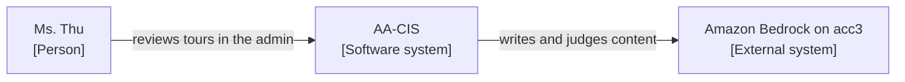

# Docs style guide

Short rules for every page in the [doc catalog](README.md). Templates are in [`templates/`](templates/); the
front-matter schema is [`templates/frontmatter.schema.json`](templates/frontmatter.schema.json). The root workflow
`.github/workflows/docs-lint.yml` (AA-888) checks these rules on every docs PR; run the same checks locally with
[`tools/docs/`](../tools/docs/README.md).

## Voice and structure

1. Second person, active voice, present tense. Steps are imperative: "Run the migration".
2. One idea per sentence, about 25 words at most. Paragraphs of four sentences at most.
3. Condition first, then action: "If the deploy gate fails, re-run ...".
4. Drop "simply", "just", "obviously", "you can", "there is".
5. Do not pre-announce. A feature that is not live goes in the backlog, not in a how-to.
6. Headings in sentence case, no final period, under 70 characters.
7. Numbered lists for sequences, bullets for sets, tables for pairs and comparisons. One action per step.
8. Dates: ISO `2026-10-19` in front-matter and technical text; `dd/mm/yyyy` only in Vietnamese text for Ms. Thư.
9. Link text names the target ("see the rollback runbook"), never "click here". Links inside a repo are relative.
10. Use the terms in the [glossary](glossary.md) and keep them: always "tenant", always "atom".

## Front-matter

- Every catalog page starts with the front-matter defined by the schema. Required: `id`, `title`, `type`, `status`,
  `owner`, `last_reviewed`. Optional: `description` (recommended), `audience`, `applies_to`, `review_every_days`
  (default 90), `last_tested`, `tested_where`, `tested_evidence`, `generated`, `generator`, `superseded_by`, `related`.
- Not used on journals (`docs/sessions/`, `docs/audits/`, `docs/implementation-notes/`, `docs/backlog/`,
  `docs/research/`, `skill/aa-lessons/lessons.md`) or on ADRs (ADRs keep their `Status` bullet).
- `last_reviewed` means "checked against the real system". An agent sets it to today only after it ran the verify
  command or read the source, and says so in the PR. A typo fix does not move the date.
- A page an agent writes from scratch starts as `status: draft` until Nghiệp has read it once (batch review at the end
  of the session is fine during the dev phase).
- Generated pages carry `generated: true`, `generator: <workflow>` and the first body line
  `<!-- GENERATED by <workflow> from <repo>@<sha> - do not edit -->`. Change them only through the generator's PR.

## Runbooks and "tested"

- A runbook is `status: active` only after it ran at least once on Dev acc2, in a drill, in a real incident or, for a
  destructive step, as a DRY RUN (`skill/aa-cis-schema/references/destructive-ops.md`). Record `last_tested`,
  `tested_where`, `tested_evidence`.
- Not run yet: `status: draft` and this banner right under the H1:

  ```markdown
  > [!WARNING]
  > UNTESTED - do not follow in an incident without checking each step.
  ```

- Every step has an expected result, a verify line and a rollback or abort line.
- Evidence (command output, JSON, screenshots) lives in `docs/audits/<date>-S<nnn>-<slug>/` (DM-8.10, C7.2b, C8a).
  `docs/ops/drills/README.md` and `docs/security/README.md` are only indexes that link there.
- Drill cadence follows DM-9.3: on Dev, re-run when the procedure changes and once before prod; quarterly from prod.
  A stale `last_tested` on Dev is a warning, not an order to re-run.

## Commands

- **AWS CLI: one command, one line.** No `\` continuation (it hangs WSL2). Put shell variables on their own line first.
- Always pass `--profile` and `--region`. Infra commands use `--profile aa365-admin --region us-west-1`; the LLM
  satellite accounts use their own profile (see the account map in [onboarding](onboarding.md)).
- The first step of every runbook is `aws sts get-caller-identity --profile aa365-admin` (AA-517: wrong-account writes).
- End a line that changes state with `# WRITE`.
- Placeholders are kebab-case in angle brackets, `<task-arn>`, with one sentence on where the value comes from.
- Code fences always carry a language tag (`bash`, `sql`, `python`, `hcl`, `json`, `yaml`, `mermaid`). No `$`
  prompt, so the line copies cleanly. Show the expected output after important commands.
- Environment variable names that contain underscores are edited by Nghiệp by hand in VSCode. Agents do not
  generate or rewrite them; refer to the variable by what it does ("the legacy admin login flag") when you can.
- Never paste a secret value, a token, a real customer record or a password. Secret **names** are fine in private repos.

```bash
aws sts get-caller-identity --profile aa365-admin
aws ecs describe-services --cluster aa-cis-dev-cluster --services aa-cis-dev-api --profile aa365-admin --region us-west-1 --query "services[0].deployments[0].rolloutState" --output text
```

## Resource IDs

- Prose uses **names** (`aa-cis-dev-db`, `aa-cis/dev/rds`, `aa-cis-dev-api`) plus a one-line lookup command, a
  Terraform output name, or a link to a generated table. No `sg-`, `subnet-`, `vpc-` IDs, task-definition revision
  numbers, snapshot IDs, API Gateway IDs or user-pool IDs in prose.
- AWS account IDs appear in one table only: the account map in [`onboarding.md`](onboarding.md). Other pages link
  to it. Exceptions: resource names that embed the account ID by convention (for example the bronze bucket),
  journals, generated files, and agent instruction files (`CLAUDE.md`, `.kiro/steering/*`, `skill/**`), whose copy
  of the table must match the onboarding one.
- Lint (AA-888, `tools/docs/check_docs_text.py resource-ids`) flags `sg-…`, `subnet-…`, `vpc-…` and similar IDs,
  standalone 12-digit numbers, ARNs with an account, user-pool IDs and API Gateway hosts outside the exempt paths.
  It **warns** in root and Infra (private) and is meant to **fail** in the public repos (`--mode error`) once their
  docs job lands. Mark a deliberate exception with `docs-lint: ignore` on the line.

## Where a page may live (SEC-06)

| Repo | Visibility | May hold | Must not hold |
|---|---|---|---|
| AA-Ecosys (root) | private | Ecosystem docs, account map, security and infra reports, audits, registers by name | Secret values, real-data dumps (`docs/backups/` is ignored and must move off the laptop, DM-6.10) |
| AA-CIS-Infra | private | Terraform docs, generated network/IAM/alarm tables, `db/` runbooks | Secret values |
| AA-CIS-App, AA-Booking, AA-TripPlanner-Web | **public** | CONTEXT.md, app ADRs, public-safe how-tos and deploy pages, LLM docs without tenant data | Account IDs, ARNs, SG/VPC IDs, inventories, secret lists, security or infra reports (D-14, D-25, DM-6.10) |

A security or infra finding about a public app is written in root (`docs/audits/` or `docs/security/`) and the app
page links to nothing more specific than "see the private ops docs".

## Language

- Technical docs (architecture, how-to, runbook, reference, ADR, templates): **English**
  (`.kiro/steering/language-convention.md`).
- **Exception: the CEO guide and the role guides (`guides/*.md`) are bilingual EN-VI**, the same content in both
  languages (English then Vietnamese for each section, or two columns in a table), none missing a point (N-7,
  `language-convention.md`). The translation work is AA-897.
- Business-facing summaries for Ms. Thư (cost report summary, release-note business part, postmortem business
  summary) are Vietnamese, plain, without internal Linear keys.
- Kept Vietnamese by convention: session logs and Notion memory; advisory audits for Nghiệp in `docs/audits/`.
- The glossary carries an EN and a VI term column. Technical docs are not translated wholesale.

## Callouts

Use GitHub alerts, at most two per screen:

```markdown
> [!NOTE]
> Extra information.

> [!TIP]
> A better way.

> [!WARNING]
> Can break something or cost money.

> [!CAUTION]
> Data loss, prod impact or not reversible.
```

## Diagrams

- Diagram as code first: Mermaid (GitHub renders it). Fifteen nodes at most per diagram.
- C4: level 1 (system context) and level 2 (containers) live in `ecosystem-architecture.md`; level 3 only for complex
  areas such as the CIS A/T pipeline; no level 4. Mermaid's `C4Context` syntax is experimental, so draw C4 with a
  `flowchart` and C4 labels:



- Screenshots only for UI how-tos (mostly for Ms. Thư and UAT): cropped, alt text, capture date in the caption,
  PNG or WebP under 300 KB. UAT videos stay on Google Drive; docs link to them.

## Naming

- File names are English kebab-case by content (`rollback-cis.md`), never by issue key. Issue keys belong only in
  `docs/implementation-notes/<ISSUE>.md`.
- Do not create empty section folders. Add a folder `README.md` when the folder holds at least two real pages.

## Deprecate and archive

- An outdated page gets `status: deprecated`, `superseded_by` and a warning line at the top naming its replacement.
- After one quarter unused, it moves to `docs/archive/YYYY/` with `status: archived`.
- ADRs are never archived: they are superseded or amended only.
