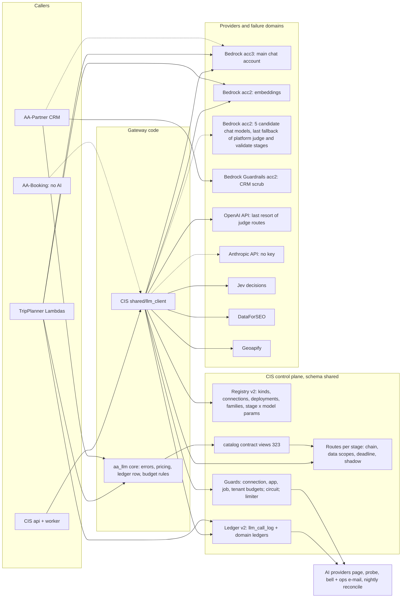

# AI gateway (as built)

> **Status:** as built on 2026-11-01 (S263). CIS migrations 319–324, TripPlanner tp-023 and CRM crm-035 are applied
> on Dev. Live facts were checked on that day: ECS task definitions, the Secrets Manager secret names (names only), the
> Bedrock guardrail list and `/health/ready` of each app. The decisions behind this page are in
> [ADR 0009](../adr/0009-ai-platform-and-provider-gateway.md); this page says what of them runs today. The full stage
> list is the [AI Use Register](ai-use-register.md); the current routes are in
> [`generated/llm-routes.md`](../generated/llm-routes.md) (snapshot of 2026-10-29: routes current, but its model
> catalog predates migration 324 and lacks the five acc2 candidates; recapture tracked in the backlog).

## 1. What the gateway is

One gateway handles every paid AI and data call of the ecosystem. It is not a service in the call path: it is a
library plus a control plane.

- **The control plane lives in CIS.** Its tables in schema `shared` hold the provider registry, the routes per stage,
  the data scopes, the budgets, the circuit state and the ledger. The CIS admin page **AI providers**
  (`/admin/ai-gateway`) shows and edits what may be edited.
- **The call path runs inside each app.** CIS calls it as `shared/llm_client/`. TripPlanner and the CRM vendor the
  pure core `aa_llm` (standard library only) as a byte copy and keep their own adapters.
- **Every attempt writes one ledger row**, including refused and failed attempts at 0 USD. The ledger is the source of
  truth for cost, latency and outcome.

| Caller | How it calls | Config it reads | Ledger it writes |
|---|---|---|---|
| CIS (api + `shared.job` worker) | `LLMClient.generate(stage=…)`, `embed(stage, texts)`, plus the Jev, DataForSEO and Geoapify clients that read their registry rows | `shared.*` registry tables directly | `shared.llm_call_log` (ledger v2, `app = 'cis'`), plus the domain ledgers `decision_log`, `dfs_call_log`, `geo.geocode_call` |
| TripPlanner (browse, assembly, jobs Lambdas) | `backend/shared/llm_gateway.py` on the vendored core `backend/aa_llm/` | `catalog.v_llm_gateway_config_v1` and `catalog.v_llm_app_spend_today_v1` (CIS 323) | `shared.llm_call_log` (INSERT only, `app = 'tripplanner'`) |
| AA-Partner CRM (api + `crm.job` worker) | the CRM gateway on the vendored core `app/aa_llm/` | its own control plane in schema `crm` (root ADR 0008a §6) | `crm.llm_call` (ledger v2 shape, `app = 'crm'`, crm-032); CIS sees it only through `crm.ops.v1` |
| AA-Booking | no AI call today | — | — (any future AI goes through CIS jobs or the shared core, ADR 0009 decision 13) |

## 2. Diagram

Solid lines are live on Dev; dashed lines are built but switched off, or planned.

The AWS-icon deployment views of each app are in the [architecture diagrams](diagrams/README.md).

## 3. Registry v2

Migrations 304, 306, 307, 320 and 322 (AA-1002, AA-1017).

- **Provider kinds:** `bedrock`, `anthropic`, `openai`, `azure_openai`, `mock` (LLM kinds) and `typesafe` (Jev),
  `dataforseo`, `geoapify`, `bedrock_guardrails` (provider kinds). The LLM dispatch never sees a provider kind.
- **Connection** (`shared.llm_provider_connection`): one way in (an account and region, or an API endpoint and a
  secret name). It carries timeouts, retries, limits (`max_concurrency`, `rpm_limit`, `daily_credit_limit`), a
  monthly budget, `data_scope` (`aws_only` or `vendor_direct`), `failure_domain`, `served_roles`, `access_state`,
  `last_probe_at`, `balance_source` and `low_balance_usd`.
- **Secret guard per kind:** LLM kinds accept only secret names under `aa-llm/<env>/`, provider kinds only
  `aa-cis/<env>/<kind>`, and each kind has a host allow-list. Both are code constants and CHECK constraints.
- **Deployment** (`shared.llm_model_deployment`): a catalog model on a connection, with wire id, priority,
  `api_style`, price overrides and request defaults.
- **Model family** (`shared.llm_model_family`): the maker (Anthropic, OpenAI, Amazon, Meta, Moonshot, Cohere, Jev).
  Catalog rows carry `family` and `capabilities` read as data (prompt cache, forced tool choice, cache minimum,
  default effort).
- **Stage × model parameters** (`shared.stage_model_params`): max tokens, minimum output tokens, temperature, effort
  and reasoning mode. Precedence: call site, then the row, then the protocol default. With no row a request is
  unchanged.
- **Edits:** secret names, base URLs and catalog prices change only by migration (322 revoked the runtime role's
  UPDATE on them). The admin may switch a connection on or off and edit limits, budgets and notes; each change is
  audited. Migration 324 proved "add a model = one migration PR": five acc2 chat models with one enabled acc2
  deployment each and no route.

## 4. Routing

- **Route per stage** (`shared.llm_role_config`): a primary model, ordered fallbacks, an optional shadow at a sample
  rate, `allowed_scopes` (migration-only, AA-1002 S5) and `route_deadline_s` (320; NULL on every row today).
- **Order of attempts:** the same model on its next deployment by priority, skipping open circuits and connections
  over budget, then the next model of the route, then a typed error. A route lists every model it may use; nothing
  falls back silently across families.
- **Legacy keys:** `haiku` and `sonnet` still reach acc3 through the legacy chain, inside the breaker since AA-1018
  part 2. The aliases that replace them (`shared.llm_model_alias`, 307) stay off until a live check; the legacy paths
  log `llm_deprecated_path_used` with a proposed removal date of 2026-12-31.
- **Data scopes** (CIS ADR 0012): a stage's content may use only connections whose `data_scope` its
  `allowed_scopes` lists. Writer stages are `aws_only`; the Anthropic and OpenAI API connections are `vendor_direct`.

## 5. Guards

| Guard | Where | Rule |
|---|---|---|
| Connection budget | `connection_budget.py`, policy `shared.llm_connection_cost_policy` (317) | Month-to-date ledger spend of the connection; alert at 80 %, hard stop at 100 % of `monthly_budget_usd` by default |
| App budget | TripPlanner `TP_DAILY_SPEND_CAP_USD` (5 USD on Dev, set by Infra) through `catalog.v_llm_app_spend_today_v1` | Fails closed when the spend cannot be read |
| Job and stage budget | `shared.spend_budget`, `cost_guard.RunBudget` | Jev and DataForSEO caps seeded by 318 |
| App profile | `shared.llm_app_profile` (345), `app_profile.py` (AA-1025 H1a, ADR 0009 decision 4) | One row per app: AI on / off, bulk paused, default daily budget, degrade mode. AI off for `cis`: every CIS AI call (chat, embed, connection test, Jev) is refused before it is sent, a 0 USD `refused` / `disabled` row; jobs wait for the re-queue. No row or unreadable = AI on. TripPlanner and the CRM read their row later (H1b / H1c) |
| Tenant budget | `shared.tenant_ai_budget` (321), `tenant_budget.py` (AA-1016) | Bell + ops e-mail at `alert_pct`; with `hard_stop`, T-stage jobs stop `stopped_budget` at `approval_pct` and wait for staff approval, then the bulk re-queue. No row = no budget. The CRM keeps its own hard per-agency monthly budget, alerts at 75 / 90 / 100 % (crm-032), capped by `AI_BUDGET_MAX_USD` |
| Circuit breaker | `breaker.py`, `shared.llm_provider_health` (309) | One circuit per deployment, shared across tasks; a connection-level circuit derived from it trips on account-wide signals (one `credential` or `quota_exhausted`, or `access_denied` on two models) |
| Limiter | per process | `max_concurrency` and `rpm_limit` of the connection |
| PII scrub | CRM F3 scrubber (crm-009): known values, regex, then Bedrock Guardrails | Fails closed; the guardrail call is a ledger row with role `guard` |

A provider spend-limit refusal (Anthropic tier cap, OpenAI `insufficient_quota`, Jev 402, DataForSEO 401/402) is the
error class `quota_exhausted`: the connection stops and the call is never retried as throttling.

## 6. Ledger v2 and observation

- **One row per attempt** (319, AA-804): app, stage, provider kind, connection, deployment wire id, model, family,
  tenant, job, request id, attempt number, status (`ok`, `refused`, `error`, `truncated`, `billed_unusable`),
  error class, latency, tokens (in, out, cache read, cache write, reasoning), units, cost, pricing mode,
  `prompt_hash` (sha256 of the system prompt), `prompt_version`, `is_shadow`, `is_experiment`. No prompt or completion
  text is stored (DM-6.4). Bedrock Batch records and Jev calls (role `decide` since AA-1025 D3) write rows too.
- **Read federated** (ADR 0009 decision 8 as amended in S264, DM-10.4): DataForSEO and Geoapify keep their domain
  ledgers (`shared.dfs_call_log`, `geo.geocode_call`) with the contract's status, latency, app and stage (CIS 319 /
  346); Jev's per-question verdicts stay in `shared.decision_log`. The Calls tab, the trace and Providers read every
  ledger side by side; nothing is copied into one table.
- **CIS admin, AI providers** (`/admin/ai-gateway`): tabs Providers (connections, Jev credit, availability),
  Routing, Models & trials (families, shadow report, the read-only Experiments section), Budgets (every cap layer,
  tenant budgets), Calls (ledger search) and Guide; the **Trace drawer** shows every attempt of a job or tour in time
  order. **Cost Operations** (`/admin/cost-ops`) holds the money view, with the "AI & data spend" tab built from the
  ledger.
- **Daily probe:** job kind `llm_connection_probe`, one small Test call per enabled text deployment (at most 30), daily
  from 05:00 UTC. It is **on** on Dev (`LLM_DAILY_PROBE=on` on the CIS api and worker, Infra #574). Each probe writes
  `access_state` and `last_probe_at`.
- **Alerts:** when a connection circuit opens, one admin bell and one ops e-mail (`llm_circuit_open`, provider text
  masked of ARNs and account IDs); budget alerts use the same bell and e-mail.
- **Re-queue:** `POST /admin/job-runner/jobs/retry-llm-denied` re-queues failed jobs refused with
  `llm_access_denied` (or held with `tenant_ai_budget_approval`) once their connection answers again; dry run by
  default, at most 50 per apply.
- **Nightly reconcile:** job kind `llm_cost_reconcile` compares logged cost with the provider's figure per connection
  and day (Bedrock from the stored Cost Explorer snapshot).
- **Failure-domain invariant:** report-only on Dev (`invariant.py`, in `/admin/llm-availability` and the OPS-12
  digest): every stage class should have an enabled, funded deployment in another failure domain, or a declared
  degrade mode.

## 7. Shared core `aa_llm`

- Canonical source: AA-CIS-App `shared/aa_llm/` (AA-642 S8): error classes, pricing (`quote` with the catalog passed
  in), the ledger v2 row and its INSERT, the budget decision, and the 323 contract SELECTs. Standard library only, so a
  byte copy runs in every app.
- Copies: TripPlanner `backend/aa_llm/` and AA-Partner `app/aa_llm/`, each pinned by a lock file with the manifest
  hash. Nobody edits a copy: a change merges in CIS, then the **Llm Core Sync** bot opens the consumer PRs
  (root wrapper `tools/llm-core/llm-core-sync.sh`). A parity test in CIS pins `shared/llm_client` and the core to the
  same results.

## 8. Live and planned

Checked on 2026-11-01 unless the row says otherwise.

| Item | State | Evidence or next step |
|---|---|---|
| Ledger v2 (319), registry v2 (320, 322), tenant budget and prompt register tables (321), contract views (323), acc2 candidates (324) | **Live** on Dev | CIS `/health/ready` `schema_version` 324 |
| Circuit breaker, connection circuit, alerts, route deadline support, re-queue | **Live** (code); `route_deadline_s` NULL on every route | AA-1002 S4, AA-1018 |
| Daily probe of every enabled connection | **Live**, on | `LLM_DAILY_PROBE=on` in the CIS api and worker task definitions |
| acc3 Bedrock (main chat account) | **Refusing** since 2026-10-29 (Error 002, every model); the connection circuit and the probe show it | Provider case open; [postmortem](../ops/postmortems/2026-10-29-acc3-bedrock-access-refusal.md) |
| acc2 Bedrock embeddings (Cohere Embed v4) | **Live** | Used by CIS and TripPlanner search |
| acc2 Bedrock candidate chat models (Nova Lite, Nova 2 Lite, Llama 4 Maverick, Llama 4 Scout, Kimi K3) | **Last fallback of the eight platform judge / validate stages that reached acc3 only** (CIS migration 331, AA-1026 I6: Nova Lite; Llama 4 Scout for the place card check). Never on writers; tenant judge / validate stages wait for CIS migration 332 and the tech lead's yes (decision 14 keeps acc2 off tenant stages until decision 10 and AA-820) | Format checked per stage by the contract smoke (CIS job `llm_contract_smoke`), which 331 requires before it changes a stage; judge calibration and A/B of the ladder (ADR 0009 decision 12, AA-900) skipped by the S263 amendment of decision 14, so a brand audit `pass` answered on acc2 is held as `manual_check` (`BRAND_AUDIT_UNCALIBRATED_JUDGE`). The [generated route table](../generated/llm-routes.md) lists the change under its known gaps until the recapture (AA-1020 follow-up) |
| OpenAI API (`openai-direct`) | Key present (`aa-cis/dev/openai-key`); last resort of the judge routes only | Monthly cap still to be stated and approved (ADR 0009 decision 14) |
| Anthropic API (`anthropic-direct`) | **Not live:** no `aa-llm/` secret exists; deployments seeded behind acc3 (306) with the connection off | The tech lead creates the key with a workspace spend limit; then the secret is stored and the connection switched on (runbook [llm-anthropic-api-key](../ops/runbooks/llm-anthropic-api-key.md)) |
| Jev, DataForSEO, Geoapify as registry rows (322) with ledger rows | **Live** | Settings come from their rows, else env, else the old constants |
| Bedrock Guardrails | **Live for the CRM scrub** (guardrail `aa-crm-dev-scrub`); the CIS registry row is seeded off | — |
| TripPlanner on the shared core and the 323 views | **Live** (code on `main`); the grandfathered SELECT on `shared.llm_role_config` / `llm_model_catalog` is still granted | A later CIS migration revokes it (ADR 0009 decision 13) |
| CRM gateway v2 (crm-032 ledger, vendored core) | **Live, stub provider:** no `CRM_LLM_*` variable is set on Dev, so CRM AI drafting runs the deterministic stub | Real provider needs `CRM_LLM_PROVIDER` and the role, Bedrock only (root ADR 0008a) |
| Tenant AI budget (Content studio) | **Live** (code and table); a tenant without a row has no budget | Amounts come from the business owner's plan prices |
| App profile (345) and the geocode ledger columns (346) | **Built** (AA-1025 D3 / H1a, S264); live once the migrations are applied and the CIS code PR is deployed | Live check: AI off for `cis`, one connection test refused at 0 USD, AI back on |
| Prompt register | Table live; until a migration registers versions, `prompt_version` is NULL | A migration inserts the first versions (`scripts/prompt_registry_check.py --sql`) |
| Stage × model parameters | Table live, no rows at its release (AA-1017) | Filled when a trial needs it |
| Legacy aliases (`LLM_LEGACY_ALIASES`) | **Off** | Switch after a live check; legacy paths proposed for removal 2026-12-31 |
| Warm independent path per stage class (decision 5 invariant) | **Not met** for writer stages | Needs the Anthropic key, or a declared degrade mode |
| Monthly failover drill | **Not scheduled** | Starts once both direct APIs are funded |
| Second region for eval connections | Not decided | ADR 0009 "Not decided here" |
| HTTP gateway service | Deferred | Reconsidered when three apps call it in production (decision 13) |

## 9. Where to change what

| Change | How |
|---|---|
| A new model on a known provider kind | One migration PR in CIS: catalog row with price and family, a deployment, no route (the 324 pattern), then the qualification ladder |
| A route | Admin AI providers › Routing within the rules (scopes, last-resort position); a writer route needs the tech lead's yes |
| A secret name, base URL, price or data scope | Migration only |
| A budget or limit | Admin AI providers › Budgets or the connection drawer (audited) |
| The shared core | CIS `shared/aa_llm/`, then the Llm Core Sync PRs in TripPlanner and AA-Partner |
| A new provider kind | An adapter in code plus a migration (ADR 0009 decision 9) |

## 10. Sources

- Decisions: [ADR 0009](../adr/0009-ai-platform-and-provider-gateway.md), CIS ADR 0005, 0006, 0008 and 0012, root
  ADR 0008a §5–6 (CRM).
- Implementation notes in AA-CIS-App `docs/implementation-notes/`: `AA-1002.md` (slices S1–S10), `AA-804-ledger-v2.md`,
  `AA-1017.md`, `AA-1017-w4a-mig324.md`, `AA-1018.md`, `AA-642-s8.md`.
- Repo context: AA-CIS-App, AA-TripPlanner-Web and AA-Partner `CONTEXT.md` (sections on the AI gateway).
- Column names: [`db-schema-reference.md`](db-schema-reference.md).
