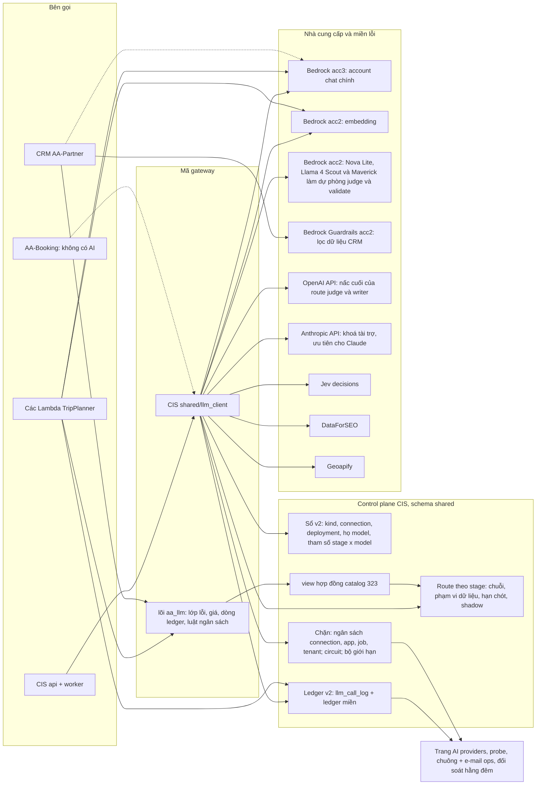

# Cổng AI (hiện trạng)

> **Trạng thái:** hiện trạng ngày 2026-11-01 (S263), cập nhật ngày 2026-11-03 (S265) và ngày 2026-11-05 (S270: route
> control phiên bản 6, khoá Anthropic API, CIS 376). Đã áp trên Dev ngày 2026-11-03, đọc từ `/health/ready` của từng
> API: CIS mọi migration tới 346 trừ file contract đang giữ 336, TripPlanner tp-023 và CRM crm-040; CIS 370 tới 376
> ngày 2026-11-04 và 2026-11-05. Sự thật live ngày 2026-11-01: task definition ECS, tên secret Secrets Manager (chỉ
> tên), danh sách guardrail Bedrock. Kết quả kiểm live của các lát S264 (340, 342, 343, 345) nằm trong log phiên S264.
> Các quyết định đứng sau trang này nằm ở [ADR 0009](../adr/0009-ai-platform-and-provider-gateway.md); trang này nói
> phần nào trong đó đang chạy hôm nay. Danh sách đầy đủ các stage là [AI Use Register](ai-use-register.md); route,
> connection và thứ tự nhà cung cấp hiện tại nằm ở [`generated/llm-routes.md`](../generated/llm-routes.md) (một bản
> chụp; thời điểm chụp ghi trên trang đó).
>
> **Đọc trạng thái live ở đâu:** trang admin CIS cổng AI › **Hướng dẫn** (`/admin/ai-gateway?tab=guide`) hiện trang này
> và, bên dưới, các bảng đọc trực tiếp từ gateway: route của mọi stage cùng deployment sẽ phục vụ trước tiên, ma trận
> model × connection, sổ connection (chỉ tên secret), trần chi phí của connection và độ phủ stage. Khi trang này và các
> bảng đó khác nhau, các bảng đúng. Một check CI (docs lint "AI gateway guide names") báo lỗi khi trang này nêu một
> stage, model, connection hay secret không còn tồn tại.

## 1. Cổng AI là gì

Một cổng xử lý mọi lời gọi AI và dữ liệu có trả phí của hệ sinh thái. Nó không phải một service nằm trên đường gọi: nó
là một thư viện cộng một control plane.

- **Control plane nằm trong CIS.** Các bảng của nó trong schema `shared` giữ sổ nhà cung cấp, route theo stage, phạm vi
  dữ liệu, ngân sách, trạng thái circuit và sổ cái (ledger). Trang admin CIS **AI providers** (`/admin/ai-gateway`)
  hiện và cho sửa những gì được phép sửa.
- **Đường gọi chạy bên trong từng app.** CIS gọi nó dưới dạng `shared/llm_client/`. TripPlanner và CRM vendor phần lõi
  thuần `aa_llm` (chỉ thư viện chuẩn) dưới dạng bản sao từng byte và giữ adapter riêng.
- **Mỗi lần thử ghi một dòng ledger**, kể cả lần bị từ chối và lần lỗi, ở 0 USD. Ledger là nguồn sự thật về chi phí,
  độ trễ và kết quả. Một ngoại lệ (AA-1042, CIS #1332): nấc route có circuit đang mở sau một lần bị từ chối (không có
  quyền, hết hạn mức, thông tin xác thực) được dời lại, không gọi và không ghi dòng riêng; nó được liệt kê trong
  `quality_signal.route_skips` của dòng được trả lời. Khi không nấc nào còn sống trả lời, các nấc bị dời được thử sau
  cùng và ghi dòng như trước.

| Bên gọi | Gọi thế nào | Đọc cấu hình nào | Ghi ledger nào |
|---|---|---|---|
| CIS (api + worker `shared.job`) | `LLMClient.generate(stage=…)`, `embed(stage, texts)`, cùng các client Jev, DataForSEO và Geoapify đọc dòng sổ của chúng | đọc thẳng các bảng sổ `shared.*` | `shared.llm_call_log` (ledger v2, `app = 'cis'`), cùng các ledger miền `decision_log`, `dfs_call_log`, `geo.geocode_call` |
| TripPlanner (các Lambda browse, assembly, jobs) | `backend/shared/llm_gateway.py` trên lõi vendor `backend/aa_llm/` | `catalog.v_llm_gateway_config_v1`, `catalog.v_llm_app_spend_today_v1` (CIS 323), `catalog.v_llm_app_profile_v1` (CIS 347) | `shared.llm_call_log` (chỉ INSERT, `app = 'tripplanner'`) |
| CRM AA-Partner (api + worker `crm.job`) | gateway CRM trên lõi vendor `app/aa_llm/` | control plane riêng trong schema `crm` (ADR gốc 0008a §6) | `crm.llm_call` (dạng ledger v2, `app = 'crm'`, crm-032); CIS chỉ thấy nó qua `crm.ops.v1` |
| AA-Booking | hôm nay không gọi AI | — | — (AI sau này đi qua job CIS hoặc lõi dùng chung, ADR 0009 quyết định 13) |

## 2. Sơ đồ

Đường liền đang chạy trên Dev; đường nét đứt đã xây nhưng đang tắt, hoặc dự kiến.

Các góc nhìn triển khai có biểu tượng AWS của từng app nằm trong [sơ đồ kiến trúc](diagrams/README.md).

## 3. Sổ v2

Migration 304, 306, 307, 320 và 322 (AA-1002, AA-1017).

- **Loại nhà cung cấp:** `bedrock`, `anthropic`, `openai`, `azure_openai`, `mock` (loại LLM) và `typesafe` (Jev),
  `dataforseo`, `geoapify`, `bedrock_guardrails` (loại provider). Phần dispatch LLM không bao giờ thấy loại provider.
- **Connection** (`shared.llm_provider_connection`): một đường vào (một account và region, hoặc một endpoint API và một
  tên secret). Nó mang timeout, số lần thử lại, giới hạn (`max_concurrency`, `rpm_limit`, `daily_credit_limit`), ngân
  sách tháng, `data_scope` (`aws_only` hoặc `vendor_direct`), `failure_domain`, `served_roles`, `access_state`,
  `last_probe_at`, `balance_source` và `low_balance_usd`.
- **Chặn secret theo loại:** loại LLM chỉ nhận tên secret dưới `aa-llm/<env>/`, loại provider chỉ `aa-cis/<env>/<kind>`,
  và mỗi loại có một danh sách host được phép. Cả hai là hằng số trong code và ràng buộc CHECK.
- **Deployment** (`shared.llm_model_deployment`): một model của catalog trên một connection, với wire id, độ ưu tiên,
  `api_style`, giá ghi đè và giá trị mặc định của request.
- **Họ model** (`shared.llm_model_family`): hãng làm model (Anthropic, OpenAI, Amazon, Meta, Moonshot, Cohere, Jev).
  Dòng catalog mang `family` và `capabilities`, đọc như dữ liệu (prompt cache, ép chọn tool, mức cache tối thiểu,
  effort mặc định).
- **Tham số stage × model** (`shared.stage_model_params`): max tokens, số token ra tối thiểu, temperature, effort và
  chế độ reasoning. Thứ tự ưu tiên: chỗ gọi, rồi dòng này, rồi mặc định của giao thức. Không có dòng thì request giữ
  nguyên. TripPlanner đọc dòng này qua cột `stage_params` của `catalog.v_llm_gateway_config_v1` (CIS 350, AA-1027 E4)
  và áp temperature (khi catalog nói model nhận nó); các chỗ gọi của nó luôn đặt max tokens, và giá trị đó thắng. Nó
  không gửi trường effort hay reasoning: mọi lời gọi của TripPlanner đi tới Bedrock, và cũng như CIS (effort chỉ có ở
  Anthropic Messages API), trường này chỉ được thêm trên Bedrock sau khi một probe cho thấy nó được nhận.
- **Sửa đổi:** tên secret, base URL và giá catalog chỉ đổi bằng migration (322 thu hồi quyền UPDATE của role runtime
  trên chúng). Admin được bật tắt một connection và sửa giới hạn, ngân sách và ghi chú; mỗi thay đổi được ghi audit.
  Migration 324 chứng minh "thêm một model = một PR migration": năm model chat acc2, mỗi model một deployment acc2 đang
  bật và không có route. Sau đó migration 331–333 và 339 đưa ba model trong số đó làm dự phòng của route (§8).

## 4. Định tuyến

- **Route theo stage** (`shared.llm_role_config`): một model chính, các model dự phòng theo thứ tự, một shadow tuỳ
  chọn theo tỉ lệ lấy mẫu, `allowed_scopes` (chỉ đổi bằng migration, AA-1002 S5), `route_deadline_s` (320; đặt theo vai
  trò ở 334: writer 1200 s, judge 900 s, validate 600 s, embed 120 s) và công tắc tắt stage cùng chế độ xuống cấp đã
  khai báo (326).
- **Thứ tự các lần thử:** do **order mode** quyết định (`shared.llm_route_settings.order_mode`, CIS 370; biến môi
  trường `LLM_ROUTE_AWS_FIRST` chỉ là mặc định lúc khởi động khi chưa đọc được dòng đó):
  - `model_first` (mặc định, tech lead S267, sửa đổi quyết định 5 của ADR 0009): mọi deployment của một model, theo
    **thứ tự nhà cung cấp** (`shared.llm_model_deployment.priority`, số nhỏ trước), rồi tới model kế tiếp của route;
  - `aws_first`: mọi deployment AWS của mọi model trong route, rồi mới tới các deployment vendor API.
  Circuit đang mở, connection vượt ngân sách và dòng đang tắt bị bỏ qua; sau nấc cuối, hoặc sau tổng cộng sáu lần thử
  (`errors.MAX_CHAIN_ATTEMPTS`), là một lỗi có kiểu. Một route liệt kê mọi model nó được dùng; không có dự phòng ngầm
  sang họ model khác.
- **Key cũ:** từ migration 327 không route nào nêu `haiku` hay `sonnet`: mọi stage chuyển sang key Converse cùng hạng
  (`haiku-5-5`, `sonnet-5-5`). Dòng catalog vẫn giữ; bên gọi nào còn truyền key cũ sẽ tới acc3 qua chuỗi cũ, nằm trong
  breaker (AA-1018 phần 2), và ghi log `llm_deprecated_path_used` (đề xuất gỡ ngày 2026-12-31). Các alias của 307
  vẫn tắt.
- **Phạm vi dữ liệu** (CIS ADR 0012): nội dung của một stage chỉ được dùng các connection có `data_scope` nằm trong
  `allowed_scopes` của nó. Connection Anthropic API và OpenAI API là `vendor_direct`. Các writer dòng A (327) và sáu
  writer của tenant (344) lúc đầu cho phép `{aws_only, vendor_direct}` với model OpenAI API `gpt-6-luna-openai` làm dự
  phòng cuối. Từ migration 366 ("ưu tiên AWS, không chỉ AWS", tech lead S267) mọi stage văn bản đang chạy cho phép cả
  hai phạm vi, nên mỗi stage tới được Anthropic API cho các model Claude của nó và OpenAI API cho bản sinh đôi GPT; chỉ
  các stage embedding còn `aws_only`. Gateway riêng của TripPlanner vẫn chỉ gọi Bedrock, và CRM định tuyến trong
  gateway riêng của nó.

### 4.1 Route control (admin, không cần deploy)

Trang admin cổng AI › **Route control** (`/admin/ai-gateway?tab=controls`, AA-1042, CIS 370) đổi định tuyến mà không
cần deploy. Gateway nhận thay đổi trong khoảng 20 giây (mỗi process đọc lại dòng cài đặt mỗi 20 s và bỏ cache route
khi số phiên bản đổi).

- **Sửa được gì:** order mode, chuỗi của mọi stage (model chính và dự phòng, kéo thả) và thứ tự nhà cung cấp của mọi
  model có hơn một deployment.
- **Preset:** "Prefer Anthropic API for Claude (sponsored)" (`prefer_anthropic_api`) đưa deployment Anthropic API
  (`anthropic-direct`) của mọi model Claude lên đầu và đặt order mode thành `model_first`; "Prefer AWS" (`prefer_aws`)
  đưa các deployment AWS của mọi model lên đầu. Preset không bao giờ đổi chuỗi.
- **Xem trước khi lưu:** server đi qua mọi stage đang chạy với cấu hình đề xuất (cùng bộ phân giải $0 như
  `scripts/llm_ops/route_chain_check.py`, không gọi model) và trả về model và nhà cung cấp sẽ phục vụ trước tiên, cạnh
  cái đang có hiệu lực. "Phục vụ trước tiên" bỏ qua deployment mà account đã từ chối theo hồ sơ (probe hoặc breaker,
  đúng luật của thẻ Stage coverage) và liệt kê nó kèm lý do, nên một model chính bị từ chối không bao giờ hiện là cái
  phục vụ.
- **Luật ở mọi lần lưu, xem trước, preset và revert (phía server):** một model chọn được cho stage (luật họ model,
  catalog, phạm vi dữ liệu); model chỉ tới được qua vendor API nằm ở cuối chuỗi hoặc ngay sau cùng model đó trên AWS;
  judge không bao giờ cùng họ với writer; hai vế của một cặp kiểm tra thuộc hai hãng khác nhau; tối đa sáu lần thử mỗi
  request (`attempt_cap`); mọi stage đang chạy giữ một model sẽ được gọi ngay bây giờ. Luật mà cấu hình live đã vi phạm
  sẵn chỉ là cảnh báo, không phải lỗi. Đổi chuỗi của writer hay judge cần một lượt eval hoặc lý do break-glass (break
  glass rung một chuông admin).
- **Phiên bản:** mọi thay đổi route, kể cả sửa ngay trên tab Routing, là một dòng của
  `shared.llm_route_config_version` với ai, khi nào, hành động (save, preset, revert, baseline, external), ghi chú, bản
  chụp (order mode, chuỗi, độ ưu tiên) và phần khác biệt. Thay đổi làm ngoài admin (một migration) được ghi thành phiên
  bản `external` trước lần đổi kế tiếp trong admin. Revert khôi phục một bản chụp cũ thành phiên bản mới, ghi audit trong
  `acp_shared.audit_log`. Shadow, công tắc stage, phạm vi dữ liệu và trần chi phí giữ điều khiển riêng và không thuộc
  một phiên bản.
- **Ở mọi lời gọi:** mỗi dòng ledger CIS mang `route_config_version`, phiên bản có hiệu lực khi dòng được ghi (một
  trigger BEFORE INSERT; dòng của TripPlanner để NULL). Trong 20 s sau một thay đổi, một dòng có thể ghi phiên bản mới
  cho lời gọi được định tuyến theo phiên bản trước.
- **Ai:** đọc cần `spend.read`; xem trước và mọi thao tác ghi cần `ai.admin` (admin và ai_ops). Người chỉ đọc thấy
  route, preset và phiên bản, không có nút điều khiển.

**Trạng thái trên Dev (2026-11-05, S269).** Khoá Anthropic API được tài trợ đã lưu (`aa-llm/dev/anthropic-direct`) và
connection `anthropic-direct` đang bật, ngân sách 150 USD mỗi tháng có dừng cứng.

- **Phiên bản 4:** preset `prefer_anthropic_api`. Các model Claude 5.x (`haiku-5-5`, `sonnet-5`, `sonnet-5-5`,
  `opus-5-5`) gọi Anthropic API trước và acc3 sau.
- **CIS 376:** năm model catalog chỉ tới được qua Anthropic API (`fable-5-1`, `fable-5`, `opus-5`, `opus-4-8`,
  `opus-4-7`); bật `opus-4-6` và `opus-4-5` (dòng acc3 của chúng vẫn tắt); chín deployment `anthropic-direct` mới ở độ
  ưu tiên 100, sau AWS. Trần sáu lần thử khiến 20 chuỗi theo họ model bỏ nấc Claude thấp nhất; nấc cuối của hãng khác
  vẫn giữ. Chưa stage nào định tuyến tới Sonnet 5, Opus hay Fable.
- **Phiên bản 6 (đang có hiệu lực):** áp lại `prefer_anthropic_api`, nên `haiku-4-5`, `sonnet-4-6`, `opus-4-6` và
  `opus-4-5` cũng gọi API trước.
- **Quay lại AWS trước:** áp preset Prefer AWS. Revert về phiên bản 3 tới 5 bị `attempt_cap` từ chối từ 376 (chuỗi của
  chúng dài hơn một nấc).

## 5. Các lớp chặn

| Lớp chặn | Ở đâu | Luật |
|---|---|---|
| Ngân sách connection | `connection_budget.py`, chính sách `shared.llm_connection_cost_policy` (317) | Chi tiêu ledger của connection từ đầu tháng; mặc định cảnh báo ở 80 %, dừng cứng ở 100 % của `monthly_budget_usd` |
| Ngân sách app | TripPlanner: `default_daily_budget_usd` trong app profile của nó (CIS 347 `catalog.v_llm_app_profile_v1`, mọi stage `tp_*`) khi có đặt, nếu không thì `TP_DAILY_SPEND_CAP_USD` (5 USD trên Dev, các stage online); chi tiêu qua `catalog.v_llm_app_spend_today_v1`; ops check CIS `llm_spend_alert.tripplanner.near/cap` (chuông + e-mail). CRM: `crm.llm_app_profile` (crm-041, gộp mọi đại lý, do admin CIS ghi qua crm.ops.v1 1.10); ops check CRM `llm_app_spend_near` / `llm_app_spend_cap` (e-mail trên topic cảnh báo nền tảng, không có chuông CIS: CIS không đọc ledger CRM) | Đóng an toàn (fail closed) khi không đọc được chi tiêu |
| Ngân sách job và stage | `shared.spend_budget`, `cost_guard.RunBudget` | Trần Jev và DataForSEO do 318 gieo |
| App profile | `shared.llm_app_profile` (345), `app_profile.py` (AA-1025 H1a, ADR 0009 quyết định 4) | Mỗi app một dòng: bật / tắt AI, tạm dừng bulk, ngân sách ngày mặc định, chế độ xuống cấp. Tắt AI cho `cis`: mọi lời gọi AI của CIS (chat, embed, test connection, Jev) bị từ chối trước khi gửi, thành một dòng `refused` / `disabled` 0 USD; job chờ được xếp lại. Không có dòng hoặc không đọc được = AI bật. TripPlanner (H1b) đọc dòng của nó qua `catalog.v_llm_app_profile_v1` (CIS 347, cache 20 s): tắt AI = một dòng refused 0 USD, lời dẫn cơ bản và tìm theo từ khoá. CRM (H1c) giữ bản riêng trong `crm.llm_app_profile` (crm-041), do admin CIS ghi qua crm.ops.v1 1.10 trước dòng CIS: tắt AI = `app_disabled` ở 0 USD, "trả lời thủ công" |
| Ngân sách tenant | `shared.tenant_ai_budget` (321), `tenant_budget.py` (AA-1016) | Chuông + e-mail ops ở `alert_pct`; với `hard_stop`, job stage T dừng `stopped_budget` ở `approval_pct` và chờ nhân viên duyệt, rồi xếp lại hàng loạt. Không có dòng = không có ngân sách. CRM giữ ngân sách tháng cứng riêng cho từng đại lý, cảnh báo ở 75 / 90 / 100 % (crm-032), giới hạn bởi `AI_BUDGET_MAX_USD` |
| Circuit breaker | `breaker.py`, `shared.llm_provider_health` (309) | Mỗi deployment một circuit, dùng chung giữa các task; một circuit cấp connection suy ra từ đó sẽ nhảy khi có tín hiệu toàn account (một `credential` hoặc `quota_exhausted`, hoặc `access_denied` trên hai model) |
| Bộ giới hạn | theo process | `max_concurrency` và `rpm_limit` của connection |
| Năng lực (TPM, làn, áp lực ngược) | `shared.llm_capacity_limit` (348), các cột tạm dừng của `shared.rerun_wave` (349), `capacity.py` (AA-1025 H2, capacity S12) | Một lời gọi là `prod`, `bulk` (wave, backfill catalogue) hoặc `dev` (ad-hoc, eval, probe). Số token của nó (prompt / 4 + `max_tokens`) được giữ chỗ trên giới hạn TPM của connection và của model, theo process; lời gọi không vừa thì chờ (prod 65 s, bulk 180 s), bulk giữ tối đa `bulk_pct` và chờ khi prod đang chờ. Circuit `prod_guard` mở: worker hoãn nhận job LLM và tạm dừng các wave đang mở (mỗi wave một chuông) tới khi circuit đóng; tạm dừng bulk của app profile làm điều tương tự cho bulk. Không có dòng = không giới hạn, không giữ |
| Lọc PII | bộ lọc F3 của CRM (crm-009): giá trị đã biết, regex, rồi Bedrock Guardrails | Đóng an toàn; lời gọi guardrail là một dòng ledger với vai trò `guard` |

Khi nhà cung cấp từ chối vì trần chi tiêu (trần hạng của Anthropic, OpenAI `insufficient_quota`, Jev 402, DataForSEO
401/402) thì đó là lớp lỗi `quota_exhausted`: connection dừng và lời gọi không bao giờ được thử lại như khi bị
throttle.

## 6. Ledger v2 và quan sát

- **Mỗi lần thử một dòng** (319, AA-804): app, stage, loại provider, connection, wire id của deployment, model, họ
  model, tenant, job, request id, số lần thử, trạng thái (`ok`, `refused`, `error`, `truncated`, `billed_unusable`),
  lớp lỗi, độ trễ, token (vào, ra, đọc cache, ghi cache, reasoning), đơn vị, chi phí, cách tính giá, `prompt_hash`
  (sha256 của system prompt), `prompt_version`, `is_shadow`, `is_experiment`. Không lưu văn bản prompt hay câu trả lời
  (DM-6.4). Bản ghi Bedrock Batch và lời gọi Jev (vai trò `decide`, AA-1025 D3) cũng ghi dòng.
- **Đọc liên kết** (ADR 0009 quyết định 8 theo sửa đổi S264, DM-10.4): DataForSEO và Geoapify giữ ledger miền của
  chúng (`shared.dfs_call_log`, `geo.geocode_call`) với trạng thái, độ trễ, app và stage theo hợp đồng (CIS 319 / 346);
  phán quyết theo từng câu hỏi của Jev vẫn ở `shared.decision_log`. Tab Calls, trace và Providers đọc mọi ledger cạnh
  nhau; không chép gì vào một bảng chung.
- **Admin CIS, AI providers** (`/admin/ai-gateway`): các tab Providers (connection, credit Jev, khả dụng), Routing,
  Route control (order mode, preset, chuỗi, thứ tự nhà cung cấp, phiên bản; §4.1), Models & trials (họ model, báo cáo
  shadow, mục Experiments chỉ đọc), Budgets (mọi lớp trần, ngân sách tenant), Calls (tìm trong ledger), Trace và Hướng
  dẫn (trang này lấy từ catalog tài liệu, theo ngôn ngữ của app, cộng các bảng live nêu ở đầu trang); **ngăn kéo
  Trace** hiện mọi lần thử của một job hay tour theo thứ tự thời gian. **Cost Operations** (`/admin/cost-ops`) giữ góc
  nhìn tiền, với tab "AI & data spend" dựng từ ledger.
- **Probe hằng ngày:** job kind `llm_connection_probe`, một lời gọi Test nhỏ cho mỗi deployment văn bản đang bật (tối
  đa 30), mỗi ngày từ 05:00 UTC. Nó **đang bật** trên Dev (`LLM_DAILY_PROBE=on` trên api và worker CIS, Infra #574).
  Mỗi probe ghi `access_state` và `last_probe_at`.
- **Cảnh báo:** khi circuit của một connection mở, một chuông admin và một e-mail ops (`llm_circuit_open`, văn bản của
  nhà cung cấp đã che ARN và account ID); cảnh báo ngân sách dùng cùng chuông và e-mail.
- **Route trace** (AA-1042): mọi dòng của một request gateway mang cùng `quality_signal.route_trace` (dòng được trả lời
  có thêm `route_position`; không phải cột ledger). Cổng AI › **Trace** hiện, theo stage, tỉ lệ request được trả lời ở
  mỗi nấc (chính = model đầu tiên trên nhà cung cấp đầu tiên của nó; dự phòng = một vị trí route sau, một nhà cung cấp
  sau của model đầu tiên, hoặc câu trả lời gateway đánh dấu `fallback_used`, nên một model dự phòng trả lời khi model
  đầu bị bỏ qua mà không thử (circuit mở, đang tắt, ngân sách) vẫn tính là dự phòng), các request với mọi lần thử (lý
  do, lớp lỗi, độ trễ, chi phí; một dòng Calls liên kết tới nó; nấc bị dời trong `route_skips` hiện thành lần thử
  `skipped`, "Không gọi: circuit mở", 0 USD) và nội dung catalog (A1) do một model dự phòng viết. Nội
  dung tenant (phiên bản T2, mẩu T9) là một lượt đọc Tenant QA, `GET /admin/content-quality/fallback-writes`
  (`tenant_content.read`), chỉ hiện trên tab cho vai trò có quyền đó. `POST /admin/ai-gateway/route-trace/test` gửi 1-6
  request thật rất nhỏ trên một stage, tuỳ chọn từ chối model đầu tiên của nó chỉ cho các request đó (không đổi breaker
  hay circuit): đó là phép kiểm live.
- **Cảnh báo route** (AA-1042): job kind `llm_route_watch` trên `shared.job` mỗi 15 phút, do bộ lấy mẫu ops của api
  xếp hàng, và một bản tổng hợp hằng ngày từ 01:00 UTC; chuông + tối đa một e-mail cho mỗi cảnh báo và mỗi ngày UTC: tỉ
  lệ dự phòng vượt ngưỡng của stage, đã chạm model cuối của route, model đầu tiên trở lại sau một cảnh báo dự phòng,
  câu trả lời dự phòng tốn hơn model chính (24 h). Ngưỡng theo stage (hoặc mặc định `*`) ở `shared.llm_route_policy`
  (CIS 371), sửa trên tab Trace; mặc định 20 % của ít nhất 5 request, 1 USD.
- **Chặn chất lượng** (AA-1042): nội dung có writer được một model dự phòng trả lời được đánh dấu trong QA (mục xuống
  cấp `fallback_writer`, chỉ admin thấy); khi bật `hold_fallback_writes` của stage, đầu ra A1 bị giữ chờ review
  (`DEGRADED_DETECTOR`), còn một phiên bản T2 (`judge_breakdown.fallback_writer.held`) hay một mẩu T9 được gắn nhãn giữ
  chỉ admin thấy (tenant vẫn nhận nó). Mặc định tắt.
- **Xếp lại hàng:** `POST /admin/job-runner/jobs/retry-llm-denied` xếp lại các job lỗi bị từ chối với
  `llm_access_denied` (hoặc bị giữ với `tenant_ai_budget_approval`) khi connection của chúng trả lời lại; mặc định chạy
  thử, tối đa 50 mỗi lần áp.
- **Đối soát hằng đêm:** job kind `llm_cost_reconcile` so chi phí đã ghi với con số của nhà cung cấp theo connection và
  ngày (Bedrock lấy từ bản chụp Cost Explorer đã lưu).
- **Usage explorer** (AA-1045): AI & spend › Usage explorer (`/admin/usage`, spend.read: admin, finance, ai_ops) gộp
  request, token, chi phí, độ trễ trung bình và p95, tỉ lệ lỗi và dự phòng (luật nấc của route trace) theo một hoặc hai
  chiều bất kỳ trong nguồn, app, sản phẩm, nhà cung cấp, connection, model, họ model, stage, vai trò, tenant, trạng thái,
  lớp lỗi, loại lưu lượng và thời gian (giờ, ngày ICT, tuần hoặc tháng), với bộ lọc chọn nhiều nằm trên địa chỉ, xuất
  CSV, góc nhìn đã lưu có tên theo từng nhân viên và một liên kết từ mỗi ô hay cột sang tab Calls với cùng khoảng thời
  gian và chiều. Nó đọc một bảng tổng hợp theo giờ (`shared.ai_usage_hourly`, CIS 372) mà job kind `ai_usage_rollup`
  dựng lại từ bốn ledger CIS mỗi 15 phút (6 giờ gần nhất được tổng hợp lại cho dòng tới muộn, idempotent theo giờ); tổng
  của nó bằng tổng của các ledger (`GET /admin/usage-explorer/rollup/check`). Tổng theo ngày của CRM (crm.ops.v1
  `GET /llm/usage`) được gộp lúc đọc cho nhóm theo ngày trở lên. Một thẻ hoá đơn đặt tháng ledger của mỗi nhà cung cấp
  cạnh con số nhà cung cấp đã lưu; chưa ghi số tiền hoá đơn nào của nhà cung cấp.
- **Bất biến miền lỗi:** chỉ báo cáo trên Dev (`invariant.py`, trong `/admin/llm-availability` và bản tổng hợp OPS-12):
  mỗi lớp stage nên có một deployment đang bật, có tiền, ở một miền lỗi khác, hoặc một chế độ xuống cấp đã khai báo.

## 7. Lõi dùng chung `aa_llm`

- Nguồn gốc: AA-CIS-App `shared/aa_llm/` (AA-642 S8): lớp lỗi, tính giá (`quote` với catalog truyền vào), dòng ledger
  v2 và lệnh INSERT của nó, quyết định ngân sách, và các SELECT hợp đồng 323. Chỉ thư viện chuẩn, nên bản sao từng byte
  chạy được trong mọi app.
- Bản sao: TripPlanner `backend/aa_llm/` và AA-Partner `app/aa_llm/`, mỗi bản được ghim bằng một file khoá có hash của
  manifest. Không ai sửa bản sao: thay đổi merge ở CIS, rồi bot **Llm Core Sync** mở PR ở các repo dùng (wrapper gốc
  `tools/llm-core/llm-core-sync.sh`). Một test đối chiếu trong CIS ghim `shared/llm_client` và lõi ra cùng kết quả.

## 8. Đã chạy và dự kiến

Kiểm ngày 2026-11-01 và cập nhật ngày 2026-11-03 (các lượt đọc `/health/ready`, bản chụp route ngày 2026-11-02 và các
phép kiểm live S264); các dòng Anthropic API, route control và tab Hướng dẫn ngày 2026-11-05. Một dòng có thể ghi khác.

| Hạng mục | Trạng thái | Bằng chứng hoặc bước kế tiếp |
|---|---|---|
| Ledger v2 (319), sổ v2 (320, 322), bảng ngân sách tenant và sổ prompt (321), view hợp đồng (323, thông tin định tuyến và trạng thái circuit thêm ở 341), ứng viên acc2 (324) | **Đang chạy** trên Dev | CIS `/health/ready` `schema_version` 346 ngày 2026-11-03 |
| Circuit breaker, circuit connection, cảnh báo, hạn chót route, xếp lại hàng | **Đang chạy**; mọi route có hạn chót theo vai trò (334) | AA-1002 S4, AA-1018, AA-1024 |
| Công tắc tắt stage và chế độ xuống cấp (326), ngân sách LLM tập trung trong `shared.spend_budget` (340) | **Đang chạy** | 340: trần `llm/app:cis` chỉ cảnh báo (phép kiểm live S264) |
| Circuit dùng chung của Jev, DataForSEO và Geoapify (342); sổ credit và cảnh báo credit thấp của các API trực tiếp (342, 343) | **Đang chạy** | Phép kiểm live S264 (chuông + e-mail, circuit đóng sau 60 s) |
| Probe hằng ngày mọi connection đang bật | **Đang chạy**, bật | `LLM_DAILY_PROBE=on` trong task definition api và worker CIS |
| Bedrock acc3 (account chat chính) | **Đang từ chối** từ 2026-10-29 (Error 002, mọi model); circuit connection và probe cho thấy điều đó | Case với nhà cung cấp đang mở; [postmortem](../ops/postmortems/2026-10-29-acc3-bedrock-access-refusal.md) |
| Embedding Bedrock acc2 (Cohere Embed v4) | **Đang chạy** | CIS và tìm kiếm TripPlanner dùng |
| Model chat ứng viên Bedrock acc2 (Nova Lite, Nova 2 Lite, Llama 4 Maverick, Llama 4 Scout, Kimi K3) | **Dự phòng của route judge và validate, không bao giờ của writer:** Nova Lite trên các stage judge / validate của nền tảng (331) và tenant (332) và trước bước nhảy sang OpenAI của route judge (333); Llama 4 Scout cho kiểm tra thẻ địa điểm; Llama 4 Maverick cho `a3_place_dedupe` (339). Nova 2 Lite và Kimi K3 không nằm trên route nào | Định dạng được contract smoke kiểm theo stage (job CIS `llm_contract_smoke`) trước mỗi thay đổi; hiệu chuẩn judge và A/B của thang (ADR 0009 quyết định 12, AA-900) bị bỏ qua theo sửa đổi S263 của quyết định 14, nên một brand audit `pass` được trả lời trên acc2 bị giữ thành `manual_check` (`BRAND_AUDIT_UNCALIBRATED_JUDGE`) |
| OpenAI API (`openai-direct`) | Có khoá (`aa-cis/dev/openai-key`); **nấc cuối** của hầu hết route judge, `a3_place_dedupe`, các writer dòng A (327) và sáu writer tenant (344); ngân sách tháng 10 USD, cảnh báo ở 80 %, dừng cứng (327) | Khi acc3 từ chối, việc viết cho tenant chạy trên nó (một `t9_write` live đã được trả lời qua nó ngày 2026-11-02); số dư lấy từ sổ credit (343) |
| Anthropic API (`anthropic-direct`) | **Đang chạy** từ 2026-11-05: khoá tài trợ lưu thành `aa-llm/dev/anthropic-direct`, connection bật, 150 USD mỗi tháng có dừng cứng; nhà cung cấp đầu tiên của mọi model Claude theo route control phiên bản 6 (§4.1) | Lưu theo runbook [llm-anthropic-api-key](../ops/runbooks/llm-anthropic-api-key.md); 13 trên 13 deployment trả lời probe ngày 2026-11-05 |
| Jev, DataForSEO, Geoapify thành dòng sổ (322) có dòng ledger | **Đang chạy** | Cài đặt lấy từ dòng của chúng, nếu không thì env, nếu không nữa thì hằng số cũ |
| Bedrock Guardrails | **Đang chạy cho bộ lọc CRM** (guardrail `aa-crm-dev-scrub`); dòng sổ CIS được gieo ở trạng thái tắt | — |
| TripPlanner trên lõi dùng chung và các view 323 | **Đang chạy**; nó chỉ đọc các view (AA-1027 E5) và đóng an toàn (không quay về đọc bảng) | CIS 351 thu hồi quyền SELECT được giữ lại trên `shared.llm_role_config` / `llm_model_catalog`; tp-024 xoá `tripplanner.llm_spend_daily` |
| Gateway CRM v2 (ledger crm-032, lõi vendor) | **Đang chạy, provider giả:** trên Dev không đặt biến `CRM_LLM_*` nào, nên việc soạn nháp AI của CRM chạy stub tất định | Provider thật cần `CRM_LLM_PROVIDER` và role, chỉ Bedrock (ADR gốc 0008a) |
| Ngân sách AI tenant (Content studio) | **Đang chạy** (code và bảng); tenant không có dòng thì không có ngân sách | Số tiền lấy từ giá gói của chủ doanh nghiệp |
| App profile (345) và các cột ledger geocode (346) | **Đang chạy** trong CIS (AA-1025 D3 / H1a, S264); TripPlanner và CRM đọc dòng của chúng sau (H1b / H1c) | Phép kiểm live S264: tắt AI cho `cis`, một test connection bị từ chối ở 0 USD, bật AI lại; cả bốn app `ai_enabled = true` lúc kết thúc |
| Capacity S12: bộ giới hạn TPM, làn request, áp lực ngược khi nhận job, tạm dừng wave (348, 349) | **Đã xây** (AA-1025 H2, S265); chưa gieo dòng giới hạn hay prod guard nào, nên Dev chạy như trước | Diễn tập live ở 0 USD: `scripts/aa1025_h2_tpm_drill.py` trong CIS (một dòng TPM thấp trên key model diễn tập: request N+1 chờ khoảng 60 s, không lỗi); tech lead đặt dòng thật theo số Service Quotas |
| Gỡ các route chết `s1_atom_writer`, `tp_extract`, `tp_component_embed` (336) | **Đang giữ** (file contract; guard 30 ngày của nó cho phép từ 2026-11-10) | Áp tay bằng DB Migrate, rồi bật lại `DB_AUTO_APPLY_CONTRACT` |
| App profile trong TripPlanner và CRM, chuông chi tiêu TripPlanner (CIS 347, crm-041) | **Đã xây** (AA-1025 H1b / H1c, S265); chạy khi 347 / crm-041 được áp và ba PR code được deploy | Phép kiểm live: tắt AI cho `tripplanner` (tìm kiếm trả xếp hạng theo từ khoá, một dòng refused 0 USD) và cho `crm` (nháp AI trả `app_disabled`); ngân sách TripPlanner bằng hoặc dưới chi tiêu hôm nay rung `llm_spend_alert.tripplanner.cap`; ngân sách CRM bằng hoặc dưới chi tiêu CRM hôm nay gửi mail `llm_app_spend_cap` trong một nhịp lấy mẫu |
| Sổ prompt | Bảng đang chạy; tới khi một migration đăng ký phiên bản, `prompt_version` là NULL | Một migration chèn các phiên bản đầu (`scripts/prompt_registry_check.py --sql`) |
| Tham số stage × model | Bảng đang chạy, không có dòng lúc phát hành (AA-1017) | Điền khi một lượt thử cần |
| Key cũ và alias (`LLM_LEGACY_ALIASES`) | Không route nào nêu key cũ (327); alias **tắt** | Đường cũ đề xuất gỡ ngày 2026-12-31 |
| Đường dự phòng ấm độc lập cho mỗi lớp stage (bất biến của quyết định 5) | Writer dòng A và writer tenant: đạt qua nấc cuối OpenAI API (327, 344) và, từ 2026-11-05, Anthropic API cho mọi model Claude. TripPlanner `tp_compose`: chỉ Bedrock trong gateway riêng của nó, được che bởi chế độ xuống cấp đã khai báo (`basic_narration`, 326) | TripPlanner thêm adapter vendor sau |
| Route control: order mode trong DB, thứ tự nhà cung cấp, preset, xem trước, phiên bản có revert, phiên bản route trên ledger (CIS 370) | **Đang chạy** (AA-1042, S268); phiên bản 6 có hiệu lực ngày 2026-11-05 (§4.1) | Phép kiểm live S268: preset, revert và một lần xem trước 0 lỗi, phiên bản có audit; `llm_call_log.route_config_version` được đặt trên dòng CIS mới. Deployment `gpt-4.1` đã nghỉ bị 370 tắt (probe hằng ngày thôi gọi nó) |
| Tab Hướng dẫn: trang này cộng route, ma trận, sổ connection, trần chi phí và độ phủ live | **Đã xây** (AA-1042, S270); hiện trang này khi bundle của Docs sync có nó | Tab nêu deployment phục vụ mỗi stage trước tiên, bằng cùng bộ phân giải với phần xem trước của Route control |
| Diễn tập chuyển dự phòng hằng tháng | **Chưa lên lịch** | Cả hai API trực tiếp đã có tiền từ 2026-11-05; chưa lên kế hoạch diễn tập |
| Region thứ hai cho connection eval | Chưa quyết định | ADR 0009 "Not decided here" |
| Service gateway HTTP | Hoãn | Xem lại khi ba app gọi nó trên production (quyết định 13) |

## 9. Đổi gì ở đâu

| Thay đổi | Cách làm |
|---|---|
| Một model mới trên loại provider đã biết | Một PR migration trong CIS: dòng catalog có giá và họ model, một deployment, không route (mẫu 324), rồi thang thẩm định |
| Một route, một thứ tự nhà cung cấp hoặc order mode | Admin AI providers › Route control (có xem trước, server kiểm, có phiên bản, revert được; §4.1) hoặc Routing cho một stage; route của writer cần tech lead đồng ý |
| Hoàn tác một thay đổi route | Admin AI providers › Route control › Versions › Revert (một phiên bản mới; lịch sử giữ mọi bước) |
| Tên secret, base URL, giá hoặc phạm vi dữ liệu | Chỉ bằng migration |
| Một ngân sách hoặc giới hạn | Admin AI providers › Budgets hoặc ngăn kéo connection (có audit) |
| Lõi dùng chung | CIS `shared/aa_llm/`, rồi các PR Llm Core Sync ở TripPlanner và AA-Partner |
| Một loại provider mới | Một adapter trong code cộng một migration (ADR 0009 quyết định 9) |

## 10. Nguồn

- Quyết định: [ADR 0009](../adr/0009-ai-platform-and-provider-gateway.md), CIS ADR 0005, 0006, 0008 và 0012, ADR gốc
  0008a §5–6 (CRM).
- Ghi chú triển khai trong AA-CIS-App `docs/implementation-notes/`: `AA-1002.md` (các lát S1–S10),
  `AA-804-ledger-v2.md`, `AA-1017.md`, `AA-1017-w4a-mig324.md`, `AA-1018.md`, `AA-642-s8.md`.
- Bối cảnh repo: `CONTEXT.md` của AA-CIS-App, AA-TripPlanner-Web và AA-Partner (các mục về cổng AI).
- Tên cột: [`db-schema-reference.md`](db-schema-reference.md).
