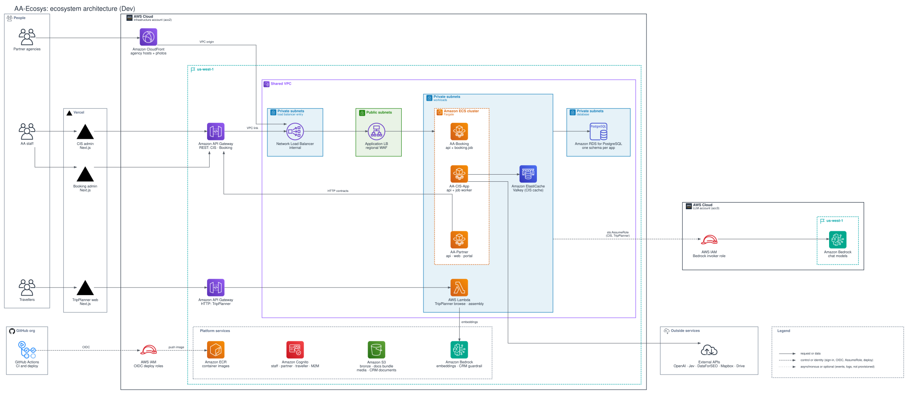
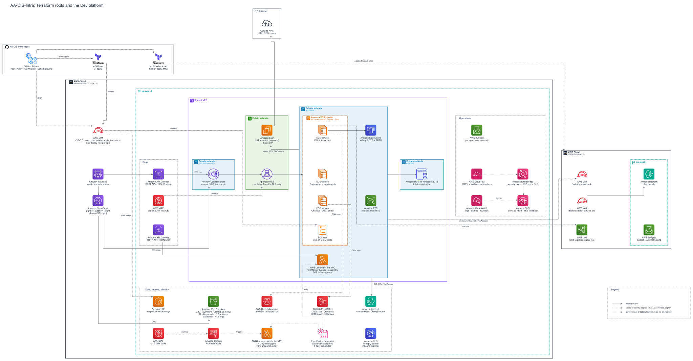
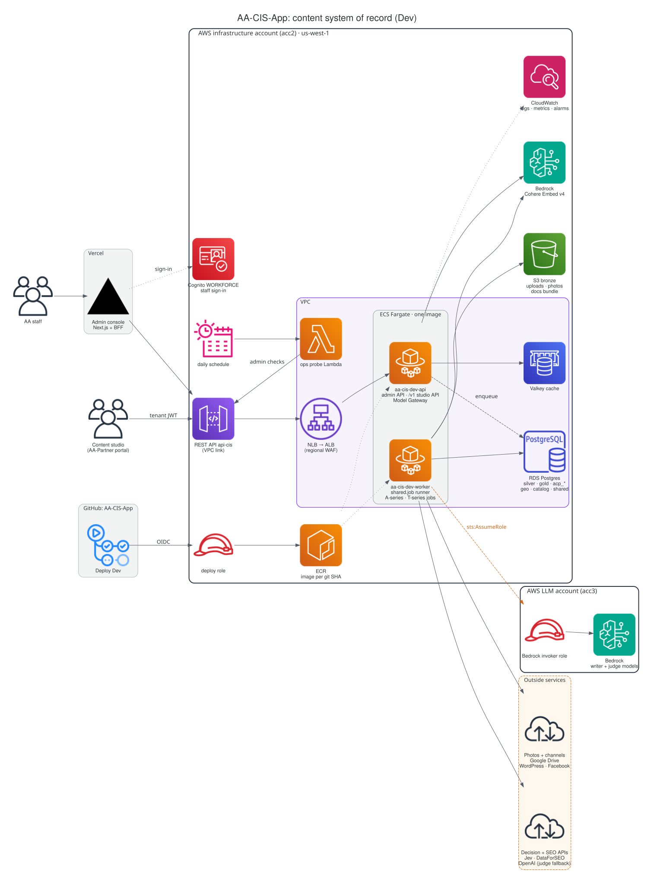
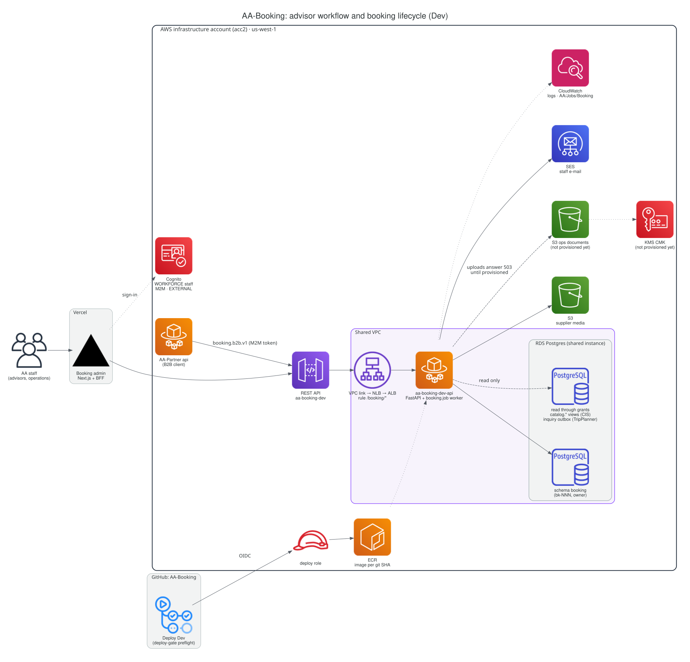
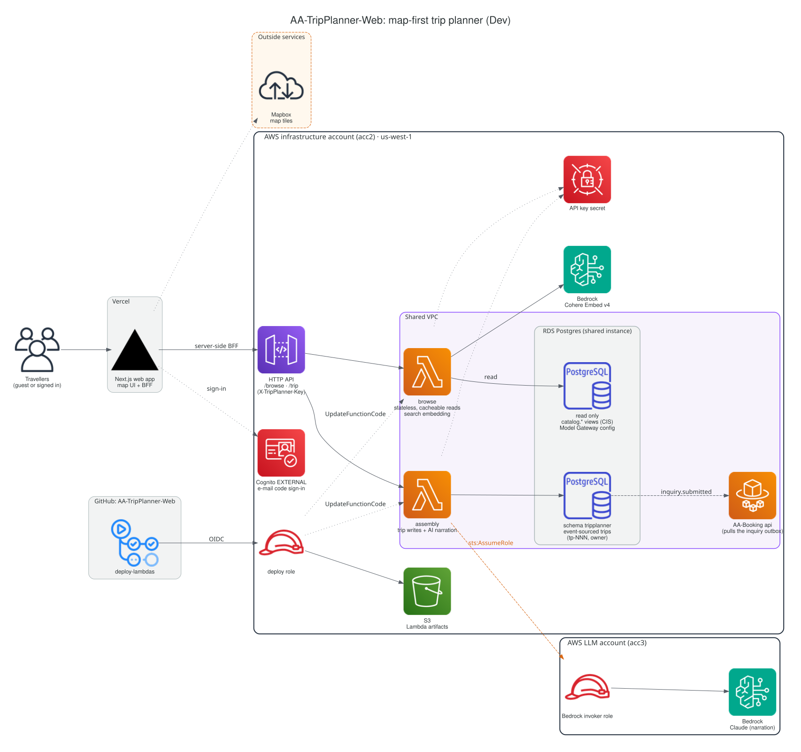
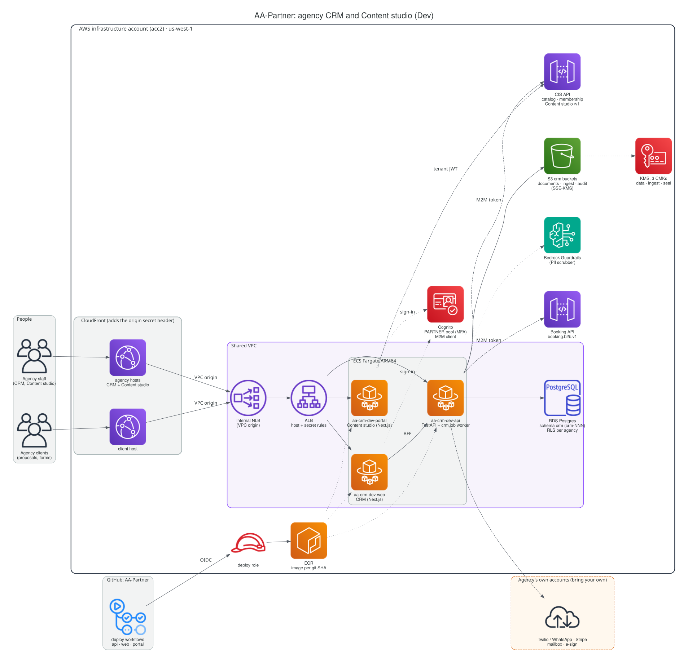

# Architecture diagrams with AWS icons

Six deployment views of the Dev platform, drawn as code in the style of the AWS Architecture Icons deck (the AWS
reference-architecture look): the official service icons and group shapes shipped by the Python
[`diagrams`](https://diagrams.mingrammer.com/) package, laid out on a grid and drawn by Graphviz. Each view is a `.py`
source next to its rendered `.svg`. The prose they illustrate is the source of truth:
[ecosystem architecture](../../ecosystem-architecture.md) and each repo's `CONTEXT.md`. When a view and the prose
disagree, fix the view.

**Review:** pilot reviewed and approved by the tech lead (S257 session plan, 2026-10-29). The Infra view passed the
Terraform drift check on 2026-10-28 (S256, [below](#aa-cis-infra)), and every repo's `CONTEXT.md` links this page.

## Conventions

Groups follow the AWS order and look, outermost first:

| Group | Look | Holds |
|---|---|---|
| AWS Cloud (one per account) | dark solid border, AWS logo | the infrastructure account (acc2) and the LLM account (acc3), side by side, never nested; global services (CloudFront, Route 53, IAM roles) sit here, outside the Region |
| Region | teal dashed border, flag | `us-west-1` |
| VPC | purple border, VPC icon | the shared VPC |
| Public subnets | green fill, green lock | ALB, NAT instance |
| Private subnets | blue fill, blue lock | "load balancer entry" (NLB), "workloads" (ECS tasks, VPC Lambdas, Valkey, EFS), "database" (RDS) |
| Amazon ECS cluster | orange dashed border, ECS icon | the ECS services |
| Generic group | grey dashed border | a logical set (Edge, Platform services, Operations, Legend) |
| People, Vercel, GitHub, Outside services | grey solid border with the owner's icon | everything outside AWS |

Every service shows its official icon with the AWS service name and a short role line under it. Arrows read left to
right (people, edge, compute, data), are orthogonal, end on an icon side or on a group border (an arrow from a group
border stands for all its members, one arrow instead of a fan), and carry the arrowhead on the target only. Labels
sit beside their arrow. Every view draws this legend:

| Line | Meaning |
|---|---|
| solid | a request, a read or a write (also an HTTP contract between apps) |
| dashed | control or identity: sign-in, OIDC, `sts:AssumeRole`, deploy (push and pull of images, `UpdateFunctionCode`) |
| dotted | asynchronous or optional: events, logs and metrics, a call that is not provisioned yet |

Labels name services and roles only: never an account ID, an ARN or a network ID.

## Ecosystem

The four apps on the infrastructure account (acc2), the shared VPC and RDS, the edge (API Gateway, CloudFront) and the
LLM account (acc3). Source: [`ecosystem.py`](ecosystem.py).



## AA-CIS-Infra

What the two Terraform roots create: edge and DNS, the VPC with the ECS cluster, Lambdas, RDS and Valkey, data and
identity services, operations, and the acc3 roles. Source: [`infra.py`](infra.py). Cross-checked on 2026-10-28 against
the live `accounts/aa365` state (a no-refresh plan reported no changes) with TerraVision 0.56.0: every service group in
the state has a node and no node draws something that does not exist. The drift table and how to repeat the check are in
the root audit folder `docs/audits/2026-10-28-S256-aa697-drift/`.



## AA-CIS-App

The admin console on Vercel, the API and the `shared.job` worker on one image, the CIS schemas, and the Model Gateway
path to Bedrock on both accounts and to the outside APIs. Source: [`cis.py`](cis.py).



## AA-Booking

The staff admin, the API with its `booking.job` worker behind the `/booking/*` ALB rule, its own schema, the read-only
grants it consumes, the B2B API for AA-Partner, and its S3, KMS and SES pieces. Source: [`booking.py`](booking.py).



## AA-TripPlanner-Web

The Next.js web app, the HTTP API and the two Lambdas split by statefulness, the `tripplanner` schema and the read-only
catalog views, the embedding and narration models, and the inquiry hand-off to AA-Booking.
Source: [`tripplanner.py`](tripplanner.py).



## AA-Partner

The agency CRM and the Content studio behind CloudFront (VPC origin on the shared NLB), the three ECS services, the
`crm` schema with row-level security, the PARTNER and M2M identity, and the HTTP contracts with CIS and AA-Booking.
Source: [`partner.py`](partner.py).



## Change a diagram

1. Edit the `.py` file (or add one and list it in `VIEWS` in [`render.py`](render.py)): declare the groups with
   `group(kind, title, note)`, the services with the `diagrams` node classes, put each service on a grid cell with
   `place({node: (column, row)})` and draw the arrows with `link(src, dst, label, kind, into=, out_of=)`. Members of
   one group need adjacent cells, and a service outside a group must not sit inside that group's cell range.
   [`_common.py`](_common.py) holds the group styles, the arrow kinds and the SVG clean-up;
   [`_layout.py`](_layout.py) computes the coordinates, routes every arrow on a 6 pt grid (it never crosses an icon,
   a text, a group title or a group that holds neither of its ends when another way exists, keeps clear of icons that
   are not its ends, and avoids running along borders or other arrows, continuing another arrow's line and small
   kinks), places each label beside its own arrow clear of everything else, and writes a laid-out Graphviz file that
   `neato -n2` draws as is.
   [`_group_icons.py`](_group_icons.py) drew the two group icons the package does not ship (`icons/`).
2. Render with Graphviz (`dot` and `neato`) on the `PATH` and a virtual environment that has `diagrams`, Pillow
   (smaller inline icons) and the docs tool requirements:

   ```bash
   python3 -m venv .tmp-session/diagrams-venv
   .tmp-session/diagrams-venv/bin/pip install diagrams pillow -r tools/docs/requirements.txt
   .tmp-session/diagrams-venv/bin/python docs/architecture/diagrams/render.py --png .tmp-session/diagram-previews
   ```

   Without root rights, `apt-get download graphviz` and its libraries, unpack them with `dpkg -x` into a local folder
   and point `PATH`, `LD_LIBRARY_PATH` and `GVBINDIR` at it (run `dot -c` once).
3. `render.py` prints the layout problems it finds in each view (an arrow through a node, a group title or a group
   that holds neither of its ends, an arrow along a border, two arrows on one track or on one line with a small gap,
   a kink shorter than 13 pt, a label over a node, a title, a border, another arrow or another label); a clean view
   prints none. When a label cannot sit clear (two borders too close together), drop it if a node text already says
   it, or move a service to another cell. Look
   at the PNG previews, then commit the `.py` and the `.svg` together. The layout is deterministic: an unchanged
   view renders to the same file. `render.py` also inlines every icon as a PNG data URI and refuses an unsafe SVG.

The docs reader publishes each SVG byte for byte only when it passes rule 9 of
[`build_docs_reader.py`](../../../tools/docs/build_docs_reader.py): no script, `foreignObject`, event handler or
outside reference, and no account or resource ID in its text. `python3 render.py --check` runs the same check on the
committed files; the docs lint unit tests run it in CI.

## Check a view against Terraform

Repeat the drift check after an infrastructure change that adds or removes a service:

1. In an AA-CIS-Infra checkout of `main`, with read-only credentials, run
   `terraform plan -lock=false -refresh=false -out=<plan>` in `accounts/aa365`. "No changes" means the code and the
   state agree, so the plan lists what exists.
2. `terraform show -json <plan>` and `terraform graph -plan=<plan>`, then
   `terravision graphdata --planfile <plan.json> --graphfile <graph.dot> --source accounts/aa365 --show_services`.
   TerraVision skips a few types (RDS instance, ElastiCache, SQS, EC2), so also list the managed resource types of the
   plan JSON.
3. Compare with the nodes of the views, fix the `.py` sources, render, and commit. Keep the plan, the JSON and any
   TerraVision image out of the repo: they hold account IDs and, for `show -json`, sensitive values.

Each repo's `CONTEXT.md` links this page.

## Not covered yet

- Inline Mermaid `architecture-beta` diagrams with an AWS icon pack in the docs reader.
