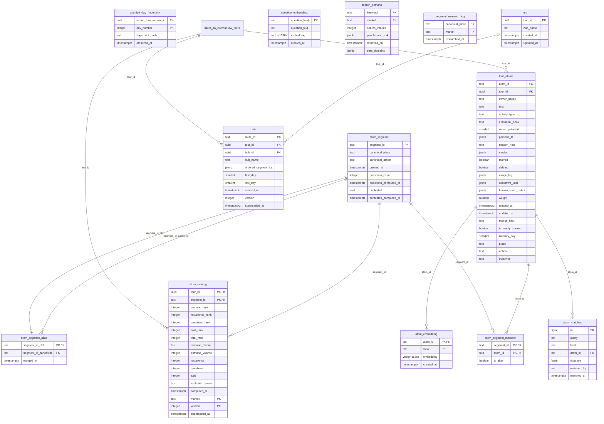

# ERD: acp_contract schema

<!-- GENERATED by AA-CIS-Infra db/gen_erd.py (infra/AA-CIS-Infra/.github/workflows/db-schema-dump.yml) - do not edit -->

Live catalog as of the newest CIS migration **324** (applied 2026-10-31). Owner: CIS (schema owner role `cis_owner`). 13 table(s), 2 view(s), 11 foreign key(s), 3 foreign key(s) in from other schemas.

The diagram shows every column. Full columns, indexes, grants and RLS: [DB schema reference](../db-schema-reference.md) (search for `acp_contract.<table>`). Generated file: change the schema through a migration, not this page.

Notation: `||` exactly one, `|o` zero or one (nullable FK), `o{` zero or more, `o|` zero or one (the FK is the child's PK or a unique key); a dashed line is a `NOT VALID` FK. Attribute comments are DM-6.1 tags (`pii:<class>`, `conf:<class>`). A quoted `"schema.table"` box is the parent table in another schema; foreign keys of other schemas that point here are listed below, and drawn on their own schema's page.

## Tables

| table | kind | columns | primary key | FKs out | FKs in | DM-6.1 tagged columns |
|---|---|---|---|---|---|---|
| `atom_embedding` | table | 4 | `atom_id`, `view` | 1 | 0 |  |
| `atom_matches` | table | 7 | `id` | 1 | 0 |  |
| `atom_ranking` | table | 17 | `market`, `tour_id`, `segment_id`, `version` | 2 | 0 |  |
| `atom_segment` | table | 8 | `segment_id` | 0 | 5 |  |
| `atom_segment_alias` | table | 3 | `segment_id_old` | 2 | 0 |  |
| `atom_segment_member` | table | 3 | `segment_id`, `atom_id` | 2 | 0 |  |
| `atomize_day_fingerprint` | table | 4 | `tenant_tour_version_id`, `day_number` | 0 | 0 |  |
| `hub` | table | 4 | `hub_id` | 0 | 1 |  |
| `question_embedding` | table | 4 | `question_hash` | 0 | 0 |  |
| `route` | table | 10 | `route_id` | 2 | 1 |  |
| `search_demand` | table | 6 | `keyword`, `market` | 0 | 0 |  |
| `segment_research_log` | table | 3 | `canonical_place`, `market` | 0 | 0 |  |
| `tour_atoms` | table | 24 | `atom_id` | 1 | 4 |  |
| `v_active_tour_atoms` | view | 24 |  | 0 | 0 |  |
| `v_trip_registry` | view | 23 |  | 0 | 0 |  |

## Foreign keys

| constraint | from | to | valid |
|---|---|---|---|
| `atom_embedding_atom_id_fkey` | `acp_contract.atom_embedding` (atom_id) | `acp_contract.tour_atoms` (atom_id) | yes |
| `atom_matches_atom_id_fkey` | `acp_contract.atom_matches` (atom_id) | `acp_contract.tour_atoms` (atom_id) | yes |
| `atom_ranking_segment_id_fkey` | `acp_contract.atom_ranking` (segment_id) | `acp_contract.atom_segment` (segment_id) | yes |
| `atom_ranking_tour_id_fkey` | `acp_contract.atom_ranking` (tour_id) | `silver_aa_internal.raw_tours` (tour_id) | yes |
| `atom_segment_alias_segment_id_canonical_fkey` | `acp_contract.atom_segment_alias` (segment_id_canonical) | `acp_contract.atom_segment` (segment_id) | yes |
| `atom_segment_alias_segment_id_old_fkey` | `acp_contract.atom_segment_alias` (segment_id_old) | `acp_contract.atom_segment` (segment_id) | yes |
| `atom_segment_member_atom_id_fkey` | `acp_contract.atom_segment_member` (atom_id) | `acp_contract.tour_atoms` (atom_id) | yes |
| `atom_segment_member_segment_id_fkey` | `acp_contract.atom_segment_member` (segment_id) | `acp_contract.atom_segment` (segment_id) | yes |
| `route_hub_id_fkey` | `acp_contract.route` (hub_id) | `acp_contract.hub` (hub_id) | yes |
| `route_tour_id_fkey` | `acp_contract.route` (tour_id) | `silver_aa_internal.raw_tours` (tour_id) | yes |
| `tour_atoms_tour_id_fkey` | `acp_contract.tour_atoms` (tour_id) | `silver_aa_internal.raw_tours` (tour_id) | yes |

## Foreign keys in from other schemas

| constraint | from | to | valid |
|---|---|---|---|
| `atom_place_card_atom_id_fkey` | `acp_shared.atom_place_card` (atom_id) | `acp_contract.tour_atoms` (atom_id) | yes |
| `subject_route_id_fkey` | `acp_shared.subject` (route_id) | `acp_contract.route` (route_id) | yes |
| `subject_segment_id_fkey` | `acp_shared.subject` (segment_id) | `acp_contract.atom_segment` (segment_id) | yes |
