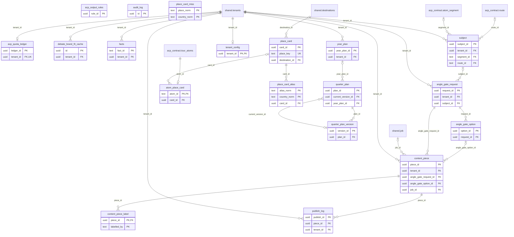

# ERD: acp_shared schema

<!-- GENERATED by AA-CIS-Infra db/gen_erd.py (infra/AA-CIS-Infra/.github/workflows/db-schema-dump.yml) - do not edit -->

Live catalog as of the newest CIS migration **304** (applied 2026-10-29). Owner: CIS (schema owner role `cis_owner`). 19 table(s), 0 view(s), 25 foreign key(s), 2 foreign key(s) in from other schemas.

The diagram shows key columns only (PK, FK, UK): the schema has more than 20 tables or 150 columns. Full columns, indexes, grants and RLS: [DB schema reference](../db-schema-reference.md) (search for `acp_shared.<table>`). Generated file: change the schema through a migration, not this page.

Notation: `||` exactly one, `|o` zero or one (nullable FK), `o{` zero or more, `o|` zero or one (the FK is the child's PK or a unique key); a dashed line is a `NOT VALID` FK. Attribute comments are DM-6.1 tags (`pii:<class>`, `conf:<class>`). A quoted `"schema.table"` box is the parent table in another schema; foreign keys of other schemas that point here are listed below, and drawn on their own schema's page.

## Tables

| table | kind | columns | primary key | FKs out | FKs in | DM-6.1 tagged columns |
|---|---|---|---|---|---|---|
| `acp_output_rules` | table | 13 | `rule_id` | 0 | 0 |  |
| `acp_quota_ledger` | table | 11 | `ledger_id` | 1 | 0 |  |
| `angle_gate_option` | table | 11 | `option_id` | 1 | 1 |  |
| `angle_gate_request` | table | 13 | `request_id` | 2 | 2 |  |
| `atom_place_card` | table | 4 | `atom_id` | 2 | 0 |  |
| `audit_log` | table | 15 | `id` | 0 | 0 |  |
| `content_piece` | table | 23 | `piece_id` | 4 | 2 |  |
| `content_piece_label` | table | 8 | `piece_id`, `labelled_by` | 1 | 0 |  |
| `debate_brand_fit_cache` | table | 11 | `id` | 1 | 0 |  |
| `facts` | table | 13 | `fact_id` | 1 | 0 |  |
| `place_card` | table | 15 | `card_id` | 1 | 4 |  |
| `place_card_alias` | table | 5 | `alias_norm`, `country_norm` | 1 | 0 |  |
| `place_card_miss` | table | 9 | `place_norm`, `country_norm` | 0 | 0 |  |
| `publish_log` | table | 14 | `publish_id` | 2 | 0 |  |
| `quarter_plan` | table | 7 | `plan_id` | 2 | 1 |  |
| `quarter_plan_version` | table | 9 | `version_id` | 1 | 1 |  |
| `subject` | table | 9 | `subject_id` | 3 | 1 |  |
| `tenant_config` | table | 4 | `tenant_id` | 1 | 0 |  |
| `year_plan` | table | 4 | `year_plan_id` | 1 | 1 |  |

## Foreign keys

| constraint | from | to | valid |
|---|---|---|---|
| `acp_quota_ledger_tenant_id_fkey` | `acp_shared.acp_quota_ledger` (tenant_id) | `shared.tenants` (tenant_id) | yes |
| `angle_gate_option_request_id_fkey` | `acp_shared.angle_gate_option` (request_id) | `acp_shared.angle_gate_request` (request_id) | yes |
| `angle_gate_request_subject_id_fkey` | `acp_shared.angle_gate_request` (subject_id) | `acp_shared.subject` (subject_id) | yes |
| `angle_gate_request_tenant_id_fkey` | `acp_shared.angle_gate_request` (tenant_id) | `shared.tenants` (tenant_id) | yes |
| `atom_place_card_atom_id_fkey` | `acp_shared.atom_place_card` (atom_id) | `acp_contract.tour_atoms` (atom_id) | yes |
| `atom_place_card_card_id_fkey` | `acp_shared.atom_place_card` (card_id) | `acp_shared.place_card` (card_id) | yes |
| `content_piece_angle_gate_option_id_fkey` | `acp_shared.content_piece` (angle_gate_option_id) | `acp_shared.angle_gate_option` (option_id) | yes |
| `content_piece_angle_gate_request_id_fkey` | `acp_shared.content_piece` (angle_gate_request_id) | `acp_shared.angle_gate_request` (request_id) | yes |
| `content_piece_job_id_fkey` | `acp_shared.content_piece` (job_id) | `shared.job` (id) | yes |
| `content_piece_tenant_id_fkey` | `acp_shared.content_piece` (tenant_id) | `shared.tenants` (tenant_id) | yes |
| `content_piece_label_piece_id_fkey` | `acp_shared.content_piece_label` (piece_id) | `acp_shared.content_piece` (piece_id) | yes |
| `debate_brand_fit_cache_tenant_id_fkey` | `acp_shared.debate_brand_fit_cache` (tenant_id) | `shared.tenants` (tenant_id) | yes |
| `facts_tenant_id_fkey` | `acp_shared.facts` (tenant_id) | `shared.tenants` (tenant_id) | yes |
| `place_card_destination_id_fkey` | `acp_shared.place_card` (destination_id) | `shared.destinations` (id) | yes |
| `place_card_alias_card_id_fkey` | `acp_shared.place_card_alias` (card_id) | `acp_shared.place_card` (card_id) | yes |
| `publish_log_piece_id_fkey` | `acp_shared.publish_log` (piece_id) | `acp_shared.content_piece` (piece_id) | yes |
| `publish_log_tenant_id_fkey` | `acp_shared.publish_log` (tenant_id) | `shared.tenants` (tenant_id) | yes |
| `fk_quarter_plan_current_version` | `acp_shared.quarter_plan` (current_version_id) | `acp_shared.quarter_plan_version` (version_id) | yes |
| `quarter_plan_year_plan_id_fkey` | `acp_shared.quarter_plan` (year_plan_id) | `acp_shared.year_plan` (year_plan_id) | yes |
| `quarter_plan_version_plan_id_fkey` | `acp_shared.quarter_plan_version` (plan_id) | `acp_shared.quarter_plan` (plan_id) | yes |
| `subject_route_id_fkey` | `acp_shared.subject` (route_id) | `acp_contract.route` (route_id) | yes |
| `subject_segment_id_fkey` | `acp_shared.subject` (segment_id) | `acp_contract.atom_segment` (segment_id) | yes |
| `subject_tenant_id_fkey` | `acp_shared.subject` (tenant_id) | `shared.tenants` (tenant_id) | yes |
| `tenant_config_tenant_id_fkey` | `acp_shared.tenant_config` (tenant_id) | `shared.tenants` (tenant_id) | yes |
| `year_plan_tenant_id_fkey` | `acp_shared.year_plan` (tenant_id) | `shared.tenants` (tenant_id) | yes |

## Foreign keys in from other schemas

| constraint | from | to | valid |
|---|---|---|---|
| `place_name_place_card_id_fkey` | `geo.place_name` (place_card_id) | `acp_shared.place_card` (card_id) | yes |
| `tour_place_place_card_id_fkey` | `geo.tour_place` (place_card_id) | `acp_shared.place_card` (card_id) | yes |
