# ERD: booking schema

<!-- GENERATED by AA-CIS-Infra db/gen_erd.py (infra/AA-CIS-Infra/.github/workflows/db-schema-dump.yml) - do not edit -->

Live catalog as of the newest Booking migration **bk-028** (applied 2026-10-27). Owner: Booking (schema owner role `bk_owner`). 53 table(s), 14 view(s), 128 foreign key(s), 0 foreign key(s) in from other schemas.

```mermaid
erDiagram
    audit_logs {
        uuid id PK
    }
    b2b_cancellations {
        uuid id PK
        uuid hold_id FK, UK
        uuid trip_case_id FK, UK
        uuid partner_id FK
        uuid policy_id FK
    }
    b2b_hold_lines {
        uuid hold_id PK, FK
        smallint line_no PK
        uuid departure_id FK
        text answered_by FK
    }
    b2b_holds {
        uuid id PK
        uuid partner_id FK
        uuid quote_id FK
        uuid trip_case_id FK
        uuid cancellation_policy_id FK
    }
    b2b_partners {
        uuid id PK
        uuid tenant_id UK
        text created_by FK
        text updated_by FK
    }
    b2b_quote_lines {
        uuid quote_id PK, FK
        smallint line_no PK
        uuid departure_id FK
    }
    b2b_quotes {
        uuid id PK
        uuid partner_id FK
    }
    cancellation_policies {
        uuid id PK
        uuid trip_plan_id FK
        text created_by FK
    }
    countries {
        char(2) iso2 PK
    }
    customer_identities {
        text iss PK "pii:online_id"
        text sub PK "pii:online_id"
        uuid customer_id FK
    }
    customer_otps {
        uuid id PK
        uuid customer_id FK
    }
    customer_sessions {
        uuid id PK
        uuid customer_id FK
        text refresh_token_hash UK "conf:credential"
    }
    customers {
        uuid id PK
        uuid profile_media_id FK "pii:profile"
        uuid merge_candidate_id FK
        text code UK
    }
    departure_incidents {
        uuid id PK
        uuid departure_id FK
        text flagged_by FK
        text cleared_by FK
    }
    departures {
        uuid id PK
        uuid trip_plan_id FK
        text created_by FK
        text updated_by FK
    }
    entity_media {
        uuid id PK
        text uploaded_by FK
        text updated_by FK
    }
    fx_rates {
        uuid id PK
        text created_by FK
    }
    hotel_room_types {
        uuid id PK
        uuid hotel_id FK
        text created_by FK
        text updated_by FK
    }
    hotels {
        uuid id PK
        text code UK
        uuid supplier_id FK
        char(2) country_code FK
        text created_by FK
        text updated_by FK
    }
    inbox_cursor {
        text source PK
        text contract PK
    }
    inbox_events {
        uuid id PK
    }
    invoice_items {
        uuid id PK
        uuid invoice_id FK
        text created_by FK
        text updated_by FK
    }
    invoices {
        uuid id PK
        text invoice_number UK
        uuid trip_case_id FK
        uuid version_id FK
        uuid customer_id FK
        text sent_by FK
        text cancelled_by FK
        text created_by FK
        text updated_by FK
    }
    job {
        uuid id PK
        uuid parent_job_id FK
    }
    media_files {
        uuid id PK
    }
    notification_reads {
        uuid notification_id PK, FK
        text cis_user_id PK, FK
    }
    notifications {
        uuid id PK
    }
    ops_files {
        uuid id PK
        uuid trip_case_id FK
        text uploaded_by FK
        text removed_by FK
    }
    ops_transitions {
        text entity PK
        text from_status PK
        text to_status PK
    }
    outbox {
        bigint id PK
        uuid event_id UK
        bigint feed_seq UK
    }
    payment_schedule {
        uuid id PK
        uuid invoice_id FK
        text created_by FK
        text updated_by FK
    }
    payments {
        uuid id PK
        text ref UK
        uuid invoice_id FK
        uuid evidence_file_id FK
        text recorded_by FK
        text verified_by FK
        text voided_by FK
        text updated_by FK
    }
    policy_approvals {
        uuid id PK
        uuid pricing_rule_id FK, UK
        uuid fx_rate_id FK, UK
        uuid cancellation_policy_id FK, UK
    }
    pricing_rules {
        uuid id PK
        text created_by FK
    }
    services {
        uuid id PK
        text code UK
        uuid supplier_id FK
        char(2) country_code FK
        text created_by FK
        text updated_by FK
    }
    settings {
        text key PK
    }
    staff_assignments {
        uuid id PK
        uuid trip_case_id FK
        text staff_user_id FK
        text assigned_by FK
    }
    staff_users {
        text cis_user_id PK "pii:online_id"
    }
    supplier_bookings {
        uuid id PK
        text code UK
        uuid trip_case_id FK
        uuid version_item_id FK
        uuid supplier_id FK
        uuid hotel_room_type_id FK
        uuid service_id FK
        text requested_by FK
        text confirmed_by FK
        uuid voucher_file_id FK
        uuid b2b_hold_id FK
        text b2b_line_ref FK
        text created_by FK
        text updated_by FK
    }
    supplier_contracts {
        uuid id PK
        uuid supplier_id FK
        text created_by FK
        text updated_by FK
        text published_by FK
        text expired_by FK
    }
    supplier_rates {
        uuid id PK
        uuid supplier_contract_id FK
        uuid hotel_room_type_id FK
        uuid service_id FK
        text created_by FK
        text updated_by FK
    }
    suppliers {
        uuid id PK
        text code UK
        char(2) country_code FK
        text created_by FK
        text updated_by FK
    }
    trip_case_checks {
        uuid id PK
        uuid trip_case_id FK
        text assignee_ref FK
        text done_by FK
        text created_by FK
        text updated_by FK
    }
    trip_case_countries {
        uuid trip_case_id PK, FK
        char(2) country_code PK, FK
    }
    trip_case_legs {
        uuid id PK
        uuid trip_case_id FK
    }
    trip_case_status_history {
        uuid id PK
        uuid trip_case_id FK
        text changed_by FK
    }
    trip_case_status_transitions {
        text from_status PK
        text to_status PK
    }
    trip_case_version_itinerary {
        uuid id PK
        uuid trip_case_version_id FK
        uuid hotel_room_type_id FK
        uuid service_id FK
    }
    trip_case_versions {
        uuid id PK
        uuid trip_case_id FK
        text created_by FK
        text sent_by FK
        text approved_by FK
        text updated_by FK
    }
    trip_cases {
        uuid id PK
        text code UK
        uuid customer_id FK
        text idempotency_key UK
        uuid inbox_event_id FK
    }
    trip_plan_components {
        uuid id PK
        uuid trip_plan_id FK
        uuid hotel_room_type_id FK
        uuid service_id FK
        text created_by FK
    }
    trip_plans {
        uuid id PK
        text created_by FK
        text updated_by FK
    }
    version_item_costs {
        uuid id PK
        uuid version_item_id FK
        text entered_by FK
        uuid supplier_rate_id FK
    }
    b2b_holds ||--o| b2b_cancellations : "hold_id"
    b2b_partners ||--o{ b2b_cancellations : "partner_id"
    cancellation_policies ||--o{ b2b_cancellations : "policy_id"
    trip_cases ||--o| b2b_cancellations : "trip_case_id"
    staff_users |o--o{ b2b_hold_lines : "answered_by"
    departures |o--o{ b2b_hold_lines : "departure_id"
    b2b_holds ||--o{ b2b_hold_lines : "hold_id"
    cancellation_policies |o--o{ b2b_holds : "cancellation_policy_id"
    b2b_partners ||--o{ b2b_holds : "partner_id"
    b2b_quotes ||--o{ b2b_holds : "quote_id"
    trip_cases |o--o{ b2b_holds : "trip_case_id"
    staff_users |o--o{ b2b_partners : "created_by"
    staff_users |o--o{ b2b_partners : "updated_by"
    departures |o--o{ b2b_quote_lines : "departure_id"
    b2b_quotes ||--o{ b2b_quote_lines : "quote_id"
    b2b_partners ||--o{ b2b_quotes : "partner_id"
    staff_users |o--o{ cancellation_policies : "created_by"
    trip_plans |o--o{ cancellation_policies : "trip_plan_id"
    customers ||--o{ customer_identities : "customer_id"
    customers ||--o{ customer_otps : "customer_id"
    customers ||--o{ customer_sessions : "customer_id"
    customers |o--o{ customers : "merge_candidate_id"
    media_files |o--o{ customers : "profile_media_id"
    staff_users |o--o{ departure_incidents : "cleared_by"
    departures ||--o{ departure_incidents : "departure_id"
    staff_users ||--o{ departure_incidents : "flagged_by"
    staff_users |o--o{ departures : "created_by"
    trip_plans ||--o{ departures : "trip_plan_id"
    staff_users |o--o{ departures : "updated_by"
    staff_users |o--o{ entity_media : "updated_by"
    staff_users ||--o{ entity_media : "uploaded_by"
    staff_users |o--o{ fx_rates : "created_by"
    staff_users |o--o{ hotel_room_types : "created_by"
    hotels ||--o{ hotel_room_types : "hotel_id"
    staff_users |o--o{ hotel_room_types : "updated_by"
    countries |o--o{ hotels : "country_code"
    staff_users |o--o{ hotels : "created_by"
    suppliers ||--o{ hotels : "supplier_id"
    staff_users |o--o{ hotels : "updated_by"
    staff_users |o--o{ invoice_items : "created_by"
    invoices ||--o{ invoice_items : "invoice_id"
    staff_users |o--o{ invoice_items : "updated_by"
    staff_users |o--o{ invoices : "cancelled_by"
    staff_users |o--o{ invoices : "created_by"
    customers |o--o{ invoices : "customer_id"
    staff_users |o--o{ invoices : "sent_by"
    trip_cases ||--o{ invoices : "trip_case_id"
    staff_users |o--o{ invoices : "updated_by"
    trip_case_versions ||--o{ invoices : "version_id"
    job |o--o{ job : "parent_job_id"
    staff_users ||--o{ notification_reads : "cis_user_id"
    notifications ||--o{ notification_reads : "notification_id"
    staff_users |o--o{ ops_files : "removed_by"
    trip_cases |o--o{ ops_files : "trip_case_id"
    staff_users |o--o{ ops_files : "uploaded_by"
    staff_users |o--o{ payment_schedule : "created_by"
    invoices ||--o{ payment_schedule : "invoice_id"
    staff_users |o--o{ payment_schedule : "updated_by"
    ops_files |o--o{ payments : "evidence_file_id"
    invoices ||--o{ payments : "invoice_id"
    staff_users ||--o{ payments : "recorded_by"
    staff_users |o--o{ payments : "updated_by"
    staff_users |o--o{ payments : "verified_by"
    staff_users |o--o{ payments : "voided_by"
    cancellation_policies |o--o| policy_approvals : "cancellation_policy_id"
    fx_rates |o--o| policy_approvals : "fx_rate_id"
    pricing_rules |o--o| policy_approvals : "pricing_rule_id"
    staff_users |o--o{ pricing_rules : "created_by"
    countries |o--o{ services : "country_code"
    staff_users |o--o{ services : "created_by"
    suppliers ||--o{ services : "supplier_id"
    staff_users |o--o{ services : "updated_by"
    staff_users |o--o{ staff_assignments : "assigned_by"
    staff_users ||--o{ staff_assignments : "staff_user_id"
    trip_cases ||--o{ staff_assignments : "trip_case_id"
    b2b_hold_lines |o--o{ supplier_bookings : "b2b_hold_id, b2b_line_ref"
    staff_users |o--o{ supplier_bookings : "confirmed_by"
    staff_users |o--o{ supplier_bookings : "created_by"
    hotel_room_types |o--o{ supplier_bookings : "hotel_room_type_id"
    staff_users |o--o{ supplier_bookings : "requested_by"
    services |o--o{ supplier_bookings : "service_id"
    suppliers ||--o{ supplier_bookings : "supplier_id"
    trip_cases ||--o{ supplier_bookings : "trip_case_id"
    staff_users |o--o{ supplier_bookings : "updated_by"
    trip_case_version_itinerary |o--o{ supplier_bookings : "version_item_id"
    ops_files |o--o{ supplier_bookings : "voucher_file_id"
    staff_users ||--o{ supplier_contracts : "created_by"
    staff_users |o--o{ supplier_contracts : "expired_by"
    staff_users |o--o{ supplier_contracts : "published_by"
    suppliers ||--o{ supplier_contracts : "supplier_id"
    staff_users |o--o{ supplier_contracts : "updated_by"
    staff_users ||--o{ supplier_rates : "created_by"
    hotel_room_types |o--o{ supplier_rates : "hotel_room_type_id"
    services |o--o{ supplier_rates : "service_id"
    supplier_contracts ||--o{ supplier_rates : "supplier_contract_id"
    staff_users |o--o{ supplier_rates : "updated_by"
    countries |o--o{ suppliers : "country_code"
    staff_users |o--o{ suppliers : "created_by"
    staff_users |o--o{ suppliers : "updated_by"
    staff_users |o--o{ trip_case_checks : "assignee_ref"
    staff_users |o--o{ trip_case_checks : "created_by"
    staff_users |o--o{ trip_case_checks : "done_by"
    trip_cases ||--o{ trip_case_checks : "trip_case_id"
    staff_users |o--o{ trip_case_checks : "updated_by"
    countries ||--o{ trip_case_countries : "country_code"
    trip_cases ||--o{ trip_case_countries : "trip_case_id"
    trip_cases ||--o{ trip_case_legs : "trip_case_id"
    staff_users |o--o{ trip_case_status_history : "changed_by"
    trip_cases ||--o{ trip_case_status_history : "trip_case_id"
    hotel_room_types |o--o{ trip_case_version_itinerary : "hotel_room_type_id"
    services |o--o{ trip_case_version_itinerary : "service_id"
    trip_case_versions ||--o{ trip_case_version_itinerary : "trip_case_version_id"
    staff_users |o--o{ trip_case_versions : "approved_by"
    staff_users |o--o{ trip_case_versions : "created_by"
    staff_users |o--o{ trip_case_versions : "sent_by"
    trip_cases ||--o{ trip_case_versions : "trip_case_id"
    staff_users |o--o{ trip_case_versions : "updated_by"
    customers |o--o{ trip_cases : "customer_id"
    inbox_events |o--o{ trip_cases : "inbox_event_id"
    staff_users |o--o{ trip_plan_components : "created_by"
    hotel_room_types |o--o{ trip_plan_components : "hotel_room_type_id"
    services |o--o{ trip_plan_components : "service_id"
    trip_plans ||--o{ trip_plan_components : "trip_plan_id"
    staff_users |o--o{ trip_plans : "created_by"
    staff_users |o--o{ trip_plans : "updated_by"
    staff_users |o--o{ version_item_costs : "entered_by"
    supplier_rates |o--o{ version_item_costs : "supplier_rate_id"
    trip_case_version_itinerary ||--o{ version_item_costs : "version_item_id"
```

The diagram shows key columns only (PK, FK, UK): the schema has more than 20 tables or 150 columns. Full columns, indexes, grants and RLS: [DB schema reference](../db-schema-reference.md) (search for `booking.<table>`). Generated file: change the schema through a migration, not this page.

Notation: `||` exactly one, `|o` zero or one (nullable FK), `o{` zero or more, `o|` zero or one (the FK is the child's PK or a unique key); a dashed line is a `NOT VALID` FK. Attribute comments are DM-6.1 tags (`pii:<class>`, `conf:<class>`). A quoted `"schema.table"` box is the parent table in another schema; foreign keys of other schemas that point here are listed below, and drawn on their own schema's page.

## Tables

| table | kind | columns | primary key | FKs out | FKs in | DM-6.1 tagged columns |
|---|---|---|---|---|---|---|
| `audit_logs` | table | 12 | `id` | 0 | 0 | `before` pii:free_text, `after` pii:free_text, `entity_label` pii:free_text, `summary` pii:free_text |
| `b2b_cancellations` | table | 16 | `id` | 4 | 0 |  |
| `b2b_hold_lines` | table | 12 | `hold_id`, `line_no` | 3 | 1 |  |
| `b2b_holds` | table | 21 | `id` | 4 | 2 |  |
| `b2b_partners` | table | 11 | `id` | 2 | 3 | `agency_name` conf:commercial, `credit_terms_ref` conf:commercial |
| `b2b_quote_lines` | table | 17 | `quote_id`, `line_no` | 2 | 0 | `net_cost_usd` conf:commercial, `supplier_rate_ids` conf:commercial |
| `b2b_quotes` | table | 19 | `id` | 1 | 2 | `margin_applied` conf:commercial, `card_fee_pct` conf:commercial |
| `cancellation_policies` | table | 9 | `id` | 2 | 3 | `title` conf:commercial, `note` conf:commercial |
| `countries` | table | 3 | `iso2` | 0 | 4 |  |
| `customer_identities` | table | 4 | `iss`, `sub` | 1 | 0 | `iss` pii:online_id, `sub` pii:online_id |
| `customer_otps` | table | 8 | `id` | 1 | 0 | `otp_hash` conf:credential |
| `customer_sessions` | table | 6 | `id` | 1 | 0 | `refresh_token_hash` conf:credential |
| `customers` | table | 21 | `id` | 2 | 6 | `name` pii:name, `email` pii:contact, `phone` pii:contact, `address` pii:address, `gender` pii:profile, `marital_status` pii:profile, `profession` pii:profile, `profile_media_id` pii:profile |
| `departure_incidents` | table | 7 | `id` | 3 | 0 |  |
| `departures` | table | 10 | `id` | 3 | 3 |  |
| `entity_media` | table | 16 | `id` | 2 | 0 |  |
| `fx_rates` | table | 8 | `id` | 1 | 1 |  |
| `hotel_room_types` | table | 11 | `id` | 3 | 4 | `internal_notes` conf:commercial |
| `hotels` | table | 22 | `id` | 4 | 1 | `internal_notes` conf:commercial |
| `inbox_cursor` | table | 4 | `source`, `contract` | 0 | 0 |  |
| `inbox_events` | table | 12 | `id` | 0 | 1 | `payload` pii:contact, `error` pii:free_text |
| `invoice_items` | table | 13 | `id` | 3 | 0 | `description` pii:free_text, `reason` pii:free_text |
| `invoices` | table | 28 | `id` | 7 | 3 | `bill_to_name` pii:name, `bill_to_email` pii:contact, `bill_to_address` pii:address, `notes` pii:free_text, `terms` pii:free_text, `cancel_reason` pii:free_text |
| `job` | table | 21 | `id` | 1 | 1 |  |
| `media_files` | table | 11 | `id` | 0 | 1 | `s3_key` pii:profile |
| `notification_reads` | table | 3 | `notification_id`, `cis_user_id` | 2 | 0 |  |
| `notifications` | table | 12 | `id` | 0 | 1 | `title` pii:free_text, `message` pii:free_text, `data` pii:contact |
| `ops_files` | table | 18 | `id` | 3 | 2 | `s3_key` pii:payment, `file_name` pii:free_text, `removed_reason` pii:free_text |
| `ops_transitions` | table | 3 | `entity`, `from_status`, `to_status` | 0 | 0 |  |
| `outbox` | table | 17 | `id` | 0 | 0 |  |
| `payment_schedule` | table | 10 | `id` | 3 | 0 |  |
| `payments` | table | 25 | `id` | 6 | 0 | `reference` pii:payment, `note` pii:free_text, `void_reason` pii:free_text |
| `policy_approvals` | table | 8 | `id` | 3 | 0 | `note` conf:commercial |
| `pricing_rules` | table | 10 | `id` | 1 | 1 | `target_margin` conf:commercial, `floor_margin` conf:commercial, `peak_uplift_pts` conf:commercial, `card_fee_pct` conf:commercial, `note` conf:commercial |
| `services` | table | 20 | `id` | 4 | 4 | `internal_notes` conf:commercial |
| `settings` | table | 4 | `key` | 0 | 0 |  |
| `staff_assignments` | table | 7 | `id` | 3 | 0 |  |
| `staff_users` | table | 12 | `cis_user_id` | 0 | 60 | `cis_user_id` pii:online_id, `email` pii:contact, `name` pii:name, `cognito_iss` pii:online_id, `cognito_sub` pii:online_id |
| `supplier_bookings` | table | 31 | `id` | 11 | 0 | `net_amount` conf:commercial, `cancel_reason` pii:free_text, `notes` pii:free_text |
| `supplier_contracts` | table | 19 | `id` | 5 | 1 | `payment_terms` conf:commercial, `cancellation_policy` conf:commercial, `notes` conf:commercial |
| `supplier_rates` | table | 18 | `id` | 5 | 1 | `net_amount` conf:commercial, `notes` conf:commercial |
| `suppliers` | table | 20 | `id` | 3 | 4 | `internal_notes` conf:commercial, `contact_name` pii:name, `contact_title` pii:profile, `contact_email` pii:contact, `contact_phone` pii:contact |
| `trip_case_checks` | table | 17 | `id` | 5 | 0 | `title` pii:free_text, `note` pii:free_text, `emergency_contact_name` pii:emergency_contact, `emergency_contact_phone` pii:emergency_contact |
| `trip_case_countries` | table | 4 | `trip_case_id`, `country_code` | 2 | 0 |  |
| `trip_case_legs` | table | 9 | `id` | 1 | 0 |  |
| `trip_case_status_history` | table | 8 | `id` | 2 | 0 | `note` pii:free_text |
| `trip_case_status_transitions` | table | 2 | `from_status`, `to_status` | 0 | 0 |  |
| `trip_case_version_itinerary` | table | 12 | `id` | 3 | 2 | `notes` pii:free_text |
| `trip_case_versions` | table | 23 | `id` | 5 | 2 | `notes` pii:free_text, `title` pii:free_text, `approval_note` pii:free_text |
| `trip_cases` | table | 23 | `id` | 2 | 11 | `trip_style` pii:travel, `start_date` pii:travel, `end_date` pii:travel, `pax` pii:travel, `inquiry_snapshot` pii:travel, `notes` pii:free_text, `pax_adults` pii:travel, `pax_children` pii:travel |
| `trip_plan_components` | table | 7 | `id` | 4 | 0 |  |
| `trip_plans` | table | 14 | `id` | 2 | 3 | `default_channel` conf:commercial, `price_hint_amount` conf:commercial, `price_hint_currency` conf:commercial, `price_hint_basis` conf:commercial, `commercial_notes` conf:commercial |
| `v_customer_summary` | view | 19 |  | 0 | 0 | `name` pii:name, `email` pii:contact, `phone` pii:contact, `address` pii:address |
| `v_invoice_balance` | view | 16 |  | 0 | 0 |  |
| `v_ops_case_status` | view | 2 |  | 0 | 0 |  |
| `v_ops_data_totals` | view | 2 |  | 0 | 0 |  |
| `v_ops_funnel_daily` | view | 4 |  | 0 | 0 |  |
| `v_ops_trip_plan_keys` | view | 3 |  | 0 | 0 |  |
| `v_payment_schedule_status` | view | 10 |  | 0 | 0 |  |
| `v_schema_versions` | view | 3 |  | 0 | 0 |  |
| `v_supply_hotels` | view | 16 |  | 0 | 0 |  |
| `v_supply_media` | view | 8 |  | 0 | 0 |  |
| `v_supply_outbox` | view | 7 |  | 0 | 0 |  |
| `v_supply_services` | view | 12 |  | 0 | 0 |  |
| `v_trip_case_supply_state` | view | 8 |  | 0 | 0 |  |
| `v_trip_check_board` | view | 15 |  | 0 | 0 |  |
| `version_item_costs` | table | 9 | `id` | 3 | 0 | `net_amount` conf:commercial, `supplier_note` conf:commercial |

## Foreign keys

| constraint | from | to | valid |
|---|---|---|---|
| `b2b_cancellations_hold_id_fkey` | `booking.b2b_cancellations` (hold_id) | `booking.b2b_holds` (id) | yes |
| `b2b_cancellations_partner_id_fkey` | `booking.b2b_cancellations` (partner_id) | `booking.b2b_partners` (id) | yes |
| `b2b_cancellations_policy_id_fkey` | `booking.b2b_cancellations` (policy_id) | `booking.cancellation_policies` (id) | yes |
| `b2b_cancellations_trip_case_id_fkey` | `booking.b2b_cancellations` (trip_case_id) | `booking.trip_cases` (id) | yes |
| `b2b_hold_lines_answered_by_fkey` | `booking.b2b_hold_lines` (answered_by) | `booking.staff_users` (cis_user_id) | yes |
| `b2b_hold_lines_departure_id_fkey` | `booking.b2b_hold_lines` (departure_id) | `booking.departures` (id) | yes |
| `b2b_hold_lines_hold_id_fkey` | `booking.b2b_hold_lines` (hold_id) | `booking.b2b_holds` (id) | yes |
| `b2b_holds_cancellation_policy_id_fkey` | `booking.b2b_holds` (cancellation_policy_id) | `booking.cancellation_policies` (id) | yes |
| `b2b_holds_partner_id_fkey` | `booking.b2b_holds` (partner_id) | `booking.b2b_partners` (id) | yes |
| `b2b_holds_quote_id_fkey` | `booking.b2b_holds` (quote_id) | `booking.b2b_quotes` (id) | yes |
| `b2b_holds_trip_case_id_fkey` | `booking.b2b_holds` (trip_case_id) | `booking.trip_cases` (id) | yes |
| `b2b_partners_created_by_fkey` | `booking.b2b_partners` (created_by) | `booking.staff_users` (cis_user_id) | yes |
| `b2b_partners_updated_by_fkey` | `booking.b2b_partners` (updated_by) | `booking.staff_users` (cis_user_id) | yes |
| `b2b_quote_lines_departure_id_fkey` | `booking.b2b_quote_lines` (departure_id) | `booking.departures` (id) | yes |
| `b2b_quote_lines_quote_id_fkey` | `booking.b2b_quote_lines` (quote_id) | `booking.b2b_quotes` (id) | yes |
| `b2b_quotes_partner_id_fkey` | `booking.b2b_quotes` (partner_id) | `booking.b2b_partners` (id) | yes |
| `cancellation_policies_created_by_fkey` | `booking.cancellation_policies` (created_by) | `booking.staff_users` (cis_user_id) | yes |
| `cancellation_policies_trip_plan_id_fkey` | `booking.cancellation_policies` (trip_plan_id) | `booking.trip_plans` (id) | yes |
| `customer_identities_customer_id_fkey` | `booking.customer_identities` (customer_id) | `booking.customers` (id) | yes |
| `customer_otps_customer_id_fkey` | `booking.customer_otps` (customer_id) | `booking.customers` (id) | yes |
| `customer_sessions_customer_id_fkey` | `booking.customer_sessions` (customer_id) | `booking.customers` (id) | yes |
| `customers_merge_candidate_id_fkey` | `booking.customers` (merge_candidate_id) | `booking.customers` (id) | yes |
| `customers_profile_media_id_fkey` | `booking.customers` (profile_media_id) | `booking.media_files` (id) | yes |
| `departure_incidents_cleared_by_fkey` | `booking.departure_incidents` (cleared_by) | `booking.staff_users` (cis_user_id) | yes |
| `departure_incidents_departure_id_fkey` | `booking.departure_incidents` (departure_id) | `booking.departures` (id) | yes |
| `departure_incidents_flagged_by_fkey` | `booking.departure_incidents` (flagged_by) | `booking.staff_users` (cis_user_id) | yes |
| `departures_created_by_fkey` | `booking.departures` (created_by) | `booking.staff_users` (cis_user_id) | yes |
| `departures_trip_plan_id_fkey` | `booking.departures` (trip_plan_id) | `booking.trip_plans` (id) | yes |
| `departures_updated_by_fkey` | `booking.departures` (updated_by) | `booking.staff_users` (cis_user_id) | yes |
| `entity_media_updated_by_fkey` | `booking.entity_media` (updated_by) | `booking.staff_users` (cis_user_id) | yes |
| `entity_media_uploaded_by_fkey` | `booking.entity_media` (uploaded_by) | `booking.staff_users` (cis_user_id) | yes |
| `fx_rates_created_by_fkey` | `booking.fx_rates` (created_by) | `booking.staff_users` (cis_user_id) | yes |
| `hotel_room_types_created_by_fkey` | `booking.hotel_room_types` (created_by) | `booking.staff_users` (cis_user_id) | yes |
| `hotel_room_types_hotel_id_fkey` | `booking.hotel_room_types` (hotel_id) | `booking.hotels` (id) | yes |
| `hotel_room_types_updated_by_fkey` | `booking.hotel_room_types` (updated_by) | `booking.staff_users` (cis_user_id) | yes |
| `hotels_country_code_fkey` | `booking.hotels` (country_code) | `booking.countries` (iso2) | yes |
| `hotels_created_by_fkey` | `booking.hotels` (created_by) | `booking.staff_users` (cis_user_id) | yes |
| `hotels_supplier_id_fkey` | `booking.hotels` (supplier_id) | `booking.suppliers` (id) | yes |
| `hotels_updated_by_fkey` | `booking.hotels` (updated_by) | `booking.staff_users` (cis_user_id) | yes |
| `invoice_items_created_by_fkey` | `booking.invoice_items` (created_by) | `booking.staff_users` (cis_user_id) | yes |
| `invoice_items_invoice_id_fkey` | `booking.invoice_items` (invoice_id) | `booking.invoices` (id) | yes |
| `invoice_items_updated_by_fkey` | `booking.invoice_items` (updated_by) | `booking.staff_users` (cis_user_id) | yes |
| `invoices_cancelled_by_fkey` | `booking.invoices` (cancelled_by) | `booking.staff_users` (cis_user_id) | yes |
| `invoices_created_by_fkey` | `booking.invoices` (created_by) | `booking.staff_users` (cis_user_id) | yes |
| `invoices_customer_id_fkey` | `booking.invoices` (customer_id) | `booking.customers` (id) | yes |
| `invoices_sent_by_fkey` | `booking.invoices` (sent_by) | `booking.staff_users` (cis_user_id) | yes |
| `invoices_trip_case_id_fkey` | `booking.invoices` (trip_case_id) | `booking.trip_cases` (id) | yes |
| `invoices_updated_by_fkey` | `booking.invoices` (updated_by) | `booking.staff_users` (cis_user_id) | yes |
| `invoices_version_id_fkey` | `booking.invoices` (version_id) | `booking.trip_case_versions` (id) | yes |
| `job_parent_job_id_fkey` | `booking.job` (parent_job_id) | `booking.job` (id) | yes |
| `notification_reads_cis_user_id_fkey` | `booking.notification_reads` (cis_user_id) | `booking.staff_users` (cis_user_id) | yes |
| `notification_reads_notification_id_fkey` | `booking.notification_reads` (notification_id) | `booking.notifications` (id) | yes |
| `ops_files_removed_by_fkey` | `booking.ops_files` (removed_by) | `booking.staff_users` (cis_user_id) | yes |
| `ops_files_trip_case_id_fkey` | `booking.ops_files` (trip_case_id) | `booking.trip_cases` (id) | yes |
| `ops_files_uploaded_by_fkey` | `booking.ops_files` (uploaded_by) | `booking.staff_users` (cis_user_id) | yes |
| `payment_schedule_created_by_fkey` | `booking.payment_schedule` (created_by) | `booking.staff_users` (cis_user_id) | yes |
| `payment_schedule_invoice_id_fkey` | `booking.payment_schedule` (invoice_id) | `booking.invoices` (id) | yes |
| `payment_schedule_updated_by_fkey` | `booking.payment_schedule` (updated_by) | `booking.staff_users` (cis_user_id) | yes |
| `payments_evidence_file_id_fkey` | `booking.payments` (evidence_file_id) | `booking.ops_files` (id) | yes |
| `payments_invoice_id_fkey` | `booking.payments` (invoice_id) | `booking.invoices` (id) | yes |
| `payments_recorded_by_fkey` | `booking.payments` (recorded_by) | `booking.staff_users` (cis_user_id) | yes |
| `payments_updated_by_fkey` | `booking.payments` (updated_by) | `booking.staff_users` (cis_user_id) | yes |
| `payments_verified_by_fkey` | `booking.payments` (verified_by) | `booking.staff_users` (cis_user_id) | yes |
| `payments_voided_by_fkey` | `booking.payments` (voided_by) | `booking.staff_users` (cis_user_id) | yes |
| `policy_approvals_cancellation_policy_id_fkey` | `booking.policy_approvals` (cancellation_policy_id) | `booking.cancellation_policies` (id) | yes |
| `policy_approvals_fx_rate_id_fkey` | `booking.policy_approvals` (fx_rate_id) | `booking.fx_rates` (id) | yes |
| `policy_approvals_pricing_rule_id_fkey` | `booking.policy_approvals` (pricing_rule_id) | `booking.pricing_rules` (id) | yes |
| `pricing_rules_created_by_fkey` | `booking.pricing_rules` (created_by) | `booking.staff_users` (cis_user_id) | yes |
| `services_country_code_fkey` | `booking.services` (country_code) | `booking.countries` (iso2) | yes |
| `services_created_by_fkey` | `booking.services` (created_by) | `booking.staff_users` (cis_user_id) | yes |
| `services_supplier_id_fkey` | `booking.services` (supplier_id) | `booking.suppliers` (id) | yes |
| `services_updated_by_fkey` | `booking.services` (updated_by) | `booking.staff_users` (cis_user_id) | yes |
| `staff_assignments_assigned_by_fkey` | `booking.staff_assignments` (assigned_by) | `booking.staff_users` (cis_user_id) | yes |
| `staff_assignments_staff_user_id_fkey` | `booking.staff_assignments` (staff_user_id) | `booking.staff_users` (cis_user_id) | yes |
| `staff_assignments_trip_case_id_fkey` | `booking.staff_assignments` (trip_case_id) | `booking.trip_cases` (id) | yes |
| `supplier_bookings_b2b_line_fk` | `booking.supplier_bookings` (b2b_hold_id, b2b_line_ref) | `booking.b2b_hold_lines` (hold_id, line_ref) | yes |
| `supplier_bookings_confirmed_by_fkey` | `booking.supplier_bookings` (confirmed_by) | `booking.staff_users` (cis_user_id) | yes |
| `supplier_bookings_created_by_fkey` | `booking.supplier_bookings` (created_by) | `booking.staff_users` (cis_user_id) | yes |
| `supplier_bookings_hotel_room_type_id_fkey` | `booking.supplier_bookings` (hotel_room_type_id) | `booking.hotel_room_types` (id) | yes |
| `supplier_bookings_requested_by_fkey` | `booking.supplier_bookings` (requested_by) | `booking.staff_users` (cis_user_id) | yes |
| `supplier_bookings_service_id_fkey` | `booking.supplier_bookings` (service_id) | `booking.services` (id) | yes |
| `supplier_bookings_supplier_id_fkey` | `booking.supplier_bookings` (supplier_id) | `booking.suppliers` (id) | yes |
| `supplier_bookings_trip_case_id_fkey` | `booking.supplier_bookings` (trip_case_id) | `booking.trip_cases` (id) | yes |
| `supplier_bookings_updated_by_fkey` | `booking.supplier_bookings` (updated_by) | `booking.staff_users` (cis_user_id) | yes |
| `supplier_bookings_version_item_id_fkey` | `booking.supplier_bookings` (version_item_id) | `booking.trip_case_version_itinerary` (id) | yes |
| `supplier_bookings_voucher_file_id_fkey` | `booking.supplier_bookings` (voucher_file_id) | `booking.ops_files` (id) | yes |
| `supplier_contracts_created_by_fkey` | `booking.supplier_contracts` (created_by) | `booking.staff_users` (cis_user_id) | yes |
| `supplier_contracts_expired_by_fkey` | `booking.supplier_contracts` (expired_by) | `booking.staff_users` (cis_user_id) | yes |
| `supplier_contracts_published_by_fkey` | `booking.supplier_contracts` (published_by) | `booking.staff_users` (cis_user_id) | yes |
| `supplier_contracts_supplier_id_fkey` | `booking.supplier_contracts` (supplier_id) | `booking.suppliers` (id) | yes |
| `supplier_contracts_updated_by_fkey` | `booking.supplier_contracts` (updated_by) | `booking.staff_users` (cis_user_id) | yes |
| `supplier_rates_created_by_fkey` | `booking.supplier_rates` (created_by) | `booking.staff_users` (cis_user_id) | yes |
| `supplier_rates_hotel_room_type_id_fkey` | `booking.supplier_rates` (hotel_room_type_id) | `booking.hotel_room_types` (id) | yes |
| `supplier_rates_service_id_fkey` | `booking.supplier_rates` (service_id) | `booking.services` (id) | yes |
| `supplier_rates_supplier_contract_id_fkey` | `booking.supplier_rates` (supplier_contract_id) | `booking.supplier_contracts` (id) | yes |
| `supplier_rates_updated_by_fkey` | `booking.supplier_rates` (updated_by) | `booking.staff_users` (cis_user_id) | yes |
| `suppliers_country_code_fkey` | `booking.suppliers` (country_code) | `booking.countries` (iso2) | yes |
| `suppliers_created_by_fkey` | `booking.suppliers` (created_by) | `booking.staff_users` (cis_user_id) | yes |
| `suppliers_updated_by_fkey` | `booking.suppliers` (updated_by) | `booking.staff_users` (cis_user_id) | yes |
| `trip_case_checks_assignee_ref_fkey` | `booking.trip_case_checks` (assignee_ref) | `booking.staff_users` (cis_user_id) | yes |
| `trip_case_checks_created_by_fkey` | `booking.trip_case_checks` (created_by) | `booking.staff_users` (cis_user_id) | yes |
| `trip_case_checks_done_by_fkey` | `booking.trip_case_checks` (done_by) | `booking.staff_users` (cis_user_id) | yes |
| `trip_case_checks_trip_case_id_fkey` | `booking.trip_case_checks` (trip_case_id) | `booking.trip_cases` (id) | yes |
| `trip_case_checks_updated_by_fkey` | `booking.trip_case_checks` (updated_by) | `booking.staff_users` (cis_user_id) | yes |
| `trip_case_countries_country_code_fkey` | `booking.trip_case_countries` (country_code) | `booking.countries` (iso2) | yes |
| `trip_case_countries_trip_case_id_fkey` | `booking.trip_case_countries` (trip_case_id) | `booking.trip_cases` (id) | yes |
| `trip_case_legs_trip_case_id_fkey` | `booking.trip_case_legs` (trip_case_id) | `booking.trip_cases` (id) | yes |
| `trip_case_status_history_changed_by_fkey` | `booking.trip_case_status_history` (changed_by) | `booking.staff_users` (cis_user_id) | yes |
| `trip_case_status_history_trip_case_id_fkey` | `booking.trip_case_status_history` (trip_case_id) | `booking.trip_cases` (id) | yes |
| `trip_case_version_itinerary_hotel_room_type_id_fkey` | `booking.trip_case_version_itinerary` (hotel_room_type_id) | `booking.hotel_room_types` (id) | yes |
| `trip_case_version_itinerary_service_id_fkey` | `booking.trip_case_version_itinerary` (service_id) | `booking.services` (id) | yes |
| `trip_case_version_itinerary_trip_case_version_id_fkey` | `booking.trip_case_version_itinerary` (trip_case_version_id) | `booking.trip_case_versions` (id) | yes |
| `trip_case_versions_approved_by_fkey` | `booking.trip_case_versions` (approved_by) | `booking.staff_users` (cis_user_id) | yes |
| `trip_case_versions_created_by_fkey` | `booking.trip_case_versions` (created_by) | `booking.staff_users` (cis_user_id) | yes |
| `trip_case_versions_sent_by_fkey` | `booking.trip_case_versions` (sent_by) | `booking.staff_users` (cis_user_id) | yes |
| `trip_case_versions_trip_case_id_fkey` | `booking.trip_case_versions` (trip_case_id) | `booking.trip_cases` (id) | yes |
| `trip_case_versions_updated_by_fkey` | `booking.trip_case_versions` (updated_by) | `booking.staff_users` (cis_user_id) | yes |
| `trip_cases_customer_id_fkey` | `booking.trip_cases` (customer_id) | `booking.customers` (id) | yes |
| `trip_cases_inbox_event_id_fkey` | `booking.trip_cases` (inbox_event_id) | `booking.inbox_events` (id) | yes |
| `trip_plan_components_created_by_fkey` | `booking.trip_plan_components` (created_by) | `booking.staff_users` (cis_user_id) | yes |
| `trip_plan_components_hotel_room_type_id_fkey` | `booking.trip_plan_components` (hotel_room_type_id) | `booking.hotel_room_types` (id) | yes |
| `trip_plan_components_service_id_fkey` | `booking.trip_plan_components` (service_id) | `booking.services` (id) | yes |
| `trip_plan_components_trip_plan_id_fkey` | `booking.trip_plan_components` (trip_plan_id) | `booking.trip_plans` (id) | yes |
| `trip_plans_created_by_fkey` | `booking.trip_plans` (created_by) | `booking.staff_users` (cis_user_id) | yes |
| `trip_plans_updated_by_fkey` | `booking.trip_plans` (updated_by) | `booking.staff_users` (cis_user_id) | yes |
| `version_item_costs_entered_by_fkey` | `booking.version_item_costs` (entered_by) | `booking.staff_users` (cis_user_id) | yes |
| `version_item_costs_supplier_rate_id_fkey` | `booking.version_item_costs` (supplier_rate_id) | `booking.supplier_rates` (id) | yes |
| `version_item_costs_version_item_id_fkey` | `booking.version_item_costs` (version_item_id) | `booking.trip_case_version_itinerary` (id) | yes |

## Foreign keys in from other schemas

None.
