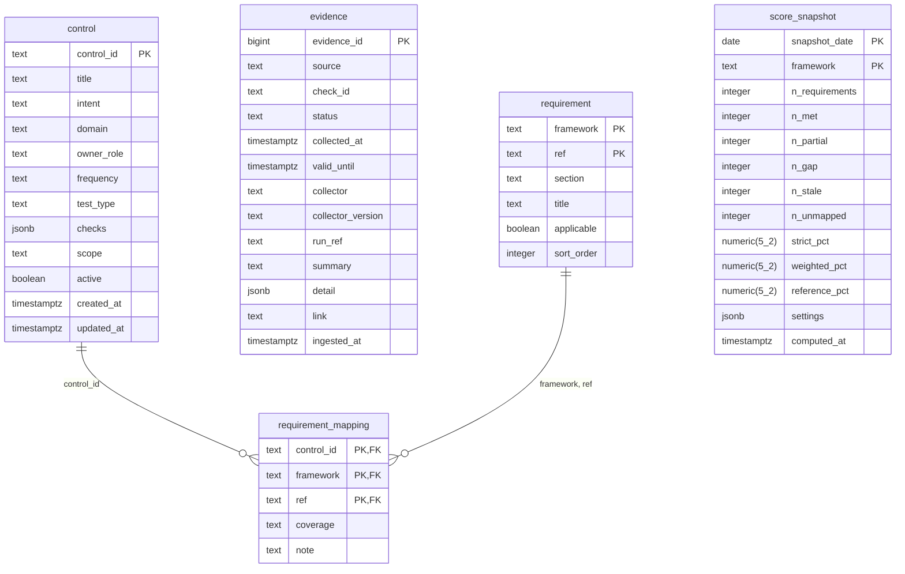

# ERD: compliance schema

<!-- GENERATED by AA-CIS-Infra db/gen_erd.py (infra/AA-CIS-Infra/.github/workflows/db-schema-dump.yml) - do not edit -->

Live catalog as of the newest CIS migration **468** (applied 2026-11-21). Owner: CIS (schema owner role `cis_owner`). 5 table(s), 0 view(s), 2 foreign key(s), 0 foreign key(s) in from other schemas.

The diagram shows every column. Full columns, indexes, grants and RLS: [DB schema reference](../db-schema-reference.md) (search for `compliance.<table>`). Generated file: change the schema through a migration, not this page.

Notation: `||` exactly one, `|o` zero or one (nullable FK), `o{` zero or more, `o|` zero or one (the FK is the child's PK or a unique key); a dashed line is a `NOT VALID` FK. Attribute comments are DM-6.1 tags (`pii:<class>`, `conf:<class>`). A quoted `"schema.table"` box is the parent table in another schema; foreign keys of other schemas that point here are listed below, and drawn on their own schema's page.

## Tables

| table | kind | columns | primary key | FKs out | FKs in | DM-6.1 tagged columns |
|---|---|---|---|---|---|---|
| `control` | table | 12 | `control_id` | 0 | 1 |  |
| `evidence` | table | 13 | `evidence_id` | 0 | 0 |  |
| `requirement` | table | 6 | `framework`, `ref` | 0 | 1 |  |
| `requirement_mapping` | table | 5 | `control_id`, `framework`, `ref` | 2 | 0 |  |
| `score_snapshot` | table | 13 | `snapshot_date`, `framework` | 0 | 0 |  |

## Foreign keys

| constraint | from | to | valid |
|---|---|---|---|
| `requirement_mapping_control_id_fkey` | `compliance.requirement_mapping` (control_id) | `compliance.control` (control_id) | yes |
| `requirement_mapping_requirement_fkey` | `compliance.requirement_mapping` (framework, ref) | `compliance.requirement` (framework, ref) | yes |

## Foreign keys in from other schemas

None.
