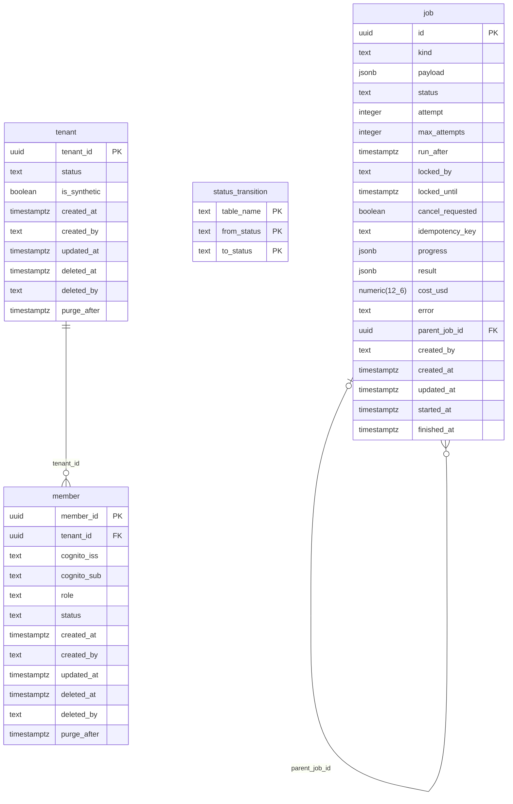

# ERD: crm schema

<!-- GENERATED by AA-CIS-Infra db/gen_erd.py (infra/AA-CIS-Infra/.github/workflows/db-schema-dump.yml) - do not edit -->

Live catalog as of the newest migration (applied 2026-10-23). Owner: crm (schema owner role `crm_owner`). 4 table(s), 1 view(s), 2 foreign key(s), 0 foreign key(s) in from other schemas.

The diagram shows every column. Full columns, indexes, grants and RLS: [DB schema reference](../db-schema-reference.md) (search for `crm.<table>`). Generated file: change the schema through a migration, not this page.

Notation: `||` exactly one, `|o` zero or one (nullable FK), `o{` zero or more, `o|` zero or one (the FK is the child's PK or a unique key); a dashed line is a `NOT VALID` FK. Attribute comments are DM-6.1 tags (`pii:<class>`, `conf:<class>`). A quoted `"schema.table"` box is the parent table in another schema; foreign keys of other schemas that point here are listed below, and drawn on their own schema's page.

## Tables

| table | kind | columns | primary key | FKs out | FKs in | DM-6.1 tagged columns |
|---|---|---|---|---|---|---|
| `job` | table | 21 | `id` | 1 | 1 |  |
| `member` | table | 12 | `member_id` | 1 | 0 |  |
| `status_transition` | table | 3 | `table_name`, `from_status`, `to_status` | 0 | 0 |  |
| `tenant` | table | 9 | `tenant_id` | 0 | 1 |  |
| `v_schema_versions` | view | 2 |  | 0 | 0 |  |

## Foreign keys

| constraint | from | to | valid |
|---|---|---|---|
| `job_parent_job_id_fkey` | `crm.job` (parent_job_id) | `crm.job` (id) | yes |
| `member_tenant_id_fkey` | `crm.member` (tenant_id) | `crm.tenant` (tenant_id) | yes |

## Foreign keys in from other schemas

None.
