# ERD: crm schema

<!-- GENERATED by AA-CIS-Infra db/gen_erd.py (infra/AA-CIS-Infra/.github/workflows/db-schema-dump.yml) - do not edit -->

Live catalog as of the newest migration (applied 2026-10-24). Owner: crm (schema owner role `crm_owner`). 45 table(s), 5 view(s), 82 foreign key(s), 0 foreign key(s) in from other schemas.

```mermaid
erDiagram
    audit_event {
        uuid event_id PK
        uuid tenant_id FK
        timestamptz at PK
    }
    audit_event_legacy {
        uuid event_id PK
        uuid tenant_id FK
        timestamptz at PK
    }
    audit_event_p202611 {
        uuid event_id PK
        uuid tenant_id FK
        timestamptz at PK
    }
    audit_event_p202612 {
        uuid event_id PK
        uuid tenant_id FK
        timestamptz at PK
    }
    audit_event_p202701 {
        uuid event_id PK
        uuid tenant_id FK
        timestamptz at PK
    }
    audit_export_manifest {
        uuid manifest_id PK
    }
    audit_export_tenant {
        uuid tenant_id PK, FK
    }
    client_link {
        uuid link_id PK
        uuid tenant_id FK
        uuid trip_id FK
        uuid traveler_id FK
        bytea token_hash UK "conf:credential"
        uuid reissued_from FK
        uuid dispatch_id FK
    }
    consent {
        uuid consent_id PK
        uuid tenant_id FK
        uuid traveler_id FK
        uuid submission_id FK
    }
    dispatch_queue {
        uuid dispatch_id PK
        uuid tenant_id FK
        uuid traveler_id FK
        uuid trip_id FK
    }
    document {
        uuid document_id PK
        uuid tenant_id FK
        uuid trip_id FK
        uuid traveler_id FK
        text s3_key UK
    }
    erasure_request {
        uuid request_id PK
        uuid tenant_id FK
    }
    form_definition {
        uuid form_definition_id PK
        uuid tenant_id FK
    }
    form_submission {
        uuid submission_id PK
        uuid tenant_id FK
        uuid intake_form_id FK
        uuid trip_id FK
        uuid traveler_id FK
        uuid client_link_id FK
    }
    intake_form {
        uuid intake_form_id PK
        uuid tenant_id FK
        text public_key UK
        uuid form_definition_id FK
        uuid default_owner_member_id FK
    }
    integration_credential {
        uuid integration_credential_id PK
        uuid tenant_id FK
    }
    job {
        uuid id PK
        uuid parent_job_id FK
    }
    legal_hold {
        uuid hold_id PK
        uuid tenant_id FK
    }
    lifecycle_run {
        uuid run_id PK
        uuid tenant_id FK
    }
    llm_call {
        uuid llm_call_id PK
        uuid tenant_id FK
    }
    llm_usage_daily {
        date day PK
        text stage PK
        text model PK
    }
    meeting_slot {
        uuid slot_id PK
        uuid tenant_id FK
        uuid trip_id FK
        uuid traveler_id FK
        uuid form_submission_id FK
    }
    member {
        uuid member_id PK
        uuid tenant_id FK
    }
    member_invitation {
        uuid invitation_id PK
        uuid tenant_id FK
        bytea token_hash UK
        uuid member_id FK
    }
    membership_feed_state {
        boolean singleton PK
    }
    membership_inbox {
        uuid event_id PK
    }
    note {
        uuid note_id PK
        uuid tenant_id FK
        uuid trip_id FK
        uuid traveler_id FK
    }
    owner_recovery_request {
        uuid request_id PK
        uuid tenant_id FK
        uuid candidate_member_id FK
    }
    placeholder_map {
        uuid placeholder_map_id PK
        uuid tenant_id FK
        uuid llm_call_id FK, UK
    }
    profile_history {
        uuid history_id PK
        uuid tenant_id FK
        uuid traveler_token FK
    }
    status_transition {
        text table_name PK
        text from_status PK
        text to_status PK
    }
    task {
        uuid task_id PK
        uuid tenant_id FK
        uuid trip_id FK
        uuid assignee_member_id FK
    }
    tenant {
        uuid tenant_id PK
    }
    tenant_entitlement {
        uuid tenant_id PK, FK
    }
    tenant_key {
        uuid tenant_key_id PK
        uuid tenant_id FK
    }
    tenant_settings {
        uuid tenant_id PK, FK
    }
    traveler {
        uuid traveler_id PK
        uuid tenant_id FK
        uuid owner_member_id FK
        uuid referrer_traveler_id FK
    }
    traveler_health {
        uuid health_id PK
        uuid tenant_id FK
        uuid traveler_id FK
        uuid consent_id FK
    }
    traveler_profile {
        uuid traveler_token PK
        uuid tenant_id FK
    }
    traveler_relation {
        uuid relation_id PK
        uuid tenant_id FK
        uuid from_traveler_id FK
        uuid to_traveler_id FK
        uuid inverse_id FK
    }
    trip {
        uuid trip_id PK
        uuid tenant_id FK
        uuid owner_member_id FK
        uuid intake_form_id FK
    }
    trip_commitment {
        uuid commitment_id PK
        uuid tenant_id FK
        uuid trip_id FK
    }
    trip_party {
        uuid trip_party_id PK
        uuid tenant_id FK
        uuid trip_id FK
        uuid traveler_token FK
    }
    trip_stage_history {
        uuid history_id PK
        uuid tenant_id FK
        uuid trip_id FK
        uuid undo_of FK
    }
    trip_traveler {
        uuid trip_traveler_id PK
        uuid tenant_id FK
        uuid trip_id FK
        uuid traveler_id FK
    }
    tenant ||--o{ audit_event : "tenant_id"
    tenant ||--o{ audit_event_legacy : "tenant_id"
    tenant ||--o{ audit_event_p202611 : "tenant_id"
    tenant ||--o{ audit_event_p202612 : "tenant_id"
    tenant ||--o{ audit_event_p202701 : "tenant_id"
    tenant ||--o| audit_export_tenant : "tenant_id"
    dispatch_queue |o--o{ client_link : "tenant_id, dispatch_id"
    client_link |o--o{ client_link : "tenant_id, reissued_from"
    tenant ||--o{ client_link : "tenant_id"
    traveler |o--o{ client_link : "tenant_id, traveler_id"
    trip ||--o{ client_link : "tenant_id, trip_id"
    form_submission |o--o{ consent : "submission_id"
    tenant ||--o{ consent : "tenant_id"
    traveler ||--o{ consent : "traveler_id"
    tenant ||--o{ dispatch_queue : "tenant_id"
    traveler ||--o{ dispatch_queue : "tenant_id, traveler_id"
    trip |o--o{ dispatch_queue : "tenant_id, trip_id"
    tenant ||--o{ document : "tenant_id"
    traveler |o--o{ document : "tenant_id, traveler_id"
    trip |o--o{ document : "tenant_id, trip_id"
    tenant ||--o{ erasure_request : "tenant_id"
    tenant ||--o{ form_definition : "tenant_id"
    client_link |o--o{ form_submission : "tenant_id, client_link_id, trip_id, traveler_id"
    intake_form |o--o{ form_submission : "intake_form_id"
    tenant ||--o{ form_submission : "tenant_id"
    traveler |o--o{ form_submission : "traveler_id"
    trip |o--o{ form_submission : "trip_id"
    member |o--o{ intake_form : "default_owner_member_id"
    form_definition ||--o{ intake_form : "form_definition_id"
    tenant ||--o{ intake_form : "tenant_id"
    tenant ||--o{ integration_credential : "tenant_id"
    job |o--o{ job : "parent_job_id"
    tenant ||--o{ legal_hold : "tenant_id"
    tenant ||--o{ lifecycle_run : "tenant_id"
    tenant ||--o{ llm_call : "tenant_id"
    form_submission |o--o{ meeting_slot : "tenant_id, form_submission_id"
    tenant ||--o{ meeting_slot : "tenant_id"
    traveler |o--o{ meeting_slot : "tenant_id, traveler_id"
    trip |o--o{ meeting_slot : "tenant_id, trip_id"
    tenant ||--o{ member : "tenant_id"
    member |o--o{ member_invitation : "tenant_id, member_id"
    tenant ||--o{ member_invitation : "tenant_id"
    tenant ||--o{ note : "tenant_id"
    traveler |o--o{ note : "traveler_id"
    trip |o--o{ note : "trip_id"
    member ||--o{ owner_recovery_request : "tenant_id, candidate_member_id"
    tenant ||--o{ owner_recovery_request : "tenant_id"
    llm_call ||--o{ placeholder_map : "tenant_id, llm_call_id"
    tenant ||--o{ placeholder_map : "tenant_id"
    traveler_profile ||--o{ profile_history : "tenant_id, traveler_token"
    tenant ||--o{ profile_history : "tenant_id"
    member |o--o{ task : "assignee_member_id"
    tenant ||--o{ task : "tenant_id"
    trip |o--o{ task : "trip_id"
    tenant ||--o| tenant_entitlement : "tenant_id"
    tenant ||--o{ tenant_key : "tenant_id"
    tenant ||--o| tenant_settings : "tenant_id"
    member |o--o{ traveler : "owner_member_id"
    traveler |o--o{ traveler : "referrer_traveler_id"
    tenant ||--o{ traveler : "tenant_id"
    consent ||--o{ traveler_health : "consent_id"
    tenant ||--o{ traveler_health : "tenant_id"
    traveler ||--o{ traveler_health : "tenant_id, traveler_id"
    tenant ||--o{ traveler_profile : "tenant_id"
    traveler ||--o{ traveler_relation : "tenant_id, from_traveler_id"
    traveler_relation |o--o{ traveler_relation : "inverse_id"
    tenant ||--o{ traveler_relation : "tenant_id"
    traveler ||--o{ traveler_relation : "tenant_id, to_traveler_id"
    intake_form |o--o{ trip : "intake_form_id"
    member |o--o{ trip : "owner_member_id"
    tenant ||--o{ trip : "tenant_id"
    tenant ||--o{ trip_commitment : "tenant_id"
    trip ||--o{ trip_commitment : "tenant_id, trip_id"
    tenant ||--o{ trip_party : "tenant_id"
    traveler_profile ||--o{ trip_party : "traveler_token"
    trip ||--o{ trip_party : "trip_id"
    tenant ||--o{ trip_stage_history : "tenant_id"
    trip ||--o{ trip_stage_history : "trip_id"
    trip_stage_history |o--o{ trip_stage_history : "tenant_id, undo_of"
    tenant ||--o{ trip_traveler : "tenant_id"
    traveler ||--o{ trip_traveler : "traveler_id"
    trip ||--o{ trip_traveler : "trip_id"
```

The diagram shows key columns only (PK, FK, UK): the schema has more than 20 tables or 150 columns. Full columns, indexes, grants and RLS: [DB schema reference](../db-schema-reference.md) (search for `crm.<table>`). Generated file: change the schema through a migration, not this page.

Notation: `||` exactly one, `|o` zero or one (nullable FK), `o{` zero or more, `o|` zero or one (the FK is the child's PK or a unique key); a dashed line is a `NOT VALID` FK. Attribute comments are DM-6.1 tags (`pii:<class>`, `conf:<class>`). A quoted `"schema.table"` box is the parent table in another schema; foreign keys of other schemas that point here are listed below, and drawn on their own schema's page.

## Tables

| table | kind | columns | primary key | FKs out | FKs in | DM-6.1 tagged columns |
|---|---|---|---|---|---|---|
| `audit_event` | partitioned table | 15 | `event_id`, `at` | 1 | 0 |  |
| `audit_event_legacy` | table (partition) | 15 | `event_id`, `at` | 1 | 0 |  |
| `audit_event_p202611` | table (partition) | 15 | `event_id`, `at` | 1 | 0 |  |
| `audit_event_p202612` | table (partition) | 15 | `event_id`, `at` | 1 | 0 |  |
| `audit_event_p202701` | table (partition) | 15 | `event_id`, `at` | 1 | 0 |  |
| `audit_export_manifest` | table | 14 | `manifest_id` | 0 | 0 |  |
| `audit_export_tenant` | table | 6 | `tenant_id` | 1 | 0 |  |
| `client_link` | table | 19 | `link_id` | 5 | 2 | `token_hash` conf:credential |
| `consent` | table | 11 | `consent_id` | 3 | 1 |  |
| `dispatch_queue` | table | 19 | `dispatch_id` | 3 | 1 |  |
| `document` | table | 19 | `document_id` | 3 | 0 | `filename_enc` pii:free_text |
| `erasure_request` | table | 26 | `request_id` | 1 | 0 |  |
| `form_definition` | table | 12 | `form_definition_id` | 1 | 1 |  |
| `form_submission` | table | 23 | `submission_id` | 5 | 2 | `payload_enc` pii:contact |
| `intake_form` | table | 17 | `intake_form_id` | 3 | 2 |  |
| `integration_credential` | table | 17 | `integration_credential_id` | 1 | 0 | `account_ref` pii:contact, `secret_enc` conf:credential |
| `job` | table | 21 | `id` | 1 | 1 |  |
| `legal_hold` | table | 15 | `hold_id` | 1 | 0 |  |
| `lifecycle_run` | table | 7 | `run_id` | 1 | 0 |  |
| `llm_call` | table | 17 | `llm_call_id` | 1 | 1 |  |
| `llm_usage_daily` | table | 9 | `day`, `stage`, `model` | 0 | 0 |  |
| `meeting_slot` | table | 15 | `slot_id` | 4 | 0 |  |
| `member` | table | 12 | `member_id` | 1 | 6 |  |
| `member_invitation` | table | 20 | `invitation_id` | 2 | 0 |  |
| `membership_feed_state` | table | 7 | `singleton` | 0 | 0 |  |
| `membership_inbox` | table | 7 | `event_id` | 0 | 0 |  |
| `note` | table | 12 | `note_id` | 3 | 0 | `body_enc` pii:free_text |
| `owner_recovery_request` | table | 15 | `request_id` | 2 | 0 |  |
| `placeholder_map` | table | 14 | `placeholder_map_id` | 2 | 0 | `map_enc` pii:free_text |
| `profile_history` | table | 13 | `history_id` | 2 | 0 |  |
| `status_transition` | table | 3 | `table_name`, `from_status`, `to_status` | 0 | 0 |  |
| `task` | table | 19 | `task_id` | 3 | 0 |  |
| `tenant` | table | 12 | `tenant_id` | 0 | 38 |  |
| `tenant_entitlement` | table | 11 | `tenant_id` | 1 | 0 |  |
| `tenant_key` | table | 17 | `tenant_key_id` | 1 | 0 | `wrapped_dek` conf:credential |
| `tenant_settings` | table | 15 | `tenant_id` | 1 | 0 |  |
| `traveler` | table | 31 | `traveler_id` | 3 | 12 | `given_name_enc` pii:name, `family_name_enc` pii:name, `display_name_enc` pii:name, `email_enc` pii:contact, `phone_enc` pii:contact, `email_bidx` pii:contact, `phone_bidx` pii:contact, `name_bidx` pii:name, `name_token_bidx` pii:name, `dob_enc` pii:government_id, `nationality_enc` pii:government_id, `passport_no_enc` pii:government_id, `passport_expiry_enc` pii:government_id, `passport_country_enc` pii:government_id, `emergency_contact_enc` pii:emergency_contact, `profile_token_enc` pii:profile |
| `traveler_health` | table | 11 | `health_id` | 3 | 0 | `health_flags_enc` pii:health |
| `traveler_profile` | table | 29 | `traveler_token` | 1 | 2 |  |
| `traveler_relation` | table | 12 | `relation_id` | 4 | 1 |  |
| `trip` | table | 31 | `trip_id` | 3 | 11 | `title` pii:travel |
| `trip_commitment` | table | 13 | `commitment_id` | 2 | 0 |  |
| `trip_party` | table | 12 | `trip_party_id` | 3 | 0 |  |
| `trip_stage_history` | table | 13 | `history_id` | 3 | 1 |  |
| `trip_traveler` | table | 12 | `trip_traveler_id` | 3 | 0 |  |
| `v_ai_traveler_profile` | view | 21 |  | 0 | 0 |  |
| `v_ai_trip_context` | view | 14 |  | 0 | 0 |  |
| `v_ai_trip_party` | view | 4 |  | 0 | 0 |  |
| `v_insight_fact` | view | 8 |  | 0 | 0 |  |
| `v_schema_versions` | view | 2 |  | 0 | 0 |  |

## Foreign keys

| constraint | from | to | valid |
|---|---|---|---|
| `audit_event_tenant_fk` | `crm.audit_event` (tenant_id) | `crm.tenant` (tenant_id) | yes |
| `audit_event_tenant_id_fkey` | `crm.audit_event_legacy` (tenant_id) | `crm.tenant` (tenant_id) | yes |
| `audit_event_tenant_fk` | `crm.audit_event_p202611` (tenant_id) | `crm.tenant` (tenant_id) | yes |
| `audit_event_tenant_fk` | `crm.audit_event_p202612` (tenant_id) | `crm.tenant` (tenant_id) | yes |
| `audit_event_tenant_fk` | `crm.audit_event_p202701` (tenant_id) | `crm.tenant` (tenant_id) | yes |
| `audit_export_tenant_tenant_id_fkey` | `crm.audit_export_tenant` (tenant_id) | `crm.tenant` (tenant_id) | yes |
| `client_link_dispatch_fk` | `crm.client_link` (tenant_id, dispatch_id) | `crm.dispatch_queue` (tenant_id, dispatch_id) | yes |
| `client_link_reissued_fk` | `crm.client_link` (tenant_id, reissued_from) | `crm.client_link` (tenant_id, link_id) | yes |
| `client_link_tenant_id_fkey` | `crm.client_link` (tenant_id) | `crm.tenant` (tenant_id) | yes |
| `client_link_traveler_fk` | `crm.client_link` (tenant_id, traveler_id) | `crm.traveler` (tenant_id, traveler_id) | yes |
| `client_link_trip_fk` | `crm.client_link` (tenant_id, trip_id) | `crm.trip` (tenant_id, trip_id) | yes |
| `consent_submission_id_fkey` | `crm.consent` (submission_id) | `crm.form_submission` (submission_id) | yes |
| `consent_tenant_id_fkey` | `crm.consent` (tenant_id) | `crm.tenant` (tenant_id) | yes |
| `consent_traveler_id_fkey` | `crm.consent` (traveler_id) | `crm.traveler` (traveler_id) | yes |
| `dispatch_queue_tenant_id_fkey` | `crm.dispatch_queue` (tenant_id) | `crm.tenant` (tenant_id) | yes |
| `dispatch_queue_traveler_fk` | `crm.dispatch_queue` (tenant_id, traveler_id) | `crm.traveler` (tenant_id, traveler_id) | yes |
| `dispatch_queue_trip_fk` | `crm.dispatch_queue` (tenant_id, trip_id) | `crm.trip` (tenant_id, trip_id) | yes |
| `document_tenant_id_fkey` | `crm.document` (tenant_id) | `crm.tenant` (tenant_id) | yes |
| `document_traveler_fk` | `crm.document` (tenant_id, traveler_id) | `crm.traveler` (tenant_id, traveler_id) | yes |
| `document_trip_fk` | `crm.document` (tenant_id, trip_id) | `crm.trip` (tenant_id, trip_id) | yes |
| `erasure_request_tenant_id_fkey` | `crm.erasure_request` (tenant_id) | `crm.tenant` (tenant_id) | yes |
| `form_definition_tenant_id_fkey` | `crm.form_definition` (tenant_id) | `crm.tenant` (tenant_id) | yes |
| `form_submission_client_link_fk` | `crm.form_submission` (tenant_id, client_link_id, trip_id, traveler_id) | `crm.client_link` (tenant_id, link_id, trip_id, traveler_id) | yes |
| `form_submission_intake_form_id_fkey` | `crm.form_submission` (intake_form_id) | `crm.intake_form` (intake_form_id) | yes |
| `form_submission_tenant_id_fkey` | `crm.form_submission` (tenant_id) | `crm.tenant` (tenant_id) | yes |
| `form_submission_traveler_id_fkey` | `crm.form_submission` (traveler_id) | `crm.traveler` (traveler_id) | yes |
| `form_submission_trip_fk` | `crm.form_submission` (trip_id) | `crm.trip` (trip_id) | yes |
| `intake_form_default_owner_member_id_fkey` | `crm.intake_form` (default_owner_member_id) | `crm.member` (member_id) | yes |
| `intake_form_form_definition_id_fkey` | `crm.intake_form` (form_definition_id) | `crm.form_definition` (form_definition_id) | yes |
| `intake_form_tenant_id_fkey` | `crm.intake_form` (tenant_id) | `crm.tenant` (tenant_id) | yes |
| `integration_credential_tenant_id_fkey` | `crm.integration_credential` (tenant_id) | `crm.tenant` (tenant_id) | yes |
| `job_parent_job_id_fkey` | `crm.job` (parent_job_id) | `crm.job` (id) | yes |
| `legal_hold_tenant_id_fkey` | `crm.legal_hold` (tenant_id) | `crm.tenant` (tenant_id) | yes |
| `lifecycle_run_tenant_id_fkey` | `crm.lifecycle_run` (tenant_id) | `crm.tenant` (tenant_id) | yes |
| `llm_call_tenant_id_fkey` | `crm.llm_call` (tenant_id) | `crm.tenant` (tenant_id) | yes |
| `meeting_slot_submission_fk` | `crm.meeting_slot` (tenant_id, form_submission_id) | `crm.form_submission` (tenant_id, submission_id) | yes |
| `meeting_slot_tenant_id_fkey` | `crm.meeting_slot` (tenant_id) | `crm.tenant` (tenant_id) | yes |
| `meeting_slot_traveler_fk` | `crm.meeting_slot` (tenant_id, traveler_id) | `crm.traveler` (tenant_id, traveler_id) | yes |
| `meeting_slot_trip_fk` | `crm.meeting_slot` (tenant_id, trip_id) | `crm.trip` (tenant_id, trip_id) | yes |
| `member_tenant_id_fkey` | `crm.member` (tenant_id) | `crm.tenant` (tenant_id) | yes |
| `member_invitation_member_fk` | `crm.member_invitation` (tenant_id, member_id) | `crm.member` (tenant_id, member_id) | yes |
| `member_invitation_tenant_id_fkey` | `crm.member_invitation` (tenant_id) | `crm.tenant` (tenant_id) | yes |
| `note_tenant_id_fkey` | `crm.note` (tenant_id) | `crm.tenant` (tenant_id) | yes |
| `note_traveler_id_fkey` | `crm.note` (traveler_id) | `crm.traveler` (traveler_id) | yes |
| `note_trip_id_fkey` | `crm.note` (trip_id) | `crm.trip` (trip_id) | yes |
| `owner_recovery_candidate_fk` | `crm.owner_recovery_request` (tenant_id, candidate_member_id) | `crm.member` (tenant_id, member_id) | yes |
| `owner_recovery_request_tenant_id_fkey` | `crm.owner_recovery_request` (tenant_id) | `crm.tenant` (tenant_id) | yes |
| `placeholder_map_call_fk` | `crm.placeholder_map` (tenant_id, llm_call_id) | `crm.llm_call` (tenant_id, llm_call_id) | yes |
| `placeholder_map_tenant_id_fkey` | `crm.placeholder_map` (tenant_id) | `crm.tenant` (tenant_id) | yes |
| `profile_history_profile_fk` | `crm.profile_history` (tenant_id, traveler_token) | `crm.traveler_profile` (tenant_id, traveler_token) | yes |
| `profile_history_tenant_id_fkey` | `crm.profile_history` (tenant_id) | `crm.tenant` (tenant_id) | yes |
| `task_assignee_member_id_fkey` | `crm.task` (assignee_member_id) | `crm.member` (member_id) | yes |
| `task_tenant_id_fkey` | `crm.task` (tenant_id) | `crm.tenant` (tenant_id) | yes |
| `task_trip_id_fkey` | `crm.task` (trip_id) | `crm.trip` (trip_id) | yes |
| `tenant_entitlement_tenant_id_fkey` | `crm.tenant_entitlement` (tenant_id) | `crm.tenant` (tenant_id) | yes |
| `tenant_key_tenant_id_fkey` | `crm.tenant_key` (tenant_id) | `crm.tenant` (tenant_id) | yes |
| `tenant_settings_tenant_id_fkey` | `crm.tenant_settings` (tenant_id) | `crm.tenant` (tenant_id) | yes |
| `traveler_owner_member_id_fkey` | `crm.traveler` (owner_member_id) | `crm.member` (member_id) | yes |
| `traveler_referrer_traveler_id_fkey` | `crm.traveler` (referrer_traveler_id) | `crm.traveler` (traveler_id) | yes |
| `traveler_tenant_id_fkey` | `crm.traveler` (tenant_id) | `crm.tenant` (tenant_id) | yes |
| `traveler_health_consent_id_fkey` | `crm.traveler_health` (consent_id) | `crm.consent` (consent_id) | yes |
| `traveler_health_tenant_id_fkey` | `crm.traveler_health` (tenant_id) | `crm.tenant` (tenant_id) | yes |
| `traveler_health_traveler_fk` | `crm.traveler_health` (tenant_id, traveler_id) | `crm.traveler` (tenant_id, traveler_id) | yes |
| `traveler_profile_tenant_id_fkey` | `crm.traveler_profile` (tenant_id) | `crm.tenant` (tenant_id) | yes |
| `traveler_relation_from_fk` | `crm.traveler_relation` (tenant_id, from_traveler_id) | `crm.traveler` (tenant_id, traveler_id) | yes |
| `traveler_relation_inverse_id_fkey` | `crm.traveler_relation` (inverse_id) | `crm.traveler_relation` (relation_id) | yes |
| `traveler_relation_tenant_id_fkey` | `crm.traveler_relation` (tenant_id) | `crm.tenant` (tenant_id) | yes |
| `traveler_relation_to_fk` | `crm.traveler_relation` (tenant_id, to_traveler_id) | `crm.traveler` (tenant_id, traveler_id) | yes |
| `trip_intake_form_id_fkey` | `crm.trip` (intake_form_id) | `crm.intake_form` (intake_form_id) | yes |
| `trip_owner_member_id_fkey` | `crm.trip` (owner_member_id) | `crm.member` (member_id) | yes |
| `trip_tenant_id_fkey` | `crm.trip` (tenant_id) | `crm.tenant` (tenant_id) | yes |
| `trip_commitment_tenant_id_fkey` | `crm.trip_commitment` (tenant_id) | `crm.tenant` (tenant_id) | yes |
| `trip_commitment_trip_fk` | `crm.trip_commitment` (tenant_id, trip_id) | `crm.trip` (tenant_id, trip_id) | yes |
| `trip_party_tenant_id_fkey` | `crm.trip_party` (tenant_id) | `crm.tenant` (tenant_id) | yes |
| `trip_party_traveler_token_fkey` | `crm.trip_party` (traveler_token) | `crm.traveler_profile` (traveler_token) | yes |
| `trip_party_trip_id_fkey` | `crm.trip_party` (trip_id) | `crm.trip` (trip_id) | yes |
| `trip_stage_history_tenant_id_fkey` | `crm.trip_stage_history` (tenant_id) | `crm.tenant` (tenant_id) | yes |
| `trip_stage_history_trip_id_fkey` | `crm.trip_stage_history` (trip_id) | `crm.trip` (trip_id) | yes |
| `trip_stage_history_undo_fk` | `crm.trip_stage_history` (tenant_id, undo_of) | `crm.trip_stage_history` (tenant_id, history_id) | yes |
| `trip_traveler_tenant_id_fkey` | `crm.trip_traveler` (tenant_id) | `crm.tenant` (tenant_id) | yes |
| `trip_traveler_traveler_id_fkey` | `crm.trip_traveler` (traveler_id) | `crm.traveler` (traveler_id) | yes |
| `trip_traveler_trip_id_fkey` | `crm.trip_traveler` (trip_id) | `crm.trip` (trip_id) | yes |

## Foreign keys in from other schemas

None.
