# ERD design: crm schema

<!-- erd-design schema=crm enforce=false implied-fk=tenant_id:tenant -->

Design ERD of schema `crm`, owned by AA-Partner (migrations `crm-NNN`, byte copy in AA-CIS-Infra
`db/migrations/crm/`). The schema is live: AA-932 created the schema and the roles, `crm-001` (base template,
AA-933) the first tables, and the slices after it the rest (78 tables and 6 views at `crm-023`, schema reference of
28/10/2026). This page is the diagram the migration PRs are reviewed against.

**Not in sync with the live schema yet** (28/10/2026, table names only; the drift check stays report only; group F
redrawn for crm-024, AA-952, 30/10/2026: `invoice`, `invoice_line`, `invoice_sequence`, `payment`, `refund_request`
and `payment_provider_account` match the migration once it is applied; the agreements part of group E redrawn for
crm-025, AA-955, 30/10/2026: `agreement_doc`, `terms_acceptance`, `signature_request` and `signature_event` match the
migration once it is applied):

- On this page, not live: `ai_draft`, `calendar_connection`, `campaign`, `campaign_recipient`, `commission`,
  `export_job`, `incident_flag`, `insight_aggregate`, `insight_fact`, `metric_daily`, `ops_release`,
  `outbox`, `release_note`, `spend_budget`,
  `supplier_manifest_export`, `support_grant`, `support_session`, `tag`, `tag_link`,
  `traveler_flight`, `trip_stage_transition`, `unsubscribe_token`, `voice_profile`, `workflow_rule`, `workflow_run`,
  `workflow_template` (slices not built yet, or renamed).
- Live, not on this page: `aa_catalog_state`, `aa_catalog_tour`, `aa_content` (described in text only), `aa_request`,
  `audit_export_tenant`, `booking_feed_state`, `legal_hold`, `lifecycle_run`, `llm_usage_daily`, `mail_import`,
  `member_invitation`, `membership_feed_state`, `membership_inbox`, `status_transition`, `studio_invitation`,
  `trip_commitment`, and the `audit_event` partitions.

Rule 7 of the [design ERD rules](README.md) asks each migration PR to update this page; the owner decides whether to
redraw it from the live dump and switch it to `enforce=true`. After every DB Migrate apply, the drift check of the DB Schema Dump workflow compares it with the
live catalog (see [design ERDs](README.md)).

Sources, in order of precedence:

1. [CRM final design §5](../../../audits/2026-10-21-S246-crm-design-v3/final/crm-design-final.md#5-data-model-and-privacy-f1f5)
   and its [errata S247](../../../audits/2026-10-21-S246-crm-design-v3/final/errata-s247-byo.md) (bring-your-own
   integrations).
2. [Design v3 §3.3](../../../audits/2026-10-21-S246-crm-design-v3/design-v3.md#33-tables-about-76-in-11-groups-full-columns-in-data-privacy-integrationsmd-2-unless-changed-here)
   (the table list) and the column lists in the
   [data and privacy lane §2](../../../audits/2026-10-21-S246-crm-design-v3/lanes/data-privacy-integrations.md#2-data-model-schema-crm).
3. The `crm.*` retention rows of [data standards DM-7](../../data-standards/02-data-management.md) (88 table names).

## How to read this page

- **Keys only.** Each box shows the primary key (`PK`), the foreign keys (`FK`), single-column unique keys (`UK`) and
  the column that names the state (`stage`, `status`). Full columns stay in the lane §2. Attribute comments are the
  DM-6.1 tags the column will carry.
- **Edges.** The parent is on the left, the child on the right. The label is the child's FK column list, so the
  drift check can compare it with the live `FOREIGN KEY` columns. `|o` marks a nullable FK.
- **The tenant edge is implied.** Every box with a `tenant_id ... FK` attribute has an FK `tenant_id` to `tenant`
  (the marker comment under the title says so). Drawing about 80 such lines would hide everything else.
- **One box per table.** A table has its attribute block in exactly one diagram. A bare name in another diagram is
  a reference to that box.
- **Not drawn:** soft keys to other apps (`bk_hold_id`, `bk_booking_id`, `departure_id`, `aa_component_ref`,
  `cis_pack_id`, CIS place ids), which are text ids under DM-4.2, and the Booking-owned objects (`b2b_*`,
  `departure`), which are Booking's design ([final design §5.3](../../../audits/2026-10-21-S246-crm-design-v3/final/crm-design-final.md#53-booking-owned-additions-aa-booking-bk-nnn-no-pii)).

## Overview: the trip is the folder

The core path from an agency to money and messages. Boxes are defined in the group diagrams below.

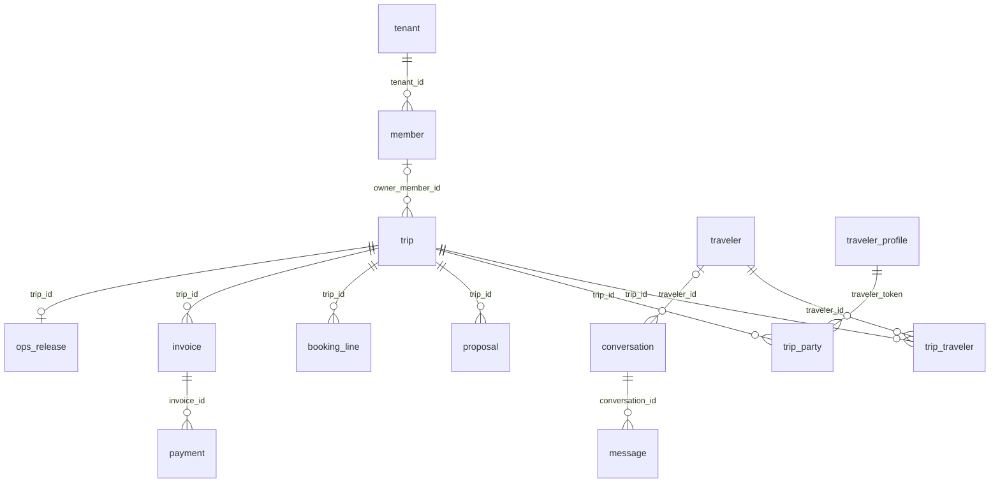

`traveler` (F1, identity) and `traveler_profile` (F2, pseudonymous) have **no FK** between them: the link is the
encrypted `profile_token_enc` column. The honest threat model is in the final design §5.5.

## A. Tenancy, keys and access (F4, F5, L1–L2)

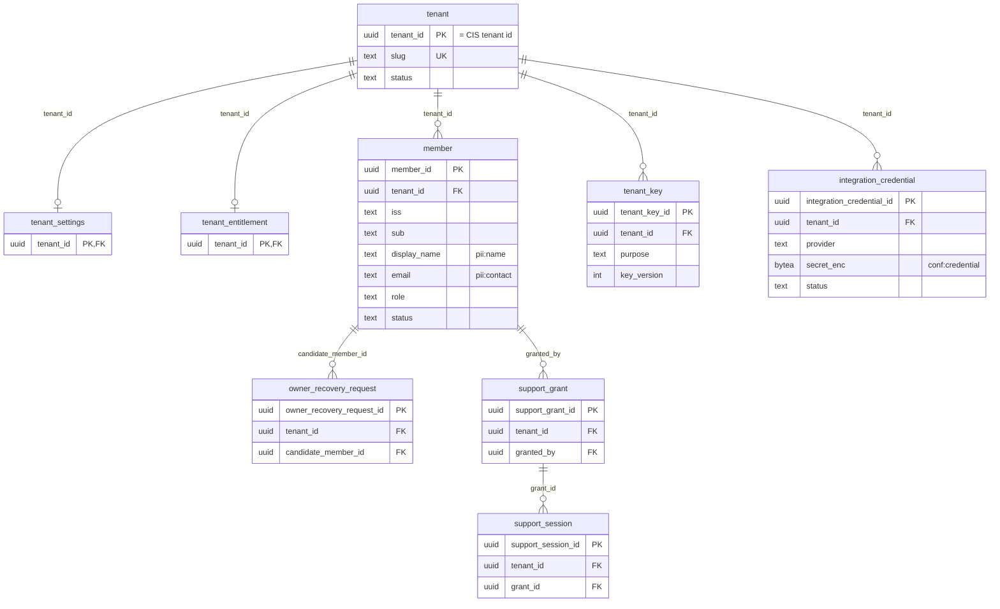

`member` is unique on `(tenant_id, iss, sub)`. `integration_credential.provider` takes the errata list (`twilio`,
`stripe_key`, `stripe_webhook_secret`, `google`, `microsoft`, `smtp`, `esign`) and `status` the four connection
states (`not_set_up`, `connected`, `needs_attention`, `disconnected`).

## B and C. F1 identity vault and F2 pseudonymous profile

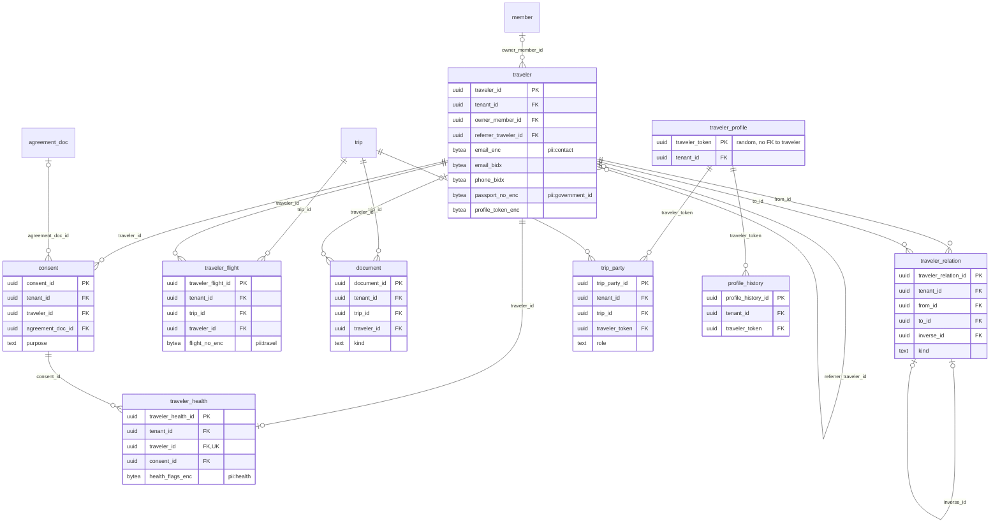

`consent`, like `terms_acceptance` and `signature_event`, is append-only (INSERT and SELECT only); only
`crm.erase_subject()` deletes it.

## D. Pipeline and tasks (M2, M10)

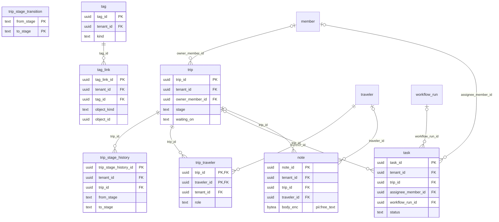

`trip_stage_transition` holds the allowed edges (no `tenant_id`, the Booking `trip_case_status_transitions`
pattern); a trigger checks each `trip_stage_history` row against it. `trip.stage` is
`inquiry|qualifying|proposal|booked|pre_departure|travelling|completed|lost|cancelled`, `trip.waiting_on`
`agency|client|aa|supplier|none`.

## D. Intake and metrics (M1, M16)

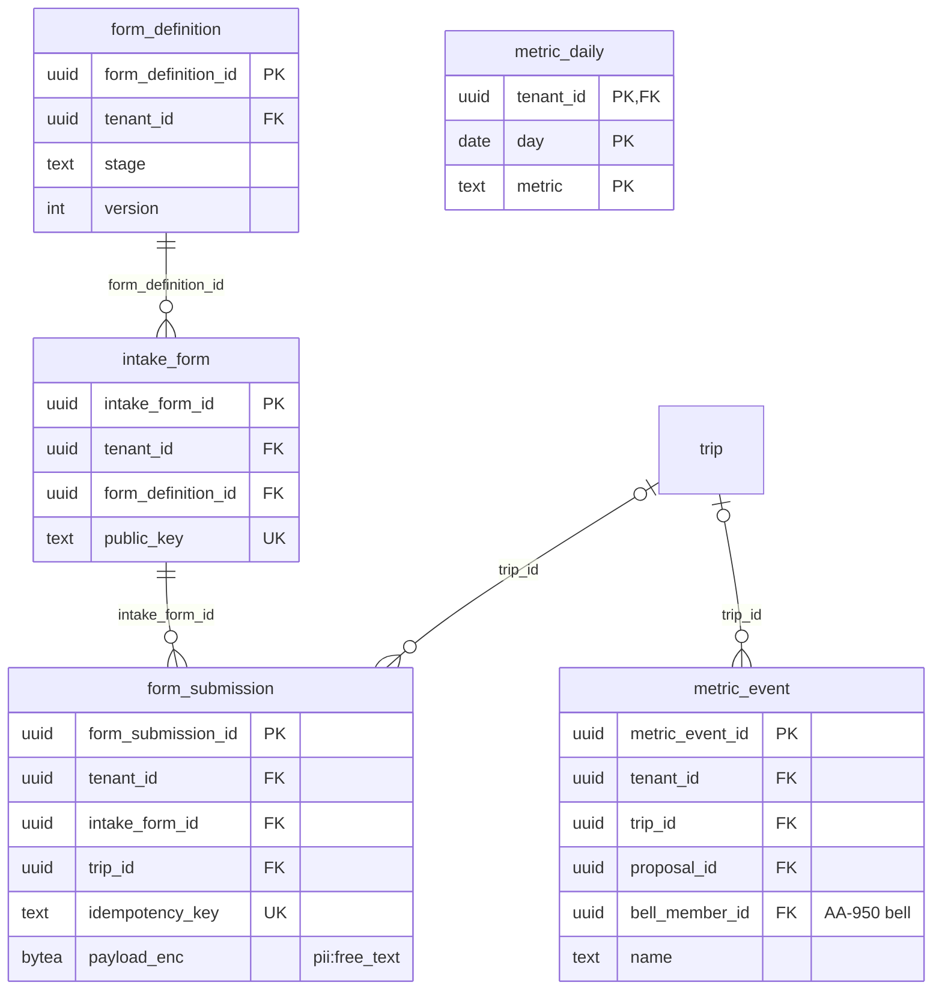

## E. Proposal builder (M3, M4)

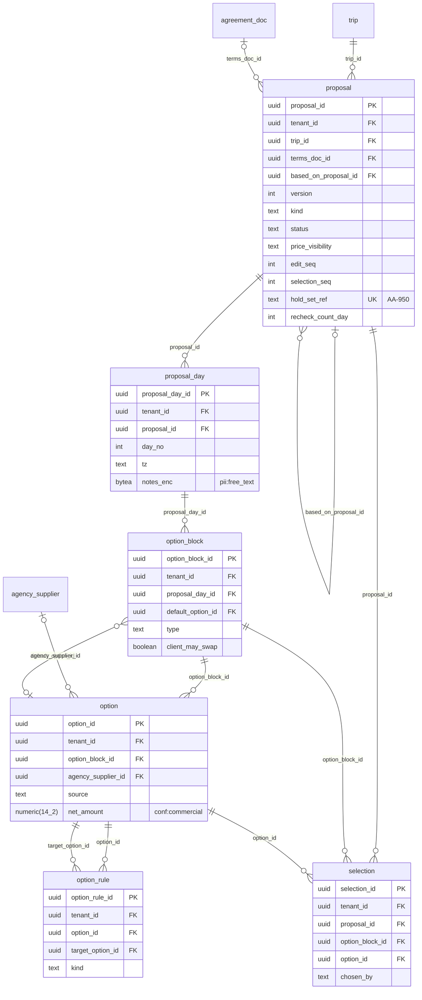

`proposal` is unique on `(trip_id, version)`; `kind` is `text` (AA-946) or `builder` (AA-949, crm-019).
`price_visibility` is `total_with_deltas` (default) or `total_only`. As built in crm-019: the option keeps its absolute
`net_amount` (the design's `net_delta` is computed against the block's default), the pick's `by` is `chosen_by`
(`by` is an SQL keyword), and `selection` is unique per `(proposal_id, option_block_id)`. The hold set reference,
unique on `(proposal_id, version)`, comes with CRM-21b (AA-950).

## E. Client access and agreements (M11, M12)

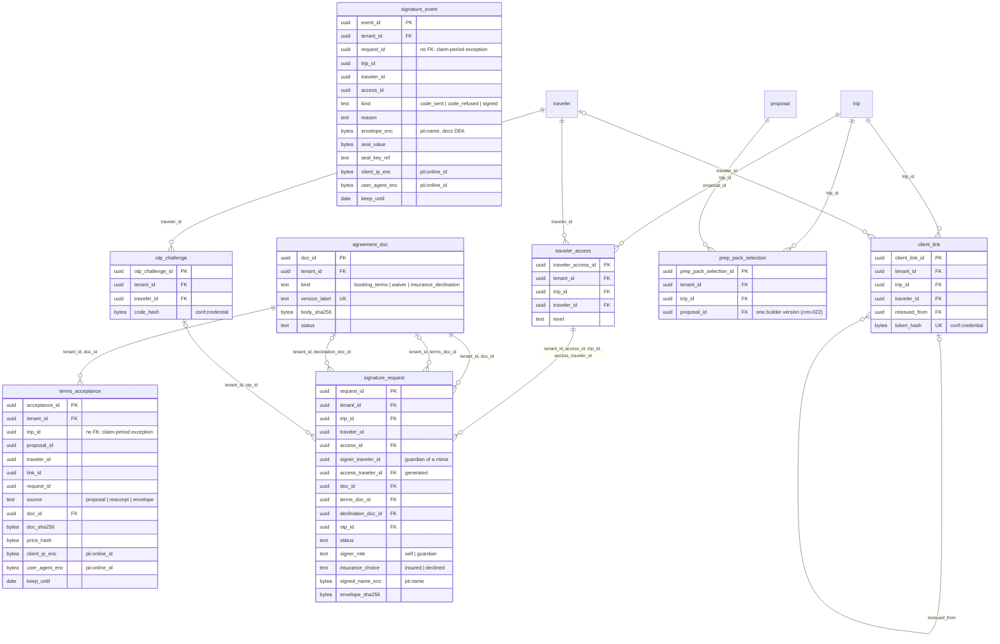

E-sign v1 (crm-025, AA-955): `signature_request` is one envelope per traveller (booking terms, waiver and, when the
traveller declines insurance, the insurance declination); a guardian (the adult lead) signs a minor's envelope from
their own portal access (`signer_traveler_id`, `signer_role = guardian`; the access key names `access_traveler_id`).
`terms_acceptance` (every acceptance of a booking terms version: at the proposal accept, a re-accept before the
deposit, inside an envelope) and `signature_event` (the signing log: code sent, code refused, signed with the sealed
envelope) are append-only and carry **no foreign key** on trip, proposal, traveller, link or request: they are the
DM-7 signed-agreement evidence and outlive a trip or traveller erasure until `keep_until` (trip end + 3 years, est.),
then `crm.lifecycle_purge_expired` deletes them; the agency offboarding deletes them with everything else.
`signature_request` itself still leaves with its trip or traveller.

## F. Money (M6, M7, M13, M15)

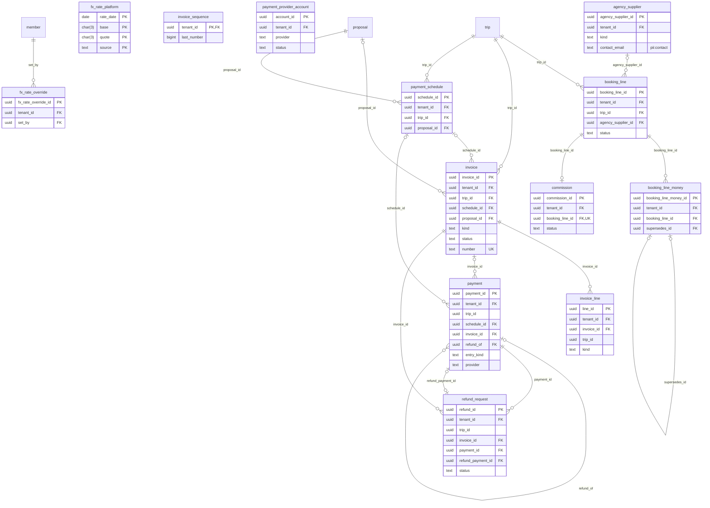

`booking_line_money` carries the margin (RLS adds `app.member_role IN ('owner', 'agent')`). Money rows freeze
their FX block; a correction is a new row with `supersedes_id`. `invoice.status` is
`draft|open|payment_claimed|paid|paid_unfulfillable|void|expired`. `fx_rate_platform` is reference data without
`tenant_id`. crm-024 (AA-952): an invoice names no traveller (the bill-to is the trip lead, read at render time);
`invoice_sequence` is the agency's gapless number; a refund is a `payment` row with `entry_kind = refund` and
`refund_of`, written only from an approved `refund_request` (`refund_payment_id`); `refund_request.decided_by` is
the deciding member's actor text, not a foreign key. The same-agency keys carry `trip_id` too
(`(tenant_id, invoice_id, trip_id)` and the like); the edges show the leading column only.

## G. Messages and channels (M5, M9)

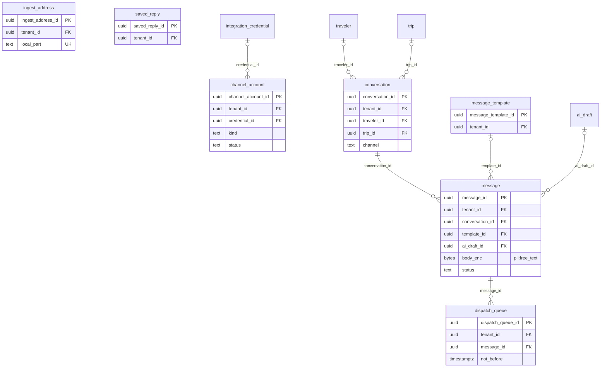

`message.status` is `queued|held_reconnect|sent|delivered|read|failed`; sender kinds are `agency_mailbox|system`
(errata S247: `platform` is removed). `message.external_id` is unique per channel.

## G. Campaigns and calendar (R14, R15)

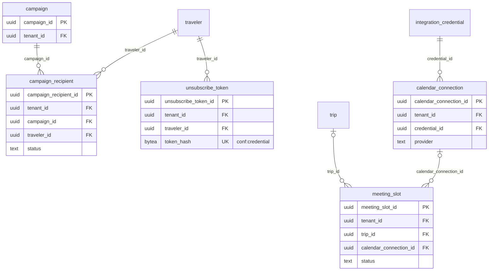

## H. Automation and AI (M10, M14)

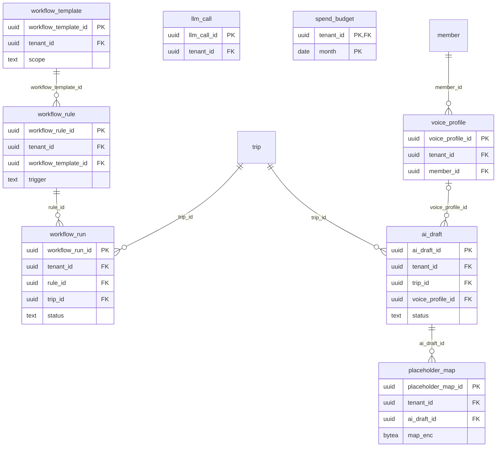

`llm_call` holds no prompt or output text and no `traveler_token`; `ai_draft` stores text with placeholders only.

## I. Ops hand-off and insights (M8, M17)

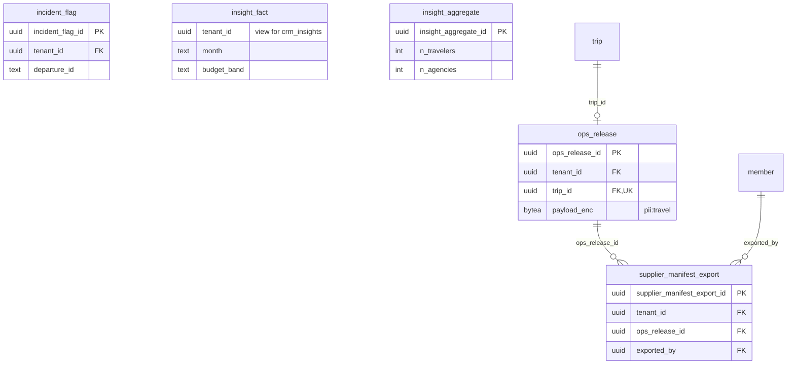

`insight_fact` is a view (no keys). `insight_aggregate` has **no `tenant_id`**: a cell is published only when
n ≥ 10 travellers and ≥ 3 agencies.

## J. Audit, deletion and platform (F5, M18)

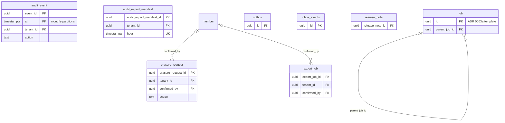

`job`, `outbox` and `inbox_events` follow the ADR 0003a and contracts templates (`id` keys, ids-only payloads,
`inbox_events` unique on `(source, contract, idempotency_key)`); `crm.job` has no RLS. `audit_event` is partitioned
by month, so its primary key includes `at`. `release_note` is platform data without `tenant_id`.

### Platform: AA content cache (crm-022, AA-951)

`crm.aa_content` (PK `content_id`, `kind` prep_pack | starter_template | campaign_block) caches the AA-authored content
CIS serves on `catalog.http.v1` `/aa-content` (prep packs for "Before you go", starter message templates). Platform
reference data: no `tenant_id`, no personal data; refreshed by `crm_catalog_sync`. `prep_pack_selection` copies the
pinned pack version per builder version; `message_template` holds the agency library (one AA starter copy per group
and locale, unique `(tenant_id, aa_group_key, locale)`).

## Open points for the migration PRs

Choices this page makes where the sources are silent. The PR that creates the table either follows them or changes
this page in the same PR (the drift check reads this page).

| Point | This page | Decide in |
|---|---|---|
| Primary keys | `<table>_id uuid` (the lane's own names: `tenant_id`, `member_id`, `trip_id`); natural keys for `tenant_settings`, `tenant_entitlement`, `metric_daily`, `spend_budget`, `fx_rate_platform`, `trip_stage_transition`, `trip_traveler`; template `id` for `job`, `outbox`, `inbox_events` | AA-933 (`crm-001` base template) |
| Tenant FK form | Single-column `tenant_id` to `tenant` on every tenant table; child FKs single-column. A composite `(tenant_id, <parent>_id)` FK is the alternative that makes a cross-tenant link impossible even for the owner role | AA-933 |
| `trip_stage_transition` | Global rows without `tenant_id` (Booking pattern), although DM-7 lists it with the tenant configuration tables | AA-943 |
| Inferred FKs | `form_submission.intake_form_id`, `workflow_rule.workflow_template_id`, `meeting_slot.calendar_connection_id`, `booking_line_money.booking_line_id` (the lane says `line_id`) | the card that creates each table |
| Errata additions | The data-request log and the owner's shared-responsibility acknowledgement (errata §1, CRM-31 and CRM-35) have no table name or DM-7 row yet; they are not drawn | AA-962, AA-967 (DM-7 row first, DM-7.1) |
