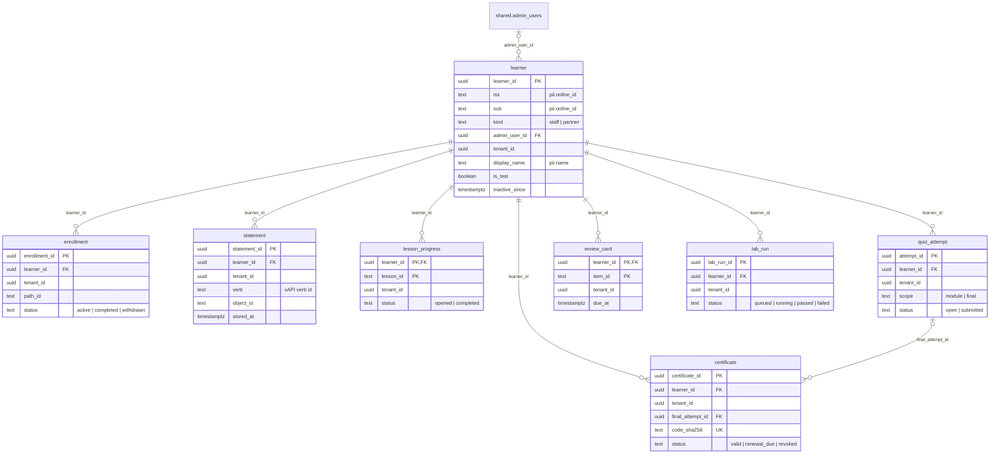
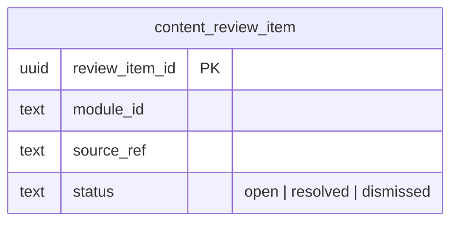

# ERD design: learn schema

<!-- erd-design schema=learn enforce=false -->

Design ERD of schema `learn`, owned by AA-CIS-App in the CIS migration key space (decision D3 of the
[AA Academy research](../../../research/lms/README.md#9-decisions-for-the-tech-lead); root
[ADR 0022](../../../adr/0022-aa-academy-learning-platform.md)). The schema does not exist yet: the CIS migration that
creates it (planned as CIS 420) is reviewed against this page. The drift check reports "not live yet" until it is
applied; the root PR after the first in-sync dump switches the marker to `enforce=true`.

Sources, in order of precedence:

1. [Research §5.4](../../../research/lms/README.md#54-target-architecture) (target architecture),
   [§4.3](../../../research/lms/README.md#43-completion-criteria) (completion),
   [§6.4](../../../research/lms/README.md#64-drift-checks) (drift and content review items) and
   [§7.2](../../../research/lms/README.md#72-learner-data-and-privacy) (privacy).
2. The learn bundle format in the header of `tools/docs/build_learn_bundle.py`: the ids the tables store (path id,
   module id, lesson id, quiz item id, bundle sha) are the manifest's.
3. The `learn.*` retention rows of [data standards DM-7](../../data-standards/02-data-management.md).

## How to read this page

- **Keys only, plus the state column.** Attribute comments are the DM-6.1 tags the column carries. Full columns are
  in the migration.
- **Learner key.** A learner is a verified identity `(iss, sub)` (ADR 0006): one row per person who opened the
  academy. Staff learners point at their `shared.admin_users` row; agency learners (P7, decision D6) carry their
  `tenant_id` instead.
- **Tenant column on every learner-data table.** `tenant_id` is NULL for staff rows and set for agency rows (P7). It
  is a soft key to `shared.tenants.tenant_id` (no FK, like the TripPlanner tables), so no tenant edge is drawn. Each
  of these tables gets the CIS row-level security template now (ENABLE, a `tenant_isolation` policy TO
  `aa_app_user`, a `<table>_cis_app_all` policy TO `cis_app`), so P7 adds no table rewrite. `aa_app_user` holds no
  privilege on the schema until P7.
- **Content ids are text.** Paths, modules, lessons and quiz items live in the learn bundle, not in the database, so
  `path_id`, `module_id`, `lesson_id` and `item_id` are text ids from the manifest and no edge points at them.
- **Deleting a learner deletes everything under it** (`ON DELETE CASCADE` on every `learner_id`); the retention job is
  the only path that deletes, and the append-only guard of `statement` lets a delete through only on that path.

## Learner records

## Content review

A content review item belongs to the course, not to a learner: one row per (module, lesson, cited source, current
hash) the learn manifest marks stale, opened on manifest reload and by the daily drift scan, closed by the module
owner from the CIS admin. It has no tenant column and no personal data except the actor id of the person who resolved
it (`admin:<uuid>`).

## Tables

| Table | One row per | Notes |
|---|---|---|
| `learner` | verified identity `(iss, sub)`, unique | `kind` `staff` (needs `admin_user_id`, `tenant_id` NULL) or `partner` (needs `tenant_id`, P7). `display_name` is a snapshot refreshed on sign-in, shown on the certificate verify page. `is_test` marks the Dev E2E identities, kept out of team stats. `inactive_since` starts the retention clock when the staff account is deactivated or gone |
| `enrollment` | learner and path, unique | `status`; `completed_at` set when the path is complete |
| `statement` | learning event, xAPI-shaped (actor = the learner, verb, object, result, context, timestamp, stored) | Append-only: a trigger refuses `UPDATE` always and `DELETE` unless the retention purge sets its transaction flag. Holds the bundle sha and module version the event was made against |
| `lesson_progress` | learner and lesson | `opened_at`, `completed_at`, the module version read |
| `quiz_attempt` | one quiz sitting | `scope` `module` (one module quiz) or `final` (the path's final quiz). Bound to the item ids drawn, the bundle sha and the module version(s); `score_pct`, `passed`, the submitted answers; graded on the server |
| `review_card` | learner and quiz item | FSRS card state as the browser computed it (`ts-fsrs`), checked on the server: the due date only moves forward and the grade is the server's |
| `lab_run` | lab check run | Stays empty until the lab provisioner exists (P4b, decisions D14 and D15); the API answers `lab_closed` |
| `certificate` | path certificate | Open Badges 3.0 fields (achievement = the path, valid from / until, the pinned module versions); `code_sha256` is the SHA-256 of the 128-bit verification code, never the code itself; `expires_at` NULL unless the path is in the recertification list; `revoked_at` / `revoked_by` / `revoke_reason` when an admin revokes it |
| `content_review_item` | stale lesson source to review | See above |

## Open points

| Point | Decision on this page | Why |
|---|---|---|
| Row-level security form | ENABLE + FORCE on every table with `tenant_id`, with the X1 parity policies `<table>_cis_app_all` TO `cis_app` and `<table>_cis_owner_all` TO `cis_owner`, and `tenant_isolation` TO `aa_app_user` on `NULLIF(current_setting('app.tenant_id', true), '')::uuid` | Research §5.4 names FORCE; data standards SEC-7 delayed FORCE on CIS only until the X1 role split, done since X1 S18; every CIS tenant table since CIS 277 (360, 386, 388, 391, 394, 400, 407) has this form. An S280 implementation choice listed for the tech lead's review in ADR 0022 |
| Tenant edge | Soft key, no FK to `shared.tenants` | Staff rows have no tenant; P7 decides whether agency learners follow the tenant erasure saga by FK or by the saga's own step |
| `admin_user_id` FK | `ON DELETE SET NULL`; the retention job then treats the learner as inactive | A staff row is deactivated, not deleted, today; a deletion must not take the learning record with it before its window ends |
| Expired certificates | Not a stored status: `expires_at < now()` reads as expired | No job has to flip rows at midnight |
