# ERD design: tripplanner schema

<!-- erd-design schema=tripplanner enforce=true -->

Design ERD of schema `tripplanner` (owner TripPlanner, migrations `tp-NNN`). Started S247 (AA-894) as a copy of the live
model at **tp-017**, so the drift check passes today. It is **enforced**: the nightly DB Schema Dump fails its drift
step when the live tables, primary keys or foreign keys differ from this page. A TripPlanner migration that changes
them updates this page in the same change (root PR next to the migration copy).

Generated live view: [ERD: tripplanner schema](../tripplanner.md). Conventions: [design README](README.md).

```mermaid
erDiagram
    component_id_map {
        uuid old_id PK
        uuid new_id
        text matched_by
        timestamptz created_at
    }
    customers {
        uuid id PK
        text name "pii:name"
        text phone UK "pii:contact"
        text email UK "pii:contact"
        timestamptz created_at
        boolean contact_consent
        timestamptz contact_consent_at
    }
    itinerary_components {
        uuid id PK
        text source_tour_id
        integer source_day_index
        uuid destination_id FK
        text name
        text activity
        text intensity_level
        integer[] season_months
        text duration_hint
        text text_extract
        vector(1536) embedding
        timestamptz created_at
    }
    llm_spend_daily {
        date day PK
        text stage PK
        numeric cost_usd
        integer calls
        integer unpriced_calls
        timestamptz updated_at
    }
    narration_cache {
        text itinerary_hash PK
        text mode
        text narration
        text source
        integer days
        timestamptz created_at
        integer hits
        timestamptz last_hit_at
    }
    outbox {
        bigint id PK
        text event
        integer schema_version
        text idempotency_key UK
        uuid aggregate_id
        jsonb payload "pii:contact"
        timestamptz created_at
    }
    sessions {
        uuid id PK
        text guest_token UK "conf:credential"
        uuid customer_id FK
        timestamptz created_at
        timestamptz expires_at
        bytea guest_token_hash "conf:credential"
    }
    tour_day {
        text source_tour_id PK
        integer day_index PK
        text title
        text start_place
        text end_place
        text overnight_place
        uuid overnight_destination_id FK
        text[] places
        text extracted_by
        text source_hash
        timestamptz extracted_at
    }
    tour_graph_build {
        uuid id PK
        timestamptz built_at
        jsonb params
        jsonb stats
    }
    tour_graph_edge {
        uuid from_destination_id PK, FK
        uuid to_destination_id PK, FK
        integer tour_count
        text[] tour_ids
        float8 km
    }
    tour_graph_node {
        uuid destination_id PK, FK
        text name
        text country
        float8 lat
        float8 lng
        text[] tour_ids
        integer stop_count
        text[] activities
        text intensity_min
        text intensity_max
        integer[] season_months
    }
    tour_junction {
        uuid destination_a PK, FK
        uuid destination_b PK, FK
        float8 km
        boolean cross_border
    }
    tour_leg {
        text source_tour_id PK
        integer day_from PK
        integer day_to PK
        integer days
        uuid start_destination_id FK
        uuid end_destination_id FK
        uuid[] destination_ids
        text[] countries
        text[] activities
    }
    tour_stop {
        text source_tour_id PK
        integer day_index PK
        uuid destination_id FK
        text country
        text source
    }
    trip_drafts {
        uuid id PK
        uuid session_id FK
        text status
        jsonb itinerary "pii:travel"
        date date_start "pii:travel"
        date date_end "pii:travel"
        timestamptz created_at
        timestamptz updated_at
    }
    trip_events {
        bigint id PK
        uuid trip_id
        uuid session_id FK
        text event_type
        jsonb payload "pii:free_text"
        timestamptz created_at
    }
    "shared.destinations"
    "shared.destinations" ||--o{ itinerary_components : "destination_id"
    customers |o--o{ sessions : "customer_id"
    "shared.destinations" |o--o{ tour_day : "overnight_destination_id"
    "shared.destinations" ||--o{ tour_graph_edge : "from_destination_id"
    "shared.destinations" ||--o{ tour_graph_edge : "to_destination_id"
    "shared.destinations" ||--o| tour_graph_node : "destination_id"
    "shared.destinations" ||--o{ tour_junction : "destination_a"
    "shared.destinations" ||--o{ tour_junction : "destination_b"
    "shared.destinations" ||--o{ tour_leg : "end_destination_id"
    "shared.destinations" ||--o{ tour_leg : "start_destination_id"
    "shared.destinations" ||--o{ tour_stop : "destination_id"
    sessions ||--o{ trip_drafts : "session_id"
    sessions ||--o{ trip_events : "session_id"
```

