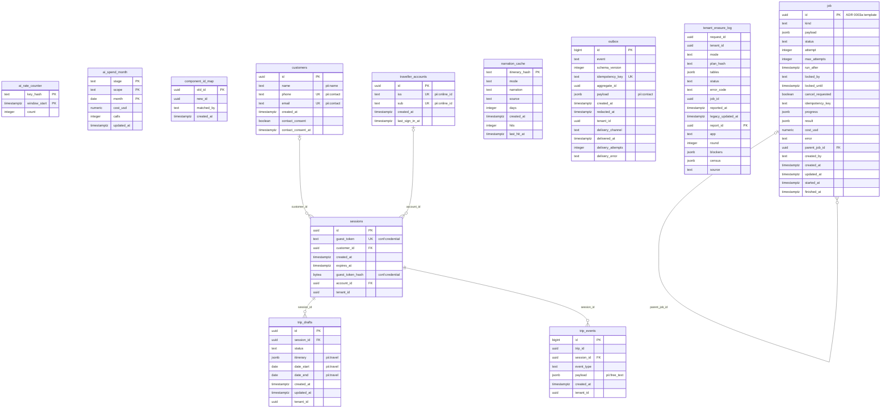

# ERD design: tripplanner schema

<!-- erd-design schema=tripplanner enforce=true -->

Design ERD of schema `tripplanner` (owner TripPlanner, migrations `tp-NNN`). Started S247 (AA-894) as a copy of the live
model at **tp-017**, re-synced to **tp-018** in S250 and to **tp-019** in S251 (`traveller_accounts` +
`sessions.account_id`, AA-908): the pilot place tables tp-018 dropped (`itinerary_components`,
`tour_day`, `tour_stop`, `tour_graph_*`, `tour_leg`, `tour_junction`) are gone from the page, so the drift check passes
again. Checked against the live dump at **tp-020** in S255: tp-020 (AA-992) adds three ops views only, so no table, key
or foreign key changed. Updated for **tp-021** (AA-861) in S257, in the same change as the migration: the new
`job` table (ADR 0003a job table template, kinds `tp_*`, self FK `parent_job_id`, drawn like `crm.job` and
`booking.job`) and the new nullable `outbox.redacted_at` (the redaction marker of DM-6.6; no key or FK change on
`outbox`). The `job` unique key on `idempotency_key` is a partial unique index, so it is not marked `UK` (the
generated page marks single-column unique keys without a predicate only). Updated for **tp-023** (AA-1015) in S262,
before the migration copy: the new `ai_rate_counter` table (the AI route limiter's fixed-window counters, composite
primary key `(key_hash, window_start)`, no foreign key, no personal data: `key_hash` is an HMAC). Updated for
**tp-024** (AA-1027 E5) in S265, merged right before the destructive apply: `llm_spend_daily` (the tp-010 spend
counter; no foreign key) is gone from the page. Updated for **tp-025** (AA-1038 R5 slice 1, root ADR 0019 d10) in S270: `sessions`,
`trip_drafts`, `trip_events` and `outbox` gain `tenant_id uuid NOT NULL` (backfilled to the demo tenant `aa-tripplanner`,
default from the `app.tenant_id` setting with that tenant as fallback) under shadow row-level security (ENABLE, not
FORCE; one permissive policy TO `tripplanner` per table). No table, primary key or foreign key changes: `tenant_id` is a
soft key to `shared.tenants.tenant_id`, so no tenant edge is drawn. Updated for **tp-026** (AA-1038 R5 slice 3, root ADR 0019 d11) in S272, next to the migration copy: `outbox` gains `delivery_channel`, `delivered_at`, `delivery_attempts` and `delivery_error` for the `lead.submitted` rows (a guest's trip request to one agency, kept until delivered) and the partial index `outbox_lead_pending_idx`; no table, primary key or foreign key changes. Updated for **tp-029** (AA-1041 slice 2) in S277, before the migration copy: the new `ai_spend_month` table (the planning chat's monthly spend sums per stage, scope `app` | `tenant:<uuid>` and UTC month; composite primary key `(stage, scope, month)`, no foreign key, no personal data). Noted for **tp-028** (AA-1038 FORCE slice) in S276: row-level security on the four tables becomes FORCED and enforcing (policies `<table>_tenant`, `<table>_system`, `<table>_owner_read`), the `tenant_id` default loses the demo fallback; no table, primary key or foreign key changes. Updated for **tp-030** and **tp-031** (AA-1093, tenant offboarding saga) in S279, next to the tp-031 migration copy: the new `tenant_erasure_log` table (tp-030 keyed it by `(request_id, mode)`; tp-031 reshapes it in place to the append-only report log of contract `tenant.erasure.v1`, primary key `report_id`, columns in live order: the renamed tp-030 columns first, then the added ones). Ids, codes, counts and hashes only, no personal data, soft `tenant_id` key (no FK). The page draws tables only; the views are listed on the generated page. It is **enforced**: the nightly DB Schema Dump fails its drift step when the live tables, primary keys or
foreign keys differ from this page. A TripPlanner migration that changes
them updates this page in the same change (root PR next to the migration copy).

Generated live view: [ERD: tripplanner schema](../tripplanner.md). Conventions: [design README](README.md).

