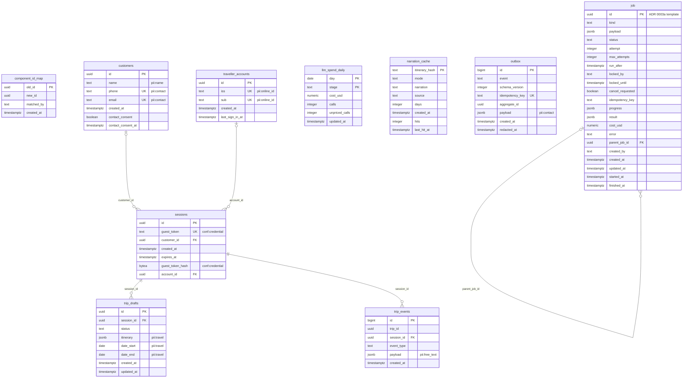

# ERD design: tripplanner schema

<!-- erd-design schema=tripplanner enforce=true -->

Design ERD of schema `tripplanner` (owner TripPlanner, migrations `tp-NNN`). Started S247 (AA-894) as a copy of the live
model at **tp-017**, re-synced to **tp-018** in S250 and to **tp-019** in S251 (`traveller_accounts` +
`sessions.account_id`, AA-908): the pilot place tables tp-018 dropped (`itinerary_components`,
`tour_day`, `tour_stop`, `tour_graph_*`, `tour_leg`, `tour_junction`) are gone from the page, so the drift check passes
again. Checked against the live dump at **tp-020** in S255: tp-020 (AA-992) adds three ops views only, so no table, key
or foreign key changed. Updated for **tp-021** (AA-861) in S257, in the same change as the migration: the new
`job` table (ADR 0003a job table template, kinds `tp_*`, self FK `parent_job_id`, drawn like `crm.job` and
`booking.job`) and the new nullable `outbox.redacted_at` (the redaction marker of DM-6.6; no key or FK change on
`outbox`). The `job` unique key on `idempotency_key` is a partial unique index, so it is not marked `UK` (the
generated page marks single-column unique keys without a predicate only). The page draws tables only; the views are listed on the generated page. It is **enforced**: the nightly DB Schema Dump fails its drift step when the live tables, primary keys or
foreign keys differ from this page. A TripPlanner migration that changes
them updates this page in the same change (root PR next to the migration copy).

Generated live view: [ERD: tripplanner schema](../tripplanner.md). Conventions: [design README](README.md).

