# ERD: geo schema

<!-- GENERATED by AA-CIS-Infra db/gen_erd.py (infra/AA-CIS-Infra/.github/workflows/db-schema-dump.yml) - do not edit -->

Live catalog as of the newest CIS migration **301** (applied 2026-10-29). Owner: CIS (schema owner role `cis_owner`). 18 table(s), 0 view(s), 28 foreign key(s), 0 foreign key(s) in from other schemas.

```mermaid
erDiagram
    component_redirect {
        uuid old_id PK
    }
    geocode_call {
        bigint id PK
    }
    graph_build {
        uuid build_id PK
    }
    graph_edge {
        uuid build_id PK, FK
        uuid from_destination_id PK, FK
        uuid to_destination_id PK, FK
    }
    graph_node {
        uuid build_id PK, FK
        uuid destination_id PK, FK
    }
    place_dedupe_country {
        text country PK
    }
    place_merge {
        uuid id PK
        uuid merged_id FK
        uuid keeper_id FK
    }
    place_name {
        text name_norm PK
        text country_norm PK
        text locality_norm PK
        uuid destination_id FK
        uuid place_card_id FK
    }
    place_outlier {
        uuid destination_id PK, FK
        text source_id PK
        integer day_index PK
    }
    place_pair_verdict {
        uuid lo_id PK, FK
        uuid hi_id PK, FK
        text input_hash PK
    }
    place_shape {
        uuid destination_id PK, FK
    }
    tour_build {
        text source_id PK
    }
    tour_day {
        text source_id PK
        integer day_index PK
        uuid overnight_destination_id FK
    }
    tour_junction {
        uuid build_id PK, FK
        uuid destination_a PK, FK
        uuid destination_b PK, FK
    }
    tour_leg {
        uuid build_id PK, FK
        text source_id PK
        integer day_from PK
        integer day_to PK
        uuid start_destination_id FK
        uuid end_destination_id FK
    }
    tour_place {
        uuid component_id PK
        uuid destination_id FK
        uuid place_card_id FK
    }
    tour_segment {
        uuid build_id PK, FK
        text source_id PK
        integer day_index PK
        uuid destination_id PK, FK
        uuid from_destination_id FK
        uuid to_destination_id FK
    }
    tour_stop {
        uuid build_id PK, FK
        text source_id PK
        integer day_index PK
        uuid destination_id FK
    }
    "acp_shared.place_card"
    "shared.destinations"
    graph_build ||--o{ graph_edge : "build_id"
    "shared.destinations" ||--o{ graph_edge : "from_destination_id"
    "shared.destinations" ||--o{ graph_edge : "to_destination_id"
    graph_build ||--o{ graph_node : "build_id"
    "shared.destinations" ||--o{ graph_node : "destination_id"
    "shared.destinations" ||--o{ place_merge : "keeper_id"
    "shared.destinations" ||--o{ place_merge : "merged_id"
    "shared.destinations" |o--o{ place_name : "destination_id"
    "acp_shared.place_card" |o--o{ place_name : "place_card_id"
    "shared.destinations" ||--o{ place_outlier : "destination_id"
    "shared.destinations" ||--o{ place_pair_verdict : "hi_id"
    "shared.destinations" ||--o{ place_pair_verdict : "lo_id"
    "shared.destinations" ||--o| place_shape : "destination_id"
    "shared.destinations" |o--o{ tour_day : "overnight_destination_id"
    graph_build ||--o{ tour_junction : "build_id"
    "shared.destinations" ||--o{ tour_junction : "destination_a"
    "shared.destinations" ||--o{ tour_junction : "destination_b"
    graph_build ||--o{ tour_leg : "build_id"
    "shared.destinations" ||--o{ tour_leg : "end_destination_id"
    "shared.destinations" ||--o{ tour_leg : "start_destination_id"
    "shared.destinations" |o--o{ tour_place : "destination_id"
    "acp_shared.place_card" |o--o{ tour_place : "place_card_id"
    graph_build ||--o{ tour_segment : "build_id"
    "shared.destinations" ||--o{ tour_segment : "destination_id"
    "shared.destinations" |o--o{ tour_segment : "from_destination_id"
    "shared.destinations" |o--o{ tour_segment : "to_destination_id"
    graph_build ||--o{ tour_stop : "build_id"
    "shared.destinations" ||--o{ tour_stop : "destination_id"
```

The diagram shows key columns only (PK, FK, UK): the schema has more than 20 tables or 150 columns. Full columns, indexes, grants and RLS: [DB schema reference](../db-schema-reference.md) (search for `geo.<table>`). Generated file: change the schema through a migration, not this page.

Notation: `||` exactly one, `|o` zero or one (nullable FK), `o{` zero or more, `o|` zero or one (the FK is the child's PK or a unique key); a dashed line is a `NOT VALID` FK. Attribute comments are DM-6.1 tags (`pii:<class>`, `conf:<class>`). A quoted `"schema.table"` box is the parent table in another schema; foreign keys of other schemas that point here are listed below, and drawn on their own schema's page.

## Tables

| table | kind | columns | primary key | FKs out | FKs in | DM-6.1 tagged columns |
|---|---|---|---|---|---|---|
| `component_redirect` | table | 5 | `old_id` | 0 | 0 |  |
| `geocode_call` | table | 8 | `id` | 0 | 0 |  |
| `graph_build` | table | 6 | `build_id` | 0 | 6 |  |
| `graph_edge` | table | 6 | `build_id`, `from_destination_id`, `to_destination_id` | 3 | 0 |  |
| `graph_node` | table | 12 | `build_id`, `destination_id` | 2 | 0 |  |
| `place_dedupe_country` | table | 7 | `country` | 0 | 0 |  |
| `place_merge` | table | 17 | `id` | 2 | 0 |  |
| `place_name` | table | 15 | `name_norm`, `country_norm`, `locality_norm` | 2 | 0 |  |
| `place_outlier` | table | 5 | `destination_id`, `source_id`, `day_index` | 1 | 0 |  |
| `place_pair_verdict` | table | 13 | `lo_id`, `hi_id`, `input_hash` | 2 | 0 |  |
| `place_shape` | table | 21 | `destination_id` | 1 | 0 |  |
| `tour_build` | table | 13 | `source_id` | 0 | 0 |  |
| `tour_day` | table | 16 | `source_id`, `day_index` | 1 | 0 |  |
| `tour_junction` | table | 5 | `build_id`, `destination_a`, `destination_b` | 3 | 0 |  |
| `tour_leg` | table | 10 | `build_id`, `source_id`, `day_from`, `day_to` | 3 | 0 |  |
| `tour_place` | table | 20 | `component_id` | 2 | 0 |  |
| `tour_segment` | table | 9 | `build_id`, `source_id`, `day_index`, `destination_id` | 4 | 0 |  |
| `tour_stop` | table | 6 | `build_id`, `source_id`, `day_index` | 2 | 0 |  |

## Foreign keys

| constraint | from | to | valid |
|---|---|---|---|
| `graph_edge_build_id_fkey` | `geo.graph_edge` (build_id) | `geo.graph_build` (build_id) | yes |
| `graph_edge_from_destination_id_fkey` | `geo.graph_edge` (from_destination_id) | `shared.destinations` (id) | yes |
| `graph_edge_to_destination_id_fkey` | `geo.graph_edge` (to_destination_id) | `shared.destinations` (id) | yes |
| `graph_node_build_id_fkey` | `geo.graph_node` (build_id) | `geo.graph_build` (build_id) | yes |
| `graph_node_destination_id_fkey` | `geo.graph_node` (destination_id) | `shared.destinations` (id) | yes |
| `place_merge_keeper_id_fkey` | `geo.place_merge` (keeper_id) | `shared.destinations` (id) | yes |
| `place_merge_merged_id_fkey` | `geo.place_merge` (merged_id) | `shared.destinations` (id) | yes |
| `place_name_destination_id_fkey` | `geo.place_name` (destination_id) | `shared.destinations` (id) | yes |
| `place_name_place_card_id_fkey` | `geo.place_name` (place_card_id) | `acp_shared.place_card` (card_id) | yes |
| `place_outlier_destination_id_fkey` | `geo.place_outlier` (destination_id) | `shared.destinations` (id) | yes |
| `place_pair_verdict_hi_id_fkey` | `geo.place_pair_verdict` (hi_id) | `shared.destinations` (id) | yes |
| `place_pair_verdict_lo_id_fkey` | `geo.place_pair_verdict` (lo_id) | `shared.destinations` (id) | yes |
| `place_shape_destination_id_fkey` | `geo.place_shape` (destination_id) | `shared.destinations` (id) | yes |
| `tour_day_overnight_destination_id_fkey` | `geo.tour_day` (overnight_destination_id) | `shared.destinations` (id) | yes |
| `tour_junction_build_id_fkey` | `geo.tour_junction` (build_id) | `geo.graph_build` (build_id) | yes |
| `tour_junction_destination_a_fkey` | `geo.tour_junction` (destination_a) | `shared.destinations` (id) | yes |
| `tour_junction_destination_b_fkey` | `geo.tour_junction` (destination_b) | `shared.destinations` (id) | yes |
| `tour_leg_build_id_fkey` | `geo.tour_leg` (build_id) | `geo.graph_build` (build_id) | yes |
| `tour_leg_end_destination_id_fkey` | `geo.tour_leg` (end_destination_id) | `shared.destinations` (id) | yes |
| `tour_leg_start_destination_id_fkey` | `geo.tour_leg` (start_destination_id) | `shared.destinations` (id) | yes |
| `tour_place_destination_id_fkey` | `geo.tour_place` (destination_id) | `shared.destinations` (id) | yes |
| `tour_place_place_card_id_fkey` | `geo.tour_place` (place_card_id) | `acp_shared.place_card` (card_id) | yes |
| `tour_segment_build_id_fkey` | `geo.tour_segment` (build_id) | `geo.graph_build` (build_id) | yes |
| `tour_segment_destination_id_fkey` | `geo.tour_segment` (destination_id) | `shared.destinations` (id) | yes |
| `tour_segment_from_destination_id_fkey` | `geo.tour_segment` (from_destination_id) | `shared.destinations` (id) | yes |
| `tour_segment_to_destination_id_fkey` | `geo.tour_segment` (to_destination_id) | `shared.destinations` (id) | yes |
| `tour_stop_build_id_fkey` | `geo.tour_stop` (build_id) | `geo.graph_build` (build_id) | yes |
| `tour_stop_destination_id_fkey` | `geo.tour_stop` (destination_id) | `shared.destinations` (id) | yes |

## Foreign keys in from other schemas

None.
