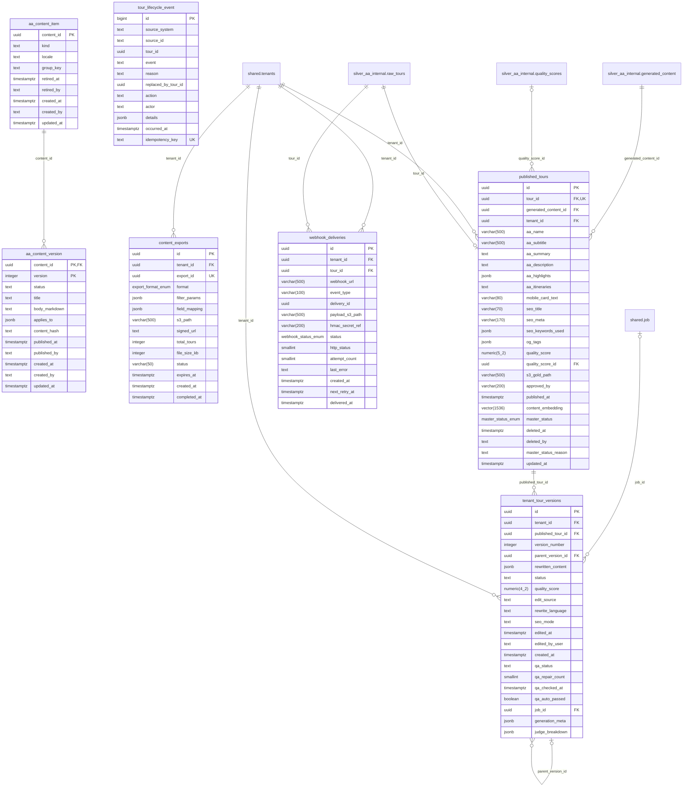

# ERD: gold_aa_internal schema

<!-- GENERATED by AA-CIS-Infra db/gen_erd.py (infra/AA-CIS-Infra/.github/workflows/db-schema-dump.yml) - do not edit -->

Live catalog as of the newest CIS migration **308** (applied 2026-10-30). Owner: CIS (schema owner role `cis_owner`). 7 table(s), 2 view(s), 12 foreign key(s), 1 foreign key(s) in from other schemas.

The diagram shows every column. Full columns, indexes, grants and RLS: [DB schema reference](../db-schema-reference.md) (search for `gold_aa_internal.<table>`). Generated file: change the schema through a migration, not this page.

Notation: `||` exactly one, `|o` zero or one (nullable FK), `o{` zero or more, `o|` zero or one (the FK is the child's PK or a unique key); a dashed line is a `NOT VALID` FK. Attribute comments are DM-6.1 tags (`pii:<class>`, `conf:<class>`). A quoted `"schema.table"` box is the parent table in another schema; foreign keys of other schemas that point here are listed below, and drawn on their own schema's page.

## Tables

| table | kind | columns | primary key | FKs out | FKs in | DM-6.1 tagged columns |
|---|---|---|---|---|---|---|
| `aa_content_item` | table | 9 | `content_id` | 0 | 1 |  |
| `aa_content_version` | table | 12 | `content_id`, `version` | 1 | 0 |  |
| `content_exports` | table | 14 | `id` | 1 | 0 |  |
| `published_tours` | table | 26 | `id` | 4 | 1 |  |
| `tenant_tour_versions` | table | 21 | `id` | 4 | 2 |  |
| `tour_lifecycle_event` | table | 12 | `id` | 0 | 0 |  |
| `v_aa_content_published` | view | 11 |  | 0 | 0 |  |
| `v_tour_liveness` | view | 6 |  | 0 | 0 |  |
| `webhook_deliveries` | table | 15 | `id` | 2 | 0 |  |

## Foreign keys

| constraint | from | to | valid |
|---|---|---|---|
| `aa_content_version_content_id_fkey` | `gold_aa_internal.aa_content_version` (content_id) | `gold_aa_internal.aa_content_item` (content_id) | yes |
| `content_exports_tenant_id_fkey` | `gold_aa_internal.content_exports` (tenant_id) | `shared.tenants` (tenant_id) | yes |
| `published_tours_generated_content_id_fkey` | `gold_aa_internal.published_tours` (generated_content_id) | `silver_aa_internal.generated_content` (id) | yes |
| `published_tours_quality_score_id_fkey` | `gold_aa_internal.published_tours` (quality_score_id) | `silver_aa_internal.quality_scores` (id) | yes |
| `published_tours_tenant_id_fkey` | `gold_aa_internal.published_tours` (tenant_id) | `shared.tenants` (tenant_id) | yes |
| `published_tours_tour_id_fkey` | `gold_aa_internal.published_tours` (tour_id) | `silver_aa_internal.raw_tours` (tour_id) | yes |
| `tenant_tour_versions_job_id_fkey` | `gold_aa_internal.tenant_tour_versions` (job_id) | `shared.job` (id) | yes |
| `tenant_tour_versions_parent_version_id_fkey` | `gold_aa_internal.tenant_tour_versions` (parent_version_id) | `gold_aa_internal.tenant_tour_versions` (id) | yes |
| `tenant_tour_versions_published_tour_id_fkey` | `gold_aa_internal.tenant_tour_versions` (published_tour_id) | `gold_aa_internal.published_tours` (id) | yes |
| `tenant_tour_versions_tenant_id_fkey` | `gold_aa_internal.tenant_tour_versions` (tenant_id) | `shared.tenants` (tenant_id) | yes |
| `webhook_deliveries_tenant_id_fkey` | `gold_aa_internal.webhook_deliveries` (tenant_id) | `shared.tenants` (tenant_id) | yes |
| `webhook_deliveries_tour_id_fkey` | `gold_aa_internal.webhook_deliveries` (tour_id) | `silver_aa_internal.raw_tours` (tour_id) | yes |

## Foreign keys in from other schemas

| constraint | from | to | valid |
|---|---|---|---|
| `review_queue_tenant_tour_version_id_fkey` | `silver_aa_internal.review_queue` (tenant_tour_version_id) | `gold_aa_internal.tenant_tour_versions` (id) | yes |
