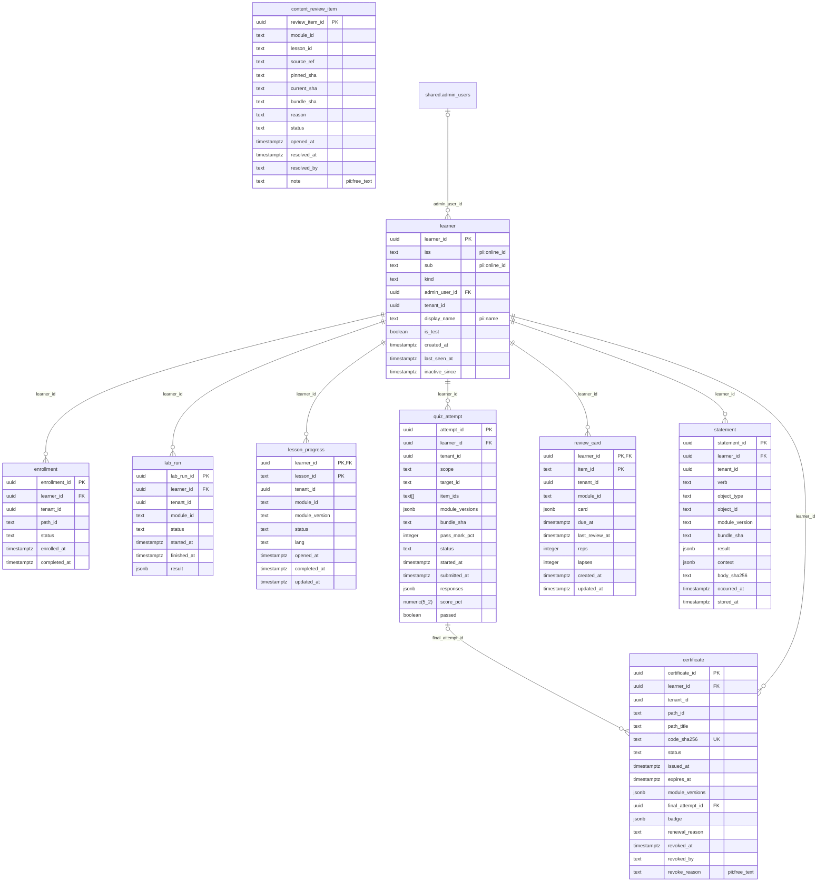

# ERD: learn schema

<!-- GENERATED by AA-CIS-Infra db/gen_erd.py (infra/AA-CIS-Infra/.github/workflows/db-schema-dump.yml) - do not edit -->

Live catalog as of the newest CIS migration **421** (applied 2026-11-14). Owner: CIS (schema owner role `cis_owner`). 9 table(s), 0 view(s), 9 foreign key(s), 0 foreign key(s) in from other schemas.

The diagram shows every column. Full columns, indexes, grants and RLS: [DB schema reference](../db-schema-reference.md) (search for `learn.<table>`). Generated file: change the schema through a migration, not this page.

Notation: `||` exactly one, `|o` zero or one (nullable FK), `o{` zero or more, `o|` zero or one (the FK is the child's PK or a unique key); a dashed line is a `NOT VALID` FK. Attribute comments are DM-6.1 tags (`pii:<class>`, `conf:<class>`). A quoted `"schema.table"` box is the parent table in another schema; foreign keys of other schemas that point here are listed below, and drawn on their own schema's page.

## Tables

| table | kind | columns | primary key | FKs out | FKs in | DM-6.1 tagged columns |
|---|---|---|---|---|---|---|
| `certificate` | table | 16 | `certificate_id` | 2 | 0 | `revoke_reason` pii:free_text |
| `content_review_item` | table | 13 | `review_item_id` | 0 | 0 | `note` pii:free_text |
| `enrollment` | table | 7 | `enrollment_id` | 1 | 0 |  |
| `lab_run` | table | 8 | `lab_run_id` | 1 | 0 |  |
| `learner` | table | 11 | `learner_id` | 1 | 7 | `iss` pii:online_id, `sub` pii:online_id, `display_name` pii:name |
| `lesson_progress` | table | 10 | `learner_id`, `lesson_id` | 1 | 0 |  |
| `quiz_attempt` | table | 15 | `attempt_id` | 1 | 1 |  |
| `review_card` | table | 11 | `learner_id`, `item_id` | 1 | 0 |  |
| `statement` | table | 13 | `statement_id` | 1 | 0 |  |

## Foreign keys

| constraint | from | to | valid |
|---|---|---|---|
| `certificate_final_attempt_id_fkey` | `learn.certificate` (final_attempt_id) | `learn.quiz_attempt` (attempt_id) | yes |
| `certificate_learner_id_fkey` | `learn.certificate` (learner_id) | `learn.learner` (learner_id) | yes |
| `enrollment_learner_id_fkey` | `learn.enrollment` (learner_id) | `learn.learner` (learner_id) | yes |
| `lab_run_learner_id_fkey` | `learn.lab_run` (learner_id) | `learn.learner` (learner_id) | yes |
| `learner_admin_user_id_fkey` | `learn.learner` (admin_user_id) | `shared.admin_users` (id) | yes |
| `lesson_progress_learner_id_fkey` | `learn.lesson_progress` (learner_id) | `learn.learner` (learner_id) | yes |
| `quiz_attempt_learner_id_fkey` | `learn.quiz_attempt` (learner_id) | `learn.learner` (learner_id) | yes |
| `review_card_learner_id_fkey` | `learn.review_card` (learner_id) | `learn.learner` (learner_id) | yes |
| `statement_learner_id_fkey` | `learn.statement` (learner_id) | `learn.learner` (learner_id) | yes |

## Foreign keys in from other schemas

None.
