# ERD: shared schema

<!-- GENERATED by AA-CIS-Infra db/gen_erd.py (infra/AA-CIS-Infra/.github/workflows/db-schema-dump.yml) - do not edit -->

Live catalog as of the newest CIS migration **323** (applied 2026-10-31). Owner: CIS (schema owner role `cis_owner`). 71 table(s), 4 view(s), 46 foreign key(s), 48 foreign key(s) in from other schemas.

```mermaid
erDiagram
    admin_users {
        uuid id PK
        varchar(100) username UK "pii:online_id"
    }
    alert_recipient {
        uuid id PK
    }
    cost_explorer_app_snapshot {
        uuid id PK
    }
    cost_explorer_snapshot {
        uuid id PK
    }
    countries {
        char(2) iso2 PK
        char(3) iso3 UK
        char(3) numeric_code UK
        text name UK
    }
    decision_cache_hits_daily {
        date day PK
        text stage PK
        text question_key PK
        text mode PK
        text zone PK
    }
    decision_log {
        bigint id PK
    }
    decision_question {
        text question_key PK
    }
    destinations {
        uuid id PK
        uuid duplicate_of FK
        char(2) country_iso2 FK
    }
    dfs_balance_snapshot {
        uuid id PK
    }
    dfs_call_log {
        uuid id PK
    }
    eval_golden_item {
        uuid item_id PK
        uuid set_id FK
    }
    eval_golden_set {
        uuid set_id PK
    }
    eval_item_result {
        uuid result_id PK
        uuid run_id FK
        uuid item_id FK
        uuid scored_result_id FK
    }
    jev_credit_topup {
        bigint id PK
    }
    jev_tenant_allowlist {
        uuid tenant_id PK, FK
    }
    job {
        uuid id PK
        uuid parent_job_id FK
    }
    job_worker {
        text worker_id PK
    }
    kpi_daily {
        text kpi_id PK
        date day PK
        text scope PK
    }
    llm_call_daily
    llm_call_log {
        uuid id PK
        uuid tenant_id FK
    }
    llm_connection_cost_policy {
        text connection_key PK, FK
    }
    llm_cost_reconcile {
        text connection_key PK, FK
        date day PK
    }
    llm_model_alias {
        text alias_key PK
        smallint position PK
        text model_key FK
    }
    llm_model_catalog {
        text model_key PK
        text family FK
    }
    llm_model_deployment {
        text model_key PK, FK
        text connection_key PK, FK
    }
    llm_model_family {
        text family_key PK
    }
    llm_provider_connection {
        text connection_key PK
    }
    llm_provider_health {
        text connection_key PK, FK
        text model_key PK, FK
    }
    llm_role_config {
        text stage PK
    }
    llm_shadow_log {
        bigint id PK
    }
    membership_plans {
        uuid id PK
        text plan_name UK
    }
    notifications {
        bigint id PK
    }
    pipeline_jobs {
        uuid id PK
    }
    pipeline_runs {
        uuid id PK
        uuid tenant_id FK
        uuid batch_id UK
    }
    place_photo {
        uuid id PK
        text drive_file_id UK
        uuid tour_id FK
        uuid destination_id FK
    }
    prompt_eval_runs {
        uuid id PK
        uuid golden_set_id FK
    }
    prompt_version {
        text stage PK
        text version PK
    }
    report_run {
        uuid id PK
    }
    rerun_wave {
        uuid id PK
    }
    schema_versions {
        varchar(20) version PK
    }
    spend_budget {
        text provider PK
        text scope PK
    }
    staff_app_grant {
        uuid admin_user_id PK, FK
        text app PK
    }
    stage_model_params {
        text stage PK
        text model_key PK, FK
    }
    supply_content_version {
        uuid id PK
        uuid entity_id FK
    }
    supply_entity {
        uuid id PK, FK
        uuid published_version_id FK
    }
    supply_event_inbox {
        bigint id PK
    }
    supply_feed_cursor {
        text consumer PK
    }
    supply_media {
        uuid booking_media_id PK
        uuid entity_id FK
    }
    tenant_ai_budget {
        uuid tenant_id PK, FK
    }
    tenant_api_usage {
        uuid id PK
        uuid tenant_id FK
        uuid admin_user_id FK
    }
    tenant_api_usage_monthly
    tenant_brand_rules {
        uuid id PK
        uuid tenant_id FK
    }
    tenant_export_config {
        uuid id PK
        uuid tenant_id FK, UK
    }
    tenant_integrations {
        uuid id PK
        uuid tenant_id FK
    }
    tenant_members {
        uuid membership_id PK
        uuid tenant_id FK
    }
    tenant_membership_event {
        bigint seq PK
        uuid event_id UK
    }
    tenant_rewrite_usage {
        uuid tenant_id PK, FK
        text year_month PK
    }
    tenant_seo_config {
        uuid id PK
        uuid tenant_id FK, UK
    }
    tenants {
        uuid tenant_id PK
        varchar(100) slug UK
        uuid plan_id FK
    }
    unmapped_market_requests {
        uuid id PK
    }
    writing_exemplar {
        uuid exemplar_id PK
    }
    writing_memory_disagreement {
        uuid item_id PK
    }
    writing_memory_keep {
        uuid keep_id PK
        uuid release_id FK
    }
    writing_memory_kpi_report {
        uuid report_id PK
    }
    writing_memory_release {
        uuid release_id PK
        uuid r0_run_id FK
        uuid eval_run_id FK
        uuid shadow_run_id FK
        uuid previous_release_id FK
        uuid reverify_run_id FK
    }
    writing_memory_release_exemplar {
        uuid release_id PK, FK
        uuid exemplar_id PK, FK
    }
    writing_memory_shadow {
        uuid shadow_id PK
        uuid release_id FK
        uuid run_id FK
    }
    writing_memory_writer {
        text writer PK
    }
    writing_rule {
        uuid rule_id PK
    }
    writing_signal {
        uuid signal_id PK
    }
    "silver_aa_internal.raw_tours"
    countries |o--o{ destinations : "country_iso2"
    destinations |o--o{ destinations : "duplicate_of"
    eval_golden_set ||--o{ eval_golden_item : "set_id"
    eval_golden_item ||--o{ eval_item_result : "item_id"
    prompt_eval_runs ||--o{ eval_item_result : "run_id"
    eval_item_result |o--o{ eval_item_result : "scored_result_id"
    tenants ||--o| jev_tenant_allowlist : "tenant_id"
    job |o--o{ job : "parent_job_id"
    tenants |o--o{ llm_call_log : "tenant_id"
    llm_provider_connection ||--o| llm_connection_cost_policy : "connection_key"
    llm_provider_connection ||--o{ llm_cost_reconcile : "connection_key"
    llm_model_catalog ||--o{ llm_model_alias : "model_key"
    llm_model_family |o--o{ llm_model_catalog : "family"
    llm_provider_connection ||--o{ llm_model_deployment : "connection_key"
    llm_model_catalog ||--o{ llm_model_deployment : "model_key"
    llm_provider_connection ||--o{ llm_provider_health : "connection_key"
    llm_model_catalog ||--o{ llm_provider_health : "model_key"
    tenants ||--o{ pipeline_runs : "tenant_id"
    destinations |o--o{ place_photo : "destination_id"
    "silver_aa_internal.raw_tours" |o--o{ place_photo : "tour_id"
    eval_golden_set |o--o{ prompt_eval_runs : "golden_set_id"
    admin_users ||--o{ staff_app_grant : "admin_user_id"
    llm_model_catalog ||--o{ stage_model_params : "model_key"
    supply_entity ||--o{ supply_content_version : "entity_id"
    supply_content_version |o--o{ supply_entity : "id, published_version_id"
    supply_entity ||--o{ supply_media : "entity_id"
    tenants ||--o| tenant_ai_budget : "tenant_id"
    admin_users |o--o{ tenant_api_usage : "admin_user_id"
    tenants |o--o{ tenant_api_usage : "tenant_id"
    tenants ||--o{ tenant_brand_rules : "tenant_id"
    tenants ||--o| tenant_export_config : "tenant_id"
    tenants ||--o{ tenant_integrations : "tenant_id"
    tenants ||--o{ tenant_members : "tenant_id"
    tenants ||--o{ tenant_rewrite_usage : "tenant_id"
    tenants ||--o| tenant_seo_config : "tenant_id"
    membership_plans |o--o{ tenants : "plan_id"
    writing_memory_release ||--o{ writing_memory_keep : "release_id"
    prompt_eval_runs |o--o{ writing_memory_release : "eval_run_id"
    writing_memory_release |o--o{ writing_memory_release : "previous_release_id"
    prompt_eval_runs |o--o{ writing_memory_release : "r0_run_id"
    prompt_eval_runs |o--o{ writing_memory_release : "reverify_run_id"
    prompt_eval_runs |o--o{ writing_memory_release : "shadow_run_id"
    writing_exemplar ||--o{ writing_memory_release_exemplar : "exemplar_id"
    writing_memory_release ||--o{ writing_memory_release_exemplar : "release_id"
    writing_memory_release ||--o{ writing_memory_shadow : "release_id"
    prompt_eval_runs ||--o{ writing_memory_shadow : "run_id"
```

The diagram shows key columns only (PK, FK, UK): the schema has more than 20 tables or 150 columns. Full columns, indexes, grants and RLS: [DB schema reference](../db-schema-reference.md) (search for `shared.<table>`). Generated file: change the schema through a migration, not this page.

Notation: `||` exactly one, `|o` zero or one (nullable FK), `o{` zero or more, `o|` zero or one (the FK is the child's PK or a unique key); a dashed line is a `NOT VALID` FK. Attribute comments are DM-6.1 tags (`pii:<class>`, `conf:<class>`). A quoted `"schema.table"` box is the parent table in another schema; foreign keys of other schemas that point here are listed below, and drawn on their own schema's page.

## Tables

| table | kind | columns | primary key | FKs out | FKs in | DM-6.1 tagged columns |
|---|---|---|---|---|---|---|
| `admin_users` | table | 13 | `id` | 0 | 4 | `username` pii:online_id, `password_hash` conf:credential, `email` pii:contact, `display_name` pii:name, `cognito_iss` pii:online_id, `cognito_sub` pii:online_id |
| `alert_recipient` | table | 15 | `id` | 0 | 0 | `email` pii:contact |
| `cost_explorer_app_snapshot` | table | 9 | `id` | 0 | 0 |  |
| `cost_explorer_snapshot` | table | 9 | `id` | 0 | 0 |  |
| `countries` | table | 6 | `iso2` | 0 | 3 |  |
| `decision_cache_hits_daily` | table | 7 | `day`, `stage`, `question_key`, `mode`, `zone` | 0 | 0 |  |
| `decision_log` | table | 20 | `id` | 0 | 0 |  |
| `decision_question` | table | 14 | `question_key` | 0 | 0 |  |
| `destinations` | table | 22 | `id` | 2 | 23 |  |
| `dfs_balance_snapshot` | table | 7 | `id` | 0 | 0 |  |
| `dfs_call_log` | table | 18 | `id` | 0 | 0 |  |
| `eval_golden_item` | table | 25 | `item_id` | 1 | 1 | `input` pii:free_text, `control_output` pii:free_text, `pipeline_verdict` pii:free_text, `label` pii:free_text |
| `eval_golden_set` | table | 16 | `set_id` | 0 | 2 | `label_history` pii:online_id |
| `eval_item_result` | table | 21 | `result_id` | 3 | 1 | `output` pii:free_text |
| `jev_credit_topup` | table | 6 | `id` | 0 | 0 |  |
| `jev_tenant_allowlist` | table | 4 | `tenant_id` | 1 | 0 |  |
| `job` | table | 21 | `id` | 1 | 3 |  |
| `job_worker` | table | 14 | `worker_id` | 0 | 0 |  |
| `kpi_daily` | table | 10 | `kpi_id`, `day`, `scope` | 0 | 0 |  |
| `llm_call_daily` | table | 22 |  | 0 | 0 |  |
| `llm_call_log` | table | 37 | `id` | 1 | 0 |  |
| `llm_connection_cost_policy` | table | 9 | `connection_key` | 1 | 0 |  |
| `llm_cost_reconcile` | table | 12 | `connection_key`, `day` | 1 | 0 |  |
| `llm_model_alias` | table | 7 | `alias_key`, `position` | 1 | 0 |  |
| `llm_model_catalog` | table | 22 | `model_key` | 1 | 4 |  |
| `llm_model_deployment` | table | 18 | `model_key`, `connection_key` | 2 | 0 |  |
| `llm_model_family` | table | 7 | `family_key` | 0 | 1 |  |
| `llm_provider_connection` | table | 30 | `connection_key` | 0 | 4 |  |
| `llm_provider_health` | table | 12 | `connection_key`, `model_key` | 2 | 0 |  |
| `llm_role_config` | table | 13 | `stage` | 0 | 0 |  |
| `llm_shadow_log` | table | 12 | `id` | 0 | 0 |  |
| `membership_plans` | table | 9 | `id` | 0 | 1 |  |
| `notifications` | table | 11 | `id` | 0 | 0 |  |
| `pipeline_jobs` | table | 13 | `id` | 0 | 0 |  |
| `pipeline_runs` | table | 22 | `id` | 1 | 2 |  |
| `place_photo` | table | 27 | `id` | 2 | 0 |  |
| `prompt_eval_runs` | table | 27 | `id` | 1 | 6 |  |
| `prompt_version` | table | 7 | `stage`, `version` | 0 | 0 |  |
| `report_run` | table | 19 | `id` | 0 | 0 |  |
| `rerun_wave` | table | 11 | `id` | 0 | 0 |  |
| `schema_versions` | table | 3 | `version` | 0 | 0 |  |
| `spend_budget` | table | 8 | `provider`, `scope` | 0 | 0 |  |
| `staff_app_grant` | table | 5 | `admin_user_id`, `app` | 1 | 0 |  |
| `stage_model_params` | table | 11 | `stage`, `model_key` | 1 | 0 |  |
| `supply_content_version` | table | 17 | `id` | 1 | 1 |  |
| `supply_entity` | table | 14 | `id` | 1 | 2 |  |
| `supply_event_inbox` | table | 11 | `id` | 0 | 0 |  |
| `supply_feed_cursor` | table | 6 | `consumer` | 0 | 0 |  |
| `supply_media` | table | 15 | `booking_media_id` | 1 | 0 |  |
| `tenant_ai_budget` | table | 9 | `tenant_id` | 1 | 0 |  |
| `tenant_api_usage` | table | 9 | `id` | 2 | 0 |  |
| `tenant_api_usage_monthly` | table | 10 |  | 0 | 0 |  |
| `tenant_brand_rules` | table | 21 | `id` | 1 | 0 |  |
| `tenant_export_config` | table | 8 | `id` | 1 | 0 |  |
| `tenant_integrations` | table | 10 | `id` | 1 | 0 |  |
| `tenant_members` | table | 12 | `membership_id` | 1 | 0 | `cognito_iss` pii:online_id, `cognito_sub` pii:online_id |
| `tenant_membership_event` | table | 7 | `seq` | 0 | 0 | `membership` pii:online_id |
| `tenant_rewrite_usage` | table | 4 | `tenant_id`, `year_month` | 1 | 0 |  |
| `tenant_seo_config` | table | 7 | `id` | 1 | 0 |  |
| `tenants` | table | 18 | `tenant_id` | 1 | 30 |  |
| `unmapped_market_requests` | table | 6 | `id` | 0 | 0 |  |
| `v_country_unmapped` | view | 3 |  | 0 | 0 |  |
| `v_destination_photos` | view | 10 |  | 0 | 0 |  |
| `v_tenant_monthly_usage` | view | 16 |  | 0 | 0 |  |
| `v_tour_photos` | view | 10 |  | 0 | 0 |  |
| `writing_exemplar` | table | 17 | `exemplar_id` | 0 | 1 | `masked_text` pii:free_text |
| `writing_memory_disagreement` | table | 15 | `item_id` | 0 | 0 | `note` pii:free_text |
| `writing_memory_keep` | table | 10 | `keep_id` | 1 | 0 | `reason` pii:free_text |
| `writing_memory_kpi_report` | table | 12 | `report_id` | 0 | 0 |  |
| `writing_memory_release` | table | 36 | `release_id` | 5 | 4 | `retired_reason` pii:free_text, `rejected_reason` pii:free_text, `notes` pii:free_text |
| `writing_memory_release_exemplar` | table | 8 | `release_id`, `exemplar_id` | 2 | 0 |  |
| `writing_memory_shadow` | table | 20 | `shadow_id` | 2 | 0 | `output` pii:free_text |
| `writing_memory_writer` | table | 5 | `writer` | 0 | 0 |  |
| `writing_rule` | table | 29 | `rule_id` | 0 | 0 | `rule_text` pii:free_text, `replacement` pii:free_text, `match_phrases` pii:free_text |
| `writing_signal` | table | 23 | `signal_id` | 0 | 0 | `before_text` pii:free_text, `after_text` pii:free_text, `problem` pii:free_text |

## Foreign keys

| constraint | from | to | valid |
|---|---|---|---|
| `destinations_country_iso2_fkey` | `shared.destinations` (country_iso2) | `shared.countries` (iso2) | yes |
| `destinations_duplicate_of_fkey` | `shared.destinations` (duplicate_of) | `shared.destinations` (id) | yes |
| `eval_golden_item_set_fkey` | `shared.eval_golden_item` (set_id) | `shared.eval_golden_set` (set_id) | yes |
| `eval_item_result_item_fkey` | `shared.eval_item_result` (item_id) | `shared.eval_golden_item` (item_id) | yes |
| `eval_item_result_run_fkey` | `shared.eval_item_result` (run_id) | `shared.prompt_eval_runs` (id) | yes |
| `eval_item_result_scored_fkey` | `shared.eval_item_result` (scored_result_id) | `shared.eval_item_result` (result_id) | yes |
| `jev_tenant_allowlist_tenant_id_fkey` | `shared.jev_tenant_allowlist` (tenant_id) | `shared.tenants` (tenant_id) | yes |
| `job_parent_job_id_fkey` | `shared.job` (parent_job_id) | `shared.job` (id) | yes |
| `llm_call_log_tenant_id_fkey` | `shared.llm_call_log` (tenant_id) | `shared.tenants` (tenant_id) | yes |
| `llm_connection_cost_policy_connection_fkey` | `shared.llm_connection_cost_policy` (connection_key) | `shared.llm_provider_connection` (connection_key) | yes |
| `llm_cost_reconcile_connection_fkey` | `shared.llm_cost_reconcile` (connection_key) | `shared.llm_provider_connection` (connection_key) | yes |
| `llm_model_alias_model_fkey` | `shared.llm_model_alias` (model_key) | `shared.llm_model_catalog` (model_key) | yes |
| `llm_model_catalog_family_fk` | `shared.llm_model_catalog` (family) | `shared.llm_model_family` (family_key) | yes |
| `llm_model_deployment_connection_fkey` | `shared.llm_model_deployment` (connection_key) | `shared.llm_provider_connection` (connection_key) | yes |
| `llm_model_deployment_model_fkey` | `shared.llm_model_deployment` (model_key) | `shared.llm_model_catalog` (model_key) | yes |
| `llm_provider_health_connection_fkey` | `shared.llm_provider_health` (connection_key) | `shared.llm_provider_connection` (connection_key) | yes |
| `llm_provider_health_model_fkey` | `shared.llm_provider_health` (model_key) | `shared.llm_model_catalog` (model_key) | yes |
| `pipeline_runs_tenant_id_fkey` | `shared.pipeline_runs` (tenant_id) | `shared.tenants` (tenant_id) | yes |
| `place_photo_destination_id_fkey` | `shared.place_photo` (destination_id) | `shared.destinations` (id) | yes |
| `place_photo_tour_id_fkey` | `shared.place_photo` (tour_id) | `silver_aa_internal.raw_tours` (tour_id) | yes |
| `prompt_eval_runs_golden_set_fkey` | `shared.prompt_eval_runs` (golden_set_id) | `shared.eval_golden_set` (set_id) | yes |
| `staff_app_grant_admin_user_id_fkey` | `shared.staff_app_grant` (admin_user_id) | `shared.admin_users` (id) | yes |
| `stage_model_params_model_key_fkey` | `shared.stage_model_params` (model_key) | `shared.llm_model_catalog` (model_key) | yes |
| `supply_content_version_entity_fkey` | `shared.supply_content_version` (entity_id) | `shared.supply_entity` (id) | yes |
| `supply_entity_published_version_fkey` | `shared.supply_entity` (id, published_version_id) | `shared.supply_content_version` (entity_id, id) | yes |
| `supply_media_entity_fkey` | `shared.supply_media` (entity_id) | `shared.supply_entity` (id) | yes |
| `tenant_ai_budget_tenant_id_fkey` | `shared.tenant_ai_budget` (tenant_id) | `shared.tenants` (tenant_id) | yes |
| `tenant_api_usage_admin_user_id_fkey` | `shared.tenant_api_usage` (admin_user_id) | `shared.admin_users` (id) | yes |
| `tenant_api_usage_tenant_id_fkey` | `shared.tenant_api_usage` (tenant_id) | `shared.tenants` (tenant_id) | yes |
| `tenant_brand_rules_tenant_id_fkey` | `shared.tenant_brand_rules` (tenant_id) | `shared.tenants` (tenant_id) | yes |
| `tenant_export_config_tenant_id_fkey` | `shared.tenant_export_config` (tenant_id) | `shared.tenants` (tenant_id) | yes |
| `tenant_integrations_tenant_id_fkey` | `shared.tenant_integrations` (tenant_id) | `shared.tenants` (tenant_id) | yes |
| `tenant_members_tenant_id_fkey` | `shared.tenant_members` (tenant_id) | `shared.tenants` (tenant_id) | yes |
| `tenant_rewrite_usage_tenant_id_fkey` | `shared.tenant_rewrite_usage` (tenant_id) | `shared.tenants` (tenant_id) | yes |
| `tenant_seo_config_tenant_id_fkey` | `shared.tenant_seo_config` (tenant_id) | `shared.tenants` (tenant_id) | yes |
| `tenants_plan_id_fkey` | `shared.tenants` (plan_id) | `shared.membership_plans` (id) | yes |
| `writing_memory_keep_release_fkey` | `shared.writing_memory_keep` (release_id) | `shared.writing_memory_release` (release_id) | yes |
| `writing_memory_release_eval_fkey` | `shared.writing_memory_release` (eval_run_id) | `shared.prompt_eval_runs` (id) | yes |
| `writing_memory_release_previous_fkey` | `shared.writing_memory_release` (previous_release_id) | `shared.writing_memory_release` (release_id) | yes |
| `writing_memory_release_r0_fkey` | `shared.writing_memory_release` (r0_run_id) | `shared.prompt_eval_runs` (id) | yes |
| `writing_memory_release_reverify_fkey` | `shared.writing_memory_release` (reverify_run_id) | `shared.prompt_eval_runs` (id) | yes |
| `writing_memory_release_shadow_fkey` | `shared.writing_memory_release` (shadow_run_id) | `shared.prompt_eval_runs` (id) | yes |
| `writing_memory_release_exemplar_exemplar_fkey` | `shared.writing_memory_release_exemplar` (exemplar_id) | `shared.writing_exemplar` (exemplar_id) | yes |
| `writing_memory_release_exemplar_release_fkey` | `shared.writing_memory_release_exemplar` (release_id) | `shared.writing_memory_release` (release_id) | yes |
| `writing_memory_shadow_release_fkey` | `shared.writing_memory_shadow` (release_id) | `shared.writing_memory_release` (release_id) | yes |
| `writing_memory_shadow_run_fkey` | `shared.writing_memory_shadow` (run_id) | `shared.prompt_eval_runs` (id) | yes |

## Foreign keys in from other schemas

| constraint | from | to | valid |
|---|---|---|---|
| `acp_quota_ledger_tenant_id_fkey` | `acp_shared.acp_quota_ledger` (tenant_id) | `shared.tenants` (tenant_id) | yes |
| `angle_gate_request_tenant_id_fkey` | `acp_shared.angle_gate_request` (tenant_id) | `shared.tenants` (tenant_id) | yes |
| `content_piece_job_id_fkey` | `acp_shared.content_piece` (job_id) | `shared.job` (id) | yes |
| `content_piece_tenant_id_fkey` | `acp_shared.content_piece` (tenant_id) | `shared.tenants` (tenant_id) | yes |
| `debate_brand_fit_cache_tenant_id_fkey` | `acp_shared.debate_brand_fit_cache` (tenant_id) | `shared.tenants` (tenant_id) | yes |
| `facts_tenant_id_fkey` | `acp_shared.facts` (tenant_id) | `shared.tenants` (tenant_id) | yes |
| `place_card_destination_id_fkey` | `acp_shared.place_card` (destination_id) | `shared.destinations` (id) | yes |
| `publish_log_tenant_id_fkey` | `acp_shared.publish_log` (tenant_id) | `shared.tenants` (tenant_id) | yes |
| `subject_tenant_id_fkey` | `acp_shared.subject` (tenant_id) | `shared.tenants` (tenant_id) | yes |
| `tenant_config_tenant_id_fkey` | `acp_shared.tenant_config` (tenant_id) | `shared.tenants` (tenant_id) | yes |
| `year_plan_tenant_id_fkey` | `acp_shared.year_plan` (tenant_id) | `shared.tenants` (tenant_id) | yes |
| `graph_edge_from_destination_id_fkey` | `geo.graph_edge` (from_destination_id) | `shared.destinations` (id) | yes |
| `graph_edge_to_destination_id_fkey` | `geo.graph_edge` (to_destination_id) | `shared.destinations` (id) | yes |
| `graph_node_destination_id_fkey` | `geo.graph_node` (destination_id) | `shared.destinations` (id) | yes |
| `place_merge_keeper_id_fkey` | `geo.place_merge` (keeper_id) | `shared.destinations` (id) | yes |
| `place_merge_merged_id_fkey` | `geo.place_merge` (merged_id) | `shared.destinations` (id) | yes |
| `place_name_destination_id_fkey` | `geo.place_name` (destination_id) | `shared.destinations` (id) | yes |
| `place_outlier_destination_id_fkey` | `geo.place_outlier` (destination_id) | `shared.destinations` (id) | yes |
| `place_pair_verdict_hi_id_fkey` | `geo.place_pair_verdict` (hi_id) | `shared.destinations` (id) | yes |
| `place_pair_verdict_lo_id_fkey` | `geo.place_pair_verdict` (lo_id) | `shared.destinations` (id) | yes |
| `place_shape_destination_id_fkey` | `geo.place_shape` (destination_id) | `shared.destinations` (id) | yes |
| `tour_day_overnight_destination_id_fkey` | `geo.tour_day` (overnight_destination_id) | `shared.destinations` (id) | yes |
| `tour_junction_destination_a_fkey` | `geo.tour_junction` (destination_a) | `shared.destinations` (id) | yes |
| `tour_junction_destination_b_fkey` | `geo.tour_junction` (destination_b) | `shared.destinations` (id) | yes |
| `tour_leg_end_destination_id_fkey` | `geo.tour_leg` (end_destination_id) | `shared.destinations` (id) | yes |
| `tour_leg_start_destination_id_fkey` | `geo.tour_leg` (start_destination_id) | `shared.destinations` (id) | yes |
| `tour_place_destination_id_fkey` | `geo.tour_place` (destination_id) | `shared.destinations` (id) | yes |
| `tour_segment_destination_id_fkey` | `geo.tour_segment` (destination_id) | `shared.destinations` (id) | yes |
| `tour_segment_from_destination_id_fkey` | `geo.tour_segment` (from_destination_id) | `shared.destinations` (id) | yes |
| `tour_segment_to_destination_id_fkey` | `geo.tour_segment` (to_destination_id) | `shared.destinations` (id) | yes |
| `tour_stop_destination_id_fkey` | `geo.tour_stop` (destination_id) | `shared.destinations` (id) | yes |
| `content_exports_tenant_id_fkey` | `gold_aa_internal.content_exports` (tenant_id) | `shared.tenants` (tenant_id) | yes |
| `published_tours_tenant_id_fkey` | `gold_aa_internal.published_tours` (tenant_id) | `shared.tenants` (tenant_id) | yes |
| `tenant_tour_versions_job_id_fkey` | `gold_aa_internal.tenant_tour_versions` (job_id) | `shared.job` (id) | yes |
| `tenant_tour_versions_tenant_id_fkey` | `gold_aa_internal.tenant_tour_versions` (tenant_id) | `shared.tenants` (tenant_id) | yes |
| `webhook_deliveries_tenant_id_fkey` | `gold_aa_internal.webhook_deliveries` (tenant_id) | `shared.tenants` (tenant_id) | yes |
| `generated_content_reviewed_by_fkey` | `silver_aa_internal.generated_content` (reviewed_by) | `shared.admin_users` (id) | yes |
| `generated_content_tenant_id_fkey` | `silver_aa_internal.generated_content` (tenant_id) | `shared.tenants` (tenant_id) | yes |
| `quality_scores_tenant_id_fkey` | `silver_aa_internal.quality_scores` (tenant_id) | `shared.tenants` (tenant_id) | yes |
| `raw_sources_batch_id_fkey` | `silver_aa_internal.raw_sources` (batch_id) | `shared.pipeline_runs` (batch_id) | yes |
| `raw_sources_tenant_id_fkey` | `silver_aa_internal.raw_sources` (tenant_id) | `shared.tenants` (tenant_id) | yes |
| `fk_raw_tours_reviewed_by_admin_users` | `silver_aa_internal.raw_tours` (reviewed_by) | `shared.admin_users` (id) | yes |
| `raw_tours_batch_id_fkey` | `silver_aa_internal.raw_tours` (batch_id) | `shared.pipeline_runs` (batch_id) | yes |
| `raw_tours_country_fkey` | `silver_aa_internal.raw_tours` (country) | `shared.countries` (name) | yes |
| `raw_tours_country_iso2_fkey` | `silver_aa_internal.raw_tours` (country_iso2) | `shared.countries` (iso2) | yes |
| `raw_tours_tenant_id_fkey` | `silver_aa_internal.raw_tours` (tenant_id) | `shared.tenants` (tenant_id) | yes |
| `review_queue_tenant_id_fkey` | `silver_aa_internal.review_queue` (tenant_id) | `shared.tenants` (tenant_id) | yes |
| `seo_context_tenant_id_fkey` | `silver_aa_internal.seo_context` (tenant_id) | `shared.tenants` (tenant_id) | yes |
