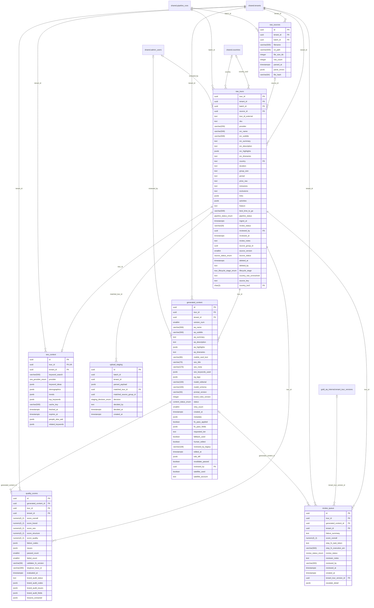

# ERD: silver_aa_internal schema

<!-- GENERATED by AA-CIS-Infra db/gen_erd.py (infra/AA-CIS-Infra/.github/workflows/db-schema-dump.yml) - do not edit -->

Live catalog as of the newest CIS migration **318** (applied 2026-10-31). Owner: CIS (schema owner role `cis_owner`). 7 table(s), 0 view(s), 21 foreign key(s), 8 foreign key(s) in from other schemas.

The diagram shows every column. Full columns, indexes, grants and RLS: [DB schema reference](../db-schema-reference.md) (search for `silver_aa_internal.<table>`). Generated file: change the schema through a migration, not this page.

Notation: `||` exactly one, `|o` zero or one (nullable FK), `o{` zero or more, `o|` zero or one (the FK is the child's PK or a unique key); a dashed line is a `NOT VALID` FK. Attribute comments are DM-6.1 tags (`pii:<class>`, `conf:<class>`). A quoted `"schema.table"` box is the parent table in another schema; foreign keys of other schemas that point here are listed below, and drawn on their own schema's page.

## Tables

| table | kind | columns | primary key | FKs out | FKs in | DM-6.1 tagged columns |
|---|---|---|---|---|---|---|
| `generated_content` | table | 35 | `id` | 3 | 3 |  |
| `quality_scores` | table | 21 | `id` | 3 | 1 |  |
| `raw_sources` | table | 10 | `id` | 2 | 1 |  |
| `raw_tours` | table | 39 | `tour_id` | 6 | 11 |  |
| `review_queue` | table | 15 | `id` | 4 | 0 |  |
| `seo_context` | table | 14 | `id` | 2 | 0 |  |
| `upload_staging` | table | 10 | `id` | 1 | 0 |  |

## Foreign keys

| constraint | from | to | valid |
|---|---|---|---|
| `generated_content_reviewed_by_fkey` | `silver_aa_internal.generated_content` (reviewed_by) | `shared.admin_users` (id) | yes |
| `generated_content_tenant_id_fkey` | `silver_aa_internal.generated_content` (tenant_id) | `shared.tenants` (tenant_id) | yes |
| `generated_content_tour_id_fkey` | `silver_aa_internal.generated_content` (tour_id) | `silver_aa_internal.raw_tours` (tour_id) | yes |
| `quality_scores_generated_content_id_fkey` | `silver_aa_internal.quality_scores` (generated_content_id) | `silver_aa_internal.generated_content` (id) | yes |
| `quality_scores_tenant_id_fkey` | `silver_aa_internal.quality_scores` (tenant_id) | `shared.tenants` (tenant_id) | yes |
| `quality_scores_tour_id_fkey` | `silver_aa_internal.quality_scores` (tour_id) | `silver_aa_internal.raw_tours` (tour_id) | yes |
| `raw_sources_batch_id_fkey` | `silver_aa_internal.raw_sources` (batch_id) | `shared.pipeline_runs` (batch_id) | yes |
| `raw_sources_tenant_id_fkey` | `silver_aa_internal.raw_sources` (tenant_id) | `shared.tenants` (tenant_id) | yes |
| `fk_raw_tours_reviewed_by_admin_users` | `silver_aa_internal.raw_tours` (reviewed_by) | `shared.admin_users` (id) | yes |
| `raw_tours_batch_id_fkey` | `silver_aa_internal.raw_tours` (batch_id) | `shared.pipeline_runs` (batch_id) | yes |
| `raw_tours_country_fkey` | `silver_aa_internal.raw_tours` (country) | `shared.countries` (name) | yes |
| `raw_tours_country_iso2_fkey` | `silver_aa_internal.raw_tours` (country_iso2) | `shared.countries` (iso2) | yes |
| `raw_tours_source_id_fkey` | `silver_aa_internal.raw_tours` (source_id) | `silver_aa_internal.raw_sources` (id) | yes |
| `raw_tours_tenant_id_fkey` | `silver_aa_internal.raw_tours` (tenant_id) | `shared.tenants` (tenant_id) | yes |
| `review_queue_generated_content_id_fkey` | `silver_aa_internal.review_queue` (generated_content_id) | `silver_aa_internal.generated_content` (id) | yes |
| `review_queue_tenant_id_fkey` | `silver_aa_internal.review_queue` (tenant_id) | `shared.tenants` (tenant_id) | yes |
| `review_queue_tenant_tour_version_id_fkey` | `silver_aa_internal.review_queue` (tenant_tour_version_id) | `gold_aa_internal.tenant_tour_versions` (id) | yes |
| `review_queue_tour_id_fkey` | `silver_aa_internal.review_queue` (tour_id) | `silver_aa_internal.raw_tours` (tour_id) | yes |
| `seo_context_tenant_id_fkey` | `silver_aa_internal.seo_context` (tenant_id) | `shared.tenants` (tenant_id) | yes |
| `seo_context_tour_id_fkey` | `silver_aa_internal.seo_context` (tour_id) | `silver_aa_internal.raw_tours` (tour_id) | yes |
| `upload_staging_matched_tour_id_fkey` | `silver_aa_internal.upload_staging` (matched_tour_id) | `silver_aa_internal.raw_tours` (tour_id) | yes |

## Foreign keys in from other schemas

| constraint | from | to | valid |
|---|---|---|---|
| `atom_ranking_tour_id_fkey` | `acp_contract.atom_ranking` (tour_id) | `silver_aa_internal.raw_tours` (tour_id) | yes |
| `route_tour_id_fkey` | `acp_contract.route` (tour_id) | `silver_aa_internal.raw_tours` (tour_id) | yes |
| `tour_atoms_tour_id_fkey` | `acp_contract.tour_atoms` (tour_id) | `silver_aa_internal.raw_tours` (tour_id) | yes |
| `published_tours_generated_content_id_fkey` | `gold_aa_internal.published_tours` (generated_content_id) | `silver_aa_internal.generated_content` (id) | yes |
| `published_tours_quality_score_id_fkey` | `gold_aa_internal.published_tours` (quality_score_id) | `silver_aa_internal.quality_scores` (id) | yes |
| `published_tours_tour_id_fkey` | `gold_aa_internal.published_tours` (tour_id) | `silver_aa_internal.raw_tours` (tour_id) | yes |
| `webhook_deliveries_tour_id_fkey` | `gold_aa_internal.webhook_deliveries` (tour_id) | `silver_aa_internal.raw_tours` (tour_id) | yes |
| `place_photo_tour_id_fkey` | `shared.place_photo` (tour_id) | `silver_aa_internal.raw_tours` (tour_id) | yes |
