# ERD: tripplanner schema

<!-- GENERATED by AA-CIS-Infra db/gen_erd.py (infra/AA-CIS-Infra/.github/workflows/db-schema-dump.yml) - do not edit -->

Live catalog as of the newest TripPlanner migration **tp-017** (applied 2026-10-21). Owner: TripPlanner (schema owner role `tp_owner`). 16 table(s), 2 view(s), 13 foreign key(s), 0 foreign key(s) in from other schemas.

```mermaid
erDiagram
    component_id_map {
        uuid old_id PK
        uuid new_id
        text matched_by
        timestamptz created_at
    }
    customers {
        uuid id PK
        text name "pii:name"
        text phone UK "pii:contact"
        text email UK "pii:contact"
        timestamptz created_at
        boolean contact_consent
        timestamptz contact_consent_at
    }
    itinerary_components {
        uuid id PK
        text source_tour_id
        integer source_day_index
        uuid destination_id FK
        text name
        text activity
        text intensity_level
        integer[] season_months
        text duration_hint
        text text_extract
        vector(1536) embedding
        timestamptz created_at
    }
    llm_spend_daily {
        date day PK
        text stage PK
        numeric cost_usd
        integer calls
        integer unpriced_calls
        timestamptz updated_at
    }
    narration_cache {
        text itinerary_hash PK
        text mode
        text narration
        text source
        integer days
        timestamptz created_at
        integer hits
        timestamptz last_hit_at
    }
    outbox {
        bigint id PK
        text event
        integer schema_version
        text idempotency_key UK
        uuid aggregate_id
        jsonb payload "pii:contact"
        timestamptz created_at
    }
    sessions {
        uuid id PK
        text guest_token UK "conf:credential"
        uuid customer_id FK
        timestamptz created_at
        timestamptz expires_at
        bytea guest_token_hash "conf:credential"
    }
    tour_day {
        text source_tour_id PK
        integer day_index PK
        text title
        text start_place
        text end_place
        text overnight_place
        uuid overnight_destination_id FK
        text[] places
        text extracted_by
        text source_hash
        timestamptz extracted_at
    }
    tour_graph_build {
        uuid id PK
        timestamptz built_at
        jsonb params
        jsonb stats
    }
    tour_graph_edge {
        uuid from_destination_id PK, FK
        uuid to_destination_id PK, FK
        integer tour_count
        text[] tour_ids
        float8 km
    }
    tour_graph_node {
        uuid destination_id PK, FK
        text name
        text country
        float8 lat
        float8 lng
        text[] tour_ids
        integer stop_count
        text[] activities
        text intensity_min
        text intensity_max
        integer[] season_months
    }
    tour_junction {
        uuid destination_a PK, FK
        uuid destination_b PK, FK
        float8 km
        boolean cross_border
    }
    tour_leg {
        text source_tour_id PK
        integer day_from PK
        integer day_to PK
        integer days
        uuid start_destination_id FK
        uuid end_destination_id FK
        uuid[] destination_ids
        text[] countries
        text[] activities
    }
    tour_stop {
        text source_tour_id PK
        integer day_index PK
        uuid destination_id FK
        text country
        text source
    }
    trip_drafts {
        uuid id PK
        uuid session_id FK
        text status
        jsonb itinerary "pii:travel"
        date date_start "pii:travel"
        date date_end "pii:travel"
        timestamptz created_at
        timestamptz updated_at
    }
    trip_events {
        bigint id PK
        uuid trip_id
        uuid session_id FK
        text event_type
        jsonb payload "pii:free_text"
        timestamptz created_at
    }
    "shared.destinations"
    "shared.destinations" ||--o{ itinerary_components : "itinerary_components_destination_id_fkey"
    customers |o--o{ sessions : "sessions_customer_id_fkey"
    "shared.destinations" |o--o{ tour_day : "tour_day_overnight_destination_id_fkey"
    "shared.destinations" ||--o{ tour_graph_edge : "tour_graph_edge_from_destination_id_fkey"
    "shared.destinations" ||--o{ tour_graph_edge : "tour_graph_edge_to_destination_id_fkey"
    "shared.destinations" ||--o| tour_graph_node : "tour_graph_node_destination_id_fkey"
    "shared.destinations" ||--o{ tour_junction : "tour_junction_destination_a_fkey"
    "shared.destinations" ||--o{ tour_junction : "tour_junction_destination_b_fkey"
    "shared.destinations" ||--o{ tour_leg : "tour_leg_end_destination_id_fkey"
    "shared.destinations" ||--o{ tour_leg : "tour_leg_start_destination_id_fkey"
    "shared.destinations" ||--o{ tour_stop : "tour_stop_destination_id_fkey"
    sessions ||--o{ trip_drafts : "trip_drafts_session_id_fkey"
    sessions ||--o{ trip_events : "trip_events_session_id_fkey"
```

The diagram shows every column. Full columns, indexes, grants and RLS: [DB schema reference](../db-schema-reference.md) (search for `tripplanner.<table>`). Generated file: change the schema through a migration, not this page.

Notation: `||` exactly one, `|o` zero or one (nullable FK), `o{` zero or more, `o|` zero or one (the FK is the child's PK or a unique key); a dashed line is a `NOT VALID` FK. Attribute comments are DM-6.1 tags (`pii:<class>`, `conf:<class>`). A quoted `"schema.table"` box is the parent table in another schema; foreign keys of other schemas that point here are listed below, and drawn on their own schema's page.

## Tables

| table | kind | columns | primary key | FKs out | FKs in | DM-6.1 tagged columns |
|---|---|---|---|---|---|---|
| `component_id_map` | table | 4 | `old_id` | 0 | 0 |  |
| `customers` | table | 7 | `id` | 0 | 1 | `name` pii:name, `phone` pii:contact, `email` pii:contact |
| `itinerary_components` | table | 12 | `id` | 1 | 0 |  |
| `llm_spend_daily` | table | 6 | `day`, `stage` | 0 | 0 |  |
| `narration_cache` | table | 8 | `itinerary_hash` | 0 | 0 |  |
| `outbox` | table | 7 | `id` | 0 | 0 | `payload` pii:contact |
| `sessions` | table | 6 | `id` | 1 | 2 | `guest_token` conf:credential, `guest_token_hash` conf:credential |
| `tour_day` | table | 11 | `source_tour_id`, `day_index` | 1 | 0 |  |
| `tour_graph_build` | table | 4 | `id` | 0 | 0 |  |
| `tour_graph_edge` | table | 5 | `from_destination_id`, `to_destination_id` | 2 | 0 |  |
| `tour_graph_node` | table | 11 | `destination_id` | 1 | 0 |  |
| `tour_junction` | table | 4 | `destination_a`, `destination_b` | 2 | 0 |  |
| `tour_leg` | table | 9 | `source_tour_id`, `day_from`, `day_to` | 2 | 0 |  |
| `tour_stop` | table | 5 | `source_tour_id`, `day_index` | 1 | 0 |  |
| `trip_drafts` | table | 8 | `id` | 1 | 0 | `itinerary` pii:travel, `date_start` pii:travel, `date_end` pii:travel |
| `trip_events` | table | 6 | `id` | 1 | 0 | `payload` pii:free_text |
| `v_inquiry_outbox` | view | 6 |  | 0 | 0 | `payload` pii:contact |
| `v_ops_traffic_daily` | view | 3 |  | 0 | 0 |  |

## Foreign keys

| constraint | from | to | valid |
|---|---|---|---|
| `itinerary_components_destination_id_fkey` | `tripplanner.itinerary_components` (destination_id) | `shared.destinations` (id) | yes |
| `sessions_customer_id_fkey` | `tripplanner.sessions` (customer_id) | `tripplanner.customers` (id) | yes |
| `tour_day_overnight_destination_id_fkey` | `tripplanner.tour_day` (overnight_destination_id) | `shared.destinations` (id) | yes |
| `tour_graph_edge_from_destination_id_fkey` | `tripplanner.tour_graph_edge` (from_destination_id) | `shared.destinations` (id) | yes |
| `tour_graph_edge_to_destination_id_fkey` | `tripplanner.tour_graph_edge` (to_destination_id) | `shared.destinations` (id) | yes |
| `tour_graph_node_destination_id_fkey` | `tripplanner.tour_graph_node` (destination_id) | `shared.destinations` (id) | yes |
| `tour_junction_destination_a_fkey` | `tripplanner.tour_junction` (destination_a) | `shared.destinations` (id) | yes |
| `tour_junction_destination_b_fkey` | `tripplanner.tour_junction` (destination_b) | `shared.destinations` (id) | yes |
| `tour_leg_end_destination_id_fkey` | `tripplanner.tour_leg` (end_destination_id) | `shared.destinations` (id) | yes |
| `tour_leg_start_destination_id_fkey` | `tripplanner.tour_leg` (start_destination_id) | `shared.destinations` (id) | yes |
| `tour_stop_destination_id_fkey` | `tripplanner.tour_stop` (destination_id) | `shared.destinations` (id) | yes |
| `trip_drafts_session_id_fkey` | `tripplanner.trip_drafts` (session_id) | `tripplanner.sessions` (id) | yes |
| `trip_events_session_id_fkey` | `tripplanner.trip_events` (session_id) | `tripplanner.sessions` (id) | yes |

## Foreign keys in from other schemas

None.
