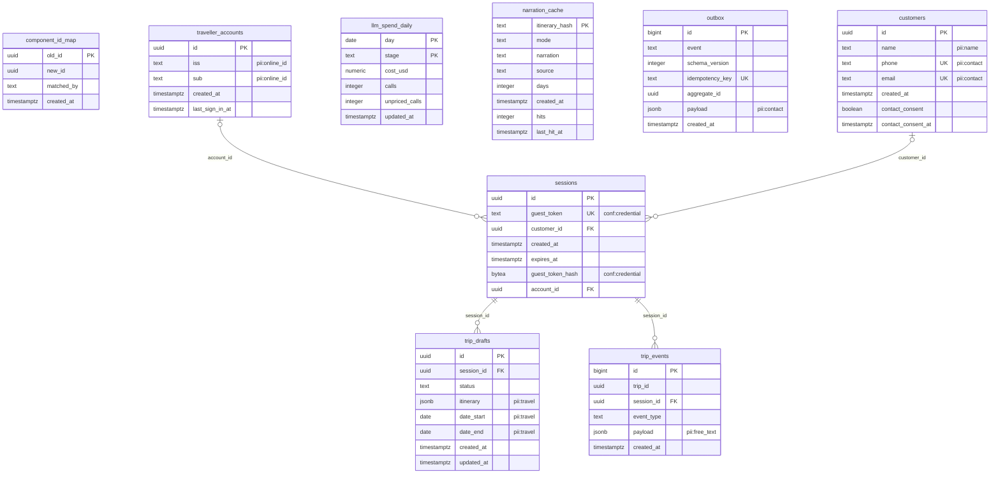

# ERD: tripplanner schema

<!-- GENERATED by AA-CIS-Infra db/gen_erd.py (infra/AA-CIS-Infra/.github/workflows/db-schema-dump.yml) - do not edit -->

Live catalog as of the newest TripPlanner migration **tp-020** (applied 2026-10-26). Owner: TripPlanner (schema owner role `tp_owner`). 9 table(s), 5 view(s), 4 foreign key(s), 0 foreign key(s) in from other schemas.

The diagram shows every column. Full columns, indexes, grants and RLS: [DB schema reference](../db-schema-reference.md) (search for `tripplanner.<table>`). Generated file: change the schema through a migration, not this page.

Notation: `||` exactly one, `|o` zero or one (nullable FK), `o{` zero or more, `o|` zero or one (the FK is the child's PK or a unique key); a dashed line is a `NOT VALID` FK. Attribute comments are DM-6.1 tags (`pii:<class>`, `conf:<class>`). A quoted `"schema.table"` box is the parent table in another schema; foreign keys of other schemas that point here are listed below, and drawn on their own schema's page.

## Tables

| table | kind | columns | primary key | FKs out | FKs in | DM-6.1 tagged columns |
|---|---|---|---|---|---|---|
| `component_id_map` | table | 4 | `old_id` | 0 | 0 |  |
| `customers` | table | 7 | `id` | 0 | 1 | `name` pii:name, `phone` pii:contact, `email` pii:contact |
| `llm_spend_daily` | table | 6 | `day`, `stage` | 0 | 0 |  |
| `narration_cache` | table | 8 | `itinerary_hash` | 0 | 0 |  |
| `outbox` | table | 7 | `id` | 0 | 0 | `payload` pii:contact |
| `sessions` | table | 7 | `id` | 2 | 2 | `guest_token` conf:credential, `guest_token_hash` conf:credential |
| `traveller_accounts` | table | 5 | `id` | 0 | 1 | `iss` pii:online_id, `sub` pii:online_id |
| `trip_drafts` | table | 8 | `id` | 1 | 0 | `itinerary` pii:travel, `date_start` pii:travel, `date_end` pii:travel |
| `trip_events` | table | 6 | `id` | 1 | 0 | `payload` pii:free_text |
| `v_inquiry_outbox` | view | 6 |  | 0 | 0 | `payload` pii:contact |
| `v_ops_component_id_map` | view | 2 |  | 0 | 0 |  |
| `v_ops_data_totals` | view | 2 |  | 0 | 0 |  |
| `v_ops_pin_components` | view | 2 |  | 0 | 0 |  |
| `v_ops_traffic_daily` | view | 3 |  | 0 | 0 |  |

## Foreign keys

| constraint | from | to | valid |
|---|---|---|---|
| `sessions_account_id_fkey` | `tripplanner.sessions` (account_id) | `tripplanner.traveller_accounts` (id) | yes |
| `sessions_customer_id_fkey` | `tripplanner.sessions` (customer_id) | `tripplanner.customers` (id) | yes |
| `trip_drafts_session_id_fkey` | `tripplanner.trip_drafts` (session_id) | `tripplanner.sessions` (id) | yes |
| `trip_events_session_id_fkey` | `tripplanner.trip_events` (session_id) | `tripplanner.sessions` (id) | yes |

## Foreign keys in from other schemas

None.
