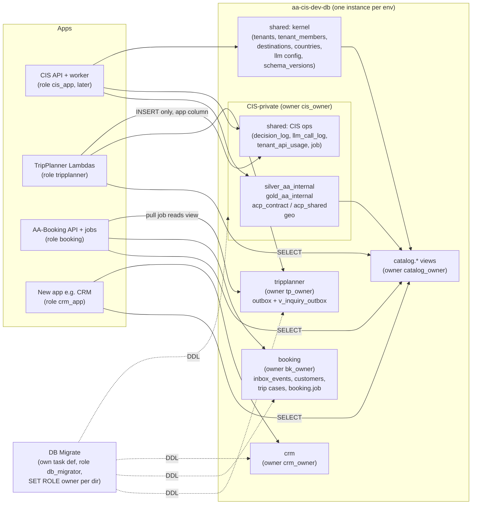

# AA_Ecosys data architecture review (S237)

**Date:** 15/10/2026 · **Author:** Claude Code (S237, final reviewer of a 4-survey + 3-panel workflow) · **Mode:** read-only. No DB, AWS or repo writes were made; this file is the only output.

**Scope:** the shared PostgreSQL 15.17 RDS `aa-cis-dev-db` (acc2 `005097885195`, us-west-1, DB `aa_cis_dev`), used by AA-CIS-App, AA-TripPlanner-Web and AA-Booking. The question: what data architecture to aim for, how to run it, and how to scale it when another app (for example the tenant CRM, AA-821) joins.

**Sources (all paths relative to the workspace root):**
- `docs/architecture/db-schema-reference.md`: S236 live dump, "Verified 2026-10-14". It is **stale**: it predates CIS 228, 230 and bk-007.
- `docs/audits/2026-10-14-S237-lane-backlog/aa817/probe.json` and `aa817_design.md`: the S237 live RLS/role probe, which ran after 228.
- `docs/audits/2026-10-14-S237-lane-backlog/00-orchestrator-journal.md` (decisions D1-D9).
- `docs/database/schema-ownership.md`, `docs/contracts/README.md`, `docs/adr/0001`-`0007` (including `0004a`), `apps/*/CONTEXT.md`.
- `infra/AA-CIS-Infra/modules/rds/*.tf`, `infra/AA-CIS-Infra/db/run_migration.py`, `.github/workflows/db-migrate.yml`, `db/check_migration_copies.py`.
- Linear: AA-804, AA-807, AA-813, AA-817, AA-821 and AA-751, read live on 15/10.

**Row counts** are `pg_class.reltuples` estimates unless marked otherwise. Run exact counts before any drop decision.

---

## 1. Executive summary

1. **Keep one RDS instance with a schema per app.** The logical design is mostly right: each schema has one owner, keys are prefixed (`NNN` / `tp-NNN` / `bk-NNN`), cross-app reads go through the `catalog.*` views, and TripPlanner → Booking uses outbox/inbox. A database per app would double cost and add contracts for no benefit at today's volume.
2. **Ownership is a convention, not a permission.** `aa_cis_admin` (the RDS master) owns every object in `booking.*` and `tripplanner.*` too, inherits `pg_read_all_data`/`pg_write_all_data` through `rds_superuser`, and is at once the CIS API pool, the worker and the DB Migrate runner (`probe.json` → `identity`, `membership_chain`).
3. **DB-level tenant isolation covers 2 canary routes only.** 42 base tables carry a tenant column; 14 have RLS and 8 have FORCE. The owner is exempt from all of it (AA-817).
4. **Two live RLS policies exist in no migration** (`gold_aa_internal.tenant_tour_versions_isolation`, `acp_shared.acp_output_rules.output_rules_rls`). The draft 229 would leave the first one in place, and permissive policies OR together, so the two would combine.
5. **The instance is below what three apps need:** `db.t3.micro`, 20 GB gp3, no storage autoscaling, no Performance Insights, no slow-query log, single-AZ, `skip_final_snapshot = true`. Worst-case pool demand already exceeds `max_connections`; only the 10-concurrency Lambda quota hides it.
6. **Nothing is retained or rolled up.** `shared.decision_log` ~314k, `llm_call_log` ~244k (5x in 10 days), `tenant_api_usage` ~113k (+8.5k/day with 4 tenants). The only cleanup so far was the manual AA-742 delete of 695,728 rows.
7. **The tour key is inconsistent across contracts.** `catalog.tour.v1.1` says to key tours by `(source_system, source_id)`, while `inquiry.submitted` carries the version id `tour_id`. After a CIS re-upload, Booking trip cases would point at tours that no longer exist in `catalog.v_tour`.
8. **TripPlanner is still coupled two ways:** direct reads of `published_tours` (it sets the AA master GUC itself), `shared.destinations` and silver `raw_tours`; 12 FKs into `shared.destinations`; and CIS `photo_sync` reads the frozen TripPlanner tables.
9. **The source of truth is not trusted to stay true.** The reference dump is manual and has no policy, index, grant or size section, and `dead-table-registry.md` is referenced but does not exist. Most of this is already scoped in **AA-807**, which is In Progress.
10. **Order of work:** automate the dump and drift check, add instance guardrails, a connection budget and retention; then split owner and runtime roles (Booking and TripPlanner first), fix the tour key, and finish the TripPlanner decoupling; write a new-app playbook **before** AA-821 builds anything. Partitioning, an analytics lake, RDS Proxy, an event bus and the prod blueprint are trigger-based, not "now".

---

## 2. Current state

### 2.1 Schema map

Object counts come from `db-schema-reference.md` (S236), with `catalog` updated from the probe after 228. Rows are the summed estimates of base tables: the probe for the 6 CIS schemas it covers, the reference for the others.

| Schema | Owner app (repo) | Objects | Rows (est.) | Role / what lives there |
|---|---|---|---|---|
| `shared` | CIS | 42 (37 tables + 5 views) | ~695k | Platform kernel mixed with CIS-private ops. **Kernel:** tenants, admin_users, destinations (1,251 in the dump; ~1,469 after the AA-712 Laos batch), place_photo 3,232, LLM gateway config, schema_versions 160. **CIS-private:** decision_log ~314k, llm_call_log ~244k, tenant_api_usage ~113k, cost snapshots, job ~2.5k, legacy pipeline_jobs 523, pipeline_runs 46, acp_runs. |
| `acp_contract` | CIS | 18 (16 + 2 views) | ~218k | Atoms, segments, routes, hubs. atom_ranking ~108k (versioned; superseded rows are kept), tour_atoms ~32k, atom_segment_member ~25k, route ~8k. |
| `acp_shared` | CIS | 20 | ~2.3k | Tenant content studio: content_piece 188, angle gate, plans, facts, audit_log 930, place_card 111 / place_card_alias 361. |
| `silver_aa_internal` | CIS | 7 | ~5.0k | Ingest/rewrite/review: raw_tours 987, generated_content 1,423, quality_scores 1,432, seo_context 898, review_queue 229. |
| `gold_aa_internal` | CIS | 4 | ~0.9k | Master content: published_tours 886 (892 in probe), tenant_tour_versions 22 (29 in probe). |
| `geo` | CIS (ADR 0007) | 12 | ~7.5k | Place pipeline: tour_place 967, place_name 573, tour_leg/junction/graph, tour_build 27. No consumer grants. |
| `catalog` | CIS (objects owned by NOLOGIN `catalog_owner`) | 14 views (7 from 225 + 7 from 228) | n/a | **The published read model / contract** for tours, days, places, photos and graph. Granted to `aa_app_user`, `tripplanner`, `booking`. |
| `acp_deliver` | CIS | 1 | 0 | `tenant_tour_pages` (0 rows), an ACPv1 leftover. |
| `public` | CIS | 1 | n/a | `checkpoint_migrations` (a LangGraph stub) and the legacy enums. |
| `acp_gold_output`, `acp_silver_s3`, `acp_silver_s4` | CIS (legacy) | 0 | 0 | Empty schemas. |
| `tripplanner` | TripPlanner | 16 (15 + 1 view) | ~13.4k | Sessions, trip_events 51, trip_drafts 21, customers, outbox + `v_inquiry_outbox`. **7 frozen place tables** (itinerary_components 3,972, tour_leg 3,871, tour_junction 3,496, …) are waiting to be dropped. |
| `booking` | AA-Booking | 26 (24 + 2 views) at S236; +1 (`policy_approvals`, bk-007) | ~0.4k | Customers, trip cases, pricing/suppliers (ADR 0005), inbox_events, its own `booking.job` (~428). All objects are owned by `aa_cis_admin`. |

**Login roles** (`probe.json` → `roles`):
- `aa_cis_admin`: the RDS master. NOSUPERUSER, NOBYPASSRLS, CREATEROLE, CREATEDB, and a member of `rds_superuser`.
- `aa_app_user`: the tenant pool, NOINHERIT.
- `tripplanner` and `booking`: created out of band; neither role is defined by its app's migrations.
- `catalog_owner`: the only NOLOGIN owner role.

**Note on AA-807:** its description says `aa_cis_admin` has BYPASSRLS. The probe says it does not. It is exempt because it **owns** the tables, and in the probe even FORCE did not filter it (`rls_active_for_me = false` everywhere). Fix the issue text.

### 2.2 What already works and must be kept

- **Migration flow D8:** a migration-only PR → a byte copy in Infra, checked by the AA-807 copy guard (Infra #110, which caught an empty-file copy in #111) → DB Migrate `check`/`apply` → each file self-registers in `shared.schema_versions`.
- **The `catalog_owner` read model:** views are owned by a NOLOGIN role and backed by the role-scoped policy `catalog_owner_aa_master_read` on the FORCE-RLS base tables, so consumers need no GUC.
- **Outbox/inbox:** `tripplanner.outbox` → `v_inquiry_outbox` (tp-008/tp-009) → `booking.inbox_events` with `UNIQUE (source, contract, idempotency_key)` (bk-002).
- **Booking has no cross-schema FK.** It uses soft keys plus catalog views (ADR 0004 / 0004a). This is the pattern every new app should copy.

---

## 3. Problems found (ranked)

Severity is ranked by blast radius × likelihood for a small team on Dev today, with prod and a 4th app in view.

| # | Problem | Evidence | Impact |
|---|---|---|---|
| P1 | **One master credential does everything.** `aa_cis_admin` = CIS API main pool + worker + DB Migrate for all 3 owners + owner of every object, including `booking.*` and `tripplanner.*`. It inherits `pg_read_all_data`/`pg_write_all_data` and has CREATEROLE. | `probe.json` (`main_secret_user`, `membership_chain`); `infra/AA-CIS-Infra/db/migrations/booking/001_booking_foundation.sql:19-21`; `db-migrate.yml` (one-off task from the `aa-cis-dev-api` task def); ADR 0004a:76-79 ("known gap") | Any CIS bug, injection or ECS exec session has read, write and DDL rights on Booking PII and pricing and on TripPlanner customers. A broken CIS task def blocks TP and Booking migrations. A 4th app added today would land in the same blast radius. |
| P2 | **Tenant isolation lives mostly in WHERE clauses.** RLS is on 14/42 tenant tables (8 FORCE). The owner is exempt. `aa_app_user` covers only Stage 1/5 canary routes, and when its flag is off or its pool is missing it falls back to the master pool. The default ACL (007b) auto-grants SELECT on every new shared/silver/gold table to `aa_app_user`, including 14 tenant tables with no RLS (`shared.tenants`, `tenant_integrations`, `llm_call_log`, …). | `probe.json` (`tables[].rls/force`, `default_acl`, `matrix_runner`); `apps/AA-CIS-App/api/core/aa544_tenant_pool.py`; `aa817_design.md` §5 | One missing `WHERE tenant_id` leaks across tenants. New Cognito tables such as `shared.tenant_members` (AA-813) would be exposed on creation. |
| P3 | **Live/repo drift in RLS.** `tenant_tour_versions_isolation` and `output_rules_rls` exist only in the live DB (grep over `apps/` and `infra/` finds neither). The table `acp_shared.acp_output_rules` is not created by any repo migration either (`102_…sql:25`). The draft 229 drops `tenant_isolation` but not `tenant_tour_versions_isolation`. Policies use 2 GUC names (`app.tenant_id` and `app.current_tenant`, the latter from 019/031). Six policies cast `::uuid` without NULLIF and raise errors on an empty GUC. `acp_shared.facts` has no WITH CHECK. | `probe.json` → `policies[]`; `aa817_design.md:116-118`; `apps/AA-CIS-App/api/migrations/019_social_content.sql:34` | If 229 ships as drafted, the old text-compare policy stays and ORs with the new one. A tenant session could write platform facts. |
| P4 | **Instance and connection budget.** `db.t3.micro` (1 GB), 20 GB gp3, no `max_allocated_storage`, `multi_az = false`, `skip_final_snapshot = true`, `performance_insights_enabled = false`, no parameter group. Pool capacity: CIS API 10 tasks × (10 + 5), worker up to 3 tasks, TP Lambda 5 per instance, Booking 5, against roughly 80-110 `max_connections`. The alarm fires at >70 for 10 min. | `infra/AA-CIS-Infra/modules/rds/main.tf:13-40`; `apps/AA-CIS-App/api/main.py:78`; `modules/ecs/main.tf:389`; `accounts/aa365/observability_ecosys.tf`; journal line 5 (Lambda quota 1000 CASE_OPENED) | Once the Lambda quota rises, a TripPlanner burst (S236 already saw 1,591 throttles on `/plan` tiles) can exhaust connections and take down CIS and Booking. A full disk takes down all 3 apps. With no PI or slow log, nobody can diagnose it. |
| P5 | **No retention, no rollups, a non-sargable usage view.** No partitioning anywhere. Only `shared.job_worker` is pruned (`shared/jobs/queue.py:440`). `v_tenant_monthly_usage` filters `date_trunc('month', called_at) = …` twice per tenant (`223_tenant_usage_real_llm_cost.sql:100,111`), and also on `tenant_tour_versions` (:129). The `llm_call_log` app and shadow flags live only in jsonb. | Growth history in `git log` of the reference (03/10 → 14/10) | Unbounded growth on a 20 GB disk that cannot autoscale. Admin cost and usage pages get slower every day. |
| P6 | **The tour key differs across contracts.** `catalog.tour.v1.1` says "tour_id changes on re-upload; never use it as the key", yet `inquiry.submitted` v1/v1.1 carries `published_tours.tour_id`. TP `source_tour_id` holds `source_id` for some tours and raw `tour_id` for others (journal, AA-712 trial). `raw_tours.source_id` (a uuid FK to raw_sources) is a homonym of the catalog `source_id` (text). | `docs/contracts/catalog.tour.v1.1.json`; AA-Booking `backend/app/contracts/inquiry.submitted.v1.1.json`; journal | Booking trip cases break silently after a CIS re-upload. A new app would join on the wrong column. Cheap to fix **now**: booking.trip_cases has 1-2 rows. |
| P7 | **TripPlanner ↔ CIS coupling outside the contracts.** TP reads `published_tours` by setting the AA master `app.tenant_id` itself (4 sites; `backend/shared/catalog_rls.py`), plus `shared.destinations` (~10 sites), `raw_tours` (column grant 179) and its own frozen tables (~25 sites). It holds 12 FKs into `shared.destinations`. CIS `services/photos/sync.py:95-110` reads frozen TP tables inside a catch-all `except` that returns `{}`. | Ownership survey (TP and CIS `origin/main` grep); `db-schema-reference.md:2484-2494`; ADR 0007 | CIS cannot dedupe destinations (`duplicate_of` exists). The GUC is self-asserted, so it is not an authorization boundary. When TP drops its tables, CIS photo cover matching degrades silently. |
| P8 | **The source of truth is incomplete and stale.** The dump has no policies, indexes, grants, owners or sizes. It lacks 228 (7 views), 230 (`shared.tenants.daily_publish_limit`) and bk-007 (`booking.policy_approvals`). The header still calls `shared.destinations` the "TripPlanner golden record". `docs/architecture/dead-table-registry.md` does not exist. The contracts README registry still shows 225/228/tp-009 as pending. | `db-schema-reference.md:3-17`; `ls docs/architecture` | Agents are told to trust these files, so stale rows produce wrong designs. P3 went unnoticed because policies are not dumped. |
| P9 | **The migration runner is unsafe by default.** `run_migration.py` sets no `lock_timeout`, `statement_timeout` or `application_name` (grep count 0). There is no no-transaction mode for `CONCURRENTLY`, no pre-migration snapshot, and no down path except PITR of the whole shared instance. CIS has duplicate migration numbers 007, 008 and 019, and ~160 registered versions for 221 + 10 + 7 files. | `infra/AA-CIS-Infra/db/run_migration.py`; `ls apps/AA-CIS-App/api/migrations` | An ALTER queued behind a job-runner transaction blocks a hot table for all apps. A rollback rolls back all three apps. |
| P10 | **Customer PII is copied 4 times.** `tripplanner.customers` → `tripplanner.outbox.payload` → `booking.inbox_events.payload` → `booking.customers`, with separate consent flags, no retention and no column tags. `tripplanner.sessions.guest_token = id::text` (plaintext and guessable). | `apps/AA-TripPlanner-Web/backend/assembly/events.py:138-155`, `registration.py:34-78`; ADR 0006 Phase 4 | Erasure and consent audits span 2 schemas plus jsonb. Guest-trip claiming in ADR 0006 Phase 4 would rest on a guessable token. |
| P11 | **Duplicated concepts without one rule.** 4 job/run models (`shared.job`, `booking.job`, legacy `pipeline_*`/`acp_runs`, `atom_decompose_jobs`); `booking.job` lacks `cancel_requested`, `progress`, `cost_usd`, `parent_job_id`. ADR 0003 decision 4 ("non-CIS repos enqueue into shared.job", AA-751) no longer matches reality. Also: 2 audit tables, 2 notification tables, 2 photo-view layers (`shared.v_*_photos` vs `catalog.v_*_photo`), 5 place layers, and free-text country everywhere except Booking-private `booking.countries`. | `db-schema-reference.md` (sections cited in the inventory survey); ADR 0003:54-58; ADR 0004 decision 8 | Every new app copies whichever precedent it finds first. |
| P12 | **Backup, DR and prod readiness.** 7-day PITR in the same account and region, no AWS Backup or cross-region copy, no restore drill. `envs/prod/main.tf` is 0 bytes. `db-migrate.yml` hardcodes dev resources while using the GitHub environment "prod". Real-data `pg_dump` files sit in `docs/backups/2026-09-16` (gitignored, on a laptop). The 3 app repos are public, so schema and RLS details are public. | `modules/rds/main.tf`; `.gitignore:16-17`; `lanes.json:652` | Not urgent on Dev; blocking for prod. |
| P13 | **Dead or legacy objects carry grants and confusion.** Empty schemas (3); `acp_contract.atom_decompose_jobs` (0 rows, no code ref); `acp_shared.marketplace_portfolios`; `shared.v_batch_stats`, `v_pipeline_summary`; `shared.tenant_brand_rules_deleted_aa404`; `acp_deliver.tenant_tour_pages` (0); `skill/aa-cis-schema/references/gotchas.md` still cites the dropped `acp_v2_*`. | Inventory survey (grep-based; candidates only) | Low runtime risk; high cost in confusion for agents. |

---

## 4. Target architecture

### 4.1 Principle

**One instance per environment; operate every schema as if it could be lifted into its own database later.** In practice:
- no FKs between apps;
- cross-app reads only through views in contract schemas;
- cross-app state changes only through outbox → pull job → inbox;
- writes into another app's domain only through its HTTP API;
- one NOLOGIN owner role per schema, and non-owner runtime roles.

Existing schema names stay (a rename touches hundreds of SQL sites for clarity alone). The naming conventions in 4.4 bind **new** objects only.

### 4.2 Diagram

Analytics is not in the picture on purpose. BI never queries the OLTP primary. When a trigger fires (section 5), the path is a nightly Parquet export to S3 plus Athena.

### 4.3 Entity source of truth

| Entity | Single source of truth (owner) | Cross-app key | How others read it | Retire / converge |
|---|---|---|---|---|
| Tour | `silver_aa_internal.raw_tours` → `gold_aa_internal.published_tours` (CIS) | `(source_system, source_id)`, where `source_id = COALESCE(raw_tours.source_group_id, tour_id)`. `tour_id` is only a version snapshot. | `catalog.v_tour`, `v_tour_day`, … | `inquiry.submitted` v1.2 adds `source_system` + `source_id` per leg. TP normalizes its mixed `source_tour_id` values. Glossary entry for the `raw_tours.source_id` homonym. |
| Place / destination | `shared.destinations.id` (CIS; ADR 0002/0007) | `destination_id` | `catalog.v_destination`, `v_destination_photo` | `geo.place_name` = the one name resolver. `acp_shared.place_card` becomes an editorial extension with required `destination_id` (later). Drop the frozen `tripplanner.*` place tables and their 12 FKs. Retire `shared.v_*_photos` once TP reads `catalog.v_*_photo`. |
| Tour graph / route | `geo.*` (CIS, ADR 0007) | `source_id`, `component_id` | `catalog.v_tour_component`, `v_tour_leg`, `v_graph_*` (228) | Frozen `tripplanner.tour_*` dropped 14 days after the reader cut-over. |
| Country | **New** `shared.countries` (ISO-3166, already in AA-807 scope) | `iso2` | a catalog view (e.g. `catalog.v_country`) | `booking.countries` stays as Booking's "markets we sell" list, keyed by iso2. Add `country_iso2` next to free-text country (additive). |
| Tenant | `shared.tenants.id` uuid (CIS) | `tenant_id` uuid | Inside CIS: code. For other apps: a membership view (with AA-813). | New tables use `tenant_id uuid NOT NULL`. Legacy varchar/text columns are fixed only on tables that survive retirement. |
| Tenant user / membership | **New** CIS membership table (AA-813, e.g. `shared.tenant_members`) keyed by Cognito `(iss, sub)` | `user_sub` | A read-only contract view for other tenant-facing apps (e.g. a CRM) | Must be created **after** the 007b default ACL is removed, or with an explicit REVOKE. |
| Staff identity | Cognito `aa-workforce` (ADR 0006); profiles in `shared.admin_users` / `booking.staff_users` keyed by `(iss, sub)` | `(iss, sub)` | Tokens; no DB reads across apps | — |
| Customer (B2C traveller) | `booking.customers` (Booking; ADR 0001:66 as amended by 0006) + `booking.customer_identities (iss, sub)` | `(iss, sub)` | Booking API / events | Later: `tripplanner.customers` shrinks to subject + consent. Outbox/inbox payload PII is redacted after a retention window. |
| Inquiry / trip request | `tripplanner.outbox` (producer) → `booking.inbox_events` (consumer) | `idempotency_key` | `tripplanner.v_inquiry_outbox` | Planned reverse event `trip_case.status_changed.v1`. |
| Background job | `<schema>.job` per owner (`shared.job` for CIS, `booking.job` for Booking), shape owned by the runner library | `id`, kind prefix per app | Own admin views | ADR 0003 amendment (supersedes AA-751's premise). Legacy `pipeline_jobs` archived; `acp_runs` readers move to `shared.job`; `pipeline_runs` kept as the "upload batch" entity (it is the FK parent of `raw_tours.batch_id`). |
| LLM call / cost | `shared.llm_call_log` (CIS gateway ledger, AA-804 v2 columns `app`, `is_shadow`, …) | `app`, `stage`, `job_id` | INSERT-only for other apps; read back through a rollup (`llm_call_daily`) filtered by app | Retire `tripplanner.llm_spend_daily` once TP can read the shared rollup. |
| Audit | Per-owner `<schema>.audit_log`, append-only for the runtime role | — | Not shared | No ecosystem audit table. pgaudit for prod forensics. |

### 4.4 Conventions for new objects (binding from now on)

**Schemas and tables**
- A schema is named after its domain noun: no codename, no medallion layer. New objects never go in `public`, and new CIS-private tables never go in `shared`.
- Entities use a `uuid` PK. Append-only logs use `bigint GENERATED ALWAYS AS IDENTITY` plus `created_at`, which keeps a later partitioning cheap.
- Timestamps are `created_at` / `updated_at timestamptz NOT NULL`. Use text + CHECK instead of new enum types.

**Tenancy and grants**
- Every tenant table has `tenant_id uuid NOT NULL`, ENABLE RLS, and one policy template: `USING (tenant_id = NULLIF(current_setting('app.tenant_id', true), '')::uuid) WITH CHECK (same)`, scoped `TO <runtime role>`, not PUBLIC. `app.tenant_id` is the only GUC name.
- For CIS tables, FORCE comes only after the role split (AA-817 D2). New apps use FORCE from day one.
- Grants are per object. No `ALTER DEFAULT PRIVILEGES … TO` an app role.

**Views and payloads**
- Contract views are named `v_<entity>` and live only in `catalog`, a tenant-contract view, or `<schema>.v_<event>_outbox`.
- PII columns carry `COMMENT 'pii:<class>'`.

---

## 5. Operations and scaling

### 5.1 Guardrails to add now (Dev, low cost)

The changes below are in `infra/AA-CIS-Infra/modules/rds` plus `observability_ecosys.tf`. They need one maintenance-window reboot (1-2 min for all 3 apps), taken only after the aa-ship guard shows `shared.job` and `booking.job` idle.

- `max_allocated_storage = 100`. This is free until used.
- A custom parameter group:
  - `log_min_duration_statement = 500ms`
  - `log_lock_waits = on`
  - `idle_in_transaction_session_timeout = 60s`
  - `track_io_timing = on`
  - `rds.force_ssl = 1` (explicit)
  - `pg_stat_statements` (check that it is preloaded, then `CREATE EXTENSION` in a CIS migration)
- `enabled_cloudwatch_logs_exports = ["postgresql"]` with 14-day retention.
- `skip_final_snapshot = false` and `copy_tags_to_snapshot = true`.
- Performance Insights / Database Insights at the free tier. **Check in `terraform plan` that the instance class supports it.** Some micro and small classes do not, so this may have to be bundled with the t4g.small resize in 5.2.
- `application_name` per pool: `cis-api`, `cis-worker`, `cis-tenant`, `tp-browse`, `tp-assembly`, `booking-api`, `db-migrate`.
- Alarms:
  - `DatabaseConnections` > 60 for 5 min (today: > 70 for 10 min)
  - `FreeableMemory` < 100 MB
  - `CPUUtilization` > 80% for 15 min
  - `CPUSurplusCreditsCharged` > 0 (T-class runs in Unlimited mode, so the symptom is cost, not throttling)
  - `FreeStorageSpace` < 50% of allocated

### 5.2 Thresholds and triggers

| Area | Today | Action | Trigger (measure, do not guess) | Approx. cost |
|---|---|---|---|---|
| Connection budget | No limits; TP pool max 5 per Lambda instance; CIS API up to 10 tasks × 15 | `CONNECTION LIMIT` per role (start: tripplanner 30, booking 10, aa_app_user 15), set in git through owner migrations. TP pool max 1 per instance. `reserved_concurrent_executions` on browse/assembly (start at 10 each). Cap CIS API main pool at 5 while on T-class. | **Before** the Lambda quota increase to 1000 is approved | $0 |
| RDS Proxy | None | Put it in front of the TP Lambdas first (IAM auth). Test pinning with asyncpg prepared statements and the `set_config(..., true)` GUC, and watch `DatabaseConnectionsCurrentlySessionPinned`. | Lambda concurrency need > 20, or connections p95 > 60% of max for a week, or before prod | ~$20-25/mo |
| Instance size (Dev) | db.t3.micro | → db.t4g.small (2 GB) | `FreeableMemory` < 200 MB regularly, or catalog/admin p95 regressions during waves, or PI unsupported on micro | ~+$10-15/mo (check the calculator) |
| Instance size (next steps) | — | t4g.medium; then m7g.large; r7g when the working set exceeds ~70% of RAM | CPU above the T baseline most of a week, `CPUSurplusCreditsCharged` > ~$10/mo, or >5 primary-path statements > 200 ms mean in `pg_stat_statements` | — |
| Log retention | None | Owner-run TTL jobs with batched DELETE plus rollups (section 7, item N4) | Start now. Hard stop: any log table > 1M rows, or `FreeStorageSpace` < 10 GB | $0 |
| Partitioning | None | Monthly range partitions (pg_partman, or native partitions created ahead by the job). Convert append-only tables by CHECK NOT VALID → VALIDATE → ATTACH the old table as one partition. | A table > 10M rows or > 5 GB, or a retention DELETE taking > 5 min, or `n_dead_tup / n_live_tup` > 20% after autovacuum | $0, 2-4 days per table |
| Catalog latency | Plain views; full `v_tour_place` count takes 3.3 s (journal) | Materialized tables behind the heavy views, refreshed by a CIS `catalog_refresh` job kind on publish or geo build; expose `refreshed_at` | A catalog view p95 > 500 ms in `pg_stat_statements`, or TP browse fully switched to `catalog.*` | $0 |
| Read replica | None | Add one | Read-dominated load > 30% of primary CPU, or primary CPU > 60% sustained with reads dominating | ~instance cost |
| Analytics | Admin pages query the primary | Nightly Parquet export to S3 + Glue + Athena (bytes-scanned limit). No Redshift or zero-ETL at this scale. | First cross-app BI request, or logs needing archive before delete | cents to a few $/mo |
| Event relay | Pull polling (`bk_inquiry_pull`) | Outbox → EventBridge → SQS + DLQ per consumer | The first consumer outside the DB/VPC (HubSpot sync, mobile push), or an event with a 3rd consumer | small |
| Split an app out | Shared instance | Booking first (no cross-schema FK): logical replication of the catalog materialized tables, DSN cut over through a private CNAME | Booking p95 > 2x during CIS waves at least twice a month; Booking needs its own PITR or RPO; total size > 200 GB; connections p95 > 70% | ~2x DB cost |
| Prod | Nothing (`envs/prod/main.tf` is 0 bytes) | Separate instance in acc2 (ADR 0001 S235): Multi-AZ t4g.medium to start, 14-day PITR, final snapshot on, AWS Backup cross-region copy, its own SG, secrets prefix, Terraform root and DB Migrate `environment` input, a private CNAME for the DSN, a quarterly restore drill | When a prod go-live date is set | ~$110-130/mo + storage |

### 5.3 Migration safety (applies to every owner)

- `run_migration.py` defaults: `SET lock_timeout = '5s'`, `statement_timeout = '15min'`, `application_name = 'db-migrate'`. A file can override them in a header.
- A header `-- migrate: no-transaction` allows `CREATE INDEX CONCURRENTLY` and similar statements. Such files must be idempotent.
- A header `-- migrate: destructive` makes DB Migrate take a manual snapshot first. Snapshots are the only undo that does not roll back all three apps.
- Expand/contract is mandatory: expand → flip the readers → wait ≥ 14 days → contract under DRY RUN (`skill/aa-cis-schema/references/destructive-ops.md`).
- A lint (squawk or grep rules) plus a unique-number check per owner in CI. The existing 007/008/019 pairs get resolved in the registry, not renumbered.
- After every apply and every night, a read-only dump regenerates `db-schema-reference.md` with columns, **policies, indexes, grants, owners, default ACLs, sizes and `pg_stat_user_tables` activity**. It fails on unmanaged objects. This is AA-807's drift job; the D8 train gets a step 5 for it.

---

## 6. Onboarding a new app

### 6.1 Decision gate (answer first)

1. **Does the app own data that nobody else owns?** If not, it is an API client of an existing app: no schema and no DB role. Examples:
   - A mobile app is a client of the TP/Booking APIs.
   - A supplier portal is a front end of Booking, which owns suppliers under ADR 0005.
   - A BI tool reads exports, never the RDS.
2. **Is it a new capability of an existing domain?** Then it is a module plus tables in the owner's schema.
3. **Is it a new domain with its own lifecycle?** Then it gets its own schema and the full playbook below.

### 6.2 Playbook

1. **Design and ADR.** Write a design doc in `docs/audits/<date>-S<nnn>-<slug>/` that cites the integration ADR (see decision 8.1). Name the owning repo.
2. **Register the owner.** Add one entry to `infra/AA-CIS-Infra/db/owners.yaml` (new; part of AA-807): directory, repo, path, key prefix, owner role, runtime role(s), allowed consumer grants. Today the same facts are hard-coded in 3 places: the `db-migrate.yml` regex/case, `check_migration_copies.py` OWNERS/PATH_RE, and `schema-ownership.md`. owners.yaml replaces them.
3. **Create the roles in a reviewed bootstrap, not by hand:**
   - `<app>_owner` NOLOGIN
   - `<app>_app` LOGIN with `CONNECTION LIMIT` and its own `application_name`
   - optionally `<app>_reader` NOLOGIN, which owns the contract views the app exposes
   The DSN goes in Secrets Manager at `<app>/<env>/database-url`. ⚠️ This contains underscore env vars: Nghiệp edits them manually in VSCode.
4. **First migration** `<prefix>-001`: `CREATE SCHEMA <app> AUTHORIZATION <app>_owner`, per-object grants, self-registration in `shared.schema_versions`, and the timeout headers. DB Migrate applies it with `SET ROLE <app>_owner`.
5. **Tenancy.** Every tenant table uses the RLS template in 4.4 with FORCE. The pool **fails closed**: a missing tenant context gives a 503 and never falls back to another pool. The app checks membership before `SET LOCAL app.tenant_id`.
6. **Reads from other apps** go only through contract views, granted by the producer in its own migration (unguarded, schema-ownership rule 5) once the role exists. Tours are keyed by `(source_system, source_id)`. No FK into another schema.
7. **Events** use an outbox table + `v_<event>_outbox` view, and the consumer's inbox has an idempotency key. Register the contract JSON Schema in `docs/contracts/` in the same PR as its view. Consumer copies of contract files get a hash guard.
8. **Identity** comes from a Cognito app client (ADR 0006). No password, OTP or session tables. Authorization is the app's own data (membership or role), never token claims alone.
9. **Platform services:**
   - a job table from the runner-library DDL template, with a kind prefix;
   - LLM calls through the gateway, recorded in `shared.llm_call_log` with `app` set (AA-804);
   - a retention row for every log, event or job table.
10. **PII.** Tag columns, write a retention or redaction rule, keep payloads minimal, and never put PII in LLM prompts or logs.
11. **Ops.** `App=<app>` tags, a budget alert, a row in the connection budget table (5.2), and a regenerated schema reference.
12. **Isolation probe before the first tenant.** Run an aa817-style matrix as `<app>_app` (own / foreign / empty GUC), and require 0 cross-tenant rows.

### 6.3 Checklist (copy into the epic)

- [ ] Decision gate answered; owning repo named
- [ ] Design/ADR approved by Nghiệp
- [ ] `owners.yaml` entry; Copy Guard and DB Migrate pick it up with no code edit
- [ ] Owner + runtime roles bootstrapped in git; DSN secret created by hand
- [ ] `<prefix>-001` applied through D8; `schema_versions` row present
- [ ] RLS template on every tenant table; catalogue CI guard green (no tenant table without RLS or an allowlist reason; no PUBLIC policy; no `app.current_tenant`; NULLIF present)
- [ ] No cross-schema FK; reads only through contract views; grants issued by the producer
- [ ] Contracts registered; consumer copy guard in place
- [ ] Cognito app client; no credential tables
- [ ] Job table from the template; retention rows; backlog-age alarm
- [ ] PII tags plus retention/redaction rule
- [ ] Connection budget, `application_name`, App tag, budget alert
- [ ] Isolation probe passed

### 6.4 Worked example: tenant CRM (AA-821)

AA-821 is in Backlog and is research first: build, or integrate HubSpot/Zoho. This is a **sketch to validate** in that research, not a build plan.

- **Gate:** a new domain (tenant contacts, interactions, deals). **The tenant is the data controller and AA is the processor.** This is the first time AA would hold another business's personal data, so it needs its own schema `crm` and prefix `crm-`. It can start as a module of AA-CIS-App (the portal, AA-813 membership and the tenant pool already live there) but with its own owner directory and key space, so a later move to an `AA-CRM` repo needs no renumbering. If the research picks HubSpot/Zoho, the schema shrinks to `crm.integration_link` + an outbox.
- **Roles:** `crm_owner` (NOLOGIN), `crm_app` (LOGIN, `CONNECTION LIMIT 10`), and optionally `crm_staff` for AA support (read-only, explicit policy). The CRM is the cheapest place to prove the owner/runtime split. Caveat: until the CIS role split lands (AA-817), `aa_cis_admin` can still read `crm.*` through `pg_read_all_data`, so the isolation is partial until then.
- **Tables** (all `tenant_id uuid NOT NULL`, FORCE RLS, NULLIF policy `TO crm_app` with WITH CHECK):
  - `crm.contact` (PII-tagged; `deleted_at`)
  - `crm.contact_consent` (append-only)
  - `crm.interaction`
  - `crm.deal` (tour interest as the soft key `interest_source_system` / `interest_source_id`, never `tour_id`)
  - `crm.pipeline_stage`
  - `crm.outbox`, `crm.job` (runner template, `crm_` kinds)
  - No FK into `shared`, `tripplanner` or `booking`.
- **Reads:** `catalog.v_tour` / `v_destination`, and the AA-813 membership view. **Never** `booking.customers` or `tripplanner.customers`: those are AA's own customers under a different controller, and AA sales must not see a tenant's leads.
- **Identity:** tenant users sign in through the `aa-external` pool (ADR 0006 Phase 3). Each request is checked against an active membership, then `SET LOCAL app.tenant_id`. Lead capture from a tenant's website uses the tenant's X-API-Key on a CIS endpoint with an idempotency key, never a DB role.
- **Events (only if needed):** `crm.lead.handoff_requested.v1`, sent only when a tenant explicitly asks AA to operate a trip, with captured consent. Booking consumes it and creates its **own** customer record.
- **PII:** a per-tenant retention setting; hard delete on erasure or tenant offboarding; outbox payloads carry `contact_id`, not contact details; no contact PII in prompts or in `llm_call_log`.
- **Product rule:** consistent with "tenant sees content only". All AA-side QA and diagnostics of the CRM stay in admin.
- **Preconditions before any CRM DSN exists:** this playbook (ADR), `owners.yaml`, the RLS catalogue guard, AA-813 membership + view, and the guardrails and connection budget from 5.1/5.2.

---

## 7. Roadmap

Effort: S ≤ 1 day, M 2-4 days, L ≥ 1 week. "No issue": ask Nghiệp before creating one (steering rule; project quota ≤ 100 unarchived issues).

### Now (this and next session)

| # | Item | Effort | Linear |
|---|---|---|---|
| N1 | **Automate the schema dump and nightly drift check.** Move `.tmp-session/s209_schema_dump.py` + `s209_gen_schema_md.py` into `infra/AA-CIS-Infra/db/`. Add policies, indexes, grants (including column grants), owners, default ACLs, sizes and activity. Run it after every DB Migrate apply and nightly; auto-PR to root. Regenerate the reference now, so 228/230/bk-007 appear. | M | **AA-807** (drift job in scope) |
| N2 | **Fix 229 before it ships.** Explicitly `DROP POLICY IF EXISTS tenant_tour_versions_isolation`. Bring `output_rules_rls` / `acp_output_rules` under a migration, or put them on the retire list. Use the NULLIF template. Keep D2 (ENABLE without FORCE). | S | **AA-817** |
| N3 | **Instance guardrails + connection budget (5.1, first rows of 5.2):** storage autoscaling, parameter group, `pg_stat_statements`, log export, final snapshot, alarms, `application_name`, CONNECTION LIMIT, TP pool max 1, Lambda reserved concurrency. Must land **before** the Lambda quota increase is applied. | S-M | No issue |
| N4 | **Retention + rollups + sargable view:** (a) Range-predicate rewrite of `v_tenant_monthly_usage` (and the `tenant_tour_versions` part) + index `(tenant_id, called_at)` on `tenant_api_usage`. (b) `shared.llm_call_daily` rollup. (c) TTL job kinds: • `llm_call_log`: raw 90-180 d (decision 8.3) • `decision_log`: confirm the cache TTL in code first; 180 d is cited but not found in `181_jev_decision_layer.sql` • `tenant_api_usage`: 90 d raw + monthly rollup • `shared.job` / `booking.job`: succeeded rows after 30 d, failed after 90 d • `cost_explorer_snapshot`: latest per day Batched DELETE, DRY RUN first. Never `VACUUM FULL`. | M | Partly **AA-804** (the `app`/`is_shadow` columns the rollup groups by); rest: no issue |
| N5 | **Make the migration runner safe by default** (5.3): timeouts, no-transaction mode, pre-snapshot for destructive files, a "latest" query per prefix, a unique-number check. | S-M | **AA-807** (runner/CI part) or no issue |
| N6 | **Dead Table Registry + wave-1 quarantine.** Create `docs/architecture/dead-table-registry.md`. Verify with exact counts + 14 days of `pg_stat_user_tables` + code grep. Quarantine by `ALTER … SET SCHEMA retired` (reversible). Wave 1: • the 3 empty schemas • `atom_decompose_jobs` • `marketplace_portfolios` • `v_batch_stats` / `v_pipeline_summary` • `tenant_brand_rules_deleted_aa404` Fix `gotchas.md` (`acp_v2_*`) in the same PR. | M | **AA-807** |
| N7 | **Remove the 007b default-ACL auto-grant to `aa_app_user`** (no behaviour change for existing tables), so AA-813 tables are not exposed on creation. | S | **AA-817** / precondition for **AA-813** |

### Next (before prod or a 4th app)

| # | Item | Effort | Linear |
|---|---|---|---|
| X1 | **`owners.yaml` + owner roles + separate migrator.** 1. Reassign `booking.*` → `bk_owner` and `tripplanner.*` → `tp_owner` first (low risk: explicit grants, no owner-exemption dependence). 2. DB Migrate gets its own task def + `db_migrator` role, uses `SET ROLE <owner>`, and takes an `environment` input. 3. Capture the `tripplanner`/`booking`/`aa_app_user` role definitions in git. 4. For CIS, follow AA-817 D2: role-scoped admin/worker policies → switch the runtime to `cis_app` → reassign CIS objects to `cis_owner`; keep `aa_cis_admin` for break-glass. | L (Booking/TP part S-M) | **AA-807** (owner roles), **AA-817** (CIS runtime) |
| X2 | **Catalogue CI guard:** • no tenant table without RLS or an allowlist entry • no PUBLIC policy in new schemas • no `app.current_tenant` • NULLIF present • no cross-owner FK • non-owner grants checked against the `owners.yaml` allowlist | M | **AA-817** (guard proposed in `aa817_design.md` §4) / **AA-807** |
| X3 | **Tour key fix:** `inquiry.submitted` v1.2 (additive `source_system` + `source_id` per leg); Booking `trip_case_legs.source_id`; a TP backfill matching both key types; a glossary entry for the `raw_tours.source_id` homonym; update the contracts README registry (225/228/tp-009 rows). | M | Related to **AA-679** (Booking catalog sync); else no issue |
| X4 | **Finish the TripPlanner decoupling:** 1. CIS `photo_sync` moves to `geo.tour_place` / `catalog.v_tour_component` and logs loudly instead of returning `{}`. 2. TP slices 6b/7 move the `published_tours` / `raw_tours` / `destinations` / photo-view reads to `catalog.*` and remove `set_catalog_tenant`. 3. A 7-day parity check, then drop the 7 frozen tables and their 12 FKs (DRY RUN, archive to S3). 4. A CIS revoke migration for 173/179/180/216 + the `published_tours` SELECT + USAGE grants. 5. Update `apps/AA-TripPlanner-Web/CONTEXT.md:48`. | M-L | **AA-712** (place pipeline slices) |
| X5 | **`shared.countries` (ISO-3166) + a catalog country view + additive `country_iso2` columns.** | M | **AA-807** (in scope) |
| X6 | **ADR 0003 amendment:** one job table per owner schema, shape owned by a DDL template in `shared/jobs`, kind prefixes in `owners.yaml`. Add the missing `booking.job` columns. Move the `acp_runs` readers. This supersedes the premise of AA-751. | M | **AA-751** (re-scope or close) |
| X7 | **New-app integration ADR + playbook** (section 6) and a hash guard for consumer contract copies. **Before** any AA-821 build. | S-M | No issue (prerequisite of **AA-821**) |
| X8 | **Hash `tripplanner.sessions.guest_token`** (a separate random token). Must be done before ADR 0006 Phase 4 guest claiming ships. | S | No issue (ADR 0006 Phase 4) |
| X9 | **Dev resize t3.micro → t4g.small + PI**, if 5.2 triggers fire or PI is unsupported on micro. Per-app cost tags + budgets (`default_tags` not flipped in S235). | S | No issue |
| X10 | **Restore drill on Dev** (PITR to a new instance, smoke queries, record the RTO) + a private CNAME for DSNs. Delete or encrypt `docs/backups/2026-09-16`. | S | No issue |

### Later (by trigger, see 5.2)

| # | Item | Effort | Trigger | Linear |
|---|---|---|---|---|
| L1 | Wave 2-3 retirement: `content_exports`/`webhook_deliveries` (an owner decision: planned or dead?), `acp_deliver`, `tenant_atom_state`, `quarter_plan_version`, `acp_quota_ledger`, `acp_output_rules`, `public.checkpoint_migrations`; archive `pipeline_jobs` to S3 | M | After N6 + owner confirmation | **AA-807** |
| L2 | Place identity convergence (`place_card.destination_id NOT NULL`; fold `place_card_alias` into `geo.place_name`) | M-L | After X4 | No issue |
| L3 | Customer PII consolidation (Booking master; shrink `tripplanner.customers`; redact outbox/inbox payload PII after N days; `pii:` tags) | M-L | Cognito Phase 4 / before prod | No issue (ADR 0006) |
| L4 | Materialized catalog read model | M | View p95 > 500 ms | No issue |
| L5 | Partition the ledgers (pg_partman) | M per table | > 10M rows / > 5 GB / DELETE > 5 min | No issue |
| L6 | Analytics export (S3 Parquet + Athena) | M | First cross-app BI request | No issue |
| L7 | RDS Proxy | M | 5.2 trigger | No issue |
| L8 | EventBridge/SQS relay from the outboxes | M | First external consumer or 3rd consumer | No issue |
| L9 | Prod blueprint (separate instance, Multi-AZ, cross-region backup, own Terraform root) | L | Prod go-live date | No issue |
| L10 | Tenant CRM build through the playbook | L | AA-821 research approved + X1/X2/X7/AA-813 done | **AA-821**, **AA-813** |

### What this review dropped or downgraded from the panel

- **A new `platform` contract schema plus a separate `tenancy` schema** (both panels proposed one). Two new schemas at once is too much for a small team. The country view goes into the existing `catalog`. One tenant-contract view is created only when AA-813 lands and a second app needs it. The name is decision 8.4.
- **Fixing varchar/text `tenant_id` on legacy tables.** Most of them (`acp_output_rules`, `acp_deliver.tenant_tour_pages`, `pipeline_jobs`) are retirement candidates, so retire them instead of fixing them.
- **FORCE RLS on every CIS tenant table now.** That contradicts accepted D2 (229 = ENABLE without FORCE) until the role split. FORCE is kept for new apps only.
- **Consent ledger, `subject.erasure_*` events, per-app `_export` schemas, EventBridge relay, pg_partman, a lake, RDS Proxy, Route 53 CNAME, pgaudit.** These are moved to Later or trigger-based. They are correct but premature at Dev volume with 4 tenants and 1-2 booking rows.
- **The `shared.country` name.** Aligned to AA-807's `shared.countries`.
- **"Performance Insights is free on the current instance".** Downgraded to "verify in plan": PI support on micro classes is not guaranteed, so it may need the t4g.small resize.
- **Cost figures** are rough us-west-1 estimates and must be checked in the AWS pricing calculator before any decision.

---

## 8. Decisions needed from Nghiệp

1. **ADR numbering.** AA-804 still plans a "root ADR 0006 AI platform", but `docs/adr/0006` is now ecosystem identity. Proposal: 0008 = new-app integration and data platform rules (section 6 + conventions 4.4); 0009 = AI platform (AA-804). Also approve the ADR 0003 amendment (per-app job tables), and decide whether AA-751 is closed or re-scoped.
2. **Role-split order.** Approve reassigning `booking.*` and `tripplanner.*` to `bk_owner` / `tp_owner` and creating a separate migrator task def now (X1, low risk). The CIS runtime switch stays behind AA-817 D2.
3. **Retention windows:**
   - `llm_call_log` raw 90 vs 180 days (cost/audit history vs disk)
   - `tenant_api_usage` 90 days raw
   - succeeded jobs 30 days
   - outbox/inbox payload PII redaction after 90 days
   Archive to S3 before delete: yes or no.
4. **Contract-schema naming for tenant data.** Should the AA-813 membership view live in `catalog`, or in one new contract schema (e.g. `platform`)? Pick one name and use it for the CRM.
5. **Spend:**
   - Dev resize to t4g.small (~+$10-15/mo) and PI
   - RDS Proxy only at its trigger (~$20-25/mo)
   - per-app cost allocation tags, which need activation in the Billing console by you
6. **Lambda quota 1000.** Confirm that N3 (connection limits + reserved concurrency) must ship before the quota case is applied.
7. **Tour key.** Approve `inquiry.submitted` v1.2 (additive) now, while Booking has 1-2 trip cases.
8. **Customer PII ownership.** Confirm `booking.customers` as the single customer master, and that TripPlanner keeps only subject + consent after ADR 0006 Phase 4.
9. **CRM (AA-821).** Build or integrate (HubSpot/Zoho), and CIS module vs separate repo. The data rules in 6.4 hold either way.
10. **Hygiene:**
    - delete or encrypt the real-data dumps in `docs/backups/2026-09-16`
    - confirm the 3 app repos stay public, given that schema, RLS and role details are visible
    - fix the AA-807 description (`aa_cis_admin` is owner-exempt, not BYPASSRLS)
11. **New Linear issues.** N3, N4 (non-AA-804 part), X7, X8, X9 and X10 have no issue. Approve creating them, and say which project, given the quota of 100 unarchived issues per project.
