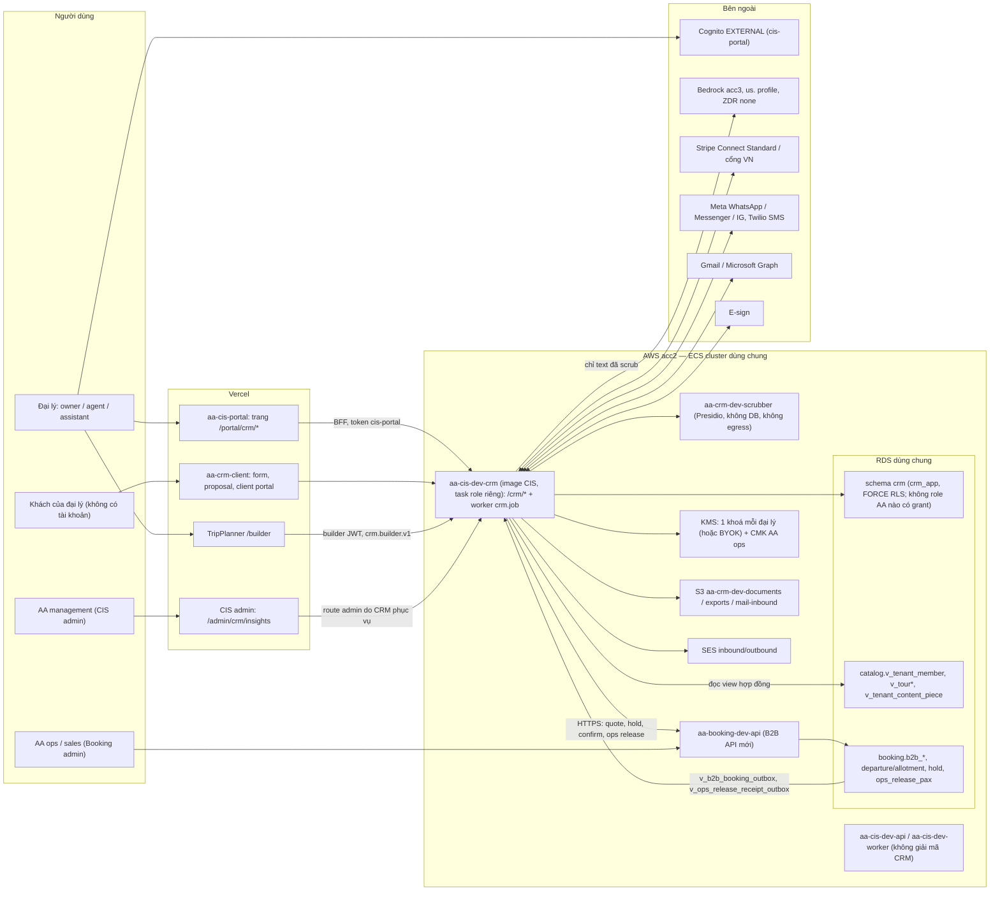

# Thiết kế CRM cho đại lý (tenant) — sản phẩm hoàn chỉnh (AA-821 / PR-19)

Ngày 20/10/2026, phiên S245, tác nhân: Claude Code. Chỉ đọc và viết tài liệu: không đổi Linear, Jira, Notion, GitHub
hay AWS. Quyết định đầu vào của Nghiệp (S245): **không làm MVP**, thiết kế sản phẩm hoàn chỉnh theo spec của chị Thư
([partner-crm-spec.md](../../research/partner-crm-spec.md), Jira PR-19) để xây thẳng một mạch.

Tài liệu gốc trong `research/` (tiếng Anh, giữ nguyên như workflow trả về):
[01 nền tảng](research/01-platform-fit.md) · [02 yêu cầu](research/02-requirements.md) ·
[03 benchmark](research/03-market-benchmark.md) · [04 chi phí, tuân thủ, bảo mật](research/04-economics-compliance-security.md)
(bản thô cùng nội dung: [research-fullbuild.md](research/research-fullbuild.md)) ·
[options.json](research/options.json) (3 phương án thật của panel) · [judges.json](research/judges.json) (2 giám khảo
thật) · [ADR nháp cho phương án A](research/adr-draft.md) (đã thay thế, xem §7).

> **Bản này thay bản trước cùng ngày.** Bản trước được viết khi output của panel bị cắt: tác nhân viết tài liệu tự chấm
> điểm (A 79 / B 74 / C 68), tự dựng lại phương án B và C, và ước lượng phần phủ module 10–18. Bản này dùng **output
> thật** của 3 lane phương án và 2 giám khảo. Khuyến nghị đổi từ "app thứ tư AA-CRM" sang "module của AA-CIS-App có
> service ECS riêng" (§7).

## 1. Tóm tắt

1. **Khuyến nghị: làm CRM thành module của AA-CIS-App ngay bây giờ** (phương án C của panel), có schema `crm` và role
   `crm_owner`/`crm_app` riêng như ADR 0008 §8 đã viết, chạy trên **ECS service riêng `aa-cis-dev-crm`** (build từ
   image CIS, task role và security group riêng) và giữ ranh giới module sạch để **tách thành app AA-CRM sau này** mà
   không phải đánh số lại. Trang cho đại lý nằm ngay trong portal `/portal/crm`.
2. Panel **chia phiếu**: giám khảo góc nhìn sản phẩm chọn C (C 19 / A 16 / B 11), giám khảo góc nhìn CTO chọn A
   (A 18 / C 17 / B 11). Tổng: **C 36, A 34, B 22** — C hơn A 2 điểm. Cả hai cùng loại B (lõi Booking đa tenant).
3. Phủ đủ 23 module (F1–F5, 1–18) và 3 điểm khác biệt của spec: hàng AA thật qua Booking B2B API, proposal khách tự chọn
   qua TripPlanner `/builder`, riêng tư theo kiến trúc (khoá KMS riêng mỗi đại lý, profile ẩn danh do DB chặn,
   scrubber, audit chuỗi hash).
4. Công sức: **≈20 phiên agent (dải 19–21), ~115 issue, 9 đợt W0–W8**. Số phiên tính theo khối lượng từng module (§9),
   không phải chia số issue — trung bình ~6 issue/phiên vì Booking B2B và các tích hợp ngoài nặng. Ở nhịp 3–5
   issue/phiên thì 23–38 phiên.
5. Lịch thực tế do việc **ngoài code** quyết định: Google (CASA), Meta/WhatsApp, insurer duyệt waiver, luật sư (DPA,
   PDPL Việt Nam, có thể cần giấy phép VN), và môi trường prod (AA-880) vì dữ liệu khách thật không được lên Dev (C7.1a).
   Khởi động tất cả từ W0.
6. Chi phí tăng thêm: Dev ~$85–160/tháng; prod ~$500–925 / $1,6–2,0k / $4,7–5,2k mỗi tháng ở 10 / 50 / 200 đại lý,
   chưa kể prod nền ($150–300) và phí luật sư (chưa có báo giá).
7. Cần Nghiệp trả lời **24 quyết định** ở §15 cộng một ngày go-live prod, và hỏi chị Thư 11 câu; quan trọng nhất là mô
   hình giá cho đại lý và câu chữ cam kết F1.

## 2. Yêu cầu của chị Thư (trích nguyên văn)

| # | Nguyên văn | Ngày / kênh | Nguồn |
|---|---|---|---|
| T1 | "Chị đang suy nghĩ build 1 cái CRM, quản lý khách hàng cho tenant." | 14/10/2026 (S236) | AA-821; log S236 |
| T2 | "CRM cho travel agencies (tenant) dùng với khách hàng của họ, Không phải AA quản lý tenant." | 18/10/2026, Jira | PR-19 |
| T3 | Đính kèm spec (link Drive) làm tài liệu yêu cầu | 18/10/2026 | PR-19 → [partner-crm-spec.md](../../research/partner-crm-spec.md) |
| T4 | (Nghiệp chép lại, không có nguyên văn) CRM nằm **trong** tenant portal, cho tenant quản lý khách B2C; không bán riêng ngoài portal | 19/10/2026, Zalo 11:07 | comment AA-821 |
| T5 | "Cái CRM em cứ lơ đi cái 40 tuần đi" | 19/10/2026, Zalo 11:21 | comment AA-821; log S243 |

Spec (trích): mục đích "*a CRM given to AA partner travel agencies to manage their own customers (B2C): inquiry →
proposal → booking → payment → trip → follow-up*"; ba điểm khác biệt "*Live AA supply inside the CRM*",
"*Traveler-configurable proposals*", "*Privacy by architecture*"; định vị "*free for partners*"; nguyên tắc "*Traveler
data belongs to the agency*", "*AI drafts, humans send*", "*Every task must be faster than the agency's current Gmail +
WhatsApp + spreadsheet routine*", "*Privacy foundation ships before any feature that stores or reads traveler data*".
Pipeline 7 bước Inquiry → Qualifying → Proposal → Booked → Pre-departure → Travelling → Completed (+ Lost). Thu thập
dữ liệu theo 3 giai đoạn. 23 module, 7 tích hợp (§9), một track không phải code (luật, DPA, thoả thuận không lôi kéo
khách, insurer, WhatsApp).

Cách hiểu S245: T5 bỏ **kế hoạch 40 tuần / 2–3 dev**, không bỏ phạm vi. Nghiệp chốt làm đủ phạm vi. Câu hỏi Q1 trong
[02](research/02-requirements.md) (bỏ lịch hay bỏ cả phạm vi) coi như đã trả lời; nên xác nhận lại với chị Thư một câu (§15, H1).
T4 (CRM nằm trong portal) khớp tự nhiên với phương án được khuyến nghị: trang CRM là một phần của app portal.

## 3. Hiện trạng nền tảng: cái gì tái dùng được

| Cần | Đã có | Dùng thế nào (phương án khuyến nghị) |
|---|---|---|
| Vỏ portal + UI kit | App `portal/` (Vercel `aa-cis-portal`), BFF tenant, kit `DataTable`/`Drawer`/`savedViews` (AA-885) | Trang `/portal/crm/*` ngay trong app portal, dùng kit trực tiếp (cùng repo) |
| Danh tính tenant | Hôm nay: 1 API key chung mỗi tenant, chưa có người dùng riêng | **Chưa đủ.** Cần AA-813 (Cognito EXTERNAL `cis-portal`, `shared.tenant_members`, lời mời) — điều kiện cứng |
| Cách ly DB | Mẫu RLS CIS 229/241, pool fail-closed AA-544, probe aa817; X1 xong (runtime CIS = `cis_app`) | Dùng **mẫu**, không dùng role: CRM có `crm_owner`/`crm_app` riêng, FORCE RLS từ `crm-001`; không bao giờ dùng `cis_app` (CIS 244 cho `cis_app` policy `USING (true)`) |
| Audit log | `acp_shared.audit_log` hash-chain (CIS 248) | Chép thiết kế sang `crm.access_event`, đổi khoá advisory theo tenant |
| Job runner | `shared/jobs` (ADR 0003a), bảng `shared.job` viết cứng (~48–50 chỗ trong `shared/jobs/*.py`) | Tham số hoá runner theo bảng, chạy worker `crm.job` trong service CRM (§15 D22) |
| State machine | Booking `trip_case_status_transitions` + trigger (bk-003) | Chép mẫu cho pipeline 7 bước |
| Inbox idempotent | `booking.inbox_events UNIQUE(source, contract, idempotency_key)` + xoá PII 90 ngày | Chép mẫu cho webhook Stripe/Twilio/Meta/Graph và sự kiện Booking |
| Lead → khách | `bk_inquiry_process` | **Chỉ chép mẫu.** DM-6.8/KEY-6 cấm CRM đọc/ghi `booking.customers`, `tripplanner.customers` |
| Catalog tour | `catalog.v_tour*`, `v_destination`, `catalog.v_graph_node` / `catalog.v_graph_edge` (hợp đồng `docs/contracts/catalog.graph.v1.json`); khoá mềm `(source_system, source_id)` | Proposal tham chiếu tour bằng khoá mềm |
| Builder bản đồ | TripPlanner: bản đồ Mapbox, `/browse/routes` route planner, gợi ý trên `catalog.graph` | Route `/builder` cho đại lý, dữ liệu nằm ở `crm.*` (ghép từ A, §7) |
| Nội dung tenant đã đăng | `acp_shared.content_piece`, `publish_log`; `tenant_brand_rules.default_cta` | Gắn nguồn lead (attribution) + CTA trỏ form của tenant |
| Giá B2B | ADR 0005 quyết định 9 (bảng giá net B2B, kênh `b2b` trong `pricing_rules`); AA-681 Done | Booking B2B API mới (giá, availability, hold, confirm) — **chưa có endpoint, chưa có mô hình availability** |
| Kết nối kênh | `shared.tenant_integrations` + connect/test/disconnect WP/FB | Chép UX cho mailbox, WhatsApp |
| Email giao dịch | SES (AA-811 Done) | Lời mời, OTP, thông báo |
| Gác AI | Model Gateway + `shared.llm_call_log`; DM-6.4; AA-820 | Ràng buộc cho module 14 |

**Lead của tenant hôm nay đi đâu:** không vào nền tảng. CTA là chữ trơn; trang trip white-label `/trip/[tourId]` của
CIS có CTA cứng `mailto:admin@adventureasia.com` — khách đến từ kênh của tenant sẽ email cho **AA**, ngược hướng
controller (và domain có thể sai). Chi tiết: [01 §3](research/01-platform-fit.md).

## 4. Benchmark thị trường

| Công cụ | Mạnh | Yếu (so với spec) | API/webhook nhận lead | GDPR/vùng dữ liệu | Giá 2026 (nguồn) |
|---|---|---|---|---|---|
| Tourwriter | Itinerary → booking NCC → hoá đơn | CRM cơ bản; không white-label cho đại lý con | REST, cài qua support; webhook không rõ | Không công bố | $99–249/user/tháng + ~$1.199 setup (bên thứ ba) |
| Travefy | CRM mới (07/2025), form, automation, proposal, hoá đơn, hoa hồng | API là sản phẩm trả phí riêng | API $2.500/năm; $1.000/tháng cho 1.000 itinerary | Không công bố | $39–59/user/tháng (chính hãng) |
| TravelJoy | Form, hoá đơn, thanh toán, proposal, client app | Team và NCC yếu; không có API công khai | Chỉ Zapier (Premium, beta) | Không công bố | $19–39/tháng (chính hãng) |
| Lemax | Costing tour nhiều ngày, cổng B2B cho đối tác | Thiếu CRM đầy đủ (review) | SOAP | Không công bố | Không công bố (~$10k/user/năm, chưa kiểm) |
| Kaptio | Trên Salesforce, itinerary builder, multi-currency | Cho doanh nghiệp lớn, cần admin Salesforce | Theo Salesforce | Theo Hyperforce | ~€200/user/tháng (Capterra) |
| Tourplan NX | Back office DMC | CRM không rõ | hostConnect/accountConnect | Không công bố | $250–1.000/tháng (lệch nhau) |
| Rezdy / Bókun | Đặt tour ngày, phân phối OTA | Không phải CRM | Webhook ở gói cao | Không công bố | $49–499/tháng + % booking (chính hãng) |
| HubSpot | Pipeline, form, tracking; GDPR mode | Không hiểu tour/pax; sequence ở gói Pro | REST mọi gói; webhook theo app | Chọn vùng EU/AU/US | $7 và $20/seat (chính hãng, không ghi kỳ thanh toán); $15 năm / $20 tháng (bên thứ ba) |
| Zoho CRM / Bigin | Web-to-lead, cadence, quote ở Pro | Không hiểu tour | REST; webhook chỉ chiều ra | Chọn vùng theo domain | $14–52/seat; Bigin $7–18 (bên thứ ba) |
| Pipedrive | Pipeline-first | Không free; không hiểu tour | Webhook mọi gói | EU/AU/US, bị gán | $14–79/seat (bên thứ ba) |
| Salesforce | Đầy đủ; Partner Community | Đắt; PRM cần Enterprise | API thêm phí ở gói thấp | Hyperforce chọn vùng | $25–550/user/tháng (bên thứ ba) |

Nguồn + URL: [research/03 §Sources](research/03-market-benchmark.md) (truy cập 20/10/2026). "Chính hãng" = trang giá
của vendor; "bên thứ ba" = danh bạ/blog, thường lệch nhau.

Rút ra: công cụ du lịch mạnh itinerary/báo giá nhưng yếu CRM và im lặng về GDPR; CRM phổ thông có API và GDPR nhưng
không hiểu tour. **Không ai cung cấp sẵn nội dung itinerary** — đại lý phải tự gõ. Đó là lợi thế riêng của AA: lead đến
đã kèm tour/ngày/pax, proposal dựng từ tour master theo giọng thương hiệu tenant, giá chỉ báo từ giá net thật, và miễn phí
cho đối tác. 8 "table stakes" ở [03 §3](research/03-market-benchmark.md) được dùng làm tiêu chí nghiệm thu demo với đại
lý pilot (dữ liệu giả, từ W3).

## 5. Ba phương án kiến trúc (output thật của panel)

Cả ba đều xây **đủ** spec (F1–F5, 1–18, onboarding), không cắt module. Chỉ khác nơi đặt code và dữ liệu. Chi tiết đầy
đủ (mô hình dữ liệu, luồng, đợt, issue, rủi ro, tuân thủ): [options.json](research/options.json), theo thứ tự A, B, C.

**A. App thứ tư `AA-CRM`.** Repo mới, schema `crm`, ECS service `aa-crm-dev-api` (API + worker `crm.job` trong cùng
process, mẫu Booking), REST API `api-crm`. UI đại lý là Next.js trong repo AA-CRM chạy dưới host portal bằng Vercel
multi-zone; app khách riêng (`clients.…`). Builder là route `/builder` của TripPlanner. Nhận dữ liệu CIS qua view
`catalog.*`, gọi Booking B2B API. Đổi luật: ADR mới thay câu "CIS module first" của ADR 0008 §8, và DM-6.8 thêm 2 ngoại lệ
grant DB trên `crm.*` (outbox ops release cho `booking`, view insights cho `cis_app`). F2 do DB chặn (role NOLOGIN
`crm_ai_reader`, `crm_insights`). Tự ước lượng 14–16 phiên, ~125 issue (liệt kê ~102–107).

**B. Lõi Booking đa tenant.** Không có schema `crm`: mọi bảng `booking.*` thêm `tenant_id` + FORCE RLS; AA là một tenant,
mỗi đại lý là một tenant. Role `booking` (staff AA) bị ghim vào tenant AA; role mới `booking_tenant` cho route đại lý,
`booking_ai` không có grant trên vault. Service riêng `aa-booking-dev-tenant-api`/`-tenant-worker` từ cùng image. Phải
retrofit RLS ~32–34 object Booking đang chạy, chuyển PII của `booking.customers` vào vault, và một ngoại lệ đọc chéo
controller qua `handoff_outbox`. Builder + client hub ở TripPlanner (stateless). Đảo ngược ADR 0008 §8, DM-6.8, KEY-6,
SEC-12. Tự ước lượng ~95 issue, 11–13 phiên + 2–3 phiên hardening.

**C. Module của AA-CIS-App.** Code ở `apps/AA-CIS-App/crm/`, chạy trong process `aa-cis-dev-api`/`aa-cis-dev-worker`
nhưng bằng login DB riêng `crm_app` (không bao giờ dùng `cis_app`); schema `crm`, key `crm-NNN`, mục `owners.yaml` riêng —
**đúng như ADR 0008 §8 và DM-6.8 đã viết**. Không role AA nào có grant trên `crm.*`: ops release là HTTPS POST sang
Booking (PII chỉ trong body), trang insights cho AA do chính module CRM phục vụ. Thêm app Next.js `crm-client` cho khách,
một service ECS nội bộ cho scrubber Presidio. Cần tham số hoá job runner CIS theo bảng. Builder dựng mới trên view catalog.
Tự ước lượng 18–20 phiên, liệt kê 104 issue (phần rủi ro ghi ~150).

| | A. App thứ tư `AA-CRM` | B. Lõi Booking đa tenant | C. Module AA-CIS-App |
|---|---|---|---|
| Khớp luật hiện có | Phải viết ADR thay ADR 0008 §8 + 2 ngoại lệ grant DB | Đảo ngược ADR 0008 §8, DM-6.8, KEY-6, SEC-12 | Đúng luật đã viết; chỉ sửa câu chữ sau X1 + lớp PII mới + 1 dòng KEY-6 |
| Bán kính sự cố | Thấp: service, task role, deploy, job gate riêng | Cao: lỗi tenant có thể làm sập app staff B2C của AA | TB: chung process + task role CIS (thành principal KMS); chung CI và deploy gate CIS |
| Tái dùng | Mẫu Booking; TP builder; kit bằng byte-copy | Booking nhiều nhất (trip case, giá, NCC) | Nhiều nhất phía nền: portal + kit, Cognito `cis-portal`, process api/worker, job runner, hạ tầng |
| Dev tăng thêm/tháng | ~$75–90 (task API + sidecar Presidio + KMS + log) | ~$100–115 (2 service + sidecar + WAF) | ~$80–150 (scrubber, WAF, KMS, S3/SES, số test, e-sign, gọi gateway) |
| Prod tăng thêm 10 / 50 / 200 đại lý | $500–925 / $1,6–2,0k / $4,7–5,2k | như A | như A |
| Số phiên (tự ước lượng) | 14–16 (~125 issue; CTO: lạc quan) | 11–13 + 2–3 (~95 issue; giám khảo: thiếu phần retrofit) | 18–20 (104 issue liệt kê) |
| Điểm yếu chính theo giám khảo | Lệch ADR 0008 §8; 2 ngoại lệ grant; dùng số ADR 0010/0011 đã giữ chỗ; 3 frontend cho 1 engineer | Trộn hai controller trong một schema; retrofit RLS khi app đang chạy; ngân sách kết nối 168/181 | Task role CIS giải mã được; sửa job runner lõi CIS; phát hành CRM theo nhịp CIS; tiền đề AA-681 lỗi thời |

Nguồn số liệu chi phí: [04 §3](research/04-economics-compliance-security.md) và `monthly_cost` của từng phương án
(truy cập 20/10/2026). Dev của ba phương án tính các khoản khác nhau nên không so sánh trực tiếp được; bản khuyến nghị
tính lại ở §13.

## 6. Điểm giám khảo (panel thật)

Hai giám khảo độc lập, mỗi người chấm 5 tiêu chí, thang 1–5 mỗi tiêu chí, tổng tối đa 25, không trọng số. Nguyên văn
lý do, đề xuất ghép (grafts) và lỗi của phương án thắng: [judges.json](research/judges.json). Nhãn PO/CTO lấy từ cách
dựng panel (judge[0] = PO, judge[1] = CTO): `judges.json` không ghi nhãn, chỉ judge[1] tự nói "Under the CTO lens".

| Tiêu chí | PO: A | PO: B | PO: C | CTO: A | CTO: B | CTO: C |
|---|---|---|---|---|---|---|
| Khớp (fit) | 4 | 3 | 4 | 4 | 2 | 3 |
| Thời gian ra giá trị | 3 | 3 | 3 | 3 | 2 | 3 |
| Chi phí | 3 | 3 | 4 | 3 | 3 | 4 |
| Rủi ro | 3 | 1 | 3 | 4 | 2 | 3 |
| Tuân thủ | 3 | 1 | 5 | 4 | 2 | 4 |
| **Tổng /25** | **16** | **11** | **19** | **18** | **11** | **17** |
| Người thắng | | | **C** | **A** | | |

| Phương án | PO | CTO | **Tổng /50** |
|---|---|---|---|
| C. Module AA-CIS-App | 19 | 17 | **36** |
| A. App thứ tư AA-CRM | 16 | 18 | **34** |
| B. Lõi Booking đa tenant | 11 | 11 | **22** |

**Đây là quyết định chia phiếu.** Giám khảo sản phẩm (PO) chọn C, giám khảo CTO chọn A; trên tổng, C hơn A 2 điểm.
B thua rõ ở cả hai góc nhìn (trộn dữ liệu khách của AA với khách của đại lý trong một schema).

- **PO chọn C vì:** là phương án duy nhất theo đúng ADR 0008 §8 ("If built, it is a CIS module with its own crm schema …
  so a later move to its own repo needs no renumbering") và DM-6.8 như đã viết, chỉ cần sửa standards cho điều khoản
  insights và các lớp PII mới (lý do PO cho tuân thủ 5/5); tái dùng nhiều nhất thứ đang chạy (portal + kit, process
  api/worker, Cognito `cis-portal`, job template, hạ tầng); rẻ nhất trên Dev. PO vẫn ghi trang insights cho AA cần sửa
  KEY-6 (lỗi #9 PO nêu ở C). Trừ điểm: ước lượng phiên cao nhất, sửa job runner lõi CIS, phát hành gắn với 5 job CI của
  CIS; task role CIS thành principal giải mã KMS nên "chỉ runtime CRM giải mã được" không đúng nghĩa đen nếu CRM không
  chạy service riêng (PO cho rủi ro 3 vì điểm này); builder dựng mới trên view catalog, không tái dùng route planner
  Mapbox của TripPlanner.
- **CTO chọn A vì:** riêng tư theo kiến trúc mạnh nhất — service, task role, SG riêng nên "chỉ runtime CRM giải mã được"
  đúng theo nghĩa đen; deploy và job gate (DM-11.4) tách khỏi wave CIS; sự cố CRM không kéo sập API CIS; là phương án
  duy nhất lên lịch spec gap 1–4. Trừ điểm: lệch ADR 0008 §8, 2 ngoại lệ grant DB, số ADR trùng, 3 frontend cho 1
  engineer, chi phí Dev chạy suốt.
- **Điểm chung của hai giám khảo:** cả hai chỉ ra cùng điểm yếu của C: chạy trong process CIS thì task role CIS thành
  principal giải mã KMS. Chỉ PO đề xuất ghép **service ECS riêng cho CRM** vào C (PO #3); CTO dùng chính điểm này để
  chọn A (C "suggests a separate service on prod, which leads back to option A"). Cả hai cũng chỉ ra cùng các lỗi: AA-681 đã Done (tiền đề "chờ AA-681" lỗi thời), ngân sách kết nối 136 trên trần 135,
  lịch ở nhịp 3–5 issue/phiên dài gần gấp đôi, cạnh tranh với M1.

## 7. Khuyến nghị

**Chọn C bây giờ, kèm ranh giới module sạch để tách thành A sau** — tức D1 = a ở §15. Cụ thể: module `crm` trong
AA-CIS-App, nhưng chạy trên **service ECS riêng `aa-cis-dev-crm`** từ Dev trở đi.

Lý do, dựa trên lập luận của chính hai giám khảo:

1. **Thời gian ra giá trị và tái dùng (lý do của PO).** Spec yêu cầu CRM nằm trong portal (T4). C dùng thẳng app portal,
   kit, Cognito `cis-portal`, hạ tầng ECS/API GW, job runner, CI đang có; không có repo, ECR, REST API, OIDC role, 2 project
   Vercel và multi-zone rewrite mới như A. Đây là điều có giá trị nhất khi chỉ có một engineer.
2. **Khớp luật đã viết (lý do của PO, CTO cũng công nhận).** ADR 0008 §8 và DM-6.8 đã quyết định "CIS module trước, schema
   riêng, tách repo sau không phải đánh số lại". C không cần ADR thay thế luật cũ, không cần ngoại lệ grant DB nào trên
   `crm.*` (KEY-6 chỉ thêm một dòng cho trang insights do module CRM phục vụ).
3. **Cách ly và bán kính sự cố (lý do của CTO) — giải bằng ghép, không phải bằng repo mới.** Điểm yếu lớn nhất của C là
   task role CIS thành principal giải mã KMS và CRM chung process với pipeline nội dung. Ghép PO #3 (CTO nêu cùng điểm
   yếu và cho rằng cách sửa này dẫn về A; ở đây giải bằng service riêng trong cùng repo): CRM
   routes + worker `crm.job` chạy trên service riêng `aa-cis-dev-crm`, task role + SG riêng, **chỉ task role này có
   `kms:Decrypt` trên `alias/crm/*`**, job gate `crm.job` không chặn deploy `aa-cis-dev-api`/`aa-cis-dev-worker`. Giá:
   ~$21/tháng. Như vậy "chỉ runtime CRM giải mã được" đúng theo nghĩa đen, giống A.
4. **Rủi ro CTO còn lại sau khi ghép** (chấp nhận, có giảm thiểu): (a) tham số hoá `shared/jobs` chạm lõi CIS → PR riêng,
   test hồi quy worker CIS, review agent, chỉ merge khi `shared.job` rảnh; (b) phát hành CRM đi qua 5 job CI của AA-CIS-App
   → job deploy riêng chỉ cuộn `aa-cis-dev-crm`, không cần cuộn api/worker CIS; (c) khi lý do tách xuất hiện (§15 D23) thì
   tách sang AA-CRM — ranh giới dưới đây làm việc đó chỉ còn là chuyển thư mục + ECR + trỏ service sang image mới.

**Ranh giới module (để tách được về sau):** code chỉ ở `apps/AA-CIS-App/crm/` (+ `crm-client/`, `services/crm_scrubber/`,
trang `portal/…/crm`); migration riêng `crm/migrations` khoá `crm-NNN`; DSN, pool, role, task role, bảng job riêng; CRM
chỉ đọc dữ liệu CIS qua view hợp đồng `catalog.*`; test import-boundary hai chiều (CIS không import `crm.db`; chỉ
`crm/vault` có KMS client; CRM không chạm pool `cis_app` hay bảng `booking.*`/`tripplanner.*`); mọi giao tiếp với Booking
và TripPlanner qua HTTP/hợp đồng.

**Ghép thêm từ panel** (theo grafts trong [judges.json](research/judges.json)):

- **Từ A:** builder module 3 là route `/builder` của TripPlanner (bản đồ Mapbox, `/browse/routes`, gợi ý `catalog.graph`),
  ghi qua builder API `crm.builder.v1` với builder JWT ký bằng KMS (aud `tp-builder`, 30 phút, không PII) + khoá chỉnh sửa
  `crm.builder_session` — thay cho builder dựng mới trên view catalog (PO #1; D21). F2 do **DB** chặn: role NOLOGIN
  `crm_ai_reader`, `crm_insights` chỉ thấy `v_ai_trip_context`, `v_insight_facts`, probe `SET ROLE crm_ai_reader → 42501`
  trên vault (PO #2). Chuỗi hash theo tenant với `pg_advisory_xact_lock(hashtext(tenant_id))` + số lần KMS Decrypt mỗi
  ngày trên trang audit đại lý; tuyển 3–5 đại lý pilot ngay W0, demo dữ liệu giả từ W3 — đợt "bán một chuyến" (PO #4). FX cho dòng hàng AA lấy từ
  báo giá B2B của Booking; `crm.fx_rate` chỉ cho dòng NCC ngoài AA (PO #7).
- **Từ B:** Booking xuất bảng giá B2B đã tính sẵn (`b2b_price_list` / `v_b2b_offer`) nên giá net thô không rời Booking
  (ADR 0005 QĐ9); hash giá trên mỗi version proposal để bản chữ và bản chọn chứng minh được là cùng giá; đăng ký mọi kind
  định kỳ `crm_` vào `idle_exempt_kinds` + `DEPLOY_GATE_EXEMPT` từ ngày đầu (PO #5, CTO #6–7). Bản sao ops release ở Booking
  mã hoá lại bằng CMK riêng của AA ops; job xoá 90 ngày ghi biên nhận vào audit của đại lý; ghi rõ DM-6.2 "pax B2B không
  phải `booking.customers`" (PO #6). DEK riêng từng khách bọc bằng khoá tenant để xoá một khách bằng crypto-shred (CTO #8).
  Load test 200 tenant giả, property test insights không trả nhóm n<10, câu hỏi Zalo cho chị Thư (CTO #9). Ghi follow-up
  Linear: mở rộng AA-839 (runbook xoá) cho CRM, làm rõ AA-682 để không xây hoá đơn B2B hai lần (CTO #10).
- **Sửa lỗi giám khảo chỉ ra ở C:** tiền đề "chờ AA-681" bỏ (AA-681 Done 16/10; còn thiếu là B2B endpoint + mô hình
  availability/hold); bù ngân sách kết nối phải merge **trước** `crm-001`; lên lịch spec gap 1–4 ở W0; luật insights "≥3
  đại lý" và opt-in từng tenant không có trong spec → cần chủ sản phẩm quyết (D24, H11); bỏ `crm.fx_rate` cho dòng AA.
- **Bỏ khỏi bản trước:** module xuất sang HubSpot/Zoho/Pipedrive (đến từ phương án C do bản trước tự dựng, không có trong
  spec hay panel).

**ADR:** root **ADR 0014** Tenant CRM và **ADR 0015** B2B channel (0009–0013 đã giữ chỗ: 0009 AI platform, 0010/0011
GitHub App AA-901, 0012 prod AA-880, 0013 HTTP conventions AA-899 — kiểm `docs/adr/README.md` trước khi viết); ADR Infra
về vòng đời khoá KMS theo tenant. Bản nháp ADR 0010 cũ cho phương án A giữ trong `research/` với ghi chú "đã thay thế".

## 8. Kiến trúc chi tiết (phương án khuyến nghị: C + ghép)

### 8.1 Sơ đồ khối

Điểm khác A: không có repo, REST API, multi-zone riêng; không có grant DB nào từ `crm.*` sang `booking` hay `cis_app`
(ops release đi bằng HTTPS, insights do route CRM trả). Điểm khác C gốc: CRM không chạy trong `aa-cis-dev-api`/`-worker`
mà trong service riêng; builder là TP `/builder`.

### 8.2 Mô hình dữ liệu (schema `crm`, owner `crm` trong `owners.yaml`, repo AA-CIS-App)

Mọi bảng tenant có `tenant_id NOT NULL`, ENABLE + FORCE RLS từ `crm-001`, policy `TO crm_app` USING/WITH CHECK
`tenant_id = NULLIF(current_setting('app.tenant_id', true), '')::uuid`; không FK sang schema khác; tour qua khoá mềm
`(source_system, source_id)`; mọi cột PII có `COMMENT 'pii:<class>'` (lớp mới `pii:government_id`, `pii:health`,
`pii:emergency_contact`); `consumer_grants: none`. Danh sách cột: [options.json](research/options.json) → phương án C,
`data_model`.

| Nhóm | Bảng chính |
|---|---|
| Nền | `job` (template ADR 0003a, kind `crm_*`), `outbox` (chỉ id, DM-6.3), `inbox_events`, `metric_event` |
| F4 tenancy | `tenant_settings` (retention, tiền tệ, múi giờ, ngôn ngữ, `insights_opt_in`, `byok_mode`), `member_role` (owner/agent/assistant, `margin_visible`) |
| F1 vault | `tenant_key` (ARN CMK hoặc BYOK, DEK + khoá index đã bọc), `traveler` (các cột `_enc` AES-256-GCM, AAD = tenant/bảng/cột/id; blind index email/phone/tên; DEK từng khách — ghép từ B), `document` (S3 SSE-KMS khoá đại lý) |
| F2 ẩn danh | `traveler_profile` (`traveler_token` ngẫu nhiên, band, flag, sở thích; không cột danh tính, không FK sang vault); view `v_ai_trip_context`, `v_insight_facts` cho role NOLOGIN (ghép từ A) |
| Consent | `contact_consent` append-only (contact, marketing, health_data, ops_release, ai_processing), `retention_hold` |
| Pipeline | `trip`, `trip_traveler`, `trip_stage_transitions` + trigger (mẫu bk-003), `trip_stage_history`, `task`, `note` (mã hoá) |
| Intake | `intake_form` (public key, origin cho phép), `intake_submission` (idempotent, payload mã hoá, xoá sau 90 ngày) |
| Proposal | `proposal` (version, hash giá — ghép từ B), `proposal_day`, `option_block`, `option` (khoá mềm sản phẩm B2B của Booking hoặc NCC đại lý), `selection`, `client_link` (token hash, OTP), `otp_challenge`, `builder_session` (ghép từ A) |
| Tiền | `booking_line`, `booking_line_money` (RLS thêm điều kiện role owner/agent), `invoice`, `payment_schedule`, `payment`, `payment_provider_account`, `fx_rate` (chỉ dòng NCC ngoài AA) |
| Liên lạc | `channel_account` (refresh token bọc bằng DEK tenant), `conversation`, `message` (`body_enc`), `saved_reply`, `message_template` |
| Tự động + AI | `workflow_template`, `workflow_rule`, `workflow_run`, `ai_draft` (prompt đã scrub, bản đồ placeholder mã hoá TTL 24h) |
| F5 audit | `access_event` (phân vùng tháng, chuỗi hash theo tenant, chỉ INSERT/SELECT) |
| NCC, báo cáo, insights | `agency_supplier`, view `v_report_*`, `insight_aggregate` (không `tenant_id`; chỉ ô n≥10 — và ≥3 đại lý nếu D24 = có) |

Ngoài `crm`: **CIS** thêm `shared.tenant_members` (AA-813), `catalog.v_tenant_member`, `catalog.v_tenant_content_piece`,
grant `catalog.v_tour*`/geo cho `crm_app`, guard khoá `crm-` trong `shared.schema_versions`, cấu hình route LLM `crm_*`.
**Booking** (ADR 0015, bk-NNN) thêm `b2b_partner`, `departure`/`allotment`, `hold`, `b2b_quote`, `b2b_price_list` +
`v_b2b_offer` (ghép từ B), `b2b_booking`, `ops_release_pax` (mã hoá lại bằng CMK AA ops, xoá sau ngày về + 90 ngày), view
hợp đồng `booking.v_b2b_booking_outbox` (`booking.b2b_booking_outbox.v1`) và view biên nhận
`booking.v_ops_release_receipt_outbox` (`booking.ops_release_receipt.v1`, chỉ id + biên nhận, không PII) grant cho
`crm_app` — đây là grant từ `booking` sang role CRM, không phải ngoại lệ `crm.v_ops_release_outbox` của A mà D2 loại.
**TripPlanner** không thêm bảng (route
`/builder` chỉ là UI). **Infra**: mục `owners.yaml`, file roles `rl-003`, service `aa-cis-dev-crm` + `aa-crm-dev-scrubber`,
KMS theo tenant, bucket, quy tắc SES, WAF, báo động CloudTrail.

### 8.3 F1–F5: riêng tư theo kiến trúc

| Module | Cách làm | Ai bị chặn, bằng gì |
|---|---|---|
| F1 Kho danh tính | Mã hoá từng trường AES-256-GCM ở tầng ứng dụng, DEK bọc bằng **khoá KMS riêng mỗi đại lý** (encryption context `crm_tenant_id`), DEK riêng từng khách, blind index HMAC để tìm chính xác, crypto-shred khi đại lý rời đi; tuỳ chọn BYOK | Master DB chỉ thấy ciphertext; key policy chỉ cho task role `aa-cis-dev-crm`; CloudTrail báo động mọi Decrypt từ principal khác (mở rộng AA-873) |
| F2 Profile ẩn danh | `traveler_token` ngẫu nhiên; AI và insights đọc qua `SET LOCAL ROLE crm_ai_reader`/`crm_insights` | Role đó không có grant trên bảng vault — **DB chặn**, không dựa vào review code |
| F3 Scrubber | Lượt 1 thay giá trị danh tính đã biết của chuyến đi; lượt 2 service Presidio nội bộ (recognizer VN, hộ chiếu); kiểm sót, lỗi thì chặn; placeholder chỉ khôi phục trong phiên đại lý; wrapper gateway từ chối stage `crm_*` không có biên nhận scrub; AI tắt mặc định cho đến khi owner bật | Không có PII định danh trong prompt hay `llm_call_log`; corpus EN/VI ≥200 mẫu trong CI phải 0 rò |
| F4 Tenancy | Membership AA-813 là ranh giới; `crm.member_role` owner/agent/assistant; RLS thêm cho cột tiền; kiểm lại membership trong cùng transaction | Probe: `cis_app`, `booking`, `tripplanner`, `aa_app_user` nhận 42501 trên **mọi** `crm.*` (không ngoại lệ); X2 fail nếu có grant như vậy |
| F5 Audit | `access_event` ghi **trong cùng transaction** với mỗi lần `vault.reveal()` — ghi lỗi thì đọc lỗi; chuỗi hash theo tenant; trang audit cho đại lý tự kiểm chuỗi + số Decrypt KMS mỗi ngày | Đại lý tự thấy ai/cái gì đọc trường nào, vì sao |

**Câu chữ phải sửa:** spec F1 "*No access outside the agency, AA included*" không đúng khi khoá nằm trong account AA (admin
IAM của AA đổi được key policy). Nói đúng là "**chỉ runtime CRM dùng được khoá, mọi lần dùng đều ghi log; đại lý thu hồi
được nếu dùng BYOK**". Cần chị Thư đồng ý (§15, H3).

### 8.4 Tích hợp theo spec §9

| Spec §9 | Thiết kế | Hợp đồng |
|---|---|---|
| AA inventory API | Booking B2B API mới `/booking/b2b/v1`: quote từ `v_b2b_offer` (engine giá kênh `b2b`, biên 15%, sàn rate parity), availability theo departure/allotment, hold có hạn + job thu hồi, confirm/cancel; auth service-to-service + `tenant_id`; trạng thái về qua `v_b2b_booking_outbox`. Booking sập → proposal hiện "giá tham khảo, chờ xác nhận" và retry | ADR 0015, ADR 0013, OpenAPI trong `docs/contracts/` |
| Visual itinerary builder | TripPlanner `/builder` (Mapbox, route planner, `catalog.graph.v1`) — chỉ UI; dữ liệu ở `crm.*`; sự kiện `itinerary.sent/accepted/updated` | `crm.builder.v1`, builder JWT ký bằng KMS, khoá chỉnh sửa |
| Stripe | Connect **Standard**: đại lý là merchant of record, AA trả $0; Checkout pay link; webhook ký + idempotent; hoàn tiền (refund) và đa tiền tệ theo spec §9. **Stripe không hỗ trợ Việt Nam** → cổng VN (OnePay/2C2P/9Pay, cần báo giá) hoặc ghi nhận thủ công | — |
| Gmail / Outlook | Đường A (làm trước, không CASA): địa chỉ nhận riêng mỗi đại lý qua SES inbound, đại lý đặt chuyển tiếp/BCC; gửi bằng SES với DKIM domain đại lý hoặc `gmail.send`. Đường B: Gmail hai chiều (scope restricted → CASA hằng năm) và Outlook Graph (publisher verification) | — |
| Twilio / 360dialog | WhatsApp Embedded Signup: mỗi đại lý sở hữu WABA, trả Meta trực tiếp; Cloud API trực tiếp (Tech Provider), Twilio làm dự phòng; tránh 360dialog ($49/số/tháng, [research/04 §2.4](research/04-economics-compliance-security.md) → docs.360dialog.com/docs/pricing, truy cập 20/10/2026). SMS qua Twilio (sub-account đại lý). Messenger và Instagram (spec §7 `Conversation.channel`) qua Meta Graph API, dùng chung xác minh Meta với WhatsApp (D19) | — |
| E-sign | BoldSign ($30/tháng gồm 40 phong bì, sau đó $0,75/phong bì; có vùng AU/EU — [research/04 §2.5](research/04-economics-compliance-security.md) → boldsign.com/pricing, truy cập 20/10/2026), chốt trong ADR 0014 sau khi có DPA vendor; đổi sang Documenso Platform khi > ~30 đại lý | — |
| LLM | Bedrock acc3 qua gateway, profile `us.`, retention `none` (không Fable 5/5.1), SCP ép ZDR nếu acc3 cho phép; loại OpenAI và Jev khỏi route CRM | ADR 0009 (đã giữ số, AA-804) |

### 8.5 Luồng chính (tóm tắt)

Đại lý được mời (AA-813) → vào `/portal/crm` lần đầu thì tạo `tenant_settings` + cấp khoá KMS → khách điền form (nhúng,
link CTA thay `mailto`, có attribution) → job `crm_intake_process` khử trùng bằng blind index, tạo khách (F1) + profile
(F2) + trip ở Inquiry, giao task "trả lời < 2 giờ" → agent gửi form Stage 2 (link ký, 14 ngày) → cổng sang Proposal khi
Stage 2 ≥ 80% hoặc override có log → dựng proposal trong TP `/builder`, giá qua Booking B2B → khách giữ/đổi/chấp nhận không
cần đăng nhập, mỗi lần đổi báo giá lại → chấp nhận thì đặt hold ở Booking → cọc (Stripe/cổng VN/thủ công) → Booked,
confirm hold, sổ booking tự điền dòng AA → mở Stage 3 qua client portal có OTP (hộ chiếu, chuyến bay, bảo hiểm) + e-sign
waiver → "Release to AA ops" bằng HTTPS sang Booking, xoá sau 90 ngày, biên nhận hiện trong audit đại lý → T-21 nhắc
Stage 3 → Travelling → Completed, đối chiếu hoa hồng → báo cáo, insights k≥10, xuất/xoá. Chi tiết:
[options.json](research/options.json) → phương án C, `flows`.

## 9. Bảng phủ spec (dữ liệu thật của phương án C)

Cột "Xây ở đâu", "Tái dùng" và "Phiên (C)" lấy từ `module_coverage` của lane phương án C; mọi thay đổi do các mục ghép ở
§7 và sửa lỗi review chỉ nằm ở cột "Sau ghép" (chỉ khác ở các dòng có ghi chú).

| Module | Xây ở đâu | Tái dùng | Phiên (C) | Sau ghép |
|---|---|---|---|---|
| F1 Kho danh tính | AA-CIS-App `crm/vault/` + migration `crm-00x`; Infra mẫu IAM/key policy KMS, bucket tài liệu, báo động CloudTrail | KMS (CMK mỗi đại lý), S3 SSE-KMS, mẫu DSN Secrets Manager, mẫu token hash (ADR 0006, DM-6.9) | 0,8 | 0,8 (DEK từng khách nằm trong thư viện) |
| F2 Profile ẩn danh | `crm/profile/` + `crm.traveler_profile` | Band của Booking trip case chỉ làm mẫu hình (không dùng dữ liệu) | 0,25 | 0,35 (+ role NOLOGIN, view, ô probe) |
| F3 Scrubber | Service ECS nội bộ `aa-crm-dev-scrubber` (Presidio, code `services/crm_scrubber/`, ECR riêng); client scrub/restore trong `crm/ai/`; Infra service + SG | Model Gateway (`shared/llm_client`), tag `shared.llm_call_log`, mẫu guard `test_aa685_no_raw_model_calls.py` | 0,6 | 0,6 |
| F4 Tenancy | AA-813 trong CIS (`shared.tenant_members`, `catalog.v_tenant_member`, lời mời Cognito `cis-portal`) + `crm.member_role` + pool/RLS CRM; Infra `rl-003` + `owners.yaml` | Pool EXTERNAL + client `cis-portal`, mẫu RLS NULLIF (CIS 229/241), pool fail-closed (`aa544_tenant_pool.py`), probe cách ly | 0,6 CRM + 0,7 AA-813 | 1,5 (+ service ECS riêng `aa-cis-dev-crm` 0,2) |
| F5 Audit | `crm.access_event` (phân vùng, chuỗi theo tenant), hook `vault.reveal`, trang `/portal/crm/audit`, job archive | Thiết kế hash-chain CIS 248, archive Parquet ADR 0008 §7, kit DataTable | 0,5 | 0,5 (+ số Decrypt KMS trên trang) |
| 1 Form intake | CIS `/crm/public/v1/intake` + `/crm/v1/intake` (X-API-Key); app Next.js `crm-client/` (Vercel `aa-crm-client`) cho trang form + widget nhúng; đổi CTA T11/trang trip trong CIS | API key tenant, `tenant_brand_rules.default_cta` (CIS 220), `content_piece`/`publish_log` qua `catalog.v_tenant_content_piece`, mẫu inbox idempotent Booking, WAF | 0,8 | 0,8 |
| 2 Pipeline | `crm.trip`, trigger chuyển/lịch sử, `/portal/crm/pipeline` (Kanban + list), trip view + panel Traveler info | Mẫu bk-003, kit portal, react-query | 0,7 | 0,7 |
| 3 Proposal tương tác | CRM proposal builder + trang chọn cho khách trong `crm-client`; Booking B2B API (quote, availability, hold, confirm) theo ADR 0015 | `catalog.v_tour`, `v_tour_day`, `v_tour_place`, `v_tour_photo` + geo; engine giá Booking kênh `b2b`; khoá mềm `(source_system, source_id)` | 1,5 CRM + 1,5 Booking | 1,3 CRM + 0,3 TP `/builder` + 1,6 Booking (builder chuyển sang TP `/builder`, CRM chỉ giữ mô hình proposal + builder API `crm.builder.v1`; + `v_b2b_offer`) |
| 4 Proposal dạng chữ | Renderer email HTML / WhatsApp từ cùng version | Dữ liệu module 3, SES (AA-811), template module 9 | 0,25 | 0,25 (hash giá chung với module 3) |
| 5 Inbox email | `crm/comms/email/`; quy tắc SES + bucket inbound (Infra); connector Gmail và Graph | Tiền lệ SES inbound (`e2e_mailbox.tf`, một rule set active ở us-west-1), mẫu `v1_integrations`, poll qua `crm.job` | 1,0 | 1,0 |
| 6 Sổ booking | `crm.booking_line` + `booking_line_money`; dòng AA tự điền từ `booking.v_b2b_booking_outbox` | Mẫu outbox → pull → inbox (tp-009 / `bk_inquiry_pull`) | 0,5 | 0,5 |
| 7 Hoá đơn + thanh toán | `crm/payments/` với adapter Stripe Connect Standard, cổng VN, thủ công; endpoint webhook công khai | Mẫu inbox idempotent, nhắc qua `crm.job`; không dùng code thanh toán Booking (cổng của Booking còn mở, ui-spec Q22) | 0,8 | 0,8 |
| 8 AA ops release | Outbox CRM + job push; endpoint nhận ở Booking, `booking.ops_release_pax`, kind TTL xoá, view biên nhận | Luật hand-off có đồng ý ADR 0008 (DM-6.8), mẫu TTL `booking.job` (DM-7.2) | 0,6 | 0,6 (+ CMK AA ops) |
| 9 Inbox WhatsApp/SMS | `crm/comms/whatsapp/`, `crm/comms/sms/` (Meta Cloud API Embedded Signup, Twilio) | Mẫu inbox/webhook, `crm.message_template`, blind index số điện thoại | 0,8 | 1,0 (+ Messenger + Instagram qua Meta Graph API theo spec §7, sửa lỗi review) |
| 10 Tự động hoá | `crm.workflow_*` + job `crm_workflow_tick` | Template job runner (kind định kỳ) | 0,5 | 0,5 |
| 11 Client portal | App `crm-client/` (link ký + OTP), CIS `/crm/public/v1/portal/*` | SES, token hash (DM-6.9), brand token (`_brand/tokens.ts`) | 0,7 | 0,7 |
| 12 Hợp đồng + waiver | Adapter e-sign (BoldSign hoặc Documenso, chốt trong ADR 0014), PDF đã ký vào bucket tài liệu | Bucket F1, inbox webhook | 0,5 | 0,5 |
| 13 Hoa hồng | Trường hoa hồng trong `booking_line_money` + luật quá hạn + báo cáo | Dữ liệu module 6, luật workflow | 0,3 | 0,3 |
| 14 AI agent | `crm/ai/` job `crm_ai_draft_*`, UI duyệt trong portal | Gateway → Bedrock acc3 (stage `crm_*` ghim `us.`), F3, luật công bố AA-820, điều khoản AI tenant §5 | 0,7 | 0,7 |
| 15 Danh bạ NCC | `crm.agency_supplier` + "NCC ảo" AA dựa trên Booking B2B API | Danh mục sản phẩm B2B của Booking (không đọc `booking.suppliers`) | 0,3 | 0,3 |
| 16 Báo cáo đại lý | View `crm.v_report_*` + `/portal/crm/reports` | Xuất CSV của DataTable, quy ước dataviz trang admin | 0,5 | 0,5 |
| 17 AA insights | `crm_insights_rollup` → `crm.insight_aggregate`; trang CIS admin `/admin/crm/insights` do module CRM phục vụ | Kit admin, luật k≥10 (spec §8); sửa 1 dòng KEY-6 | 0,3 | 0,3 |
| 18 Mang dữ liệu đi | Job `crm_export`, `crm_erase_traveler`, `crm_tenant_offboard` (crypto-shred); bucket exports; runbook | DRY RUN (`destructive-ops.md`), endpoint offboard tenant (AA-797), KMS ScheduleKeyDeletion | 0,6 | 0,6 |
| Spec gap §11 (onboarding/import, NFR, event tracking) | Wizard import CSV, import danh bạ Gmail (People API), i18n EN/VI, tiền tệ/múi giờ, `crm.metric_event` | Kit portal, `crm.fx_rate` (tỉ giá riêng hằng ngày) | 0,6 | 0,7 (+ SLO hiệu năng/uptime + alarm, sửa lỗi review; `crm.fx_rate` chỉ cho dòng NCC ngoài AA, dòng AA lấy FX từ báo giá Booking — PO #7) |
| Nền tảng (ADR, registry/role Infra, runner, `crm-001`, probe, prod/pilot) | ADR root 0013/0014/0015 + standards v1.2; `owners.yaml`/`rl-003`/mirror DB Migrate; tham số hoá `shared/jobs`; AA-880 prod | Playbook 12 bước ADR 0008 + checklist S237 §6.3, công cụ X1 | ≈3 | ≈3,3 (+ spec gap 1–4 ở W0) |
| **Tổng** | | | **≈19,9** | **≈21,0** |

Tổng theo đợt ở §10 là ≈19,8, thấp hơn ≈21,0 ở trên 1,2 phiên. Lý do: số phiên theo đợt ở §10 là **ước lượng lại của tài
liệu này**, xuất phát từ `phases` của C (cộng lại 19 = 1 + 2 + 2 + 2,5 + 3 + 2,5 + 2,5 + 2 + 1,5; chính C đã lệch 0,9 phiên
giữa `phases` và `module_coverage` 19,9), rồi cộng phần ghép ở W0 (+0,3 spec gap 1–4), W1 (+0,2 service `aa-cis-dev-crm`),
W6 (+0,2 Messenger/IG), W7 (+0,1 SLO). Role NOLOGIN của F2 (+0,1) và TP `/builder` + `v_b2b_offer` (+0,2 ròng) được gộp
vào ngân sách W2 và W4 sẵn có. Dải dùng trong tài liệu: **19–21 phiên**, phủ cả hai cách tính.

## 10. Kế hoạch xây theo đợt (toàn bộ module, không cắt)

Thứ tự đợt theo phương án C: bán hàng phía CRM trước (W3), rồi hàng AA + proposal tương tác (W4) khi Booking B2B sẵn
sàng; liên lạc (W6) trước AI (W7) đúng phụ thuộc spec "module 14 cần F3, F5, 5 và 9". Cột "Phiên" là ước lượng lại của
tài liệu này (sau ghép), không phải số của C (`phases` của C cộng lại 19); cách đối chiếu với bảng §9 ở cuối §9.

| Đợt | Phạm vi | Phiên | Thoát đợt khi |
|---|---|---|---|
| W0 Quyết định, pháp lý, việc ngoài | ADR 0014/0015, ADR 0013 (AA-899), ADR Infra KMS; standards v1.2; hợp đồng JSON; spec gap 1–4 + 7; báo giá chi phí; mở **mọi** quy trình bên ngoài; tuyển đại lý pilot | 1,3 | ADR được duyệt; standards v1.2 merge; mỗi việc ngoài có ngày nộp + người phụ trách; chi phí được duyệt; chị Thư xác nhận phạm vi + mô hình giá |
| W1 Điều kiện nền + khung | AA-813; mở rộng X2 cho `crm`; `owners.yaml` + `rl-003` + bù ngân sách kết nối; service `aa-cis-dev-crm`; `crm-001`; runner tham số hoá; request context + test import-boundary; probe | 2,2 | Probe 0 dòng chéo tenant với `crm_app`, role AA nhận 42501 trên `crm.*`; X2 xanh; user tenant test đăng nhập bằng lời mời; heartbeat `crm.job` trên trang Jobs; pool CRM trả 503 khi thiếu DSN |
| W2 Nền riêng tư F1–F5 | Cấp khoá KMS, thư viện mã hoá, vault, bucket, BYOK, báo động; F2 + role NOLOGIN; consent; service scrubber + corpus + wrapper gateway; role CRM + RLS tiền; audit chuỗi + archive | 2 | Dump DB chỉ thấy ciphertext; Decrypt từ principal khác kích báo động; `SET ROLE crm_ai_reader` → 42501 trên vault; corpus 0 rò; assistant không bao giờ nhận cột tiền; mỗi reveal có `access_event`, chuỗi kiểm đúng; xoá khoá tenant test → tài liệu không đọc được |
| W3 Bán một chuyến (phía CRM) | Intake công khai + `crm-client` + WAF + attribution + sửa CTA; pipeline + Traveler info; Stage 2; danh bạ khách; import CSV + onboarding; module 4 cho hàng ngoài AA; sổ booking dòng đại lý; NCC đại lý; báo cáo cơ bản; i18n EN/VI, tiền tệ, múi giờ, mobile | 2,5 | Form nhúng trên WordPress test tạo trip ở Inquiry dưới 2 phút; gửi lại là idempotent; cạnh stage sai bị chặn; import 1.000 khách giả có khử trùng; trang portal qua aa-ui-verify |
| W4 Hàng AA + proposal tương tác | Booking: `b2b_partner`, departure/allotment, hold, quote + `v_b2b_offer`, confirm/cancel, outbox, UI staff; bảng giá net B2B trong portal; CRM: mô hình proposal, builder API + JWT + khoá, TP `/builder`, giá sống + chế độ Booking sập, luật phụ thuộc, trang chọn cho khách, accept → hold, hash giá | 3 | Đại lý giả dựng proposal 7 ngày từ tour catalog trong TP `/builder`; khách đổi 2 lựa chọn, giá cập nhật; accept tạo hold ở Booking; Booking sập → giá tham khảo rồi hồi phục; sàn rate parity được ép; giá bản chữ và bản chọn trùng hash |
| W5 Thu tiền + giao | Hoá đơn + lịch cọc; Stripe Connect (pay link, webhook, hoàn tiền, đa tiền tệ); cổng VN + thủ công; nhắc; client portal + OTP; e-sign (waiver bật sau khi insurer duyệt); ops release + xoá 90 ngày + biên nhận; hoa hồng | 2,5 | Cọc test Stripe → Booked + confirm hold; replay webhook idempotent; link Stage 3 đòi OTP; PDF đã ký được lưu; ops release hiện ở Booking, bị xoá trong test tua thời gian, biên nhận hiện trong audit đại lý |
| W6 Liên lạc + tự động | SES inbound + threading + gửi DKIM; trả lời mẫu + ghi chú; Gmail hai chiều (sau cờ); Outlook Graph; WhatsApp Embedded Signup + template + cửa sổ 24h; Messenger/IG; Twilio SMS; workflow + nhắc khách im lặng + T-21 | 2,7 | Thread Gmail chuyển tiếp gắn đúng trip; WhatsApp test chạy hai chiều, ngoài cửa sổ chỉ gửi được template; không lead nào im > 3 ngày mà không có task; chữ ký webhook Meta/Twilio/Graph/Stripe đều kiểm |
| W7 AI, insights, mang dữ liệu đi, hardening | Nháp AI qua F3 + route ZDR, UI duyệt + AA-820 + đo tỉ lệ sửa; báo cáo đầy đủ + event tracking; insights k≥10 + trang admin; xuất/xoá khách/offboarding; review bảo mật; load test 200 tenant; SLO hiệu năng/uptime + alarm | 2,1 | Nháp không có PII thật trong prompt/log; xuất của đại lý test nhập lại sạch; xoá DRY RUN → chạy → kiểm; ô n<10 bị chặn (property test); phát hiện review bảo mật đã đóng |
| W8 Prod + pilot | AA-880 + ADR 0012; role/KMS/S3/SES/WAF prod; Vercel Pro; CASA trên app prod; template WhatsApp mỗi WABA pilot; DPA + thoả thuận đối tác ký; review quyền (DM-8.10); trang dữ liệu công khai; onboarding 3–5 đại lý + video UAT; nhắc TIA VN 60 ngày | 1,5 | Probe prod = 0; diễn tập restore đạt; DPA đã ký; đại lý pilot đầu tiên chạy một inquiry tới Completed; alarm chi phí `App=crm` bật |
| **Tổng** | | **≈19,8** | |

Phụ thuộc theo thứ tự: W1 cần AA-813, mở rộng X2 và bù ngân sách kết nối (merge trước `crm-001`); W2 trước mọi dữ liệu
khách; W4 cần ADR 0013/0015 và Booking B2B; W7 (AI) cần F3, F5, module 5 và 9; module 17 chỉ có ý nghĩa sau 3–6 tháng dữ
liệu pilot.

**Đổi so với spec — thời điểm pilot:** spec đặt pilot 3–5 đại lý ở cuối Phase 2 (tuần 22), trước phần tự động hoá. Bản
này để pilot ở W8, sau mọi module, vì pilot dùng dữ liệu khách thật nên cần prod (AA-880, C7.1a cấm PII thật trên Dev), DPA
đã ký và review bảo mật. Đại lý pilot vẫn thấy sản phẩm sớm qua demo trên dữ liệu giả từ W3 (đợt "bán một chuyến", theo
PO #4; proposal hàng AA có từ W4). Nếu muốn pilot sớm như spec:
kéo phần prod + DPA + review bảo mật lên ngay sau W5, rồi chạy W6–W7 khi pilot đang chạy (cần Nghiệp chọn khi đặt ngày
go-live, D13).

### Phụ thuộc bên ngoài có thời gian chờ — khởi động ngay W0, chạy song song

| Việc | Thời gian chờ | Chi phí | Chặn cái gì nếu trễ |
|---|---|---|---|
| Google: xác minh thương hiệu + scope restricted + CASA | Vài tuần (+2–3 ngày brand); **làm lại mỗi 12 tháng**; cần app prod | $675–5.400/năm (bên thứ ba) | Chỉ Gmail hai chiều (W6); đường chuyển tiếp chạy trước |
| Microsoft publisher verification | Ngày → tuần (chưa rõ) | ~$0 (chưa kiểm) | Outlook ở tenant M365 chặn user consent |
| Meta: xác minh doanh nghiệp + Tech Provider + duyệt template WhatsApp | 2–4 tuần | $0 phí Meta (chưa kiểm) | WhatsApp, Messenger/IG (W6) |
| Twilio đăng ký sender AU/VN | Chưa rõ | Chưa rõ | SMS (W6) |
| Insurer duyệt waiver ký điện tử | Chưa rõ | Chưa rõ | Tiêu chí "insurer chấp nhận" của module 12 |
| Luật sư: DPA, SCC Module 2 (+ flow-down Module 3) / UK Addendum, PDPL VN (DPIA, TIA, **có thể cần Giấy chứng nhận đủ điều kiện + pháp nhân VN**), APP 8 Úc, thoả thuận đối tác chống lôi kéo khách | Chưa rõ; TIA VN nộp trong 60 ngày từ lần chuyển đầu | Chưa có báo giá | Pilot với dữ liệu thật; đại lý VN có thể phải chờ |
| Stripe Connect platform profile | Vài ngày | $0 | Thanh toán AU/EU (W5) |
| Cổng thanh toán VN (OnePay / 2C2P / 9Pay) | Chưa rõ | Chưa có báo giá | Thanh toán online cho đại lý VN; tạm ghi nhận thủ công |
| Vendor e-sign: DPA + vùng dữ liệu | Vài ngày | $30/tháng gồm 40 phong bì, sau đó $0,75/phong bì (BoldSign) | W5 |
| acc3 (eCloudvalley) có cho SCP ép Bedrock retention `none` không | Chưa rõ | — | Bằng chứng ZDR cho W7 |
| Vercel Pro (D-18) | Ngay | $20/seat/tháng | Đại lý dùng portal (Hobby cấm thương mại) |
| Môi trường prod (AA-880 / ADR 0012) | Vài phiên | ~$150–300/tháng | Toàn bộ pilot (C7.1a) |
| Tuyển 3–5 đại lý pilot + phỏng vấn | Theo chị Thư | — | Phản hồi sản phẩm từ demo (từ W3) |

Nguồn + URL: [research/04 §2, §3.4](research/04-economics-compliance-security.md) (BoldSign → boldsign.com/pricing; CASA,
Meta, Stripe, Vercel theo nguồn ghi trong note), [research/03 §Sources](research/03-market-benchmark.md); truy cập 20/10/2026.

## 11. Issue Linear đề xuất theo đợt (CHƯA tạo — chờ Nghiệp duyệt D16)

115 issue tổng, trong đó **khoảng 112 issue mới** (W0 #3 là AA-899, W1 #1 là AA-813, W8 #1 là AA-880 — đã có, chỉ cập
nhật; W8 #7 dựa trên AA-855 nên số mới có thể còn ít hơn). Tên tiếng Anh như sẽ tạo trên Linear, dựa trên `issue_breakdown` của phương án C (104) cộng các mục ghép và
sửa lỗi review. `[root]` repo gốc, `[CIS]` AA-CIS-App (gồm module `crm/`), `[BK]` Booking, `[TP]`, `[Infra]`. Issue đã
có: AA-813, AA-880, AA-886, AA-855, AA-899, AA-873/875/876/877 — cập nhật mô tả thay vì tạo trùng. AA-848 (X2) đã
**Done** trên Linear (kiểm lại 20/10/2026: hoàn thành 20/10 08:05 giờ VN), nên phần phủ `crm` (W1 #5) là issue mới.

**W0 (13)**
1. [root] ADR 0014 Tenant CRM: CIS module with own schema/roles and a dedicated ECS service, controller/processor split, honest F1 wording, signed links + OTP step-up, ops release over HTTPS, CRM-served insights, ZDR route, extraction trigger to an AA-CRM repo
2. [root] ADR 0015 B2B channel and inventory contract: quote from a materialised offer, availability/hold/confirm, rate parity, tenant_id on B2B bookings, ops-release receiver with 90-day deletion and receipt (implements ADR 0005 d9)
3. [root] ADR 0013 HTTP conventions (AA-899, existing) accepted before the first /booking/b2b/v1 route
4. [Infra] ADR: per-tenant KMS key lifecycle (key policy template with encryption context, BYOK cross-account, CloudTrail alarm, deletion windows)
5. [root] Data standards v1.2: pii:government_id, pii:health, pii:emergency_contact; DM-6.8/KEY-6/SEC-12 post-X1 wording; KEY-6 line for CRM-served insights; DM-6.2 note that B2B pax are not booking.customers; retention rows for crm.*
6. [root] Contracts in docs/contracts: crm.builder.v1, Booking B2B OpenAPI, booking.b2b_booking_outbox.v1, booking.ops_release_receipt.v1
7. [root] CRM spec gaps 1–4 and 7: G/W/T stories (module 3 first), edge cases, day-in-the-life, clickable mockups, event tracking plan
8. [root] Cost quote + approval (DM-10.7): CRM ECS service, scrubber, KMS, S3, WAF, SES inbound, e-sign, Twilio, CASA
9. [root] Start Google brand verification + CASA plan; Microsoft publisher verification
10. [root] Meta Business verification + Tech Provider application; Twilio sender registration checks AU/VN
11. [root] Stripe Connect platform setup + VN payment gateway shortlist and quotes
12. [root] Legal track (owner named): DPA + sub-processor annex (extends AA-886), SCC Module 2 + Module 3 flow-down / UK Addendum, VN counsel on Decree 356 + DPIA/TIA, insurer waiver review, partner agreement with no-poaching clause
13. [root] Recruit 3–5 pilot agencies + interview plan; synthetic-data demos from W3 (sell-a-trip wave)

**W1 (14)**
1. [CIS] AA-813 rescope to ADR 0006 Phase 3 (existing issue)
2. [CIS] AA-813 build: shared.tenant_members + invitation API + SES mail
3. [CIS] AA-813: portal Cognito sign-in via cis-portal + tenant picker + close API-key human login; re-run the N7 probe
4. [CIS] AA-813: catalog.v_tenant_member contract view + members UI
5. [Infra] Extend the X2 guard (AA-848, Done) to the crm schema + rule: no grant on crm.* to cis_app, aa_app_user, booking, tripplanner (new issue)
6. [Infra] owners.yaml crm entry + mirrors (run_migration.py, check_migration_copies.py, isolation_probe.py, db-migrate.yml, tests) + idle_exempt_kinds / DEPLOY_GATE_EXEMPT for recurring crm_ kinds
7. [Infra] rl-003: crm_owner, crm_app (limit 10), NOLOGIN crm_ai_reader and crm_insights, db_migrator membership, set-password, secret crm/dev/database-url (Nghiệp by hand); C2.2 connection offset merged before crm-001
8. [Infra] ECS service aa-cis-dev-crm from the CIS image (own task role + SG, CRM routes + crm.job worker), ALB/API GW route /crm/*, App=crm tags, optional scale-to-0 outside work sessions
9. [CIS] CIS migration: schema_versions crm- key guard + catalog grants to crm_app
10. [CIS] crm-001: schema, crm.job, tenant_settings, member_role, access_event partitions, outbox/inbox, FORCE RLS
11. [CIS] Parametrise shared/jobs queue/worker by table; crm.job worker in aa-cis-dev-crm; Jobs page shows crm.job; CIS worker regression tests
12. [CIS] CRM request context (pool, fail closed, membership re-check, SET LOCAL GUCs) + two-way import-boundary CI test
13. [Infra] Isolation probe crm cells: own / foreign / forged / empty GUC; AA roles get 42501 on crm.*
14. [CIS] Portal navigation entry for /portal/crm + CI deploy job that rolls only aa-cis-dev-crm

**W2 (15)**
1. [CIS] F1: KMS key provisioning job + IAM/key-policy template (with Infra)
2. [CIS] F1: envelope crypto library (AEAD with AAD, per-traveller DEK, DEK cache, blind-index HMAC via HKDF) + unit tests
3. [CIS] F1: vault tables (crm.traveler, tenant_key) with pii tags + vault.reveal() API
4. [Infra] F1: documents bucket SSE-KMS + presigned upload/download + size/scan limits
5. [CIS] F1: BYOK onboarding (agency key ARN, validation, revocation handling)
6. [Infra] F1/AA-873: CloudTrail alarm on Decrypt of alias/crm/* by any principal other than the aa-cis-dev-crm task role
7. [CIS] F2: crm.traveler_profile + completeness engine (s1/s2/s3 %)
8. [CIS] F2: v_ai_trip_context + v_insight_facts for crm_ai_reader/crm_insights + probe cell SET ROLE crm_ai_reader → 42501 on vault
9. [CIS] Consent ledger crm.contact_consent + consent capture components
10. [Infra] F3: scrubber service image (Presidio + VN phone/passport/name recognisers) + internal ECS service
11. [CIS] F3: known-value scrubber + placeholder restore + fail-closed gateway wrapper for crm_* stages; AI off per tenant by default
12. [CIS] F3: leak-regression corpus (EN/VI, ≥200 samples) as a CI gate
13. [CIS] F4: CRM roles UI + margin tables with RLS role check + per-route role-matrix tests
14. [CIS] F5: per-tenant hash chain (advisory lock per tenant) + portal audit page + chain verifier + daily KMS Decrypt counts
15. [CIS] F5: partition management + Parquet archive TTL job (DRY RUN first run)

**W3 (16)**
1. [CIS] Public intake API (publishable form key, origin allow-list, idempotency, WAF/bot challenge)
2. [CIS] New Next.js app crm-client (Vercel aa-crm-client): hosted intake page + embeddable widget
3. [CIS] crm_intake_process job: dedupe by blind index, create traveller/profile/trip, notify, first-reply task
4. [CIS] Server-to-server intake with X-API-Key + Idempotency-Key
5. [CIS] Attribution: catalog.v_tenant_content_piece + T11 CTA link with src/utm
6. [CIS] White-label trip page CTA points to the tenant intake form instead of mailto:admin@adventureasia.com
7. [CIS] Pipeline: crm.trip + transition/history triggers + gate rules (s2 ≥ 80% or logged override)
8. [CIS] Portal pipeline board + list view + trip timeline + Traveler-info panel
9. [CIS] Stage 2 follow-up form via signed link + agent "fill from call"
10. [CIS] Contacts: list, search (blind index), merge, notes, tasks
11. [CIS] Onboarding: CSV import wizard with mapping/dedupe + first-run setup + team invites
12. [CIS] Module 15: agency supplier directory
13. [CIS] Module 6: bookings ledger for agency lines + margin per trip
14. [CIS] Module 4: text proposal mode (email/WhatsApp render) for agency-only items
15. [CIS] Module 16 base reports: conversion by stage, lead source, pipeline value
16. [CIS] NFR: EN/VI i18n, currencies AUD/USD/VND/EUR (crm.fx_rate for non-AA lines only), tenant time zone, mobile layout

**W4 (16)**
1. [BK] b2b_partner + service-to-service auth for the CRM caller
2. [BK] Departures/allotments availability model + staff UI
3. [BK] Holds with expiry + reaper job
4. [BK] Materialised b2b_price_list + v_b2b_offer (raw net rates never leave Booking)
5. [BK] B2B quote endpoint (pricing engine b2b channel, 15% rule, rate-parity floor, FX for AA lines)
6. [BK] b2b_booking confirm/cancel + v_b2b_booking_outbox + contract JSON
7. [BK] Staff UI for B2B bookings per tenant
8. [CIS] Portal: B2B net price list per tour (ADR 0005 d9)
9. [CIS] Proposal model (proposal/day/option_block/option/selection) + versioning + price hash
10. [CIS] Builder API crm.builder.v1 + KMS-signed builder JWT (aud tp-builder, 30 min, no PII) + edit lock crm.builder_session
11. [TP] /builder route on the builder token (Mapbox map, route planner, catalog.graph suggestions)
12. [CIS] Live quote integration + caching + Booking-down indicative mode
13. [CIS] Dependency rules (requires/excludes) + defaults from Stage 2 bands
14. [CIS] crm-client option picker (keep/swap/request change, no login) + live re-price
15. [CIS] Accept → Booking hold via outbox/push job; ledger AA lines auto-fill via crm_b2b_pull
16. [CIS] Builder events itinerary.sent/accepted/updated + text-mode price-hash parity test

**W5 (11)**
1. [CIS] Invoices + deposit/balance schedules + PDF
2. [CIS] Stripe Connect Standard onboarding (account link) + status sync
3. [CIS] Stripe Checkout pay links + signed idempotent webhooks + refunds + multi-currency
4. [CIS] VN payment gateway adapter (first contracted provider) + manual payment recording
5. [CIS] Payment reminders + "Booked on deposit" stage automation
6. [CIS] Client portal (crm-client): one link, OTP step-up, Stage 3 forms into F1, documents, invoices, itinerary
7. [CIS] E-sign adapter (vendor per ADR 0014) + terms/waiver templates + signed PDF storage; waiver enabled after insurer sign-off
8. [CIS] Module 8: ops release request + HTTPS push job (PII only in the TLS body) + consent display
9. [BK] Module 8: ops release receiver, ops_release_pax re-encrypted under the AA-ops CMK, 90-day purge kind, receipt outbox view
10. [CIS] Module 8: deletion receipt into the agency audit
11. [CIS] Module 13: commission expected/received + overdue rule + report

**W6 (11)**
1. [Infra] SES inbound per agency (receipt rule in the existing active set) + inbound bucket
2. [CIS] Mail ingest job + threading + outbound with agency DKIM or gmail.send
3. [CIS] Saved replies + internal notes + inbox UI linked to trips
4. [CIS] Gmail two-way sync connector (restricted scopes, encrypted refresh tokens, history API) behind a flag
5. [CIS] Outlook Graph connector + change-notification subscriptions + renewal job
6. [CIS] WhatsApp Cloud API Embedded Signup + webhook + message model + 24-hour window
7. [CIS] WhatsApp template sync/approval status + category guard (marketing needs consent)
8. [CIS] Facebook Messenger + Instagram inbox via the Meta Graph API (spec §7 channels; webhook signature, unmatched queue)
9. [CIS] Twilio SMS (agency sub-account) + inbound matching
10. [CIS] Workflow engine (crm.workflow_*, crm_workflow_tick) + default templates per stage
11. [CIS] Quiet-client nudges, Stage 2 auto-send, T-21 Stage 3 nudge, no-lead-idle-3-days rule

**W7 (12)**
1. [CIS] AI draft jobs (reply / proposal text / follow-up) through F3 + crm_ai_reader + gateway crm_* stages (us. profile, ZDR)
2. [CIS] AI approval UI + AA-820 disclosure + edit tracking (≥60% light-edit metric)
3. [CIS] AI evaluation set + per-tenant cost tagging (app=crm)
4. [CIS] Module 16 full reports (margin, option picks) + event tracking (crm.metric_event)
5. [CIS] Module 17: insights rollup (k≥10, plus ≥3 agencies and tenant opt-in if D24 = yes) + CRM-served admin page + property test
6. [CIS] Module 18: full export (CSV/JSON ZIP) + presigned delivery
7. [CIS] Traveller erasure job + DRY RUN + verification query + runbook (extends AA-839 to the CRM)
8. [CIS] Agency offboarding crypto-shred (ScheduleKeyDeletion / BYOK revoke) + verification report; hook into AA-797
9. [CIS] Gmail contacts import (People API) for onboarding
10. [CIS] Security review / threat model of CRM public surfaces + Sentry PII scrubbing; AA-875/AA-876 applied to CRM endpoints
11. [CIS] Load test: 200 synthetic tenants (access_event volume, DEK cache, connection pool)
12. [Infra] Performance and uptime SLOs for /crm/*, portal CRM pages and crm-client + CloudWatch alarms (spec gap 6)

**W8 (7)**
1. [Infra] AA-880 prod blueprint + ADR 0012 with the CRM sized in (RDS class, Multi-AZ, 14-day PITR)
2. [Infra] Prod CRM roles/owner + KMS/S3/SES/WAF + aa-cis-prod-crm service + Vercel Pro (D-18)
3. [Infra] Isolation probe + restore drill on prod
4. [CIS] Google CASA assessment on the prod app; Gmail sync enabled after the Letter of Assessment
5. [root] Access review incl. crm_* roles and KMS key policies (DM-8.10)
6. [root] Public plain-language data page + per-agency DPA / partner agreement signing
7. [root] Pilot onboarding of 3–5 agencies + UAT videos (AA-855) + VN TIA filing reminder (60 days)

Hạn mức Linear: 115 issue vượt một project (≤100 chưa lưu trữ) → project mới "Tenant CRM" (không dùng project "CIS Portal
— Admin & Tenant UI"); tạo issue theo từng đợt khi bắt đầu đợt đó. Cũng cần: làm rõ AA-682 (tiền/ops Booking) để hoá đơn
B2B cho đại lý không bị xây hai lần.

## 12. Điều kiện tiên quyết

1. **AA-813** (Backlog): viết lại theo ADR 0006 Phase 3 rồi xây — ranh giới F4, không có dữ liệu CRM nào trước nó.
2. **AA-848 X2** (Done trên Linear, hoàn thành 20/10/2026): mở rộng X2 phủ schema `crm` (FORCE, NULLIF, không PUBLIC,
   `rolconnlimit`, cấm grant cho role AA) bằng issue mới W1 #5.
3. **N7 / AA-817** (Done): phần default ACL 007b tới `aa_app_user` **đã kiểm trong dump 20/10** (`db-schema-reference.md`
   mục Default privileges không còn dòng nào tới `aa_app_user`). Còn mở: probe lại không runtime role nào có
   `pg_read_all_data`/BYPASSRLS trước `crm-001`.
4. **Ngân sách kết nối** (AA-824 Done): C2.2 tính ~126 trên trần ~135 (75% của 181, `03-scaling.md:101,125`); thêm
   `crm_app` 10 thành ~136. Bù trừ (ví dụ hạ `booking` từ mức live 15 xuống mục tiêu C2.2 là 10, hoặc pool theo job của
   `cis_app`) phải **merge trước `crm-001`**, nếu không thì t4g.medium (~+$31/tháng Dev). Tổng LOGIN limit live (dump
   20/10): 155 = `aa_app_user` 15 + `booking` 15 + `cis_app` 90 + `db_migrator` 5 + `tripplanner` 30, trên
   `max_connections` 181 — đây là cơ sở khác C2.2, cả hai phải được đối chiếu trong cùng PR.
5. **AA-880 + ADR 0012** (Backlog): điều kiện cứng của pilot; Nghiệp đặt ngày go-live.
6. **AA-886** (In Progress): mở rộng cho DPA CRM, phụ lục sub-processor, SCC, điều khoản xoá 90 ngày.
7. **AA-681** (Done 16/10/2026): đủ cổng "Booking báo giá được" của ADR 0005 QĐ9 — tiền đề "chờ AA-681" trong phương án C
   đã lỗi thời. Vẫn phải xây B2B API + availability/hold (W4).
8. **AA-899 / ADR 0013** HTTP conventions: chấp nhận trước route `/booking/b2b/v1` đầu tiên.
9. **AA-873, AA-874, AA-875, AA-876, AA-877** (Backlog): xong trước khi intake công khai, link proposal và webhook lên
   (W3/W5). AA-874 vì CRM dùng cache Redis.
10. **ADR 0009** (đã giữ số, AA-804): ghi luật route AI cho CRM (`us.`, ZDR qua SCP, không Fable 5/5.1, không OpenAI/Jev),
    cột `app` trong ledger, "không lưu prompt trong `llm_call_log`".
11. **Vercel Pro (D-18)** trước khi đại lý đầu tiên dùng portal.
12. **Thứ tự với M1:** backlog đang ghi AA-821 "After M1"; quyết định S245 đổi điều này — xác nhận phần M1 không nằm trên
    đường CRM chạy song song (D3).
13. **Linear + backlog:** project mới + cập nhật Done-when của AA-821 theo quyết định "sản phẩm hoàn chỉnh"; sửa luôn dòng
    AA-821 ở `docs/backlog/README.md:123` (đang ghi "research + phased MVP plan … After M1", trái với quyết định không MVP và
    với D3).

## 13. Chi phí (phương án khuyến nghị)

**Một lần:** CASA $675–5.400 (rồi lặp mỗi năm); xác minh Microsoft, Meta, Stripe ~$0; pen test chưa có báo giá; luật
sư VN + AU/EU chưa có báo giá (DPA, SCC, DPIA/TIA, ý kiến về giấy phép VN, thoả thuận đối tác); đại diện EU Art. 27 nếu
cần: chưa rõ.

**Hằng tháng — Dev (tăng thêm, trước khi có đại lý): ~$85–160.**

| Khoản | $/tháng |
|---|---|
| Service `aa-cis-dev-crm` (0,5 vCPU / 1 GB, chạy suốt) — ghép | ~21 |
| Service scrubber Presidio (1 vCPU / 4 GB) | ~39 (ARM) – 49 (x86) |
| WAF cho route công khai `/crm/public/*` | ~10–15 |
| KMS (vài khoá test) | ~1–5 |
| S3 + SES inbound | < 5 |
| Số test Twilio / Meta | ~5 |
| E-sign sandbox hoặc BoldSign | 0–30 |
| Gọi gateway test | ~5–20 |
| Secret + log/alarm | ~4–7 |

RDS, ECS api/worker CIS và Cognito đã trả sẵn; `crm_app` vừa instance nếu có bù trừ kết nối. Đòn bẩy Dev: cho service CRM
và scrubber về 0 ngoài giờ làm (−$40–50), hoặc chỉ gọi scrubber từ đường worker. Nguồn: `monthly_cost` phương án C
($80–150, chưa có service riêng) + giá Fargate us-west-1 ở [research/04 §3](research/04-economics-compliance-security.md).

**Hằng tháng — prod (phần CRM tăng thêm, như nhau ở cả ba phương án):**

| | 10 đại lý | 50 đại lý | 200 đại lý |
|---|---|---|---|
| Biến đổi (~$18,7/đại lý: WhatsApp qua Twilio ~5, SMS ~3, LLM Sonnet ~8,4, KMS 1–3, SES ~0,3) | ~187 | ~935 | ~3.740 |
| E-sign | 75 (BoldSign) | 250 (Documenso) | 250 |
| Compute | 111 | 222 | 395 |
| RDS tăng thêm | ~0 | +63 | +188 (+ lưu trữ) |
| Vercel Pro | 40–60 | 60 | 60–100 |
| CASA chia tháng | 56–450 | 56–450 | 56–450 |
| Bảo mật nền / WAF | 25–40 | 25–40 | 25–40 |
| **Tổng** | **≈ $500–925** | **≈ $1,6k–2,0k** | **≈ $4,7k–5,2k** (~$24–26/đại lý) |

Nguồn + URL: [research/04 §3](research/04-economics-compliance-security.md) (giá AWS us-west-1 và trang giá vendor, truy cập
20/10/2026).

Chưa gồm: prod nền ~$150–300/tháng; phí đại lý tự trả (Stripe, Meta nếu đại lý sở hữu WABA); luật sư. Đòn bẩy: Haiku
thay Sonnet −$8/đại lý; WABA của đại lý trên Cloud API trực tiếp −$3–5/đại lý; đường Gmail chuyển tiếp tránh CASA; refresh
token bọc trong DB thay vì một secret mỗi mailbox (tránh ~$240/tháng ở 600 mailbox). Nếu "miễn phí cho đối tác", AA gánh
~$4,7–5,2k/tháng ở 200 đại lý. Nếu đại lý tự trả WhatsApp và SMS (Stripe chưa bao giờ là chi phí của AA: Connect Standard
$0), phần AA còn lại là LLM 1.680 + KMS 200–600 + SES 60 + compute 395 + RDS 188 + Vercel 60–100 + WAF 25–40 ≈
**$2,6–3,1k**; cộng e-sign 250 và CASA 56–450 mà AA vẫn gánh thì ≈ **$2,9–3,8k**. (Con số ~$2,5k ở
[research/04 §3.3](research/04-economics-compliance-security.md) và ~$2,5–3k ở phương án C thấp hơn thực tế; dùng số ở
đây.) Mọi dịch vụ AWS mới (KMS, SES inbound, service CRM, scrubber, WAF) cần Nghiệp duyệt báo giá này (DM-10.7); gắn tag
`App=crm`.

## 14. Tuân thủ + DPA

- **Vai trò:** đại lý là controller, AA là processor cho `crm.*` (DM-6.8, ADR 0008 §8). AA thành controller độc lập chỉ với
  bản ghi Booking của chính mình sau ops release và với số liệu tổng hợp k≥10 — luật sư quyết, DPA phải ghi rõ cùng điều
  khoản xoá 90 ngày + biên nhận đã xoá (`docs/legal/tenant-terms-ai-clause-draft.md:304` còn để mở).
- **GDPR (đại lý EU/UK):** điều khoản Art. 28; chuyển dữ liệu ra ngoài EU gồm ba chặng: SCC Module 2 cho đại lý (EU) →
  AA (lưu ở Mỹ); flow-down Module 3 / điều khoản tương đương cho chuyển tiếp sang sub-processor (AWS và các bên khác theo
  DPF hoặc SCC riêng của họ); và việc nhân viên AA truy cập từ Việt Nam (nước chưa có quyết định đầy đủ). Ai là exporter /
  importer còn tuỳ pháp nhân của AA ở nước nào (H5, chưa biết) — luật sư chốt sau H5. UK: IDTA/Addendum. Bằng chứng Art. 32
  (mã hoá, RLS, audit, review quyền); đồng ý rõ ràng Art. 9 cho cờ sức khoẻ/vận động/ăn uống; yêu cầu chủ thể qua module
  18; runbook hỗ trợ khi rò rỉ; danh sách sub-processor có báo trước khi đổi. Hỏi luật sư: đại diện Art. 27, sổ Art. 30(2).
- **PDPL Việt Nam** (Luật 91/2025/QH15 + Nghị định 356/2025, hiệu lực 01/01/2026): hợp đồng xử lý có nội dung bắt buộc;
  DPIA cho cả processor; **TIA nộp trong 60 ngày** từ lần chuyển dữ liệu ra nước ngoài đầu tiên (us-west-1); AA
  **không** được hưởng ân hạn doanh nghiệp nhỏ, trước hết vì AA là bên **cung cấp dịch vụ xử lý dữ liệu cá nhân** (theo
  các bản tóm tắt thứ cấp của Điều 38), và thêm vì CRM giữ dữ liệu nhạy cảm (sức khoẻ, tài chính; ảnh giấy tờ có phải dữ
  liệu nhạy cảm theo Nghị định 356 hay không: luật sư xác nhận); cấm ô đồng ý tick sẵn;
  **có thể phải có Giấy chứng nhận đủ điều kiện và pháp nhân VN** cho dịch vụ "cung cấp hệ thống xử lý dữ liệu cá nhân
  cho bên kiểm soát". Phải có ý kiến luật sư trước khi đại lý VN nào lưu dữ liệu. Chưa có ở đâu theo dõi việc này.
- **Privacy Act Úc:** viết DPA đạt phép thử APP 8 "use, not disclosure" cho cloud nước ngoài (giới hạn mục đích, ràng
  buộc nhà thầu phụ, đại lý giữ quyền kiểm soát — khoá riêng mỗi đại lý + BYOK + audit hỗ trợ "kiểm soát thực sự"); các
  APP (kể cả APP 8, APP 11) + NDB chỉ áp cho đại lý là APP entity (doanh thu > A$3M, hoặc thuộc ngoại lệ như kinh doanh
  thông tin cá nhân hay tự chọn tham gia); bản thân AA cũng có thể là APP entity — luật sư xác nhận; "AI nháp, người gửi"
  có lẽ nằm ngoài nghĩa vụ minh bạch quyết định tự động (từ 10/12/2026) — cần kiểm.
- **DPA mẫu phải có trước đại lý đầu tiên** (DM-6.8, mở rộng AA-886): điều khoản processor cho VN/GDPR/AU; phụ lục SCC (Module 2 + flow-down
  Module 3) + UK; xoá 90 ngày cho ops; tổng hợp k≥10; phụ lục kỹ thuật (khoá KMS, RLS, audit, câu chữ F1 đã sửa); phụ lục
  sub-processor: AWS acc2 qua TrueIDC, Bedrock acc3 qua eCloudvalley, Vercel, Twilio/Meta, vendor e-sign, Sentry (không
  PII); Stripe/Google/Microsoft là hợp đồng riêng của đại lý (luật sư xác nhận); OpenAI và Jev bị loại khỏi CRM. Backup PITR
  giữ bản mã hoá của khách đã xoá tới khi hết hạn (7 ngày Dev, 14 ngày prod) — ghi rõ; DEK riêng từng khách giúp crypto-shred
  từng người.
- **Luật nền tảng phải bám:** DM-6.1, 6.3, 6.4, 6.5, 6.6, 6.8, 6.9, DM-7.1/7.2, DM-8.4, DM-8.9, C7.1a; điều khoản AI cho
  tenant (`docs/legal/tenant-terms-ai-clause-draft.md`) mở rộng cho CRM; chính sách Limited Use của Google (nhân viên AA,
  kể cả hỗ trợ, không đọc mail đồng bộ nếu người dùng đại lý không đồng ý rõ ràng); chính sách WhatsApp Business (opt-in,
  loại template); PCI ngoài phạm vi vì thanh toán do Stripe/cổng host, không lưu dữ liệu thẻ.

## 15. Quyết định cần Nghiệp

Trả lời theo số, ví dụ "D1 a, D2 có, …". Khuyến nghị in đậm.

| # | Quyết định | Lựa chọn | Khuyến nghị |
|---|---|---|---|
| D1 | Kiến trúc | a) Module AA-CIS-App + service ECS riêng + ranh giới sạch để tách sau (C ghép, §7) · b) App thứ tư AA-CRM (A) · c) Lõi Booking đa tenant (B) | **a** (panel chia phiếu: PO C, CTO A; tổng C 36 / A 34 / B 22) |
| D2 | ADR: root ADR 0014 Tenant CRM + ADR 0015 B2B channel theo đúng ADR 0008 §8 hiện hành; standards v1.2 chỉ sửa câu chữ sau X1, thêm lớp PII mới và 1 dòng KEY-6 cho trang insights do module CRM phục vụ; **không** có ngoại lệ grant DB nào trên `crm.*` | có / không | **có** |
| D3 | Thứ tự với M1 | a) CRM thành một lane riêng chạy song song từ S246 (W0 ngay; W1 khi AA-813 xong) · b) chờ M1 đóng hẳn như backlog ghi | **a** |
| D4 | Nhịp làm | a) agent team (điều phối + 2–3 lane), ~6 issue/phiên trung bình → ≈20 phiên (19–21) · b) giữ 3–5 issue/phiên → 23–38 phiên | **a** |
| D5 | Khởi động mọi việc ngoài ngay ở W0 (Google/CASA, Microsoft, Meta, Twilio, Stripe, cổng VN, insurer, brief luật sư) | có / không | **có** |
| D6 | Gmail | a) chuyển tiếp SES làm trước, Gmail hai chiều (scope restricted, CASA $675–5.400/năm) sau cờ · b) chỉ `gmail.send` + chuyển tiếp SES, không CASA | **a** |
| D7 | Khoá F1 | a) 1 khoá KMS mỗi đại lý (+ BYOK tuỳ chọn) + DEK từng khách, $1–3/đại lý/tháng · b) 1 khoá chung + DEK mỗi đại lý (~$1/tháng tổng, xoá kém sạch vì backup PITR) | **a** |
| D8 | Sửa câu F1 trong spec/DPA thành "chỉ runtime CRM dùng được, mọi lần đều ghi log; thu hồi được với BYOK" — cùng một quyết định với H3, **chỉ chốt sau H3** (chị Thư đồng ý) | có / không | **có** |
| D9 | WhatsApp | a) Embedded Signup, đại lý sở hữu WABA, Cloud API trực tiếp (Tech Provider) · b) Twilio làm BSP · c) 360dialog | **a** (b làm dự phòng) |
| D10 | Thanh toán đại lý VN | a) tích hợp cổng VN sau khi có báo giá, trong lúc chờ ghi nhận thủ công · b) chỉ ghi nhận thủ công | **a** |
| D11 | E-sign | a) BoldSign · b) Documenso Platform (chốt trong ADR 0014 sau DPA vendor) | **a** (xem lại ở ~30 đại lý) |
| D12 | Route AI của CRM chỉ Bedrock acc3 `us.`, model cho phép ZDR (không Fable 5/5.1), SCP ép `none`, loại OpenAI + Jev; AI tắt mặc định từng tenant cho tới khi owner bật | có / không | **có** |
| D13 | Prod (AA-880 / ADR 0012, ~$150–300/tháng) là điều kiện cứng của pilot | có / không | **có** |
| D13-ngày | Ngày go-live prod (cũng quyết định pilot đi theo W8 hay sớm hơn, xem §10) | Nghiệp điền ngày | — |
| D14 | Mua Vercel Pro (D-18) trước khi đại lý đầu tiên vào portal | có / không | **có** |
| D15 | Gửi brief cho luật sư VN + AU/EU để lấy báo giá | có / không | **có** |
| D16 | Tạo project Linear "Tenant CRM" và tạo issue theo từng đợt (115 issue ở §11, ~112 issue mới; AA-899 = W0 #3, AA-813 = W1 #1, AA-880 = W8 #1 và AA-855 cho W8 #7 là issue đã có → cập nhật, không tạo mới), cập nhật Done-when AA-821 và dòng AA-821 ở `docs/backlog/README.md:123` | có / không | **có** |
| D17 | Chạy CRM trên service ECS riêng `aa-cis-dev-crm` (image CIS, task role + SG riêng, chỉ role này có `kms:Decrypt` trên `alias/crm/*`) **từ Dev**, ~$21/tháng | có / không | **có** |
| D18 | Mở ngay một issue nhỏ (CIS) sửa CTA `mailto:admin@adventureasia.com` cứng trên `/trip/[tourId]` (lead của tenant đang chảy về AA) | có / không | **có** |
| D19 | Messenger + Instagram (spec §7 `Conversation.channel`) | a) làm ở W6 qua Meta Graph API (W6 #8) · b) hoãn — đây là cắt phạm vi spec, phải ghi rõ | **a** |
| D20 | Ngôn ngữ giao diện (spec gap 6 chưa chốt) | a) EN/VI cho trang đại lý và app khách, khung i18n sẵn để thêm ngôn ngữ · b) thêm ngay ngôn ngữ cho đại lý/khách EU (ví dụ DE, FR) | **a**, xem lại sau H4 |
| D21 | Builder của module 3 | a) route `/builder` của TripPlanner qua `crm.builder.v1` (tái dùng Mapbox + route planner, ghép từ A) · b) dựng builder mới trong portal trên view catalog (C gốc) · c) builder nằm trong portal/app CRM, tái dùng component bản đồ/route của TP bằng byte-copy có guard (cách CTO đề xuất, lỗi #5 CTO nêu ở A) | **a** (rủi ro lệch hợp đồng giữa repo → OpenAPI + consumer test). Lưu ý: a tạo đúng ràng buộc "3 frontend cho 1 engineer" (portal + `aa-crm-client` + TP builder, qua 2 repo) mà CTO trừ điểm A; chọn c nếu muốn bỏ ràng buộc đó |
| D22 | Job runner | a) tham số hoá `shared/jobs` theo bảng (một runner, test hồi quy worker CIS, merge khi `shared.job` rảnh) · b) chép runner vào `crm/` (không chạm lõi CIS, nhưng hai bản dễ lệch) | **a** |
| D23 | Điều kiện tách module thành app AA-CRM, ghi vào ADR 0014: tách khi (i) phát hành CRM bị wave/deploy gate CIS chặn nhiều lần trong một tháng, hoặc (ii) review bảo mật trước tenant trả tiền đầu tiên đòi tách repo/CI, hoặc (iii) có engineer riêng cho CRM | có / không | **có** |
| D24 | Insights (module 17): thêm luật "≥3 đại lý đóng góp" ngoài k≥10 và opt-in từng tenant (không có trong spec) | có / không — cần chị Thư biết (H11) | **có** |

### Câu hỏi cho chị Thư

1. **H1.** "Lơ đi cái 40 tuần" là bỏ lịch, còn phạm vi vẫn đủ 23 module như spec — chị xác nhận giúp em đúng không?
2. **H2.** Mô hình giá cho đại lý: miễn phí / theo seat / gắn với hoa hồng khi bán hàng AA? (Ở 200 đại lý AA gánh ~$5k/tháng nếu miễn phí hoàn toàn.)
3. **H3.** Chị đồng ý sửa câu "AA cũng không truy cập được" thành "chỉ hệ thống CRM dùng được khoá, mọi lần đều ghi log, đại lý tự thu hồi được nếu dùng khoá riêng"?
4. **H4.** 3–5 đại lý pilot là ai, ở nước nào (Úc / EU / VN)? Mình phỏng vấn họ được từ đầu không?
5. **H5.** Pháp nhân ký hợp đồng của AA ở nước nào? Chị có luật sư VN và AU/EU để em gửi brief (PDPL, có thể cần giấy phép VN)?
6. **H6.** Bảo hiểm nào sẽ duyệt waiver trekking ký điện tử, ai liên hệ?
7. **H7.** Khách VN của đại lý có cần Zalo không (spec ghi WhatsApp/SMS/Messenger/IG, không có Zalo)?
8. **H8.** Tour AA nào có ngày khởi hành cố định + chỗ (allotment) để hiển thị "còn chỗ" thật; ai giữ số liệu đó luôn đúng?
9. **H9.** Bảng giá net B2B (ADR 0005, biên 15%) có dùng nguyên cho CRM không?
10. **H10.** Ai soạn nội dung điều khoản đặt tour và waiver mẫu cho đại lý?
11. **H11.** Số liệu tổng hợp cho AA (module 17): mình chỉ lấy nhóm có ít nhất 10 khách **và** từ ít nhất 3 đại lý, và đại lý phải đồng ý tham gia — chị thấy được không?

## 16. Rủi ro

| Rủi ro | Mức | Giảm thiểu |
|---|---|---|
| Lời hứa F1 quá tay (khoá nằm trong account AA) | Cao | Sửa câu chữ (D8), key policy chỉ task role `aa-cis-dev-crm` + encryption context, báo động Decrypt, BYOK |
| Pháp lý VN (Nghị định 356): có thể cần giấy phép + pháp nhân VN; DPIA/TIA | Cao | Brief luật sư từ W0 (D15); đại lý VN có thể phải chờ — trượt phạm vi do bên ngoài |
| Lịch: 115 issue, ≈20 phiên; ở nhịp 3–5 issue/phiên là 23–38 phiên, cạnh tranh với CIS-first và M1 | Cao | D4 (agent team), CRM là lane riêng (D3) |
| Rủi ro sản phẩm: chưa phỏng vấn đại lý nào; Dev có ~4 tenant thử | Cao | Tuyển pilot ở W0, demo dữ liệu giả từ W3, table stakes làm tiêu chí |
| Sửa job runner lõi CIS (`shared/jobs`, chạy A0–A4, T0–T11) | TB | PR riêng, test hồi quy worker, review agent, merge khi `shared.job` rảnh (D22) |
| Phát hành CRM gắn CI 5 job + nhịp deploy CIS; kind `crm_` định kỳ chặn deploy gate | TB | Job deploy chỉ cuộn `aa-cis-dev-crm`; `idle_exempt_kinds` + `DEPLOY_GATE_EXEMPT` ngày đầu; điều kiện tách (D23) |
| Module chạy chung repo → ranh giới bị xói mòn, khó tách sau | TB | Test import-boundary hai chiều, schema/role/DSN/service riêng, chỉ đọc CIS qua view `catalog.*` |
| Việc ngoài trễ (CASA, Meta, insurer, luật sư, cổng VN) | TB | Code đằng sau cờ; chỉ Gmail hai chiều, WhatsApp/Messenger và pilot bị chặn |
| Booking chưa có mô hình availability; "còn chỗ thật" cần ops giữ allotment | TB | Departure/allotment ở W4; tour tailor-made "on request"; kỷ luật vận hành (H8) |
| Ngân sách kết nối RDS ~136 trên trần ~135 | TB | Bù trừ merge trước `crm-001` hoặc t4g.medium |
| Khối lượng audit (~9–10 triệu dòng/tháng ở 200 đại lý) | TB | Phân vùng tháng, chuỗi theo tenant, event theo trang, 90 ngày nóng rồi Parquet S3; load test W7 |
| Tìm kiếm trên dữ liệu mã hoá chỉ khớp chính xác | TB | Blind index; kiểm với pilot xem có chậm hơn Gmail không |
| Scrubber tiếng Việt chưa rõ chất lượng | TB | Lượt thay thế tất định trước, recognizer riêng, corpus CI đo "0 rò", AI tắt mặc định |
| Bedrock `global.` có thể đi vòng thế giới; Fable 5/5.1 bắt buộc lưu 30 ngày; SCP trên acc3 có thể ngoài quyền AA | TB | Ghim `us.` + model cho phép ZDR + SCP (D12); kiểm acc3 (eCloudvalley) |
| Stripe không có VN → hai adapter thanh toán | TB | D10 |
| Chi phí WhatsApp trôi (từ 01/10/2026 tính phí service vượt 1.000; nhắc khách có thể là marketing) | TB | WABA của đại lý (D9), kiểm loại template |
| Builder ở TripPlanner lệch hợp đồng với CRM; portal + `aa-crm-client` + TP builder là 3 frontend qua 2 repo cho 1 engineer (lỗi #5 CTO nêu ở A, cũng áp cho bản ghép này) | TB | OpenAPI + consumer test, builder JWT ngắn hạn (D21 a); hoặc D21 c (builder trong portal, byte-copy component TP có guard) nếu ràng buộc gây sự cố |
| Pool Cognito EXTERNAL dùng chung | TB | Membership là ranh giới; probe + X2 bắt buộc |
| Trùng khách giữa `booking.customers` (B2C của AA) và CRM đại lý | TB | Cấm so khớp/khử trùng chéo (KEY-6); pax B2B tách khỏi danh sách khách B2C (DM-6.2) |
| Backup PITR giữ hàng đã xoá 7–14 ngày | Thấp | DEK từng khách + crypto-shred khi offboarding; ghi rõ trong DPA |

## 17. Ghi chú nguồn và chỗ lệch

- Nguồn chính: 4 note research trong `research/` (`research-fullbuild.md` là bản thô của note 04, cùng nội dung), output
  đầy đủ của 3 lane phương án ([options.json](research/options.json)) và 2 giám khảo ([judges.json](research/judges.json)),
  spec, ADR 0005/0006/0008, data standards DM-6/7/8, C7.1a.
- **Bản trước cùng ngày (commit 1018f87, fe083af)** được viết khi output panel bị cắt: điểm A 79 / B 74 / C 68 là điểm tự
  chấm của tác nhân viết tài liệu, phương án B ("module CIS") và C ("tích hợp HubSpot/Zoho/Pipedrive") là bản tự dựng, và
  phần phủ module 10–18 là ước lượng. Bản này thay tất cả bằng dữ liệu thật; các sửa lỗi review của fe083af (Messenger/IG,
  SLO, múi giờ, hoàn tiền/đa tiền tệ, thời điểm pilot, pháp lý GDPR/PDPL/APP, ngân sách kết nối, AA-848, N7, dòng backlog,
  D13-ngày, D19, D20, phép tính chi phí khi chuyển phí cho đại lý) được giữ, trừ mục xuất sang CRM ngoài (bỏ vì đến từ
  phương án tự dựng).
- **Lệch đã xử lý:** AA-848 — cả ba lane phương án và hai giám khảo ghi In Progress; Linear đọc lại 20/10/2026 cho thấy
  **Done**, hoàn thành 20/10 lúc 08:05 giờ VN (sau khi panel đọc). AA-681 — phương án C còn ghi là tiền đề chưa xong; thực
  tế Done 16/10. Số ADR — phương án A dùng 0010/0011 (đã giữ cho GitHub App), đúng là 0014/0015. Ngân sách kết nối — phương
  án C tính 136/135 theo C2.2; phương án B tính 168/181 theo LOGIN limit; bản này dùng C2.2 và yêu cầu đối chiếu cả hai cơ
  sở. Số issue của C — liệt kê 104, phần rủi ro ghi ~150; bản này dùng danh sách thật cộng phần ghép (115). Số đếm job
  runner — PO ghi `queue.py` 32 + `worker.py` 8 + `backlog.py` 8 chỗ `shared.job`, phương án C ghi 48, CTO ghi ~50; kiểm lại
  khi làm W1 #11.
- **Lệch tài liệu đã thấy** (sửa ở W0, issue 5): `docs/ecosystem-architecture.md:340` còn ghi staff Cognito của Booking
  "chưa bắt đầu"; DM-6.8/KEY-6/SEC-12 còn ghi `aa_cis_admin` runtime đọc được `crm.*` (X1 đã xong); CIS `CONTEXT.md:1621`
  ghi T11 chỉ blog nhưng code đăng cả Facebook.
- Giá vendor phần lớn từ nguồn bên thứ ba (ghi rõ trong research) — phải lấy báo giá trước khi chốt ngân sách.
