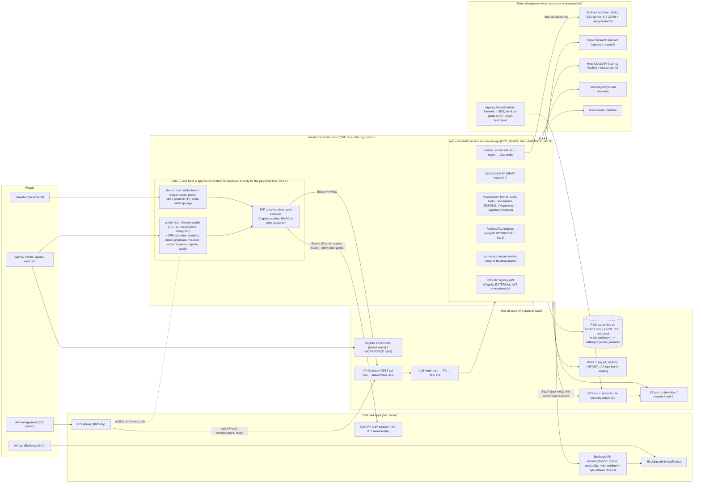

# CRM redesign, angle A: ONE tenant-facing app ("AA Partner Portal" = tenant portal + CRM)

Date: 20/10/2026 (S245 r2). Read-only design pass: no repo, AWS, Vercel, Linear or Jira change; no paid API call.
Inputs read in full: `.tmp-session/s245-r2/owner-input.md`, `docs/research/partner-crm-spec.md` (the requirement
source of truth, "spec" below), `.tmp-session/s245-r2/out/crm-01-current-state.md` ("scout"),
`docs/audits/2026-10-20-S245-tenant-crm/README.md` ("previous design") and every `research/*.md` there
(01, 02, 03, 04, `research-fullbuild.md` = 04 with a different scratch path, `adr-draft.md`).

Code is cited as `repo/path:line`. CIS lines are `origin/main` @ `b7e6da66` (local checkout is behind, see scout header);
Booking `f4fb80d`; Infra `4824c81`; TripPlanner `b79ec48`. Prices carry a source URL + access date (all 20/10/2026) or
say **estimate**.

---

## 0. The answer in 12 lines

1. **New repo `AdventureAsia365-Ecosys/AA-Partner-Portal`** is the *only* tenant-facing product: the current tenant
   portal (moved out of `AA-CIS-App/portal/` with its git history) **plus** the CRM, in **one Next.js app** (one Vercel
   project, two hosts: `portal.` for agency staff, `clients.` for their travellers) and **one small FastAPI service**
   `aa-crm-dev-api` on the shared ECS cluster (Booking-style bootstrap, D17).
2. CIS keeps only content APIs (`/v1/*`) that the portal BFF calls, plus tenant membership (AA-813). The CIS staff admin
   and the partner portal share no code, no links, no cookies, no token secret (§3).
3. Data: schema `crm`, roles `crm_owner`/`crm_app`, DSN `crm/dev/database-url`, own `crm.job` runner copied from
   Booking (D22 b), FORCE RLS, per-agency KMS key + per-traveller DEK (D7 a). No AA role gets any grant on `crm.*`.
4. Cost levers that change the bill: **no Presidio service** (deterministic scrub + Bedrock Guardrails sensitive-info
   filter, pay per use, Vietnamese "optimized"); **Haiku 5.5 default** for AI drafts; **ARM64 + Fargate Spot on Dev**;
   **BYO accounts** for Stripe/WhatsApp/SMS (agency pays the provider); **shared WAF ACL**; **no CASA** (D6 b).
5. **Dev marginal ≈ $10–12/month** (worst case ≈ $17 if Spot is unavailable), vs $85–160 in the previous design.
6. **Prod CRM increment ≈ $330 / $590 / $1.43–1.46k per month at 10 / 50 / 200 agencies**, vs $500–925 / $1.6–2.0k /
   $4.7–5.2k. The biggest fixed line left is Documenso Platform $250 (owner answer D11 b).
7. Go-live **30/11/2026** = the spec's own pilot point (end of "get paid & deliver"): waves W0–W5 + pilot gate
   (≈84 issues, ≈14–15 sessions); automation, AI and scale waves (W6–W7) run during the pilot. Total ≈107 issues,
   ≈18–19 sessions at ~6 issues/session (D4 a).
8. Tensions (§12) get concrete answers: pilot on the Dev stack with real PII **only as vault ciphertext** (one written
   C7.1a amendment); **no Vercel Pro** (D14) → the *production* pilot host is AWS Amplify Hosting (~$3–6/month at
   pilot), Vercel Hobby stays for previews/synthetic data; no lawyer (D15) → standard-template DPA, real data only for
   non-VN pilot agencies, lawyer brief becomes a hard gate at named triggers.

---

## 1. Constraints honoured (owner answers D1–D24, verbatim intent from owner-input.md)

| # | Owner answer | Where honoured in this design |
|---|---|---|
| D1 b | Own app, shared infra, integrated into the portal | §2–§4: repo AA-Partner-Portal; shares only VPC, ECS cluster, RDS instance, Cognito EXTERNAL, ALB/VPC link, SES, S3, Vercel team |
| D2 có | ADRs, no DB grant exception on `crm.*` | ADR 0014 (partner app, amends ADR 0008 §8 + ADR 0006 client table), ADR 0015 (B2B channel). Insights via a staff API, ops release via HTTPS: zero grants on `crm.*` to AA roles |
| D3 a | Own lane from S246 | §13 waves start S246 |
| D4 a | Agent team ~6 issues/session | §13 session maths |
| D5 có | Start external processes at W0 | §13 W0 #8 |
| D6 b | `gmail.send` + SES forwarding only, no CASA | §8 module 5 |
| D7 a | KMS key per agency + per-customer DEK | §6 |
| D8 có | Reword F1 after H3 | §6.1, H3 in §15 |
| D9 a | WhatsApp Embedded Signup, agency-owned WABA, Cloud API direct | §8 module 9 |
| D10 a | VN gateway after quote; manual meanwhile | §8 module 7 |
| D11 b | Documenso Platform | §8 module 12, §11 (tier-timing lever offered as R3, not assumed) |
| D12 có | Bedrock acc3 `us.` only, ZDR models, AI off by default per tenant | §7 |
| D13 không + 30/11 | Prod not a precondition of the pilot | §12.1 |
| D14 không | No Vercel Pro now | §12.2 |
| D15 không | No lawyer brief now | §12.3 |
| D16 có | Linear project "Tenant CRM", issues per wave | §13 |
| D17 có | Own ECS service from Dev | §4.2 `aa-crm-dev-api` |
| D18 có | Fix the hard-coded `mailto:admin@adventureasia.com` | W1 #2; the trip page then moves to the `clients.` host (§3) |
| D19 a | Messenger + Instagram in W6 | §8, W6 |
| D20 a | EN/VI with an i18n frame | W1 #17 |
| D21 c | Builder lives in the portal/CRM app, TripPlanner map/route components by guarded byte-copy | §5.3 |
| D22 b | Own job runner copy, CIS `shared/jobs` untouched | §9 (copied from **Booking's** port, not CIS) |
| D23 có | Split conditions (moot) | Becomes "extraction already done"; ADR 0014 records the app boundary instead |
| D24 có | Insights: ≥3 agencies + k≥10 + opt-in | Module 17, §8 |

---

## 2. Architecture



What is *not* in the picture on purpose: no Presidio service, no separate traveller app (`crm-client`), no TripPlanner
`/builder` route, no second Vercel project, no new WAF ACL, no CIS code imported anywhere in the partner repo.

---

## 3. Separation: CIS staff admin vs the partner portal (owner: "two apps for two audiences")

Today's coupling is listed exhaustively in the scout (§2). Each item gets a fate here; the separation lands in W1
**before** any CRM page ships.

| Scout id | Today (verified) | Action | Repo |
|---|---|---|---|
| L1 | Staff login shows "B2B Tenant login →" (`AA-CIS-App/frontend/app/login/LoginForm.tsx:158-160`) | Delete | CIS |
| L2 | Tenant login shows "← Staff login" (`portal/app/tenant-login/page.tsx:108-114`, `portal/lib/hosts.ts:5-9`) | Delete with the file move; partner login page shows only its own sign-in | Partner |
| L3 | 308 redirects `/portal`, `/portal/:path*`, `/tenant-login` on the admin host (`frontend/next.config.ts:20-25`), required by `tests/unit/test_aa885_portal_split.py` | **Delete** (Dev has ~4 test tenants, no real bookmarks); the guard test is replaced by "admin app has no portal route, no portal host constant" | CIS |
| L4 | Help text naming `/portal/t7-planning` (`frontend/app/admin/atom-curation/page.tsx:1106-1107`, scout) | Reword to "tenants act on planning in their portal" (no path) | CIS |
| L5 | Dead `NavBar` with `/tenant` "Tenant Portal" (`frontend/components/NavBar.tsx:6-12`) | Delete file | CIS |
| L6/L7 | Public tenant-facing trip page served by the **admin** app (`frontend/app/trip/[tourId]/page.tsx:146` mailto CTA) and stored URL `https://aa-cis.lumiguides.it.com/trip/{tour_id}` (`api/routers/v1_trip_page.py:157`) | D18 quick fix now (W1 #2); then the page moves to the partner `clients.` host, CTA = the tenant's intake form; CIS keeps the content endpoint `/v1/trip/{tour_id}` and stores `clients.` URLs | CIS + Partner |
| C1 | 14 byte-copied kit files kept equal by `test_aa885_portal_split.py:24-40` | The partner repo **owns** its copy; the byte-equality test is deleted (two repos may diverge) | both |
| C2/C3/C5 | Admin-only `adminHeaders()` in the portal bundle, admin shell CSS | Strip in the moved app | Partner |
| N1 | Same cookie name `cis_role` on both hosts | Partner cookies renamed `pp_session` (encrypted, host-only) | Partner |
| N2/N4 | Same env `API_URL`; CORS lists only admin host (`api/main.py:162-173`) | Partner BFF calls CIS server-to-server (no browser CORS); env names `CIS_API_URL`, `CRM_API_URL` ⚠️ underscore env vars: Nghiệp edits them by hand in Vercel/Amplify | Partner |
| N3 | Same Vercel team/token, 100 deploys/day shared | Unchanged on Hobby for previews (one fewer project than the previous design); pilot prod host is Amplify (§12.2) | — |
| P1–P3 | Admin "tenant" proxies are staff-only but named `/api/tenant/*` | Rename to `/api/admin/*` | CIS |
| B2/B3 | One HS256 `JWT_SECRET` signs tenant and staff tokens (`api/routers/auth.py:34-41`); `/auth/verify-tenant` uses `verify_jwt`, not `verify_tenant_jwt` (`api/main.py:326-335` vs `auth.py:86-94`) | Tenant humans move to Cognito EXTERNAL (AA-813, ADR 0006 Phase 3, `docs/adr/0006-ecosystem-identity.md:400`); CIS tenant routes verify the Cognito JWT + membership; the API-key tenant login closes for humans. Fix B3 in the same PR (refuse non-tenant tokens) | CIS |
| B4 | Portal calls `/admin/brand-identity` with a tenant token (dual-auth) | New tenant route `/v1/brand-identity`; partner BFF allow-list forbids `/admin/*` | CIS + Partner |
| B7 | Portal BFF forwards **any** path (`portal/app/api/tenant/[...path]/route.ts:20-32`) | Explicit allow-list per upstream (CIS `/v1/...`, CRM `/crm/v1/...`) | Partner |

**Who owns the portal after separation:** the AA-Partner-Portal repo owns every tenant-facing screen (content studio
T0–T11, marketplace, billing, API tab, settings) and the CRM. CIS owns the content APIs and publishes them as a
versioned contract `docs/contracts/cis.tenant-api.v1.json` (OpenAPI of the tenant routes); the partner CI runs a
contract test against it. Cost of this: a content feature that needs UI touches two repos (API in CIS, page in
partner). That is the price of the separation the owner asked for, and it is the same model Booking already lives with.

---

## 4. Repo and app layout

### 4.1 Repo `AA-Partner-Portal` (public, like the other app repos; no account IDs/ARNs in it, DM-6.10)

```
AA-Partner-Portal/
├── CONTEXT.md                 # boundaries: tenant-facing only; reads CIS via contract; no AA role reads crm.*
├── web/                       # ONE Next.js 16 app (moved from AA-CIS-App/portal/ with history: git filter-repo)
│   ├── app/(portal)/portal/   # existing content-studio pages (dashboard, t0-brand … t11-publish, marketplace, …)
│   ├── app/(portal)/crm/      # pipeline, trips/[id], contacts, inbox, proposals/[id](+builder), ledger,
│   │                          # invoices, commissions, suppliers, reports, automations, ai-drafts, audit, settings
│   ├── app/(clients)/         # served only on clients. host: intake/[formKey], embed.js, p/[token] (option picker),
│   │                          # c/[token] (client portal + OTP), trip/[tourKey] (white-label page, D18)
│   ├── app/api/               # BFF: auth (Cognito OIDC), cis/[...path] (allow-list), crm/[...path] (allow-list)
│   ├── proxy.ts               # host routing: portal. → (portal) group + session gate; clients. → (clients) only
│   ├── components/tp/         # byte-copies of TripPlanner map/route components (D21 c), manifest-guarded
│   ├── lib/i18n/              # EN/VI dictionaries (D20 a)
│   └── tests/e2e/             # moved smoke-portal suite + CRM smoke
├── api/                       # FastAPI + asyncpg (same stack as Booking, ADR 0004)
│   ├── app/main.py            # lifespan starts crm.job worker when WORKER_ENABLED (Booking pattern)
│   ├── app/jobs/              # copy of AA-Booking backend/app/jobs/{queue,worker,metrics,kinds}.py, kinds crm_*
│   ├── app/vault/             # F1 envelope crypto, blind index, reveal() + access_event in the same tx
│   ├── app/ai/                # scrub/restore, Bedrock client (acc3 satellite role), cost ledger
│   ├── app/comms/{email,whatsapp,meta,sms}/
│   ├── app/payments/{stripe,vn_gateway,manual}/
│   ├── app/esign/             # Documenso adapter
│   ├── app/b2b/               # Booking B2B client (SigV4)
│   └── tests/                 # unit + isolation + leak corpus (EN/VI ≥200)
├── migrations/crm/            # crm-NNN; byte copy in AA-CIS-Infra/db/migrations/crm/, applied by DB Migrate
└── .github/workflows/         # ci.yml, deploy-api-dev.yml (gate), web-preview.yml (Vercel), web-pilot.yml (Amplify),
                               # tp-copy-drift.yml (nightly, opens an issue on drift)
```

### 4.2 Infra (`infra/AA-CIS-Infra/accounts/aa365/crm.tf`, a copy of the `booking.tf` shape)

`booking.tf` is the template: one self-contained file that only reads module outputs and touches one shared resource
(an ALB listener rule) (scout §4; task def `booking.tf:285-286` = 256 CPU / 512 MB; capacity strategy
`booking.tf:389-400`; `ignore_changes [desired_count, task_definition]` `booking.tf:435`). Differences for CRM:

| Item | Booking today | CRM |
|---|---|---|
| Task size | 0.25 vCPU / 0.5 GB x86 | 0.25 vCPU / 0.5 GB **ARM64** on Dev |
| Capacity | FARGATE base 1 + SPOT weight 3 | **Dev: FARGATE_SPOT only** (Graviton Spot is supported on ECS: [AWS what's-new 2024-09](https://aws.amazon.com/about-aws/whats-new/2024/09/amazon-ecs-graviton-based-spot-compute-fargate/)); prod: FARGATE base 1 + SPOT |
| ECS exec | on (SSM exec in task role) | **off** for the CRM service (vault plaintext lives in its memory); debugging via logs + DB Migrate run-script on non-PII tables |
| REST API | own, throttle 20/40 | own `api-crm.lumiguides.it.com`, throttle, **associated with the existing WAF ACL** (only this stage; `waf_protect_rest_api_stages` stays false for others, `variables.tf:202`) |
| Extra IAM | SES send, PutMetricData | + `kms:Decrypt/GenerateDataKey` on `alias/crm/*` with encryption-context condition; `bedrock:ApplyGuardrail` + `sts:AssumeRole` to the acc3 invoker role; `execute-api:Invoke` on the Booking B2B resource |
| DB role | `booking` limit 15 | `crm_app` **limit 5** (pool `max_size=5` like `AA-Booking/backend/app/db.py:65-72`), offset by lowering `booking` 15 → 10 in the same PR, so the LOGIN total stays 155/181 (`observability_ecosys.tf:59-66`) — no RDS resize |
| SES | send | send + one receipt rule `*@in.<domain>` → S3 + SNS, **added to the existing active rule set** (`e2e_mailbox.tf:195-197`; only one set can be active per region, `e2e_mailbox.tf:16-17`) |

---

## 5. How the portal integrates the CRM

### 5.1 Same Next.js app, not microfrontends

One app, one build, one Vercel project (the current `aa-cis-portal` project re-pointed to the new repo and renamed;
or a new project, same cost: $0). The sidebar has two sections, **Content studio** (today's pages,
`portal/app/portal/_components/Sidebar.tsx:28-50` per scout) and **CRM**. Why not a second Next.js app under the portal
host (multi-zone/microfrontends): it would add a second deploy, a second kit copy, cross-zone navigation reloads and,
on Hobby, the 2-project microfrontend allowance (scout §3 Vercel row) — cost and complexity for no user benefit. The
owner's "one product for one audience" is literally one app.

### 5.2 Two hosts, one app

`proxy.ts` routes by `Host`: `portal.lumiguides.it.com` serves only the agency route group behind the Cognito session;
`clients.lumiguides.it.com` serves only traveller routes (intake, option picker, client portal, trip page) with a
strict CSP and **no agency cookie in scope** (host-only cookies). Hobby allows 50 domains per project
([vercel.com/docs/plans/hobby](https://vercel.com/docs/plans/hobby), accessed 20/10/2026), enough for per-agency custom
domains later (that needs a commercial plan anyway, §12.2).

### 5.3 Builder (D21 c): TripPlanner components by guarded byte-copy

TripPlanner's map stack is `mapbox-gl` 3.7.0 (`AA-TripPlanner-Web/frontend/package.json:14`), `components/MapView.tsx`
(803 lines) and `components/RoutePlanner.tsx` (173 lines). `MapView.tsx:5-17` imports `@/lib/api`, `@/lib/mapbox`,
`@/lib/tileLoader`, `@/lib/types`, `@/lib/useTrip`. Plan:

- Byte-copy unchanged: `MapView.tsx`, `RoutePlanner.tsx`, `DestinationPopup.tsx`, `lib/mapbox.ts`, `lib/tileLoader.ts`,
  `lib/types.ts` into `web/components/tp/` + `web/lib/tp/`.
- Partner-owned **adapters with the same export signatures**: `lib/tp/api.ts` (`fetchByCountry`, `fetchTile`,
  `fetchRoutes` served by `/crm/v1/catalog/*`, which reads `catalog.v_tour*`/`catalog.v_graph_*` views) and
  `lib/tp/useTrip.ts` (state from the CRM proposal model instead of the TP trip draft).
- Guard: `web/tests/tp-copy-manifest.json` (path → sha256 + TP commit) checked in CI; nightly `tp-copy-drift.yml` reads
  TP `main` through the public GitHub API (no secret) and opens an issue on drift. No cross-repo runtime dependency, one
  frontend instead of three (removes the CTO's "3 frontends for 1 engineer" objection, previous design §16).

---

## 6. Data and encryption (unchanged in substance from the previous design; only placement changes)

Schema `crm`, owner `crm_owner` NOLOGIN, runtime `crm_app` LOGIN, `crm-NNN` keys, registered in
`infra/AA-CIS-Infra/db/owners.yaml` (no `crm` entry yet — grep empty), migrations only via DB Migrate. Every tenant table:
`tenant_id NOT NULL`, ENABLE + FORCE RLS from `crm-001`, NULLIF template `TO crm_app`, `COMMENT 'pii:<class>'`
(new classes `pii:government_id`, `pii:health`, `pii:emergency_contact` in standards v1.2). Table groups as in the
previous design §8.2 (vault, profile, consent, pipeline, intake, proposal, money, comms, automation/AI, audit, suppliers,
reports, insights). Reads from CIS only through `catalog.*` views granted to `crm_app` (Booking does the same, scout §4);
`catalog.v_tenant_member` comes from AA-813. Rules already written: ADR 0008 §8
(`docs/adr/0008-new-app-integration-and-data-platform-rules.md:168-175`), DM-6.8
(`docs/architecture/data-standards/02-data-management.md:228`).

### 6.1 F1 identity vault (D7 a)

- AES-256-GCM per field, AAD = tenant/table/column/row id; **per-traveller DEK** wrapped by the **agency KMS key**
  (encryption context `crm_tenant_id`); HMAC blind indexes (email, phone, name) for exact search; documents in S3
  SSE-KMS under the agency key; BYOK optional.
- Key policy: only the `aa-crm-dev-api` task role may Decrypt/GenerateDataKey; CloudTrail metric alarm on any other
  principal (extends AA-873). ECS exec off on this service (§4.2).
- **Cost lever R4:** KMS bills $1 per customer-managed key *version*
  ([AWS price list AWSKMS us-west-1](https://pricing.us-east-1.amazonaws.com/offers/v1.0/aws/awskms/current/us-west-1/index.json),
  publication 2026-09-11, read 20/10/2026), so automatic yearly rotation takes a key to $2 then $3/month. Proposed:
  no automatic KEK rotation; rotate by re-wrapping DEKs (cheap, same security effect for data at rest). $1/agency
  instead of $1–3. Security review (W7) may overrule.
- F1 wording (D8, after H3): "Only the CRM system can use your agency's key; every use is logged and you can see it;
  with your own key (BYOK) you can revoke it." (AA admins *can* change a key policy in AA's account; the spec's "AA
  included" is not literally true — research 04 §0.4.)

### 6.2 F2 pseudonymous profile, F4 tenancy, F5 audit

F2: random `traveler_token`, bands/flags only; AI and insights read through `SET LOCAL ROLE crm_ai_reader` /
`crm_insights` (NOLOGIN, grants only on `v_ai_trip_context` / `v_insight_facts`), probe `→ 42501` on the vault.
F4: membership from CIS (`catalog.v_tenant_member`, AA-813) + `crm.member_role` (owner/agent/assistant,
`margin_visible`), RLS on money tables adds the role check. F5: `crm.access_event` written in the same transaction as
every `vault.reveal()`, per-tenant hash chain, monthly partitions, Parquet archive after 90 days, agency audit page with
daily KMS Decrypt counts.

---

## 7. AI and PII handling (F3, module 14) — the cheapest robust scrubber

### 7.1 Options compared

| Option | Price (source, accessed 20/10/2026) | Vietnamese | Fixed cost | Verdict |
|---|---|---|---|---|
| Presidio sidecar (previous design) | 1 vCPU/4 GB Fargate ≈ $39 ARM / $49 x86 per month always on (research 04 §2.6, AWS price list) | "quality unknown, needs a custom model" (research 04 §2.6) | **$39–49/month**, ×2 for HA | Drop |
| Amazon Comprehend DetectPiiEntities | $0.0001 per 100-char unit, 3-unit minimum ([aws.amazon.com/comprehend/pricing](https://aws.amazon.com/comprehend/pricing/)) | **No** — "English or Spanish text documents" ([Comprehend PII docs](https://docs.aws.amazon.com/comprehend/latest/dg/how-pii.html)) | $0 | Reject (VN travellers) |
| Bedrock Guardrails sensitive-information filter via `ApplyGuardrail` (standalone, no model call) | **$0.10 per 1,000 text units, 1 unit ≤ 1,000 chars; regex filters free** ([aws.amazon.com/bedrock/pricing](https://aws.amazon.com/bedrock/pricing/)); standalone API "without invoking the foundation models", masks with `ANONYMIZED` ([ApplyGuardrail docs](https://docs.aws.amazon.com/bedrock/latest/userguide/guardrails-use-independent-api.html)) | **Yes — "Vietnamese: Optimized and supported"** for sensitive information filters ([Guardrails languages](https://docs.aws.amazon.com/bedrock/latest/userguide/guardrails-supported-languages.html)) | $0 | **Use as pass 3** |
| Deterministic known-value + regex in process | $0 | Yes for known values and formats; cannot find unknown names | $0 | **Use as passes 1–2** |

### 7.2 Design

`scrub()` runs inside the CRM worker before any LLM call, fail closed:
1. **Known values**: every identity value the trip already holds in F1 (all travellers, companions, emergency
   contacts, agency staff names) → `<PERSON_1>`, `<EMAIL_1>`, … ($0, catches most PII because the CRM knows who the
   travellers are).
2. **Regex**: emails, international + VN phone formats, passport-like IDs, dates of birth, card/IBAN, signed-link URLs
   ($0).
3. **Guardrails `ApplyGuardrail`** (sensitive-info filter, `ANONYMIZE`) on the residual text to catch unknown names and
   addresses ("my friend Lan from Đà Nẵng"). The response's `match` values feed the same placeholder map. Error or
   timeout → no LLM call, draft marked "needs manual reply".
4. Placeholder map encrypted with the tenant DEK, TTL 24 h, restored only in the agency session. `crm.ai_usage` stores
   stage, model, tokens, cost — never text (DM-6.4).
5. Gate: ≥200-sample EN/VI leak corpus, nightly job via GitHub OIDC (≈200 units/night ≈ $0.60/month) must report 0
   leaks; a unit test fails any `crm_*` LLM call without a scrub receipt.

Account for the guardrail: **acc2 first** (raw text never leaves acc2's AWS boundary); acc2's reseller blocks Bedrock
models (memory `acc2-bedrock-claude-gpt-blocked`), whether it also blocks `ApplyGuardrail` is **unverified** → W0 spike;
fallback acc3 (same AWS processor, already the LLM account under D12). Guardrails availability in us-west-1 is also
checked in that spike (fallback us-west-2, still `us.` geography).

### 7.3 Models (D12)

Default **Claude Haiku 5.5** ($0.10 / $0.50 per MTok for prompts ≤100K) for reply drafts, follow-ups, text-mode
proposals; **Sonnet 5.5** ($2 / $10) only for long proposal narratives where the eval set shows Haiku falls short
(prices: Anthropic list cached 2026-10-06 in the claude-api skill; Bedrock tables did not render, parity assumed as in
research 04 §1). `us.` geographic profile, retention `none`; ZDR eligibility of Haiku 5.5 / Sonnet 5.5 on Bedrock is
verified in W0 (only Fable 5/5.1 are documented as needing `aws_review`, research 04 §2.8). AI off per tenant by default;
per-tenant monthly AI cap. The CRM calls Bedrock through the acc3 satellite role directly, as TripPlanner already does
(`AA-CIS-Infra/accounts/aa365/tripplanner.tf:361-362` `BEDROCK_ACCT_PRIMARY/FALLBACK`), because it cannot import the CIS
gateway (own app).

---

## 8. Channels and integrations (spec §9)

| Spec | Design | AA pays |
|---|---|---|
| Module 5 email (D6 b) | Per-agency inbound address `<slug>@in.<domain>`: agency sets a forward/BCC rule; SES → S3 + SNS → `/crm/hooks/ses` → `crm_mail_ingest` job threads by `Message-ID`/`References`. Send: `gmail.send` (sensitive scope, brand verification, **no CASA**) or Microsoft Graph `Mail.Send`, or SES with the agency's DKIM domain. Saved replies, internal notes. **Spec deviation recorded:** spec module 5 says "two-way Gmail/Outlook sync"; D6 b replaces read-sync with forwarding | SES $0.10/1,000 out; inbound $0.10/1,000 + $0.09/1,000 chunks ([SES pricing](https://aws.amazon.com/ses/pricing/), via research 04 §1) |
| Module 9 WhatsApp (D9 a) | Embedded Signup, agency-owned WABA, Cloud API direct as Tech Provider; 24-h window and template categories enforced; marketing templates need consent | $0 (Meta bills the agency) |
| Module 9 SMS | **BYO Twilio account** (agency enters its own Account SID/API key, stored wrapped by the tenant DEK). Twilio *sub-accounts* would bill AA's parent account, so they are not used | $0 |
| Messenger + IG (D19 a) | Meta Graph API with the same Meta app verification | $0 |
| Module 7 payments (D10 a) | Stripe Connect **Standard** (agency is merchant of record; "Stripe handles pricing" = $0 to platform, research 04 §2.1); VN agencies: manual recording now, VN gateway adapter after a quote | $0 |
| Module 12 e-sign (D11 b) | Documenso adapter, embedded signing in the client portal, signed PDF to the agency's S3 prefix (SSE-KMS) | Platform $250/month ([documenso.com/pricing](https://documenso.com/pricing)); Dev on the Free plan (5 documents/month) $0 |
| AA inventory API (module 3/6) | Booking `/booking/b2b/v1`: quote from a materialised `v_b2b_offer`, availability (departure/allotment), hold with expiry, confirm/cancel; CRM calls with **SigV4 from its task role** (API GW IAM auth on that resource, zero shared secrets); status back via `booking.v_b2b_booking_outbox` granted to `crm_app` (a grant *from* booking *to* CRM, not on `crm.*`) | $0 |
| Module 8 ops release | HTTPS POST to Booking's receiver (PII only in the TLS body), Booking re-encrypts under the AA-ops key, purges at return + 90 days, receipt into the agency audit | $1 key |
| Module 17 insights (D24) | `crm_insights_rollup` → `crm.insight_aggregate` (cells only with ≥10 travellers **and** ≥3 agencies, opted-in tenants); served by `/crm/staff/v1/insights` (Cognito WORKFORCE, group check) and rendered on a CIS admin page. A staff app calling a staff API is not a link between the two user-facing apps | $0 |
| Builder | §5.3 | Mapbox GL JS: 50,000 map loads/month free, then $5/1,000 ([mapbox.com/pricing](https://www.mapbox.com/pricing)); free tier shared with TripPlanner |

Bot protection for the public intake form: honeypot + server-side rate limit + API GW throttle + the shared WAF ACL
rate rule — no new captcha vendor (one fewer sub-processor).

---

## 9. Job runner (D22 b)

Copy **Booking's** runner, not CIS's: `AA-Booking/backend/app/jobs/` is already a port of CIS `shared/jobs/queue.py`
semantics ("Same semantics as CIS `shared/jobs/queue.py` (ADR 0003)", `jobs/queue.py:3`), 675 lines in four files
(`kinds.py`, `metrics.py`, `queue.py`, `worker.py`), runs as one lifespan task inside the API process
(`backend/app/main.py:79-92`, `jobs/worker.py:1-6`), with graceful release on shutdown (`jobs/worker.py:14-19`). The CRM
table `crm.job` comes from the CIS DDL template `AA-CIS-App/shared/jobs/job_table_template.sql` (ADR 0003a), kinds
`crm_*`. Recurring kinds (`crm_workflow_tick`, `crm_mail_ingest`, `crm_insights_rollup`, reminders, TTL purges) go into
`idle_exempt_kinds` / `DEPLOY_GATE_EXEMPT` from day one. DB Migrate's idle check already covers any `<schema>.job`
(`docs/architecture/data-standards/03-scaling.md` C6.3b). No EventBridge, no SQS: $0.

## 10. CI / deploy

| Workflow | What | Cost |
|---|---|---|
| `ci.yml` | ruff/mypy/pytest (api), tsc/eslint/vitest (web), migration copy check, TP copy manifest, leak-corpus unit stubs, contract test vs `cis.tenant-api.v1` | GitHub-hosted runners; arm64 runners are free for public repos (estimate, not checked) |
| `deploy-api-dev.yml` | build **arm64** image → ECR (immutable SHA tag) → register task def → update `aa-crm-dev-api`; preflight `GET /crm/ops/deploy-gate` with GitHub OIDC (copy of Booking's gate, scout §4) | ECR < $0.20/month |
| `web-preview.yml` | Vercel preview + Playwright smoke (moved from CIS `ui-smoke-portal.yml`) | Hobby $0 |
| `web-pilot.yml` | From the pilot (§12.2): deploy `web/` to Amplify Hosting production branch | §11 |
| `tp-copy-drift.yml` | nightly TP drift check | $0 |
| DB Migrate (Infra) | `owners.yaml` `crm`, mirror `db/migrations/crm/` | $0 |

Branch protection on the new repo mirrors Booking (agent merges on green during the dev phase, DM-11.5; risky PRs —
auth, migrations, KMS policy — get an independent agent review first).

---

## 11. Costs

Unit prices (accessed 20/10/2026): Fargate us-west-1 ARM $0.03725/vCPU-h, $0.00409/GB-h; x86 $0.04656/$0.00511
([AWS price list AmazonECS us-west-1](https://pricing.us-east-1.amazonaws.com/offers/v1.0/aws/AmazonECS/current/us-west-1/index.json),
publication 2026-10-19). Fargate Spot "up to 70%" off ([AWS what's-new](https://aws.amazon.com/about-aws/whats-new/2024/09/amazon-ecs-graviton-based-spot-compute-fargate/)) — I use 60–70% (**estimate**).
RDS t4g.small single-AZ $0.043/h, Multi-AZ $0.085/h; t4g.medium MAZ $0.171/h; t4g.large MAZ $0.342/h (AWS price list
AmazonRDS us-west-1, publication 2026-10-20; large from research 04 §1). Secrets Manager $0.40/secret
(AWS price list, 2026-09-11). KMS $1/key-version, $0.03/10k requests (AWS price list, 2026-09-11). API Gateway REST
$3.50/M ([api-gateway/pricing](https://aws.amazon.com/api-gateway/pricing/)). WAF $0.60/M requests on an existing ACL
(ADR 0006 :444-446 via scout §3). Amplify Hosting: build $0.01/min, SSR $0.30/M requests + $0.20/GB-h, transfer
$0.15/GB ([aws.amazon.com/amplify/pricing](https://aws.amazon.com/amplify/pricing/)). Others as cited in §7–§8.

### 11.1 Dev marginal, per month (before any agency)

| Line | Basis | $/month |
|---|---|---|
| `aa-crm-dev-api` 0.25 vCPU / 0.5 GB **ARM64, FARGATE_SPOT only**, 24/7, in-process worker | on-demand equivalent 0.25×0.03725×730 + 0.5×0.00409×730 = $8.29; Spot −60…70% (estimate) | **2.5–3.3** (8.3 if Spot capacity is unavailable) |
| Secrets: `crm/dev/database-url` + one JSON app secret | 2 × $0.40 | 0.80 |
| KMS: 2 test-agency keys + AA-ops key (Booking) | 3 × $1; requests within the 20k free tier | 3.00 |
| CloudWatch logs (30 d) + ~5 alarms | estimate | 1–2 |
| ECR (≤10 arm64 images) | estimate $0.10/GB-month | ≤ 0.20 |
| REST API + WAF association + SES + SNS + S3 at Dev volume | estimate | ≤ 0.50 |
| Guardrails: nightly 200-sample corpus + dev tests | ≈7k units × $0.10/1,000 | ≈ 0.70 |
| Haiku 5.5 test calls | capped at $5 by a budget alarm | ≤ 1 |
| Documenso Free, Stripe test mode, Meta test number (unverified), Twilio trial, Mapbox free tier, Vercel Hobby, Cognito, RDS (connection offset) | — | 0 |
| **Total** | | **≈ $10–12** (≈ $17 worst case on-demand) |

Previous design: **$85–160** (README §13). Booking's own Dev cost is ≈ $12–15 (scout §4), so the CRM costs less than
Booking on Dev despite KMS keys, because of ARM + Spot.

### 11.2 Prod increment at 10 / 50 / 200 agencies, per month

Per-agency volume assumptions are research 04 §1 unchanged (3 seats, 40 inquiries, 10 bookings, 25 travellers,
1,000 system mails, 400 AI drafts + 50%, 5k KMS decrypts). Not included (as before): the AA-880 prod baseline
(~$150–300) and agency-paid provider fees.

Per agency, variable:

| Line | Basis | $/agency |
|---|---|---|
| LLM, Haiku 5.5 default + 20% Sonnet 5.5 | Haiku-only: 2.4M in × $0.10 + 0.36M out × $0.50 = $0.42; Sonnet-only $8.40 (research 04 §3.1); mix 0.8×0.42 + 0.2×8.40 | 2.02 |
| Guardrails scrub | 600 calls × ~3,000 chars free text = 1,800 units × $0.0001 | 0.18 |
| KMS (no auto-rotation, R4) | $1 + 5k × $0.000003 | 1.02 |
| SES out + inbound forwarding | 1,000 × $0.0001 + ~600 × ($0.0001 + $0.00009) | 0.25 |
| API GW REST + WAF | ~25k requests (estimate) × ($3.50 + $0.60)/M | 0.10 |
| S3 documents + logs | estimate | 0.15 |
| Amplify SSR + transfer (D14) | ~25k requests: $0.0075 + ~1.7 GB-h × $0.20 + 0.3 GB × $0.15 (estimate) | 0.40 |
| WhatsApp / SMS / Stripe / Cognito | agency-owned accounts; Cognito < 10k MAU | 0 |
| **Subtotal** | | **≈ 4.1** |

Totals:

| Line | 10 agencies | 50 agencies | 200 agencies |
|---|---|---|---|
| Variable (≈ $4.1/agency) | 41 | 205 | 820 |
| E-sign: Documenso Platform (D11 b) | 250 | 250 | 250 |
| Compute ARM64 on-demand, in-process worker | 2 × (0.5/1 GB) = 33 | 2 × (1/2 GB) = 66 | 3 × (1/2 GB) = 100 (load test W7 confirms) |
| RDS increment (shared prod instance resize, research 04 §3.2) | 0 | +63 (small→medium MAZ) | +188 (→ large MAZ) + storage ≤ 28 |
| Mapbox (free 50k loads shared with TP; ~320 loads/agency, estimate) | 0 | 0 | ~70 |
| Fixed ops: 2 secrets, ~10 alarms, Amplify builds (~60 × 4 min × $0.01), AA-ops KMS key | ~6 | ~6 | ~6 |
| CASA (D6 b), Twilio/360dialog BSP (D9 a), Vercel Pro (D14), new WAF ACL, Presidio | 0 | 0 | 0 |
| **Total** | **≈ $330** | **≈ $590** | **≈ $1.43–1.46k** (≈ $7.2/agency) |

### 11.3 Delta vs the previous design (README §13 / research 04 §3)

| Line | Previous | This design | Why it moved |
|---|---|---|---|
| Dev CRM service | ~$21 (0.5/1 GB x86 on-demand) | $2.5–3.3 | Booking size, ARM64 (−20% list), Spot-only on Dev (fine: Dev has no users, memory `dev-no-waiting`) |
| Dev Presidio | $39–49 | 0 | Pay-per-use Guardrails (+ $0 deterministic passes); VN supported, Presidio VN quality was unknown |
| Dev WAF | $10–15 (new ACL) | ~0 | Associate the existing ACL with the CRM stage only |
| Dev Twilio/Meta numbers | ~$5 | 0 | Test numbers / BYO trial |
| Dev e-sign | 0–30 | 0 | Documenso Free on Dev |
| Dev gateway calls | 5–20 | ≤ 1 | Haiku, capped |
| WhatsApp ~$5/agency | 50 / 250 / 1,000 | 0 | **D9 a** (owner) |
| SMS ~$3/agency | 30 / 150 / 600 | 0 | BYO Twilio account (design; Twilio sub-accounts would bill AA) |
| LLM | $8.4/agency | $2.02/agency | Haiku 5.5 default (design, R5); still within D12 |
| KMS | $1–3/agency | $1.02 | No KEK auto-rotation, DEK re-wrap (design, R4) |
| Compute | 111 / 222 / 395 | 33 / 66 / 100 | No Presidio tasks, ARM64, worker in-process, right-sized |
| Scrubber | inside compute | $0.18/agency | Guardrails pay-per-use |
| E-sign | 75 / 250 / 250 | 250 / 250 / 250 | **D11 b** raises the 10-agency case by +$175 (owner choice; lever R3) |
| Vercel Pro | 40–60 / 60 / 60–100 | Amplify ≈ 6 / 22 / 82 (in variable + fixed) | **D14** (owner); at ~50+ agencies Vercel Pro ($20/seat) becomes cheaper again (R2) |
| CASA amortised | 56–450 | 0 | **D6 b** (owner) |
| Security baseline / WAF | 25–40 | ~1–4 | Shared ACL; no new ACL |
| RDS increment | 0 / 63 / 188 | same | Scale-driven, unchanged |
| Mapbox | — | 0 / 0 / ~70 | New: D21 c reuses Mapbox components (lever: static map image on traveller pages) |

### 11.4 Remaining levers (not assumed in the totals; owner decides)

- **R3 Documenso tier timing:** Teams $40/month includes embedded signing and API ([documenso.com/pricing](https://documenso.com/pricing))
  — usable for the 3–5 pilot agencies **if Documenso confirms in writing** that multi-agency sending under one team is
  within Teams terms; Platform from the first agency outside the pilot. Saves $210/month during the pilot.
- **Haiku-only** (no Sonnet share): −$1.6/agency if the W7 eval set shows Haiku is good enough for proposal text.
- **Traveller map as a static image** instead of an interactive Mapbox map on `clients.`: removes most map loads at 200.
- **AI off by default** (D12) means real LLM cost scales with opt-in, likely below the table.

---

## 12. Tensions, with concrete answers

### 12.1 D13 không + go-live 30/11/2026 + C7.1a ("real data only on prod")

C7.1a says "Production personal data MUST NOT be copied to Dev; Dev seed data MUST be synthetic or masked", because
"Dev has weaker controls and public repos describe its schema" (`docs/architecture/data-standards/03-scaling.md:364`);
the handbook says Dev is "Test data only" (`docs/engineering-handbook.md:500`). The owner removed prod as a precondition
(D13 không). Answer:

- **The pilot runs on the Dev stack** (shared RDS, `aa-crm-dev-api`), no AA-880 prod, $0 extra.
- **Real traveller data is allowed only as F1 vault ciphertext** under per-agency KMS keys that only the CRM task role
  can use, ECS exec off on that service, no PII in logs/Sentry, F2 holds no identity. Every other Dev surface stays
  synthetic. This is written as **one amendment R1 to C7.1a/D-01**: "Until AA-880, Dev may hold real traveller data
  only inside `crm.*` vault ciphertext, for at most 5 pilot agencies." Exit trigger to AA-880 prod: the earliest of
  first paying agency, 6th agency, or 31/03/2027.
- What still blocks real data on 30/11: AA-813 (membership), W2 privacy foundation, the security review of public
  surfaces (W8a), signed pilot DPAs (§12.3). Without R1 approved, 30/11 is a **synthetic-data pilot** (agencies try
  every flow with demo travellers) — still a go-live of the product, not of real customer data.

### 12.2 D14 không (no Vercel Pro) vs Vercel Hobby's commercial clause

Vercel: "the Hobby plan restricts users to non-commercial, personal use only"; commercial includes "any method of
requesting or processing payment from visitors of the site" and "a paid employee or consultant writing the code"
([vercel.com/docs/limits/fair-use-guidelines](https://vercel.com/docs/limits/fair-use-guidelines), accessed 20/10/2026).
The CRM's client portal sends Stripe pay links (module 7), so a production pilot on Hobby is clearly outside the terms
(note: by the second clause the existing AA apps on Hobby are already arguable — not a CRM-specific issue, flagged for
Nghiệp). Answer that keeps D14:

- **Until 29/11:** Vercel Hobby for previews and Dev, synthetic data only (development, no payments taken).
- **From 30/11, the partner app's production host is AWS Amplify Hosting in acc2**, pay-as-you-go: ≈ $3–6/month at
  pilot size (§11.2), no new vendor (AWS is already the processor). The app avoids Vercel-only features (no Edge Config,
  KV, Vercel image optimisation requirements), so it is host-agnostic.
- **Risk:** Amplify documents SSR support for Next.js 12–15 ([Amplify Next.js support](https://docs.aws.amazon.com/amplify/latest/userguide/ssr-amplify-support.html));
  Next 16 is **unverified** → W0 spike (1 issue). If it fails, this is an explicit re-decision **R2**: Vercel Pro,
  1 developer seat, $20/month ([vercel.com/docs/plans/hobby](https://vercel.com/docs/plans/hobby): "Developer seats cost
  $20 per user / month"), never a silent purchase. R2 is also the cheaper host from ~50 agencies.

### 12.3 D15 không (no lawyer now) vs PDPL VN / GDPR / APP

| Item | Deferred? | What we do now ($0) | What it blocks |
|---|---|---|---|
| DPA / processor terms | Lawyer review deferred | Standard EU Art. 28 clauses + EU SCC 2021/914 Module 2 (Commission text) + UK Addendum, APP 8 "use, not disclosure" wording (research 04 §4.3), extended from AA-886's draft; pilot-only, signed with each pilot agency | Nothing for non-VN pilot agencies |
| VN Decree 356 licence ("providing systems that process personal data for controllers" may need a Certificate of Eligibility, research 04 §0.2) | Yes | VN agencies join the pilot in **synthetic-data mode** only | **Real data of any VN agency** |
| VN DPIA/TIA (TIA within 60 days of the first offshore transfer) | Yes | Pilot DPAs exclude VN-resident travellers' data where the agency is VN | VN real data |
| GDPR Art. 27 representative, Art. 30(2) records | Yes | Keep Art. 30(2)-style register from the PII tags (DM-6.1) | EU agencies beyond the pilot |
| Insurer waiver review | Not legal counsel; started W0 (D5) | Waiver signed electronically, "insurer accepted" flag off until review | Module 12 success metric only |

**Hard gates for the lawyer brief** (written into ADR 0014): before the first VN agency stores real data; before the
6th agency or first paid plan; or 60 days after the first real traveller record — whichever comes first.

### 12.4 D6 b, D11 b, D22 b

- D6 b removes CASA ($675–5,400/year) and read scopes; module 5's "two-way sync" is met by forwarding + send-as; recorded
  as a spec deviation for Ms. Thư (H1 note).
- D11 b: Documenso Platform is the single largest fixed line at small scale; lever R3 above.
- D22 b: copying Booking's runner means a third copy of the queue semantics (CIS, Booking, CRM). Guard: a shared
  conformance test (claim/lease/release/cancel cases) vendored into each repo, so semantics drift is caught.

---

## 13. Waves, issues, schedule

Session maths: D4 a ≈ 6 issues/session. Today 20/10 → go-live 30/11 = 41 days. Pilot scope = spec Phase 0–2
("Pilot: 3–5 friendly agencies at the end of Phase 2", spec §10) = W0–W5 + W8a.

| Wave | Scope (repo) | Issues | Sessions | Exit |
|---|---|---|---|---|
| W0 Decide + contracts + external | ADR 0014 (partner app; amends ADR 0008 §8 and ADR 0006 client row `docs/adr/0006-ecosystem-identity.md:80`); ADR 0015 B2B; Infra ADR KMS-per-tenant; standards v1.2 incl. **R1**; contracts (`cis.tenant-api.v1`, Booking B2B OpenAPI, ops-release); spec gaps §11.1–4 + 7; **spikes: Amplify Next 16 + Guardrails acc2/region/VN quality**; cost approval (DM-10.7); external starts (Meta Tech Provider, Stripe Connect platform, VN gateway quotes, Documenso DPA + terms for R3, Google brand verification for `gmail.send`, Microsoft publisher verification, insurer contact); pilot agency recruitment | 10 | 1.2 | ADRs merged, spikes answered |
| W1 Separate + bootstrap | [CIS] remove L1/L3/L5, reword L4, rename P1–P3, guard test; [CIS] D18 CTA fix; [root] create repo from `portal/` with history + CI + Vercel re-point; [CIS] delete `portal/`, its workflows and byte-copy test; [CIS] `/v1/brand-identity`, fix B3; [CIS] AA-813 ×3 (membership + invites, Cognito tenant sign-in + JWT verify, `catalog.v_tenant_member`); [Infra] `crm.tf`; [Infra] `owners.yaml` + roles + connection offset; [Infra] X2 + isolation probe `crm` cells; [Partner] api skeleton + request context; [Partner] runner copy + `crm-001` + deploy gate; [Partner] BFF allow-list + Cognito session; [Partner] i18n EN/VI + nav shell | 17 | 3.0 | No cross-link either way (test), tenant signs in by invitation, `crm.job` heartbeat, probe 0 cross-tenant rows |
| W2 Privacy F1–F5 | KMS provisioning + key policy; crypto lib; vault + `reveal()`; docs bucket; BYOK; Decrypt alarm; F2 + NOLOGIN roles + probe; consent ledger; scrubber (3 passes, fail closed) + restore; leak corpus job; roles UI + margin RLS; audit chain + page + archive | 12 | 2.0 | DB dump shows ciphertext only; corpus 0 leaks; assistant never sees money |
| W3 Sell a trip | intake API + `clients.` form + widget; `crm_intake_process`; attribution (T11 CTA); trip page moved to `clients.`; pipeline + transitions + Traveler-info panel (s1/s2/s3 %); Stage 2 form + "fill from call"; contacts + merge; CSV import + onboarding + invites; suppliers (15); ledger agency lines (6); text proposal for agency items (4); base reports (16); currencies/time zones/mobile | 15 | 2.5 | WordPress-embedded form creates an Inquiry < 2 min, idempotent |
| W4 AA supply + interactive proposal | [BK] partner auth (SigV4), departures/allotments, holds + reaper, `v_b2b_offer`, quote, confirm/cancel + outbox, staff UI; [Partner] proposal model + price hash; TP byte-copy + adapters + drift job; live quote + Booking-down mode; dependency rules + Stage 2 defaults; option picker (no login); accept → hold; ledger AA lines auto-fill | 15 | 3.0 | Client swaps 2 options, price updates, accept creates a Booking hold |
| W5 Get paid + deliver | invoices + schedules; Stripe Connect onboarding; pay links + webhooks + refunds + multi-currency; manual + VN adapter stub; reminders + Booked-on-deposit; client portal + OTP + Stage 3; Documenso + templates; ops release push; [BK] receiver + 90-day purge + receipt; commissions (13) | 11 | 2.0 | Test deposit → Booked; Stage 3 behind OTP; signed PDF stored |
| **W8a Pilot gate (30/11)** | Amplify prod host (or R2); pilot DPAs from standard templates; security review of public surfaces (AA-875/876 applied); onboard 3–5 agencies + UAT video (AA-855) | 4 | 0.7 | First pilot agency runs an inquiry to Booked |
| W6 Communicate + automate (during pilot) | SES inbound + ingest + threading; `gmail.send` + Graph send; inbox UI + saved replies + notes; WhatsApp Embedded Signup + 24-h window; template sync + category guard; Messenger + IG; SMS BYO Twilio; workflow engine; nudges (quiet client, Stage 2 auto-send, T-21, 3-day idle) | 9 | 1.5 | Forwarded thread links to the right trip; out-of-window WhatsApp only via template |
| W7 AI, insights, portability, hardening | AI drafts (Haiku) + approval UI + edit metric; eval set + per-tenant caps; full reports + event tracking; insights k≥10/≥3 agencies + staff API + CIS admin page; export; erasure DRY RUN; offboarding crypto-shred; load test 200 tenants; SLO alarms | 10 | 1.8 | No PII in prompts/logs; n<10 cells suppressed (property test) |
| W8b Prod + lawyer gates | AA-880 prod for the partner app when a §12.1/§12.3 trigger fires; lawyer brief; VN onboarding | 4 | 0.8 | Triggers met |
| **Total** | | **107** | **≈ 18.5** | |

To 30/11: W0–W5 + W8a = **84 issues ≈ 14.4 sessions in 41 days ≈ 2.5 CRM sessions/week** (D3 a: own lane in parallel).
Tight but consistent with the observed pace (S236 on 14/10 → S245 on 20/10). If the lane slips, W8a moves, not scope.
Compared with the previous design: 115 issues / 19–21 sessions; removed work: Presidio service, CIS runner
parametrisation, `crm-client` app, TP `/builder` route + builder JWT, Gmail two-way + CASA (D6 b); added work: repo
move + CIS separation (~7 issues), Amplify spike/host, R1 standards line.

---

## 14. Spec traceability (every section and module → where it is built)

| Spec item | Built where | Wave |
|---|---|---|
| §1 Live AA supply | Booking B2B API + `app/b2b/` client + ledger auto-fill | W4 |
| §1 Traveller-configurable proposals | `crm.proposal/day/option_block/option/selection` + `clients.` option picker + TP map byte-copy | W4 |
| §1 Privacy by architecture | F1–F5 (§6, §7) | W2 |
| §1 Free for partners | H2 proposed answer; AA cost ≈ $4–7/agency (§11) | W0 |
| §2 Data belongs to agency / AA never markets | No AA role grant on `crm.*`; DPA; probe | W1–W2 |
| §2 AI drafts, humans send | `ai_draft` approval UI; no auto-send path in code (test) | W7 |
| §2 Ask only what each stage needs | Stage-gated forms; Stage 3 locked until deposit | W3/W5 |
| §2 Faster than Gmail+WhatsApp+sheet | Table stakes (research 03 §3) as pilot acceptance; event tracking | W3–W7 |
| §2 Privacy foundation first | W2 precedes any real data; CI guard: no vault write before `crm-00x` foundation | W2 |
| §3 Users (owner/agent/assistant/traveller/AA ops/AA mgmt) | `crm.member_role`; signed links; Booking admin (ops); staff insights API (mgmt) | W1–W7 |
| §4 Pipeline 7 stages + Lost + gates | `crm.trip` + transition table + trigger (bk-003 pattern) | W3 |
| §5 Stage 1/2/3 fields, rules 1–5 | Intake, Stage 2 form, client portal Stage 3; bands; health as flags with consent; repeat pre-fill; Stage 2 → proposal defaults | W3–W5 |
| §5 Data placement table | F1 vault / F2 profile / health flags mirrored | W2 |
| §5 Traveler info panel + automations (80% task, T-21 nudge) | Trip view panel; `crm_workflow_tick` | W3/W6 |
| F1 Identity vault | `api/app/vault`, KMS per agency, BYOK | W2 |
| F2 Pseudonymous profile | `crm.traveler_profile` + NOLOGIN roles | W2 |
| F3 PII scrubber | §7 three passes, Guardrails | W2 |
| F4 Tenancy & access | AA-813 membership + `member_role` + RLS | W1–W2 |
| F5 Audit log | `crm.access_event` hash chain + agency page | W2 |
| 1 Intake form | `clients.` form + embed + public API | W3 |
| 2 Trip pipeline | board + timeline + panel | W3 |
| 3 Interactive proposal | proposal model + picker + live price + rules | W4 |
| 4 Text proposal | renderer email/WhatsApp, same price hash | W3/W4 |
| 5 Unified inbox (email) | SES forwarding + send-as (D6 b deviation recorded) | W6 |
| 6 Bookings ledger | `booking_line(_money)` | W3/W4 |
| 7 Invoices & payments | Stripe Connect Standard, VN manual/gateway | W5 |
| 8 AA ops release | HTTPS push + Booking receiver + 90-day purge + receipt | W5 |
| 9 WhatsApp / SMS | Cloud API (agency WABA), BYO Twilio | W6 |
| 10 Workflow automation | `crm.workflow_*` + tick | W6 |
| 11 Client portal | `clients.` `c/[token]` + OTP | W5 |
| 12 Contracts & waivers | Documenso | W5 |
| 13 Commission tracking | expected/received + overdue rule | W5 |
| 14 AI agent layer | Haiku/Sonnet via scrub, approval | W7 |
| 15 Supplier directory | `crm.agency_supplier` + AA as default | W3 |
| 16 Agency reports | `v_report_*` + reports page | W3/W7 |
| 17 AA insights | rollup k≥10/≥3 agencies/opt-in + staff API | W7 |
| 18 Data portability | export ZIP, erasure, crypto-shred offboarding | W7 |
| §7 Data model (incl. Conversation channels email/whatsapp/sms/messenger/ig) | schema `crm` | W1–W6 |
| §8 Privacy architecture (split stores, scrub, ZDR, AA access, agency controls) | §6–§7, D12 | W2/W7 |
| §9 Integrations (7 rows) | §8 table | W4–W6 |
| §10 Build plan / pilot at end of Phase 2 | §13 (W8a = 30/11) | — |
| §10 Non-code track (legal, partner agreement no-poaching, insurer, WhatsApp verification, public data page) | §12.3; W0 external starts; data page in W8a | W0/W8 |
| §11 gaps 1–4, 7 (stories, edge cases, day-in-life, mockups, events) | W0 issue | W0 |
| §11 gap 5 onboarding/import | CSV import + invites (Gmail contacts import dropped with D6 b: CSV export from Gmail instead) | W3 |
| §11 gap 6 NFRs (mobile, EN/VI, AUD/USD/VND/EUR, time zones, SLOs) | D20 a + W3 + W7 SLO alarms | W1/W3/W7 |
| §11 gap 8 pricing model | H2 | W0 |

---

## 15. H1–H11 with a proposed answer each (for approval)

| # | Question | Proposed answer |
|---|---|---|
| H1 | "Ignore the 40 weeks" = drop the schedule, keep all 23 modules? | Yes. Full scope; pilot on 30/11 at the spec's own pilot point (end of "get paid & deliver"); automation + AI ship during the pilot. One recorded deviation: email is forwarding + send-as, not two-way sync (D6 b) |
| H2 | Pricing for agencies | CRM free for partners (spec §1). Provider usage fees go to the agency's own accounts (Stripe, Meta WhatsApp, Twilio SMS). AA carries ≈ $4–7/agency/month (AI, keys, mail, hosting); AI drafting has a monthly cap per agency. Revisit at 50 agencies |
| H3 | Reword F1 "AA included" | Yes: "Only the CRM system can use your agency's key; every use is logged and visible to you; with your own key you can revoke access." |
| H4 | Which 3–5 pilot agencies, where | 3–5 friendly agencies, preferably AU/EU/other non-VN for real data; VN agencies welcome in demo mode until the VN legal gate; 30-minute interview each in W0 |
| H5 | AA contracting entity, lawyers | Ms. Thư names the entity. No lawyer now (D15): standard-template DPA for the pilot; lawyer brief mandatory at the §12.3 triggers |
| H6 | Insurer for the e-signed waiver | AA's current trekking insurer; Ms. Thư names the contact in W0; waivers signed meanwhile, "insurer accepted" stays off |
| H7 | Zalo for VN travellers? | Not in v1 (not in the spec); email/WhatsApp/SMS cover VN; Zalo OA evaluated after the pilot if agencies ask |
| H8 | Which AA tours have fixed departures + allotment; who keeps them right | Only tours ops already runs on fixed departures get allotments in Booking (AA ops/reservations owns them); all others show "on request" with a request-hold |
| H9 | Use ADR 0005 B2B net list (15%) unchanged? | Yes; the agency sets its own sell price in the CRM |
| H10 | Who writes booking terms + waiver templates | AA drafts one EN/VI template each from AA's existing terms; agencies may upload their own; insurer reviews the waiver |
| H11 | Insights: ≥10 travellers and ≥3 agencies, opt-in | Yes (already D24): opt-in per agency, default off |

New re-decisions this design asks for (for the approval page): **R1** C7.1a pilot amendment (§12.1); **R2** Vercel Pro
$20 only if the Amplify spike fails or from ~50 agencies (§12.2); **R3** Documenso Teams for the pilot if Documenso
confirms terms (§11.4); **R4** no automatic KMS KEK rotation (§6.1); **R5** Haiku 5.5 default model (§7.3); **R6** delete
the legacy 308 redirects L3 (§3).

---

## 16. Risks

| Risk | Level | Mitigation |
|---|---|---|
| 84 issues in 41 days to the pilot | High | Own lane (D3 a), agent team (D4 a); if late, W8a slides, scope does not; synthetic-data demos from W3 |
| R1 not approved → no real data on 30/11 | High | Synthetic-data pilot; AA-880 prod for the partner app as fallback (+$150–300) |
| Amplify does not support Next 16 SSR | Medium | W0 spike; R2 Vercel Pro $20 |
| VN legal (Decree 356 licence, DPIA/TIA) | High | VN agencies demo-only until counsel (§12.3) |
| Guardrails on acc2 blocked by reseller, or weak on VN names | Medium | W0 spike; acc3 fallback; known-value pass catches the trip's own travellers; corpus gate; AI off by default |
| Portal move breaks content-studio flows | Medium | Move with history, smoke suite moves with it, contract test vs `cis.tenant-api.v1`; cut over in one PR pair |
| Two-repo cost for content UI changes | Medium | Contract file + consumer test; accepted price of separation |
| Third copy of runner semantics (D22 b) | Low | Shared conformance test |
| TP component drift (D21 c) | Low | Manifest + nightly drift issue |
| Spot interruptions on Dev | Low | Dev only; in-process worker releases jobs on SIGTERM (`AA-Booking/backend/app/jobs/worker.py:14-19`) |
| Mapbox overage at scale | Low | Static maps for travellers |
| ECS exec off hinders debugging | Low | Structured logs, DB Migrate run-script on non-PII tables |
| Alerts still go to the old address | Low | `var.alert_email` default `pqnghiep1354@gmail.com` (`AA-CIS-Infra/accounts/aa365/variables.tf:152-156`); the owner's redirect to nghieppham@adventure.asia is a separate Infra change, CRM alarms inherit it |

---

## 17. Sources and notes

- Repo: as cited inline. Booking runner line counts from `wc -l` (675 total). TP component sizes from `wc -l`
  (MapView 803, RoutePlanner 173). Portal size: 100 files, ~13.6k TS/TSX/CSS lines at CIS `origin/main` (`git ls-tree`).
- Web (all accessed 20/10/2026): Bedrock pricing, Guardrails language support, ApplyGuardrail, Comprehend pricing and
  PII docs, Lambda/API Gateway/Amplify pricing, Vercel Hobby + fair-use pages, Documenso pricing, Mapbox pricing, AWS
  Graviton Fargate Spot announcement — URLs inline. AWS price-list JSON extracts (ECS, RDS, KMS, Secrets Manager
  us-west-1) were the ones cached in this session's scratchpad by research lane 4, publication dates stated above.
- Not re-researched (reused from research 01–04): market benchmark, Stripe/WhatsApp/Twilio/CASA/legal facts.
- Estimates are marked; the biggest are Fargate Spot discount, per-agency request volume, Amplify SSR duration and
  Mapbox loads per agency.
