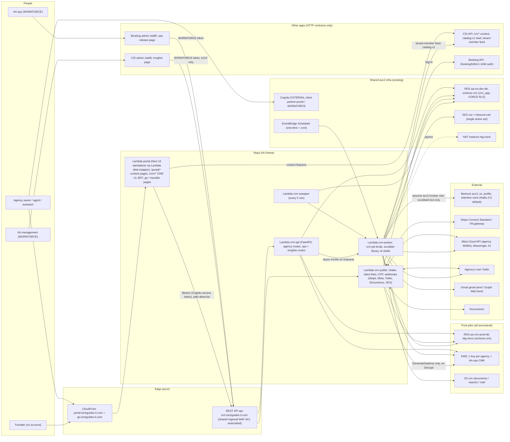

# CRM redesign, option B: serverless CRM backend + separated partner portal

Date: 20/10/2026 (S245 r2). Read-only design lane. Nothing in any repo, AWS, Vercel, Linear or Jira was changed. The
only AWS calls were free read-only ones (`lambda get-account-settings`); prices come from the public AWS price-list
JSON files (plain HTTPS, not a paid API).

**Angle of this lane:** the CRM is its own app, built serverless-first (Lambda + API Gateway + EventBridge Scheduler,
no always-on compute). The tenant portal leaves the CIS repo and becomes the agencies' one product. The CRM UI is a
section of that portal. This is compared honestly against the ECS Fargate service that D17 approved.

**Inputs read in full:** `.tmp-session/s245-r2/owner-input.md`, `docs/research/partner-crm-spec.md` (224 lines, the
requirement source of truth), `.tmp-session/s245-r2/out/crm-01-current-state.md`,
`docs/audits/2026-10-20-S245-tenant-crm/README.md`, and every `research/*.md` there. `research-fullbuild.md` is
byte-identical to note 04 apart from the header line. No market research was redone.

**Snapshot cited:** AA-CIS-App `origin/main` @ `b7e6da66` (read with `git show`), AA-CIS-Infra `4824c81`, AA-Booking
`f4fb80d`, root `f8a9938`.

---

## 0. Summary

1. **Shape.** There are two apps for two audiences, and they share only infrastructure:
   - **AA-CIS-App** is for AA staff: the admin UI plus the CIS API and worker.
   - **A new repo `AA-Partner`** is for agencies. It holds (a) the tenant portal, moved out of `AA-CIS-App/portal/`,
     with the CRM UI as its `/crm/*` section and the traveller pages on a second host, and (b) `crm-api`, the CRM
     backend.

   The CRM keeps its own schema `crm`, roles `crm_owner`/`crm_app`, DSN secret, REST API `api-crm.lumiguides.it.com`,
   job runner (D22 b) and Lambda functions. There are no links between the admin UI and the portal, in either
   direction.
2. **Runtime.** The CRM backend runs as **4 Lambda functions** (ARM, Python 3.12, FastAPI behind the AWS Lambda Web
   Adapter):
   - `api` serves the agency, behind the portal BFF.
   - `public` serves intake, client links and webhooks.
   - `worker` runs jobs.
   - `sweeper` re-dispatches missed jobs.

   They run in the existing private subnets, the same way the TripPlanner Lambdas do today (`tripplanner.tf:331-349`).
   Jobs are dispatched by async invoke and by EventBridge Scheduler, so there is no idle compute. The **same container
   image** runs on Fargate unchanged, so D17 (own ECS service) stays one Terraform flag away. **D17 needs re-approval**
   (§11, N1).
3. **Cost, CRM increment:**
   - **Dev:** about **$9–12/month**, against $85–160 in the previous design.
   - **Prod:** about **$300–320 at 10 agencies, $540–640 at 50 and $980–1,390 at 200**. The previous design was
     $500–925, $1.6–2.0k and $4.7–5.2k, and it excluded the prod database baseline that is included here.
   - About **$250 of every prod figure is Documenso Platform (D11 b)**. On Documenso Teams ($40) the totals would be
     $90–110, $330–430 and $770–1,180 (§11, N7).
   - Most of the saving does **not** come from Lambda versus Fargate. It comes from:
     - no always-on Presidio service (−$39–49 Dev, −$50–150 prod);
     - Haiku-first AI (−$7/agency);
     - agency-owned WhatsApp (D9 a) and agency-owned Twilio (−$8/agency);
     - no CASA (D6 b);
     - reusing the shared WAF ACL;
     - hosting the production portal on AWS instead of Vercel Pro (D14).
4. **Tensions, each with a concrete answer (§9):**
   - **D13 no + 30/11 + C7.1a.** The pilot runs on a **CRM-only prod cell**: its own `db.t4g.micro` RDS (~$19/month),
     KMS keys, bucket and Lambda stage, in `envs/prod/`. This needs a written exception to C7.2a for ≤10 agencies.
   - **D14 no + Hobby ToS.** The production portal goes to **Lambda + CloudFront on acc2**: $0 at 10 agencies, $8–15 at
     50–200.
   - **D15 no.** The pilot is restricted to non-VN, non-EU agencies (proposed answer to H4). VN and EU stay blocked
     until counsel.
   - D6 b, D11 b and D22 b are each built as written.
5. **Effort:** about **120 issues (≈110 new), 19–21 sessions, 9 waves.** Go-live on 30/11/2026 is W0–W5, which
   matches the spec's own pilot point (end of Phase 2). W6–W8 ship while the pilot runs.

---

## 1. Requirements this design is held to

| Source | What it fixes |
|---|---|
| Spec §1–§11 | 5 foundation + 18 feature modules, the 7-stage pipeline, 3-stage data collection, privacy architecture §8, integrations §9, non-code track §10, gaps §11. Complete product, no MVP |
| Ms. Thư T4 (README §2) | The CRM sits **inside the tenant portal**; it is not sold separately |
| Owner input | CRM is its **own app**, sharing only infra; admin and portal **fully separated**; leanest design that still meets every module; H1–H11 come with proposed answers |
| D1–D24 | Honoured row by row in §10 |
| Platform rules | ADR 0008 §8 (`docs/adr/0008-new-app-integration-and-data-platform-rules.md:168-175`, "a CIS module … later move to its own repo"), which this design amends; DM-6.8 (`02-data-management.md:228`); C7.1a/C7.2a–f (`03-scaling.md:364,371-376`); D-18 Vercel Pro "only at the first paying tenant" (`docs/engineering-handbook.md:499,743,843`) |

---

## 2. Architecture

### 2.1 Diagram

Dev and prod are two stages of the same functions. The Dev stage points at schema `crm` on the shared Dev RDS, and
the prod stage points at the pilot cell's own RDS (§9.1). The diagram shows both DB edges.

### 2.2 Why serverless here, and where it stops

The CRM traffic profile is low and bursty. The mid case is ~65k requests per agency-month (§8.1), which is about 8
requests per second at 200 agencies spread over working hours. Most CRM work waits on someone else: a traveller
opening a link, a webhook, a reminder date. That fits pay-per-request. The places where serverless is weaker are
handled explicitly:

| Concern | Handling |
|---|---|
| Cold start (Python FastAPI + asyncpg, ARM 512 MB; estimate 1–1.5 s) | Keep-warm ping every 5 min per function through Scheduler (≈26k invocations/month in total, ≈$0.03). If p95 still misses the SLO: SnapStart for Python (~$5/month per 1 GB function, cached-GB-s price $0.000001956) or provisioned concurrency (~$10.2/month per 1 GB ARM environment, $0.0000039233/GB-s). Prices from the AWS Lambda price list, us-west-1 |
| 15-minute maximum per invocation | Every long job (full export, CSV import of 10k rows, offboarding shred) is written as resumable steps that re-enqueue themselves with a cursor in `crm.job.payload` |
| DB connections (no RDS Proxy) | One connection per execution environment, capped by **reserved concurrency** (TripPlanner precedent: "1 DB connection each", `tripplanner_variables.tf:69-79`). Caps: `api` 8, `public` 3, `worker` 3, `sweeper` 1 = **15 = `crm_app` CONNECTION LIMIT**. `ALTER ROLE crm_app SET idle_session_timeout = '5min'` reaps connections held by frozen environments, and the app reconnects on `ConnectionDoesNotExistError` |
| Account concurrency | 1,000 total, 980 unreserved (live `lambda get-account-settings`, 20/10/2026). The CRM reserves 15 per stage, so 30 for Dev + prod |
| Egress (Stripe, Meta, Bedrock, Google) | Through the existing NAT instance (`t4g.nano`, scout §3). No interface endpoints, which would cost ~$7/month each (estimate) |

**RDS Proxy is not used.** It would cost $0.016 per vCPU-hour (RDS price list, us-west-1), which is $23.36/month for
the 2-vCPU `t4g.small` or `t4g.medium` and buys nothing at this concurrency. Trigger to add it: the `api` function's
`Throttles` metric stays above 1% of invocations for a week, or `crm_app` connections stay above 80% of the limit
(an alarm row in `observability_ecosys.tf:52-72` style).

---

## 3. Repo and app layout; how the portal integrates the CRM

### 3.1 After separation

| Repo | Audience | Deployables | Owns |
|---|---|---|---|
| `AA-CIS-App` | AA staff | `frontend/` (admin, Vercel), `api/` + worker (ECS) | Content pipeline, tenants registry, AA-813 membership, `/v1/*` tenant content APIs as **HTTP contracts** |
| **`AA-Partner`** (new, public, org AdventureAsia365-Ecosys) | Agencies + their travellers | `portal/` (Next.js 16, moved from `AA-CIS-App/portal/`), `crm-api/` (FastAPI, one image for 4 Lambdas) | The tenant portal and everything in it, schema `crm` (`crm-NNN`), traveller pages |
| `AA-Booking` | AA staff (B2C) | unchanged + `/booking/b2b/v1` | Supply, net rates, departures/holds |
| `AA-TripPlanner-Web` | AA's own travellers | unchanged | — |
| `AA-CIS-Infra` | — | `accounts/aa365/crm.tf` (Dev, Booking pattern), `envs/prod/crm.tf` (pilot cell) | Shared infra |

The repo is named `AA-Partner` rather than `AA-CRM` because it now carries the whole agency product. That includes
the CIS content pages (T0–T11, marketplace, billing), which stay UI-only and call CIS over HTTP. The CRM keeps a hard
code boundary inside the repo. `crm-api/` never imports from `portal/`, and the portal reaches the CRM only over HTTP.
A two-way import test guards this, and the D1 b label "fourth app" holds: the CRM has its own schema, role, DSN,
API, runner and deploy. A two-repo variant (`AA-Portal` + `AA-CRM`) is possible, but it adds a second CI, branch
protection and OIDC role for no isolation gain.

**Who owns the portal after separation.** The partner lane (the CRM lane of D3 a) owns it. CIS owns only the content
APIs the portal calls, and those calls become a documented contract. Today the portal reaches **any** backend path
through `portal/app/api/tenant/[...path]/route.ts:27-51`. That route gets a path allow-list. The admin-prefixed call
to `/admin/brand-identity` (dual-auth, scout B4) becomes a tenant route `/v1/brand-identity`.

**Portal size to move.** 100 files and ~20.7k lines under `portal/` on `origin/main`, counted with `git ls-tree`. The
move is a history-preserving `git filter-repo` of `portal/` plus its two workflows. Estimate: about 1 session.

### 3.2 CRM inside the portal: same Next.js app, not a microfrontend

- **Agency pages:** the CRM UI is the route group `portal/app/crm/*`, with a "CRM" entry in the existing sidebar
  (`portal/app/portal/_components/Sidebar.tsx`). There is one login, one BFF and one deploy. A Vercel multi-zone or
  microfrontend split would only make sense with separate teams, and here it would add a second project and routing
  config.
- **Traveller pages:** intake form, embeddable widget, option picker, client portal and the white-label trip page are
  served by the **same app on a second host**, `go.lumiguides.it.com`. Host routing happens in `portal/proxy.ts`
  (Next 16 Proxy). Cookies are host-only: the traveller host never sees agency cookies, and the reverse holds too.
  This saves the separate `aa-crm-client` project of the previous design. Per-agency custom domains are a later
  CNAME onto the same distribution.
- **Builder (D21 c):** the module 3 builder is `portal/app/crm/trips/[id]/builder`. It reuses the TripPlanner map and
  route components by guarded byte-copy (the pattern of `tests/unit/test_aa885_portal_split.py:24-40`, now pointed at
  TripPlanner files). No builder JWT or KMS signing key is needed (the previous design's `crm.builder.v1` + KMS JWT),
  because the builder runs in the agency's own session.
- **Kit:** the portal **owns** its UI kit from the move onwards. The 14 byte-copies of admin files and the equality
  test (`test_aa885_portal_split.py:24-40,66-81`) are dropped, and admin-only code is stripped. That code is
  `adminHeaders()` in `portal/app/_kit/api.ts:17-25` and the admin shell CSS in `portal/app/globals.css`, scout C2/C3.

### 3.3 Full separation checklist (no links either way)

| # | Today (origin/main) | Change | Repo |
|---|---|---|---|
| S1 | Admin login shows "B2B Tenant login →" (`frontend/app/login/LoginForm.tsx:159`) | Remove the link and the `PORTAL_BASE_URL` import | CIS |
| S2 | Portal login shows "← Staff login" (`portal/app/tenant-login/page.tsx:110-112`, `portal/lib/hosts.ts`) | Remove the link and `STAFF_LOGIN_URL` | Partner (after move) |
| S3 | 308 redirects `/portal*`, `/tenant-login` from the admin host to the portal (`frontend/next.config.ts:23-25`), required by `test_aa885_portal_split.py:104-117` | Delete the redirects (Dev only, no external bookmarks) and invert the test so it asserts there is **no** portal URL in `frontend/` | CIS |
| S4 | Dead `NavBar.tsx` with a "Tenant Portal" item (`frontend/components/NavBar.tsx:6-12`) | Delete it | CIS |
| S5 | Tenant-facing `/trip/[tourId]` served by the admin app, CTA `mailto:admin@adventureasia.com` (`frontend/app/trip/[tourId]/page.tsx:146`); stored URLs point at the admin host (`api/routers/v1_trip_page.py:157`) | Move the page to `go.lumiguides.it.com/t/{tenant}/{tour}`. The CTA opens that agency's intake form (D18). Backfill the stored `trip_url`s | Partner + CIS |
| S6 | Admin proxies named `/api/tenant/*` (scout P1–P3) | Rename them to `/api/admin/*` | CIS |
| S7 | One cookie name `cis_role` on both hosts (scout N1) | The portal uses a `pp_*` cookie namespace; remove the admin's tenant-cookie handling (`frontend/lib/cognito.ts:429-438`) | Both |
| S8 | One HS256 `JWT_SECRET` for tenant and staff tokens; `/auth/verify-tenant` does not check the role (scout B2/B3) | Separate the tenant token secret and audience; `verify-tenant` uses `verify_tenant_jwt`. Becomes moot when AA-813 moves tenants to Cognito | CIS |
| S9 | Help text in the admin pointing at `/portal/t7-planning` (`frontend/app/admin/atom-curation/page.tsx:1106-1107`) | Reword it to describe the tenant step without a URL | CIS |

Staff views **of** tenants (Tenant 360, `/admin/tenant-activity`) stay, because they are admin data views, not links.
The two AA-staff views of CRM data (ops release, insights) are pages inside the **staff** apps that call the CRM API
with a WORKFORCE token. No page in either app links to the other app.

---

## 4. Auth model

| Principal | Sign-in | How the CRM authorises |
|---|---|---|
| Agency user | Cognito EXTERNAL, confidential client renamed `cis-portal` → `partner-portal` (`identity.tf:169`; same callback host). Code + PKCE through the BFF; tokens in an encrypted httpOnly `pp_session` cookie | `crm-api` verifies the access token in-app: JWKS cache, issuer, `client_id`, `token_use=access`, exactly as Booking does (`AA-Booking backend/app/main.py:9`, which prefetches issuers' JWKS). Then it checks `crm.member_mirror` (the AA-813 membership row, mirrored from CIS within ≤1 min) plus `crm.member_role` (owner / agent / assistant, `margin_visible`) **in the same transaction** that sets `SET LOCAL app.tenant_id`. The membership row stays the boundary (ADR 0006 decision 3); the token never is |
| Before AA-813 lands | The existing per-tenant API-key login moves with the portal | The CRM refuses API-key sessions: CRM routes require a Cognito user. So AA-813 is a hard W1 prerequisite (unchanged from the previous design) |
| Traveller | No account (EXTERNAL is AA's own traveller pool; research/01 §2 item 9) | Signed link: 256-bit random token, SHA-256 stored, expiry, scoped to a trip. The Stage 3 client portal adds an email OTP step-up through SES |
| Webhooks | — | Per-provider signature check (Stripe, Meta `X-Hub-Signature-256`, Twilio, Documenso, SES/SNS), then an idempotent `crm.inbox_events UNIQUE(source, contract, idempotency_key)` (Booking pattern) |
| AA ops | WORKFORCE (staff) | Routes `/crm/ops/v1/*` require the WORKFORCE issuer + group `aa-ops`. They return only ops-release records (§5.4). Every read is written to the agency's audit |
| AA management | WORKFORCE | `/crm/insights/v1/*` with group `aa-mgmt`. They return only `crm.insight_aggregate` cells with k≥10, ≥3 agencies and opt-in (D24) |
| CRM → Booking | IAM | Booking's REST API (`booking.tf:449`) gets `AWS_IAM` authorization on `/booking/b2b/*` only. The `crm-worker` role signs with SigV4. No secret and no Cognito M2M token fee |
| CRM → CIS | IAM | Two small CIS read endpoints, also `AWS_IAM`: `GET /internal/v1/tenant-members?since=` (membership feed) and `GET /internal/v1/catalog/*` (`catalog.v1`: tours, days, places, photos). Cached in `crm.catalog_cache` with a TTL |

**Consequence: `crm_app` has no grants outside `crm.*`.** The previous design granted `catalog.v_tenant_member`,
`catalog.v_tour*` and `booking.v_b2b_booking_outbox` to `crm_app`. Here everything crosses over HTTP, which:

- removes every cross-schema grant from the X2 guard and the isolation probe;
- keeps a single code path for Dev and the prod cell, whose separate RDS cannot see Dev views;
- makes the later move into AA-880 prod a plain schema move.

The cost is two small CIS endpoints and one Booking IAM method.

---

## 5. Data, encryption, AI and PII

### 5.1 Data placement

The schema `crm` model is the previous design's model (README §8.2: vault, profile, consent, pipeline, intake,
proposal, money, comms, workflow, AI draft, audit, suppliers, reports, insights). There are four differences:

- No `builder_session`, because of D21 c.
- No `fx_rate` for AA lines; FX for those comes with the Booking quote (unchanged rule).
- **Added `crm.member_mirror`**, `crm.catalog_cache`, `crm.ops_release` (§5.4) and `crm.llm_call` (cost ledger
  without text).
- **No grants to any other role.**

FORCE RLS starts at `crm-001`, with the NULLIF template `TO crm_app`. NOLOGIN roles `crm_ai_reader` and `crm_insights`
see only `v_ai_trip_context` and `v_insight_facts`. Every PII column carries `COMMENT 'pii:<class>'`, with the new
classes `pii:government_id`, `pii:health` and `pii:emergency_contact` (standards v1.2).

### 5.2 Encryption (D7 a)

| Layer | Design |
|---|---|
| F1 fields | AES-256-GCM per field, AAD = tenant/table/column/id. A **per-traveller DEK** is wrapped by the **agency's own KMS key** (encryption context `crm_tenant_id`). An HMAC blind index on email, phone and name supports exact search. DEKs are cached in memory per Lambda environment for 5 min |
| Key creation | Lazy: the key is created when an agency stores its first traveller, not at sign-up, so inactive agencies cost $0. Offboarding calls `ScheduleKeyDeletion`, and **keys pending deletion are not billed** ([KMS pricing](https://aws.amazon.com/kms/pricing/), accessed 20/10/2026) |
| Key policy | `kms:Decrypt` only for the `crm-api` and `crm-worker` roles, with the encryption-context condition. **`crm-public` (internet-facing) gets `GenerateDataKey`/`Encrypt` only**, so an intake or webhook compromise cannot read the vault. That per-function least privilege is not possible with one ECS task role. CloudTrail alarm on Decrypt by any other principal (extends AA-873) |
| Documents | S3 SSE-KMS with the agency key and S3 Bucket Keys (fewer KMS calls); presigned upload/download |
| Wording | F1 is reworded per D8, after H3 (§12) |

### 5.3 F3 scrubber: a library, paid per use

There is no Presidio service. The scrubber is a Python library inside `crm-worker`, the only function that builds
prompts:

1. **Known values:** the vault already knows this trip's travellers, so their names, emails, phones, passport numbers
   and dates of birth are replaced deterministically with `<PERSON_1>` and similar placeholders.
2. **Patterns:** email, E.164 and VN phone formats, passport and ID shapes, card-like numbers, dates, URLs carrying
   tokens.
3. **NER:** Presidio Analyzer with a small spaCy model for English, plus a Vietnamese surname gazetteer (the
   top ~100 surnames cover almost all names) combined with capitalised-sequence rules.
4. **Fail closed:** any residual hit above the threshold blocks the draft and tells the agent; nothing goes to the
   model.

The placeholder map is encrypted with the tenant DEK, kept for 24 h, and restored only in the agency session. A CI
corpus gate (EN/VI, ≥200 samples, 0 leaks) is kept from the previous design.

Cost is Lambda time only, inside the AI job (counted in §8.1). Amazon Comprehend is not used: it documents English and
Spanish only (research/04 §2.6). The package is too large for a zip, so `crm-worker` ships as a container image. ECR
costs $0.10/GB-month (ECR price list, us-west-1).

### 5.4 Module 8, AA ops release, kept inside the CRM

- When a departure is confirmed and the traveller has consented (`ops_release` in the consent ledger), the worker
  copies the minimum ops fields into `crm.ops_release`, re-encrypted under an **AA-ops CMK**. The agency key is not
  used, so AA ops never needs agency-key rights.
- AA ops read the records from a page in the **Booking admin** (a staff app) through `/crm/ops/v1/*`, and every read
  is audited to the agency.
- A daily `crm_ops_release_purge` job deletes each record 90 days after the trip's return date and writes a deletion
  receipt into the agency's audit chain.

**Why not push the data to Booking** (as the previous design did):

- During the pilot, Booking runs only on Dev, and C7.1a forbids real PII there.
- It removes a Booking receiver, an `ops_release_pax` table and a receipt feed (−2 issues).
- When Booking prod exists, a push can be added behind the same contract if ops want the data inside Booking.

### 5.5 AI (D12)

| Item | Choice |
|---|---|
| Route | `crm-worker` assumes the acc3 invoker role with an external ID: the existing satellite pattern, `shared/llm_client/bedrock_satellite.py:121-125,198-201` (the role trust gains the CRM worker role). `us.` geographic profile; acc3 account data-retention mode `none`, with an SCP that denies other modes if the reseller org allows it |
| Models | **Haiku 5.5 by default** ($0.10 in / $0.50 out per MTok, prompts ≤100k tokens). **Sonnet 5.5 only for proposal prose**, as an agency opt-in ($2/$10). Fable 5/5.1 are excluded: they require `aws_review` and keep data up to 30 days ([Bedrock data retention](https://docs.aws.amazon.com/bedrock/latest/userguide/data-retention.html), accessed 20/10/2026). Prices are from [Claude pricing](https://platform.claude.com/docs/en/about-claude/pricing), accessed 20/10/2026, with Bedrock parity assumed (estimate). US-only routing is ×1.1 per the same page |
| Off by default | Per tenant (D12). The owner enables it; the scrubber receipt is required for every `crm_ai_*` job |
| Cost control | `crm.spend_budget` per tenant (proposal: $2/agency-month, about 4× the expected Haiku use). The cap fails closed. `crm.llm_call` stores stage, model, tokens, cost and tenant, never text. The `app` column is aligned with ADR 0009 when it lands. OpenAI and Jev are excluded |
| Cheaper still | Prompt caching of the fixed system prompt and brand rules: cache hits cost 0.1× input on Haiku (same pricing page). It is not counted in §8, so it is upside |

---

## 6. Channels

| Spec item | Design | AA cost |
|---|---|---|
| Module 5 email (D6 b) | **Inbound:** each agency gets `<slug>@in.crm.lumiguides.it.com` (prod) or `@in.crm-dev…` (Dev), as one SES receipt rule in the **single active rule set** (`e2e_mailbox.tf:194-207`: "One active set per region"; Infra moves that set to a shared owner) → S3 → `crm-public`. The agency sets up a Gmail or Outlook forward, or BCC. The UI shows Gmail's forwarding-confirmation code from the first inbound mail. **Outbound:** `gmail.send` (a *sensitive* scope: Google OAuth verification, **no CASA**, research/04 §2.2) or Graph `Mail.Send`, so sent mail lands in the agency's own Sent folder. Fallback: SES with the agency domain's DKIM. **Threading:** a per-trip reply-to plus `Message-ID`/`References` matching. **History import:** mbox upload (Google Takeout) instead of restricted read scopes | SES $0.10/1k out, $0.10/1k in + $0.09/1k chunks ([SES price list](https://pricing.us-east-1.amazonaws.com/offers/v1.0/aws/AmazonSES/current/us-west-1/index.json)) |
| Module 9 WhatsApp (D9 a) | Embedded Signup: the agency owns its WABA and pays Meta directly. Cloud API direct, AA as Tech Provider. Webhooks → `crm-public`. 24-hour window and template-category guard | $0 |
| Module 9 SMS | **The agency brings its own Twilio account**: its API key is stored encrypted under the agency DEK, and the agency is billed by Twilio. A Twilio sub-account would bill AA (§11, N6) | $0 |
| Spec §7 Messenger + IG (D19 a) | Same Meta app; Graph API webhooks; page-scoped IDs; unmatched-sender queue | $0 |
| Module 7 payments (D10 a) | Stripe Connect **Standard** (agency is merchant of record, $0 to AA, research/04 §2.1). VN gateway adapter after a quote; manual recording meanwhile | $0 |
| Module 12 e-sign (D11 b) | Documenso API + webhook; signed PDFs into the agency-key bucket. Plan choice in §11, N7 | $250 (Platform) or $40 (Teams) per month |

---

## 7. Job runner (D22 b), CI and deploy

### 7.1 Runner: a copy, dispatched by events

- **Table:** `crm.job` is rendered from `AA-CIS-App/shared/jobs/job_table_template.sql:1-5` (ADR 0003a) into
  `crm-001`, with `crm_*` kinds.
- **Semantics:** copied from **Booking's** smaller copy (`AA-Booking backend/app/jobs/queue.py`, 276 lines;
  `worker.py`, 186 lines): claim with `FOR UPDATE SKIP LOCKED`, lease, attempts, backoff, dead state, metrics. It is not
  copied from the CIS core (`shared/jobs/queue.py` 620 + `worker.py` 371 lines), which the CRM never touches.
- **Dispatch** replaces Booking's in-process loop (`AA-Booking backend/app/main.py:73-92`):
  1. **Immediate kinds:** the enqueue commits in the same transaction as the business write. After commit, the caller
     does a Lambda async invoke of `crm-worker` with `{job_id}`. Lambda's async queue retries twice, and an on-failure
     destination goes to an SQS DLQ ($0.40/M requests, [SQS price list](https://pricing.us-east-1.amazonaws.com/offers/v1.0/aws/AWSQueueService/current/us-west-1/index.json)).
  2. **Future `run_at`** (T-21 nudge, reminder dates, hold expiry): an EventBridge Scheduler **one-time** schedule
     `at(…)` with `ActionAfterCompletion=DELETE`.
  3. **Recurring kinds** (workflow tick, membership feed pull, insights rollup, audit archive, ops-release purge,
     retention TTL): Scheduler cron schedules. The first 14M scheduled invocations per month are $0 ([EventBridge price list](https://pricing.us-east-1.amazonaws.com/offers/v1.0/aws/AWSEvents/current/us-west-1/index.json)).
  4. **Sweeper:** every 5 min it re-dispatches due jobs and expired leases, which covers a lost invoke.
- **DM-11.4:** in-flight invocations finish on the old Lambda version, so a CRM code deploy does not need to drain
  `crm.job`. DB Migrate `apply` still waits for `crm.job` to be idle (the `crm` entry in `owners.yaml`), and recurring
  kinds are listed in `idle_exempt_kinds` from day one.

### 7.2 CI and deploy

| Step | AA-Partner |
|---|---|
| CI (required checks) | ruff + mypy + pytest (Postgres service container, RLS and role-matrix tests, scrubber corpus gate, import-boundary test), portal lint/typecheck/build, Playwright UI smoke against a deployed preview |
| Build | `docker buildx` ARM image for `crm-api` (`public.ecr.aws/awsguru/aws-lambda-adapter:1.1.0` as the adapter layer, per the [LWA README](https://github.com/awslabs/aws-lambda-web-adapter), accessed 20/10/2026; check that the tag is ≥2 weeks old before pinning) and for `portal` (Next `output: "standalone"`). ECR immutable SHA tags, keep 10 |
| Deploy | GitHub OIDC role scoped to the `aa-partner-*` functions and the ECR repos (Booking pattern, `booking.tf:575-708`). `update-function-code` → publish version → shift alias `live` → smoke `/crm/health` → automatic alias rollback on failure. The portal's static `/_next/static/*` goes to S3 behind CloudFront |
| Previews | Each PR gets a Lambda alias `pr-<n>` with a function URL (deleted on close). This replaces Vercel previews for the portal and takes the portal off the Hobby team's 100-deploys/day cap (scout N3) |
| Infra | `accounts/aa365/crm.tf` + `crm_variables.tf` (Dev; reads module outputs only, like `booking.tf`) and `envs/prod/crm.tf` (pilot cell; first resident of the C7.2c prod root). A `crm_runtime = "lambda" \| "ecs"` variable keeps the D17 path (§10) |

---

## 8. Cost

All AWS prices are for us-west-1, from the public price-list JSON
(`https://pricing.us-east-1.amazonaws.com/offers/v1.0/aws/<Service>/current/us-west-1/index.json`), accessed
20/10/2026:

- Lambda ARM: $0.0000133334/GB-s and $0.20/M requests (publication 2026-10-16).
- API Gateway REST: $3.50/M; HTTP API: $1.17/M.
- WAF: $0.60/M requests.
- CloudWatch Logs: $0.67/GB ingest, $0.033/GB-month storage.
- Alarms: $0.10 each.
- ECR: $0.10/GB-month.
- RDS PostgreSQL:
  - `t4g.micro`: $0.021/h single-AZ, $0.043/h Multi-AZ.
  - `t4g.small`: $0.043/h single-AZ, $0.085/h Multi-AZ.
  - `t4g.medium`: $0.085/h single-AZ, $0.171/h Multi-AZ.
- RDS Proxy: $0.016/vCPU-h. gp3 storage: $0.138/GB-month (research/04 §1).

Fargate prices are $0.03725/vCPU-h and $0.00409/GB-h on ARM, and $0.04656 and $0.00511 on x86 (research/04 §1).

**No AWS free tier is assumed.** acc2 is billed through the reseller TrueIDC. AWS states that with consolidated
billing "only one Free Tier per Organization" applies (CloudFront FAQ, found by search, accessed 20/10/2026), so it
cannot be relied on. The cost model is in `scratchpad/crmcost.py` (session scratchpad, not kept).

### 8.1 Usage model per agency-month (mid case; an estimate built on research/04 §1)

| Driver | Value | Basis |
|---|---|---|
| Portal → CRM API calls | 26,400 | 3 seats × 22 days × 400 calls (react-query SPA). Estimate |
| Public + webhooks | 2,750 | 40 intakes, proposal re-prices, client portal, ~650 WhatsApp + status callbacks, SES inbound 300, Stripe, Documenso |
| Jobs | 3,000 | 600 AI drafts (400 + 50%, research/04) at 6 s / 1 GB; 2,400 others at 0.5 s / 1 GB |
| API duration | 150 ms at 512 MB | Estimate |
| Portal (BFF + SSR) | 32,400 requests at 100 ms / 1 GB | Estimate |
| CloudFront | 45k requests, ~1.35 GB | Estimate (hashed assets are cached by the browser) |
| LLM tokens | 2.4M in, 0.36M out | research/04 §1 |

This gives about $0.15 Lambda + $0.10 API Gateway + $0.02 WAF + $0.03 logs per agency-month for the CRM and portal
compute.

### 8.2 Dev, marginal per month (before any agency)

| Line | $/month | Source / basis |
|---|---|---|
| Lambda: 4 CRM functions + portal, ~3 agency-equivalents of test and CI traffic, sweeper + keep-warm | 0.50 | Model §8.1 × 3 + 34.6k ticks (price list) |
| API Gateway REST `api-crm` | 0.31 | 0.09M × $3.50/M |
| WAF: association with the **existing** shared regional ACL (`main.tf:260-278`, `rest_api_stage_arns`) | 0.05 | $0.60/M; no new ACL |
| CloudWatch Logs (14-day retention) + 6 alarms | 0.80–1.50 | $0.67/GB ingest (estimate 0.3–1 GB) + 6 × $0.10 |
| Secrets Manager: `crm/dev/database-url` + `crm/dev/providers` (one JSON for Meta app secret, Stripe platform key, Documenso key) | 0.80 | $0.40/secret-month (research/04 §1) |
| KMS: 3 test-agency keys + 1 AA-ops CMK (deleted test keys are free while pending) | 4.00 | $1/key-month, [KMS pricing](https://aws.amazon.com/kms/pricing/) |
| S3 (documents, exports, inbound mail) + SES in/out | < 0.50 | Estimate at test volume |
| ECR: 2 repos × ≤10 images | 0.60 | ~6 GB × $0.10 (estimate) |
| EventBridge Scheduler, SQS DLQ | 0.00 | Under 14M scheduled invocations; DLQ idle |
| LLM test calls (Haiku, hard cap in `crm.spend_budget`) | ≤ 2.00 | Pricing page; cap set by us |
| Documenso Free plan ("5 documents per month") for adapter tests; Meta Cloud API test number; Twilio trial (BYO model) | 0.00 | [documenso.com/pricing](https://documenso.com/pricing), accessed 20/10/2026; Meta/Twilio test tiers (unverified, as in README §13) |
| Portal hosting on Dev: CloudFront flat-rate **Free** plan ($0, 1M requests, 100 GB) or Vercel Hobby as today | 0.00 | [CloudFront pricing](https://aws.amazon.com/cloudfront/pricing/), accessed 20/10/2026 |
| RDS: schema `crm` on the shared Dev instance; connection offsets (§10, D17 row) | 0.00 | — |
| **Total** | **≈ $9–12** | Previous design: $85–160 |

Fargate instead (D17 as approved, Booking size): add $8.29 (ARM, 0.25 vCPU / 0.5 GB always on) or $10.36 (x86), and
drop the $0.50 of Lambda, for **≈ $17–22**.

### 8.3 Prod (pilot cell, then scale), CRM increment per month

| Line | 10 agencies | 50 agencies | 200 agencies | Source / basis |
|---|---|---|---|---|
| LLM: Haiku-first, 10% Sonnet prose, US routing ×1.1, 100% adoption (worst case; AI is off by default) | 13 | 67 | 268 | $1.34/agency: 0.9 × (2.4×0.10 + 0.36×0.50)×1.1 + 0.1 × (2.4×2 + 0.36×10)×1.1. Claude pricing page; Bedrock parity is an estimate |
| KMS: one key per agency (D7 a), +$1 per rotation for the first two rotations | 10–30 | 50–150 | 200–600 | KMS pricing page |
| SES out (1,000/agency) + in (300/agency) | 2 | 10 | 38 | SES price list |
| S3 documents (grows ~75 MB/agency-month) | < 1 | 1–2 | 3–6 | $0.026/GB-month (estimate) |
| WhatsApp (D9 a), SMS (BYO Twilio), Stripe Standard, Cognito (<10k MAU) | 0 | 0 | 0 | research/04 §2.1, §3.1; ADR 0006 |
| Lambda: CRM + portal | 1.5 | 7.5 | 30 | Model §8.1 |
| API Gateway REST + WAF association | 1.2 | 6 | 24 | 0.29 / 1.46 / 5.83 M requests |
| CloudWatch Logs + ~10 alarms | 1.3 | 2.4 | 6.5 | $0.67/GB + $0.10/alarm |
| CloudFront for the portal and traveller host | 0 (flat Free, ≤1M) | 8 (pay-as-you-go, estimate $0.01/10k HTTPS + $0.085/GB) | 15 (flat Pro, ≤10M requests) | CloudFront pricing page |
| RDS for the pilot cell, own instance | 19 (`t4g.micro` single-AZ $15.33 + 20 GB gp3 $2.76 + snapshot copy ~1) | 133 (`t4g.medium` Multi-AZ $124.83 per C7.2a + 30 GB × $0.276) | 141 (same class; 60 GB) | RDS price list. **If AA-880 prod exists by then, the CRM moves onto it and the increment falls to the previous design's ~0/+63/+188 share** |
| Secrets (3) + AA-ops CMK + ECR | 3 | 3 | 3 | Price lists |
| RDS Proxy | 0 | 0 | 0 | Not used (§2.2 trigger) |
| CASA | 0 | 0 | 0 | D6 b |
| Vercel Pro | 0 | 0 | 0 | D14; portal on AWS |
| E-sign: Documenso **Platform** (D11 b) | 250 | 250 | 250 | documenso.com/pricing: Platform $250/month, unlimited docs and API, white-label embed |
| **Total (Platform)** | **≈ $300–322** | **≈ $540–640** | **≈ $980–1,390** | Range = KMS rotation |
| Total with Documenso **Teams** ($40, "API Access for Automation", embedded signing, 5 users; N7) | ≈ $90–112 | ≈ $330–430 | ≈ $770–1,180 | Same page |
| Per agency (Platform) | ~$30 | ~$11–13 | ~$5–7 | — |

**Fargate at the same scales** (2 tasks for HA at 0.5 vCPU / 1 GB ARM = $33.16; 3 tasks at 1 vCPU / 2 GB = $99.48 at
200; the portal still needs hosting) compares as follows against the Lambda CRM-API share (~$1 / $5 / $19):

| Agencies | Fargate is dearer by |
|---|---|
| 10 | ~$32/month |
| 50 | ~$28/month |
| 200 | ~$80/month, falling to ~$14 if 2 tasks suffice |

Lambda's advantage closes as traffic grows. Above roughly 25 requests/s sustained, Fargate becomes cheaper (estimate;
a re-check trigger is in §13).

### 8.4 Delta against the previous design, line by line

**Dev ($85–160 → $9–12):**

| Previous line | Previous | Now | Why |
|---|---|---|---|
| `aa-cis-dev-crm` Fargate 0.5/1 GB always on | ~21 | 0.5 | Lambda pay-per-request; same image can return to Fargate (N1) |
| Presidio service 1 vCPU / 4 GB | 39–49 | 0 | Scrubber is a library inside the AI job (§5.3); runs only when AI is used |
| New WAF ACL for `/crm/public/*` | 10–15 | 0.05 | Associate the existing shared ACL ($0.60/M) |
| KMS test keys | 1–5 | 4 | Same (D7 a); deleted test keys are free while pending |
| S3 + SES inbound | < 5 | < 0.5 | Rule added to the existing active set |
| Twilio / Meta test numbers | ~5 | 0 | Cloud API test number; BYO Twilio trial |
| E-sign sandbox | 0–30 | 0 | Documenso Free plan for Dev |
| Gateway test calls | 5–20 | ≤ 2 | Haiku default + hard cap |
| Secret + logs/alarms | 4–7 | 2–3 | Two secrets, 14-day log retention |

**Prod:**

| Previous line (10 / 50 / 200) | Now | Why |
|---|---|---|
| WhatsApp via Twilio 50 / 250 / 1,000 | 0 | D9 a (owner answer) |
| SMS 30 / 150 / 600 | 0 | BYO Twilio (new, N6) |
| LLM Sonnet 84 / 420 / 1,680 | 13 / 67 / 268 | Haiku-first, Sonnet only for opt-in proposal prose |
| KMS 10–30 / 50–150 / 200–600 | same | D7 a |
| SES 3 / 15 / 60 | 2 / 10 / 38 | Volume re-estimated at the us-west-1 price list rate |
| E-sign 75 / 250 / 250 | 250 / 250 / 250 | D11 b raises the 10-agency case (or 40 on Teams, N7) |
| Compute 111 / 222 / 395 | ~4 / 22 / 75 (Lambda + API Gateway + WAF + logs + CloudFront) | No always-on API/worker/Presidio tasks |
| RDS increment 0 / 63 / 188 (prod baseline $150–300 excluded) | 19 / 133 / 141 (CRM cell DB **included**) | D13 no: the pilot cannot wait for AA-880. Cheaper than the platform prod baseline it replaces for the pilot |
| Vercel Pro 40–60 / 60 / 60–100 | 0 | D14 no; portal on Lambda + CloudFront |
| CASA 56–450 | 0 | D6 b |
| Security baseline / WAF 25–40 | ~1–4 (inside the API Gateway + WAF line) | Shared ACL. Account-level AA-873 detection is platform cost, not CRM |

---

## 9. The tensions, answered

### 9.1 D13 no + go-live 30/11/2026 + C7.1a + D14 no

**Problem.** Real traveller data cannot go on Dev. C7.1a says "Production personal data MUST NOT be copied to Dev;
Dev seed data MUST be synthetic or masked" (`03-scaling.md:364`), and the handbook says "Test data only"
(`engineering-handbook.md:499`). Full prod (AA-880, C7.2a: Multi-AZ, starting at `t4g.medium`) is not a pilot
precondition (D13), and Vercel Hobby forbids commercial use.

**Answer: a CRM-only prod cell, live 30/11/2026.**

| Piece | Choice | $/month |
|---|---|---|
| Terraform | `infra/AA-CIS-Infra/envs/prod/crm.tf`: the first resident of the C7.2c prod root (0 bytes today, `03-scaling.md:373`). Own SGs in the shared VPC, own `crm/prod/*` secrets, own alarms that page `nghieppham@adventure.asia` (owner's notification request; `var.alert_email` today defaults to `pqnghiep1354@gmail.com`, `variables.tf:152-155`) | — |
| Database | `aa-crm-prod-db`, `db.t4g.micro` single-AZ, gp3 20 GB, 14-day PITR, deletion protection, daily cross-region snapshot copy (C7.2b). **A written exception to C7.2a** (Multi-AZ, ≥`t4g.medium`) for ≤10 agencies, accepting an RTO of hours, recorded in standards v1.2 (§11, N4). Upgrade trigger: the 11th agency, or AA-880 ready → move schema `crm` onto the platform prod instance | ~19 |
| DB Migrate | Needs the `environment` input of C7.2d ("To build", `03-scaling.md:374`). One W5 issue | — |
| Functions | Same 4 CRM functions + portal, stage `prod`, alias `live` | §8.3 |
| Identity | Agency users stay in Cognito EXTERNAL (the platform's only tenant identity pool, ADR 0006), so CIS content features keep working. Agency **staff** identity is treated as platform identity, not "Dev data"; this needs approval in N4. **Traveller PII exists only in the prod cell** | 0 |
| Other apps | The cell calls CIS and Booking **Dev** over HTTP for catalog, membership and B2B quotes/holds. None of these carries traveller PII: holds carry pax counts and a trip reference. Module 8 PII stays in the cell (§5.4) | 0 |
| Portal hosting | Lambda (Next 16 standalone via Lambda Web Adapter) + CloudFront on acc2, for both Dev and prod | 0–15 |

**Why not Amplify Hosting:** it supports Next.js "versions 12 through 15"
([Amplify docs](https://docs.aws.amazon.com/amplify/latest/userguide/ssr-amplify-support.html), accessed 20/10/2026),
and the portal is on Next 16.4.2 (`portal/package.json:15`). **Why not OpenNext:** its page claims Next 15 only
([opennext.js.org/aws](https://opennext.js.org/aws), accessed 20/10/2026). Lambda Web Adapter runs Next's standalone
Node server, which does not depend on the Next version.

**Why the portal must leave Vercel Hobby for production.** Vercel says: "Hobby teams are restricted to non-commercial
personal use only … Commercial usage is defined as any Deployment that is used for the purpose of financial gain of
anyone involved in any part of the production of the project, including a paid employee or consultant writing the
code" ([fair use guidelines](https://vercel.com/docs/limits/fair-use-guidelines), last updated 14/09/2026, accessed
20/10/2026). D-18 ("Pro only at the first paying tenant") never triggers for a CRM that is free for partners, but the
ToS clause applies anyway.

**Flag beyond the CRM (not decided here).** By that definition, the platform's existing Dev frontends on Hobby (CIS
admin, Booking admin) likely already count as commercial use. Two remedies: reuse the portal's Lambda + CloudFront
module for them, or one Pro seat at $20. That is a platform decision (N9), not a CRM cost line.

**What is live on 30/11.** W0–W5:

- F1–F5;
- modules 1–4, 6–8, 11, 12, 13;
- the module 18 traveller export and erasure;
- module 15 (agency suppliers) and module 16 (base reports).

This is the spec's own pilot point: "3–5 friendly agencies at the end of Phase 2". Modules 5 and 9 (email/WhatsApp
inboxes), 10, 14 and 17, plus full 16 and 18, follow in W6–W8 during the pilot, in the spec's own phase order.
Nothing is cut. If W4 slips, go-live moves rather than the scope.

### 9.2 D15 no (no lawyer now) vs PDPL VN, GDPR and APP

| Jurisdiction of the agency | Can it store real traveller data in the pilot? | Why | What unblocks it |
|---|---|---|---|
| Vietnam | **No** (demo on synthetic data only) | Decree 356/2025 may require an MPS Certificate of Eligibility and a VN-established provider; there is a TIA filing within 60 days of the first transfer to us-west-1; no SME grace for sensitive data (research/04 §0.2, §4.1) | Counsel opinion (D15 revisited) + TIA/DPIA dossiers |
| EU / UK | **No** | Hosting in the US needs SCC Module 2 (+ UK Addendum); the Art. 27 representative is an open question (research/04 §4.2) | Counsel-reviewed DPA + SCC annex |
| Australia and other non-EU, non-VN countries | **Yes, risk accepted by Ms. Thư** | Agencies at or below A$3M turnover are generally outside the APPs; an APP 8 "use, not disclosure" contract shape is possible from the AA-886 DPA template (research/04 §4.3) | Template DPA (AA-886, no lawyer) signed per agency; public data page |

**Still required without a lawyer**, and planned in W5:

- the DPA template from AA-886 with the sub-processor annex;
- the consent ledger (DM-6.5);
- the per-tenant retention table;
- verified traveller erasure (module 18 subset);
- the reworded F1 sentence (D8);
- the public data page (spec §10, phase 4, pulled earlier).

**Deferred:** VN licence and TIA, SCC/IDTA, Art. 27, the AU APP-entity status of AA itself, and counsel review of the
partner no-poaching clause. The pilot agreement uses a plain-language no-poaching clause drafted by Ms. Thư.

### 9.3 D6 b, D11 b, D22 b

- **D6 b:** built as §6. Spec module 5 says "Two-way Gmail / Outlook sync". This design gives two-way *conversation*
  (forward-in, send-as-out, threading) without read scopes, so there is no CASA. The success test ("Agency stops using
  Gmail for client work") is measured in the pilot. Known gap: mail the agency forgets to forward never arrives. This
  is mitigated by a Gmail filter set up during onboarding and by the per-trip reply-to address. M365 tenants may block
  automatic external forwarding by default, so the agency admin must allow it (risk §13).
- **D11 b:** Documenso is the vendor (Free plan on Dev; Platform or Teams in prod, N7). Self-hosting the AGPL-3.0
  edition ([GitHub](https://github.com/documenso/documenso), accessed 20/10/2026) was considered and rejected for the
  pilot. It needs an always-on app (~$17/month Fargate ARM 0.5 vCPU / 1 GB) plus a signing certificate, and the insurer
  acceptance risk sits with AA. Revisit it if per-agency volume makes Platform poor value.
- **D22 b:** built as §7.1. It copies Booking's runner semantics and touches nothing in CIS `shared/jobs`.

---

## 10. Owner answers D1–D24: how each is honoured

| D | Answer | In this design |
|---|---|---|
| D1 | b (own app) | Own repo `AA-Partner` (portal + CRM), own schema, role, DSN, API, runner and functions; shares infra only (§3) |
| D2 | yes | ADRs written: root **ADR 0014** (Partner app: portal ownership, serverless CRM, separation; **amends ADR 0008 §8** "it is a CIS module") and **ADR 0015** (B2B channel). Standards v1.2. No cross-schema grants at all (§4) |
| D3 | a | Own lane from S246 |
| D4 | a | Agent team, ~6 issues/session |
| D5 | yes | W0 starts Meta, Google (sensitive-scope verification only), Stripe Connect, VN gateway quotes, insurer contact, pilot recruitment |
| D6 | b | §6, §9.3 |
| D7 | a | §5.2 (lazy key creation; pending deletion is free) |
| D8 | yes | Reworded after H3 (§12) |
| D9 | a | §6 |
| D10 | a | §6 |
| D11 | b | §6, §9.3, N7 |
| D12 | yes | §5.5 |
| D13 | no, 30/11/2026 | §9.1 prod cell |
| D14 | no | §9.1 portal on AWS |
| D15 | no | §9.2 |
| D16 | yes | Linear project "Tenant CRM" (or "Partner app"); issues created per wave (§14) |
| D17 | yes (own ECS service from Dev) | **Deviation:** 4 Lambda functions instead of one ECS service, ≈$8–10/month cheaper on Dev and $30–80 cheaper in prod at ≤200 agencies, with per-function least privilege (`crm-public` cannot decrypt). The same image runs on Fargate, and `crm_runtime = "ecs"` restores D17 exactly. **Re-approval needed (N1)** |
| D18 | yes | S5: the trip page moves to the traveller host, and its CTA goes to the agency's intake form |
| D19 | a | W6 |
| D20 | a | EN/VI with next-intl in the portal; `crm.tenant_settings.locale` for traveller pages |
| D21 | c | §3.2 builder in the portal by guarded byte-copy of TP components |
| D22 | b | §7.1 |
| D23 | yes | Moot: it is its own app from day one. ADR 0014 records instead the **runtime switch condition** Lambda → Fargate (§13) |
| D24 | yes | Insights: k≥10 + ≥3 agencies + per-tenant opt-in; property test |

**Connection budget (needed for D17 or N1 alike).** Live LOGIN limits total 155 against `max_connections` 181
(`observability_ecosys.tf:52,60-66`). Adding `crm_app` 15 gives 170. The offsets are merged **before `crm-001`**:

- `booking` 15 → 10: its pool is `max_size=5` (`AA-Booking backend/app/db.py:65-69`).
- `tripplanner` 30 → 22: its Lambdas reserve 15 + 5 = 20 (`tripplanner_variables.tf:69-79`).

The result is **157 / 181**.

---

## 11. New decisions this lane needs (beyond D1–D24)

| # | Decision | Recommendation | Effect |
|---|---|---|---|
| N1 | Serverless runtime for the CRM backend (supersedes D17's form, keeps the ECS switch) | **Yes** | Dev −$8–10, prod −$30–80/month; per-function IAM |
| N2 | The portal moves from `AA-CIS-App/portal/` to a new repo `AA-Partner`, which owns the tenant portal and the CRM | **Yes** | Full separation (§3.3); ends the byte-copy kit coupling |
| N3 | The portal is hosted on Lambda + CloudFront on acc2 for Dev and prod; Vercel project `aa-cis-portal` retired | **Yes** | Hobby ToS-safe go-live without Pro; $0–15/month |
| N4 | CRM prod cell on its own `t4g.micro` RDS with a C7.2a exception for ≤10 agencies; agency staff identities in Cognito EXTERNAL are classed as platform identity | **Yes** | Makes D13 no + 30/11 lawful under C7.1a, at ~$19/month |
| N5 | Module 8 data stays in the CRM under an AA-ops CMK; AA ops read it from the Booking admin through the API | **Yes** | No PII on Booking Dev; −2 issues |
| N6 | SMS through the agency's own Twilio account | **Yes** | −$3/agency to AA |
| N7 | Documenso plan: Teams $40 for the pilot (≤5 agencies, backend as one user), Platform $250 when white-label embedding or more seats are needed. Teams may show Documenso/AA branding to travellers (unverified) | **Teams first** | −$210/month until the switch. If white-label is required from day one, keep Platform per D11 b |
| N8 | Pilot jurisdictions: non-VN, non-EU only until counsel | **Yes** (proposed answer to H4) | Makes D15 no workable |
| N9 | Platform (not CRM): the Hobby ToS exposure of the other Dev frontends | Separate decision | — |

---

## 12. Proposed answers to H1–H11 (for Ms. Thư to approve)

| H | Question | Proposed answer |
|---|---|---|
| H1 | Does "ignore the 40 weeks" drop only the schedule? | **Yes.** Scope stays all 23 modules. Pilot go-live is **30/11/2026** with the spec's Phase 0–2 modules. Phases 3–4 ship during the pilot |
| H2 | Pricing for agencies | **Free for partners**, no seat fee. Agencies pay their own WhatsApp (Meta), SMS (Twilio) and card fees (Stripe) through their own accounts. AI drafts are included up to **$2 of model use per agency-month** (well above the expected ~$0.46 on Haiku). AA's cost is about $11–13 per agency per month at 50 agencies (§8.3). Review at 50 agencies |
| H3 | Reword F1 | **Agree:** "Only the CRM system can use the agency's key; every use is logged in the agency's own audit view; AA staff cannot open traveller records; the agency can revoke the key (BYOK) and deleting it makes the data unreadable" |
| H4 | Pilot agencies | **3–5 agencies from Australia** (or another non-EU, non-VN country), named by Ms. Thư in W0. 30-minute interviews in W0–W1. Vietnamese and EU agencies join after a lawyer's review |
| H5 | Contracting entity / lawyer | **The AA entity that signs partner agreements today** (Ms. Thư names it). No lawyer for the pilot (D15). The DPA comes from the AA-886 template. A lawyer brief is prepared but not sent |
| H6 | Insurer for the e-signed waiver | **AA's current trekking insurer**; Ms. Thư names the contact in W0. Until the insurer replies, waivers are e-signed and marked "insurer review pending" |
| H7 | Zalo | **Not in the pilot** (not in the spec; VN agencies are not in the pilot). Revisit when VN agencies are unblocked |
| H8 | Fixed departures / allotment | **AA ops maintains departures and seats in Booking** for the tours with fixed dates. All other tours are "on request": a hold is confirmed by AA ops within one working day |
| H9 | Use the ADR 0005 B2B net list (15% margin) for the CRM? | **Yes, unchanged** |
| H10 | Who writes the booking terms and waiver templates | **AA provides default templates** adapted from AA's current booking terms (Ms. Thư's team). Each agency can upload its own |
| H11 | Insights: k≥10, ≥3 agencies, opt-in | **Agree** (D24) |

---

## 13. Risks

| Risk | Level | Mitigation |
|---|---|---|
| 30/11 needs W0–W5 (~14 sessions) in ~6 weeks as a parallel lane; external clocks (Meta 2–4 weeks, Google verification, insurer) | High | D5 starts everything in W0. Go-live scope is fixed at the Phase 2 modules. If late, the date moves, not the scope |
| C7.2a exception (single-AZ micro) holds real data | Medium | 14-day PITR, cross-region snapshot copy, restore drill before go-live, ≤10-agency trigger |
| VN/EU agencies blocked by D15 | Medium (scope by geography) | N8; demos on synthetic data |
| Cold starts hurt the "faster than Gmail" bar | Medium | Keep-warm; SnapStart/provisioned concurrency triggers (§2.2); p95 SLO alarm |
| **Runtime switch condition** (ADR 0014): sustained >25 req/s, or Lambda + API Gateway spend > 1.2× an equivalent Fargate service for 2 months, or a need for long-lived connections | Low | `crm_runtime = "ecs"` with the same image (LWA) |
| DB connections from frozen environments | Medium | Reserved concurrency = role limit; `idle_session_timeout`; Proxy trigger |
| Single NAT instance (`t4g.nano`) carries all CRM egress in prod | Medium | Alarm on NAT health; NAT Gateway (~$32/month + data, estimate) only if it fails in pilot |
| Single SES active receipt rule set shared by e2e and both CRM stages | Low | Infra owns the set as `shared`; rules keyed by recipient domain |
| M365 blocks auto-forwarding; Gmail forward confirmation friction | Medium | Onboarding wizard; BCC fallback; measure in pilot |
| Documenso Teams branding unacceptable to agencies | Low | Switch to Platform (+$210) |
| Portal move breaks CIS content features (BFF allow-list) | Medium | Contract test listing every `/v1/*` path the portal uses; UI smoke on every PR |
| Two hosting platforms (CIS admin on Vercel, portal on AWS) | Low | One Terraform module; N9 may converge them |
| Bedrock price parity and model retention on acc3 (reseller) | Medium | Check `none` mode on acc3 in W0; per-tenant cap |
| Vietnamese NER quality in the scrubber | Medium | Known-value pass first, gazetteer, fail closed, corpus gate; AI off by default |

---

## 14. Waves and issue estimate (complete product)

| Wave | Scope | Issues | Sessions |
|---|---|---|---|
| W0 Decisions + external starts | ADR 0014 / 0015, Infra KMS ADR, standards v1.2 (pii classes, DM-6.8 / ADR 0008 §8 rewording, C7.2a pilot exception), contracts (`catalog.v1`, tenant-member feed, Booking B2B OpenAPI), spec gaps 1–4 + 7, Meta / Google-sensitive / Stripe / VN gateway / insurer starts, pilot recruitment | 12 | 1 |
| W1 Separation + skeleton | CIS S1/S3/S4/S6/S8/S9 + `/v1/brand-identity`; `AA-Partner` bootstrap + portal move + kit ownership + BFF allow-list + cookies; portal Lambda + CloudFront module; AA-813 (3 existing-scope issues); Infra `crm.tf`, `owners.yaml`, `rl-003` + connection offsets, X2 extension, probe cells; `crm-001`; runner copy + dispatch; request context + import-boundary test | 22 | 3 |
| W2 Privacy foundation | KMS key provisioning, envelope library, vault + reveal + audit in the same transaction, documents bucket, BYOK, CloudTrail alarm, F2 + NOLOGIN roles, consent ledger, scrubber library + corpus gate, roles/margin RLS, hash-chain audit page + archive | 14 | 2 |
| W3 Sell a trip | Public intake + widget on the traveller host + trip page move/D18, intake job, attribution, pipeline + triggers + board/timeline/Traveller info, Stage 2 form, contacts, CSV/mbox import + invites, suppliers (15), ledger (6), text mode (4), base reports (16), i18n/currency/timezone/mobile | 15 | 2.5 |
| W4 AA supply + interactive proposal | Booking: B2B IAM auth, departures/allotment + UI, holds + reaper, `v_b2b_offer`, quote, confirm/cancel + status feed; portal net-price list; proposal model + price hash; builder (D21 c); live quote + Booking-down mode; dependency rules + Stage 2 defaults; option picker; accept → hold; itinerary events | 15 | 3 |
| W5 Paid, delivered, pilot cell | Invoices/schedules, Stripe Connect, VN adapter/manual, reminders, client portal + OTP + Stage 3, Documenso + templates, ops release in CRM + Booking admin page + purge + receipt, commission (13), traveller export/erasure; `envs/prod` cell + DB Migrate env input + restore drill; DPA/data page; onboarding of 3–5 agencies (**go-live 30/11**) | 16 | 2.5 |
| W6 Channels + automation | SES inbound + threading + forward confirmation, gmail.send / Mail.Send / DKIM, inbox UI + saved replies + notes, WhatsApp Embedded Signup + window + templates, Messenger/IG, BYO Twilio, workflow engine + nudges / T-21 / idle 3 days | 11 | 2.5 |
| W7 AI, insights, portability, hardening | AI drafts (Haiku-first) + approval UI + AA-820 + eval + cost cap, full reports + event tracking, insights + CIS admin page, full export + offboarding shred, Gmail contacts import, threat model, 200-tenant load test, SLO alarms | 12 | 2 |
| W8 Scale-out | Move onto AA-880 prod when it exists (C7.2a), access review, VN/EU unblocking per counsel, UAT videos (AA-855) | 5 | 1 |
| **Total** | | **≈122 (≈110 new; AA-813, AA-880, AA-855, AA-886, AA-899 updated)** | **≈19.5 (range 19–21)** |

Compared with the previous plan (115 issues, ≈20 sessions):

| Change | Issues |
|---|---|
| Admin/portal separation, portal move and AWS hosting (new owner requirement) | +10 |
| Prod cell instead of a W8 prod dependency | +3 |
| Two-way Gmail, Graph subscriptions and CASA (D6 b) | −3 |
| Booking ops receiver (N5) | −2 |
| Builder JWT and TP route (D21 c) | −1 |
| Presidio service, replaced by the library | −1 |
| CIS runner parametrisation (D22 b) | −1 |

---

## 15. Spec traceability (every section and module → where it is built)

| Spec item | Built where | Wave |
|---|---|---|
| §1 Live AA supply | Booking `/booking/b2b/v1` (IAM) + CRM quote cache, Booking-down mode | W4 |
| §1 Traveller-configurable proposals | Portal builder (D21 c) + traveller-host option picker + `crm.proposal*` | W4 |
| §1 Privacy by architecture | §5 (vault, profile, scrubber, audit, per-function IAM) | W2 |
| §2 AI drafts, humans send | Approval UI; no send path without an approval row | W7 |
| §2 Faster than Gmail + WhatsApp + spreadsheet | Inbox, templates, keep-warm SLO, pilot measurement | W6–W7 |
| §3 Users (owner/agent/assistant, traveller, AA ops, AA mgmt) | §4 auth table | W1–W5, W7 |
| §4 Pipeline + gates + Lost | `crm.trip` + transition trigger + gate rules | W3 |
| §5 Stage 1/2/3 data, rules 1–5, data placement, Traveller info panel, automation (80% task, T-21) | Intake (W3), Stage 2 form (W3), client portal Stage 3 after deposit (W5), F1/F2 placement (W2), panel (W3), workflow kinds (W6) | W2–W6 |
| F1 Identity vault | `crm-api` vault + per-agency KMS + DEK | W2 |
| F2 Pseudonymous profile | `crm.traveler_profile` + NOLOGIN views | W2 |
| F3 PII scrubber | Library in `crm-worker` + corpus gate | W2 |
| F4 Tenancy & access | Cognito `partner-portal` + AA-813 mirror + `crm.member_role` + RLS | W1–W2 |
| F5 Audit log | `crm.access_event` hash chain + portal audit page | W2 |
| 1 Intake form | `crm-public` + `go.` host + widget | W3 |
| 2 Trip pipeline | Portal `/crm/pipeline` | W3 |
| 3 Interactive proposal | W4 rows | W4 |
| 4 Text proposal | Renderer with shared price hash | W3–W4 |
| 5 Unified inbox (email) | §6, D6 b | W6 |
| 6 Bookings ledger | `crm.booking_line*`, AA lines from the Booking status feed | W3–W4 |
| 7 Invoices & payments | Stripe Connect Standard + VN adapter + manual | W5 |
| 8 AA ops release | §5.4 | W5 |
| 9 WhatsApp / SMS | §6 | W6 |
| 10 Workflow automation | Scheduler-driven `crm_workflow_*` kinds | W6 |
| 11 Client portal | Traveller host, signed link + OTP | W5 |
| 12 Contracts & waivers | Documenso adapter | W5 |
| 13 Commission tracking | Ledger fields + overdue rule | W5 |
| 14 AI agent layer | §5.5 | W7 |
| 15 Supplier directory | `crm.agency_supplier` + AA as default supplier | W3 |
| 16 Agency reports | Base W3, full W7 | W3, W7 |
| 17 AA insights | `crm.insight_aggregate` + CIS admin page via API | W7 |
| 18 Data portability | Traveller export/erasure W5; full export + offboarding shred W7 | W5, W7 |
| §7 Data model | Schema `crm` (§5.1) | W1–W5 |
| §8 Privacy architecture (split stores, scrub, ZDR, AA access, agency controls) | §5 | W2, W5, W7 |
| §9 Integrations (inventory, builder, Stripe, Gmail/Outlook, Twilio/360dialog, e-sign, LLM) | §4, §6, §5.5 (360dialog not used: $49/number, research/04 §2.4) | W4–W7 |
| §10 Build plan + pilot at end of Phase 2 | §9.1, §14 (go-live 30/11 after W5) | — |
| §10 Non-code track (legal, partner agreement, insurer, WhatsApp verification, data page) | §9.2, W0 starts, W5 DPA/data page | W0, W5 |
| §11.1–4 Stories, edge cases, day-in-the-life, mockups | W0 | W0 |
| §11.5 Onboarding (Gmail/CSV import, first run, invites) | CSV + mbox import, invites (W3); Gmail contacts (W7) | W3, W7 |
| §11.6 NFR (mobile, languages, currencies, time zones, performance, uptime) | W3 i18n/currency/timezone/mobile; W7 SLOs | W3, W7 |
| §11.7 Event tracking | `crm.metric_event` | W7 |
| §11.8 Pricing model | H2 proposal | W0 |

---

## 16. Sources

**Repo**, all read 20/10/2026:

- The inputs listed in the header.
- AA-CIS-Infra `accounts/aa365/`: `tripplanner.tf:331-349`, `tripplanner_variables.tf:69-79`,
  `observability_ecosys.tf:52-66`, `variables.tf:152-155`, `identity.tf:169`, `main.tf:260-278`, `booking.tf:449,558-565`,
  `e2e_mailbox.tf:194-207`.
- AA-CIS-App `origin/main`: `frontend/app/login/LoginForm.tsx:159`, `portal/app/tenant-login/page.tsx:110-112`,
  `frontend/next.config.ts:23-25`, `frontend/app/trip/[tourId]/page.tsx:146`, `api/routers/v1_trip_page.py:157`,
  `portal/package.json:15`, `portal/app/api/tenant/[...path]/route.ts:27-51`,
  `shared/llm_client/bedrock_satellite.py:121-125,198-201`, `shared/jobs/*` (line counts).
- AA-Booking: `backend/app/db.py:65-69`, `backend/app/main.py:9,73-92`, `backend/app/jobs/{queue,worker}.py`.
- Root: `docs/adr/0008-…:168-175`, `docs/architecture/data-standards/02-data-management.md:228`,
  `03-scaling.md:364,371-376`, `docs/engineering-handbook.md:499,743,843`.

**Web**, all accessed 20/10/2026:

- AWS price-list JSON for us-west-1: AWSLambda, AmazonApiGateway, AWSQueueService, AWSEvents, AmazonCloudWatch,
  AmazonCloudFront, AmazonSES, awswaf, AmazonECR, AWSAmplify, AmazonRDS. URL pattern
  `https://pricing.us-east-1.amazonaws.com/offers/v1.0/aws/<code>/current/us-west-1/index.json`.
- [KMS pricing](https://aws.amazon.com/kms/pricing/) and [CloudFront pricing](https://aws.amazon.com/cloudfront/pricing/).
- CloudFront free tier and consolidated billing: [CloudFront FAQs](https://aws.amazon.com/cloudfront/faqs/).
- [Vercel fair use](https://vercel.com/docs/limits/fair-use-guidelines),
  [Amplify Next.js support](https://docs.aws.amazon.com/amplify/latest/userguide/ssr-amplify-support.html) and
  [OpenNext AWS](https://opennext.js.org/aws).
- [AWS Lambda Web Adapter](https://github.com/awslabs/aws-lambda-web-adapter).
- [Documenso pricing](https://documenso.com/pricing) and [Documenso repo](https://github.com/documenso/documenso).
- [Claude pricing](https://platform.claude.com/docs/en/about-claude/pricing) and
  [Bedrock data retention](https://docs.aws.amazon.com/bedrock/latest/userguide/data-retention.html).
- Fargate, Stripe, Meta, Twilio, Cognito and gp3 figures are taken from research/04 §1–§2, with the sources and access
  dates recorded there.

**Estimates** (marked as such in the text): the usage model in §8.1, CloudFront pay-as-you-go request and data
prices, S3 growth, log volume, cold-start times, NAT Gateway and interface endpoint costs, and Bedrock price parity
with Anthropic's list prices.
