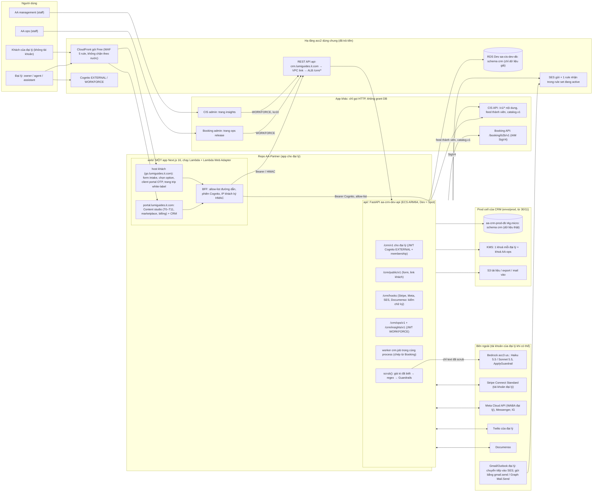

# Tenant CRM — thiết kế v2: app riêng cho đại lý (portal + CRM), dùng chung hạ tầng (AA-821 / PR-19)

Ngày 20/10/2026, phiên S245 (vòng 2), tác nhân: Claude Code. Chỉ đọc và viết tài liệu: không đổi repo, AWS, Vercel,
Linear, Jira. Không gọi API trả phí.

**Nguồn đã đọc đầy đủ:** `.tmp-session/s245-r2/owner-input.md` (ý kiến Nghiệp 20/10), spec của chị Thư
`docs/research/partner-crm-spec.md` (224 dòng, gọi tắt "spec"), scout hiện trạng `out/crm-01-current-state.md`,
phương án A `out/crm-design-A-one-tenant-app.md` (ECS, một app cho đại lý), phương án B `out/crm-design-B-serverless.md`
(Lambda), panel giám khảo `out/crm-judges.md`, và thiết kế v1 `docs/audits/2026-10-20-S245-tenant-crm/README.md`.

**Mốc code được trích:** AA-CIS-App `origin/main` @ `b7e6da66` (checkout local đang chậm 9 commit, nên mọi dòng CIS là
dòng của `origin/main`, đọc bằng `git show`); AA-CIS-Infra `4824c81`; AA-Booking `f4fb80d`; AA-TripPlanner-Web
`b79ec48`; root `f8a9938`. Tôi tự kiểm lại các dòng chốt (link login, redirect 308, `verify-tenant`, CTA `mailto`, URL
trip, `alert_email`, WAF geo, connection limit, callback Cognito, `envs/`, C7.1a/C7.2) trên đúng các mốc này.

Giá: mọi dòng có URL + ngày truy cập (20/10/2026) hoặc ghi **ước tính**. Giá Documenso và CloudFront tôi đọc lại trực
tiếp hôm nay; giá AWS khác lấy từ price-list JSON us-west-1 mà panel đã kiểm (`crm-judges.md` §1.2).

---

## 1. TL;DR

1. **CRM là một app riêng, không còn là module trong CIS.** App mới tên **AA-Partner** (repo riêng) là sản phẩm duy nhất
   cho đại lý: **tenant portal hiện tại (chuyển hẳn ra khỏi `AA-CIS-App/portal/`) + CRM** trong cùng một app Next.js, cộng
   một backend CRM nhỏ (FastAPI) chạy service ECS riêng `aa-crm-dev-api`. Đúng ý chị Thư: CRM nằm **trong** portal. Đúng
   ý anh: CRM có ranh giới code, schema, role DB, API, job runner, deploy riêng; **chỉ dùng chung hạ tầng** acc2 (VPC,
   ECS cluster, RDS instance, Cognito, API Gateway/VPC link, SES, S3).
2. **CIS admin và portal tách hoàn toàn:** xoá cả hai link chéo ở trang đăng nhập, xoá redirect 308, đổi tên proxy
   `/api/tenant/*` phía admin, bỏ 14 file kit chép byte, tách cookie và secret token. Danh sách đầy đủ 31 điểm dính ở §4.
3. **Chi phí giảm mạnh, vẫn đủ 23 module của spec:**

   | | v1 (module CIS) | **v2** | Giảm |
   |---|---|---|---|
   | Dev / tháng | $85–160 | **≈ $11–13** | −$72–147 (≈ −87–92%) |
   | Prod 10 đại lý / tháng | $500–925 (chưa gồm DB prod) | **≈ $313–320** (Documenso Platform) · **≈ $103–110** (nếu dùng gói Teams) | −$180–612 (Platform) · −$390–820 (Teams) |
   | Prod 50 đại lý | $1,6–2,0k | **≈ $570** | −$1,03–1,43k |
   | Prod 200 đại lý | $4,7–5,2k | **≈ $1,15–1,26k** | −$3,4–4,0k |

   v2 đã **gồm** DB pilot riêng; v1 thì không. Nên mức giảm thật còn lớn hơn bảng. Khoản lớn nhất còn lại là Documenso
   Platform $250/tháng (**trả theo năm, $3.000**), chiếm ~78% hoá đơn ở 10 đại lý. Đây là đòn bẩy duy nhất còn lớn, để
   anh và chị Thư chọn (N8, H12).
4. **Căng thẳng giữa các câu trả lời được giải cụ thể:**
   - D13 không + go-live 30/11/2026: pilot chạy trên một **"prod cell" chỉ cho CRM** (RDS `t4g.micro` riêng + 1 task
     ECS), ≈ $27/tháng. Không cần chờ AA-880. Dữ liệu khách thật không bao giờ nằm trên Dev.
   - D14 không: portal và trang khách chạy trên **AWS (Lambda + CloudFront gói Free, có sẵn WAF 5 rule)**, nên không
     cần Vercel Pro và không vướng điều khoản "phi thương mại" của Vercel Hobby.
   - D15 không: pilot chỉ nhận dữ liệu thật của đại lý **ngoài VN và ngoài EU** (ví dụ Úc). Đại lý VN/EU dùng chế độ demo
     cho đến khi có luật sư. Có ngưỡng bắt buộc gửi brief luật sư.
   - D6 b, D11 b, D22 b: làm đúng như anh trả lời, có ghi điểm lệch spec.
5. **Công sức:** ≈ **96 issue trước 30/11** (≈ 16 phiên, ~2,8 phiên CRM/tuần), ≈ **117 issue tổng** (≈ 20 phiên). Rủi ro
   lớn nhất là ngày. Đề xuất: nếu trễ thì **dời ngày, không cắt phạm vi** (N18).
6. **Cần anh quyết 19 quyết định mới N1–N19** (§14), xác nhận lại 9 câu D có nghĩa đã đổi theo kiến trúc mới (§13), và
   chị Thư duyệt **12 đề xuất trả lời H1–H12** (H12 mới, về giao diện ký điện tử) trong `crm-questions.json`.

---

## 2. Đổi gì so với v1, và vì sao

| # | Ý của anh (owner-input.md) | v1 | v2 |
|---|---|---|---|
| 1 | "Sao không tách thành app riêng mà là module trong CIS" | Module `crm/` trong AA-CIS-App, service `aa-cis-dev-crm` build từ image CIS | Repo riêng **AA-Partner**, image riêng, service `aa-crm-dev-api`. Mẫu khởi tạo = AA-Booking (`infra/AA-CIS-Infra/accounts/aa365/booking.tf`) |
| 2 | "Đánh giá CRM chung với portal/tenant, chị Thư nói tích hợp vào" | CRM là trang trong `portal/` nhưng portal vẫn ở repo CIS; thêm app khách `aa-crm-client` riêng | Portal + CRM **là một app** (một build, một đăng nhập). Trang khách (form, proposal, client portal) là **host thứ hai của cùng app**, không phải app thứ ba |
| 3 | "Admin CIS và portal còn link qua nhau là vô lý, phải tách hoàn toàn" | Không xử lý | §4: 31 điểm dính, mỗi điểm có hành động + đợt; test guard đảo ngược để cấm link quay lại |
| 4 | "Chi phí tăng khá nhiều, tìm giải pháp tối ưu thay vì phình to" | Dev $85–160, prod $500–925 ở 10 đại lý | Dev ≈ $11–13, prod ≈ $313–320 (≈ $103–110 với Documenso Teams). Bảng đòn bẩy ở §9.4–§9.5 |
| 5 | "Bám spec chị Thư tốt hơn" | Pilot ở W8 sau mọi module; module 5 (email) ở W6 | Pilot 30/11 = **đúng điểm pilot của spec** ("end of Phase 2", `partner-crm-spec.md:196`); **module 5 kéo lên trước 30/11** vì spec đặt nó ở Phase 1 ("S8 4 + 5", `partner-crm-spec.md:191`); baseline đo sự kiện có từ W3 để đo được chỉ tiêu thành công ngay trong pilot |
| 6 | "H1–H11 phải có đề xuất để duyệt" | Câu hỏi mở | Mỗi câu có đề xuất trả lời cụ thể + phương án khác (§15, JSON) |
| 7 | "Câu hỏi ở artifact làm cơ chế chọn, duyệt" | Bảng chữ | `crm-questions.json` máy đọc được, cho trang duyệt tương tác |

**Những gì v1 làm đúng và được giữ nguyên:** benchmark thị trường (v1 §4), trích yêu cầu chị Thư (v1 §2), phần tuân thủ
GDPR/PDPL VN/APP Úc (v1 §14, cập nhật ở §8.5 dưới đây), mô hình dữ liệu schema `crm` (v1 §8.2, với 4 thay đổi ở §7.1),
F1–F5 (v1 §8.3, đổi scrubber), Booking B2B API (v1 §8.4).

**Những gì bỏ khỏi v1 (làm hoá đơn phình):** service Presidio chạy suốt ($39–49 Dev), WAF ACL mới ($10–15), app khách
`aa-crm-client`, route `/builder` + builder JWT ở TripPlanner, tham số hoá job runner lõi CIS, Gmail hai chiều + CASA
($675–5.400/năm), WhatsApp qua Twilio BSP, SMS qua sub-account của AA, Sonnet làm mặc định, Vercel Pro.

---

## 3. Kiến trúc

### 3.1 Sơ đồ

Không có trong hình, có chủ đích: không service Presidio, không app khách riêng, không route builder ở TripPlanner,
không WAF ACL mới, không grant DB nào từ/tới `crm.*`, không dòng code CIS nào trong repo AA-Partner, **không link nào
giữa CIS admin và portal**. Các trang staff (insights, ops release) là trang của **app staff** gọi API CRM bằng token
WORKFORCE — đó là app staff đọc dữ liệu, không phải link giữa hai app người dùng.

### 3.2 Ba app → bốn app, ai sở hữu gì

| Repo | Đối tượng | Chạy gì | Sở hữu |
|---|---|---|---|
| AA-CIS-App | Nhân viên AA | `frontend/` admin (Vercel), `api/` + worker (ECS) | Pipeline nội dung, danh bạ tenant, AA-813 membership, API nội dung `/v1/*` cho tenant (thành **hợp đồng HTTP**) |
| **AA-Partner** (mới, public, org AdventureAsia365-Ecosys) | Đại lý + khách của đại lý | `web/` (portal chuyển từ CIS + CRM UI + host khách), `api/` (CRM) | Mọi màn hình cho đại lý; schema `crm` (khoá `crm-NNN`) |
| AA-Booking | Nhân viên AA (B2C) | như cũ + `/booking/b2b/v1` | Hàng, giá net, departure/hold |
| AA-TripPlanner-Web | Khách của AA | không đổi | — |
| AA-CIS-Infra | — | `accounts/aa365/crm.tf` (Dev, chép dạng `booking.tf`), `envs/prod/crm.tf` (prod cell) | Hạ tầng dùng chung |

**Vì sao một repo (portal + CRM) chứ không hai (N1):** chị Thư muốn CRM nằm trong portal; một app Next.js thì một đăng
nhập, một BFF, một deploy, một kit UI. Ranh giới "CRM là app riêng" vẫn cứng: `api/` không import `web/`, `web/` chỉ gọi
CRM qua HTTP, có test import hai chiều; CRM có schema, role, DSN, REST API, runner, image, service riêng. Tách hai repo
(AA-Portal + AA-CRM) thêm một CI, một branch protection, một OIDC role, một kit copy và điều hướng giữa hai "zone" bị
nạp lại trang — tốn thêm mà không cách ly thêm gì.

### 3.3 Backend CRM (D17, D22 b)

Chép **AA-Booking** (cùng stack ADR 0004): `booking.tf` là một file tự chứa, chỉ đọc output module, chạm đúng một tài
nguyên dùng chung là listener rule ALB (scout §4). Khác biệt cho CRM:

| Mục | Booking hôm nay | CRM v2 |
|---|---|---|
| Kích thước task | 256 CPU / 512 MB x86 (`booking.tf:285-286`) | 0,25 vCPU / 0,5 GB **ARM64** |
| Capacity | FARGATE base 1 + SPOT 3 (`booking.tf:392-400`) | **Dev: chỉ FARGATE_SPOT** (Dev không có người dùng thật); prod cell: FARGATE on-demand, 1 task trong pilot |
| Worker | Trong process API, lifespan task (`AA-Booking/backend/app/main.py:79-92`, `jobs/worker.py:14-19` nhả job khi tắt) | Giống hệt: chép `backend/app/jobs/` (675 dòng, 4 file), bảng `crm.job` từ template CIS `shared/jobs/job_table_template.sql` (ADR 0003a), kind `crm_*`. **Không chạm `shared/jobs` của CIS** (D22 b) |
| Deploy gate | `GET /booking/ops/deploy-gate` bằng OIDC GitHub, không secret (`deploy-dev.yml:15-35`) | Chép: `GET /crm/ops/deploy-gate`; kind định kỳ vào `DEPLOY_GATE_EXEMPT` + `idle_exempt_kinds` từ ngày đầu |
| ECS exec | Bật | **Tắt** trên service CRM (bản rõ của vault nằm trong bộ nhớ); debug bằng log + DB Migrate `run-script` trên bảng không PII |
| REST API | Riêng, throttle 20/40 (`booking.tf:449-567`) | Riêng `api-crm.lumiguides.it.com`, cùng VPC link |
| Role DB | `booking` limit 15, pool `max_size=5` (`AA-Booking/backend/app/db.py:65-72`) | `crm_app` limit 5, pool `max_size=5`; bù bằng hạ `booking` 15 → 10 trong cùng PR → tổng LOGIN giữ 155/181 (`observability_ecosys.tf:52,59-72`), không resize RDS (N17) |
| IAM thêm | SES send, PutMetricData | + `kms:Decrypt/GenerateDataKey` trên `alias/crm/*` có điều kiện encryption context; `bedrock:ApplyGuardrail` + `sts:AssumeRole` sang role invoker acc3; `execute-api:Invoke` trên tài nguyên B2B của Booking |

### 3.4 Portal + CRM là một app, hai host

- **Trang đại lý** (`portal.lumiguides.it.com`): sidebar có hai nhóm **Content studio** (các trang hôm nay,
  `portal/app/portal/_components/Sidebar.tsx:28-50`) và **CRM** (pipeline, trip, khách, inbox, proposal + builder, sổ
  booking, hoá đơn, hoa hồng, NCC, báo cáo, tự động, nháp AI, audit, cài đặt).
- **Trang khách** (`go.lumiguides.it.com`): form intake + widget nhúng, trang chọn option (không đăng nhập), client
  portal (link ký + OTP email), trang trip white-label (chuyển từ admin CIS, D18). `proxy.ts` (Next 16 Proxy) định tuyến
  theo `Host`; cookie host-only, nên host khách không bao giờ thấy cookie đại lý và ngược lại.
- **Builder (D21 c):** `web/app/crm/trips/[id]/builder`, chép byte các component bản đồ/route của TripPlanner
  (`mapbox-gl` 3.7.0, `AA-TripPlanner-Web/frontend/package.json:14`; `components/MapView.tsx` 803 dòng, import
  `@/lib/{api,mapbox,tileLoader,types,useTrip}` ở `MapView.tsx:4-17`) + adapter cùng chữ ký hàm cho `lib/tp/api.ts` và
  `lib/tp/useTrip.ts`. Guard: manifest sha256 + commit TP trong CI, job hằng đêm mở issue khi TP lệch. **Lưu ý:**
  TripPlanner chạy Next 15.5.28 (`frontend/package.json:15`), portal chạy Next 16.4.2 (`portal/package.json:15`), nên
  CI build thêm các file chép dưới Next 16 và cho phép một lớp bọc mỏng (D21 c đã cho phép adapter).
- **Hosting (N3):** Next 16 `output: "standalone"` trên **Lambda + Lambda Web Adapter**, sau **CloudFront gói Free**
  ($0/tháng: 1M request, 100 GB, 5 rule WAF; [aws.amazon.com/cloudfront/pricing](https://aws.amazon.com/cloudfront/pricing/),
  truy cập 20/10/2026). File tĩnh lên S3. Một kiểu host cho Dev và prod. Vì sao không Amplify: Amplify chỉ hỗ trợ Next
  "up through Next.js 15" ([Amplify docs](https://docs.aws.amazon.com/amplify/latest/userguide/ssr-amplify-support.html),
  truy cập 20/10/2026), còn portal là Next 16. W0 có một spike kiểm Next 16 Proxy + SSR + BFF trên LWA. **Dự phòng
  (không phải Vercel Pro):** cùng container chạy một service Fargate nhỏ sau cùng CloudFront, +≈ $8/tháng.
- **Preview PR:** client Cognito có callback URL cố định (`identity_variables.tf:163-168`), nên preview động (Vercel
  hay Lambda function URL) không đăng nhập được. Dùng **một host preview cố định** `portal-pr.lumiguides.it.com` đăng ký
  trên client; CI deploy PR đang test lên đó; smoke test đăng nhập bằng user `e2e-test-*`.

---

## 4. Kế hoạch tách CIS admin ↔ tenant portal (mọi điểm dính scout tìm thấy)

Tất cả nằm ở **W1**, trước khi trang CRM nào lên. Nguồn: scout §2, panel đã kiểm V1–V9.

### 4.1 Link, redirect, mục điều hướng

| ID | Hôm nay (file:line, `origin/main`) | Hành động | Repo |
|---|---|---|---|
| L1 | Trang đăng nhập staff có link "B2B Tenant login →" tới `${PORTAL_BASE_URL}/tenant-login` (`frontend/app/login/LoginForm.tsx:10,159`) | Xoá link + import `PORTAL_BASE_URL` | CIS |
| L2 | Trang đăng nhập tenant có link "← Staff login" (`portal/app/tenant-login/page.tsx:4,111-112`; `portal/lib/hosts.ts:5-9`) | Xoá cùng lúc chuyển repo; trang đăng nhập đại lý chỉ có đăng nhập của nó | Partner |
| L3 | Redirect 308 `/portal`, `/portal/:path*`, `/tenant-login` từ host admin sang portal (`frontend/next.config.ts:23-25`), test bắt buộc giữ (`tests/unit/test_aa885_portal_split.py:104-117`) | **Xoá** (Dev chỉ ~4 tenant thử, không có bookmark thật) và **đảo test**: assert `frontend/` không còn URL/hằng số host portal nào (N16) | CIS |
| L4 | Chữ hướng dẫn trong admin nhắc `/portal/t7-planning` (`frontend/app/admin/atom-curation/page.tsx:1106-1107`) | Viết lại, không ghi đường dẫn portal | CIS |
| L5 | `NavBar.tsx` chết, có mục "Tenant Portal" (`frontend/components/NavBar.tsx:6-12`, không ai import) | Xoá file | CIS |
| L6 | Trang trip white-label cho khách của tenant lại do **app admin** phục vụ, CTA cứng `mailto:admin@adventureasia.com` (`frontend/app/trip/[tourId]/page.tsx:146`) | D18: sửa CTA ngay (W1 #1); rồi chuyển trang sang host khách `go.…/t/{tenant}/{tour}`, CTA mở form intake của đúng đại lý; CIS chỉ giữ endpoint nội dung | CIS + Partner |
| L7 | URL lưu cho trang trip trỏ host admin: `real_url = f"https://aa-cis.lumiguides.it.com/trip/{tour_id}"` (`api/routers/v1_trip_page.py:157`) | Đổi sang host khách + backfill `trip_url` đã lưu (DRY RUN trước) | CIS |
| L8 | Sidebar admin không có mục portal (`frontend/lib/apps.ts:30-32`) | Giữ nguyên (đúng thiết kế) | — |

### 4.2 Code dùng chung (bản chép), style

| ID | Hôm nay | Hành động |
|---|---|---|
| C1 | 14 file kit chép byte từ admin, test ép bằng nhau (`test_aa885_portal_split.py:25-40,66-81`) — sửa kit admin là CI portal đỏ, và ngược lại | AA-Partner **sở hữu** kit của nó từ lúc chuyển; xoá test bằng-byte |
| C2 | `adminHeaders()` gửi `x-reviewer-id` nằm trong bundle portal (`portal/app/_kit/api.ts:17-25`) | Xoá trong app chuyển sang |
| C3 | CSS shell admin trong portal (`portal/app/globals.css:4-15,300-303,337-405,435-474`: `.aa-admin-sidebar`, crumb "Admin /") | Xoá |
| C4 | Comment admin trong `portal/app/_brand/tokens.ts:2-3,50-52` | Viết lại; token thương hiệu giữ (cố ý dùng chung brand) |
| C5 | Comment trỏ trang admin trong `portal/app/_kit/primitives.tsx:5-7,65,132,330,429` | Dọn |

### 4.3 Tên, cookie, env, host

| ID | Hôm nay | Hành động |
|---|---|---|
| N1 | Cùng tên cookie `cis_role` ở hai app (portal `portal/app/api/auth/tenant-login/route.ts:63`; admin `frontend/lib/cognito.ts:429-438`, còn xử lý "cookie tenant để lại trên cùng host" từ trước AA-885) | Portal dùng namespace `pp_*` (phiên mã hoá, httpOnly, host-only); xoá đoạn xử lý tenant trong `cognito.ts` |
| N2 | Cả hai app cùng biến môi trường trỏ cùng backend (`portal/lib/auth-server.ts:15`; `frontend/app/api/tenant/[...path]/route.ts:41`) | AA-Partner có biến riêng cho CIS API và CRM API. ⚠️ **Đây là biến môi trường có dấu gạch dưới — Nghiệp sửa tay trong VSCode/console**, agent không sinh script |
| N3 | Cùng team Vercel, cùng `VERCEL_TOKEN`, chung trần 100 deploy/ngày của Hobby (`.github/workflows/vercel-deploy-portal.yml:7-9,16,57`) | Portal rời Vercel (N3): bỏ workflow, gỡ project `aa-cis-portal` sau khi host AWS chạy |
| N4 | CORS backend có host admin, không có host portal (`api/main.py:162-173`) | Không cần đổi: portal gọi server-to-server qua BFF |
| N5 | Một repo, một `ci.yml`, branch protection CIS áp cho PR portal | Repo mới có CI 5 check riêng như Booking |

### 4.4 Proxy "tenant" phía admin (chỉ staff, nhưng tên gây nhầm)

| ID | Hôm nay | Hành động |
|---|---|---|
| P1 | Route admin `/api/tenant/[...path]` (staff-only, `frontend/app/api/tenant/[...path]/route.ts:1-19,48-54`) | Đổi tên `/api/admin/[...path]` |
| P2 | Trang staff gọi `/api/tenant/admin/tenants/${AA_INTERNAL_ID}/details` (`frontend/app/admin/master-content/page.tsx:857`) | Đổi theo P1 |
| P3 | `frontend/app/api/tenant/pipeline/brand-identity/route.ts` + `frontend/lib/rbac.ts:93-94` | Đổi theo P1 |

### 4.5 Backend: một process FastAPI phục vụ cả hai đối tượng

| ID | Hôm nay | Hành động |
|---|---|---|
| B1 | Một process đăng ký router tenant (`v1_*`) và staff (`admin_*`) (`api/main.py:24-62,227-269`) | Giữ cho nội dung (CIS vẫn là chủ API nội dung); CRM **không** nằm trong process này |
| B2 | Một `JWT_SECRET` HS256 ký cả token tenant và token staff cũ (`api/routers/auth.py:34-41,64-73`) | AA-813: người dùng đại lý chuyển sang Cognito EXTERNAL; route tenant của CIS kiểm JWT Cognito + membership; đóng đăng nhập bằng API key cho người |
| B3 | `POST /auth/verify-tenant` gọi `verify_jwt` chứ không phải `verify_tenant_jwt`, token staff hợp lệ ra lỗi 500 thay vì 401 (`api/main.py:326-335`) | **Sửa ngay trong PR CIS đầu tiên** (2 dòng) |
| B4 | Portal gọi `/admin/brand-identity` bằng token tenant (dual-auth, `api/routers/admin_pipeline.py:4658-4690`) | Route tenant mới `/v1/brand-identity`; allow-list BFF cấm `/admin/*` |
| B5 | `GET /v1/tours/{id}/full` dual-auth (`api/routers/v1_tours.py:676-696`) | Giữ cho staff qua header admin; portal chỉ dùng nhánh tenant (ghi trong hợp đồng) |
| B6 | Router staff nằm dưới prefix trông như tenant `/v1/pipeline` (`api/routers/v1_pipeline.py:44-69`) | Thêm vào danh sách cấm của allow-list BFF; đổi prefix khi tiện (không chặn CRM) |
| B7 | BFF portal chuyển **bất kỳ** đường dẫn nào (`portal/app/api/tenant/[...path]/route.ts:20-33`); admin phải có code phòng thủ (`api/routers/admin_atoms.py:60-90`) | **Allow-list** từng upstream (CIS `/v1/...`, CRM `/crm/v1/...`); hợp đồng `docs/contracts/cis.tenant-api.v1.json` + contract test trong CI AA-Partner |
| B8 | `verify_tenant_api_key` nhận `X-Admin-Secret` **hoặc** `X-API-Key` (`api/routers/auth.py:173-240`) | Ngoài phạm vi CRM; ghi follow-up (auth server-to-server của tenant) |
| B9 | Login tenant, API tenant và API staff chung một REST API, một domain `api-cis.…` (`modules/api_gateway/main.tf:94-339`) | CRM có REST API riêng `api-crm.…`; tách API nội dung tenant khỏi `api-cis` là việc sau (không chặn) |
| B10 | Trang staff **về** tenant (Tenant 360, `/admin/tenant-activity`) | Giữ — là dữ liệu staff, không phải link giữa hai app |

### 4.6 Chuyển `portal/` ra khỏi CIS

1. Tạo repo AA-Partner từ `portal/` **giữ lịch sử** (`git filter-repo`), kèm hai workflow `vercel-deploy-portal.yml`,
   `ui-smoke-portal.yml` (chuyển thành workflow deploy AWS + smoke). Kích thước: 101 file, ~13,6k dòng TS/TSX/CSS (panel
   V7). Ước tính ≈ 1 phiên.
2. Cùng cặp PR: CIS xoá `portal/`, hai workflow, và viết lại `test_aa885_portal_split.py` thành test "admin không có
   route/hằng số portal".
3. Host `portal.lumiguides.it.com` chuyển sang CloudFront; client Cognito `cis-portal` đổi tên `partner-portal`, giữ
   callback cùng host (`identity_variables.tf:163-168`).
4. Gỡ project Vercel `aa-cis-portal` sau khi smoke trên AWS xanh.
5. **Giá của việc tách:** một tính năng nội dung cần UI thì chạm hai repo (API ở CIS, trang ở AA-Partner). Đây là giá
   anh đã chấp nhận khi đòi tách, và Booking đang sống với mô hình này.

---

## 5. Truy vết spec (mọi mục, mọi module)

Cột "Phase spec" lấy từ `partner-crm-spec.md:190-194`. "Trước 30/11" = có trong pilot.

| Mục spec | Xây ở đâu (v2) | Đợt | Trước 30/11 | Phase spec |
|---|---|---|---|---|
| §1 Hàng AA sống trong CRM | Booking `/booking/b2b/v1` (quote, availability, hold, confirm) + client `api/app/b2b/` + sổ booking tự điền | W4 | Có | — |
| §1 Proposal khách tự chỉnh | `crm.proposal/day/option_block/option/selection` + trang chọn trên host khách + builder | W4 | Có | — |
| §1 Riêng tư theo kiến trúc | F1–F5 (§7) | W2 | Có | — |
| §1 Miễn phí cho đối tác | H2 | W0 | Có | — |
| §2 Dữ liệu thuộc đại lý; AA không marketing | Không grant nào trên `crm.*`; DPA; probe cách ly | W1–W2 | Có | — |
| §2 AI nháp, người gửi | UI duyệt; không có đường gửi nếu chưa có dòng duyệt (test) | W7 | Sau | Phase 3 |
| §2 Chỉ hỏi cái cần ở từng giai đoạn | Form theo stage; Stage 3 khoá đến khi đặt cọc | W3/W5 | Có | — |
| §2 Nhanh hơn Gmail + WhatsApp + sheet | Inbox email trước 30/11; đo bằng `crm.metric_event` | W3–W7 | Một phần | — |
| §2 Nền riêng tư trước mọi dữ liệu | W2 trước dữ liệu thật; guard CI | W2 | Có | Phase 0 |
| §3 Người dùng (6 vai) | `crm.member_role` (owner/agent/assistant, `margin_visible`); link ký cho khách; WORKFORCE cho AA ops/management | W1–W7 | Có (trừ AA mgmt) | — |
| §4 Pipeline 7 bước + Lost + cổng | `crm.trip` + bảng chuyển + trigger (mẫu Booking bk-003) | W3 | Có | Phase 1 |
| §5 Stage 1/2/3, luật 1–5, đặt dữ liệu, panel Traveler info | Intake (W3), form Stage 2 + "điền từ cuộc gọi" (W3), Stage 3 qua client portal sau cọc (W5), panel (W3) | W3/W5 | Có | Phase 1–2 |
| §5 Tự động: task "Get planning info" khi Stage 2 < 80%; nhắc T-21 | Luật cổng trong W3 (task tạo đồng bộ); T-21 qua `crm_workflow_tick` | W3/W6 | Task có; T-21 sau | Phase 3 |
| F1 Kho danh tính | Vault AES-GCM, khoá KMS mỗi đại lý + DEK mỗi khách (D7 a) | W2 | Có | Phase 0 |
| F2 Profile ẩn danh | `crm.traveler_profile` + role NOLOGIN `crm_ai_reader`/`crm_insights` | W2 | Có | Phase 0 |
| F3 Scrubber | 3 lượt, Guardrails (§7.3) | W2 | Có | Phase 0 |
| F4 Tenancy & quyền | AA-813 + `crm.member_mirror` + `member_role` + RLS | W1–W2 | Có | Phase 0 |
| F5 Audit | `crm.access_event` chuỗi hash theo tenant + trang audit | W2 | Có | Phase 0 |
| 1 Form intake | Host khách + widget + `crm_intake_process` | W3 | Có | Phase 1 |
| 2 Pipeline | Board + timeline + panel | W3 | Có | Phase 1 |
| 3 Proposal tương tác | Mô hình proposal + trang chọn + giá sống + luật phụ thuộc + mặc định từ Stage 2 | W4 | Có | Phase 1 |
| 4 Proposal dạng chữ | Renderer email/WhatsApp, chung hash giá | W3–W4 | Có | Phase 1 |
| 5 Inbox email | SES chuyển tiếp vào + `gmail.send`/Graph `Mail.Send` ra + threading + trả lời mẫu + ghi chú (D6 b) — **ghi lệch**: không đồng bộ đọc hai chiều | **W3** (kéo từ W6) | Có | Phase 1 |
| 6 Sổ booking | `crm.booking_line(_money)`, dòng AA tự điền | W3–W4 | Có | Phase 1 |
| 7 Hoá đơn + thanh toán | Stripe Connect Standard; VN: thủ công, cổng VN sau báo giá (D10 a) | W5 | Có | Phase 2 |
| 8 AA ops release | Ở lại trong CRM, mã hoá lại bằng khoá AA-ops, AA ops đọc qua trang Booking admin, xoá sau ngày về + 90 ngày, biên nhận vào audit đại lý (N6) | W5 | Có | Phase 2 |
| 12 Hợp đồng + waiver | Documenso (D11 b, gói ở N8); Dev/CI dùng container Documenso tự host | W5 | Có | Phase 2 |
| 13 Hoa hồng | Kỳ vọng/đã nhận + cờ quá hạn | W5 | Có | Phase 2 |
| 9 WhatsApp / SMS | Embedded Signup, WABA của đại lý (D9 a); SMS bằng Twilio của đại lý (N12) | W6 | Sau | Phase 3 |
| 10 Tự động hoá | `crm.workflow_*` + tick | W6 | Sau | Phase 3 |
| 14 AI agent | Haiku mặc định, scrub bắt buộc, duyệt (N10) | W7 | Sau | Phase 3 |
| 11 Client portal | Host khách, link ký + OTP | W5 | Có (kéo sớm: Stage 3 cần nó) | Phase 4 |
| 15 Danh bạ NCC | `crm.agency_supplier`, AA là mặc định | W3 | Có | Phase 4 |
| 16 Báo cáo đại lý | Cơ bản W3, đầy đủ W7 | W3/W7 | Một phần | Phase 4 |
| 17 AA insights | Rollup k≥10 + ≥3 đại lý + opt-in (D24), API WORKFORCE, trang CIS admin | W7 | Sau | Phase 4 |
| 18 Mang dữ liệu đi | Xuất/xoá khách W5 (nghĩa vụ khi có dữ liệu thật), xuất đầy đủ + crypto-shred W7 | W5/W7 | Một phần | Phase 4 |
| §7 Mô hình dữ liệu (kênh email/whatsapp/sms/messenger/ig) | Schema `crm` (§7.1) | W1–W6 | — | — |
| §8 Kiến trúc riêng tư (tách kho, scrub, ZDR, AA access, quyền đại lý) | §7 | W2/W5/W7 | — | — |
| §9 Tích hợp (7 dòng) | §8 | W3–W7 | — | — |
| §10 Pilot cuối Phase 2 | Go-live 30/11 sau W5 | — | — | — |
| §10 Track ngoài code (luật, thoả thuận chống lôi kéo, insurer, WhatsApp, trang dữ liệu) | §10.3, W0 khởi động, W5 DPA + trang dữ liệu | W0/W5 | Có | — |
| §11.1–4 Story, edge case, day-in-life, mockup | W0 | W0 | Có | — |
| §11.5 Onboarding (Gmail/CSV import, first run, mời) | CSV + mbox (Google Takeout) + mời ở W3; danh bạ Gmail (People API) ở W7 | W3/W7 | Một phần | — |
| §11.6 NFR (mobile, ngôn ngữ, AUD/USD/VND/EUR, múi giờ, hiệu năng, uptime) | EN/VI (D20 a), tiền tệ, múi giờ, mobile ở W3; SLO + alarm ở W7 | W3/W7 | Một phần | — |
| §11.7 Đo sự kiện | **Baseline `crm.metric_event` ~10 sự kiện ở W3**, báo cáo đầy đủ W7 | W3/W7 | Có (baseline) | — |
| §11.8 Mô hình giá | H2 | W0 | Có | — |
| Messenger + IG (D19 a) | Meta Graph API, cùng xác minh Meta | W6 | Sau | Phase 3 |

**Điểm lệch spec phải ghi để chị Thư biết (H1, H8, H12):**
1. Module 5: "two-way Gmail/Outlook sync" → chuyển tiếp vào + gửi bằng tài khoản đại lý (D6 b, không CASA).
2. §1 "confirmed automatically": tour có departure cố định thì tự xác nhận; tour khác "theo yêu cầu", AA ops xác nhận
   trong 1 ngày làm việc (H8).
3. Thứ tự phase: module 11 (client portal) kéo lên Phase 2 vì Stage 3 của Booked cần nó; module 18 phần xoá/xuất khách
   kéo lên vì có dữ liệu thật — không cắt gì.
4. Nếu chọn Documenso Teams: trang ký có thể hiện thương hiệu Documenso (H12).

---

## 6. Các luồng chính (tóm tắt)

Đại lý được mời (AA-813) → đăng nhập Cognito qua `portal.` → lần đầu vào CRM: tạo `tenant_settings`; khoá KMS tạo
**lười** khi lưu khách đầu tiên → khách điền form trên `go.` (hoặc widget nhúng, hoặc CTA trên trang trip) →
`crm_intake_process` khử trùng bằng blind index, tạo khách (F1) + profile (F2) + trip ở Inquiry, task "trả lời < 2 giờ"
→ email khách vào qua địa chỉ chuyển tiếp, gắn vào trip → form Stage 2 → cổng Proposal khi ≥ 80% hoặc override có log
→ dựng proposal trong builder, giá qua Booking B2B → khách giữ/đổi/chấp nhận không cần đăng nhập → chấp nhận thì đặt
hold ở Booking → cọc qua Stripe của đại lý (hoặc ghi tay) → Booked → client portal OTP mở Stage 3 + ký waiver qua
Documenso → ops release (khoá AA-ops, xoá sau 90 ngày) → T-21 nhắc → Travelling → Completed → hoa hồng, báo cáo.

---

## 7. Dữ liệu, bảo mật, AI

### 7.1 Dữ liệu

Schema `crm`, owner `crm_owner` NOLOGIN, runtime `crm_app` LOGIN, khoá migration `crm-NNN`, đăng ký trong
`infra/AA-CIS-Infra/db/owners.yaml`, bản copy `db/migrations/crm/`, chỉ áp qua DB Migrate. Mọi bảng tenant:
`tenant_id NOT NULL`, ENABLE + FORCE RLS từ `crm-001`, policy NULLIF `TO crm_app`, `COMMENT 'pii:<class>'` (lớp mới
`pii:government_id`, `pii:health`, `pii:emergency_contact` trong standards v1.2). Nhóm bảng như v1 §8.2, với 4 thay đổi:

- **Bỏ** `builder_session` (D21 c: builder chạy trong phiên đại lý, không cần builder JWT).
- **Thêm** `crm.member_mirror` (membership AA-813 kéo từ CIS ≤ 1 phút), `crm.catalog_cache` (`catalog.v1` cache TTL),
  `crm.ops_release` (module 8), `crm.llm_call` (sổ chi phí AI, không lưu text).
- `crm.fx_rate` chỉ cho dòng NCC ngoài AA; dòng AA lấy FX từ báo giá Booking.
- **Không grant cho role nào khác, và `crm_app` không có grant ngoài `crm.*`** (N5). Mọi đọc chéo app đi HTTP:
  - CIS: hai endpoint nội bộ `AWS_IAM` — `GET /internal/v1/tenant-members?since=` và `GET /internal/v1/catalog/*`.
  - Booking: `AWS_IAM` trên `/booking/b2b/*` (REST API Booking `booking.tf:449`), CRM ký SigV4.

  Lý do: prod cell có RDS riêng, không thấy được view của Dev; một đường code cho Dev và prod; probe cách ly đơn giản;
  sau này dời schema sang AA-880 chỉ là chuyển schema.

### 7.2 Mã hoá và quyền (D7 a)

| Lớp | Thiết kế |
|---|---|
| F1 | AES-256-GCM từng trường, AAD = tenant/bảng/cột/id; DEK riêng từng khách, bọc bằng **khoá KMS riêng của đại lý** (encryption context `crm_tenant_id`); blind index HMAC cho email/điện thoại/tên; BYOK tuỳ chọn |
| Vòng đời khoá (N11) | Tạo lười ở khách đầu tiên (đại lý không hoạt động = $0); rời đi thì `ScheduleKeyDeletion` — **khoá đang chờ xoá không bị tính tiền** ([aws.amazon.com/kms/pricing](https://aws.amazon.com/kms/pricing/), truy cập 20/10/2026, panel §1.2). Không bật xoay tự động KEK trong pilot (xoay bằng bọc lại DEK); review bảo mật W7 có thể đổi. Xoay tự động chỉ thêm $1 cho 2 lần xoay đầu (trần $3/khoá) |
| Key policy | Chỉ task role CRM được Decrypt/GenerateDataKey; báo động CloudTrail khi principal khác Decrypt (mở rộng AA-873); ECS exec tắt |
| Đường công khai (N15) | Pilot: một task role cho cả route đại lý lẫn intake/webhook — ghi là **rủi ro còn lại**. Trước AA-880 hoặc đại lý thứ 11: tách service thứ hai từ cùng image cho `/crm/public/*` + `/crm/hooks/*` với role **chỉ Encrypt/GenerateDataKey** (+≈ $2,5 Dev Spot / $8,3 prod) |
| Tài liệu | S3 SSE-KMS khoá đại lý + S3 Bucket Keys |
| Câu F1 (D8, H3) | "Chỉ hệ thống CRM dùng được khoá của đại lý; mọi lần dùng đều ghi log và đại lý tự xem được; nhân viên AA không mở được hồ sơ khách; đại lý dùng khoá riêng (BYOK) thì thu hồi được, xoá khoá là dữ liệu không đọc được nữa" |

### 7.3 F3 scrubber và AI (D12)

| Phương án | Giá (nguồn, 20/10/2026) | Tiếng Việt | Chi phí cố định | Kết luận |
|---|---|---|---|---|
| Presidio service (v1) | 1 vCPU/4 GB Fargate ≈ $39 ARM / $49 x86 mỗi tháng, chạy suốt (research/04 §2.6) | Chưa rõ chất lượng | $39–49 | Bỏ |
| Amazon Comprehend PII | $0,0001/100 ký tự | **Không**: chỉ tiếng Anh/Tây Ban Nha ([docs](https://docs.aws.amazon.com/comprehend/latest/dg/how-pii.html)) | $0 | Loại |
| **Bedrock Guardrails `ApplyGuardrail`** (không gọi model) | "$0.10 per 1,000 text units", 1 unit ≤ 1.000 ký tự; regex free ([aws.amazon.com/bedrock/pricing](https://aws.amazon.com/bedrock/pricing/)) | **"Vietnamese: Optimized and supported"** ([docs](https://docs.aws.amazon.com/bedrock/latest/userguide/guardrails-supported-languages.html)) | $0 | **Dùng (lượt 3)** |
| Giá trị đã biết + regex trong process | $0 | Có cho giá trị đã biết | $0 | **Dùng (lượt 1–2)** |

`scrub()` chạy trong worker CRM trước mọi lời gọi LLM, **lỗi thì chặn**: (1) thay mọi giá trị danh tính trip đã biết
(khách, người đi cùng, liên hệ khẩn, nhân viên đại lý) bằng `<PERSON_1>`…; (2) regex email, điện thoại quốc tế + VN, hộ
chiếu, ngày sinh, thẻ, link ký; (3) Guardrails `ANONYMIZE` trên phần còn lại; lỗi/timeout → không gọi LLM, nháp ghi
"cần trả lời tay". Bản đồ placeholder mã hoá bằng DEK, TTL 24 giờ, chỉ khôi phục trong phiên đại lý. Gate: corpus
EN/VI ≥ 200 mẫu phải 0 rò (~$0,70/tháng). Guardrails thử trên **acc2 trước** (text thô không rời acc2), acc2 có thể bị
reseller chặn Bedrock (memory `acc2-bedrock-claude-gpt-blocked`) → spike W0, dự phòng acc3.

**Model (N10):** mặc định **Claude Haiku 5.5** ($0,10/$0,50 mỗi MTok, prompt ≤ 100k); **Sonnet 5.5** ($2/$10) chỉ cho
văn bản proposal dài khi đại lý bật. Giá theo danh sách Anthropic (claude-api skill, cache 06/10/2026; giá trên Bedrock
**ước tính** bằng giá Anthropic, chưa kiểm được). Profile `us.`, retention `none`, loại Fable 5/5.1 (bắt buộc `aws_review`,
lưu tới 30 ngày). AI tắt mặc định mỗi tenant (D12). Trần **$2/đại lý/tháng** (fail closed). CRM gọi thẳng role satellite
acc3 như TripPlanner đang làm (`infra/AA-CIS-Infra/accounts/aa365/tripplanner.tf:361-362`) vì là app riêng, không import
gateway CIS; sổ chi phí ở `crm.llm_call` (stage, model, token, cost, tenant — không text).

### 7.4 Chống lạm dụng và WAF (N14)

ACL WAF dùng chung **không** dùng được nguyên trạng cho CRM: rule 4 chặn mọi nước ngoài 10 nước
`["US","GB","AU","SG","VN","IN","JP","TH","NZ","CA"]` (`modules/waf/variables.tf:20-25`) — khách ở Đức, Pháp… sẽ không
mở được form, webhook từ EU bị chặn; và gắn vào stage REST API đang tắt vì role CI thiếu `apigateway:SetWebACL`
(`accounts/aa365/variables.tf:198-205`). v2:

- WAF ở **biên host khách**: CloudFront Free có sẵn 5 rule (rate, CommonRuleSet, bot) — **không chặn theo nước**, $0.
- `api-crm`: không gắn ACL trong pilot; throttle API Gateway; rate limit trong app theo IP khách mà BFF chuyển trong
  header ký HMAC (vì sau BFF mọi khách cùng một IP egress).
- Webhook: kiểm chữ ký từng nhà cung cấp + idempotent (`UNIQUE(source, contract, idempotency_key)`, mẫu Booking).
- Honeypot + rate limit cho form; không thêm vendor captcha.

---

## 8. Kênh liên lạc và tích hợp (spec §9)

| Spec | Thiết kế v2 | AA trả |
|---|---|---|
| Module 5 email (D6 b) | Mỗi đại lý một địa chỉ nhận `<slug>@in.crm.lumiguides.it.com`, là 1 rule trong **rule set SES đang active duy nhất** (`e2e_mailbox.tf:14-17,203-207`; Infra chuyển rule set thành tài nguyên `shared`) → S3 → `crm_mail_ingest`. Đại lý đặt chuyển tiếp/BCC; UI hiện mã xác nhận chuyển tiếp của Gmail. Gửi: `gmail.send` (scope *sensitive*: xác minh OAuth, **không CASA**) hoặc Graph `Mail.Send`, nên thư nằm trong Sent của đại lý; dự phòng SES + DKIM domain đại lý. Threading bằng reply-to theo trip + `Message-ID`/`References`. Lịch sử: upload mbox | SES $0,10/1.000 gửi; nhận $0,10/1.000 + $0,09/1.000 chunk ([SES price list](https://pricing.us-east-1.amazonaws.com/offers/v1.0/aws/AmazonSES/current/us-west-1/index.json)) |
| Module 9 WhatsApp (D9 a) | Embedded Signup, WABA của đại lý, Cloud API trực tiếp (AA là Tech Provider); cửa sổ 24h + chặn loại template | $0 (Meta tính đại lý) |
| Module 9 SMS (N12) | **Đại lý dùng tài khoản Twilio của chính họ** (API key bọc bằng DEK). Sub-account Twilio sẽ tính tiền vào tài khoản cha của AA, nên không dùng | $0 |
| Messenger + IG (D19 a) | Meta Graph API, cùng app Meta | $0 |
| Module 7 thanh toán (D10 a) | Stripe Connect **Standard** (đại lý là merchant of record); VN: ghi tay, adapter cổng VN sau báo giá | $0 |
| Module 12 e-sign (D11 b, N8) | Adapter Documenso API + webhook, ký nhúng trong client portal, PDF đã ký vào bucket khoá đại lý. **Dev/CI: container Documenso tự host (AGPL)** vì gói Free "5 documents per month" không có API | Xem §9 |
| AA inventory (module 3/6) | Booking `/booking/b2b/v1`: quote từ `v_b2b_offer` (giá net thô không rời Booking, ADR 0005 QĐ9), availability, hold có hạn + reaper, confirm/cancel, feed trạng thái. **Chưa có gì trong Booking** (chỉ có kênh giá `b2b`, panel V20) → 6–7 issue Booking trên đường găng, cần **người phụ trách lane Booking từ W0** | $0 |
| Builder | §3.4 | Mapbox 50.000 lượt tải bản đồ/tháng free rồi $5/1.000 ([mapbox.com/pricing](https://www.mapbox.com/pricing), qua A §8), dùng chung free tier với TP |

---

## 9. Chi phí

### 9.1 Đơn giá (us-west-1, truy cập 20/10/2026)

- Fargate ARM $0,03725/vCPU-h, $0,00409/GB-h; x86 $0,04656/$0,00511 (AWS price list AmazonECS, panel §1.2). Giảm giá
  Spot 60–70% là **ước tính**.
- RDS PostgreSQL: t4g.micro $0,021/h single-AZ; t4g.medium Multi-AZ $0,171/h; gp3 $0,138/GB-tháng (price list AmazonRDS).
- Lambda ARM $0,0000133334/GB-s, $0,20/M request; API Gateway REST $3,50/M (price list).
- KMS $1/khoá-tháng, 20k request free ([aws.amazon.com/kms/pricing](https://aws.amazon.com/kms/pricing/)).
- Secrets Manager $0,40/secret-tháng. SES như §8.
- CloudFront flat-rate: **Free $0** (1M request, 100 GB, 5 rule WAF), **Pro $15** (10M request, 50 TB, 25 rule), không
  phí vượt ([aws.amazon.com/cloudfront/pricing](https://aws.amazon.com/cloudfront/pricing/), đọc lại 20/10/2026).
- Documenso: Free $0 (5 tài liệu/tháng, không ghi API); Individual $25 (**$300 billed yearly**); **Teams $40 ($480 billed
  yearly)**, 5 user, "API Access for Automation", "Embedded Signing", tài liệu không giới hạn; **Platform $250 ($3,000
  billed yearly)**, "Unlimited Documents & Users", "Embedded Signing (Whitelabel)"
  ([documenso.com/pricing](https://documenso.com/pricing), đọc lại 20/10/2026).
- Claude Haiku 5.5 $0,10/$0,50, Sonnet 5.5 $2/$10 mỗi MTok (danh sách Anthropic; Bedrock = **ước tính**).
- Guardrails sensitive-info $0,10/1.000 text unit.

Giả định dùng mỗi đại lý-tháng (research/04 §1, như A và B): 3 seat, 40 inquiry, 10 booking, 25 khách, 1.000 mail hệ
thống, 400 nháp AI + 50%, 5k lần KMS decrypt — **ước tính**. Không giả định free tier AWS (acc2 tính tiền qua TrueIDC).

### 9.2 Dev, tăng thêm mỗi tháng (trước khi có đại lý)

| Khoản | Cơ sở | $/tháng |
|---|---|---|
| `aa-crm-dev-api` ARM 0,25 vCPU / 0,5 GB, chỉ Spot, worker trong process | on-demand 0,25×0,03725×730 + 0,5×0,00409×730 = $8,29; Spot −60–70% (**ước tính**) | 2,5–3,3 (8,3 nếu hết Spot) |
| Portal Lambda + CloudFront Free | lưu lượng test + CI (**ước tính**) | ~0,5 |
| Secrets: `crm/dev/database-url` + 1 secret JSON nhà cung cấp | 2 × $0,40 | 0,80 |
| KMS: 2 khoá đại lý test + khoá AA-ops | 3 × $1 | 3,00 |
| CloudWatch Logs (14–30 ngày) + ~5 alarm | **ước tính** | 1–2 |
| ECR (≤ 10 image arm64, 2 repo) | $0,10/GB-tháng | ≤ 0,60 |
| REST API + SES + S3 ở mức Dev | **ước tính** | ≤ 0,50 |
| Guardrails: corpus 200 mẫu hằng đêm + test | ≈ 7k unit × $0,0001 | ≈ 0,70 |
| Haiku test (trần trong `crm.spend_budget`) | trần do mình đặt | ≤ 1–2 |
| Documenso (container tự host trong CI), Stripe test, số test Meta, Twilio trial, Mapbox free, Cognito, RDS (bù kết nối) | — | 0 |
| **Tổng** | | **≈ $11–13** (≈ $17 nếu Spot không có) |

So sánh: v1 $85–160; Booking Dev ≈ $12–15 (scout §4). CRM v2 trên Dev ngang Booking.

### 9.3 Prod (prod cell rồi mở rộng), phần CRM tăng thêm mỗi tháng

| Khoản | 10 đại lý | 50 đại lý | 200 đại lý | Cơ sở |
|---|---|---|---|---|
| Compute API CRM (ECS ARM on-demand) | 8,3 (1 task 0,25/0,5) | 33 (2 × 0,5/1 GB) | 66–100 (2–3 × 1/2 GB, load test W7 chốt) | price list |
| Portal Lambda + CloudFront (Free → Pro $15 khi > 1M request) | ~1,5 | ~8 | ~45 | **ước tính** + CloudFront page |
| Database | 19 (cell `t4g.micro` single-AZ $15,33 + 20 GB $2,76 + copy snapshot ~1) | 133 (`t4g.medium` Multi-AZ $124,83 + 30 GB, hoặc dời sang AA-880) | 141–216 | price list |
| KMS (khoá đại lý + AA-ops) | 11 | 51 | 201 | $1/khoá |
| LLM (Haiku-first, 10% Sonnet, ×1,1 định tuyến US, **giả định 100% bật AI** — thực tế thấp hơn vì AI tắt mặc định) | 13 | 67 | 268 | $1,34/đại lý (panel §1.3) |
| Guardrails, SES, S3, API GW, log, secret, ECR | ~10 | ~30 | ~110 | **ước tính** |
| Mapbox | 0 | 0 | ~70 (đòn bẩy: ảnh bản đồ tĩnh cho khách) | **ước tính** |
| WhatsApp, SMS, Stripe, Cognito (< 10k MAU) | 0 | 0 | 0 | tài khoản của đại lý |
| CASA, BSP, Vercel Pro, WAF ACL mới, Presidio, RDS Proxy | 0 | 0 | 0 | đã bỏ |
| **Documenso Platform (D11 b)** | 250 | 250 | 250 | $3.000/năm |
| **Tổng (Platform)** | **≈ $313–320** | **≈ $570** | **≈ $1,15–1,26k** | |
| Mỗi đại lý | ~$31 | ~$11,4 | ~$5,8–6,3 | |
| Tổng nếu Documenso **Teams** ($40) | ≈ $103–110 | — (Teams chỉ 5 user: ở 50 đại lý phải lên Platform) | — | N8 |
| v1 (chưa gồm DB prod $150–300) | $500–925 | $1,6–2,0k | $4,7–5,2k | v1 §13 |

Tuỳ chọn thêm: service thứ hai cho đường công khai +$8,3 prod (N15); fallback portal trên Fargate +≈ $8 (N3).

Kiểm số: 10 đại lý = 8,3 + 1,5 + 19 + 11 + 13 + 10 + 0 + 250 = 312,8; 50 = 33 + 8 + 133 + 51 + 67 + 30 + 250 = 572;
200 = 66 + 45 + 141 + 201 + 268 + 110 + 70 + 250 = 1.151 tới 100 + 45 + 216 + 201 + 268 + 110 + 70 + 250 = 1.260.

### 9.4 v1 → v2: tiền đi đâu

| Khoản | v1 | v2 | Vì sao |
|---|---|---|---|
| Service CRM Dev | ~$21 (0,5/1 GB x86) | $2,5–3,3 | Cỡ Booking, ARM (−20% giá list), chỉ Spot trên Dev |
| Scrubber Dev | $39–49 | ~$0,7 | Guardrails trả theo lượt + 2 lượt $0 |
| WAF Dev | $10–15 | $0 | WAF có sẵn trong CloudFront Free |
| Số test Twilio/Meta | ~$5 | $0 | Số test Cloud API, Twilio trial của đại lý |
| E-sign Dev | $0–30 | $0 | Container Documenso tự host trong CI |
| Gọi AI test | $5–20 | ≤ $2 | Haiku + trần |
| WhatsApp prod | $5/đại lý | $0 | **D9 a** |
| SMS prod | $3/đại lý | $0 | Twilio của đại lý (N12) |
| LLM prod | $8,4/đại lý | $1,34/đại lý | Haiku mặc định (N10) |
| Compute prod | 111 / 222 / 395 | 10 / 41 / 111–145 | Không Presidio, ARM, worker trong process, đúng cỡ, portal trên Lambda |
| Vercel Pro | 40–100 | 0 | **D14** + host AWS |
| CASA chia tháng | 56–450 | 0 | **D6 b** |
| Bảo mật nền / WAF | 25–40 | ~0 | CloudFront Free |
| E-sign | 75 / 250 / 250 | 250 (hoặc 40) | **D11 b** làm ca 10 đại lý **đắt hơn** v1 $175 |
| DB | 0 / 63 / 188 (chưa gồm prod nền $150–300) | 19 / 133 / 141–216 (**đã gồm** DB riêng) | Prod cell thay cho chờ AA-880 |

### 9.5 Đòn bẩy còn lại (chưa tính vào tổng, anh chọn)

1. **Documenso Teams trong pilot** (N8): −$210/tháng, cần Documenso đồng ý bằng văn bản cho nhiều đại lý dưới một team;
   khách có thể thấy thương hiệu Documenso (H12).
2. **Chỉ Haiku** (bỏ phần Sonnet) nếu bộ eval W7 cho thấy đủ: −≈ $0,8/đại lý.
3. **Bản đồ tĩnh** trên trang khách: bỏ phần lớn lượt Mapbox ở 200 đại lý (−~$70).
4. **AI tắt mặc định** (D12): LLM thật tỉ lệ với số đại lý bật.
5. **Prompt caching** system prompt + luật thương hiệu: cache hit 0,1× giá input Haiku.
6. Dời DB sang AA-880 khi AA-880 có: phần CRM chỉ còn chia sẻ instance (~0 / +63 / +188).

---

## 10. Các căng thẳng giữa câu trả lời, và cách giải

### 10.1 D13 không + go-live 30/11/2026

C7.1a: "Production personal data MUST NOT be copied to Dev; Dev seed data MUST be synthetic or masked"
(`docs/architecture/data-standards/03-scaling.md:364`). C7.2a đòi prod Multi-AZ từ `db.t4g.medium`
(`03-scaling.md:371`). Anh đã bỏ prod làm điều kiện (D13 không) nhưng giữ ngày 30/11.

**Giải: prod cell chỉ cho CRM (N4).**

| Phần | Chọn | $/tháng |
|---|---|---|
| Terraform | `infra/AA-CIS-Infra/envs/prod/crm.tf` — thư mục **chưa tồn tại** (hôm nay `envs/` chỉ có `dev`), cư dân đầu tiên của root prod C7.2c. SG riêng trong VPC dùng chung, secret `crm/prod/*`, alarm riêng gửi `nghieppham@adventure.asia` | — |
| DB | `aa-crm-prod-db` `t4g.micro` single-AZ, gp3 20 GB, PITR 14 ngày, deletion protection, copy snapshot chéo region hằng ngày (C7.2b), **diễn tập restore trước go-live**. **Ngoại lệ C7.2a có văn bản** cho ≤ 10 đại lý (chấp nhận RTO vài giờ). Kích hoạt nâng cấp: đại lý thứ 11 hoặc AA-880 sẵn sàng → dời schema `crm` | ~19 |
| API | `aa-crm-prod-api` ARM, on-demand, 1 task | 8,3 |
| DB Migrate | Cần input `environment` của C7.2d ("To build", `03-scaling.md:374`) — 1 issue W5 | — |
| Danh tính | User đại lý vẫn ở Cognito EXTERNAL (`aa-external-dev`) — coi là **danh tính nền tảng**, không phải "dữ liệu Dev" (ghi trong ngoại lệ) | 0 |
| App khác | Cell gọi CIS Dev và Booking Dev qua HTTP cho catalog, membership, quote/hold — **không chở PII khách** (hold chỉ có số pax + mã trip); module 8 PII ở lại trong cell | 0 |
| Luật vận hành | Thêm "không tắt Dev khi pilot đang chạy" (vì C7.1b cho phép tắt Dev để tiết kiệm, `03-scaling.md:365`) | 0 |

Vì sao không phương án A (sửa C7.1a cho ciphertext lên Dev, $0): Dev public schema, master Dev đọc được `crm.*`, và
module 8 sẽ đưa PII sang Booking Dev — panel chấm "High (governance)" (judges A-2, A-3). Vì sao không chờ AA-880: thêm
$150–300/tháng và vài phiên trên đường găng.

### 10.2 D14 không (không mua Vercel Pro)

Vercel: Hobby "restricted to non-commercial personal use only", thương mại gồm cả "a paid employee or consultant writing
the code" ([vercel.com/docs/limits/fair-use-guidelines](https://vercel.com/docs/limits/fair-use-guidelines), truy cập
20/10/2026, qua A §12.2 và B §9.1). Client portal gửi link thanh toán Stripe → pilot trên Hobby chắc chắn vi phạm.

**Giải (N3):** app đại lý (portal + CRM + host khách) chạy trên AWS acc2 (Lambda + LWA + CloudFront) cho cả Dev và prod.
Hobby không còn áp cho app này. ≈ $0,5 Dev, ≈ $1,5 pilot. Còn lại một việc **ngoài CRM**: CIS admin và Booking admin
đang trên Hobby cũng có thể bị coi là thương mại theo định nghĩa trên — quyết định nền tảng riêng (N19), không nằm trong
chi phí CRM. Module hosting của portal tái dùng được nếu anh muốn gom về sau.

### 10.3 D15 không (chưa gửi luật sư) vs PDPL VN / GDPR / APP Úc

| Nước của đại lý | Lưu dữ liệu khách thật trong pilot? | Vì sao | Mở khoá bằng |
|---|---|---|---|
| Việt Nam | **Không** — demo dữ liệu giả | Nghị định 356/2025 có thể đòi Giấy chứng nhận đủ điều kiện + pháp nhân VN cho dịch vụ "cung cấp hệ thống xử lý dữ liệu cá nhân cho bên kiểm soát"; TIA nộp trong 60 ngày từ lần chuyển đầu sang us-west-1; không ân hạn SME (v1 §14) | Ý kiến luật sư + hồ sơ DPIA/TIA |
| EU / UK | **Không** | Lưu ở Mỹ cần SCC Module 2 (+ UK Addendum); câu hỏi đại diện Art. 27 (v1 §14) | DPA + phụ lục SCC có luật sư duyệt |
| Úc và nước khác ngoài EU/VN | **Có**, Ms. Thư chấp nhận rủi ro | Đại lý doanh thu ≤ A$3M thường ngoài APP; DPA dạng APP 8 "use, not disclosure" từ mẫu AA-886 | DPA mẫu ký từng đại lý + trang dữ liệu công khai |

**Vẫn phải có, không cần luật sư (W5):** DPA mẫu AA-886 + phụ lục sub-processor (AWS acc2 qua TrueIDC, Bedrock acc3 qua
eCloudvalley, Documenso, Meta/Twilio theo tài khoản đại lý, Sentry không PII — Vercel **ra khỏi** danh sách cho app
đại lý), sổ đồng ý (DM-6.5), bảng lưu giữ mỗi tenant, xoá khách có kiểm, câu F1 đã sửa, trang dữ liệu công khai (spec §10
phase 4, kéo sớm). **Hoãn:** giấy phép + TIA VN, SCC/IDTA, Art. 27, tư cách APP entity của AA, luật sư xem điều khoản
chống lôi kéo (pilot dùng câu chữ đơn giản do chị Thư soạn).

**Ngưỡng bắt buộc gửi brief luật sư** (ghi vào ADR 0014): trước khi đại lý VN hoặc EU đầu tiên lưu dữ liệu thật; trước
đại lý thứ 6 hoặc gói trả phí đầu tiên; hoặc 60 ngày sau bản ghi khách thật đầu tiên — cái nào đến trước.

### 10.4 D6 b, D11 b, D22 b

- **D6 b:** bỏ CASA ($675–5.400/năm) và scope đọc. Module 5 thành hội thoại hai chiều (vào bằng chuyển tiếp, ra bằng
  tài khoản đại lý, threading) — **ghi là điểm lệch spec**. Lỗ hổng biết trước: thư đại lý quên chuyển tiếp thì không
  vào; giảm bằng filter Gmail đặt lúc onboarding + reply-to theo trip; M365 có thể chặn chuyển tiếp ra ngoài mặc định →
  admin đại lý phải mở (rủi ro §11).
- **D11 b:** Documenso là vendor. Ba điều v1 chưa nói: (1) mọi gói trả phí **trả theo năm** — Platform là cam kết
  **$3.000/năm**; (2) gói Free không có API nên Dev/CI dùng container tự host; (3) gói Teams $480/năm có API + ký nhúng
  nhưng không ghi white-label và chỉ 5 user. Quyết định gói ở N8 (đề xuất Teams cho pilot nếu Documenso đồng ý bằng văn
  bản, còn không thì Platform đúng D11 b).
- **D22 b:** chép runner của **Booking** (đã là bản port của CIS, `AA-Booking/backend/app/jobs/queue.py:3`), không chép
  lõi CIS và không chạm `shared/jobs`. Đây là bản sao thứ ba của ngữ nghĩa hàng đợi → thêm một bộ test tuân thủ chung
  (claim/lease/release/cancel) chép vào mỗi repo để bắt lệch.

---

## 11. Đợt, số issue, lịch

Mốc: hôm nay 20/10 → go-live 30/11 = **41 ngày**. Nhịp D4 a ≈ 6 issue/phiên. Pilot = Phase 0–2 của spec + module 5.

| Đợt | Phạm vi chính (repo) | Issue | Phiên | Thoát đợt khi | Mốc gợi ý |
|---|---|---|---|---|---|
| **W0** Quyết định + hợp đồng + việc ngoài | ADR 0014 (app AA-Partner; **sửa ADR 0008 §8** "CIS module first"; ranh giới, runtime), ADR 0015 B2B, ADR Infra khoá KMS theo tenant; standards v1.2 (lớp PII mới, ngoại lệ C7.2a cho cell); hợp đồng (`cis.tenant-api.v1`, `catalog.v1`, feed thành viên, Booking B2B OpenAPI); spec gap §11.1–4; spike LWA/Next 16 + spike Guardrails acc2/VN; container Documenso cho CI; duyệt chi phí (DM-10.7); khởi động việc ngoài (Meta Tech Provider, Stripe Connect, báo giá cổng VN, Documenso văn bản về Teams + DPA, xác minh Google cho `gmail.send`, Microsoft publisher, insurer); tuyển đại lý pilot; **chỉ định người lane Booking** | 11 | 1,8 | ADR merge, spike có kết quả | 23/10 |
| **W1** Tách + khung | [CIS] D18 CTA; L1/L3/L4/L5, P1–P3, đảo test guard; B3 (PR đầu tiên); `/v1/brand-identity`; AA-813 ×3 (membership + lời mời, đăng nhập Cognito + kiểm JWT, đóng login API key cho người); 2 endpoint nội bộ IAM (feed thành viên, `catalog.v1`). [root] tạo AA-Partner từ `portal/` giữ lịch sử + CI. [CIS] xoá `portal/` + workflow + test bằng-byte. [Infra] `crm.tf`, `owners.yaml` + role + bù kết nối, mở rộng X2 + probe ô `crm`, module host portal (Lambda + CloudFront), host preview cố định. [Partner] khung api + request context + test import, runner + `crm-001` + deploy gate, BFF allow-list + phiên Cognito + cookie `pp_*`, i18n EN/VI + sidebar | 21 | 3,5 | Không còn link chéo (test), đại lý đăng nhập bằng lời mời, heartbeat `crm.job`, probe 0 dòng chéo tenant, portal chạy trên AWS | 31/10 |
| **W2** Riêng tư F1–F5 | Cấp khoá KMS lười + key policy; thư viện mã hoá; vault + `reveal()` + audit cùng transaction; bucket tài liệu; BYOK; báo động Decrypt; F2 + role NOLOGIN + probe; sổ đồng ý; scrubber 3 lượt + restore; corpus job; UI quyền + RLS tiền; chuỗi audit + trang + archive | 12 | 2,0 | Dump DB chỉ thấy ciphertext; corpus 0 rò; assistant không thấy cột tiền | 05/11 |
| **W3** Bán một chuyến + email | Intake API + host khách + widget; `crm_intake_process`; attribution; chuyển trang trip sang host khách; pipeline + panel; Stage 2; danh bạ khách + gộp; import CSV/mbox + onboarding + mời; NCC (15); sổ booking dòng đại lý (6); module 4; báo cáo cơ bản (16); tiền tệ/múi giờ/mobile; **module 5 (4 issue: rule SES + ingest + threading; `gmail.send`/Graph; UI inbox + trả lời mẫu + ghi chú; xác nhận chuyển tiếp)**; **baseline `crm.metric_event` (1)** | 20 | 3,3 | Form nhúng trên WordPress test tạo Inquiry < 2 phút, idempotent; thư chuyển tiếp gắn đúng trip | 13/11 (**điểm kiểm lịch**, N18) |
| **W4** Hàng AA + proposal tương tác | [BK] auth IAM B2B, departure/allotment + UI, hold + reaper, `v_b2b_offer`, quote, confirm/cancel + feed trạng thái; [Partner] mô hình proposal + hash giá; builder chép TP + adapter + job drift; giá sống + chế độ Booking sập; luật phụ thuộc + mặc định Stage 2; trang chọn; accept → hold; sổ booking dòng AA tự điền | 15 | 3,0 | Khách đổi 2 option, giá cập nhật; accept tạo hold ở Booking | 20/11 |
| **W5** Thu tiền + giao + prod cell | Hoá đơn + lịch cọc; Stripe Connect; VN thủ công + stub cổng; nhắc + Booked khi cọc; client portal + OTP + Stage 3; Documenso + mẫu; ops release trong CRM + trang Booking admin + xoá 90 ngày + biên nhận; hoa hồng (13); xuất/xoá khách; **`envs/prod` + cell + input `environment` DB Migrate + diễn tập restore** | 14 | 2,3 | Cọc test → Booked; Stage 3 sau OTP; PDF đã ký được lưu; restore drill đạt | 27/11 |
| **W5g** Cổng go-live (30/11) | DPA mẫu + trang dữ liệu công khai; review bảo mật bề mặt công khai (AA-875/876 áp vào CRM); onboard 3–5 đại lý + video UAT (AA-855) | 3 | 0,5 | Đại lý pilot đầu tiên chạy Inquiry → Booked trên prod cell | 30/11 |
| *Trước 30/11* | | **96** | **≈ 16,4** | ≈ 2,8 phiên CRM/tuần | |
| **W6** Kênh + tự động (trong pilot) | WhatsApp Embedded Signup + cửa sổ 24h; đồng bộ template + chặn loại; Messenger + IG; SMS Twilio của đại lý; workflow engine; nhắc (khách im lặng, tự gửi Stage 2, T-21, không lead nào im 3 ngày) | 6 | 1,0 | WhatsApp ngoài cửa sổ chỉ gửi template | Tháng 12 |
| **W7** AI, insights, portability, hardening | Nháp AI (Haiku) + UI duyệt + đo tỉ lệ sửa; eval + trần; báo cáo đầy đủ + đo sự kiện; insights k≥10/≥3 đại lý + API staff + trang CIS admin; xuất đầy đủ; xoá DRY RUN; offboarding crypto-shred; danh bạ Gmail; threat model; load test 200 tenant; SLO + alarm | 11 | 1,9 | Không PII trong prompt/log; ô n<10 bị chặn (property test) | Tháng 12–1 |
| **W8** Mở rộng | Dời sang AA-880 khi có (hoặc đại lý thứ 11); review quyền (DM-8.10); mở khoá VN/EU theo luật sư; service thứ hai cho đường công khai | 4 | 0,7 | Đạt ngưỡng | Khi kích hoạt |
| **Tổng** | | **117** | **≈ 20** | | |

So với v1 (115 issue, 19–21 phiên): **thêm** tách admin/portal + chuyển repo + host AWS (~+10), prod cell (+4), module 5
kéo sớm (0 ròng), baseline sự kiện (+1); **bớt** Gmail hai chiều + Graph subscription + CASA (−3), receiver ops ở Booking
(−2), builder JWT + route TP (−1), service Presidio (−1), tham số hoá runner CIS (−1), app `crm-client` (−1), Vercel Pro
và AA-880 khỏi đường găng (−2). Issue đã có được cập nhật thay vì tạo mới: AA-813, AA-855, AA-875, AA-876, AA-880,
AA-886, AA-899. Linear: project mới (D16; ≤ 100 issue chưa lưu trữ mỗi project → tạo issue theo đợt khi bắt đầu đợt).

**Ngoài CRM nhưng anh đã yêu cầu cùng lúc:** đổi địa chỉ nhận thông báo hệ thống sang `nghieppham@adventure.asia` là một
PR Infra một dòng ở `infra/AA-CIS-Infra/accounts/aa365/variables.tf:152-156` (`alert_email`, mặc định hôm nay
`pqnghiep1354@gmail.com`, dùng bởi SNS và Budgets) + xác nhận subscription SNS từ hộp thư mới. Alarm CRM thừa hưởng.
Không tính vào 117 issue.

---

## 12. Rủi ro

| Rủi ro | Mức | Giảm thiểu |
|---|---|---|
| 96 issue trong 41 ngày, lane song song, cộng AA-813 ở repo CIS và 6–7 issue Booking B2B chưa có gì | **Cao** | D3 a + D4 a; điểm kiểm 13/11 (N18): trễ > 1 đợt thì dời ngày, không cắt phạm vi; chế độ "on request" (H8) để W4 không chờ allotment; người lane Booking chỉ định ở W0 |
| Next 16 trên Lambda Web Adapter chưa kiểm | TB | Spike W0; dự phòng Fargate sau CloudFront (+≈ $8) — **không** Vercel Pro |
| Ngoại lệ C7.2a: DB single-AZ micro giữ dữ liệu thật | TB | PITR 14 ngày, copy snapshot chéo region, diễn tập restore trước go-live, ngưỡng 10 đại lý |
| Prod cell phụ thuộc CIS/Booking Dev | TB | Không tắt Dev khi pilot chạy (ghi luật vận hành); hold của Booking không chứa PII; chấp nhận tới AA-880 |
| Pháp lý VN/EU (D15) | Cao (giới hạn theo địa lý) | Chỉ nhận dữ liệu thật ngoài VN/EU; ngưỡng brief luật sư |
| Guardrails bị reseller chặn trên acc2 hoặc yếu với tên VN | TB | Spike W0; dự phòng acc3; lượt giá trị đã biết bắt phần lớn; corpus gate; AI tắt mặc định |
| Một task role giải mã được và cũng phục vụ form/webhook công khai | TB | Ghi là rủi ro còn lại; service thứ hai trước AA-880 (N15) |
| Chuyển portal làm vỡ tính năng nội dung | TB | Chuyển giữ lịch sử, smoke chuyển theo, contract test `cis.tenant-api.v1`, cắt chuyển trong một cặp PR |
| Hai repo cho một thay đổi UI nội dung | TB | Hợp đồng + consumer test; giá chấp nhận của việc tách |
| TP Next 15 vs portal Next 16 | Thấp | CI build file chép dưới Next 16, lớp bọc mỏng; manifest + job drift |
| M365 chặn chuyển tiếp ra ngoài; thư quên chuyển tiếp | TB | Wizard onboarding; BCC; reply-to theo trip; đo trong pilot |
| Documenso Teams không được phép dùng cho nhiều đại lý / thương hiệu Documenso không chấp nhận được | Thấp | Lên Platform (+$210) |
| Bản sao runner thứ ba lệch ngữ nghĩa | Thấp | Bộ test tuân thủ chung |
| Một rule set SES active dùng chung cho e2e + CRM | Thấp | Infra sở hữu rule set như `shared`; rule theo domain người nhận |
| Giá Bedrock = giá Anthropic chưa kiểm | TB | Trần mỗi tenant; đo thật ở W7 |
| ECS exec tắt làm khó debug | Thấp | Log có cấu trúc, `run-script` trên bảng không PII |

---

## 13. Quyết định của anh D1–D24: ghi nhận, và câu nào đổi nghĩa

| D | Anh trả lời | v2 làm thế nào | Đổi nghĩa? |
|---|---|---|---|
| D1 | b — app thứ tư | App thứ tư tên **AA-Partner**, gồm portal (chuyển từ CIS) + CRM, không phải "AA-CRM chỉ có CRM" | **Có** → xác nhận lại: "app thứ tư = AA-Partner (portal + CRM)" (N1) |
| D2 | có — ADR 0014/0015, không ngoại lệ grant | ADR 0014 nay **sửa ADR 0008 §8** ("CIS module first") thay vì tuân theo nó; không grant nào cả hai chiều, đọc chéo qua HTTP | **Có** → xác nhận lại (N5) |
| D3 | a — lane riêng từ S246 | Giữ | Không |
| D4 | a — agent team ~6 issue/phiên | Giữ; ≈ 16 phiên tới 30/11 | Không |
| D5 | có — khởi động việc ngoài ở W0 | Danh sách đổi: bỏ CASA (D6 b), bỏ Vercel Pro, thêm văn bản Documenso về gói Teams, spike LWA | Nhỏ (chỉ danh sách) |
| D6 | b — `gmail.send` + chuyển tiếp SES, không CASA | Giữ; module 5 kéo lên trước 30/11 | Không |
| D7 | a — khoá KMS mỗi đại lý + DEK mỗi khách | Giữ; thêm tạo lười + không xoay tự động (N11) | Không |
| D8 | có — sửa câu F1 sau H3 | Giữ (câu ở §7.2, H3) | Không |
| D9 | a — Embedded Signup, WABA của đại lý | Giữ (W6) | Không |
| D10 | a — cổng VN sau báo giá, tạm ghi tay | Giữ | Không |
| D11 | b — Documenso Platform | Vendor giữ; v1 chưa nói Platform là **$3.000 trả theo năm**; gói tách thành N8 | **Có** → xác nhận lại gói (N8) |
| D12 | có — Bedrock acc3 `us.`, model ZDR, AI tắt mặc định | Giữ; nhưng CRM gọi thẳng role satellite acc3 và ghi sổ `crm.llm_call` riêng, **không** qua gateway CIS và `shared.llm_call_log` | **Có** (đường đi) → xác nhận lại |
| D13 | không; go-live 30/11/2026 | Pilot trên prod cell (N4) | Không (cách thực hiện ở N4) |
| D14 | không mua Vercel Pro | Giữ; app đại lý rời Vercel (N3) | Không |
| D15 | không gửi luật sư bây giờ | Giữ; giới hạn địa lý + ngưỡng (N13) | Không |
| D16 | có — project Linear + issue theo đợt | ≈ 117 issue (v1: 115); tên project đề xuất "Partner app (Tenant CRM)" | **Có** (số + tên) → xác nhận lại |
| D17 | có — service ECS riêng từ Dev | Service `aa-crm-dev-api` từ **image riêng** của AA-Partner (không phải image CIS `aa-cis-dev-crm`), ARM, Dev chỉ Spot, 0,25/0,5 | **Có** (image/cỡ) → xác nhận lại |
| D18 | có — sửa CTA `mailto` | Sửa ngay W1, rồi chuyển trang sang host khách | Không |
| D19 | a — Messenger + IG ở W6 | Giữ | Không |
| D20 | a — EN/VI + khung i18n | Giữ | Không |
| D21 | c — builder trong app portal/CRM, chép byte component TP | Giữ; thêm lưu ý TP Next 15 → portal Next 16, cho phép lớp bọc | Nhỏ → xác nhận lại |
| D22 | b — runner riêng, không chạm CIS | Chép bản **Booking** (đã port từ CIS) + bộ test tuân thủ chung | Nhỏ → xác nhận lại |
| D23 | có — điều kiện tách ghi trong ADR | **Hết ý nghĩa** (đã là app riêng); ADR 0014 ghi thay: ranh giới portal↔CRM trong repo và điều kiện chuyển runtime/dời DB | **Có** → xác nhận lại |
| D24 | có — insights ≥3 đại lý + k≥10 + opt-in | Giữ (W7) | Không |

## 14. Quyết định mới cần anh (N1–N19)

Khuyến nghị in đậm. Chi tiết lựa chọn trong `crm-questions.json`.

| # | Quyết định | Lựa chọn | Khuyến nghị | Ảnh hưởng |
|---|---|---|---|---|
| N1 | Hình dạng repo | a) Một repo AA-Partner (portal + CRM, test ranh giới) · b) Hai repo AA-Portal + AA-CRM (CRM UI là zone riêng dưới host portal) · c) Repo AA-CRM chỉ có API, trang CRM nằm trong repo portal | **a** | b: +1 CI, +1 OIDC role, +1 kit copy, điều hướng nạp lại trang, ~+3 issue |
| N2 | Chuyển `portal/` ra khỏi CIS (giữ lịch sử) và gỡ project Vercel `aa-cis-portal` | có / không | **có** | Không có thì không tách hoàn toàn được (C1, N1–N5) |
| N3 | Host app đại lý | a) Lambda + LWA + CloudFront Free cho Dev và prod; dự phòng Fargate · b) Container Fargate sau CloudFront ngay từ đầu (+≈ $8) · c) Vercel Pro $20/seat | **a** | Giữ D14; ≈ $0,5–1,5/tháng ở pilot |
| N4 | Nơi chạy pilot dữ liệu thật | a) Prod cell riêng CRM (`t4g.micro`, ngoại lệ C7.2a ≤ 10 đại lý) · b) Sửa C7.1a cho ciphertext lên Dev · c) Chờ AA-880 | **a** | +≈ $27/tháng; C7.1a nguyên vẹn |
| N5 | Đọc dữ liệu chéo app | a) Chỉ HTTP (feed thành viên, `catalog.v1`, Booking IAM), không grant DB nào · b) Grant view `catalog.*` cho `crm_app` | **a** | b không chạy được với prod cell (RDS riêng) |
| N6 | Module 8 ops release | a) Ở lại trong CRM, khoá AA-ops, AA ops xem ở Booking admin qua API · b) Đẩy sang Booking (v1) | **a** | Không có PII trên Booking Dev; −2 issue Booking |
| N7 | Module 5 + baseline đo sự kiện trước 30/11 | có / không | **có** | Đúng phase spec; +1 issue ròng trước go-live |
| N8 | Gói Documenso | a) Platform từ go-live ($250/tháng, $3.000/năm) · b) Teams ($40, $480/năm) cho pilot nếu Documenso đồng ý bằng văn bản, lên Platform khi > 5 user/đại lý thứ 6 hoặc cần white-label · c) Tự host AGPL trong cell (~$17 + chứng thư ký, rủi ro insurer) | **b** (không có văn bản → a) | −$210/tháng trong pilot |
| N9 | Scrubber F3 | a) Giá trị đã biết + regex + Bedrock Guardrails · b) Service Presidio (v1) | **a** | −$39–49/tháng; VN được hỗ trợ |
| N10 | Model AI mặc định | a) Haiku 5.5 mặc định, Sonnet 5.5 chỉ khi đại lý bật cho proposal, trần $2/đại lý/tháng · b) Sonnet mặc định | **a** | −≈ $7/đại lý |
| N11 | Vòng đời khoá KMS | a) Tạo lười, không xoay tự động trong pilot (review W7 có thể đổi) · b) Xoay tự động hằng năm | **a** | −$1–2/khoá/tháng sau năm đầu |
| N12 | SMS | a) Đại lý dùng Twilio của chính họ · b) Sub-account dưới tài khoản AA | **a** | −$3/đại lý |
| N13 | Phạm vi địa lý của pilot | a) Dữ liệu thật chỉ đại lý ngoài VN/EU; VN/EU demo tới khi có luật sư · b) Cho cả EU với SCC mẫu không luật sư | **a** | Làm D15 khả thi |
| N14 | WAF / chống lạm dụng | a) WAF trong CloudFront Free (không chặn theo nước) + rate limit trong app + chữ ký webhook; không gắn ACL vào `api-crm` trong pilot · b) Gắn ACL dùng chung (chặn 190+ nước, cần quyền CI) · c) ACL mới (~$9/tháng) | **a** | $0; khách mọi nước mở được form |
| N15 | Quyền tối thiểu cho đường công khai | a) Pilot một task role (rủi ro ghi rõ); tách service thứ hai trước AA-880/đại lý thứ 11 · b) Tách ngay | **a** | b: +$2,5 Dev / +$8,3 prod, +1 issue trước go-live |
| N16 | Redirect 308 cũ trên host admin | a) Xoá + đảo test guard · b) Giữ (chuyển tiếp bookmark cũ) | **a** | Tách hoàn toàn |
| N17 | Ngân sách kết nối RDS | a) `crm_app` 5, hạ `booking` 15 → 10 cùng PR (tổng giữ 155/181) · b) Resize Dev lên t4g.medium | **a** | b: +≈ $31/tháng |
| N18 | Nếu trễ lịch (kiểm 13/11, cuối W3) | a) Giữ phạm vi, dời ngày go-live · b) Go-live 30/11 dạng demo dữ liệu giả · c) Cắt phạm vi | **a** | Anh đã chốt không MVP |
| N19 | CIS admin + Booking admin vẫn trên Vercel Hobby (cũng có thể bị coi là thương mại) | a) Quyết định nền tảng riêng, mở 1 issue riêng, không tính vào CRM · b) Gom luôn về host AWS trong lane CRM | **a** | Không làm phình lane CRM |

## 15. Câu hỏi cho chị Thư (H1–H12, đều có đề xuất)

Nguyên văn tiếng Việt cho chị Thư nằm trong `crm-questions.json` (`questions_for_thu`). Tóm tắt:

| H | Đề xuất trả lời |
|---|---|
| H1 | Giữ đủ 23 module, bỏ lịch 40 tuần. Mở cho 3–5 đại lý thử từ 30/11/2026 với phần bán hàng, email, proposal, thu tiền, ký; WhatsApp, tự động, AI, báo cáo đầy đủ ra dần trong lúc thử. Ghi 2 điểm khác spec: email qua chuyển tiếp; tour không có lịch cố định thì "chờ AA xác nhận" |
| H2 | Miễn phí cho đại lý, không tính theo seat. Đại lý tự trả WhatsApp, SMS, phí thẻ qua tài khoản của họ. AI tối đa $2/đại lý/tháng. AA chịu ≈ $11/đại lý/tháng ở 50 đại lý. Xem lại ở 50 đại lý |
| H3 | Câu F1 mới (§7.2) |
| H4 | 3–5 đại lý thân quen ở Úc (hoặc nước ngoài EU và VN), chị chọn trong tuần đầu, mỗi đại lý 30 phút phỏng vấn; đại lý VN/EU dùng bản demo tới khi có luật sư |
| H5 | Pháp nhân AA đang ký hợp đồng đối tác hôm nay; DPA mẫu (AA-886), chưa cần luật sư cho pilot; brief luật sư soạn sẵn, gửi khi chạm ngưỡng |
| H6 | Hãng bảo hiểm trekking hiện tại của AA; trong lúc chờ, waiver vẫn ký điện tử, đánh dấu "chờ bảo hiểm duyệt" |
| H7 | Chưa làm Zalo ở bản đầu; xem lại khi mở cho đại lý VN |
| H8 | AA ops giữ lịch khởi hành + số chỗ trong Booking cho tour có ngày cố định (tự xác nhận); tour khác "theo yêu cầu", AA ops xác nhận trong 1 ngày làm việc |
| H9 | Dùng nguyên bảng giá net B2B (biên 15%); đại lý tự đặt giá bán |
| H10 | AA soạn 1 mẫu điều khoản + 1 mẫu waiver EN/VI từ điều khoản hiện tại; đại lý được tải mẫu riêng; bảo hiểm duyệt waiver |
| H11 | Đồng ý: chỉ dùng nhóm ≥ 10 khách và ≥ 3 đại lý, đại lý tự chọn tham gia, mặc định tắt |
| H12 (mới) | Trong lúc thử dùng gói ký điện tử rẻ (Teams), khách có thể thấy chữ "Documenso" trên trang ký; lên gói white-label khi có đại lý thứ 6 hoặc đại lý yêu cầu. Lý do thêm: đây là quyết định về hình ảnh thương hiệu với khách, thuộc về chị, và tiết kiệm ≈ $210/tháng |

---

## 16. Nguồn

- Repo (đọc 20/10/2026, mốc ở đầu tài liệu): như trích inline; các dòng chốt tự kiểm lại bằng `git show origin/main:…`
  và `sed` trên Infra `4824c81`.
- Web (truy cập 20/10/2026): [Documenso pricing](https://documenso.com/pricing) (đọc lại), [CloudFront pricing](https://aws.amazon.com/cloudfront/pricing/)
  (đọc lại), [KMS pricing](https://aws.amazon.com/kms/pricing/), [Bedrock pricing](https://aws.amazon.com/bedrock/pricing/),
  [Guardrails languages](https://docs.aws.amazon.com/bedrock/latest/userguide/guardrails-supported-languages.html),
  [Comprehend PII](https://docs.aws.amazon.com/comprehend/latest/dg/how-pii.html),
  [Amplify Next.js support](https://docs.aws.amazon.com/amplify/latest/userguide/ssr-amplify-support.html),
  [Vercel fair use](https://vercel.com/docs/limits/fair-use-guidelines), [Mapbox pricing](https://www.mapbox.com/pricing),
  AWS price-list JSON us-west-1 (`https://pricing.us-east-1.amazonaws.com/offers/v1.0/aws/<code>/current/us-west-1/index.json`)
  qua panel §1.2.
- Không nghiên cứu lại (dùng từ v1 research 01–04): benchmark thị trường, Stripe/WhatsApp/Twilio/CASA, pháp lý.
- **Ước tính lớn nhất:** giảm giá Spot, lưu lượng mỗi đại lý, thời gian SSR Lambda, lượt bản đồ, giá Bedrock = giá
  Anthropic, chứng thư ký nếu tự host Documenso.
