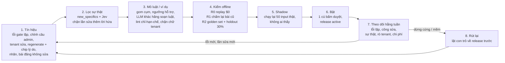

# Hệ thống viết tự học — học từ lỗi và từ chỉnh sửa của con người (CIS + Portal tenant)

Phiên S245, 20/10/2026. Tác nhân: Claude Code. Issue gốc: AA-729 (golden set). Loại tài liệu: bản tư vấn thiết kế
cho Nghiệp. **Chỉ đọc**: không truy vấn DB, không gọi LLM, không tạo issue Linear. Chi phí $0.

Nguồn: code AA-CIS-App `origin/main` 5486a0ee, `docs/architecture/db-schema-reference.md` (dump 20/10/2026 01:02 UTC,
số dòng là ước lượng `reltuples`), Linear (20/10/2026), audit AA-865 ([README](../2026-10-20-S245-f9-pooled/README.md)).
Ghi chú gốc (tiếng Anh) nằm ở `research/`. Ba phương án đầy đủ ở `research/options.json`, điểm giám khảo ở
`research/judges.json`.

## 0. Tóm tắt (6 dòng)

1. CIS đã có nhiều cổng chấm lỗi và vòng sửa (gate T10, sentence repair, flag_fix, Jev), nhưng **chưa có vòng học nào chạy được**: `shared.pipeline_lessons` ghi sai stage nên không bao giờ được đọc, còn N8 "mỗi lỗi thành luật" đã bị gỡ (AA-603).
2. Tín hiệu người sửa tốt nhất đã có là **chỉnh câu của admin** (trước/sau + gate + vấn đề, trong `audit_log`); có 3 chỗ người sửa mà **mất bản gốc hoặc lý do** (A1 sửa trường, tenant sửa T9, mọi approve/reject).
3. Fine-tune gần như không khả thi bây giờ (Bedrock Claude hết hạn, OpenAI đóng fine-tune 06/01/2027) và dữ liệu quá ít → **học trong prompt, không đổi trọng số mô hình**.
4. Khuyến nghị: **"Writing Memory v1"** — kho luật + kho ví dụ đã duyệt, mỗi lần bật đi qua replay $0 → golden set → shadow → một cú bấm duyệt; rút lại bằng một lệnh lật con trỏ.
5. Làm ngay **P0** (1 phiên, không phụ thuộc gì): đóng băng `pipeline_lessons` (đang là bẫy rò chữ tenant), lưu trước/sau mọi chỉnh sửa, chip lý do một cú bấm.
6. Khoảng **8 phiên agent**, **~$30–60/tháng** trên Dev, không thêm dịch vụ AWS; tenant chỉ thấy bài tốt hơn, không thấy QA; **15 quyết định** chờ Nghiệp (§13).

## 1. Hiện trạng: đã có gì

### 1.1 Bốn "người viết" và cổng chất lượng

| Người viết | Code chính | Bảng kết quả | Cổng / vòng sửa |
|---|---|---|---|
| **A1/S1 — tour Master** | `services/content_generation/graph.py`, `flag_fix_node.py`, `grounding.py`, `brand_audit_node.py`, `s1_batch.py` | `silver_aa_internal.generated_content` (~1.423), `quality_scores` (~1.432) | validate → judge → brand_audit (trả `lessons_extracted[]`) → grounding từng câu (Jev `a1_claim_supported`) → flag_fix chỉ sửa trường bị cờ; < 7 điểm vào `review_queue` (~229) |
| **T2 — tour giọng tenant** (AA-792) | `services/jobs/t2_rewrite_job.py`, `tenant_pipeline.py` | `gold_aa_internal.tenant_tour_versions` (~48) | Chạy **chung graph S1** (`stages.py`, AA-763) + T3 QA (`qa_status`, `qa_repair_count`) |
| **T8 — góc viết** | `services/acp_angle_gate/service.py` | `angle_gate_request` (~21), `angle_gate_option` (~57) | 3 góc, 1 góc đề xuất; tenant chọn (`chosen`) |
| **T9 — blog + social (LinkedIn, Facebook…)**, T11 đăng | `services/acp_content_writing/service.py`, `quality_gates.py`, `sentence_repair.py` | `acp_shared.content_piece` (~251) | ~27 gate F0–F19; 3 lượt, lượt 3 chỉ sửa câu; chặn hồi quy; `splice_checked`; `new_specifics` cấm thêm số/giờ; `gate_ledger`, `repair_log[]`, `discarded_attempts` (AA-791) |

Đầu vào thương hiệu chung T2/T8/T9: `render_brand_block()` (`brand_pack.py` L107) đưa style guide,
`forbidden_words` và `good_examples` (ví dụ tĩnh, chỉ lấy giọng) vào prompt.

Đang làm dở, liên quan trực tiếp:
- **AA-865 (F9 sticky pass)**: câu F9 đã duyệt thì giữ nguyên trạng thái trong cùng job; PR #868 mở rộng cho sửa kiểu
  chỉ xoá chữ. Tỉ lệ retry thêm lỗi chặn gộp 8/75 = 10,7%, replay fix (a) còn 6,7% (mục tiêu ≤ 8%).
- **AA-800 (signature vocabulary)**: PR #869 (chưa merge) thêm 3 lớp từ vựng: `PLATFORM_TRUTH` cấm mọi tenant, từ
  khen sáo rỗng tối đa 1 lần/bài, và `forbidden_words` riêng tenant luôn thắng. Đây là chỗ tự nhiên để gắn "luật từ
  vựng học được".

### 1.2 Các cơ chế "học" đã có — và tình trạng thật

| Cơ chế | Tình trạng | Vì sao |
|---|---|---|
| **A1 lessons (AA-132)** — `shared.pipeline_lessons`, chèn "LESSONS FROM PREVIOUS BATCHES" vào prompt S1 (`s1_batch.py` L108–121, `admin_pipeline.py` L560–583) | **Hỏng + nguy hiểm** | Ghi `stage='audit'` (`flag_fix_node.py` L733) nhưng đọc `S1_rewrite/S1_editor`; lệnh ghi gần như chắc chắn lỗi im lặng (`run_until_complete` trong executor). Dump: 0 insert, 1.956 lượt đọc index. Nội dung `what_to_do` chỉ là mẫu câu. Không cổng eval, không `tenant_id`, tự bật `is_active=true`. **Nếu ai đó "sửa" lệch stage, chữ của tenant (T2 dùng chung graph) sẽ vào một prompt toàn cục cho mọi tenant.** |
| **N8 flywheel / H-3 rule extractor** — `acp_shared.acp_output_rules`, `/v1/rules` | **Chết** | Gỡ cùng N7/N8 (AA-603). `acp_post_processor.py` chỉ test gọi. Bảng còn, route còn mount. |
| **Jev outcome (AA-756)** — `decision_log.outcome` | **Gần như rỗng** | Chỉ phía "approve" ghi truth=True; `record_rejected_outcome` chưa làm (AA-845). |
| **Prompt regression (AA-289)** — `shared.prompt_eval_runs` | **Chưa chạy trên schema hiện tại** | 0 insert; chỉ cho S1; fixture 20 tour nằm trên S3. |
| **Nhãn người (AA-791)** — `content_piece_label` | **Có khung, gần như chưa có nhãn** | 1 insert; gói 40 bài AA-783 chưa chấm. |
| **Brand rules** — `shared.tenant_brand_rules` (`voice_examples`, `good_examples`, `forbidden_words`, `version`) | Chạy, nhưng **tĩnh** | Người nhập tay; không học từ chỉnh sửa. |

### 1.3 Chỗ nào đã ghi lại chỉnh sửa của người, chỗ nào chưa

| Hành động của người | Lưu ở đâu | Có trước/sau? | Có lý do? |
|---|---|---|---|
| Admin chỉnh câu bài T9 (cắt / nhận gợi ý / tự viết) | `audit_log` `content_piece.admin_sentence_*` | **Có** (before, after, gate, problem, suggestion, mode) | Gián tiếp (gate + problem) |
| Admin chỉnh câu bản T2 (AA-802) | `audit_log` `tenant_tour_version.admin_sentence_*` | **Có** (câu, đoạn, cả bản) | Gián tiếp |
| Tenant sửa tour T2 trên portal | Bản mới `edit_source='tenant_edit'` + `parent_version_id` | **Có** (diff với bản cha) | Không |
| Góc T8 tenant chọn vs đề xuất | `angle_gate_option.chosen` / `recommended` | n/a | Không |
| Admin dán nhãn bài T9 | `content_piece_label` | Chỉ hash | **Có** (nhưng mới 1 nhãn) |
| **Admin sửa trường bản A1** | `generated_content.edit_diff` | **Không** — chỉ tên trường, bản AI bị ghi đè | Không |
| **Tenant sửa bài T9 ở My Content** | `audit_log` `content_piece.edited` | **Không** — chỉ `content_length`, chữ bị ghi đè | Không |
| **Mọi approve / reject / dismiss / regenerate** (A1 review queue, T2 tenant) | `review_status` / `status` | n/a | **Không**. Thực tế reviewer bấm Regenerate thay vì duyệt (S218: 196 dòng, 0 quyết định) |
| Lượt viết bị bỏ của T9 | `discarded_attempts` | Chỉ giữ **một** lượt | n/a |

Kết luận phần hiện trạng: nguyên liệu để học **có sẵn một nửa**. Thiếu ba thứ: (1) bản trước khi sửa ở A1 và T9 tenant,
(2) lý do ở mọi reject/cut/regenerate, (3) nhãn người. Và có **một cơ chế cũ phải tắt trước** khi làm gì khác.

## 2. Thế giới đang làm gì (10/2026)

| Cách làm | Khi nào dùng | Chi phí | Rủi ro chính |
|---|---|---|---|
| **Bộ nhớ luật/"playbook" từ lỗi** (ACE arXiv 2510.04618; Dynamic Cheatsheet arXiv 2504.07952) — luật ngắn, thêm/bớt từng mục, không viết lại cả khối | Lỗi lặp có quy luật; muốn hiệu quả ngay, không train | Rất thấp (vài lệnh LLM khi đúc luật; +token prompt) | "Sụp ngữ cảnh": prompt phình, luật mâu thuẫn — đúng hình dạng `pipeline_lessons` hôm nay. Phải có trần số luật + cổng eval |
| **Truy xuất ví dụ đã duyệt (dynamic few-shot)** (Liu et al. 2101.06804; Anthropic: 3–5 ví dụ) | Học **giọng** từng tenant; ít dữ liệu vẫn chạy | Thấp (embedding một lần + token) | Ví dụ mang **sự thật của tour khác** vào bài; rò chéo tenant (OWASP LLM08:2025). Cần che thực thể + lọc `tenant_id` |
| **Học từ diff chỉnh sửa** (PRELUDE/CIPHER NeurIPS 2024; PREDICT 2410.06273; LAMP CHI 2025) — suy ra "sở thích" bằng lời từ các lần sửa, kiểm trên nhiều lần sửa trước khi tin | Có nhiều cặp trước/sau; muốn "học cách viết khi con người sửa" | Thấp | Khái quát quá từ một lần sửa / một người sửa; người sửa có thể **thêm** lời hứa nguồn không có |
| **Tối ưu prompt tự động trên tập eval** (GEPA ICLR 2026; DSPy MIPROv2; OPRO; TextGrad) | Có golden set ≥ 35–100 mẫu + giám khảo đáng tin | Trung bình ($10–60/lượt chiến dịch) | Overfit tập eval; prompt tối ưu tệ hơn ở input lạ. Cần holdout + người xem từng prompt |
| **Hiệu chỉnh giám khảo LLM bằng nhãn người** (MT-Bench; EvalGen; Panickssery et al.) | Trước khi để giám khảo quyết định bật/tắt | Thấp | Giám khảo cùng hãng ưu ái bài của chính nó; "trôi tiêu chí". Dùng giám khảo khác hãng + κ ≥ 0,6 |
| **Fine-tune SFT/DPO/RFT** (SALT, "post-edits are preferences") | ~1k–10k cặp sạch / tác vụ, trên mô hình chịu dùng làm writer | Train rẻ (~$22 cho gpt-4.1-mini 500 tour) nhưng... | **Không khả dụng thực tế**: Bedrock chỉ cho fine-tune Claude 3 Haiku (EOL 10/09/2026); OpenAI đóng fine-tune cho org mới từ 07/05/2026, đóng hẳn 06/01/2027; Nova/Qwen/gpt-oss = đổi writer, khác region. Fine-tune trên dữ liệu có sự thật mới **tăng ảo giác** (Gekhman EMNLP 2024) |

Điểm chung của các nhóm làm tốt: **dữ liệu + eval + bộ nhớ nằm trong DB của mình**, không khoá vào nền tảng của hãng
(OpenAI Evals đóng 30/11/2026). Mọi thay đổi đi qua eval gate trước khi bật.

## 3. Ba phương án

| | **A. Writing Memory v1** | **B. Golden-gated Writer Optimiser (GWO)** | **C. Writer Flywheel** |
|---|---|---|---|
| Ý tưởng | Kho **luật** (từ lỗi lặp + diff người sửa) + kho **ví dụ** đã duyệt theo tenant; bật theo **release** có cổng | Đo trước; tách prompt thành "slot"; tối ưu kiểu GEPA trên golden set; bấm để promote | Ghi nhận trước; học nhiều lớp L0 (từ vựng) → L3 (ví dụ, sở thích tenant), L4 GEPA offline, L5 fine-tune khi đủ dữ liệu |
| Dùng điểm chèn có sẵn | Có (lessons append, `render_brand_block`, `_repair_feedback`, lớp AA-800) | Không — phải refactor mọi prompt A1/T2/T9 thành slot | Phần lớn có |
| Học giọng tenant | Có (ví dụ k=3 lọc theo tenant) | Muộn (P4, ví dụ là tuỳ chọn) | Có (ví dụ + tóm tắt sở thích kiểu CIPHER) |
| Cải thiện đầu tiên chạm bài viết | ~phiên 4 (phải chờ AA-729) | ~phiên 5–7 | ~phiên 3–4 |
| Bảng mới / sửa | 4 mới + 2 nới CHECK | ~8–9 | ≥4 + export S3 |
| Trang admin | 5 tab | 6 khu (Writer Lab) | 6 tab |
| Fine-tune | Không | Không (giữ dữ liệu để sau) | Có điều kiện (L5, $160–400/lượt, xuất JSONL ra S3) |
| Chi phí/tháng (Dev) | $30–50 | $30–70 | $35–80 |
| Công | ~6 phiên (giám khảo: thực tế ~8) | 7–8 phiên | 7–8 phiên |
| Điểm mạnh | Rẻ, nhanh, rút lại bằng một lệnh; phát hiện đúng bẫy `pipeline_lessons` | Kỷ luật eval tốt nhất (κ, holdout, DB trigger) | Lớp L0 từ vựng chứng minh bằng replay $0; "không gì tự bật" |
| Điểm yếu | Release tenant tự bật trong dev; chưa có ngưỡng κ cho giám khảo | Chậm, nặng; tối ưu trên rất ít dữ liệu dễ overfit | Phạm vi quá rộng; đường fine-tune + S3 thêm mặt rủi ro dữ liệu tenant không cần bây giờ |

## 4. Điểm giám khảo

Hai giám khảo độc lập, thang 1–5 mỗi tiêu chí (chất lượng tăng, an toàn, chi phí, thời gian ra giá trị, vận hành).

| Phương án | Giám khảo 1 (góc chị Thư / sản phẩm) | Giám khảo 2 (góc kỹ thuật / an toàn) | Tổng |
|---|---|---|---|
| **A. Writing Memory v1** | **19** (4/4/4/4/3) | **21** (4/5/4/4/4) | **40** |
| C. Writer Flywheel | 16 (4/4/3/3/2) | 16 (4/3/3/3/3) | 32 |
| B. GWO | 15 (3/5/3/2/2) | 15 (4/4/3/2/2) | 30 |

Cả hai giám khảo chọn **A**. Cả hai cũng chỉ ra cùng một điểm yếu: A chờ AA-729 nên luật đầu tiên chạm bài muộn,
và cho release tenant tự bật quá sớm. Phần ghép ở §5 sửa đúng hai điểm này.

## 5. KHUYẾN NGHỊ: Writing Memory v1 + 9 ý ghép

### 5.1 Phương án thắng, nói ngắn

Một vòng học dùng chung cho cả 4 người viết (A1 Master, T2 tour tenant, T9 blog, T9 social). Trọng số mô hình không
đổi. Thứ được học là **bộ nhớ viết** gồm hai loại mục:

- **Luật** — câu lệnh ngắn hoặc mục từ vựng, đúc từ lỗi gate lặp lại và từ diff người sửa. Ba loại:
  `lexicon` (cấm/thay cụm từ, không cần LLM), `writer_instruction` (một dòng trong khối "HOUSE RULES", tối đa
  12 dòng nền tảng + 8 dòng tenant), `repair_hint` (chỉ chèn khi gate tương ứng báo lỗi).
  **Luật chỉ được hạn chế** (cắt, cấm, đổi cách nói, định dạng), lint tự động từ chối mọi luật bảo "hãy nêu dịch vụ X".
- **Ví dụ** — đoạn văn đã được duyệt, **che thực thể** (tên nơi, số, giờ, giá, dịch vụ → `[PLACE]`, `[N]`…), lấy
  3 đoạn gần nhất theo người viết + kênh + **đúng tenant**, chèn với nhãn "chỉ học giọng, không dùng lại sự thật nào".

Mỗi mục có **phạm vi**: `platform` (không bao giờ chứa chữ của tenant) hoặc `tenant` (chỉ dùng cho tenant đó, RLS).
Thứ tự ưu tiên: luật brand tenant tự viết > luật tenant học được > luật nền tảng; **cổng sự thật (F1/F17/F9_cta_fact,
Jev) đứng trên tất cả**.

Không mục nào tới tay người viết một mình: chúng đi trong một **release** (gói có version theo người viết). Release
chỉ bật khi qua đủ cổng và có một cú bấm duyệt; rút lại = đưa con trỏ "active" về release trước, không cần deploy.

### 5.2 Chín ý ghép từ B và C (đã được hai giám khảo đề xuất)

1. **Đường nhanh L0 — từ vựng** (từ C): cụm từ admin đã cắt ≥ N lần thành luật `lexicon`, chứng minh bằng **replay
   $0** trên chữ + ledger đã lưu, gắn vào lớp AA-800 (sau PR #869). Không cần chờ AA-729 → chị Thư thấy "không còn viết
   X nữa" từ ~phiên 2–3 thay vì phiên 4.
2. **Không gì tự bật** (từ C): mọi release, kể cả release tenant, cần một cú bấm của Nghiệp/admin. Ghi trong ADR như
   một bất biến có ngày; xem lại khi có tenant thật.
3. **Cổng hiệu chỉnh giám khảo** (từ B): giám khảo chỉ được tính vào "dừng cứng/mềm" khi Cohen's κ ≥ 0,6 so với nhãn
   Nghiệp neo (AA-783); dưới mức đó chỉ để tham khảo. Kiểm lại khi đổi model/rubric.
4. **KPI "edit-pair replay hit rate"** (từ B): người viết còn tạo ra đúng mẫu mà người đã xoá không? Đây là con số dễ hiểu
   nhất để cho chị Thư thấy hệ thống "học từ chỉnh sửa", và đo được ngay trên golden set trước khi có tenant thật.
5. **Lưu mọi lượt viết T9** (từ B, gap G4): chữ + ledger từng lượt, không chỉ một lượt bị bỏ.
6. **Golden set thành bảng thật** (từ B): `eval_golden_set`, `eval_golden_item` (tune/holdout, tầng, bẫy, tenant),
   `eval_item_result` — thay vì nhét hết vào `prompt_eval_runs.details`. Thêm trạng thái release `reverify` khi đổi
   golden set, route model hoặc taxonomy gate (AA-787): release vẫn chạy nhưng bị cờ, R2 chạy lại **chờ duyệt**.
7. **Helper `record_writer_feedback`** (từ C): ghi tín hiệu trong cùng transaction với thao tác sửa; kiểm sự thật chạy
   bất đồng bộ (`pending/grey/pass/fail`), không thêm lệnh LLM vào đường request. Thêm bản đồ alias gate để luật
   không mồ côi khi AA-787 đổi tên gate (27 → ~18).
8. **Luật dữ liệu** (từ B): repo AA-CIS-App là public → golden fixture, cặp sửa, ví dụ chỉ ở DB / S3 bronze; test trong
   repo dùng fixture giả. Xoá dữ liệu học của tenant khi offboard (quy trình DRY RUN). Đăng ký kho mới vào AI Use
   Register (AA-804).
9. **Tóm tắt sở thích tenant kiểu CIPHER** (từ C, P4): ≤ 5 câu bằng lời, đúc từ các lần sửa đã qua lọc sự thật của
   chính tenant. Rẻ hơn ví dụ và chạy được với rất ít lần sửa — hợp với Dev hiện tại (4 tenant thử, ~48 bản T2).
   Kèm một ô "số cặp sạch / người viết" trên tab Metrics để giữ cửa fine-tune sau này, **không** xây đường export.

### 5.3 Những chỗ sửa so với bản gốc của phương án A (giám khảo 2 kiểm dump)

- `acp_shared.audit_log.id` là **uuid**, `audit_log.tenant_id` là **varchar(50)** → `writing_signal.audit_log_id` phải
  là uuid và backfill phải ép kiểu tenant_id.
- `gold_aa_internal.tenant_tour_versions` **không có** cột metadata/writer_input (jsonb duy nhất là `rewritten_content`)
  → cần migration thêm `generation_meta jsonb NULL` để đóng dấu release cho T2.
- Bảng mới chứa chữ tenant trong schema `shared`: phải nói rõ `cis_app` có bỏ qua RLS không; chọn hoặc `FORCE ROW LEVEL
  SECURITY`, hoặc mô hình như `audit_log` (chỉ cis_app, lọc tenant trong code) + test.
- Ngân sách theo **tháng**, không chỉ theo lượt (6 người viết × lớp tenant × R2 + shadow có thể vượt $15/lượt).
- Thống kê: ≤ 50 cặp trên Dev thường không đủ ý nghĩa → quy tắc promote dự phòng: **không kém hơn ở mọi dừng cứng + cải
  thiện cùng chiều, gộp qua nhiều vòng** (như AA-865).
- ADR app không đặt tên "0009" trùng nghĩa với ADR hệ sinh thái 0009 đã giữ chỗ (AI platform, AA-804); đặt tiêu đề riêng
  và trích dẫn nó.
- Công: ~8 phiên chứ không phải 6.

### 5.4 Sơ đồ vòng học



Bản ASCII (cho chỗ không vẽ được mermaid):

```
 tín hiệu ─► lọc sự thật ─► mỏ luật/ví dụ ─► R0 $0 ─► R1 ─► R2 golden+holdout ─► shadow ─► [bấm duyệt] ─► BẬT
    ▲                                                                                                  │
    │                                                                                   theo dõi hằng tuần
    └──────────────── lỗi mới / lần sửa mới ◄──────────── RÚT LẠI (lật con trỏ) ◄── dừng cứng/mềm ◄────┘
```

Đường nhanh L0: luật `lexicon` chỉ cần R0 ($0) + cú bấm, bỏ qua R2/shadow (luật từ vựng là tất định, replay đã đủ chứng minh).

### 5.5 Mỏ luật hoạt động thế nào

- **Bảng tín hiệu chuẩn hoá** `shared.writing_signal`: mỗi dòng = người viết, kênh, tenant (NULL với A1), trường/đoạn,
  trước/sau, gate, chip lý do, ai sửa (admin/tenant/system), kết luận sự thật. Backfill một lần từ `audit_log`
  admin_sentence_*, diff T2 cha/con, `discarded_attempts`/`repair_log`, `quality_scores.lessons_extracted`.
- **Job `writing_memory_mine`** (bảng `shared.job`, hằng tuần + bấm tay): gom cụm theo (người viết, gate/lý do, mẫu từ
  ngữ) → ngưỡng: luật tenant ≥ 2 lần sửa trên ≥ 2 bài của tenant đó; luật nền tảng ≥ 3 tenant khác nhau, hoặc ≥ 2 reviewer
  ở A1, hoặc lỗi gate lặp ≥ 5% bài trong 30 ngày → một lệnh LLM **khác hãng** (OpenAI soạn luật cho writer Claude, tránh
  tự ưu ái) cho mỗi cụm, tối đa 50/lượt → kiểm kiểu PREDICT: luật phải giải thích được ≥ 2 lần sửa giữ lại trong cùng cụm.
- **Luật nền tảng** từ mẫu của tenant chỉ được nâng lên khi viết lại thành câu chung, ví dụ lấy từ chữ A1 hoặc tự tạo;
  kiểm trùng 5-gram với kho chữ của mọi tenant + tên brand + forbidden words; Nghiệp duyệt từng luật.

## 6. Áp cho từng loại bài

| Loại bài | Tín hiệu chính | Luật chèn vào đâu | Ví dụ (exemplar) | Lưu ý riêng |
|---|---|---|---|---|
| **Tour Master (A1/S1)** | `quality_scores.failure_codes / brand_audit_codes / lessons_extracted`; flag_fix; admin sửa trường (sau P0 có trước/sau); Regenerate + chip lý do; chip `fact_not_in_source` → Jev | Khối HOUSE RULES **thay** "LESSONS FROM PREVIOUS BATCHES" (`s1_batch.py`, `admin_pipeline.py`); `repair_hint` cho flag_fix | Chỉ ví dụ nền tảng (A1 không có tenant) | Chỉ có luật nền tảng. Cổng: không thêm lỗi B-class trên tầng "fact-dense" và "tour dài ≥ 9 ngày" của golden set |
| **Tour tenant (T2)** | Diff `tenant_edit` cha/con; admin chỉnh câu T2 (AA-802); T3 QA | Release riêng khoá `t2_tour` (dù chung graph S1 — luật A1 chỉ áp cho T2 khi được đưa vào và chấm trên tầng T2) | k=3 theo tenant, fallback ví dụ nền tảng khi tenant < 3 | Cần migration `generation_meta` để đóng dấu release. Lời hứa tenant tự thêm (vd. "lunch included") bị cách ly, không thành ví dụ |
| **Social (T9 LinkedIn/Facebook)** | `gate_ledger` (F14_social_shape, F14_first_line, F15_voice, F2…); admin chỉnh câu; tenant sửa ở My Content (sau P0) | `render_brand_block` + `_repair_feedback`; luật `lexicon` vào lớp AA-800 / gate từ vựng AA-787 | k=3 theo tenant + kênh | Bài ngắn → luật từ vựng và "dòng mở đầu" có tác dụng lớn nhất; nên là nơi bật L0 đầu tiên |
| **Blog (T9 blog)** | Như social + F7/F16 FAQ, F5, F18, F19; `minutes_to_fix` từ nhãn | Như social | k=3 theo tenant + kênh, theo đoạn (không cả bài) | Golden set tầng blog 15 mẫu; đo `minutes_to_fix` (~5 phút/blog theo gói AA-783) |

Ghi chú T8 (góc viết) và slate: giữ tín hiệu `chosen` vs `recommended`, chưa khai thác ở v1 (thiếu lý do).

## 7. Giao diện cần thêm

**Admin (UI kit `app/_kit`, kiểm bằng skill aa-ui-verify):**

- Trang mới **`/admin/writing-memory`**, 5 tab:
  - *Signals*: cụm lỗi/sửa lặp theo người viết, kênh, tenant; số lượng, xu hướng, mẫu trước/sau.
  - *Candidates*: luật nháp kèm nguồn gốc (link tới bài gốc), độ hỗ trợ, phạm vi, kết luận sự thật, kết quả lint;
    nút sửa / từ chối / gửi replay.
  - *Exemplars*: kho ví dụ theo tenant × người viết × kênh; nút ghim / loại (kèm lý do).
  - *Releases*: nháp → báo cáo eval (R0/R1/R2, thống kê cặp, isolation probe, chi phí) → shadow đặt cạnh nhau →
    **Duyệt** → Bật / Rút lại một cú bấm; công tắc tắt theo người viết.
  - *Metrics*: KPI §8 theo người viết và tenant; ô "số cặp sạch".
- **Drawer Content Quality** (bài T9, bản T2): **nút sửa + chip lý do** khi áp câu — chip chọn sẵn theo gate bị cờ, xác
  nhận là một cú bấm: `fact_not_in_source`, `optional_as_included`, `wrong_place_or_time`, `voice_off_brand`,
  `ai_phrasing`, `format_channel`, `repair_residue`, `style_only`. Thêm "Dùng làm ví dụ" / "Không bao giờ dùng làm ví
  dụ". Drawer nhãn `PieceLabel.tsx` dùng cho cả bản T2.
- **A1 review / chi tiết tour**: chip lý do trên Regenerate, Reject, Dismiss; lưu trước/sau khi sửa trường; huy hiệu
  "đã học từ lần sửa này" khi một luật trích dẫn nó; drawer nhãn mở rộng cho A1.
- **Tenant 360**: thẻ "Voice memory" (luật tenant đang bật, số ví dụ, release gần nhất, xu hướng tỉ lệ tenant sửa).

**Tenant portal: không thêm gì về QA.** Tenant sửa trực tiếp như hôm nay (T2 sửa inline, T9 My Content); hệ thống ghi
nhận phía server, tenant không thấy luật, gate, điểm, release hay chip. Tenant chỉ nhận ra bài sau cần sửa ít hơn.
Câu hỏi tuỳ chọn "Lần sau nên đổi gì?" là quyết định sản phẩm riêng (D7), mặc định tắt.

## 8. Đo lường và tiêu chí dừng

### 8.1 KPI

| Nhóm | Chỉ số | Nguồn | Mục tiêu |
|---|---|---|---|
| **Học từ lỗi** (sao bắc đẩu) | Tỉ lệ lỗi lặp: % bài mới chạm một cụm đã có luật active | `writing_signal` × dấu `rule_ids` | Giảm qua từng release |
| **Học từ người sửa** | Edit-pair replay hit rate; khoảng cách sửa chuẩn hoá; tỉ lệ tenant sửa (T2 `tenant_edit`, T9 sự kiện sửa); số lần admin áp câu / 100 bài; `minutes_to_fix` median/p90; regenerate / tour A1 | golden set, `writing_signal`, `content_piece_label` | Giảm |
| Chất lượng | Tỉ lệ "sửa nhẹ trở xuống" | nhãn người, hoặc đa số panel AI khi chưa đủ nhãn | ≥ 60% (r5 đạt 70%) |
| **Sự thật** (không khoan nhượng) | Lỗi B-class / 100 bài trên tầng fact; ca C1; tỉ lệ chặn F1/F17/F9_cta_fact | golden set, `/admin/content-quality/stats` | Không tăng (0 lỗi mới) |
| Cách ly tenant | Isolation probe (n-gram tenant A trong bài tenant B); F10 ≥ 0,92 | R2 | 0 |
| Sức khoẻ vòng | Re-flag rate (n ≥ 60, Wilson 95%); độ đầy đủ ghi nhận (≥ 80% sự kiện admin có chip lý do); phễu ứng viên (đề xuất → R0 → R2 → holdout → bật → rút lại) | AA-865 pattern | ≤ 8%; ≥ 80%; tỉ lệ rút lại > 20% = cổng quá lỏng |
| Chi phí | $/bài theo stage; chi tiêu vòng học / tháng; token prompt thêm | `llm_call_log` | ≤ +20% / bài; ≤ trần tháng |

Phương pháp: so cặp trên cùng phiên bản fixture (McNemar cho nhị phân, Wilcoxon cho phút/điểm), Wilson 95%, gộp qua
nhiều vòng như AA-865, báo cáo theo từng tenant lẫn gộp, holdout 30% phải đồng thuận. **Đo baseline AA-729 trước
release đầu tiên.**

### 8.2 Tiêu chí dừng

**Dừng cứng — tự rút lại ngay (một điều là đủ):**
1. ≥ 1 lỗi B-class hoặc C1 **mới** trên tầng fact của golden set so với release trước (cùng logic AA-865 đã loại fix (b)
   vì ca #13 "ngủ đêm" thành "dừng ăn trưa").
2. Bất kỳ chữ có nguồn từ tenant A xuất hiện trong bài của tenant B (n-gram hoặc F10 ≥ 0,92).
3. Bất kỳ dấu vết QA (mã gate, thẻ trích dẫn, chữ của luật) lọt vào chữ tenant thấy.

**Dừng mềm — rút lại trừ khi Nghiệp ghi lý do giữ:** re-flag > 8% gộp hoặc +3 điểm; "sửa nhẹ trở xuống" −10 điểm hoặc
< 60%; `minutes_to_fix` +20%; tỉ lệ tenant sửa tăng; chi phí/bài +20%; độ ổn định giám khảo F9 giảm (phép so sánh mất giá
trị).

**Promote:** chỉ số chính tốt lên (hoặc giữ nguyên khi chi phí giảm), không dừng nào bật, holdout đồng thuận, giám khảo
dùng để quyết đã qua κ ≥ 0,6. Khi mẫu Dev quá ít để có ý nghĩa thống kê: không kém ở mọi dừng cứng + cải thiện cùng chiều
gộp qua ≥ 2 vòng.

**Tiêu chí dừng cả dự án** (để không xây tiếp vô ích): sau P3, nếu 2 release liên tiếp không giảm được tỉ lệ lỗi lặp
hoặc edit-pair hit rate trên golden set → dừng ở P3, giữ P0 (ghi nhận) + L0 (từ vựng), không làm P4/P5.

## 9. Kế hoạch theo pha (phiên agent)

| Pha | Nội dung | Phiên | Phụ thuộc | Xong khi |
|---|---|---|---|---|
| **P0 — Cầm máu + ghi lại việc người làm** | Đóng băng `pipeline_lessons` (đếm chính xác trước, tắt ghi + đọc sau flag); T9 tenant sửa lưu trước/sau phía admin; A1 sửa trường lưu trước/sau; chip lý do (sentence apply, Regenerate, Reject, Dismiss, T2 admin reject); `fact_not_in_source` → `record_outcome(truth=False)` (AA-845 a); đóng dấu `writer_prompt_version` T2/T9; lưu mọi lượt T9; helper `record_writer_feedback`; ADR app; CONTEXT.md; lesson trong `skill/aa-lessons/lessons.md` | 1 | Không | 0 đọc/ghi mới `pipeline_lessons` trên Dev; một lần sửa T9 tenant và một lần sửa A1 có bằng chứng trước/sau (curl + dòng DB); chip vào `audit_log.details`; deploy + verify theo aa-ship |
| **P1 — Kho tín hiệu + mỏ luật** | Migration `writing_signal`, `writing_rule` (RLS, CHECK phạm vi); backfill; lọc sự thật; job `writing_memory_mine`; tab Signals + Candidates; seed `llm_role_config` | 1–1,5 | P0 | Số backfill theo nguồn + tenant; 1 lượt mine ≤ $1; test: lint từ chối luật "include X", chặn 5-gram, tín hiệu tenant A không bao giờ thành luật nền tảng |
| **P1b — Đường nhanh L0 (từ vựng)** | Release chỉ-từ-vựng, R0 replay $0 trên chữ + ledger đã lưu, cú bấm duyệt; gắn lớp AA-800 | 0,5 | P1, PR #869 merge | Một release L0 bật cho T9 social, replay chứng minh giảm lỗi mục tiêu, 0 dừng cứng |
| **P2 — Eval + release** | Bảng golden set (set/item/item_result); nới `prompt_eval_runs`; bảng `writing_memory_release` (+ CHECK active cần eval + shadow), `writing_memory_shadow`; runner R0/R1/R2; isolation probe; grep dấu vết QA; shadow replay 50 input; cổng κ giám khảo; tab Releases; đo **release 0** (bộ nhớ rỗng) | 1–1,5 | **AA-729**, AA-783 (nhãn neo) | Release 0 tái lập số baseline; CHECK từ chối release thiếu eval; diễn tập rút lại: job kế tiếp dùng release cũ (chứng minh bằng dấu writer_input) |
| **P3 — Chèn luật vào mọi người viết** | A1 HOUSE RULES thay lessons append; T2 release riêng + migration `generation_meta`; T9 qua `render_brand_block` + repair hint; trần token; dấu `rule_ids` | 1 | P2 | Release 1 active cho ≥ 1 người viết: lỗi mục tiêu giảm trên golden + holdout, 0 B-class/C1 mới, 0 rò tenant, chi phí ≤ +20% |
| **P4 — Ví dụ + sở thích tenant** | `writing_exemplar` + ivfflat; che thực thể; thu từ tín hiệu duyệt; k=3 lọc tenant thay slot `good_examples` tĩnh; tóm tắt sở thích CIPHER ≤ 5 câu; tab Exemplars | 1 | P3 | R2 cặp cho thấy giảm khoảng cách sửa với ≥ 1 người viết tenant, 0 sự thật mang sang; test đặt `app.tenant_id` tenant khác → 0 dòng |
| **P5 — Đo, bảo trì, khép vòng người** | Job KPI hằng tuần + tab Metrics, tự rút lại khi dừng cứng; hết hạn luật 60 ngày; drawer nhãn cho T2 + A1; hàng đợi bất đồng 5–10 mục/tuần; DRY RUN xoá `pipeline_lessons`, `acp_output_rules`, `/v1/rules`, `acp_post_processor.py`; xoá dữ liệu học khi offboard tenant; runbook | 1 | P4 | 2 báo cáo tuần tự động; 1 luật hết hạn được job đánh dấu; xoá bảng chết có bằng chứng DRY RUN; xu hướng KPI ghi vào `docs/audits/` |

Tổng: **~7–8 phiên**. Có thể bắt đầu P0 ngay phiên sau; P0 và P1 không phụ thuộc AA-729.

### 9.1 Issue Linear đề xuất (CHƯA tạo — chờ D14)

Project đề xuất: "CIS Core — Pipeline, LLM & Platform" (kiểm còn < 100 issue chưa lưu trữ trước khi tạo). Tiêu đề
tiếng Anh theo quy ước:

| # | Pha | Tiêu đề đề xuất |
|---|---|---|
| 1 | P0 | [Writing memory] Freeze the ungated pipeline_lessons loop (stage mismatch; T2 shares the graph, so tenant text would leak into a global prompt) |
| 2 | P0 | [Writing memory] Capture before/after on tenant T9 piece edits (admin-side only) |
| 3 | P0 | [Writing memory] Capture per-field before/after on admin A1 generated_content edits |
| 4 | P0 | [Writing memory] One-click reason chips on sentence apply, A1 Regenerate/Reject/Dismiss and T2 admin reject; fact_not_in_source writes Jev record_outcome(truth=False) |
| 5 | P0 | [Writing memory] Persist every T9 attempt (text + ledger) and stamp writer_prompt_version on T2/T9 |
| 6 | P0 | [ADR] CIS app ADR: governed writing memory (rules + exemplars, release-gated, no fine-tuning); supersedes AA-132 lessons and AA-99 output rules |
| 7 | P1 | [Writing memory] Migration: shared.writing_signal + shared.writing_rule (RLS, scope CHECKs) + record_writer_feedback helper + backfill |
| 8 | P1 | [Writing memory] Mining job: cluster, thresholds, cross-vendor rule draft (≤50 calls), constraint-only lint, PREDICT validation, no-tenant-text guard |
| 9 | P1 | [Admin UI] /admin/writing-memory: Signals and Candidates tabs |
| 10 | P1b | [Writing memory] L0 lexicon fast path: replay-proven ($0) lexicon releases into the AA-800 vocabulary layers |
| 11 | P2 | [Eval] First-class golden set tables + widened prompt_eval_runs + writing_memory_release/shadow with activate-requires-eval CHECK |
| 12 | P2 | [Eval] R0/R1/R2 memory eval runner, holdout, isolation probe, QA-artefact grep, judge κ gate; baseline release 0 |
| 13 | P2 | [Eval] Shadow replay job + Releases tab (report, approve, activate, rollback, kill switch) |
| 14 | P3 | [Writers] Inject the active release into A1, T2 (generation_meta migration) and T9, with caps and rule_ids stamps |
| 15 | P4 | [Writing memory] Entity-masked exemplar pool + tenant-filtered k=3 retrieval + CIPHER tenant preference summaries |
| 16 | P5 | [Writing memory] Weekly KPI job + Metrics tab, auto-rollback on hard stops, rule expiry, disagreement queue |
| 17 | P5 | [Labels] Extend PieceLabel / content_piece_label to T2 versions and A1 tours |
| 18 | P5 | [Data] DRY-RUN retirement of pipeline_lessons, acp_output_rules, /v1/rules, acp_post_processor.py; offboarding deletion of learned tenant data |

Liên kết (blocker/related) với issue đã có: AA-729, AA-783, AA-845, AA-803, AA-787, AA-800 (PR #869), AA-865 (PR #868),
AA-804 (AI Use Register). Tìm Linear 20/10/2026 với "lesson"/"exemplar": chưa có issue nào cho vòng này.

## 10. Chi phí

| Hạng mục | Ước tính |
|---|---|
| Hạ tầng mới | **$0** — dùng lại RDS/pgvector, worker `shared.job`, LLMClient, Bedrock acc3, OpenAI. Không dịch vụ AWS mới |
| Baseline AA-729 (một lần) | ~$8,6–10,4, trần $15 |
| Mine luật | ≤ 50 lệnh giám khảo/lượt, ~$0,3–1/lượt → ~$2–4/tháng |
| R2 golden eval | ≤ $15/lượt, thường $3–10 khi chỉ chạy tầng bị ảnh hưởng; 2–3 release/tháng → ~$10–30 |
| Shadow replay | ≤ 50 input × $0,05–0,10 → ~$5–10 / release |
| R0, R1, embedding | ~$0–2 |
| **Tổng Dev** | **~$30–50/tháng**, đề xuất **trần $60/tháng** (D8) để có chỗ cho R2 chạy lại khi AA-787 đổi gate hoặc đổi route model |
| Thêm vào mỗi bài khi chạy thật | ≤ 20 dòng luật + 3 ví dụ ≈ 1,5k token đầu vào ≈ +$0,005/lệnh ≈ **+3–8%** chi phí bài S1 ($0,048–0,06) và T9 ($0,094–0,104). Prompt caching có thể giảm; acc3 đã bật caching chưa: chưa biết |
| Fine-tune | $0 (ngoài phạm vi) |

Mọi lệnh đi qua `LLMClient` và ghi `shared.llm_call_log` (stage `writing_memory_mine`, `memory_eval`, `memory_shadow`).
Lượt trả tiền theo luật `paid-runs-subset`: thử ~3 rồi ≤ ~50; không chạy khi còn PR backend chưa merge hoặc bảng job bận.

## 11. Rủi ro

| Rủi ro | Giảm thiểu |
|---|---|
| **Bẫy cũ**: ai đó "sửa" lệch stage của `pipeline_lessons` → bật prompt toàn cục không cổng, không tenant, có chữ T2 | Đóng băng ở P0, ghi lesson, sau đó xoá bảng (DRY RUN) |
| **Sai sự thật qua bộ nhớ**: ví dụ mang sự thật tour khác; tenant sửa thêm lời hứa | Che thực thể, nhãn "chỉ học giọng", cách ly `adds_unsourced_claim`, lint chỉ-hạn-chế, Jev, dừng cứng B-class. Rủi ro còn lại: che sót thực thể lạ → kiểm n-gram mang sang ở R2 |
| **Rò chéo tenant** qua luật nền tảng | Ngưỡng ≥ 3 tenant, chặn 5-gram + tên brand, Nghiệp duyệt, RLS, isolation probe là dừng cứng |
| **Ít tín hiệu trên Dev** (4 tenant thử, ~48 bản T2, ~251 bài T9, 1 nhãn) | Luật nền tảng từ lỗi gate + A1 trước; ngưỡng là config; L0 từ vựng và tóm tắt CIPHER chạy được với ít dữ liệu |
| **Băng thông người duyệt** (Nghiệp gần như duy nhất; tài khoản `trang` đã tắt) | Duyệt = một cú bấm trên báo cáo; hàng đợi bất đồng ≤ 30 phút/tuần; thời gian team chị Thư hỏi ở §14 |
| **Phình prompt / mâu thuẫn với brand pack** | Trần dòng theo người viết, xếp hạng theo hỗ trợ × hiệu quả, hết hạn 60 ngày, thứ tự ưu tiên rõ |
| **Overfit golden set hoặc một người sửa**; trôi tiêu chí | Holdout 30% không bao giờ dùng để mine, ≥ 2 reviewer/tenant cho luật nền tảng, giữ nguồn gốc, hiệu chỉnh lại giám khảo |
| **Giám khảo tự ưu ái** | Giám khảo khác hãng soạn/chấm luật; Jev giữ phần sự thật; cổng κ |
| **Chuỗi phụ thuộc** (AA-729, AA-783, AA-845, AA-787, PR #869, PR #868) | P0, P1, L0 không phụ thuộc AA-729; alias gate cho AA-787; trạng thái `reverify` |
| **Graph dùng chung A1/T2** | Release khoá theo người viết; luật A1 chỉ áp T2 khi được đưa vào và chấm trên tầng T2 |
| **Repo public** | Dữ liệu thật chỉ ở DB/S3 bronze; test dùng fixture giả |

## 12. Vì sao không fine-tune (bây giờ)

- Bedrock: chỉ Claude 3 Haiku từng fine-tune được, đã EOL 10/09/2026; Nova/Llama/Qwen/gpt-oss = đổi writer, phải đưa dữ
  liệu sang us-east-1/us-west-2.
- OpenAI: đóng fine-tune cho org chưa từng fine-tune từ 07/05/2026, đóng hẳn 06/01/2027; AA có đủ điều kiện không: chưa biết.
- Dữ liệu: vài trăm cặp, phần lớn chưa sạch; fine-tune trên dữ liệu có sự thật mới làm tăng ảo giác.
- Giữ cửa: `writing_signal` trung lập nhà cung cấp + ô "số cặp sạch". Xem lại khi ≥ 1k cặp sạch đã qua lọc sự thật / người
  viết, và chỉ trên mô hình chịu dùng làm writer. Dùng chữ tenant để huấn luyện là quyết định kinh doanh của chị Thư.

## 13. QUYẾT ĐỊNH cần Nghiệp

Trả lời ngắn theo mẫu "D1 có, D6 a…". Khuyến nghị in đậm.

| # | Câu hỏi | Trả lời | Khuyến nghị |
|---|---|---|---|
| D1 | Chọn phương án A "Writing Memory v1" + 9 ý ghép ở §5.2 làm hướng đi? | có / không | **có** |
| D2 | Không fine-tune trong v1; xem lại khi ≥ 1k cặp sạch / người viết? | có / không | **có** |
| D3 | Đóng băng `shared.pipeline_lessons` ngay ở P0 (đếm dòng chính xác, tắt ghi + đọc sau flag)? | có / không | **có** (ưu tiên cao nhất) |
| D4 | Chốt AA-729 theo memo (golden set 100 mẫu, ~$8,6–10,4, trần $15: a / có / có) và chạy trước P2? | có / không | **có** |
| D5 | AA-845 phương án (c): ~100 câu panel gán nhãn bây giờ, rồi chip `fact_not_in_source` là nguồn sự thật lâu dài? | có / không | **có** |
| D6 | Bật release: (a) mọi release, kể cả tenant, cần một cú bấm duyệt; (b) release tenant tự bật khi qua hết cổng trong giai đoạn dev | a / b | **a** |
| D7 | Tenant portal: (a) không thêm gì, chỉ ghi nhận ngầm; (b) thêm câu hỏi tuỳ chọn "Lần sau nên đổi gì?" sau khi lưu (mặc định tắt) | a / b | **a** bây giờ; xem lại (b) khi có tenant thật |
| D8 | Trần ngân sách vòng học trên Dev $60/tháng, $15/lượt R2? | có / không | **có** |
| D9 | Ngưỡng luật nền tảng: ≥ 3 tenant, hoặc ≥ 2 reviewer, hoặc lỗi gate lặp ≥ 5% / 30 ngày; luật nền tảng luôn cần Nghiệp duyệt? | có / không | **có** |
| D10 | Dùng giám khảo khác hãng (OpenAI) để soạn và chấm luật cho writer Claude? | có / không | **có** |
| D11 | Làm đường nhanh L0 (luật từ vựng chứng minh bằng replay $0) trước khi có AA-729? | có / không | **có** |
| D12 | Cho phép chữ tenant đã sửa (qua lọc sự thật + che thực thể) làm ví dụ giọng **chỉ cho chính tenant đó**? | có / không | **có** (không bao giờ cho tenant khác; không dùng để huấn luyện) |
| D13 | ADR đặt ở `apps/AA-CIS-App/docs/adr/` với tiêu đề riêng, trích dẫn ADR hệ sinh thái 0009 (AI platform, AA-804)? | có / không | **có** |
| D14 | Tạo 18 issue ở §9.1 trong project "CIS Core — Pipeline, LLM & Platform"? | có / không | **có** (P0 trước, phần còn lại tạo dần) |
| D15 | Thời gian của Nghiệp: ≤ 30 phút/tuần cho hàng đợi bất đồng 5–10 mục + các cú bấm duyệt? | có / không | **có** |

## 14. Câu hỏi cho chị Thư

Gửi nhẹ nhàng, không gấp; trả lời lúc nào tiện cũng được. Hệ thống vẫn chạy được nếu team chưa có thời gian (khi đó
chỉ học từ lần sửa bình thường và góp ý trên Jira).

1. **Thời gian review mỗi tuần**: team chị có thể dành bao nhiêu phút mỗi tuần để xem hoặc sửa bài AI viết (tour +
   social)? Ai sẽ làm? Chọn một: 0 phút / ≤ 30 phút / 30–60 phút / > 60 phút.
2. Khi team sửa một câu, có tiện bấm thêm **một nút lý do** không (vd. "Sai chi tiết", "Giọng chưa đúng", "Văn kiểu máy",
   "Sai định dạng")? Mỗi lần mất khoảng 1 giây.
3. Với tenant thật sau này: có đồng ý dùng bài tenant đã tự sửa làm **ví dụ giọng văn cho chính tenant đó** (không chia
   sẻ cho tenant khác) không? Có cần ghi vào điều khoản dịch vụ không — phần này chị quyết, có thể hỏi luật sư nếu cần.
4. Chị gửi giúp **3–5 ví dụ lỗi chị thấy lặp nhiều nhất** (tour hoặc bài social) để đưa vào bộ mẫu chuẩn ngay từ đầu.

## 15. Tệp trong thư mục này

- `README.md` — bản này.
- `research/01-current-state.md` — CIS đã có gì cho vòng học (ghi chú gốc, tiếng Anh).
- `research/02-state-of-the-art.md` — các cách làm trên thế giới + fine-tune 10/2026, kèm nguồn.
- `research/03-measurement-design.md` — thiết kế đo lường, golden set, rollout R0–R5, tiêu chí dừng.
- `research/options.json` — ba phương án (A đầy đủ; B, C rút gọn — xem ghi chú trong file).
- `research/judges.json` — điểm và nhận xét của hai giám khảo, ý ghép, lỗi của phương án thắng.

Front-matter: không dùng — `docs/audits/` là nhật ký (journal), schema front-matter loại trừ nhật ký.
