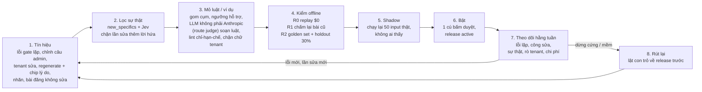

# Hệ thống viết tự học — học từ lỗi và từ chỉnh sửa của con người (CIS + Portal tenant)

Phiên S245, 20/10/2026. Tác nhân: Claude Code. Issue gốc: AA-729 (golden set). Loại tài liệu: bản tư vấn thiết kế
cho Nghiệp. **Chỉ đọc**: không truy vấn DB, không gọi LLM, không tạo issue Linear. Chi phí $0.

Nguồn: code AA-CIS-App `origin/main` ca61ca8c (đã gồm PR #868 và #869, merge 20/10/2026),
`docs/architecture/db-schema-reference.md` (dump 20/10/2026 01:02 UTC,
số dòng là ước lượng `reltuples`), Linear (20/10/2026), audit AA-865 ([README](../2026-10-20-S245-f9-pooled/README.md)).
Ghi chú gốc (tiếng Anh) nằm ở `research/`. Ba phương án đầy đủ ở `research/options.json`, điểm giám khảo ở
`research/judges.json`.

## 0. Tóm tắt (6 dòng)

1. CIS đã có nhiều cổng chấm lỗi và vòng sửa (gate T10, sentence repair, flag_fix, Jev), nhưng **chưa có vòng học nào chạy được**: `shared.pipeline_lessons` ghi sai stage nên không bao giờ được đọc, còn N8 "mỗi lỗi thành luật" đã bị gỡ (AA-603).
2. Tín hiệu người sửa tốt nhất đã có là **chỉnh câu của admin** (trước/sau + gate + vấn đề, trong `audit_log`); có 3 chỗ người sửa mà **mất bản gốc hoặc lý do** (A1 sửa trường, tenant sửa T9, mọi approve/reject).
3. Fine-tune gần như không khả thi bây giờ (Bedrock Claude hết hạn, OpenAI đóng fine-tune 06/01/2027) và dữ liệu quá ít → **học trong prompt, không đổi trọng số mô hình**.
4. Khuyến nghị: **"Writing Memory v1"** — kho luật + kho ví dụ đã duyệt, mỗi lần bật đi qua replay $0 → golden set → shadow → một cú bấm duyệt; rút lại bằng một lệnh lật con trỏ.
5. Làm ngay **P0** (1 phiên, không phụ thuộc gì): đóng băng `pipeline_lessons` (bảng toàn cục không có `tenant_id`: nếu ai "sửa" lệch stage, lỗi T2 sẽ lái prompt S1 chung và mẫu lấy từ chữ tenant nằm trong bảng toàn cục), lưu trước/sau mọi chỉnh sửa vào một bảng xoá được, chip lý do một cú bấm.
6. **6,5–7,5 phiên agent + dự phòng ≈ 8**, **~$30–50/tháng (trần $60, D8)** trên Dev, không thêm dịch vụ AWS; tenant chỉ thấy bài tốt hơn, không thấy QA; **16 quyết định** chờ Nghiệp (§13).

## 1. Hiện trạng: đã có gì

### 1.1 Bốn "người viết" và cổng chất lượng

| Người viết | Code chính | Bảng kết quả | Cổng / vòng sửa |
|---|---|---|---|
| **A1/S1 — tour Master** | `services/content_generation/graph.py`, `flag_fix_node.py`, `grounding.py`, `brand_audit_node.py`, `s1_batch.py` | `silver_aa_internal.generated_content` (~1.423), `quality_scores` (~1.432) | validate → judge → brand_audit (trả `lessons_extracted[]`) → grounding từng câu (Jev `a1_claim_supported`) → flag_fix chỉ sửa trường bị cờ; < 7 điểm vào `review_queue` (~229) |
| **T2 — tour giọng tenant** (AA-792) | `services/jobs/t2_rewrite_job.py`, `tenant_pipeline.py` | `gold_aa_internal.tenant_tour_versions` (~48) | Chạy **chung graph S1** (`stages.py`, AA-763) + T3 QA (`qa_status`, `qa_repair_count`) |
| **T8 — góc viết** | `services/acp_angle_gate/service.py` | `angle_gate_request` (~21), `angle_gate_option` (~57) | 3 góc, 1 góc đề xuất; tenant chọn (`chosen`) |
| **T9 — blog + social (LinkedIn, Facebook…)**, T11 đăng | `services/acp_content_writing/service.py`, `quality_gates.py`, `sentence_repair.py` | `acp_shared.content_piece` (~251) | ~27 gate F0–F19; 3 lượt, lượt 3 chỉ sửa câu; chặn hồi quy; `splice_checked`; `new_specifics` cấm thêm số/giờ; `gate_ledger`, `repair_log[]`, `discarded_attempts` (AA-791) |

Đầu vào thương hiệu chung T2/T8/T9: `render_brand_block()` (`brand_pack.py` L107) đưa style guide,
`forbidden_words` và `good_examples` (ví dụ tĩnh, chỉ lấy giọng) vào prompt.

Mới xong, liên quan trực tiếp:
- **AA-865 (F9 sticky pass)**: câu F9 đã duyệt thì giữ nguyên trạng thái trong cùng job; PR #868 (đã merge 20/10/2026,
  `76de7932`) mở rộng cho sửa kiểu chỉ xoá chữ. Tỉ lệ retry thêm lỗi chặn gộp 8/75 = 10,7%, replay fix (a) còn 6,7%
  (mục tiêu ≤ 8%).
- **AA-800 (signature vocabulary)**: PR #869 (đã merge 20/10/2026, `ca61ca8c`) thêm 3 lớp từ vựng: `PLATFORM_TRUTH` cấm mọi tenant, từ
  khen sáo rỗng tối đa 1 lần/bài, và `forbidden_words` riêng tenant luôn thắng. Đây là chỗ tự nhiên để gắn "luật từ
  vựng học được".

### 1.2 Các cơ chế "học" đã có — và tình trạng thật

| Cơ chế | Tình trạng | Vì sao |
|---|---|---|
| **A1 lessons (AA-132)** — `shared.pipeline_lessons`, chèn "LESSONS FROM PREVIOUS BATCHES" vào prompt S1 (`s1_batch.py` L108–121, `admin_pipeline.py` L560–583) | **Hỏng + nguy hiểm** | Ghi `stage='audit'` (`flag_fix_node.py` L733) nhưng đọc `S1_rewrite/S1_editor`; lệnh ghi gần như chắc chắn lỗi im lặng (`run_until_complete` trong executor). Dump: 0 insert kể từ lần reset thống kê gần nhất, 1.956 lượt đọc index; số dòng thật chưa biết (dump không có `reltuples` cho bảng này, P0 sẽ đếm). Đường đọc chỉ chèn `field` + `what_to_do`, mà `what_to_do` là mẫu câu `"Fix field {field} — failure code {code}"` (`flag_fix_node.py` L756), nên chữ tenant không đi thẳng vào prompt. Không cổng eval, không `tenant_id`, tự bật `is_active=true`. **Rủi ro thật nếu ai đó "sửa" lệch stage: (1) `pattern` / `example_before` lấy từ chữ tenant (T2 dùng chung graph) nằm trong một bảng toàn cục không có `tenant_id`; (2) lỗi của T2 sẽ lái prompt S1 dùng chung.** |
| **N8 flywheel / H-3 rule extractor** — `acp_shared.acp_output_rules`, `/v1/rules` | **Chết** | Gỡ cùng N7/N8 (AA-603). `acp_post_processor.py` chỉ còn test gọi và `services/acp_produce/rule_adapter.py` gọi (bản thân file này chỉ `tests/unit/test_aa363_rule_adapter.py` dùng). Bảng còn, route còn mount, `/v1/rules` còn mục policy trong `api/core/staff_authz.py` (L302, L326). |
| **Jev outcome (AA-756)** — `decision_log.outcome` | **Gần như rỗng** | Chỉ phía "approve" ghi truth=True; `record_rejected_outcome` chưa làm (AA-845). |
| **Prompt regression (AA-289)** — `shared.prompt_eval_runs` | **Chưa chạy trên schema hiện tại** | 0 insert; chỉ cho S1; fixture 20 tour nằm trên S3. |
| **Nhãn người (AA-791)** — `content_piece_label` | **Có khung, gần như chưa có nhãn** | 1 insert; gói 40 bài AA-783 chưa chấm. |
| **Brand rules** — `shared.tenant_brand_rules` (`voice_examples`, `good_examples`, `forbidden_words`, `version`) | Chạy, nhưng **tĩnh** | Người nhập tay; không học từ chỉnh sửa. |

### 1.3 Chỗ nào đã ghi lại chỉnh sửa của người, chỗ nào chưa

| Hành động của người | Lưu ở đâu | Có trước/sau? | Có lý do? |
|---|---|---|---|
| Admin chỉnh câu bài T9 (cắt / nhận gợi ý / tự viết) | `audit_log` `content_piece.admin_sentence_*` | **Có** (before, after, gate, problem, suggestion, mode) | Gián tiếp (gate + problem) |
| Admin chỉnh câu bản T2 (AA-802) | `audit_log` `tenant_tour_version.admin_sentence_*` | **Có** (câu, đoạn, cả bản) | Gián tiếp |
| Tenant sửa tour T2 trên portal | Bản mới `edit_source='tenant_edit'` + `parent_version_id` | **Có** (diff với bản cha) | Không |
| Góc T8 tenant chọn vs đề xuất | `angle_gate_option.chosen` / `recommended` | n/a | Không |
| Admin dán nhãn bài T9 | `content_piece_label` | Chỉ hash | **Có** (nhưng mới 1 nhãn) |
| **Admin sửa trường bản A1** | `generated_content.edit_diff` | **Không** — chỉ tên trường, bản AI bị ghi đè | Không |
| **Tenant sửa bài T9 ở My Content** | `audit_log` `content_piece.edited` | **Không** — chỉ `content_length`, chữ bị ghi đè | Không |
| **Mọi approve / reject / dismiss / regenerate** (A1 review queue, T2 tenant) | `review_status` / `status` | n/a | **Không**. Thực tế reviewer bấm Regenerate thay vì duyệt (S218: 196 dòng, 0 quyết định) |
| Lượt viết bị bỏ của T9 | Ledger từng lượt: `repair_log` (AA-791, #735); chữ: `discarded_attempts` | Ledger: **có** mọi lượt; chữ: chỉ giữ **một** lượt (`service.py` L1861) | n/a |

Kết luận phần hiện trạng: nguyên liệu để học **có sẵn một nửa**. Thiếu ba thứ: (1) bản trước khi sửa ở A1 và T9 tenant,
(2) lý do ở mọi reject/cut/regenerate, (3) nhãn người. Và có **một cơ chế cũ phải tắt trước** khi làm gì khác.

## 2. Thế giới đang làm gì (10/2026)

| Cách làm | Khi nào dùng | Chi phí | Rủi ro chính |
|---|---|---|---|
| **Bộ nhớ luật/"playbook" từ lỗi** (ACE arXiv 2510.04618; Dynamic Cheatsheet arXiv 2504.07952) — luật ngắn, thêm/bớt từng mục, không viết lại cả khối | Lỗi lặp có quy luật; muốn hiệu quả ngay, không train | Rất thấp (vài lệnh LLM khi đúc luật; +token prompt) | "Sụp ngữ cảnh": prompt phình, luật mâu thuẫn — đúng hình dạng `pipeline_lessons` hôm nay. Phải có trần số luật + cổng eval |
| **Truy xuất ví dụ đã duyệt (dynamic few-shot)** (Liu et al. 2101.06804; Anthropic: 3–5 ví dụ) | Học **giọng** từng tenant; ít dữ liệu vẫn chạy | Thấp (embedding một lần + token) | Ví dụ mang **sự thật của tour khác** vào bài; rò chéo tenant (OWASP LLM08:2025). Cần che thực thể + lọc `tenant_id` |
| **Học từ diff chỉnh sửa** (PRELUDE/CIPHER NeurIPS 2024; PREDICT 2410.06273; LAMP CHI 2025) — suy ra "sở thích" bằng lời từ các lần sửa, kiểm trên nhiều lần sửa trước khi tin | Có nhiều cặp trước/sau; muốn "học cách viết khi con người sửa" | Thấp | Khái quát quá từ một lần sửa / một người sửa; người sửa có thể **thêm** lời hứa nguồn không có |
| **Tối ưu prompt tự động trên tập eval** (GEPA ICLR 2026; DSPy MIPROv2; OPRO; TextGrad) | Có golden set ≥ 35–100 mẫu + giám khảo đáng tin | Trung bình ($10–60/lượt chiến dịch) | Overfit tập eval; prompt tối ưu tệ hơn ở input lạ. Cần holdout + người xem từng prompt |
| **Hiệu chỉnh giám khảo LLM bằng nhãn người** (MT-Bench; EvalGen; Panickssery et al.) | Trước khi để giám khảo quyết định bật/tắt | Thấp | Giám khảo cùng hãng ưu ái bài của chính nó; "trôi tiêu chí". Dùng giám khảo khác hãng + κ ≥ 0,6 |
| **Fine-tune SFT/DPO/RFT** (SALT, "post-edits are preferences") | ~1k–10k cặp sạch / tác vụ, trên mô hình chịu dùng làm writer | Train rẻ (~$22 cho gpt-4.1-mini 500 tour) nhưng... | **Không khả dụng thực tế**: Bedrock chỉ cho fine-tune Claude 3 Haiku (EOL 10/09/2026); OpenAI đóng fine-tune cho org mới từ 07/05/2026, đóng hẳn 06/01/2027; Nova/Qwen/gpt-oss = đổi writer, khác region. Fine-tune trên dữ liệu có sự thật mới **tăng ảo giác** (Gekhman EMNLP 2024) |

Điểm chung của các nhóm làm tốt: **dữ liệu + eval + bộ nhớ nằm trong DB của mình**, không khoá vào nền tảng của hãng
(OpenAI Evals chỉ-đọc từ 31/10/2026, đóng 30/11/2026). Mọi thay đổi đi qua eval gate trước khi bật.

Nguồn: `research/02-state-of-the-art.md` §2–§3 và mục Sources (truy cập 20/10/2026); fine-tune và giá:
<https://docs.aws.amazon.com/bedrock/latest/userguide/custom-model-fine-tuning.html>,
<https://docs.aws.amazon.com/bedrock/latest/userguide/model-lifecycle.html>, <https://aws.amazon.com/bedrock/pricing/>,
<https://developers.openai.com/api/docs/deprecations>, <https://developers.openai.com/api/docs/pricing>.

## 3. Ba phương án

Cả ba đều do agent viết phương án đề xuất độc lập; bản đầy đủ (tiếng Anh) ở `research/options.json`. Cả ba đều: đóng
băng `pipeline_lessons` ở P0, ghi trước/sau mọi chỉnh sửa + chip lý do một cú bấm, lọc sự thật trước khi học, giữ tenant
chỉ thấy nội dung, chạy trên RDS + worker sẵn có (không dịch vụ AWS mới; riêng C có thể thêm một bucket/prefix S3 cho
dataset). Khác nhau ở **cái gì được học** và **ai bật**.

| | **A. Writing Memory v1** | **B. Golden-gated Writer Optimiser (GWO)** | **C. Writer Flywheel** |
|---|---|---|---|
| Ý tưởng | Kho **luật** (từ lỗi gate lặp + diff người sửa) + kho **ví dụ** đã duyệt theo tenant; chỉ bật qua **release** có cổng (R0 → R1 → R2 → shadow) | **Đo trước**: golden set + giám khảo đã hiệu chỉnh; tách prompt thành **slot** có tên; bộ đề xuất kiểu GEPA sửa từng slot theo cụm lỗi, chọn theo biên Pareto, **bấm để promote** | **Ghi nhận trước** vào một kho sự kiện; học theo 6 lớp: L0 từ vựng, L1 sổ bài học (ACE), L2 ví dụ, L3 tóm tắt sở thích tenant (CIPHER), L4 GEPA offline cho prompt sửa/giám khảo, L5 fine-tune khi đủ dữ liệu |
| Dùng điểm chèn có sẵn | Có (lessons append, `render_brand_block`, `_repair_feedback`, lớp AA-800) | **Không** — refactor mọi prompt writer/repair A1/T2/T9 thành slot đọc từ DB (`prompt_registry.resolve`); phải replay giống hệt từng byte trước khi bật | Có (khối "HOUSE LESSONS" ở S1/T2/T9; ví dụ thay few-shot tĩnh trong `render_brand_block`) |
| Học giọng tenant | Có (P4: ví dụ k=3 lọc theo tenant) | Muộn (P4: slot `*.voice.*` riêng tenant; ví dụ chỉ là tuỳ chọn) | Có (P3: 3–5 ví dụ + tóm tắt sở thích ≤ 5 câu) |
| Cải thiện đầu tiên chạm bài viết | ~phiên 4 (P2 chờ AA-729) | ~phiên 5–7 (bản tối ưu tự động đầu tiên ở P3; P2 chỉ thử một biến thể do người viết) | ~phiên 3,5 (P2; P1 chờ trả lời AA-729 + AA-845) |
| Bảng mới / sửa | 4 mới (+ bảng shadow) + nới 2 CHECK | **8 mới** (sự kiện; golden set, mẫu, kết quả từng mẫu; slot; biến thể; cụm lỗi; lượt tối ưu) + sửa `prompt_eval_runs`, `content_piece_label` | 4 mới (sự kiện, bài học, ví dụ, cặp ưa thích) + sửa `prompt_eval_runs`, `tenant_brand_rule_versions`, bảng nhãn + prefix/bucket S3 cho dataset |
| Job mới | `writing_memory_mine` + eval/shadow | Mine cụm lỗi hằng tuần + lượt tối ưu (mặc định ≤ 2 chiến dịch/tháng) | 6 kind: backfill, `writer_pair_build`, `writer_lesson_mine`, `writer_exemplar_index`, `writer_eval_run`, `writer_dataset_export` |
| Trang admin | `/admin/writing-memory`, 5 tab | Writer Lab, 6 khu (+ panel ở LLM usage và Decisions) | `/admin/writer-learning`, 6 tab (+ thẻ Tenant 360) |
| Ai bật | Release nền tảng: Nghiệp bấm; release tenant **tự bật** trong dev khi qua cổng | Mọi biến thể: bấm; DB trigger đòi một lượt holdout đạt | Mọi thứ: admin bấm — "không gì tự bật" |
| Fine-tune | Không | Không (giữ dữ liệu trung lập, xem lại ở ~1k+ cặp sạch / tác vụ) | Có điều kiện (L5: xuất JSONL SFT/DPO ra S3; cần ≥ 1.000 cặp sạch + KPI chững 2 vòng; RFT open-weight ~$160–400/lượt) |
| Chi phí/tháng (Dev) | $30–50 | $30–70 | $35–80 |
| Công | ~6 phiên (giám khảo 2: thực tế ~8) | 7–8 phiên | ~5,5 phiên (P0–P4) + P5 có điều kiện ~1,5 |
| Điểm mạnh (theo giám khảo) | Rẻ nhất; dùng lại điểm chèn, không refactor; luật chỉ-hạn-chế; rút lại bằng lật con trỏ; chỉ ra đúng bẫy T2 chạy chung graph S1 | Kỷ luật eval tốt nhất: golden set là bảng thật có tune/holdout, giám khảo chỉ tính khi κ ≥ 0,6, DB trigger, KPI edit-pair, phễu ứng viên, luật repo public, xoá khi offboard | L0 từ vựng chứng minh bằng replay $0; helper ghi tín hiệu cùng transaction, kiểm sự thật bất đồng bộ; "không gì tự bật"; phân lớp thẳng thắn về rủi ro nhà cung cấp |
| Điểm yếu (theo giám khảo) | Chờ AA-729; release tenant tự bật trong dev; không có ngưỡng κ; vài chi tiết schema sai (§5.3) | Chậm và nặng nhất; refactor prompt có phạm vi ảnh hưởng rộng (T2 chung graph S1); tối ưu trên ~251 bài T9, ~48 bản T2, 1 nhãn → dễ overfit kiểu OPRO; nhịp chiến dịch + duyệt nặng cho một người | Phạm vi rộng nhất; đường export dataset + S3 + đồng ý tenant thêm một chỗ chứa chữ tenant mà bây giờ chưa cần; fine-tune gần như không khả dụng; một người duyệt thành nút thắt cho mọi mục giọng tenant; đắt nhất |

### 3.1 B và C nói ngắn

**B — Golden-gated Writer Optimiser.** Bốn lớp, tất cả trong AA-CIS-App:
- *Ghi nhận*: `acp_shared.writer_feedback_event` (giống `writing_signal` của A) + lưu chữ mọi lượt T9.
- *Golden set*: bảng `eval_golden_set` / `eval_golden_item` / `eval_item_result`; A1 50, T2 10 + phân vùng theo tenant,
  blog 15, social 15, injection 10; chia tune/holdout 30%, có mẫu edit-pair và mẫu cài lỗi (AA-791). Giám khảo khác
  hãng với writer, chỉ được tính vào dừng cứng khi κ ≥ 0,6 so với nhãn Nghiệp neo; dưới mức đó chỉ là chỉ số mềm.
- *Optimiser*: job hằng tuần gom cụm lỗi (`failure_cluster`) → LLM phản tư đề xuất ≤ 3 sửa nhỏ cho một slot → chấm R0
  ($0) / R1 / R2 (≤ 50 mẫu) → giữ biên Pareto theo từng mẫu (GEPA-lite tự viết ~300 dòng, không chuyển writer sang
  DSPy). Slot `*.fidelity.*` bị khoá: chỉ được thêm hạn chế.
- *Promote*: chạy holdout một lần → Writer Lab hiện diff + nguồn gốc + bảng điểm → bấm promote (active/canary), một cú
  bấm rút lại; đổi golden set / model / gate → biến thể vào trạng thái `reverify`, lượt chấm lại chờ duyệt.
- Pha: P0 ghi nhận (1) · P1 golden set + giám khảo + baseline (1,5–2) · P2 registry slot + Writer Lab (1) · P3 mine +
  optimiser (1,5–2) · P4 giọng tenant (1–1,5) · P5 vận hành (0,5–1).

**C — Writer Flywheel.** Một kho sự kiện + sáu lớp học, mỗi lớp rẻ và an toàn hơn lớp sau:
- *Ghi nhận*: helper `record_writer_feedback` ghi trong cùng transaction với thao tác sửa; kiểm sự thật chạy bất đồng
  bộ trong job (`pending/grey/pass/fail`), vùng xám cần admin xác nhận tới khi AA-803 được hiệu chỉnh.
- *L0–L3*: luật từ vựng (cụm bị cắt ≥ 5 lần bởi ≥ 2 reviewer hoặc qua ≥ 3 tenant); sổ bài học kiểu ACE (chỉ thêm/gộp/bỏ
  từng mục; trần 8 bài nền tảng + 5 bài tenant / người viết × kênh); ví dụ đã che sự thật lọc theo `tenant_id`; tóm tắt
  sở thích tenant ≤ 5 câu. `rule_set_version` (hash) đóng dấu mọi đầu ra; cờ `LEARNING_LAYERS_ENABLED` tắt tức thì.
- *Cổng chung R0–R3*: replay $0 → chấm lại bài cũ → golden set ≤ $15 → shadow biến thể (viết cạnh bản chính, tenant
  không thấy). Không gì tự bật.
- *L4–L5*: GEPA chỉ trên prompt sửa câu và prompt giám khảo, cần Nghiệp duyệt từng lượt; xuất dataset SFT/DPO ra S3 tách
  nền tảng / tenant; fine-tune chỉ khi ≥ 1.000 cặp sạch, KPI tăng < 2 điểm hai vòng liền và có nhà cung cấp; adapter riêng
  tenant cần tenant đồng ý bằng văn bản (quyết định kinh doanh của chị Thư).
- Pha: P0 ghi nhận (1) · P1 eval + nhãn (1) · P2 L0 + L1 (1,5) · P3 L2 + L3 (1) · P4 dataset + GEPA thử (1) · P5 quyết
  định fine-tune (có điều kiện).
- Cả A (bản gốc) và C đều đề xuất giám khảo OpenAI; bản khuyến nghị thay bằng route judge không phải Anthropic trên Bedrock acc3 (§5.5, D10).

## 4. Điểm giám khảo

**Panel giám khảo AI** (S245): hai agent AI chấm độc lập, không phải người. Thang 1–5 mỗi tiêu chí (chất lượng tăng, an toàn, chi phí, thời gian ra giá trị, vận hành).

| Phương án | Giám khảo AI 1 (góc chị Thư / sản phẩm) | Giám khảo AI 2 (góc kỹ thuật / an toàn) | Tổng |
|---|---|---|---|
| **A. Writing Memory v1** | **19** (4/4/4/4/3) | **21** (4/5/4/4/4) | **40** |
| C. Writer Flywheel | 16 (4/4/3/3/2) | 16 (4/3/3/3/3) | 32 |
| B. GWO | 15 (3/5/3/2/2) | 15 (4/4/3/2/2) | 30 |

Cả hai giám khảo chọn **A**. Cả hai cũng chỉ ra cùng một điểm yếu: A chờ AA-729 nên luật đầu tiên chạm bài muộn,
và cho release tenant tự bật quá sớm. Phần ghép ở §5 sửa đúng hai điểm này.

Vì sao B và C thua:
- **B (30)**: cả hai giám khảo cho "thời gian ra giá trị" và "vận hành" 2/5. Golden set, giám khảo hiệu chỉnh và refactor
  prompt thành slot phải xong trước khi có ứng viên tối ưu đầu tiên; với dữ liệu Dev hiện nay (1 nhãn, 4 tenant thử),
  optimiser có rất ít tín hiệu thật. Giám khảo 1 cho an toàn 5/5 — cao nhất — nên phần an toàn của B được ghép vào A.
- **C (32)**: lõi L0–L3 gần giống A nhưng mô hình release/quy trách nhiệm lỏng hơn (một hash `rule_set_version` thay cho
  CHECK eval theo từng release). Giám khảo 2 cho an toàn 3/5 vì đường export dataset + S3 + đồng ý tenant; giám khảo 1
  cho vận hành 2/5 (6 job, ≥ 4 bảng, 6 tab). Chi phí cao nhất ($35–80).

## 5. KHUYẾN NGHỊ: Writing Memory v1 + 11 ý ghép

### 5.1 Phương án thắng, nói ngắn

Một vòng học dùng chung cho cả 4 người viết (A1 Master, T2 tour tenant, T9 blog, T9 social). Trọng số mô hình không
đổi. Thứ được học là **bộ nhớ viết** gồm hai loại mục:

- **Luật** — câu lệnh ngắn hoặc mục từ vựng, đúc từ lỗi gate lặp lại và từ diff người sửa. Ba loại:
  `lexicon` (cấm/thay cụm từ, không cần LLM), `writer_instruction` (một dòng trong khối "HOUSE RULES", tối đa
  12 dòng nền tảng + 8 dòng tenant), `repair_hint` (chỉ chèn khi gate tương ứng báo lỗi).
  **Luật chỉ được hạn chế** (cắt, cấm, đổi cách nói, định dạng), lint tự động từ chối mọi luật bảo "hãy nêu dịch vụ X".
  Với luật `lexicon` kiểu "thay", **chuỗi thay thế cũng bị kiểm** bằng `new_specifics` (hoặc phép kiểm tương đương): từ
  chối mọi chuỗi thêm số, nơi, giờ, giá hay dịch vụ (vd. "lunch" → "lunch included" bị loại).
  **Tóm tắt sở thích tenant (CIPHER, §5.2.9) cũng là một loại luật** (`preference_summary`): qua cùng lint chỉ-hạn-chế,
  cách ly `adds_unsourced_claim`, R0–R2 và một cú bấm duyệt — vì một tóm tắt ≤ 5 câu vẫn có thể mã hoá một lời hứa nguồn
  không có (vd. "luôn nhắc đón khách sạn miễn phí") rồi được chèn vào prompt writer.
- **Ví dụ** — đoạn văn đã được duyệt, **che thực thể** (tên nơi, số, giờ, giá, dịch vụ → `[PLACE]`, `[N]`…), lấy
  3 đoạn gần nhất theo người viết + kênh + **đúng tenant**, chèn với nhãn "chỉ học giọng, không dùng lại sự thật nào".

Mỗi mục có **phạm vi**: `platform` (không bao giờ chứa chữ của tenant) hoặc `tenant` (chỉ dùng cho tenant đó: lọc
`WHERE tenant_id = $1` trong code + RLS, xem §5.3).
Thứ tự ưu tiên: luật brand tenant tự viết > luật tenant học được > luật nền tảng; **cổng sự thật (F1/F17/F9_cta_fact,
Jev) đứng trên tất cả**.

Không mục nào tới tay người viết một mình: chúng đi trong một **release** (gói có version theo người viết). Release
chỉ bật khi qua đủ cổng và có một cú bấm duyệt; rút lại = đưa con trỏ "active" về release trước, không cần deploy.

### 5.2 Mười một ý ghép từ B và C (đều do giám khảo đề xuất, `research/judges.json` mục `grafts`)

1. **Đường nhanh L0 — từ vựng** (từ C): cụm từ admin đã cắt ≥ N lần thành luật `lexicon`, chứng minh bằng **replay
   $0** trên chữ + ledger đã lưu, gắn vào lớp AA-800 (PR #869 đã merge). Không cần chờ AA-729 → chị Thư thấy "không còn viết
   X nữa" từ ~phiên 2–3 thay vì phiên 4.
2. **Không gì tự bật** (từ C): mọi release, kể cả release tenant, cần một cú bấm của Nghiệp/admin. Ghi trong ADR như
   một bất biến có ngày; xem lại khi có tenant thật.
3. **Cổng hiệu chỉnh giám khảo** (từ B): giám khảo chỉ được tính vào "dừng cứng/mềm" khi Cohen's κ ≥ 0,6 so với nhãn
   Nghiệp neo (AA-783); dưới mức đó chỉ để tham khảo. Kiểm lại khi đổi model/rubric.
4. **KPI "edit-pair replay hit rate"** (từ B): người viết còn tạo ra đúng mẫu mà người đã xoá không? Đây là con số dễ hiểu
   nhất để cho chị Thư thấy hệ thống "học từ chỉnh sửa", và đo được ngay trên golden set trước khi có tenant thật.
5. **Lưu chữ của mọi lượt viết T9** (từ B, gap G4): ledger từng lượt đã có trong `repair_log` (AA-791, #735); phần
   thiếu là **chữ** — `discarded_attempts` chỉ giữ một lượt.
6. **Golden set thành bảng thật** (từ B): `eval_golden_set`, `eval_golden_item` (tune/holdout, tầng, bẫy, tenant),
   `eval_item_result` — thay vì nhét hết vào `prompt_eval_runs.details`. Thêm trạng thái release `reverify` khi đổi
   golden set, route model hoặc taxonomy gate (AA-787): release vẫn chạy nhưng bị cờ, R2 chạy lại **chờ duyệt**.
7. **Helper `record_writer_feedback`** (từ C): ghi tín hiệu trong cùng transaction với thao tác sửa; kiểm sự thật chạy
   bất đồng bộ (`pending/grey/pass/fail`), không thêm lệnh LLM vào đường request; sự kiện vùng xám cần admin xác nhận
   cho tới khi AA-803 được hiệu chỉnh. Luật khoá theo `reason_code` + bản đồ alias gate để không mồ côi khi AA-787 đổi
   tên gate (27 → ~18).
8. **Luật dữ liệu** (từ B): repo AA-CIS-App là public → golden fixture, cặp sửa, ví dụ chỉ ở DB / S3 bronze; test trong
   repo dùng fixture giả. Xoá dữ liệu học của tenant khi offboard (quy trình DRY RUN): `writing_signal`, luật và tóm tắt
   phạm vi tenant, `writing_exemplar`, và `writing_memory_shadow` (đầu ra shadow chứa chữ tenant). Vì `audit_log` là
   append-only, có chuỗi hash và trigger `audit_log_no_delete` / `no_update` / `no_truncate`, **chữ trước/sau chỉ lưu ở
   `writing_signal` (xoá được); `audit_log.details` chỉ giữ id/hash + chip**. Chữ chỉnh câu admin T2/T9 đã nằm sẵn trong
   `audit_log` thì không xoá được → ngoại lệ lưu giữ chờ Nghiệp chốt (D16). Đăng ký kho mới vào AI Use Register (AA-804).
9. **Tóm tắt sở thích tenant kiểu CIPHER** (từ C, P4): ≤ 5 câu bằng lời, đúc từ các lần sửa đã qua lọc sự thật của
   chính tenant. Tóm tắt là một loại luật (§5.1): qua cùng lint chỉ-hạn-chế, cách ly `adds_unsourced_claim`, R0–R2 và
   một cú bấm duyệt. Rẻ hơn ví dụ và chạy được với rất ít lần sửa — hợp với Dev hiện tại (4 tenant thử, ~48 bản T2).
   Kèm một ô "số cặp sạch / người viết" trên tab Metrics để giữ cửa fine-tune sau này, **không** xây đường export.
10. **Khoá bật release hai lớp + replay release rỗng** (từ B, giám khảo 1): ngoài CHECK trong DB, API cũng từ chối bật
    release thiếu eval/shadow (B dùng DB trigger + API). Test CI: luật, ví dụ, tóm tắt của tenant A không bao giờ được
    resolve cho tenant B. Trước khi bật `memory_enabled`, replay **release 0 (bộ nhớ rỗng)** qua đường chèn mới phải cho
    prompt **giống hệt từng byte** với prompt hiện tại (R0, $0) — bằng chứng rằng đường chèn không tự đổi bài.
11. **Gộp AA-900 vào tab Releases** (từ B, giám khảo 2): AA-900 (sổ đăng ký prompt, cổng eval thủ công) không thành
    trang riêng; tab Releases là chỗ duy nhất quản lý prompt và bộ nhớ.

### 5.3 Những chỗ sửa so với bản gốc của phương án A (giám khảo 2 kiểm dump)

- **Route soạn luật / giám khảo:** bản gốc của A gieo stage `writing_memory_mine` là "judge, OpenAI"; bản khuyến nghị dùng route judge không phải Anthropic sẵn có trên Bedrock acc3 (D10), OpenAI chỉ là fallback cuối theo migration 224.
- **Chi phí tăng thêm mỗi bài:** A ghi +3–8%; tính lại theo từng lời gọi có chèn ví dụ/luật thì khoảng +17–21% cho S1 và +5–21% cho blog T9, sát ngưỡng dừng mềm +20%. Vì vậy ví dụ mẫu chỉ chèn ở lượt viết đầu, còn `repair_hint` chỉ chèn khi gate bắn.

- `acp_shared.audit_log.id` là **uuid**, `audit_log.tenant_id` là **varchar(50)** → `writing_signal.audit_log_id` phải
  là uuid và backfill phải ép kiểu tenant_id.
- `gold_aa_internal.tenant_tour_versions` **không có** cột metadata/writer_input (jsonb duy nhất là `rewritten_content`)
  → cần migration thêm `generation_meta jsonb NULL` để đóng dấu release cho T2 (P3). Trước đó, P0 chỉ đóng dấu T9
  (`content_piece.writer_input` đã có).
- Bảng mới chứa chữ tenant trong schema `shared`: writer và job mine chạy bằng `cis_app`, mà mọi bảng RLS của CIS có
  policy `... TO cis_app USING true` (vd. `content_piece_cis_app_all`, `tenant_tour_versions_cis_app_all`). Đặt
  `app.tenant_id` chỉ lọc được với `aa_app_user` qua tenant pool (`api/core/aa544_tenant_pool.py`). Vì vậy truy xuất ví
  dụ và tóm tắt **phải có `WHERE tenant_id = $1` trong code** (hoặc đi qua tenant pool), kèm test chạy bằng `cis_app`.
  Vẫn bật `FORCE ROW LEVEL SECURITY` cho bảng mới (tiền lệ: `generated_content` "RLS on + FORCE").
- Ngân sách theo **tháng**, không chỉ theo lượt (6 người viết × lớp tenant × R2 + shadow có thể vượt $15/lượt).
- Thống kê: ≤ 50 cặp trên Dev thường không đủ ý nghĩa → quy tắc promote dự phòng: **không kém hơn ở mọi dừng cứng + cải
  thiện cùng chiều, gộp qua nhiều vòng** (như AA-865).
- ADR: **app ADR 0009 trong chuỗi app** (`apps/AA-CIS-App/docs/adr/` đang dừng ở 0008), tiêu đề riêng, trích dẫn ADR
  hệ sinh thái 0009 đã giữ chỗ (AI platform, AA-804, `docs/adr/README.md`). Hai số 0009 thuộc hai chuỗi khác nhau.
- Công: 6,5–7,5 phiên + dự phòng ≈ 8, không phải 6.

### 5.4 Sơ đồ vòng học



Bản ASCII (cho chỗ không vẽ được mermaid):

```
 tín hiệu ─► lọc sự thật ─► mỏ luật/ví dụ ─► R0 $0 ─► R1 ─► R2 golden+holdout ─► shadow ─► [bấm duyệt] ─► BẬT
    ▲                                                                                                  │
    │                                                                                   theo dõi hằng tuần
    └──────────────── lỗi mới / lần sửa mới ◄──────────── RÚT LẠI (lật con trỏ) ◄── dừng cứng/mềm ◄────┘
```

Đường nhanh L0: luật `lexicon` chỉ cần R0 ($0) + cú bấm, bỏ qua R2/shadow (luật từ vựng là tất định, replay đã đủ chứng minh).
Hai điều kiện để đường tắt này an toàn: (1) chuỗi thay thế của luật "thay" phải qua `new_specifics` (§5.1); (2) luật
`lexicon` áp **trước** các cổng — hoặc v1 chỉ dùng luật "cấm" để kích hoạt lượt sửa bình thường. Không bao giờ thay chữ
sau khi cổng đã chạy, vì như vậy phép thay đi vòng qua F1/F17/F9_cta_fact.

### 5.5 Mỏ luật hoạt động thế nào

- **Bảng tín hiệu chuẩn hoá** `shared.writing_signal` (tạo ở P0, xoá được): mỗi dòng = người viết, kênh, phạm vi +
  tenant, trường/đoạn, trước/sau, gate, chip lý do, ai sửa (admin/tenant/system), kết luận sự thật. Dòng A1 mang
  `scope='platform'`: `generated_content.tenant_id` là NOT NULL nhưng chưa rõ chứa tenant nào, nên backfill ánh xạ A1
  sang `scope='platform'` một cách tường minh và **không chép `tenant_id`**. Backfill một lần từ `audit_log`
  admin_sentence_*, diff T2 cha/con, `discarded_attempts`/`repair_log`, `quality_scores.lessons_extracted`.
- **Job `writing_memory_mine`** (bảng `shared.job`, hằng tuần + bấm tay): gom cụm theo (người viết, gate/lý do, mẫu từ
  ngữ) → ngưỡng: luật tenant ≥ 2 lần sửa trên ≥ 2 bài của tenant đó; luật nền tảng có bằng chứng từ bài của tenant **luôn
  cần ≥ 3 tenant khác nhau**; "≥ 2 reviewer" và "lỗi gate lặp ≥ 5% bài trong 30 ngày" chỉ áp cho tín hiệu A1 (Dev có
  4 tenant thử, một tenant có thể một mình vượt 5%) → một lệnh LLM **không phải Anthropic trên route judge sẵn có**
  (gpt-5.6-luna → gpt-6-luna trên Bedrock acc3; gpt-6-luna-openai chỉ là fallback cuối theo migration 224; stage mới seed
  `role='judge'`) cho mỗi cụm, tối đa 50/lượt. Giữ luật vendor của app ADR 0006 §5: "writer là Anthropic, judge thì
  không" → kiểm kiểu PREDICT: luật phải giải thích được ≥ 2 lần sửa giữ lại trong cùng cụm.
- **Luật nền tảng** từ mẫu của tenant chỉ được nâng lên khi viết lại thành câu chung, ví dụ lấy từ chữ A1 hoặc tự tạo;
  prompt soạn luật nền tảng chỉ nhận chữ **đã che thực thể**, không nhận chữ thô của nhiều tenant; kiểm trùng 5-gram với
  kho chữ của mọi tenant + tên brand + forbidden words; Nghiệp duyệt từng luật.

## 6. Áp cho từng loại bài

| Loại bài | Tín hiệu chính | Luật chèn vào đâu | Ví dụ (exemplar) | Lưu ý riêng |
|---|---|---|---|---|
| **Tour Master (A1/S1)** | `quality_scores.failure_codes / brand_audit_codes / lessons_extracted`; flag_fix; admin sửa trường (sau P0 có trước/sau); Regenerate + chip lý do; chip `fact_not_in_source` → Jev | Khối HOUSE RULES **thay** "LESSONS FROM PREVIOUS BATCHES" (`s1_batch.py`, `admin_pipeline.py`); `repair_hint` cho flag_fix | Chỉ ví dụ nền tảng (A1 không có tenant) | Chỉ có luật nền tảng. Cổng: không thêm lỗi lớp `fact.*` hard (§8.2) trên tầng "fact-dense" và "tour dài ≥ 9 ngày" của golden set |
| **Tour tenant (T2)** | Diff `tenant_edit` cha/con; admin chỉnh câu T2 (AA-802); T3 QA | Release riêng khoá `t2_tour` (dù chung graph S1 — luật A1 chỉ áp cho T2 khi được đưa vào và chấm trên tầng T2) | k=3 theo tenant, fallback ví dụ nền tảng khi tenant < 3 | Cần migration `generation_meta` (P3, cùng PR bịt projection tenant ở §7) để đóng dấu release. Golden set chỉ 10 mẫu T2 → promote theo quy tắc dự phòng (§8.2). Lời hứa tenant tự thêm (vd. "lunch included") bị cách ly, không thành ví dụ |
| **Social (T9 LinkedIn/Facebook)** | `gate_ledger` (F14_social_shape, F14_first_line, F15_voice, F2…); admin chỉnh câu; tenant sửa ở My Content (sau P0) | `render_brand_block` + `_repair_feedback`; luật `lexicon` vào lớp AA-800 / gate từ vựng AA-787 | k=3 theo tenant + kênh | Bài ngắn → luật từ vựng và "dòng mở đầu" có tác dụng lớn nhất; nên là nơi bật L0 đầu tiên. Golden set có 15 LinkedIn nhưng **không có Facebook** → release Facebook dùng quy tắc dự phòng (§8.2) cho tới khi có tầng riêng |
| **Blog (T9 blog)** | Như social + F7/F16 FAQ, F5, F18, F19; `minutes_to_fix` từ nhãn | Như social | k=3 theo tenant + kênh, theo đoạn (không cả bài) | Golden set tầng blog 15 mẫu; đo `minutes_to_fix` (~5 phút/blog theo gói AA-783) |

Ghi chú T8 (góc viết) và slate: giữ tín hiệu `chosen` vs `recommended`, chưa khai thác ở v1 (thiếu lý do).

## 7. Giao diện cần thêm

**Admin (UI kit `app/_kit`, kiểm bằng skill aa-ui-verify):**

- Trang mới **`/admin/writing-memory`**, 5 tab:
  - *Signals*: cụm lỗi/sửa lặp theo người viết, kênh, tenant; số lượng, xu hướng, mẫu trước/sau.
  - *Candidates*: luật nháp kèm nguồn gốc (link tới bài gốc), độ hỗ trợ, phạm vi, kết luận sự thật, kết quả lint;
    nút sửa / từ chối / gửi replay.
  - *Exemplars*: kho ví dụ theo tenant × người viết × kênh; nút ghim / loại (kèm lý do).
  - *Releases*: nháp → báo cáo eval (R0/R1/R2, thống kê cặp, isolation probe, chi phí) → shadow đặt cạnh nhau →
    **Duyệt** → Bật / Rút lại một cú bấm; công tắc tắt theo người viết.
  - *Metrics*: KPI §8 theo người viết và tenant; ô "số cặp sạch".
- **Drawer Content Quality** (bài T9, bản T2): **nút sửa + chip lý do** khi áp câu — chip chọn sẵn theo gate bị cờ, xác
  nhận là một cú bấm: `fact_not_in_source`, `optional_as_included`, `wrong_place_or_time`, `voice_off_brand`,
  `ai_phrasing`, `format_channel`, `repair_residue`, `style_only`. Thêm "Dùng làm ví dụ" / "Không bao giờ dùng làm ví
  dụ". Drawer nhãn `PieceLabel.tsx` dùng cho cả bản T2.
- **A1 review / chi tiết tour**: chip lý do trên Regenerate, Reject, Dismiss; lưu trước/sau khi sửa trường; huy hiệu
  "đã học từ lần sửa này" khi một luật trích dẫn nó; drawer nhãn mở rộng cho A1.
- **Tenant 360**: thẻ "Voice memory" (luật tenant đang bật, số ví dụ, release gần nhất, xu hướng tỉ lệ tenant sửa).

**Tenant portal: không thêm gì về QA.** Tenant sửa trực tiếp như hôm nay (T2 sửa inline, T9 My Content); hệ thống ghi
nhận phía server, tenant không thấy luật, gate, điểm, release hay chip. Tenant chỉ nhận ra bài sau cần sửa ít hơn.
Câu hỏi tuỳ chọn "Lần sau nên đổi gì?" là quyết định sản phẩm riêng (D7), mặc định tắt.

**Khe hở phải bịt trước khi đóng dấu release cho T2.** Đọc bản T2 phía tenant dùng `SELECT ttv.*`
(`api/routers/v1_tours.py` L820) rồi lọc bằng denylist `TENANT_HIDDEN_VERSION_FIELDS`
(`api/routers/_tenant_projection.py` L19–21). Regex key-walk `TENANT_FORBIDDEN_KEY_RE`
(`needs_review|quality|score|qa_|judge|llm_cost|jev_cost`) không bắt `generation_meta`, `rule_ids` hay `release`. Cùng PR
với migration `generation_meta` (P3) phải: thêm `generation_meta` vào `TENANT_HIDDEN_VERSION_FIELDS`; mở rộng regex thêm
`generation_meta|rule_ids|release|memory`; lấy test key-walk làm bằng chứng cho dừng cứng 3 (§8.2). T9 đã theo kiểu
allowlist (`api/routers/v1_content_writing.py`), nên không có khe này.

## 8. Đo lường và tiêu chí dừng

### 8.1 KPI

| Nhóm | Chỉ số | Nguồn | Mục tiêu |
|---|---|---|---|
| **Học từ lỗi** (sao bắc đẩu) | Tỉ lệ lỗi lặp: % bài mới chạm một cụm đã có luật active | `writing_signal` × dấu `rule_ids` | Giảm qua từng release |
| **Học từ người sửa** | Edit-pair replay hit rate; khoảng cách sửa chuẩn hoá; tỉ lệ tenant sửa (T2 `tenant_edit`, T9 sự kiện sửa); số lần admin áp câu / 100 bài; `minutes_to_fix` median/p90; regenerate / tour A1 | golden set, `writing_signal`, `content_piece_label` | Giảm |
| Chất lượng | Tỉ lệ "sửa nhẹ trở xuống" | nhãn người, hoặc đa số panel AI khi chưa đủ nhãn | ≥ 60% (r5 đạt 70%) |
| **Sự thật** (không khoan nhượng) | Lỗi lớp `fact.*` hard (qtax-v1, xem §8.2) / 100 bài trên tầng fact; tỉ lệ chặn F1/F17/F9_cta_fact | golden set, `/admin/content-quality/stats` | Không tăng (0 lỗi mới) |
| Cách ly tenant | Isolation probe (n-gram tenant A trong bài tenant B); F10 ≥ 0,92 | R2 | 0 |
| Sức khoẻ vòng | Re-flag rate (n ≥ 60, Wilson 95%); độ đầy đủ ghi nhận (≥ 80% sự kiện admin có chip lý do); phễu ứng viên (đề xuất → R0 → R2 → holdout → bật → rút lại) | AA-865 pattern | ≤ 8%; ≥ 80%; tỉ lệ rút lại > 20% = cổng quá lỏng |
| Chi phí | $/bài theo stage; chi tiêu vòng học / tháng; token prompt thêm | `llm_call_log` | ≤ +20% / bài; ≤ trần tháng |

Phương pháp: so cặp trên cùng phiên bản fixture (McNemar cho nhị phân, Wilcoxon cho phút/điểm), Wilson 95%, gộp qua
nhiều vòng như AA-865, báo cáo theo từng tenant lẫn gộp, holdout 30% phải đồng thuận. **Đo baseline AA-729 trước
release đầu tiên.**

### 8.2 Tiêu chí dừng

**Dừng cứng — tự rút lại ngay (một điều là đủ):**
1. ≥ 1 lỗi **mới** thuộc bất kỳ lớp `fact.*` có `severity: hard` (qtax-v1, `AA-CIS-App/services/quality/taxonomy.yaml`)
   trên tầng fact của golden set so với release trước (cùng logic AA-865 đã loại fix (b) vì ca #13 "ngủ đêm" thành
   "dừng ăn trưa"). Hôm nay là 5 lớp: `fact.inclusion`, `fact.number`, `fact.misbinding`, `fact.name`,
   `fact.direction`. Trước AA-926 tiêu chí này viết là "B-class hoặc C1".
2. Bất kỳ chữ có nguồn từ tenant A xuất hiện trong bài của tenant B (n-gram hoặc F10 ≥ 0,92).
3. Bất kỳ dấu vết QA (mã gate, thẻ trích dẫn, chữ của luật, khoá `generation_meta` / `rule_ids` / `release`) lọt vào
   chữ hoặc response tenant thấy.

**Theo dõi sau khi bật (có từ P3, không chờ P5):** mỗi bài mới do một release active viết chạy isolation probe (dừng
cứng 2) và grep dấu vết QA (dừng cứng 3); vi phạm → tự rút lại về release trước. Ba dừng cứng vì vậy được kiểm cả trước
lẫn sau khi bật; job KPI tuần ở P5 lo phần dừng mềm và dừng cứng 1 trên golden set.

**Dừng mềm — rút lại trừ khi Nghiệp ghi lý do giữ:** re-flag > 8% gộp hoặc +3 điểm; "sửa nhẹ trở xuống" −10 điểm hoặc
< 60%; `minutes_to_fix` +20%; tỉ lệ tenant sửa tăng; chi phí/bài +20%; độ ổn định giám khảo F9 giảm (phép so sánh mất giá
trị).

**Promote:** chỉ số chính tốt lên (hoặc giữ nguyên khi chi phí giảm), không dừng nào bật, holdout đồng thuận, giám khảo
dùng để quyết đã qua κ ≥ 0,6. Khi mẫu Dev quá ít để có ý nghĩa thống kê: không kém ở mọi dừng cứng + cải thiện cùng chiều
gộp qua ≥ 2 vòng.

Golden set AA-729 có 10 T2, 15 blog, 15 LinkedIn và không có Facebook (memo M2a). Holdout 30% của tầng T2 chỉ còn 3 mẫu,
không đủ để chặn một release. Vì vậy **release T2 và Facebook luôn dùng quy tắc dự phòng ở trên** (cộng shadow 50 input
thật), cho tới khi hai tầng này được mở rộng.

**Tiêu chí dừng cả dự án** (để không xây tiếp vô ích): sau P3, nếu 2 release liên tiếp không giảm được tỉ lệ lỗi lặp
hoặc edit-pair hit rate trên golden set → dừng ở P3, giữ P0 (ghi nhận) + L0 (từ vựng), không làm P4/P5.

## 9. Kế hoạch theo pha (phiên agent)

| Pha | Nội dung | Phiên | Phụ thuộc | Xong khi |
|---|---|---|---|---|
| **P0 — Cầm máu + ghi lại việc người làm** | Đóng băng `pipeline_lessons` (đếm chính xác trước, tắt ghi + đọc sau flag); migration `shared.writing_signal` (RLS + FORCE, xoá được) để chữ trước/sau có chỗ xoá được ngay từ đầu; T9 tenant sửa lưu trước/sau phía admin; A1 sửa trường lưu trước/sau; chip lý do (sentence apply, Regenerate, Reject, Dismiss, T2 admin reject); `fact_not_in_source` → `record_outcome(truth=False)` (AA-845 a); đóng dấu `writer_prompt_version` **chỉ cho T9** (`content_piece.writer_input`; T2 chờ `generation_meta` ở P3); lưu **chữ** mọi lượt T9 (ledger đã có từ AA-791); helper `record_writer_feedback`; ADR app; CONTEXT.md; lesson trong `skill/aa-lessons/lessons.md` | 1 | Không | 0 đọc/ghi mới `pipeline_lessons` trên Dev; một lần sửa T9 tenant và một lần sửa A1 có bằng chứng trước/sau (curl + dòng `writing_signal`); `audit_log.details` chỉ có id/hash + chip, không có chữ; test xoá dòng `writing_signal` theo tenant; deploy + verify theo aa-ship |
| **P1 — Kho luật + mỏ luật** | Migration `writing_rule` (RLS + FORCE, CHECK phạm vi); backfill `writing_signal` (A1 → `scope='platform'`); lọc sự thật; job `writing_memory_mine` (route judge không phải Anthropic, đầu vào đã che thực thể); tab Signals + Candidates; seed `llm_role_config` với `role='judge'` | 1–1,5 | P0 | Số backfill theo nguồn + tenant; 1 lượt mine ≤ $1; test: lint từ chối luật "include X", chặn 5-gram, tín hiệu tenant A không bao giờ thành luật nền tảng, luật nền tảng có bằng chứng tenant cần ≥ 3 tenant |
| **P1b — Đường nhanh L0 (từ vựng)** | Release chỉ-từ-vựng, R0 replay $0 trên chữ + ledger đã lưu, cú bấm duyệt; gắn lớp AA-800; luật áp trước các cổng (hoặc chỉ luật "cấm") | 0,5 | P1 (PR #869 đã merge) | Một release L0 bật cho T9 social, replay chứng minh giảm lỗi mục tiêu, 0 dừng cứng; **test: chuỗi thay thế thêm số / nơi / giờ / giá / dịch vụ bị `new_specifics` từ chối** |
| **P2 — Eval + release** | Bảng golden set (set/item/item_result); nới `prompt_eval_runs`; bảng `writing_memory_release` (+ CHECK active cần eval + shadow, API kiểm thêm lần nữa), `writing_memory_shadow`; runner R0/R1/R2; isolation probe; grep dấu vết QA; shadow replay 50 input; cổng κ giám khảo; tab Releases (gộp AA-900); đo **release 0** (bộ nhớ rỗng) | 1–1,5 | **AA-729**, AA-783 (nhãn neo) | Release 0 cho prompt giống hệt từng byte với hiện tại và tái lập số baseline; CHECK và API đều từ chối release thiếu eval; test CI tenant A không resolve sang tenant B; diễn tập rút lại: job kế tiếp dùng release cũ (chứng minh bằng dấu writer_input) |
| **P3 — Chèn luật vào mọi người viết** | A1 HOUSE RULES thay lessons append; T2 release riêng + migration `generation_meta` **cùng PR** bịt projection tenant (denylist + regex, §7); T9 qua `render_brand_block` + repair hint; trần token; dấu `rule_ids`; kiểm sau bật (isolation probe + grep dấu vết QA trên mỗi bài mới → tự rút lại) | 1 | P2 | Release 1 active cho ≥ 1 người viết: lỗi mục tiêu giảm trên golden + holdout, 0 lỗi `fact.*` hard mới (§8.2), 0 rò tenant, chi phí ≤ +20%; test key-walk tenant không thấy `generation_meta` / `rule_ids`; diễn tập vi phạm giả → tự rút lại |
| **P4 — Ví dụ + sở thích tenant** | `writing_exemplar` + ivfflat; che thực thể; thu từ tín hiệu duyệt; k=3 lọc tenant thay slot `good_examples` tĩnh; tóm tắt sở thích CIPHER ≤ 5 câu (loại luật: lint + cách ly + R0–R2 + cú bấm); lọc `WHERE tenant_id = $1` trong code; tab Exemplars | 1 | P3 | R2 cặp cho thấy giảm khoảng cách sửa với ≥ 1 người viết tenant, 0 sự thật mang sang; **test chạy bằng `cis_app`** (role thật của writer và job mine): truy xuất ví dụ / tóm tắt cho tenant A trả 0 dòng của tenant B; tóm tắt chứa lời hứa nguồn không có bị cách ly |
| **P5 — Đo, bảo trì, khép vòng người** | Job KPI hằng tuần + tab Metrics, dừng mềm + dừng cứng 1 trên golden set (dừng cứng 2–3 đã kiểm từ P3); hết hạn luật 60 ngày; drawer nhãn cho T2 + A1; hàng đợi bất đồng 5–10 mục/tuần; DRY RUN xoá `pipeline_lessons`, `acp_output_rules`, `/v1/rules` (kèm mục policy trong `api/core/staff_authz.py`), `acp_post_processor.py`, `services/acp_produce/rule_adapter.py` + `tests/unit/test_aa363_rule_adapter.py`; xoá dữ liệu học khi offboard tenant (gồm `writing_memory_shadow`); runbook | 1 | P4 | 2 báo cáo tuần tự động; 1 luật hết hạn được job đánh dấu; xoá bảng chết có bằng chứng DRY RUN; xu hướng KPI ghi vào `docs/audits/` |

Tổng: **6,5–7,5 phiên + dự phòng ≈ 8**. Có thể bắt đầu P0 ngay phiên sau; P0 và P1 không phụ thuộc AA-729.

### 9.1 Issue Linear đề xuất (CHƯA tạo — chờ D14)

Project đề xuất: "CIS Core — Pipeline, LLM & Platform" (kiểm còn < 100 issue chưa lưu trữ trước khi tạo). Tiêu đề
tiếng Anh theo quy ước:

| # | Pha | Tiêu đề đề xuất |
|---|---|---|
| 1 | P0 | [Writing memory] Freeze the ungated pipeline_lessons loop (stage mismatch; if "fixed", T2 failures would steer the global S1 prompt and tenant-derived pattern/example text would sit in a table with no tenant_id) |
| 2 | P0 | [Writing memory] Capture before/after on tenant T9 piece edits (admin-side only) |
| 3 | P0 | [Writing memory] Capture per-field before/after on admin A1 generated_content edits |
| 4 | P0 | [Writing memory] One-click reason chips on sentence apply, A1 Regenerate/Reject/Dismiss and T2 admin reject; fact_not_in_source writes Jev record_outcome(truth=False) |
| 5 | P0 | [Writing memory] Persist every T9 attempt's text (ledgers already kept by AA-791) and stamp writer_prompt_version on T9 |
| 6 | P0 | [ADR] CIS app ADR: governed writing memory (rules + exemplars, release-gated, no fine-tuning); supersedes AA-132 lessons and AA-99 output rules |
| 7 | P0 | [Writing memory] Migration: shared.writing_signal (RLS + FORCE; deletable before/after text, audit_log keeps ids/hashes only) + record_writer_feedback helper |
| 8 | P1 | [Writing memory] shared.writing_rule (RLS + FORCE, scope CHECKs) + backfill (A1 → scope=platform) + mining job: cluster, thresholds (tenant-derived platform rules need ≥3 tenants), non-Anthropic judge-route drafter on entity-masked text (≤50 calls), constraint-only lint, PREDICT validation |
| 9 | P1 | [Admin UI] /admin/writing-memory: Signals and Candidates tabs |
| 10 | P1b | [Writing memory] L0 lexicon fast path: replay-proven ($0) lexicon releases into the AA-800 vocabulary layers, applied before the gates; replacement strings checked by new_specifics |
| 11 | P2 | [Eval] First-class golden set tables + widened prompt_eval_runs + writing_memory_release/shadow with activate-requires-eval CHECK and the same check in the API |
| 12 | P2 | [Eval] R0/R1/R2 memory eval runner, holdout, isolation probe, QA-artefact grep, judge κ gate; baseline release 0 with a byte-identical prompt replay before memory_enabled; CI test that tenant A items never resolve for tenant B |
| 13 | P2 | [Eval] Shadow replay job + Releases tab (report, approve, activate, rollback, kill switch); absorbs AA-900 (prompt register, manual eval gate) |
| 14 | P3 | [Writers] Inject the active release into A1, T2 (generation_meta migration + tenant projection denylist/regex in the same PR) and T9, with caps, rule_ids stamps and a post-activation isolation/QA-artefact check that rolls back |
| 15 | P4 | [Writing memory] Entity-masked exemplar pool + k=3 retrieval with a code-level tenant_id filter (tested as cis_app) + CIPHER tenant preference summaries gated like rules |
| 16 | P5 | [Writing memory] Weekly KPI job + Metrics tab, soft-stop rollback, rule expiry, disagreement queue |
| 17 | P5 | [Labels] Extend PieceLabel / content_piece_label to T2 versions and A1 tours |
| 18 | P5 | [Data] DRY-RUN retirement of pipeline_lessons, acp_output_rules, /v1/rules (+ staff_authz policy entries), acp_post_processor.py, rule_adapter.py and its test; offboarding deletion of learned tenant data incl. writing_memory_shadow |

Liên kết (blocker/related) với issue đã có: AA-729, AA-783, AA-845, AA-803, AA-787, AA-800 (PR #869, đã merge), AA-865
(PR #868, đã merge),
AA-804 (AI Use Register), AA-900 (sổ đăng ký prompt — gộp vào issue 13). Tìm Linear 20/10/2026 với "lesson"/"exemplar": chưa có issue nào cho vòng này.

## 10. Chi phí

| Hạng mục | Ước tính |
|---|---|
| Hạ tầng mới | **$0** — dùng lại RDS/pgvector, worker `shared.job`, LLMClient, route writer + route judge sẵn có trên Bedrock acc3. Không dịch vụ AWS mới |
| Baseline AA-729 (một lần) | ~$8,6–10,4, trần $15 |
| Mine luật | ≤ 50 lệnh giám khảo/lượt, ~$0,3–1/lượt → ~$2–4/tháng |
| R2 golden eval | ≤ $15/lượt, thường $3–10 khi chỉ chạy tầng bị ảnh hưởng; 2–3 release/tháng → ~$10–30 |
| Shadow replay | ≤ 50 input × $0,05–0,10 → ~$5–10 / release |
| R0, R1, embedding | ~$0–2 |
| **Tổng Dev** | **~$30–50/tháng**, đề xuất **trần $60/tháng** (D8) để có chỗ cho R2 chạy lại khi AA-787 đổi gate hoặc đổi route model |
| Thêm vào mỗi bài khi chạy thật | ≤ 20 dòng luật + 3 ví dụ ≈ 1,5k token đầu vào ≈ +$0,005 **mỗi lệnh có chèn bộ nhớ**. Số lệnh mỗi bài: S1 = writer + flag_fix (2 lệnh) → +~$0,01 ≈ +17–21% của $0,048–0,06/tour; T9 = 1–3 lượt viết + lượt sửa → +$0,005–0,02 ≈ +5–21% của $0,094–0,104/blog. Để giữ ≤ +20%: ví dụ chỉ chèn ở lượt viết đầu, `repair_hint` chỉ chèn khi gate tương ứng báo lỗi. Giá đơn vị: S1 từ S218, blog từ S234 (tổng hợp ở memo M2a, `../2026-10-20-S245-m2a-decisions/README.md` mục AA-729). Caching: tra được, vì `LLMClient` ghi `cache_read_tokens` / `cache_write_tokens` cho đường satellite (`shared/llm_client/client.py` L593–606) → truy `shared.llm_call_log`. Để không phá cache tiền tố: đặt luật tĩnh (HOUSE RULES) ngay sau khối hệ thống cố định, ví dụ thay đổi theo lệnh để **cuối cùng** (hôm nay lessons được nối vào cuối system prompt) |
| Fine-tune | $0 (ngoài phạm vi) |

Mọi lệnh đi qua `LLMClient` và ghi `shared.llm_call_log` (stage `writing_memory_mine`, `memory_eval`, `memory_shadow`;
stage soạn/chấm luật seed `role='judge'` trên route judge không phải Anthropic).
Lượt trả tiền theo luật `paid-runs-subset`: thử ~3 rồi ≤ ~50; không chạy khi còn PR backend chưa merge hoặc bảng job bận.

## 11. Rủi ro

| Rủi ro | Giảm thiểu |
|---|---|
| **Bẫy cũ**: ai đó "sửa" lệch stage của `pipeline_lessons` → lỗi T2 lái prompt S1 toàn cục không cổng, và mẫu lấy từ chữ tenant nằm trong một bảng không có `tenant_id` | Đóng băng ở P0, ghi lesson, sau đó xoá bảng (DRY RUN) |
| **Sai sự thật qua bộ nhớ**: ví dụ mang sự thật tour khác; tenant sửa thêm lời hứa | Che thực thể, nhãn "chỉ học giọng", cách ly `adds_unsourced_claim`, lint chỉ-hạn-chế, Jev, dừng cứng lớp `fact.*` hard (§8.2). Rủi ro còn lại: che sót thực thể lạ → kiểm n-gram mang sang ở R2 |
| **Rò chéo tenant** qua luật nền tảng hoặc truy xuất | Mọi luật nền tảng có bằng chứng tenant cần ≥ 3 tenant; prompt soạn luật chỉ nhận chữ đã che thực thể; chặn 5-gram + tên brand; Nghiệp duyệt; lọc `tenant_id` trong code (vì `cis_app` có policy `USING true`) + FORCE RLS; isolation probe là dừng cứng, kiểm cả sau khi bật |
| **QA lộ ra portal** qua `generation_meta` | Denylist + regex key-walk mở rộng cùng PR migration (§7) |
| **Không xoá được chữ tenant khi offboard** | Chữ mới chỉ ở `writing_signal`; `audit_log` chỉ id/hash; chữ cũ trong `audit_log` là ngoại lệ chờ D16 |
| **Ít tín hiệu trên Dev** (4 tenant thử, ~48 bản T2, ~251 bài T9, 1 nhãn) | Luật nền tảng từ lỗi gate + A1 trước; ngưỡng là config; L0 từ vựng và tóm tắt CIPHER chạy được với ít dữ liệu |
| **Băng thông người duyệt** (Nghiệp gần như duy nhất; tài khoản `trang` đã tắt) | Duyệt = một cú bấm trên báo cáo; hàng đợi bất đồng ≤ 30 phút/tuần; thời gian team chị Thư hỏi ở §14 |
| **Phình prompt / mâu thuẫn với brand pack** | Trần dòng theo người viết, xếp hạng theo hỗ trợ × hiệu quả, hết hạn 60 ngày, thứ tự ưu tiên rõ |
| **Overfit golden set hoặc một người sửa**; trôi tiêu chí | Holdout 30% không bao giờ dùng để mine, ≥ 2 reviewer/tenant cho luật nền tảng, giữ nguồn gốc, hiệu chỉnh lại giám khảo |
| **Giám khảo tự ưu ái** | Mô hình không phải Anthropic trên route judge sẵn có soạn/chấm luật; Jev giữ phần sự thật; cổng κ |
| **Chuỗi phụ thuộc** (AA-729, AA-783, AA-845, AA-787; PR #868 và #869 đã merge 20/10/2026) | P0, P1, L0 không phụ thuộc AA-729; alias gate cho AA-787; trạng thái `reverify` |
| **Graph dùng chung A1/T2** | Release khoá theo người viết; luật A1 chỉ áp T2 khi được đưa vào và chấm trên tầng T2 |
| **Repo public** | Dữ liệu thật chỉ ở DB/S3 bronze; test dùng fixture giả |

## 12. Vì sao không fine-tune (bây giờ)

- Bedrock: chỉ Claude 3 Haiku từng fine-tune được, đã EOL 10/09/2026; Nova/Llama/Qwen/gpt-oss = đổi writer, phải đưa dữ
  liệu sang us-east-1/us-west-2.
- OpenAI: đóng fine-tune cho org chưa từng fine-tune từ 07/05/2026; từ 02/07/2026 đóng thêm cho org không chạy inference
  trên mô hình fine-tune trong 60 ngày gần nhất; đóng hẳn 06/01/2027. AA có đủ điều kiện không: chưa biết.
- Dữ liệu: vài trăm cặp, phần lớn chưa sạch; fine-tune trên dữ liệu có sự thật mới làm tăng ảo giác.
- Giữ cửa: `writing_signal` trung lập nhà cung cấp + ô "số cặp sạch". Xem lại khi ≥ 1k cặp sạch đã qua lọc sự thật / người
  viết, và chỉ trên mô hình chịu dùng làm writer. Dùng chữ tenant để huấn luyện là quyết định kinh doanh của chị Thư.

Nguồn: `research/02-state-of-the-art.md` §3 (truy cập 20/10/2026). Kiểm lại 20/10/2026:
<https://docs.aws.amazon.com/bedrock/latest/userguide/custom-model-fine-tuning.html> (mô hình Claude duy nhất được liệt
kê là Claude 3 Haiku, us-west-2) và <https://developers.openai.com/api/docs/deprecations> (các mốc 07/05/2026,
02/07/2026, 06/01/2027; Evals chỉ-đọc 31/10/2026, đóng 30/11/2026).

## 13. QUYẾT ĐỊNH cần Nghiệp

Trả lời ngắn theo mẫu "D1 có, D6 a…". Khuyến nghị in đậm.

| # | Câu hỏi | Trả lời | Khuyến nghị |
|---|---|---|---|
| D1 | Chọn phương án A "Writing Memory v1" + 11 ý ghép ở §5.2 làm hướng đi? | có / không | **có** |
| D2 | Không fine-tune trong v1; xem lại khi ≥ 1k cặp sạch / người viết? | có / không | **có** |
| D3 | Đóng băng `shared.pipeline_lessons` ngay ở P0 (đếm dòng chính xác, tắt ghi + đọc sau flag)? | có / không | **có** (ưu tiên cao nhất) |
| D4 | Chốt AA-729 theo [memo M2a](../2026-10-20-S245-m2a-decisions/README.md) (`AA-729: a / có / có` — golden set 100 mẫu, ~$8,6–10,4, trần $15) và chạy trước P2? **Cùng câu hỏi với memo: trả lời một lần ở memo là đủ cho cả D4.** | có / không | **có** |
| D5 | AA-845 theo [memo M2a](../2026-10-20-S245-m2a-decisions/README.md) (`AA-845: c / có / có` — ~100 câu panel gán nhãn bây giờ, rồi chip `fact_not_in_source` là nguồn sự thật lâu dài)? **Cùng câu hỏi với memo: một câu trả lời dùng cho cả hai.** | có / không | **có** |
| D6 | Bật release: (a) mọi release, kể cả tenant, cần một cú bấm duyệt; (b) release tenant tự bật khi qua hết cổng trong giai đoạn dev | a / b | **a** |
| D7 | Tenant portal: (a) không thêm gì, chỉ ghi nhận ngầm; (b) thêm câu hỏi tuỳ chọn "Lần sau nên đổi gì?" sau khi lưu (mặc định tắt) | a / b | **a** bây giờ; xem lại (b) khi có tenant thật |
| D8 | Trần ngân sách vòng học trên Dev $60/tháng, $15/lượt R2? | có / không | **có** |
| D9 | Ngưỡng luật nền tảng: luật có bằng chứng từ bài của tenant luôn cần ≥ 3 tenant khác nhau; "≥ 2 reviewer" và "lỗi gate lặp ≥ 5% / 30 ngày" chỉ cho tín hiệu A1; luật nền tảng luôn cần Nghiệp duyệt? | có / không | **có** |
| D10 | Dùng một mô hình không phải Anthropic trên route judge sẵn có (gpt-5.6-luna → gpt-6-luna trên Bedrock acc3; gpt-6-luna-openai chỉ là fallback cuối, theo migration 224 + app ADR 0006 §5) để soạn và chấm luật cho writer Claude? | có / không | **có** |
| D11 | Làm đường nhanh L0 (luật từ vựng chứng minh bằng replay $0) trước khi có AA-729? | có / không | **có** |
| D12 | Cho phép chữ tenant đã sửa (qua lọc sự thật + che thực thể) làm ví dụ giọng **chỉ cho chính tenant đó**? | có / không | **có** (không bao giờ cho tenant khác; không dùng để huấn luyện) |
| D13 | ADR là **app ADR 0009 (chuỗi app)** ở `apps/AA-CIS-App/docs/adr/`, tiêu đề riêng, trích dẫn ADR hệ sinh thái 0009 (AI platform, AA-804 — chuỗi khác)? | có / không | **có** |
| D14 | Tạo 18 issue ở §9.1 trong project "CIS Core — Pipeline, LLM & Platform"? | có / không | **có** (P0 trước, phần còn lại tạo dần) |
| D15 | Thời gian của Nghiệp: ≤ 30 phút/tuần cho hàng đợi bất đồng 5–10 mục + các cú bấm duyệt? | có / không | **có** |
| D16 | Chữ trước/sau đã nằm sẵn trong `acp_shared.audit_log` (chỉnh câu admin T2/T9; append-only, chuỗi hash, trigger chặn DELETE/UPDATE/TRUNCATE) không xoá được khi offboard tenant: chấp nhận là **ngoại lệ lưu giữ** có ghi trong AI Use Register, còn từ P0 chữ mới chỉ lưu ở `writing_signal` (xoá được)? | có / không | **có** |

## 14. Câu hỏi cho chị Thư

Gửi nhẹ nhàng, không gấp; trả lời lúc nào tiện cũng được. Hệ thống vẫn chạy được nếu team chưa có thời gian (khi đó
chỉ học từ lần sửa bình thường và góp ý trên Jira).

1. **Thời gian review mỗi tuần**: team chị có thể dành bao nhiêu phút mỗi tuần để xem hoặc sửa bài AI viết (tour +
   social)? Ai sẽ làm? Chọn một: 0 phút / ≤ 30 phút / 30–60 phút / > 60 phút.
2. Khi team sửa một câu, có tiện bấm thêm **một nút lý do** không (vd. "Sai chi tiết", "Giọng chưa đúng", "Văn kiểu máy",
   "Sai định dạng")? Mỗi lần mất khoảng 1 giây.
3. Với tenant thật sau này: có đồng ý dùng bài tenant đã tự sửa làm **ví dụ giọng văn cho chính tenant đó** (không chia
   sẻ cho tenant khác) không? Có cần ghi vào điều khoản dịch vụ không — phần này chị quyết, có thể hỏi luật sư nếu cần.
4. Chị gửi giúp **3–5 ví dụ lỗi chị thấy lặp nhiều nhất** (tour hoặc bài social) để đưa vào bộ mẫu chuẩn ngay từ đầu.

## 15. Tệp trong thư mục này

- `README.md` — bản này.
- `research/01-current-state.md` — CIS đã có gì cho vòng học (ghi chú gốc, tiếng Anh).
- `research/02-state-of-the-art.md` — các cách làm trên thế giới + fine-tune 10/2026, kèm nguồn.
- `research/03-measurement-design.md` — thiết kế đo lường, golden set, rollout R0–R5, tiêu chí dừng.
- `research/options.json` — ba phương án đầy đủ, nguyên văn đầu ra của các agent viết phương án. Thứ tự trong file:
  Writer Flywheel (= C), Writing Memory v1 (= A), Golden-gated Writer Optimiser (= B); file không dùng chữ A/B/C.
- `research/judges.json` — nguyên văn đầu ra của hai giám khảo (phần tử 1 = giám khảo AI 1, phần tử 2 = giám khảo AI 2):
  điểm, nhận xét, phương án thắng, ý ghép, lỗi của phương án thắng.

Front-matter: không dùng — `docs/audits/` là nhật ký (journal), schema front-matter loại trừ nhật ký.
