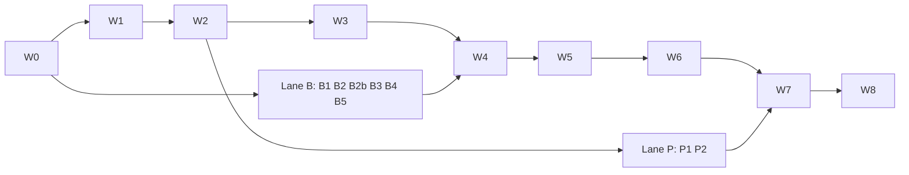

# AA Partner CRM: design v3 (AA-821 / PR-19)

S246, 21/10/2026. Agent: Claude Code (assembly lane). Status: **draft for Nghiệp**. Nothing was written to repos, AWS, Linear or Jira, and no paid calls were made.

**What this document is.** v3 is assembled from three lane drafts in `.tmp-session/s246-crm-v3/`: `ux-design.md`, `data-privacy-integrations.md` and `delivery-plan.md` (column lists and full-width wireframes live there). It applies **every** finding of the skeptic review (§1.6 fix log). Where v3 and a lane draft differ, **v3 wins**. Where v3 and v2 / v2.1 / v2.2 differ, v3 wins and the change is cited.

**Inputs (real paths):**
- Spec: `docs/research/partner-crm-spec.md`. The task path `v2.1/partner-crm-spec.md` does not exist.
- Designs: v2 `docs/audits/2026-10-20-S245-tenant-crm/v2/crm-design-v2.md`; v2.1 `…/v2.1/crm-design-v2.1-tech.md`; v2.2 `.tmp-session/s245-r2/r4/crm-v2.2-simplified.md` + `decisions-v2.2.json`. v2.2 exists only in `.tmp-session` and must be copied into `docs/audits/` with the root PR.
- Approvals: `owner-approvals-r2.md`, review-*.md.
- Ideas: R1–R16 `docs/audits/2026-10-20-S245-crm-tern-traveljoy/`; R17–R44, C12, C31 `docs/audits/2026-10-21-S246-crm-more-ideas/`.
- Answers: `docs/audits/2026-10-21-S246-thu-questionnaire/` (v1 41 answers, `reply-to-notes.md`, v2 12 answers treated as decided).
- Platform: `docs/ecosystem-architecture.md`, ADR 0002/0005/0006/0008, data standards Part B, CIS and Booking `CONTEXT.md`, `docs/architecture/db-schema-reference.md` (Booking at bk-017/018, no departures, holds or allotment).

**Conventions:** `Mn` = spec module n; `F1–F5` = foundation modules; `Rn` = approved idea; `C12`, `C31` = approved AA flow gaps; `Q1 x.y` / `Q2 x.y` = questionnaire v1 / v2 answer; `N x.y` = reply-to-notes row; `S1–S7`, `A1`, `V1–V3` = v2.2 items; `A-nn` / `C-nn` / `S-nn` = agency / client / AA staff screen; `CRM-nn` = issue card in §6; `Fix A1…E5` = skeptic finding. "(est.)" = estimate; "(unverified)" = external fact not re-checked today.

---

## 0. Summary

1. **Product.** A separate app, **AA-Partner** (portal + CRM web + CRM API), integrated with the tenant portal. Free for partner agencies now, tiers later. All 23 spec modules are built on Dev with synthetic agencies before any real agency (owner decisions).
2. **The trip is the folder.** A lead is a trip in the first column. Messages, tasks, proposal, booking lines, invoices, documents and audit lines all hang off the trip workspace (A-03). The board (A-02) is an action queue with one "waiting on" enum, `agency | client | aa | supplier | none` (Fix B1).
3. **Clients never create an account.** Forms and the proposal open from a signed link. The token is exchanged for a host-only cookie and stripped from the URL, but stays valid until it expires, so a second device or the spouse still gets in (Fix B11). The client portal asks each person for an email code (R22), with a "Who are you?" picker when one family email serves two travellers (Fix E4).
4. **AA supply sits inside the builder.** It is a drawer opened from "+ Add" (Fix E1), showing B2B price, sell, margin and availability: Instant, On request (AA confirms within 1 business day) or Sold out.
5. **Holds are tied to the money.**
   - The hold placed at acceptance limits the deposit link (C31). Bank transfers get one bounded hold extension when the client presses "I have paid" (Fix A8).
   - A proposal can hold AA capacity at most once per version, and re-checks are rate-limited (Fix A3).
   - Cancelling a trip is one action with a dry-run preview (C12).
6. **Privacy (F1–F5)** follows v2.2:
   - one KMS data key per environment plus `ingest` and `seal` keys, and a DEK per agency per purpose;
   - documents are encrypted client-side with the `docs` DEK (Fix A7);
   - F1 and F2 are split. The threat model is stated honestly: F2 protects against the AI, insight and support roles, not against `crm_app` or the master user (Fix A1);
   - one role × action matrix, plus a serializer allow-list tested on every route (Fix B12, B13);
   - AA access in three layers. L1 ships in W2; L2 and L3 move to W7, still before Go-real (Fix C4).
7. **Partner Cognito pool on Dev from W2.** It has MFA required (passkey or TOTP) and synthetic users only. The EXTERNAL pool is untouched; it is shared with TripPlanner and Booking (Fix A4).
8. **Booking is the longest pole.** AA-Booking has no departures, capacity, holds, B2B API, VND selling currency or cancellation-fee policy today. Lane B (6 issues, including new CRM-B2b) starts right after the ADRs. The R12 premise "Booking already has departure/allotment" is false.
9. **Delivery: 53 issues, all children of AA-821.**
   - Structure: W0–W8 plus Lane B (Booking/CIS) and Lane P (portal move). Issues are created one wave ahead, so about 10–14 are open at once.
   - Effort *(est.)*: **≈ 40–45 sessions**. At about 2.8 CRM sessions a week, **all 23 modules run on Dev around mid-Feb to end-Mar 2027** (Fix C5). That is later than the Dec–Jan figure in the plan draft.
10. **Cost *(est., AA AWS per month)*:**
    - **Dev ≈ $13–22**;
    - **10 agencies ≈ $84–97**, or $104–152 if prod is a separate cell with its own networking;
    - **50 agencies ≈ $319–344**, or $339–399 for a cell.
    
    AA's vendor cost is $0 under the decided options.
11. **Eight decisions for Nghiệp** are in the decisions list: price detail on the client page, the bank-transfer hold, partner-pool timing, the L2/L3 order, pace, data-standards windows, list-view logging and the v2.2 approval record. Everything else is decided or is an execution detail.

---

## 1. Scope and traceability

### 1.1 Scope

| Bucket | Items |
|---|---|
| **Build before real agencies (W0–W7)** | F1–F5, M1–M18; R1–R10, R15–R44 (R38 content in CIS, R43 in-app part, R44 step 1); R11 as entitlement fields only; R13 as the signed decline only; R14 campaigns; C12; C31 |
| **Go-real (W8)** | Prod placement, partner pool in prod, WAF, vendor verifications (Google, Microsoft, Twilio/Meta if required), Stripe live per agency, DPA, public data page |
| **After the 23 modules (backlog, no issues)** | R12 group departures (hooks now); in-app insurance sales; Messenger/IG; BYOK; help bot (after about 50 real questions); paid flight-status API (R44 step 2); two-way mail sync; Zalo; tier billing; VN payment gateway |
| **Not in scope** | Post-trip rating form (not in the spec or any R-item; only a "Welcome home" template). Content studio → CRM cross-links ("Start a proposal with this tour"; suggestion only, not approved) |

### 1.2 Approval basis and unapproved items (Fix A5)

**Approved:**
- owner decisions;
- R1–R44, with R15/R16 changed to "add now" and R41/R42 included;
- C12 and C31;
- questionnaire v1 and v2;
- v2.2 S1–S7 / A1 / V1–V3, assumed approved as recommended (no click recorded; see Decision D8).

**Not approved, so v3 does not build them as features:**

| Id | Was in draft | v3 handling |
|---|---|---|
| C13 "show total only" | CRM-21 Implements; `price_visibility` default `total_only` | Removed from Implements. Enum `total_with_deltas` (default) \| `total_only`; `per_line` dropped. The default is Decision D1 |
| C47 repeat inquiry attaches to the open trip | CRM-08/15 | Relabelled as part of **R6 + M1 intake dedupe** (the ideas README recommends merging it into R6) |
| C39 drafts / scheduled send | CRM-17 | Autosaved drafts = **basic M5 requirement** (README text). Scheduled send is **not** built |
| C34 "view as client" in the onboarding checklist | CRM-31 | Removed from the checklist. "Preview as client" in the builder (basic M3, U10) covers it |

### 1.3 Traceability: spec → screens → entities → issues

| Spec | Screens | Main entities (`crm.*` unless noted) | Issues |
|---|---|---|---|
| F1 identity vault | A-03 Travellers, A-07, A-08 (masked + reveal), C-07, C-08 | `traveler`, `traveler_health`, `traveler_flight`, `document`, `consent`, `tenant_key` | 06, 09, 24a, 13b |
| F2 pseudonymous profile | A-07 profile, A-04 defaults | `traveler_profile`, `trip_party`, `profile_history` | 08, 09 |
| F3 PII filter | A-21 AI cards | `placeholder_map`, `llm_call.scrub_receipt` | 10, 33a |
| F4 tenancy and roles | A-18 Team & roles, Security; S-01; S-04 | `tenant`, `member`, `owner_recovery_request`, `support_grant`, RLS, permission matrix (§4.6) | 05, 07, 11, 13a, 13b, P1 |
| F5 audit | A-18 Access log, A-03 Activity | `audit_event`, `audit_export_manifest` | 08, 12, 13a, 13b, 26 |
| M1 intake | C-01, A-18 Forms & embed | `intake_form`, `form_definition`, `form_submission` | 08, 15 |
| M2 pipeline | A-02, A-03 | `trip` (+ transitions, history), `task`, `note`, `tag` | 08, 15 |
| M3 interactive proposal | A-04, C-03, C-04, C-12 | `proposal`, `proposal_day`, `option_block`, `option`, `option_rule`, `selection`, `client_link`; Booking quote/hold | 20, 21a, 21b (+ B1, B2, B2b, 19) |
| M4 text proposal | A-05 | `proposal` (shared `price_hash`), `message_template` | 18, 22 |
| M5 email inbox | A-08, A-18 Channels | `channel_account`, `ingest_address`, `conversation`, `message`, `dispatch_queue` | 17 |
| M6 bookings ledger | A-03 Bookings, A-11 | `booking_line`, `booking_line_money`, `agency_supplier` | 16, 19, B3 |
| M7 invoices and payments | A-10, A-03 Payments, C-04, C-10 | `invoice`, `payment_schedule`, `payment`, `refund_request`, `payment_provider_account` | 18, 23 |
| M8 AA ops release | S-02, A-03 Activity, A-18 Access log | `ops_release`, `supplier_manifest_export` | 26 |
| M9 WhatsApp/SMS | A-08, A-18 Channels | `conversation`, `message`, `integration_credential` | 28 |
| M10 workflow automation | A-17, A-09, A-16 | `workflow_template`, `workflow_rule`, `workflow_run`, `task`, `dispatch_queue` | 29a, 29b |
| M11 client portal | C-05 – C-10 | `client_link`, `traveler_access`, `otp_challenge`, `document.visible_to_travelers` | 18, 24a, 24b |
| M12 contracts and waivers | C-08, A-16 Terms, A-03 Travellers | `agreement_doc`, `terms_acceptance`, `signature_request`, `signature_event` | 18, 25 |
| M13 commission | A-12, A-03 Bookings | `commission` | 27 |
| M14 AI layer | A-21 in A-03/A-04/A-05/A-08, A-00 meter, A-18 AI | `ai_draft`, `voice_profile`, `spend_budget`, `llm_call` | 08 (stub), 33a, 33b |
| M15 supplier directory | A-13, A-04 drawer | `agency_supplier` (AA built-in row) | 16 |
| M16 agency reports | A-14, A-01 | `metric_event`, `metric_daily` | 34 |
| M17 AA insights | S-03; A-18 "Included, request opt-out" | `insight_fact` view → `insight_aggregate` | 34 |
| M18 portability and deletion | A-18 Export/Trash, A-07 Export/Delete | `export_job`, `erasure_request`, `crm.erase_subject()` | 14, 35 |
| §4 pipeline and gates | A-02, A-03, gate dialog | `trip.stage` incl. `cancelled`, transitions table | 15, 27 |
| §5 traveler info panel, stage rules | A-03 Overview, A-09 | `trip.intake_completeness`, `form_definition` | 15, 29a |
| §9 AA inventory API and builder | A-04 | Booking `b2b_*`, `departure` | B1–B3, 19, 20, 21a |
| §11.2 edge cases | A-04, C-03, C-04, A-08 Unmatched, A-10 | — | 19, 21b, 23, 28 |
| §11.5 onboarding | A-20, A-01 checklist | import jobs | 31 |
| §11.6 NFR | all screens, A-00, A-18 Payments | — | 07, 37a |
| §11.7 events | — | `metric_event` | 34 |

### 1.4 Traceability: R / C items

| Id | Item | Screens | Entities | Issues |
|---|---|---|---|---|
| R1 | Waiting on + bulk by stage | A-02, A-03 | `trip.waiting_on` | 15 |
| R2 | Special dates | A-07, A-17, A-09, A-15 | passport expiry (F1), `task`, `consent` | 29a |
| R3 | Tags + tag workflows | A-02, A-06, A-07, A-17 | `tag`, `tag_link`, `workflow_rule` | 29b |
| R4 | Proposal viewed + nudge | A-03, A-02, A-00, A-17 | `metric_event proposal.viewed` | 21b |
| R5 | AI usage meter | A-00, A-18 | `spend_budget` | 33a |
| R6 | Merge duplicates + staged import (+ C47 dedupe) | A-06, A-07, A-20, C-01 | blind indexes | 08, 31 |
| R7 | Relationships + multi-traveller form | A-07, C-01 | `traveler_relation`, `trip_traveler` | 09, 15 |
| R8 | Agency owns clients; owner reassigns | A-03, A-07, A-18 Team | `traveler.owner_member_id` | 11 |
| R9 | Template library + AA content | A-16, A-04 | `workflow_template`, `message_template`, CIS AA templates | B5, 22, 29a, 32 |
| R10 | AI reads supplier confirmations | A-03, A-08, A-21 | `ai_draft`, `booking_line` | 33b |
| R11 | Tiers (free now) | A-18 Plan & usage | `tenant_entitlement` | 11 |
| R12 | Group booking (after 23 modules) | reserved slot | `trip.group_departure_ref`, Booking `departure` | hooks in B2, 15 |
| R13 | Insurance: decline only | C-07, C-08, A-03 | `agreement_doc kind=insurance_declination` | 25 |
| R14 | Consent campaigns | A-15, C-11 | `campaign*`, `unsubscribe_token` | B5, 36 |
| R15 | Call booking + calendar sync | C-01, A-18, A-09 | `meeting_slot`, `calendar_connection` | 15, 30 |
| R16 | Offline itinerary PWA | C-09, C-05 | service-worker cache (itinerary only) | 24b |
| R17 | FX rules | A-03, A-10, A-14, A-18 | frozen FX block, `fx_rate_platform`, `fx_rate_override` | 16, 19, 27 |
| R18 | Line status + strictness | A-03, A-11, A-18 | `booking_line.status`, `aa_sub_status` | 16, 19, B3 |
| R19 | Choice diff | A-03, A-00 | `selection` | 21b |
| R20 | Task buckets + relative dates | A-09, A-00 | `task.due_anchor`, `due_at`, `due_overridden` | 29a |
| R21 | Trash + Cancel instead of Delete | A-03, A-18, dialog | trash columns (template from crm-001) | 05, 14, 27 |
| R22 | Per-person client view | C-05 – C-10, A-03 | `traveler_access`, `otp_challenge`, `document.visible_to_travelers` | 24a |
| R23 | Archive + Lost reasons | A-07, Lost dialog, A-02, A-14 | `traveler.archived_at`, `trip.lost_reason_code` | 14, 19, 34 |
| R24 | Sender table + reconnect | A-08, A-18, A-05 | `message.sender_kind`, `held_reconnect` | 17 |
| R25 | Pay on arrival | A-04, A-03, C-03, C-04, A-10 | `booking_line.collect` | B4, 23 |
| R26 | Grouped confirmation + decline task | C-04, A-03, A-09 | `option.confirm_class` | 21b, 23 |
| R27 | Service-fee invoice | A-10, A-18, C-10 | `invoice.kind=service_fee` | 23 |
| R28 | YoY KPI tiles | A-01, A-14 | `metric_daily` (25 months) | 34 |
| R29 | System-tag workflows | A-17, A-02 | `tag.kind=system` | B4, 29b |
| R30 | Missing-workflow badge | A-02, A-17 | `workflow_run.coverage_gap` | 29b |
| R31 | Conditional forms | C-01, C-02, C-07, A-16 | `form_definition` | 15 |
| R32 | Locale dates + age band | A-00, A-07, A-04, client pages | `age_band_at_departure` | 07, 09 |
| R33 | Time zones + overnight flights | A-04, C-07, C-09, S-02 | `proposal_day.tz`, `traveler_flight` | 21a, 24a, 26 |
| R34 | Versioned terms | C-04, A-16, A-18 | `agreement_doc`, `terms_acceptance` | 25 |
| R35 | Global search | A-00 | blind indexes | 32 |
| R36 | Ready to travel again | A-15, A-07 | `profile_history` | 29b |
| R37 | Where are my clients + incident flag | A-02 Travelling now, A-00; Booking staff admin | `incident_flag` | B3, 30 |
| R38 | Pre-travel section | A-04, A-16, C-03, C-09 | `proposal_day.day_no=0`, `prep_pack_selection`; CIS packs | B5, 22 |
| R39 | AI guardrails | A-21 | `ai_draft.validation`, `feedback_code` | 33a |
| R40 | Notes → AA options | A-04, A-03 | `ai_draft stage=notes_to_options` | 33b |
| R41 | Voice profiles | A-18 AI, A-05 | `voice_profile` | 33b |
| R42 | What's new + preview switch | A-00, A-18, S-01 | `release_note`, `release_channel` | 37b |
| R43 | Self-serve onboarding / support model | A-20, Help | help pages | 31, 37b |
| R44 | T-48 h flight task (step 1) | A-09, S-02 | `traveler_flight`, `task` | 26, 29a |
| C12 | One-action cancellation | A-03, cancel dialog, A-10 | `trip.stage=cancelled`, `refund_request`, Booking cancel policy | B2b, 15, 26, 27 |
| C31 | Link valid until hold expiry | C-04, C-12, A-10, A-09, A-02 | `invoice.pay_window_until`, `bk_hold_ids`, `payment_claimed` | B2, B2b, 21b, 23 |

### 1.5 Questionnaire decisions → where

| Decision | Where |
|---|---|
| Q1 1.1 free; tiers later | A-18 "Free"; `tenant_entitlement` (11) |
| Q1 1.2 / Q2 1.1 B2B price (15 % margin), agency sets sell | A-04; Booking quote (B1) |
| Q1 1.3 / Q2 1.2 AA invoices the agency per current B2B terms; outside the CRM | A-10 "Owed to suppliers" (link only, O-10) |
| Q1 1.4 / Q2 1.3 warn below public "from" price | A-04; `GET /price-parity` (B1) |
| Q1 2.6 neutral domain, optional custom domain, mail from the agency mailbox | §2.1, A-18 |
| Q1 3.5 support access 1–7 days, default 24 h, read-only, F1 hidden | A-18, A-00 banner, S-04 (13b) |
| Q1 3.7 / 3.8 deletion ≤ 30 days; audit 12 months in-app + 7-year archive | §3.6, §4.9 (12, 14, 35) |
| Q1 3.9 / 3.10 "AA ops viewed trip X"; minimal ops fields | S-02, A-18 (26) |
| Q1 3.12 → N 3.12 → Q2 3.12 insights k ≥ 10 and ≥ 3 agencies, default on, opt-out **by request** | L1 action, A-18 shows "Included, request opt-out" (34). X7 closed |
| Q1 3.13 MFA for owner and agent | Partner pool on Dev (11) |
| Q1 4.1 self-built e-sign; BoldSign fallback | C-08 (18, 25) |
| Q1 4.2–4.4 → N 4.2 WhatsApp + SMS on the agency's own Twilio | A-08, A-18 (28). X9 closed |
| Q1 4.5 / 4.6 Stripe Connect Standard; VN manual | C-04, A-10 (23) |
| Q2 4.1 + Q1 4.8 → N 4.8 send-as Gmail **and** Outlook, forward-in; no two-way sync | A-08, A-18 (17) |
| Q1 6.2 / Q2 6.1 fixed departures auto-confirm; others on request, 1 business day | A-04, C-03, C-04 (B2, B3) |
| Q1 6.3 owner recovery after 14 days | S-01; banner for every member with [Cancel] (11, 13a) |
| Q2 2.1 self-serve onboarding, help pages + videos, bot later | A-20 (31, 37b) |
| Q1 2.3 AA writes prep packs; visa = official link only | CIS (B5), A-04 (22) |
| Q2 5.1 "I decline travel insurance" signed with the waiver | C-08 (25) |

### 1.6 Skeptic fix log (every finding → where applied)

| Fix | Change in v3 | Section / issue |
|---|---|---|
| A1 F1/F2 joinable via `trip_id` | Threat model stated honestly; `trip_traveler` excluded from every NOLOGIN reader grant; isolation-probe test; DPA wording | §4.3; CRM-09 |
| A2 PWA cached documents | Itinerary only; documents online only | §2.9 rule 7, WF-8; CRM-24b |
| A3 anonymous link places holds | One active hold set per (proposal, version); re-check ≤ 3/day/proposal; bell on every re-hold; Booking rate limit | §2.7 F6, §3.5; CRM-21b, CRM-B2b |
| A4 MFA vs EXTERNAL pool | Partner pool with MFA on Dev in CRM-11; EXTERNAL untouched; reenrol step in P2; ADR 0006 amendment in CRM-01a | §4.7; Decision D3 |
| A5 C13 and other unapproved C-ids | §1.2 table; enum `total_with_deltas \| total_only` | §1.2, §3.3; Decision D1 |
| A6 ADR/standards scope | CRM-01a (ADRs + contracts + errata), CRM-01b (DM-6.1, 6.8, 7 + DM-7.5 approval) | §6; Decision D6 |
| A7 keys, buckets, docs encryption | CRM-04: 3 keys + 2 buckets; CRM-09: client-side `docs` DEK; CRM-12 writes both buckets | §4.1 |
| A8 C31 vs bank transfer | `payment_claimed` → one hold extension → verify task; `paid_unfulfillable` in enum | §3.5; CRM-23, CRM-B2b; Decision D2 |
| B1 waiting-on enum | `agency \| client \| aa \| supplier \| none`; "Me" label; AA chip | §2.7, §3.3 |
| B2 ops release timing | Created at AA line confirmed, refreshed as Stage 3 fills, T-21 alert | §2.7 F8; CRM-26 |
| B3 incident flag location | Button in the Booking staff admin; S-02 links to it | §2.5; CRM-B3 |
| B4 date rule vs gate | Moves to Travelling anyway + timeline line + urgent task | §3.5; CRM-15, 29a |
| B5 `cancelled` late | Defined in CRM-15 migration | CRM-15 |
| B6 trash retrofit | Base table template with trash columns from `crm-001` | §3.2; CRM-05 |
| B7 delete-block rule | Blocked only for AA lines `held` or `confirmed` (plus money/signature/commission) | §3.5 |
| B8 undo vs side effects | `dispatch_queue.not_before = now + 10 s`; Undo cancels queued rows; "Undo until sent" | §3.5 |
| B9 "Choose later" | Agency items only | §2.7 F5 |
| B10 rooms at C-04 | Agent sets in builder; client confirms; change = request | §2.7 F6, WF-7 |
| B11 device-bound link | Cookie exchange + URL strip; token valid to expiry; rate limits; [Re-issue link] | §2.9, §3.3 |
| B12 margin leaks | Per-role serializer allow-list + contract test over every `/crm/v1` route; margin field list | §4.6; CRM-11 |
| B13 no permission matrix | Role × action table | §4.6 |
| B14 ops path | `/crm/ops/v1`; negative test for `cis-admin` on `/crm/v1` | §4.7; CRM-05 |
| B15 list-view F1 reads | Batched `list_view` event; no partial phones in lists; sensitive fields per click | §4.4; Decision D7 |
| B16 erasure vs append-only | `crm.erase_subject()` SECURITY DEFINER + `crm_eraser`; signed-agreement retention exception | §4.10; CRM-35 |
| B17 X7, X9 already decided | Closed; insights opt-out is an L1 action on owner request | §1.5, §9.2 |
| B18 R24 wording | `allow_platform_sender` opt-in kept (default off, owner only, logged) | §5.5; CRM-17 |
| B19 "net" naming | `b2b_price` vs `supplier_net`; schema test forbids `supplier_net` | §5.2; CRM-B1 |
| C1 AA content authoring | New CRM-B5 in AA-CIS-App | §6 |
| C2 Booking VND + fee policy | New CRM-B2b | §6 |
| C3 dependencies | 29a→24a; 27→B2b, 26; cancel stops workflows; 21a without map; 20 is an enhancement | §6 |
| C4 admin front-loading | 13a L1 in W2; 13b L2+L3 in W7 | §6; Decision D4 |
| C5 sizes | 7 splits; ≈ 40–45 sessions; Feb–Mar 2027; CIS/CRM split stated | §6.4; Decision D5 |
| C6 load test on shared RDS | 50 tenants, limits enforced, idle job tables, abort on CIS lag; or throwaway RDS | CRM-37a |
| C7 safe post-M4 items | R28, R36, R40, R41, R42 may land after M4, before W8 | §6.4 |
| C8 MFA count | Single list: MFA applies vs OIDC apply role | §6.5 |
| C9 Guardrails default | Acc3 CRM-only role is the planned path if acc2 is blocked; "US regions" | §4.5, §5.10 |
| C10 Lane P gap | Same Cognito client + cross-links from CRM-07; Content studio inside the shell only after P2; CIS-first risk in CRM-01a | §2.1; CRM-07, P2 |
| D cost errors | Dev +$1–2; prod networking assumption; Cognito MAU line; Guardrails corpus nightly | §7 |
| E1 builder | AA drawer, map collapsed, Advanced section, default "client may swap" | WF-4 |
| E2 onboarding | 3 required steps, rest "Later" | §2.7 side flows |
| E3 safe defaults | Basic strictness, automatic FX, fee off, trash 7 days, agent-first reminders | §3.3 `tenant_settings` |
| E4 shared email | "Who are you?" picker | C-05, WF-8 |
| E5 intake | Companions optional, collapsed, names only | C-01 |

---

## 2. UX

### 2.1 Hosts

| Host | Users | Auth | Contains |
|---|---|---|---|
| Agency `portal.` → AA-Partner (Dev `partner-dev.`) | Owner, agent, assistant; AA support only in a granted session | Dev W1: `cis-portal` EXTERNAL client (SSO with the portal). From CRM-11: **partner pool**, MFA required for owner and agent | CRM; Content studio pages after CRM-P2 |
| Client `go.` (Dev `go-dev.`), later a neutral product domain + optional agency custom domain (Q1 2.6) | Travellers and prospects | Signed link for forms and the proposal; email code per person for the portal | C-01 … C-12 |
| CIS admin | AA staff (WORKFORCE + MFA) | existing | S-01 "Agencies (CRM)" (no PII), S-03 insights |
| AA-Partner staff routes | `crm-ops`, `crm-support` groups | WORKFORCE, separate app client | S-02 ops release, S-04 support session |

Cookies are host-only, so the agency and client hosts never share a session.

**Integration with the portal before P2 (Fix C10).** Until CRM-P2, the CRM runs on `partner-dev.` beside the Vercel portal:
- the portal sidebar gets a "CRM" entry and the CRM sidebar a "Content studio" entry;
- from CRM-11, CRM sign-in uses the partner pool while the portal stays on EXTERNAL. Synthetic users sign in twice until P2 moves them (invite-to-reenrol).

Content studio appears inside the CRM shell only after P2.

### 2.2 Agency information architecture

```
HOME                A-01  KPI tiles, "needs you", onboarding checklist (3 required + optional)
CRM   Pipeline      A-02  Board | List | Travelling now | Closed (Lost, Cancelled, Completed)
      Clients       A-06  directory, tags, archived, duplicates
      Inbox         A-08  email, WhatsApp, SMS, AI drafts, Unmatched, Waiting for reconnect
      Tasks         A-09  Overdue / Today / Upcoming / Later / Waiting for dates
MONEY Payments      A-10  receivables, schedules, reminders queue, owed to suppliers   (hidden for assistant: margin columns)
      Bookings      A-11  ledger across trips
      Commissions   A-12  hidden for assistant
GROW  Reports       A-14  margin hidden for assistant
      Marketing     A-15  ready to travel again, special dates, campaigns (owner/agent only)
      Suppliers     A-13  AA (built-in) + own suppliers
      Library       A-16  itinerary items, task lists, messages, forms, pre-travel packs, terms/waivers
      Automations   A-17  owner edits; agent applies
CONTENT STUDIO            existing portal pages (inside the shell after CRM-P2)
Settings            A-18  team, security, channels, payments, forms, AI, data & privacy, plan, trash
Help & what's new         R42, R43
```

Trip tabs: Overview · Proposal · Bookings · Payments · Travellers & docs · Messages · Tasks & notes · Activity. The builder (A-04) opens full screen.

### 2.3 Global shell (A-00)

| Element | Behaviour | Covers |
|---|---|---|
| Search (Ctrl/Cmd+K) | Recognises `bk-` codes, supplier confirmation numbers, E.164 phones and emails (blind index, exact only); accent-insensitive on non-PII fields | R35 |
| `+ New` | Trip, client, task, note | U1 |
| Tasks / notes drawers | Reachable from any screen | R20, U11 |
| Bell | Proposal viewed or option chosen, **re-hold placed** (Fix A3), payment claimed or received, hold expiring, AA confirmed or declined a line, AA incident, mailbox disconnected | R4, R19, C31, R26, R37, R24 |
| AI meter | Warns at 75 / 90 / 100 %; at 100 % AI stops and nothing is charged | R5 |
| Language and dates | EN/VI; dates follow the locale; anything sent out spells the month | R32 |
| Support banner | Amber, cannot be dismissed, [End now] | A1 L2 |
| Undo toast | 10 s after a move, bulk action, archive or delete. Sends and workflow starts triggered by the action are queued with `not_before = now + 10 s` and cancelled by Undo; bulk sends say "Undo until sent" (Fix B8) | Tern no-undo complaint |

### 2.4 Client pages

| Page | Access | Covers |
|---|---|---|
| C-01 Inquiry form (embed, hosted page) | Public. Stage 1 fields; companions optional and collapsed, **names only** (Fix E5); optional call slot (R15); lead source recorded | M1, R7, R15, R31, R32 |
| C-02 Planning form (Stage 2) | Signed link; conditional; health after a consent screen; returning clients get pre-filled bands | Stage 2, R31, rule 4 |
| C-03 Proposal page | Signed link, no login; total + per-option sell deltas (Decision D1) | M3, R4, R19, R26 |
| C-04 Accept and deposit | Signed link + typed name; rooms **confirmed**, not chosen (Fix B10) | M3, M7, R25, R26, R34, C31 |
| C-05 Code sign-in | Email code per person; **"Who are you?" picker** when one email maps to several travellers (Fix E4) | M11, R22 |
| C-06 Portal home | After code; lead vs companion | M11, R22 |
| C-07 My forms (Stage 3) | After code; companion emails are asked here, at the portal invite | Stage 3, R31, R33 |
| C-08 Sign | Code asked again; terms + waiver + insurance decline in one envelope | M12, R13, R34 |
| C-09 Itinerary (installable, offline) | After code; offline cache = itinerary only | M11, R16, R38, R33 |
| C-10 Payments | Lead only | M7, R25, R27 |
| C-11 Preferences / unsubscribe | Signed link | R2, R14, R23, R36 |
| C-12 Link or hold expired | [Check availability again], limited to 3 a day per proposal, then "Ask your agent" (Fix A3) | C31, R21 |

### 2.5 AA staff screens

| Screen | Holds | Covers |
|---|---|---|
| S-01 CIS "Agencies (CRM)" (L1, W2) | Usage meters only; create agency; invite the first owner (only while the agency has no owner and no travellers); lock/unlock; retry jobs; allow (never switch on) entitlements; set the insights opt-out on the owner's request; raise export/delete requests that the owner confirms; owner recovery by promoting an existing member after 14 days. Never trips or revenue | A1 L1, Q1 6.3, Q2 3.12 |
| S-02 crm-ops | Releases for confirmed AA lines, minimal fields (Q1 3.10), completeness indicator, deletion countdown (return + 90 days), supplier export (logged). **Link to the Booking staff admin** for incident flags; there is no flag button here (Fix B3) | M8, R33, R44 |
| S-03 AA insights | Cells with fewer than 10 travellers or 3 agencies suppressed | M17 |
| S-04 Support session (L2, W7) | Agency UI, read-only; F1 masked unless the owner ticked "show identity"; banners on both sides | A1 L2 |
| Booking staff admin (AA-Booking) | On-request desk (accept/decline within 1 business day), **"Flag incident on departure"** | Q1 6.2, R37 |

### 2.6 Patterns copied and not copied

**Copied** (sources in the UX draft §2):
- trip as folder (U1), "waiting on" chip (U2), bulk by stage (U3);
- one form creates the client and the trip, with dedupe and companions (U4);
- tag workflows with count previews (U5), stage moves by date logged as "moved by" (U6);
- approve and pay in one flow (U7), reminders to the agent first (U8);
- AI preview card and meter (U9), working copy vs published copy plus "viewed" (U10);
- search, notes and tasks from anywhere (U11), quick copy with logging (U12);
- form fields mapped to the profile, never F1 (U13), starter templates (U14);
- option blocks, task buckets.

**Not copied:**
- editing without undo;
- date edits that silently drop prices (we re-quote and show the diff);
- one reminder template for deposit and balance;
- referrals that cannot be taken back;
- one passport photo per client.

### 2.7 Main flows

**F1 Inquiry.**
1. The prospect submits C-01.
2. `crm_intake_process` dedupes by blind index (R6, which absorbs C47). A repeat submission attaches to the open Inquiry. Otherwise it creates:
   - an F1 traveller and an F2 profile;
   - companions linked by relationship (R7);
   - a trip at `inquiry` with system tags (R29);
   - a "Reply within 2 h" task and the confirmation email.
3. The card shows on A-02 within about 1 minute, waiting on **agency** (labelled "Me" for the owner of the trip).

**F2 Qualifying.**
1. The agent sends C-02 (a workflow can auto-send it) or picks [Fill in from call]. R40 suggests answers and options as a preview only.
2. If Stage 2 is below 80 %, the task "Get planning info" is created.
3. **Gate to Proposal:** Stage 2 ≥ 80 %, or an override with a logged reason (409 `stage2_incomplete` otherwise).

**F3 Build (A-04).**
1. A skeleton comes from Stage 2: days, region, default options. **The agent sets the room configuration here** (Fix B10).
2. AA items come from the inventory drawer, showing B2B price ("Net"), sell, margin, availability, and age and fitness limits. Option blocks default to "client may swap"; requires/excludes rules sit under Advanced (Fix E1).
3. Agency items come from Suppliers or the Library (R9). R10 turns a forwarded supplier PDF into suggested lines.
4. Other settings on this step:
   - sell prices or markup; a price below the AA public "from" price **warns, never blocks**;
   - pay-on-arrival lines (R25), per-day time zones (R33), the "Before you go" day 0 (R38).
5. Preview as client, then **Publish vN**.

The builder works as a day list. The map (CRM-20) is an enhancement that does not block M3 (Fix C3).

**F4 Send (A-05).**
1. Gate check.
2. Pick a format: visual link, email text, or WhatsApp/SMS text. All three share one `price_hash`.
3. A saved reply or an AI draft (with R41 voice) can start the message; only a human sends.
4. The trip moves to `proposal`, waiting on client.
5. Mail goes out send-as from the agency mailbox. A dead token holds it in "Waiting for reconnect" (R24).

**F5 Client choice (C-03).**
1. Opening the page logs "viewed" (R4). If the client viewed but chose nothing for 2 days, a nudge goes out.
2. The client can **Keep** or **Swap**. Each swap re-prices live; options that clash with a rule are greyed with the reason.
3. **"Choose later" exists only for agency-supplier items**, which need no hold or AA billing. AA blocks are decided at accept (Fix B9).
4. "Request a change" sends the agent one bundled diff (R19).
5. Edge cases:
   - an option sells out: the block falls back to the default and the agent is told;
   - a new version is published: a banner shows and picks carry over;
   - Booking is down: the page shows "last checked", Accept is disabled and the agent is alerted.

**F6 Accept, hold, deposit (C-04).**
1. Lines are grouped (R26): confirmed when you pay; confirmed by our partner within 1 business day (alternative or refund if declined); your agent books; paid on arrival (listed, never charged).
2. The client **confirms** travellers and rooms. A change goes through "Request a change".
3. The client accepts the terms version (stored with the `price_hash` and hold ids, R34) and types their full name.
4. Booking places **one hold set per proposal version**, idempotent on `(proposal_id, version)` (Fix A3). The agent's bell rings on every re-hold.
5. Pay:
   - **Card:** Stripe Checkout on the agency's Connect Standard account. The link expires with the earliest hold (C31).
   - **Bank transfer:** bank details are shown while the hold is active. "I have paid" sets the invoice to `payment_claimed`, the CRM asks Booking once for an extension (`POST /holds/{id}/extend`, length set by Booking, proposed +72 h), and the agent gets the task "Verify transfer before <new expiry>" (Fix A8, Decision D2).
6. Once paid, the trip moves to `booked`:
   - AA lines go to confirm;
   - waiting on `aa` while an on-request line is pending, `supplier` while agency lines are unconfirmed;
   - each traveller gets their own portal invite; Stage 3 unlocks.
7. After 2 failed card payments the agent gets a task.

**F7 Booking lines.**
- Status is `planning → confirmed → cancelled` (R18). Only `confirmed` counts.
- AA lines fill from the Booking feed (bk- code, B2B price, sell, FX locked at the quote) and are read-only (403 `aa_line_read_only`).
- Agency lines follow strictness Off / **Basic (default)** / Strict. A missing commission creates an owner task and never blocks the assistant.
- An AA decline creates a task offering [Swap product] or [Refund that part].

**F8 Pre-trip.**
1. Each traveller signs in with their own code (C-05), fills Stage 3 (C-07) and signs (C-08).
2. The lead can fill a form for a child or a companion without email, but cannot read it back.
3. **Ops release (M8, Fix B2):**
   - created when an AA line becomes `confirmed`, matching spec M8 "only for confirmed departures";
   - its payload is refreshed as Stage 3 fills in; S-02 shows completeness;
   - an alert goes to the agent and AA ops if it is still incomplete at T-21;
   - every ops view writes "AA ops viewed trip X" into the agency's access log.
4. **Gate to Pre-departure:** Stage 3 complete and waiver signed.
5. Reminders and tasks:
   - Stage 3 incomplete at T-21: the client is nudged and the agent alerted;
   - waiver missing at T-21: alert (R29);
   - passport expiring within 200 days of return: task (R2);
   - T-48 h: "Confirm arrival flight" (R44 step 1).
6. The balance has its own reminders (U8) and is paid on C-10.

**F9 Travelling.**
1. The trip moves on the departure date ("moved by date rule"). **If Stage 3 or the waiver is still missing**, it moves anyway, the timeline says "moved by date; Stage 3/waiver missing", and an urgent task is created (Fix B4).
2. "Travelling now" groups trips by AA region; names stay hidden until clicked (R37).
3. An AA incident (flagged in the Booking admin) shows a banner and a WhatsApp draft to each affected agency. AA never messages travellers.
4. Travellers use C-09 offline.

**F10 Post-trip.**
1. The trip moves to `completed` on the return date; a "Welcome home" draft is ready. A trip with no return date stays Travelling and raises a task.
2. Commission: expected vs received, with overdue flags.
3. The ops release is purged at return + 90 days, with a receipt in Activity.
4. Ready to travel again (R36) and special dates (R2) feed Marketing; sending needs consent.

**Side flows:**
- **Lost:** a fixed reason (R23): price · price (AA tour) · AA sold out · AA on-request declined · dates changed · went elsewhere · no response · postponed · other. The reason is pre-selected from the Booking feed. The client can be archived.
- **Cancel trip (C12),** a dialog with a dry-run preview and a typed CANCEL:
  1. AA lines are cancelled or released, and Booking returns the fee;
  2. agency suppliers get one task each;
  3. invoices are voided and open Checkout sessions expired;
  4. refund requests follow the accepted terms version and need approval (§4.6);
  5. commission is cancelled;
  6. the ops release is withdrawn;
  7. **workflows stop**;
  8. stage becomes `cancelled`.
  
  While Booking is down the trip shows "cancellation pending" and never "cancelled" early.
- **Delete:** see §3.5. A blocked delete becomes "Cancel trip".
- **Onboarding (Fix E2).**
  - **3 required steps:** connect Gmail or Outlook (send-as + forwarding address), invite the team, embed the inquiry form.
  - **Optional, with "Later":** import CSV (clients → relationships → trips → notes), review duplicates, connect Stripe or choose bank transfer, deposit rules, EN/VI templates, kickoff call, help centre.
  - Safe defaults mean no settings choice is forced (§3.3).

### 2.8 Wireframes (shortened; full width in `ux-design.md`, with these v3 changes)

**WF-1 Pipeline (A-02).** The chip row is `Waiting on: (All) (Me 9) (Client 14) (AA 2) (Supplier 3)`. The AA chip means on-request pending; its action is "Escalate to AA ops".
- Column menu: send a follow-up (undo until sent); apply a workflow (preview count); tag; reassign (owner); mark lost; "N trips missing workflow Y" [Preview][Run] (R30).
- Cards never show margin.
- On mobile, one stage per screen with swipe.

**WF-2 Trip workspace (A-03).** Header: stage, waiting-on chip, owner, [Cancel trip].
- Traveler info panel: Basics / Planning % / Booking details locked until the deposit.
- Proposal card: version, viewed time and count, picks.
- Money card: margin for owner and agent only.
- Timeline: selection diffs, sends with price hash, "moved by" lines.
- Bookings tab columns: Day | Item | Supplier | Conf no | Status (AA rows from the feed) | Cost | Sell | FX (rate @ date) | Collect (agency / on arrival).
- Travellers tab: F1 shown as `••••` with [Reveal]/[Copy], each logged.

**WF-3 Client profile (A-07).**
- Masked contact with [Reveal]; consent state; buttons by role (§4.6): [Archive] [Merge] [Export client] (owner) [Delete client data] (owner).
- Bands-only profile; relationships; special dates; trips; ready-to-travel-again reason.

**WF-4 Builder (A-04, Fix E1).**
```
| Working copy v3 . Published v2 (viewed)   [Preview as client] [Publish v3]                    |
| Sell 18,680 . Net 15,248 . Margin 3,432 (18.4%) . Pay on arrival 180 . AUD   [Send...]       |
| DAYS (+ Before you go) | DAY 3 Luang Prabang (UTC+7)        [Map v] (collapsed by default)    |
| 1 Arrive LPQ           | OPTION BLOCK Lodging (default from Stage 2)  client may swap [on]      |
| 2 Kuang Si             | (*) Homestay        Instant      net 140  sell 280                     |
| >3 Luang Prabang       | ( ) Riverside Lodge On request   +40 sell                              |
| Rooms: 1 family (2A2C) | ( ) Amantaka        Sold out (cannot add)                              |
| Checks: Day 1 late     | [+ Add] -> drawer: AA inventory (live, synced 10:42) | Suppliers | Library |
|  arrival               | > Advanced: requires / excludes rules, choose-later (agency items only)|
| ! sell below AA "from": warning only     [AI: ideas from call notes (AA stock only)]         |
```
- The assistant sees no Net or Margin.
- If AA is offline the drawer says so and AA adds are disabled.
- Shortening dates re-quotes and shows a diff.
- The phone is for edits (swap, price, text); building happens on desktop (O-8).

**WF-5 Send (A-05).** Gate warning with [Send planning form] or a logged override; format; recipient [Reveal]; sender shown (send-as); template and voice; AI draft chip; price hash; [Save draft] [Send].

**WF-6 Client proposal (C-03, phone first).** Agency logo, dates, party, "Prepared by". Total with the pay-on-arrival note. Per day: "Included [Keep]" or "+$40 pp [Swap to this]", with the confirmation class and rule hints. [Ask for a change]. No net prices, no per-line prices, no traveller names, no cancelled lines.

**WF-7 Accept and deposit (C-04 / C-12).**
```
| 1 Review . 2 Travellers & rooms (confirm) . 3 Terms . 4 Pay                           |
| CONFIRMED WHEN YOU PAY | CONFIRMED BY OUR PARTNER IN 1 BUSINESS DAY | YOUR AGENT BOOKS |
| PAID ON ARRIVAL (not charged now): Angkor pass 180                                     |
| Rooms: 1 family room (2A 2C)  [Ask for a change]                                       |
| [x] I accept Sunshine Travel's booking terms (v2026-09) . Full name [Grace Lee]       |
| Deposit 30% AUD 5,604 now . Balance AUD 13,076 due 12 Dec                             |
| Your places are held until 23 Oct 17:00                                               |
| [Pay by card]   [Bank transfer -> details + "I have paid"]                            |
C-12: "Your reservation hold has expired" [Check availability again] (3 per day) -> new hold, maybe new price
```

**WF-8 Client portal (C-05 / C-06).**
```
Sign-in: email (hint t***@o*****.com) [Send code] -> 6-digit code (10 min)
  -> if this email belongs to 2+ travellers on the trip: "Who are you?" [Tom] [Lily (guardian)]
Companion home: TO DO My details 2/6 > | Sign terms + waiver > | Insurance: own [x]
  ITINERARY (works offline) > | DOCUMENTS (online only, mine) > | [Email Minh][WhatsApp Minh]
Lead home adds: PARTY STATUS (progress only) . [Fill for Max] . PAYMENTS balance due >
```

**WF-9 Payments (A-10).**
- Tabs: Receivables | Schedules | Reminders queue | Owed to suppliers.
- Rows show the invoice status, including `payment_claimed` ("Client says paid; verify before 26 Oct 17:00" [Mark received]).
- A deposit link shows "valid until hold expiry".
- Reminders go to the agent first. "Owed to suppliers" for AA is a "per B2B terms" link only (O-10).

**WF-10 Tasks (A-09).**
- Buckets: Overdue / Today / Upcoming / Later / Waiting for dates.
- Sources: workflow / AI / manual / AA event.
- The morning digest carries counts only.

**WF-11 Inbox (A-08).**
- Filters: All, Email, WhatsApp, SMS, AI drafts, Unmatched, Waiting for reconnect.
- A thread shows the masked number with [Reveal], the linked trip, the AI draft card ("checked: in stock, price unchanged") with [Use] [Edit] [Discard] and reason codes, and the WhatsApp window.
- The footer shows send-as and inbound by forwarding/BCC.

**WF-12 Settings and Library (A-18 / A-16).**
- Settings sections:
  - Agency & branding; Team & roles; Security (2-step); Channels;
  - Payments (Stripe/bank, deposit rules, FX automatic, service fee off, line strictness Basic, refund owner-approval threshold);
  - Forms & embed; AI (off by default, usage, voices);
  - Data & privacy (access log 12 months, AA support access, AA insights "Included, request opt-out", export, Trash 7 days);
  - Plan "Free"; What's new / preview.
- The AA support access control is owner-only: off → allow for 24 h (1–7 days), read-only, show identity [ ], revoke any time.

**Dialogs:** Cancel trip (dry run + typed CANCEL); Mark lost; Gate override (reason, logged).

### 2.9 Client-page rules

1. **No accounts.**
   - Signed links for forms and the proposal. On first open the token is exchanged for a host-only cookie and **stripped from the URL** (redirect; `Referrer-Policy: no-referrer`).
   - The token **stays valid until `expires_at`**, so another device can open it.
   - Opens are rate-limited per link and IP. The agent can [Re-issue link], which revokes the old token (Fix B11).
   - The portal uses a 6-digit code per person (10 min), asked again at signing.
2. **Per-person view (R22).** The lead and companions see their own forms, documents flagged visible to travellers, the itinerary and their own signatures. The lead also sees party progress (not the data) and payments.
3. **Never shown:** other travellers' data, passports after upload, B2B price or margin, per-line prices, cancelled lines, internal notes, AI drafts. The agency is the brand.
4. **Stage rules (spec §5).**
   - Stage 3 only after the deposit; health only after consent; answers as bands.
   - Pre-fill on signed-link forms = profile bands only; identity fields only inside the portal.
5. **Money wording.**
   - Deposit and balance are always separate; pay-on-arrival is shown and never charged.
   - Lines are grouped by confirmation class.
   - The hold deadline sits next to the pay button, and the link dies at hold expiry (C31).
6. **Language and time.** EN/VI, month names, per-day local time.
7. **Offline (Fix A2).** Only the itinerary is cached: days, times, places and the agency contact for the signed-in person. Documents, Stage 3 data and write-only files open online only. The cache is cleared at sign-out and when the link expires. No push notifications in v1.
8. **Consent.** Marketing messages carry a C-11 unsubscribe link; archived and opted-out clients are blocked at the dispatcher.
9. **Phone first.** Large Keep/Swap buttons; forms jump to the first error.

---

## 3. Data model

### 3.1 Placement

- **Gate answer (ADR 0008 §2):** a new domain with its own lifecycle. The agency is the controller and AA the processor.
- **Owner:** repo **AA-Partner** (new, public): `web/` (portal + CRM UI + traveller host) and `api/` (FastAPI + in-process `crm.job` worker).
- **Schema `crm`:**
  - migrations `crm-NNN`, with a byte copy in `AA-CIS-Infra/db/migrations/crm/` applied only by DB Migrate;
  - registered in `owners.yaml`, with the `crm_` kind prefix in `IDLE_EXEMPT_KINDS` from day one.
- **Where:** Dev is `aa-cis-dev-db`, and `tenant.is_synthetic` must be true there. Prod is a prod cell or shared prod RDS, decided at Go-real (N4).
- **DEK store:** `crm.tenant_key` on Dev; S3 with retention ≤ 30 days if prod shares an RDS (S1/E2, V1).
- **Roles:**
  - `crm_owner` NOLOGIN owns every object;
  - `crm_app` LOGIN runtime: connection limit 6, pool 3 (DM C2.2 row in CRM-01b);
  - NOLOGIN roles reached only by `SET LOCAL ROLE` inside `tenant_tx()`:
    - `crm_ai_reader`: F2 and AI views;
    - `crm_insights`: the insight-fact view;
    - `crm_support_reader`: SELECT on non-F1 tables plus INSERT on `audit_event`;
    - `crm_eraser`: execute `crm.erase_subject()` only (Fix B16).
- **Isolation:** no cross-schema grants (N5). The probe expects 42501 for `cis_app`, `booking`, `tripplanner` and `aa_app_user` on every `crm.*` object, and for every NOLOGIN reader on `trip_traveler` and the vault tables (Fix A1).
- **Other apps over HTTP only:**
  - Booking `booking.b2b.v1`;
  - CIS `tenant.membership.v1`, `tenant.entitlements.v1`, `catalog.http.v1`;
  - CRM publishes `crm.ops.v1` under the **`/crm/ops/v1`** prefix (Fix B14) and `crm.insights.v1`.
- **Keys and payloads:**
  - tours use the soft key `(source_system, source_id)`;
  - Booking references (`bk_hold_id`, `bk_booking_id`, `departure_id`) are text ids;
  - `crm.job`, `crm.outbox` and events carry ids only, and CI rejects `pii:` keys.

### 3.2 Conventions (base template from `crm-001`, Fix B6)

- **Base columns** on every tenant table: `tenant_id uuid NOT NULL`, `created_at`, `created_by`, `updated_at`. ENABLE + FORCE RLS: `tenant_id = NULLIF(current_setting('app.tenant_id', true), '')::uuid`, set after the membership check.
- **Trash columns** (`deleted_at`, `deleted_by`, `purge_after`) on every user-deletable table **from its first migration**. CRM-14 adds only the behaviour.
- **Encrypted columns** `*_enc`: AES-256-GCM, format `key_version ‖ nonce ‖ ciphertext ‖ tag`, AAD = tenant ‖ table ‖ column ‖ row id.
- **Blind indexes** `*_bidx` (§4.2).
- **PII tags.** Every PII column carries `COMMENT 'pii:<class>'`. The new classes `government_id`, `health` and `emergency_contact` arrive in CRM-01b.
- **Status:** `TEXT + CHECK` plus a transitions table and trigger.
- **Money rows:** `amount numeric(14,2)`, `currency char(3)` and a frozen FX block (`base_currency`, `amount_base`, `fx_rate`, `fx_rate_date`, `fx_source aa_quote_lock|platform_daily|manual`, `fx_basis booking_date|receipt_date|quote_lock`). A trigger blocks updates; a correction is a new row with `supersedes_id`.

### 3.3 Tables (about 76 in 11 groups; full columns in `data-privacy-integrations.md` §2 unless changed here)

| Group | Tables | v3 changes |
|---|---|---|
| A Tenancy, keys, access (F4, F5, A1) | `tenant`, `tenant_settings`, `tenant_entitlement` (R11), `member`, `owner_recovery_request` (14 days), `support_grant` (1–7 days, default 24 h), `support_session`, `tenant_key`, `integration_credential` | `tenant_settings` safe defaults (Fix E3): `booking_validation_level='basic'`, `fx_mode='automatic'`, `service_fee_enabled=false`, `trash_days=7`, `reminders_mode='agent_first'`, `allow_platform_sender=false` (owner-only, logged), `ai_enabled=false`, `ai_budget_usd=2`, `refund_owner_threshold_base` (default 1,000 in base currency, est.). `insights_opt_out` is written only through the L1 action on the owner's request |
| B F1 vault | `traveler`, `traveler_health`, `traveler_relation` (R7), `traveler_flight` (R33, R44), `document` (client-side `docs` DEK + SSE-KMS; `visible_to_travelers`; `write_only` for passports), `consent` (append-only) | — |
| C F2 | `traveler_profile` (random token, bands and codes, no FK to F1), `trip_party`, `profile_history` | Threat model in §4.3 |
| D Pipeline (M1, M2, M10) | `trip`, `trip_stage_transition`, `trip_stage_history`, `trip_traveler`, `task`, `note`, `tag`, `tag_link`, `form_definition`, `intake_form`, `form_submission` (90 days), `metric_event`, `metric_daily` (25 months) | `trip.stage`: `inquiry\|qualifying\|proposal\|booked\|pre_departure\|travelling\|completed\|lost\|cancelled`, **all defined in CRM-15** (Fix B5). `trip.waiting_on`: **`agency\|client\|aa\|supplier\|none`** (Fix B1). Date-rule edges in §3.5 |
| E Proposal and agreements (M3, M4, M11, M12) | `proposal`, `proposal_day` (day 0 = Before you go; IANA tz), `option_block`, `option`, `option_rule`, `selection`, `client_link`, `traveler_access`, `otp_challenge`, `prep_pack_selection`, `agreement_doc`, `terms_acceptance`, `signature_request`, `signature_event` | `proposal.price_visibility`: **`total_with_deltas` (default) \| `total_only`**; `per_line` dropped (Fix A5, Decision D1). `proposal.room_config jsonb`, set by the agent (Fix B10). `proposal.hold_set_ref` UNIQUE `(proposal_id, version)`; `recheck_count_day` (Fix A3). `option.choose_later_allowed` only when `source=agency_supplier` (Fix B9). `client_link`: `cookie_bound` dropped; `revoked_at`, `reissued_from` added (Fix B11). `option.net_delta` is margin-bearing (§4.6) |
| F Money (M6, M7, M13, M15) | `agency_supplier`, `booking_line`, `booking_line_money`, `fx_rate_platform`, `fx_rate_override`, `invoice`, `payment_schedule`, `payment`, `refund_request`, `commission`, `payment_provider_account` | `invoice.status`: **`draft\|open\|payment_claimed\|paid\|paid_unfulfillable\|void\|expired`**; `invoice.claimed_at`, `hold_extended_at` (Fix A8). `refund_request.approved_by` follows the §4.6 matrix |
| G Communications (M5, M9) | `channel_account`, `ingest_address`, `conversation`, `message` (`sender_kind`, `held_reconnect`), `saved_reply`, `message_template`, `dispatch_queue`, `campaign`, `campaign_recipient`, `unsubscribe_token`, `calendar_connection`, `meeting_slot` | `dispatch_queue.not_before`, `undo_token`, `origin user_action\|workflow\|system` (Fix B8). `message.status` adds `draft_autosaved` (basic M5) |
| H Automation and AI (M10, M14) | `workflow_template`, `workflow_rule`, `workflow_run`, `ai_draft`, `placeholder_map` (24 h), `voice_profile`, `llm_call` (no text), `spend_budget` | `workflow_run` is stopped by cancel trip (C12) |
| I Ops and AA (M8, M17) | `ops_release` (DEK `ops_release`; trip end + 90 days), `supplier_manifest_export`, `incident_flag` (by `departure_id`), `insight_fact` view, `insight_aggregate` (no `tenant_id`; n ≥ 10 and ≥ 3 agencies) | `ops_release.created_on='aa_line_confirmed'`, `payload_version`, `completeness jsonb` (Fix B2) |
| J Audit, deletion, platform (F5, M18) | `audit_event` (monthly partitions, INSERT/SELECT only, no PII), `audit_export_manifest` (hash chain), `erasure_request`, `export_job`, `job`, `outbox`, `inbox_events`, `release_note` (R42) | `audit_event.action` adds `list_view` (Fix B15). `crm.erase_subject()` (§4.10) |

### 3.4 Booking-owned additions (`bk-NNN`, AA-Booking, no PII)

| Object | Fields / rule | Issue |
|---|---|---|
| `b2b_partner` | `tenant_id` (soft), status, billing currency, `credit_terms_ref`, `m2m_client_id` | B1 |
| `b2b_quote` (+ lines) | Lines (component, pax by age band, rooms), currency, FX lock, `price_hash`, `valid_until`; response field **`b2b_price`** (the agency's "net"); **`supplier_net` never leaves Booking** (Fix B19) | B1 |
| VND selling/quote currency | Added to the pricing engine and the FX table (X10) | B2b |
| `departure` | Capacity, held, sold, `status scheduled\|guaranteed\|cancelled`, `auto_confirm` | B2 |
| `b2b_hold` (+ lines) | `expires_at`, `status active\|confirmed\|expired\|released`, `line_status available\|on_request`, `extended_count` (max 1), idempotency on `(tenant, proposal_ref, version)` | B2, B2b |
| Hold rate limit | Per tenant and per proposal reference: re-holds ≤ 3/day, 429 `rehold_limit` (Fix A3) | B2b |
| Cancellation-fee policy | Per product/contract: fee schedule by days before departure, returned by `POST /bookings/{id}/cancel` and by a dry-run variant (C12) | B2b |
| B2B trip case | `channel='b2b'`, `party_tenant_id`; `customer_id` NULL only for b2b (CHECK) | B2 |
| `b2b_event` outbox | `hold.expired`, `hold.extended`, `line.confirmed`, `line.declined`, `booking.cancelled`, `departure.guaranteed`, `departure.incident` (set from the Booking staff admin), `departure.time_change` | B3 |

### 3.5 Cross-cutting rules

**FX (R17).**
- Sell, cost and expected commission convert at the rate of the day the line is confirmed. AA lines take the Booking quote's FX lock.
- Amounts received convert at the receipt date.
- Stored base amounts are never re-converted.
- "Underpaid" is judged in the original currency only; `fx_difference_base` is its own field.
- Rate sources: agency override → platform daily (ECB crosses; VND from a source chosen in CRM-02; the SBV terms are unverified) → Booking's approved rates. Dev uses synthetic rates. The default mode is automatic.

**Line status (R18).**
- AA lines are read-only and follow the feed.
- Agency lines use the off/basic/strict levels (default basic).
- Only `confirmed` lines count.
- A missing commission creates an owner task and never blocks.

**Stage transitions (§4 + C12 + Fix B4).**
- Edges are enforced by the DB.
- `cancelled` is reachable from `booked`, `pre_departure` and `travelling`. `lost` is reachable before `booked`.
- The **date rule**: `booked`/`pre_departure` → `travelling` on the departure date even if the gate is unmet. That writes `trip_stage_history.reason='date_rule_gate_unmet'` and creates an urgent task.
- `travelling` → `completed` on the return date. With no return date, the trip stays and a task is raised.

**Trash, delete block, archive (R21, R23, Fix B7).**
- One trash for every user-deletable object; 7-day window; job `crm_trash_purge`.
- **Delete is blocked** when the trip has any of: a succeeded payment, a signed signature request, a commission `received` or `claimed`, an AA line `held` or `confirmed`. The UI then offers "Cancel trip". A trip whose AA lines are all released, expired or cancelled can be deleted.
- Restoring a trip re-checks Booking first.
- Erasure and offboarding skip the trash.
- Archived travellers are stopped at the dispatcher. Auto-archive after 36 months (est.) of inactivity, then the owner is asked whether to delete.

**Cancellation (C12).** `POST /crm/v1/trips/{id}/cancel?dry_run=true` previews every effect. The run then follows §2.7, using Booking's fee from CRM-B2b and the refund approval in §4.6. If Booking is down, the state is `cancellation_pending` and retried.

**Deposit link (C31, Fix A3, Fix A8).**
- The pay link is a stable CRM URL.
- **Card.** On click the CRM checks the holds (cache ≤ 60 s), then creates a Checkout Session expiring at `min(earliest hold − 15 min, now + 24 h)`. If less than 30 minutes are left, the page asks for a re-check. The 30-minute floor is Stripe's allowed range and is unverified.
- **Bank transfer.**
  - Bank details show only while the hold is active.
  - "I have paid" → `payment_claimed` → one `POST /holds/{id}/extend` (Booking decides the length, proposed +72 h) → agent task "Verify transfer before <expiry>".
  - Marked received before expiry → normal confirm.
  - Marked received after expiry → re-hold. If that fails → `paid_unfulfillable` + a refund request + agent notice.
- **Card race.** Checkout completes after the hold expired → re-hold. If that fails → `paid_unfulfillable` + a refund request.
- **Re-checks** from C-12: ≤ 3 a day per proposal, and every re-hold rings the agent's bell.

**Undo (Fix B8).** Sends and workflow starts caused by a user action are queued with `not_before = now + 10 s`; Undo deletes the queued rows. Workflow-scheduled sends (T-21 and so on) have no undo delay.

### 3.6 Retention (DM-7 rows in CRM-01b; DM-7.5 approval = Decision D6)

| Data | Window |
|---|---|
| F1, F2, trips, money | Until the agency deletes or offboards. Auto-archive suggestion after 36 months (est.) |
| Erased data in backups and DEK copies | ≤ 30 days (V1). Prod never stopped. Restore drill. Fallback wording 90 days |
| Trash | 7 days |
| `audit_event` in the DB | 12 months viewable |
| Audit archive | Two Object Lock buckets: `-c` compliance 12 months and `-g` governance 7 years (X19). Dev: governance only |
| `ops_release` | Trip end + 90 days, with a receipt |
| Signed agreements (waiver/declination PDF, `signature_event`, `terms_acceptance`, terms consent rows) | **Claim-period exception** (Fix B16): kept until trip end + 3 years (est., the lawyer confirms), then deleted; an erasure request keeps only this evidence and the receipt says so |
| Accounting records (invoices, payments) | Statutory exception, per the agency's jurisdiction |
| `form_submission`, inbox/outbox payloads | 90 days (payload redacted) |
| OTP, placeholder map | 24 h |
| `ai_draft.prompt_scrubbed` | 30 days (est.) |
| `llm_call` | 180 days + rollup |
| Raw inbound mail | ≤ 1 day |
| `metric_daily` | 25 months |
| Export files | 7 days |
| CloudWatch logs | 30 days, PII-masking data-protection policy |

---

## 4. Privacy (F1–F5)

### 4.1 Keys and buckets (S1, Fix A7)

- **KMS keys, all created in CRM-04:**
  - `alias/crm-<env>/data` (symmetric). Three-statement policy: use by the CRM task role with an encryption-context condition; administration by the apply role (no Decrypt); deny everyone else.
  - `alias/crm-<env>/ingest` for raw mail and the audit export.
  - `alias/crm-<env>/seal` (asymmetric, PAdES seal for e-sign).
  - No runtime `CreateKey`.
- **DEKs:** one per tenant per purpose (`vault`, `docs`, `integration`, `scrub`, `ops_release`, `export`, `mail`). Context `{tenant_id, purpose}`, cached about 5 minutes. **No per-traveller DEK.**
- **Documents** are encrypted client-side with the `docs` DEK (AAD = tenant + document id), then stored with SSE-KMS (`data`) as a second layer. This keeps per-tenant crypto-shred.
- **`KeyProvider`** (`get_dek`, `rewrap`, `destroy`) with a rewrap contract test. This is the BYOK path for later.
- **Alarms (all three keys):** `PutKeyPolicy`, `CreateGrant`, `ScheduleKeyDeletion`, `DisableKey`, or Decrypt by any principal other than the task role and break-glass. Plus a nightly `GetKeyPolicy` diff and a KMS Decrypt-rate anomaly alarm.
- **Buckets:** two Object Lock audit buckets (compliance + governance; governance only on Dev), a documents bucket and an ingest bucket (1-day lifecycle).

### 4.2 Blind indexes

- Key: HKDF-SHA256 from the tenant's vault DEK, per column.
- Value: truncated HMAC (CipherSweet style): 16 bytes for email and phone; about 4 bytes per name token (deliberately lossy).
- Normalisation: email lower-cased; phone to E.164; names NFKD with diacritics stripped and casefolded.
- Uses: dedupe/merge (R6), inbound matching, search (R35, exact only).
- Fuzzy partial-name search is not offered and would need a security review first.

### 4.3 F1/F2 split and the honest threat model (Fix A1)

- The only F1 → F2 pointer is `traveler.profile_token_enc` (encrypted). The F2 token is random.
- `trip_traveler` (F1 side) and `trip_party` (F2 side) are twins written in one transaction.
- **What the split protects against:** the AI role (`crm_ai_reader`), the insight role (`crm_insights`) and the L2 support role (`crm_support_reader`). None of them is granted `traveler`, `traveler_health`, `traveler_flight`, `trip_traveler`, `note`, `message`, `document` or `ops_release`. The isolation probe asserts 42501 for each.
- **What it does not protect against:** `crm_app` and the RDS master user. A solo trip, or the lead row of any trip, joins F2 to identity through `trip_id`. This is accepted at this scale; a token-per-trip redesign is not worth it. The wording in this design and in the DPA draft says so. The earlier claim that "no DB reader can join F2 to identity" is withdrawn.
- **Never in an AI view or prompt:** Stage 3 data (passport, DOB, flights, emergency contact).
- **Health** is stored as F1 codes with consent and mirrored as F2 flags.

### 4.4 List views (Fix B15, Decision D7)

- Board, inbox, client list and search results decrypt `display_name` only. Each page load writes **one** `audit_event action=list_view` with the object ids and the field name.
- Partial phone digits are **not** shown in lists.
- Passport, DOB, health, emergency contact, full email and full phone stay click-to-reveal, one event per field.
- Field decryption is local AES under a cached DEK, so list views do not raise the KMS Decrypt rate. An app-level "reveals per member per hour" metric covers bulk reveal.
- The security reviewer signs this off in CRM-09.

### 4.5 PII filter before any LLM call (F3)

1. **Known values** become numbered placeholders: traveller, companions, emergency contact, agency members, supplier contacts.
2. **Regex:** email, international and VN phone numbers, passport numbers, 12-digit CCCD, DOB, card numbers (Luhn), signed links and OTPs.
3. **Bedrock Guardrails** `ApplyGuardrail` in detect mode on the remaining free text; `match` is never logged.

Rules:
- Any error stops the call (fail closed).
- The placeholder map is encrypted (`scrub` DEK), lives 24 h, and is restored only in the agency session.
- Gateway order: scrub receipt → budget (75/90/100 %) → `ai_enabled` → call → `crm.llm_call` (no text).
- **Location (Fix C9):** CRM-02 checks Guardrails on acc2. If acc2 is blocked (Bedrock LLMs already are, through TrueIDC), the **planned** path is acc3 through the CRM-only role `AA3-Bedrock-Invoker-CRM` (`us.` inference profiles + `ApplyGuardrail` only). It is approved under Q1 3.11, because both accounts are AWS. "Stop" applies only if neither works.
- **CI corpus:** ≥ 200 EN/VI samples, 0 leaks, run nightly and on scrubber changes only (Fix D).

### 4.6 Roles, permission matrix, margin protection (F4, Fix B12, B13)

| Action | Owner | Agent | Assistant |
|---|---|---|---|
| Reveal contact (name, email, phone) | ✔ logged | ✔ logged | ✔ logged |
| Reveal passport / DOB / health / emergency contact | ✔ | ✔ | ✔ (documents work, spec F4) |
| See B2B price ("net"), cost, margin, commission | ✔ | ✔ | ✘ |
| Create / edit trips, Stage forms, booking lines | ✔ | ✔ | ✔ (no money fields) |
| Publish and send proposals | ✔ | ✔ | ✘ (prepares drafts) |
| Inbox: send messages, approve an AI draft | ✔ | ✔ | ✔ on trips assigned to them |
| Mark payment received (manual) | ✔ | ✔ | ✘ |
| Approve refund | ✔ any | ✔ up to `refund_owner_threshold_base` | ✘ |
| Cancel trip | ✔ | ✔ | ✘ |
| Delete trip (to trash, subject to §3.5) | ✔ | ✔ own trips | ✘ |
| Delete client / data-deletion request | ✔ | ✘ | ✘ |
| Export client / agency export | ✔ | ✘ | ✘ |
| Reassign clients and trips (R8) | ✔ | ✘ | ✘ |
| Send campaign; Marketing (A-15) | ✔ | ✔ | ✘ |
| Edit workflows / automations | ✔ | apply only | ✘ |
| Publish terms / waiver / consent versions | ✔ | ✘ | ✘ |
| AA support access settings | ✔ | ✘ | ✘ |
| Team, roles, integrations, payment settings, plan | ✔ | own mailbox only | own mailbox only |
| Access log (A-18) | ✔ | ✘ (sees trip Activity) | ✘ |
| Reports | ✔ | ✔ | ✔ without margin |

**Margin-bearing fields**, hidden from the assistant and from client pages:
- `booking_line_money.cost`, `commission_expected`;
- `option.net_delta`;
- `commission.*`;
- `metric_daily` margin metrics;
- the quote's `b2b_price` in every proposal and builder API;
- `proposal` margin totals.

**Enforcement:**
1. RLS on `booking_line_money` (`app.member_role IN ('owner', 'agent')`).
2. One per-role **serializer allow-list** for every response.
3. A **contract test over every `/crm/v1` route** that fails on any margin, net or commission key for the assistant role and on the client host.

**Request context.** `tenant_tx()` sets `app.tenant_id` and `app.member_role` after the membership check. A lint forbids raw queries outside it.

### 4.7 Identity and tenancy (Fix A4, B14)

- **Agency users:**
  - W1 uses the `cis-portal` EXTERNAL client (synthetic users, SSO with the portal).
  - **CRM-11 creates the partner pool on Dev:** MFA required (passkey or TOTP) and synthetic users only. The "invite → active < 5 min" test runs against it.
  - The EXTERNAL pool is not changed (TripPlanner and Booking travellers).
  - CRM-P2 moves Content studio users by invite-to-reenrol.
  - The ADR 0006 amendment is in CRM-01a. CRM-38 creates the prod pool.
- **Travellers** stay out of every AA Cognito pool (controller separation, X4). The CRM owns hashed OTP and link tables, recorded as an exception in ADR 0008a.
- **Routes:**
  - `/crm/v1` accepts only partner-pool (or, before CRM-11, `cis-portal`) user tokens. `cis-admin`, `crm-ops` and `breakglass` tokens are refused, with a negative test per route group.
  - `/crm/ops/v1` accepts WORKFORCE `cis-admin` (read) and `crm-platform-admin` (write) for L1 only.
  - `/crm/staff/v1` accepts `crm-ops` and `crm-support`.
- **Membership:** `tenant.membership.v1` says only that a person belongs to agency X. The CRM owns roles. CIS removal invalidates the cache within 60 s.

### 4.8 AA access in three layers (A1; Fix C4 timing)

| Layer | When built | Summary |
|---|---|---|
| L1 platform console (no PII) | **W2, CRM-13a** | S-01 over `/crm/ops/v1`: meters; create agency; first-owner invite only while there is no owner and no travellers; lock; retry; allow entitlements; insights opt-out on owner request; export/delete requests; owner recovery after 14 days. A response test forbids trip, pipeline and revenue keys. Every write → that agency's audit |
| L2 owner-granted support | **W7, CRM-13b** | 1–7 days (default 24 h), read-only via `crm_support_reader`, F1 hidden unless ticked (then via `reveal()` with actor `support:<staff>`), one staff member at a time, ticket required, banner. Send, export, role or integration changes and support settings are blocked |
| L3 break-glass | **W7, CRM-13b** | IAM role, MFA, ≤ 1 h, session tag `tenant_id`, KMS context condition (one agency per session); SNS to Nghiệp + a named non-engineer manager; CloudTrail Decrypt copied into the agency audit; owner emailed within 24 h |

Moving L2 and L3 changes only the order, not the A1 approval. Both ship before Go-real (Decision D4). Module 8 ops access (S-02) is a business flow built in CRM-26.

### 4.9 Audit (F5)

- **Logged:** sign-ins, role changes, every F1 field reveal (same transaction; a failed write fails the read), list views (§4.4), exports, deletes, key operations, AI context builds, AA ops reads, manifest exports, L1 writes, support reads, break-glass Decrypts.
- **Bulk jobs** write one event per run per tenant.
- **Export:** hourly to **both** Object Lock buckets, with a chained SHA-256 manifest.
- **Agency page:** 12 months in the app, plus download.

### 4.10 Deletion and portability (M18, Fix B16)

- **Erasure** (traveller or agency): the owner confirms → DRY RUN counts → run → verify.
- **Mechanism:** the run uses `crm.erase_subject(scope, subject_id)`, a SECURITY DEFINER function owned by `crm_owner` and executable only by `crm_eraser`, reached through the erasure job's `SET LOCAL ROLE`. It is the only path allowed to delete `consent`, `signature_event` and `terms_acceptance` rows; the append-only triggers check `current_user = crm_owner` inside the function. `audit_event` has no PII and is kept.
- **Exceptions, listed in the receipt and the Q1 3.7 wording:** signed agreements during the claim period (§3.6) and accounting records.
- **The receipt** lists table counts, `backup_purge_by` (≤ 30 days) and copies outside AA's control (agency Twilio/WABA/Gmail, manifests already sent, a BoldSign copy if active).
- **Export:** full CSV + JSON zip under the `export` DEK; owner-only download; 7-day link; audited. AA staff can only raise requests.

---

## 5. Integrations

### 5.1 Service identity
- **Cognito M2M:** pool `aa-m2m-<env>`, one client per caller, scoped tokens valid 6 h and cached.
- **Tenant header:** `X-AA-Tenant-Id` on every B2B call; Booking checks `b2b_partner`.
- ⚠️ This contains underscore env vars — edit manually in VSCode (Cognito client config, DSNs, Mapbox token). Agents generate no scripts for them.

### 5.2 Booking B2B API `booking.b2b.v1` (OpenAPI in CRM-01a)

| Endpoint | Notes |
|---|---|
| `GET /products` | Keys and components; content comes from CIS |
| `POST /quotes` | `b2b_price` per line (15 % B2B margin), currency incl. VND (B2b), FX lock, `valid_until`, `price_hash`, availability `available\|on_request\|sold_out`. Schema test forbids `supplier_net` (Fix B19) |
| `GET /departures` | Fixed departures: capacity, guaranteed |
| `POST /holds` | `Idempotency-Key`; one active set per `(tenant, proposal_ref, version)`; 429 `rehold_limit` after 3 a day (Fix A3) |
| `POST /holds/{id}/extend` | Once per hold; used by the bank-transfer claim and the re-check (Fix A8) |
| `DELETE /holds/{id}`, `POST /holds/{id}/confirm` | Confirm after the deposit; fixed → confirmed; others → on_request |
| `POST /bookings/{id}/cancel` (+ `?dry_run=true`) | Returns the fee from the cancellation policy (C12) |
| `GET /events?after=` | Pulled every minute into `crm.inbox_events` |
| `GET /fx-rates`, `GET /price-parity` | R17 source; "from" price warning only |

- **Payload:** no names, contact details, DOB or passport. Pax counts, age bands and room configuration only.
- **Errors:** 409 `price_changed` → re-quote; 410 `hold_expired` → re-hold; 422 `sold_out`; 503 → indicative price, no deposit while no active hold.
- **Settlement** between AA and the agency stays outside the CRM.

### 5.3 Stripe Connect Standard
- Each agency connects its own account; no application fee, no stored cards.
- Direct charges with on-demand Checkout Sessions.
- Webhooks: checkout completed/expired, payment succeeded/failed, refunded, dispute, `account.updated`, deauthorised. The tenant comes from `event.account`.
- Refunds run only from an approved `refund_request`.
- VN agencies use manual payments.
- The current "controller properties" form must be checked at build time (unverified).

### 5.4 WhatsApp and SMS on the agency's own Twilio
- Credentials: SID + Auth Token under the `integration` DEK.
- A per-tenant hook URL; the HMAC is checked before anything is stored.
- Inbound matching by phone blind index; unknown numbers → Unmatched.
- The 24 h window is enforced at the dispatcher.
- Fallback if Twilio requires the Meta Tech Provider programme (asked in CRM-02): AA subaccounts, re-billing, Twilio becomes a sub-processor.
- Messenger and IG come later.

### 5.5 Email
- **Send:** send-as with `gmail.send` and Graph `Mail.Send`, built together.
- **Receive:** one SES domain rule and per-agency addresses. Raw mail under the `ingest` key ≤ 1 day, then re-encrypted, threaded and deleted. The forwarding code is shown in the UI; BCC is the fallback for Microsoft 365.
- **Sender table (R24):** a dead token holds mail as `held_reconnect` with a red banner and nightly checks.
- **`allow_platform_sender` (Fix B18):** opt-in, default off, owner only, logged. R24 forbids only *silent* fallback.
- **Drafts** autosave (basic M5). No scheduled send, no two-way sync.

### 5.6 SES
- Separate configuration sets: `crm-transactional` and `crm-marketing` (consent, one-click unsubscribe, sent in the agency's name).
- Bounces and complaints feed a per-tenant suppression list.
- AA never sends to travellers in its own name.

### 5.7 E-sign (self-built; BoldSign fallback)
- Flow: OTP per signer → versioned documents → typed name + consent ticks → server PDF (terms + waiver + insurance decline in one envelope) → audit page → PAdES seal with the `seal` key → stored under the `docs` DEK.
- The `esign.*` adapter is provider-neutral, with a stub on Dev.
- Each adult signs their own waiver; the lead signs as guardian for minors (O-6, insurer confirms).

### 5.8 Insurance
- Insured travellers: insurer and policy number encrypted in F1; F2 holds only an "insured" flag.
- Travellers who decline sign the declination in the waiver.
- In-app sales come after the 23 modules.

### 5.9 CIS contracts and AA content (Fix C1)
- `catalog.http.v1` (CRM-B4): tour content, `exclusions` (R25), facets for system tags (R29), places and time zones (R33).
- **CRM-B5** (AA-CIS-App) adds AA-authored content in CIS (ADR 0002): prep packs (R38, about 10, written by Ms. Thư's team), AA starter templates (R9) and campaign content blocks (R14). It brings CIS tables (CIS migration, risky-change review), an admin editor and a publish step, served through `catalog.http.v1`.
- Other CIS contracts: `tenant.membership.v1`, `tenant.entitlements.v1`.

### 5.10 Calendar, flights, offline, sub-processors
- **R15:** call slots in the form + Google `calendar.events` / Graph sync. Scope class checked in CRM-02; fall back to an ICS link if CASA is needed.
- **R44 step 1:** T-48 h task, $0.
- **R16:** itinerary-only cache (§2.9).
- **AA sub-processors:**
  - Amazon Web Services, Inc. (hosting + Bedrock AI), **US regions**, because `us.` inference profiles route outside us-west-1 (Fix C9);
  - Mapbox (to be confirmed);
  - conditional: Twilio (fallback only), BoldSign (fallback only), a flight-status API (step 2), Sentry if enabled.
- **Still to check (CRM-02):** whether TrueIDC and eCloudvalley hold IAM roles in the accounts.
- **The agency's own processors:** Stripe, Twilio/Meta, Google, Microsoft.
- **Not used:** OpenAI, Jev, Documenso, 360dialog.

---

## 6. Delivery plan

### 6.1 Rules
- One issue = one deliverable (~1 PR or a small group). Sizes *(est.)*: S ≈ 0.25 session, M ≈ 0.5, L ≈ 1.
- Every Done-when has a refusal case (**R**) and an edge case (**E**).
- **Global Done** (not repeated per card):
  - merged + CI green + Dev rollout COMPLETED + live check (aa-ship);
  - `Refs AA-821`;
  - implementation notes under `docs/implementation-notes/`.
- Risky PRs get an independent agent review before merge: auth/permissions, migrations, CI/workflow/secret, deletion.
- Dev only, synthetic agencies only, vendors in test mode.
- Linear: create issues one wave ahead; archive at session end.

### 6.2 Waves and milestones

| Wave | Exit | Issues | Effort *(est.)* |
|---|---|---|---|
| W0 | ADRs + standards accepted; readiness verdicts; CloudFront → VPC origin proven | 01a, 01b, 02, 03 | 1.75 |
| W1 = **M1** "CRM runs on Dev" | Synthetic agency signs in; form → Inquiry card < 1 min; ciphertext only; CIS sees CRM jobs | 04, 05, 06, 07, 08 | 4.0 |
| W2 | F1–F5 done; roles + partner pool with MFA; L1 console; trash/archive rules | 09, 10, 11, 12, 13a, 14 | 4.0 |
| W3 = **M2** "full lifecycle with agency goods" (Slice 2) | One trip Inquiry → Completed with own suppliers | 15, 16, 17, 18 | 3.5 |
| W4 = **M3** "AA supply inside the CRM" | AA products quoted, held, confirmed from the interactive proposal (day-list builder; no wait on T13) | 19, 20, 21a, 21b, 22 | 3.5 |
| W5 | Stripe test deposits, bank-transfer claims, portal, waiver, ops release, commission, cancel | 23, 24a, 24b, 25, 26, 27 | 4.0 |
| W6 | WhatsApp/SMS, workflows, duty of care, onboarding, search | 28, 29a, 29b, 30, 31, 32 | 4.5 |
| W7 = **M4** "23 modules on Dev" | AI, reports, insights, portability, campaigns, L2/L3, hardening | 33a, 33b, 34, 35, 36, 37a, 37b, 13b | 6.0 |
| Lane B | Booking B2B + CIS catalog/content | B1, B2, B2b, B3, B4, B5 | 4.5 |
| Lane P | Membership feed; portal into AA-Partner | P1, P2 | 1.5 |
| W8 = **M5** Go-real | Opens when Ms. Thư names the first real agency | 38 | 2–3 + external clocks |



### 6.3 Issue cards (53)

**W0: decisions, readiness, bootstrap**

- **CRM-01a ADRs + contracts + spec errata.**
  - Root · M · deps none.
  - Implements: §8–§10 framing, X2–X5, X11, X16, v2.2.
  - Who: agent writes; Nghiệp accepts.
  - Checklist:
    - ADR 0008a: CRM as a separate app; step 8 OTP exception; step 9 own LLM gateway;
    - a new AA-Partner ADR, noting the "CIS App first" risk of moving Content studio work in P2;
    - ADR 0005 decision 9 (warn, not block; no subscription line) + VND;
    - ADR 0006 amendment (partner pool with MFA on Dev from CRM-11);
    - JSON/OpenAPI contracts `crm.ops.v1` (under `/crm/ops/v1`), `booking.b2b.v1` (incl. extend, dry-run cancel, `b2b_price`), `catalog.http.v1` (incl. AA content), `tenant.membership.v1`;
    - spec errata for Ms. Thư (F1 key wording, §8, M5 sync, M9 provider, terminal `cancelled`);
    - AA-813 re-scope comment;
    - copy v2.2 into `docs/audits/`.
  - Done when: ADRs Accepted and indexed; contracts validated in CI. **R:** a `crm.ops.v1` sample with `trip_count`, `revenue` or a `pii:` field fails; a `booking.b2b.v1` sample with `supplier_net` fails. **E:** the ADR-number check fails a used or reserved number.
- **CRM-01b Data-standards bump.**
  - Root · M · deps none.
  - Implements: X17, X18, X5.
  - Who: agent; Nghiệp approves the DM-7.5 windows (Decision D6).
  - Checklist: DM-6.1 classes `government_id`, `health`, `emergency_contact`; DM-6.8 (no Booking customer; ops data stays in the CRM); DM-7 rows (§3.6, incl. the signed-agreement exception); C2.2 `crm_app` limit 6 / pool 3.
  - Done when: standards version bumped and the schema-lint knows the new classes. **R:** a column tagged with an unknown class fails lint. **E:** a table without a DM-7 row fails the PR check.
- **CRM-02 Readiness checks (read-only).**
  - Root note · S.
  - Checklist:
    - Haiku 5.5 `us.` + `ApplyGuardrail` on acc3;
    - **Guardrails on acc2** (decides the planned path, Fix C9);
    - the Twilio ISV rule (question sent by Nghiệp);
    - TrueIDC/eCloudvalley IAM roles;
    - Google/Microsoft scope classes;
    - **Cognito tier + MAU price for passkeys/MFA** on the partner pool;
    - a free FX source with VND;
    - Stripe Checkout expiry range.
  - Done when: verdict + source + date + plan delta for each. **R:** Haiku 5.5 missing → fallback and cost delta recorded. **E:** Twilio requires Tech Provider → CRM-28 switches to subaccounts, and the clock moves to W8.
- **CRM-03 Infra bootstrap + CloudFront VPC-origin spike.**
  - Infra · M · Nghiệp MFA.
  - Checklist: apply-role permissions (incl. KMS, Object Lock, SES and Cognito actions needed later, so later applies can go through OIDC; §6.5); hello container via CloudFront → VPC origin → NLB → ALB host rule; ALB rule-order test (V3).
  - **R:** a non-partner Host gets 403. **E:** a 30 s SSR response is not cut; a country outside the WAF list loads.

**W1: walking skeleton (M1)**

- **CRM-04 Infra + DB owner `crm`.**
  - Infra · L · deps 01a, 01b, 03 · Nghiệp MFA (KMS policies).
  - Checklist:
    - ECR, task definitions, services (desired 0, Fargate ARM Spot), SGs, ALB rules, secrets, OIDC, CloudFront/DNS/ACM, budget;
    - **KMS `data`, `ingest`, `seal`** with alarms for all three; nightly policy diff;
    - **both Object Lock buckets** (governance-only on Dev) + documents + ingest buckets;
    - `owners.yaml` owner `crm` and roles; `IDLE_EXEMPT_KINDS`; isolation probe.
  - **R:** `crm_app` → `booking.*` and `cis_app` → `crm.*` give 42501. **E:** a CIS DB Migrate apply is not blocked by the CRM heartbeat job; a test `PutKeyPolicy` matches each key's alarm rule.
- **CRM-05 AA-Partner repo, API, job runner.**
  - AA-Partner · L.
  - Checklist:
    - layout, ARM CI, DM-6.10 scan, import-boundary test;
    - `/crm/health`;
    - `tenant_tx()`, FORCE RLS from `crm-001`;
    - **base table template with trash columns** (Fix B6);
    - **route prefixes `/crm/v1`, `/crm/ops/v1`, `/crm/staff/v1`** with token-audience guards;
    - `crm.job` runner with the shared conformance tests.
  - **R:** a `cis-admin` or `breakglass` token on any `/crm/v1` route → 403; a cross-tenant SELECT returns 0 rows. **E:** a job payload with a `pii:` key fails CI; a stopped worker's lease is re-claimed.
- **CRM-06 KeyProvider and field encryption.**
  - AA-Partner · M.
  - Checklist: DEK per tenant per purpose; AES-GCM with AAD; HKDF blind index; `crm-002` vault columns; rewrap contract test.
  - **R:** decrypting with another tenant's context fails and is audited `denied`. **E:** DEK cache expiry mid-request re-unwraps transparently.
- **CRM-07 Web skeleton + synthetic agencies.**
  - AA-Partner · M · Nghiệp creates `e2e-test-crm-*` users.
  - Checklist: Next standalone, host routing, server session, BFF allow-list, EN/VI, locale dates; seeder (2–3 agencies, Faker EN/VI, DRY RUN default); **same `cis-portal` client as the portal + cross-links both ways** (Fix C10).
  - **R:** a non-synthetic tenant on Dev → 422. **E:** Vietnamese diacritics round-trip; `03/04` renders per locale.
- **CRM-08 Slice 1: intake → Inquiry → board.**
  - AA-Partner + CIS · L.
  - Implements: M1 base, M2 Inquiry, minimal F1/F2/F5, R6 dedupe (incl. C47 behaviour), D12.
  - Checklist: public intake (honeypot, rate limit); `crm_intake_process`; board; CIS `AppInfo("crm")` + jobs tab; LLM gateway stub + `crm.llm_call`; Playwright E2E.
  - **R:** honeypot filled or no consent → no row (count-only log). **E:** a repeat email with an open Inquiry attaches to it.

**W2: privacy foundation + L1**

- **CRM-09 F1/F2 complete.**
  - AA-Partner · L.
  - Implements: F1, F2, S6, R7, R32.
  - Checklist:
    - `reveal(field, reason)` → audit; `traveller_self_reveal` + boundary test;
    - F2 views and NOLOGIN roles; **isolation probe incl. `trip_traveler`** (Fix A1);
    - **client-side `docs` DEK encryption** (Fix A7);
    - **`list_view` audit + no partial phones in lists** (Fix B15);
    - relationships with inverse; age band at departure;
    - threat-model wording into the DPA draft.
  - **R:** `crm_ai_reader`, `crm_insights` and `crm_support_reader` selecting `trip_traveler` → 42501; a public route importing `reveal` fails CI. **E:** a companion without email is valid; an unrelated edit does not recompute age bands; a board page load writes exactly one `list_view` event.
- **CRM-10 F3 scrubber.**
  - AA-Partner · M.
  - Checklist: three passes, fail closed, encrypted placeholder map; corpus of ≥ 200 samples **nightly + on scrubber change**.
  - **R:** a Guardrails timeout → no call, `manual_reply_needed`. **E:** an unaccented VN name and a place-like name are both caught.
- **CRM-11 F4 roles, partner pool, MFA, permission matrix.**
  - AA-Partner + Infra · L · Nghiệp MFA (Cognito).
  - Implements: F4, §3 roles, R8, R11, Q1 3.13, Q1 6.3.
  - Checklist:
    - **partner pool on Dev**: MFA required (passkey/TOTP), synthetic users; EXTERNAL untouched;
    - the §4.6 matrix in code;
    - **serializer allow-list + contract test over every `/crm/v1` route** (Fix B12);
    - clients owned by the agency, reassign on leave;
    - owner recovery (14 days);
    - entitlement columns.
  - Done when: invite → active < 5 min (timed). **R:** any assistant response containing a margin, net or commission key fails the test; agent export or client delete → 403; refund above the threshold by an agent → 403. **E:** last owner deactivated → recovery only; a deactivated agent's trips land in the reassign queue.
- **CRM-12 F5 audit.**
  - AA-Partner + Infra · M.
  - Checklist: append-only events, actors, no PII; **hourly export to both buckets** with a chain; agency page + download.
  - **R:** UPDATE as `crm_app` → error. **E:** an export retry keeps the chain; the verify script detects a deleted row.
- **CRM-13a AA admin L1 console.**
  - CIS + AA-Partner · M.
  - Implements: A1 L1, T9, Q1 6.3, Q2 3.12 (opt-out action).
  - Checklist: S-01 over `/crm/ops/v1`; meters; create agency; first-owner rule; lock; retry; allow entitlements; insights opt-out on request; export/delete requests; owner-recovery start.
  - **R:** an L1 response contains no trip, pipeline or revenue keys; an owner invite into an agency with travellers → 409. **E:** a member cancels a recovery inside 14 days → nothing changes.
- **CRM-14 Data lifecycle rules.**
  - AA-Partner + Infra · M.
  - Implements: R21, R23, V1.
  - Checklist: trash behaviour; **delete block per §3.5**; archive at the dispatcher; Lost codes; erasure bypasses trash; snapshot-age alarm.
  - **R:** delete a trip with a paid invoice → 409 `has_money`; an archived contact's queued message is dropped. **E:** a trip whose AA lines are all expired can be deleted; restore re-checks Booking.

**W3: Slice 2 (M2)**

- **CRM-15 Modules 1 + 2 complete.**
  - AA-Partner · L.
  - Implements: M1, M2, §4, §5, R1, R7, R15 (slot picker), R31.
  - Checklist:
    - widget + hosted form; **companions optional, names only** (Fix E5);
    - Stage 2 auto-send / fill from call; panel and completeness;
    - **all 9 stages incl. `cancelled` and the date-rule edges** (Fix B4, B5);
    - gate + override;
    - `waiting_on` enum `agency|client|aa|supplier|none` (Fix B1);
    - bulk moves with preview; **dispatch undo delay** (Fix B8).
  - **R:** Qualifying → Proposal under 80 % without override → 409 `stage2_incomplete`. **E:** Booked with Stage 3 missing on the departure date → Travelling + urgent task; Undo within 10 s cancels the auto-sent planning form.
- **CRM-16 Agency-line ledger + suppliers.**
  - AA-Partner · M.
  - Implements: M6 (non-AA), M15, R17, R18.
  - Checklist: line statuses, frozen FX, strictness **default Basic**, AA as a built-in supplier.
  - **R:** a duplicate confirmation number under Strict → 409. **E:** a later FX row does not change past margins.
- **CRM-17 Module 5 email.**
  - AA-Partner + Infra (SES rule via OIDC) · L.
  - Implements: M5, R24, Q2 4.1.
  - Checklist: SES ingest; send-as Gmail + Outlook; saved replies, notes, **autosaved drafts** (basic M5); sender table; `held_reconnect`; **`allow_platform_sender` opt-in, owner-only, logged** (Fix B18); forwarding code; history import.
  - **R:** unknown slug → discarded, count-only log; revoked token → held, not sent via SES. **E:** a thread without `References` is matched by the trip token.
- **CRM-18 Thin full lifecycle.**
  - AA-Partner · L.
  - Implements: M4 base, M7 manual, M11 base, M12 v0.
  - Checklist: text proposal + accept; schedule + mark paid → Booked; per-person OTP; Stage 3 after the deposit; e-sign v0; date ticks.
  - **R:** Stage 3 before the deposit → 403 `stage3_locked`. **E:** no return date → stays Travelling + task.

**W4: AA supply (M3)**

- **CRM-19 B2B client + AA lines.**
  - AA-Partner · M · deps B1–B4, 16.
  - Checklist: M2M client, catalog cache, lines from quote/hold/feed only, "from"-price warning, AA-aware Lost reasons, outage queue.
  - **R:** editing an AA line → 403 `aa_line_read_only`. **E:** Booking down → "AA pending", retried without duplicates.
- **CRM-20 Builder map fork (enhancement).**
  - AA-Partner · M · deps 07 and T13.
  - Checklist: fork the TP map at a pinned commit; import guard; Mapbox.
  - **Does not block M3** (Fix C3).
  - **R:** a banned TP import fails CI. **E:** a day without a location renders without a pin.
- **CRM-21a Proposal model + day-list builder.**
  - AA-Partner · L · deps 19.
  - Implements: M3 (agent side), rule 5, §11.2 concurrent edits, R33, R38 slot.
  - Checklist:
    - proposal / day / block / option / rule / selection;
    - defaults from Stage 2; **room config in the builder** (Fix B10);
    - live price and availability; **AA drawer, Advanced section, default "may swap"** (Fix E1);
    - `price_visibility` enum (Fix A5); per-day tz; publish vN.
  - **R:** an `excludes` violation → 422 `option_conflict`. **E:** an agent edit concurrent with a client selection → version conflict surfaced; a Nepal day shows +05:45.
- **CRM-21b Client proposal + accept + hold.**
  - AA-Partner · L · deps 21a, B2, B2b.
  - Implements: M3 (client side), R4, R19, R26, C31.
  - Checklist:
    - C-03 (total + deltas per D1), C-04 grouped, C-12;
    - **link cookie exchange without device lock + re-issue** (Fix B11);
    - **one hold set per version, ≤ 3 re-checks/day, bell per re-hold** (Fix A3);
    - "Choose later" for agency items only (Fix B9); viewed + nudge; diff + bundled notice.
  - **R:** accept after hold expiry → 409 `hold_expired` + re-quote offer; a 4th re-check in a day → "Ask your agent", no hold. **E:** an option sells out mid-session → fallback to the default and the total recomputes; the same link opens on a second device.
- **CRM-22 Module 4 + "Before you go".**
  - AA-Partner · M · deps 21a, **B5**.
  - Implements: M4, R38, R9.
  - Checklist: EN/VI email and WhatsApp renderers sharing `price_hash`; day 0 from CIS packs; visa link only; insurance reminder; fitness warning.
  - **R:** a differing `price_hash` blocks the send. **E:** a trip without AA lines renders without packs.

**W5: get paid + deliver**

- **CRM-23 Module 7 invoices and payments.**
  - AA-Partner · L · deps 18, 21b, B2b.
  - Implements: M7, R25, R26, R27, C31.
  - Checklist:
    - Stripe Connect Standard (test) + manual;
    - schedules, reminders, refunds with the approval matrix;
    - webhooks idempotent;
    - **bank transfer: `payment_claimed` → one extend → verify task; `paid_unfulfillable`** (Fix A8);
    - pay-on-arrival excluded; service fee off by default.
  - **R:** bad signature → 400; pay link after hold expiry → expired page, no session. **E:** transfer marked received after the extended expiry → re-hold, or a refund request if that fails; webhook replay is idempotent.
- **CRM-24a Module 11 portal per person.**
  - AA-Partner · L · deps 18, 23.
  - Implements: M11, R22, R33.
  - Checklist: one link, per-person OTP, **"Who are you?" picker** (Fix E4); lead/companion; Stage 3 write-only passport; structured flights; document visibility; cancelled lines hidden; companion emails asked at the invite.
  - **R:** a companion's session cannot open the lead's passport → 403. **E:** two travellers on one email get separate sessions after the picker.
- **CRM-24b Offline PWA.**
  - AA-Partner · M · deps 24a.
  - Implements: R16.
  - Checklist: installable; **itinerary-only cache**; documents online only (Fix A2); clear on sign-out/expiry.
  - **R:** a cache inspection test finds no document, Stage 3 or F1 field. **E:** offline shows the last synced itinerary with "last updated".
- **CRM-25 Module 12 contracts and waivers.**
  - AA-Partner · M · deps 18.
  - Implements: M12, R34, R13 (decline).
  - Checklist: versioned docs; acceptance pinned to version + `price_hash`; e-sign v1 with PAdES via `seal`; waiver + decline in one envelope; per-adult signing, guardian for minors; gate.
  - **R:** an expired code is refused and logged. **E:** terms updated after viewing → re-accept before payment.
- **CRM-26 Module 8 ops release.**
  - AA-Partner · M · deps B3, 24a.
  - Implements: M8, R33, R44 data.
  - Checklist: **release when an AA line is confirmed; payload refresh; completeness; T-21 alert** (Fix B2); S-02 with the **link to the Booking incident admin** (Fix B3); minimal manifest; audit line per view; purge at +90 days with a receipt; withdraw API for C12.
  - **R:** a release for an unconfirmed line → 404; staff without `crm-ops` → 403. **E:** dates moved → purge date recomputed; incomplete at T-21 → alert.
- **CRM-27 Commission + cancel trip.**
  - AA-Partner · M · deps 23, **B2b, 26**.
  - Implements: M13, C12, R17, R21.
  - Checklist: expected vs received; cancel dry-run + run (Booking cancel with fee, void, refund requests, commission, ops withdraw, **stop workflows**, `cancelled`).
  - **R:** cancel while Booking is down → `cancellation_pending`, never "cancelled" early. **E:** the fee becomes a cost line; a receipt in another currency uses the receipt-date rate.

**W6: automate + onboard**

- **CRM-28 Module 9 WhatsApp + SMS.**
  - AA-Partner · L · deps 02, 17.
  - Checklist: adapter, credentials under the DEK, templates + 24 h window, inbound match, Unmatched, HMAC.
  - **R:** free text outside the window → 409 `template_required`; invalid signature → 403. **E:** out-of-order status callbacks keep the latest state.
- **CRM-29a Module 10 engine + tasks.**
  - AA-Partner · L · deps 15, 28, **24a**.
  - Implements: M10, §5 automation, R2, R20, R44 step 1, R9 task lists.
  - Checklist: templates, idempotent tick, task buckets and anchors, PII-free digest, T-21 nudges, T-48 h flight task, special dates (consent-gated); **cancel stops runs** (Fix C3).
  - **R:** a birthday mail without consent → not sent, logged. **E:** a trip without dates keeps tasks in "Waiting for dates"; re-running a tick creates no duplicates.
- **CRM-29b Tags, system tags, coverage, ready-to-travel.**
  - AA-Partner · M · deps 29a, B4.
  - Implements: R3, R29, R30, R36.
  - **R:** a workflow on an archived contact is suppressed. **E:** bulk apply previews the count; the R36 list explains its reasons.
- **CRM-30 Duty of care + calendar.**
  - AA-Partner · M · deps B3, 17.
  - Implements: R37, R15 sync.
  - **R:** bulk reveal above a threshold needs a reason and is rate-limited. **E:** a revoked calendar token pauses sync with a banner.
- **CRM-31 Onboarding + import.**
  - AA-Partner · L · deps 17, 11.
  - Implements: §11.5, R6, R43 (in-app).
  - Checklist: **3 required steps + optional "Later"** (Fix E2); phased CSV import with dry run; merge screen; help links. C34 removed.
  - **R:** missing column → refused before any write. **E:** re-running an import creates no duplicates.
- **CRM-32 Search + library.**
  - AA-Partner · M · deps 19, 29a, **B5**.
  - Implements: R35, R9.
  - **R:** no partial F1 search (test proves there is no plaintext index). **E:** "Đà Lạt" = "Da Lat".

**W7: AI, insights, hardening (M4)**

- **CRM-33a AI gateway + drafts + guardrails.**
  - AA-Partner + Infra (acc3 role, Nghiệp MFA) · L · deps 10, 12, 17, 28, 21a.
  - Implements: M14, R5, R39.
  - Paid calls: trial about 3, then ≤ 50, cap enforced.
  - **R:** 100 % cap → `manual`; send without approval → 403. **E:** scrubber failure → no call.
- **CRM-33b AI: supplier confirmations, notes → options, voices.**
  - AA-Partner · L · deps 33a.
  - Implements: R10, R40, R41. *May land after M4 (C7).*
  - **R:** an option code outside the day's closed list is rejected. **E:** passport images are never sent.
- **CRM-34 Reports + insights.**
  - AA-Partner + CIS · M · deps 21b, 23.
  - Implements: M16, M17, §11.7, R23, R28 (*R28 tiles may land after M4*).
  - **R:** a cell with n < 10 or < 3 agencies is suppressed; an opted-out agency never contributes. **E:** no prior year → 3-month trend.
- **CRM-35 Module 18 portability + deletion.**
  - AA-Partner · M · deps 14, 13a · risky → review.
  - Checklist: export; DRY RUN → run → verify; **`crm.erase_subject()` + `crm_eraser`; signed-agreement exception** (Fix B16).
  - **R:** AA staff download → 403; DELETE on `signature_event` as `crm_app` → error. **E:** erasure during the claim period keeps only signed evidence and the receipt says so; verify proves the ciphertext is unreadable.
- **CRM-36 Campaigns (R14).**
  - AA-Partner · M · deps 17, 29a, **B5**.
  - **R:** contacts without consent are excluded; an unsubscribed contact re-imported stays suppressed. **E:** a list over the mailbox daily limit is spread over days.
- **CRM-37a Security review, SLOs, bounded load test.**
  - All · L.
  - Checklist: independent review + fixes; SLOs + alarms; **load test with 50 tenants, the `crm_app` limit enforced, run only when `shared.job` and `booking.job` are idle, abort on the CIS job-lag alarm** — or a throwaway RDS from a snapshot, cost stated first (Fix C6).
  - **R:** a noisy tenant cannot push another tenant past the SLO. **E:** a Spot interruption loses no jobs.
- **CRM-37b Release train, help, data page.**
  - Root + AA-Partner · M.
  - Implements: R42 (*may land after M4*), R43 help pages, Q1 3.11/3.14.
  - Checklist: What's new EN/VI + preview toggle; help pages; public data page; sub-processor page ("US regions"); DPA technical annex with the honest F2 wording.
  - **R:** privacy or price logic behind a preview flag fails a lint. **E:** an agency on `preview` sees the flagged UI; others do not.
- **CRM-13b AA support L2 + break-glass L3.**
  - AA-Partner + CIS + Infra · L · Nghiệp MFA · Ms. Thư names the second alarm recipient.
  - **R:** a token after grant expiry → 403; support export/send → 403. **E:** a mid-session revoke → next request 403; a break-glass session for tenant A cannot decrypt tenant B.

**Lane B: Booking and CIS**

- **CRM-B1 M2M + B2B quote.**
  - Booking + Infra (M2M pool, Nghiệp MFA) · L · deps 01a.
  - Checklist: pool and scopes; offers; quote with FX lock and `price_hash`; parity flag; **`b2b_price` naming, schema test forbids `supplier_net`** (Fix B19).
  - **R:** wrong client or scope → 403. **E:** below the "from" price → warning flag, not an error.
- **CRM-B2 Departures, capacity, holds.**
  - Booking · L · migration → review.
  - Checklist: `departure`, capacity, holds with TTL + reaper, B2B trip case without PII, confirm/release, idempotency, auto-confirm vs on_request; hold set per `(tenant, proposal_ref, version)`.
  - **R:** capacity 0 → 409 `sold_out`; confirm after expiry → 409. **E:** two concurrent holds on the last seat → exactly one wins.
- **CRM-B2b Booking commercial rules (new, Fix C2, A3, A8).**
  - Booking · L · deps B2 · migration → review.
  - Checklist: **VND** selling/quote currency + FX rows; **cancellation-fee policy model** + `cancel` with fee + dry run; **`extend` once per hold**; **re-hold limit** (429).
  - **R:** a second extend → 409 `extend_limit`; a 4th re-hold in a day → 429. **E:** a VND quote uses the rate in force on the pricing day; cancel inside the fee window returns the scheduled fee.
- **CRM-B3 Event feed + on-request desk + incident flag.**
  - Booking · M · deps B2.
  - Checklist: cursor feed (incl. `hold.extended`); staff admin accept/decline with an SLA badge; **"Flag incident on departure" button in the Booking staff admin** (Fix B3).
  - **R:** a non-CRM client → 403. **E:** replay from an old cursor yields no duplicates; an incident flag never carries traveller data.
- **CRM-B4 CIS catalog over HTTP.**
  - CIS · M · deps 01a, B1.
  - Checklist: published views (tour, days, places, exclusions, facets, tz); scope `cis.catalog/read`; ETag.
  - **R:** an unpublished tour → 404. **E:** a removed tour → 410, and the CRM marks lines "no longer offered".
- **CRM-B5 AA-authored content in CIS (new, Fix C1).**
  - CIS · M · deps B4 · CIS migration → review.
  - Implements: R38 packs, R9 AA templates, R14 content blocks (ADR 0002).
  - Checklist: tables; admin editor (EN/VI, versioned); publish; served via `catalog.http.v1`; seed for ~10 packs (content from Ms. Thư's team).
  - **R:** draft content is never served. **E:** the CRM keeps the pack version in use when a new version is published.

**Lane P: portal**

- **CRM-P1 Membership feed + tenant API.**
  - CIS · M · deps 11, AA-813 re-scoped.
  - **R:** a CIS event granting a CRM role → rejected. **E:** revoking the last owner → the agency is locked until recovery.
- **CRM-P2 Move `portal/` into AA-Partner.**
  - CIS + AA-Partner + Infra · L · deps P1, 07.
  - Checklist: move with history; flip the host to CloudFront → Fargate; **invite-to-reenrol Content studio users into the partner pool**; delete the CIS copy; keep Vercel one week; 301 for `/trip/*`.
  - **R:** a `cis-admin` token gets no portal session. **E:** a re-enrolled user keeps their tenant and content; the rollback drill to Vercel works.

**W8: Go-real (M5)**

- **CRM-38 Go-real.**
  - Infra + AA-Partner + root · L + external clocks.
  - Checklist:
    - prod placement (backups ≤ 30 days, never stopped, compliance Object Lock, networking per §7 assumption);
    - prod partner pool;
    - WAF; ECS exec off; pentest;
    - second public service decision;
    - vendor verifications;
    - Stripe live;
    - data page, sub-processors, DPA.
  - **R:** prod refuses synthetic tenants and Dev refuses real ones. **E:** a pending vendor verification disables only that channel.

### 6.4 Effort and pace (Fix C5, C7)

- **Nominal:** 37.25 sessions (sum of sizes, W8 excluded). Review-and-fix loops and MFA waits add about 15 %, so **≈ 40–45 sessions** *(est.)*.
- **At about 2.8 CRM sessions a week** from S247, with the holiday weeks and Tết 2027 (early February) counted: **M4 ≈ mid-Feb to end-Mar 2027**. Milestones *(est.)*:
  - M1 ≈ mid-Nov 2026;
  - M2 ≈ mid-Dec 2026;
  - M3 ≈ early Jan 2027.
- **Weekly split:** state the CIS / CRM split explicitly each week, as the "CIS App first" rule requires (Decision D5).
- **Optional, inside the approvals:** R28 (no prior-year data on Dev), R36, R40, R41 and R42 may land after M4 and before W8. Their own texts allow it, and it cuts about 2–3 sessions from the M4 path. The R44 step 1 task stays.

### 6.5 Who does what

| Work | Agent | Nghiệp | Ms. Thư |
|---|---|---|---|
| Code, migrations, Terraform, tests, docs | ✔ (backend suits Kiro when "dùng kiro-cli" is on; UI by Claude) | — | — |
| ADRs (01a), data standards and DM-7.5 windows (01b) | writes | accepts / approves | — |
| **MFA applies** *(est., final list fixed in CRM-03)*: CRM-03 (apply-role bootstrap), CRM-04 (KMS key policies), CRM-11 (partner pool), CRM-B1 (M2M pool), CRM-13b (break-glass role), CRM-33a (acc3 role), CRM-38 (prod) = **7** | prepares | ✔ | — |
| **Through the GitHub OIDC apply role** (after CRM-03): CRM-12 bucket policies, CRM-14 snapshot alarm, CRM-17 SES rule, CRM-P2 host flip, routine ECS/ALB changes | ✔ | — | — |
| Secret values, DB Migrate `set-password`, test users (⚠️ underscore env vars, edit manually in VSCode) | — | ✔ | — |
| Free test accounts (Stripe, Twilio, Google Testing, Microsoft) and the Twilio question | drafts | ✔ | — |
| v2 questionnaire confirmations, names, legal entity, B2B terms, insurer, ~10 prep packs, terms/waiver templates, help videos, net rates, first agency | formats | — | ✔ |
| Risky PR review | independent agent | — | — |

---

## 7. Cost (AA AWS per month, *est.*)

| Line | Dev (0 real agencies) | 10 agencies (prod) | 50 agencies (prod) |
|---|---|---|---|
| API + web Fargate | 5.4–7.2 | 18 | 55 |
| CloudFront / WAF | ≤ 0.2 / 0 | ≈ 0 / 7.5 | ≈ 0 / 8 |
| DB | 0 (shared Dev RDS) | 19 | 133 |
| LLM (Haiku 5.5, AI on for all) | ≤ 2 (test cap) | 13–15 | 67–75 |
| Guardrails, SES, S3, logs, secrets, ECR, alarms | 4–6 | 10 | 30 |
| **KMS (3 keys) + Cognito M2M** | **≈ 4** (was 2–3, Fix D) | ≈ 4 | ≈ 4 |
| **Cognito partner pool (MAU, tier from CRM-02)** | ≈ 0 | ≈ 0–1 | ≈ 1–5 |
| Second public service | 0 | 0 | 8.3 |
| Audit Object Lock storage | ≈ 0 | ≈ 0.5 | 1–4 |
| **Prod subtotal (shared AA-880 networking)** | — | **≈ $72–75** | **≈ $306–322** |
| **Prod networking if a separate cell** (ALB ≈ 16–22, NAT ≈ 32 or interface endpoints ≈ 7 each; Fix D) | — | +$20–55 | +$20–55 |
| Dev keeps running | **$13–22** (worst $26–33) | 13–22 | 13–22 |
| **Total AA AWS** | **≈ $13–22** | **≈ $84–97** (cell: $104–152) | **≈ $319–344** (cell: $339–399) |
| Upper bound if every agency hits the $2 AI cap | — | +$5–7 | +$25–33 |

- **Assumption:** prod shares AA-880 networking unless CRM-38 decides on a separate cell.
- **Guardrails CI corpus:** ≈ $0.70 only because it runs nightly and on scrubber changes, not on every PR. The cost is logged.
- **Load test (CRM-37a):** $0 on shared Dev RDS. A throwaway RDS from a snapshot would add about $1–2 a day (est.), stated before use.
- **Vendor cost for AA: $0** under the decided options. Conditional costs:
  - BoldSign from ≈ $30/month (if the insurer refuses self-built);
  - Tech Provider fallback (re-billed);
  - CASA $675–5,400/year (only if two-way sync is ever required);
  - ≈ +$38/month at 10 agencies if Haiku 5.5 `us.` is missing;
  - the paid flight API (price unknown, approval first).
- **Pricing trigger (Q1 1.1: tiers above $150/month or 20 agencies):** about 18–25 agencies on shared networking, about 10–15 for a cell. The entitlement fields arrive in CRM-11.

---

## 8. Risks

| Risk | Level | Mitigation / signal |
|---|---|---|
| Booking B2B domain missing (departures, holds, VND, fee policy) | High | Lane B right after CRM-01a; fake prices on Dev; reviews on B2/B2b migrations |
| Real net rates not entered before the pilot | High | Dev uses fake rates; the W8 checklist blocks without a named ops owner's sign-off |
| Effort under-estimated again | High | Splits done; ≈ 40–45 sessions; usable checkpoints M2/M3; optional post-M4 items (§6.4) |
| Anonymous link abuse on AA capacity | Medium | One hold set per version; 3 re-checks a day; Booking 429; bell per re-hold |
| Bank transfers outlast holds (VN) | Medium | One extension on claim; verify task; re-hold or refund (D2) |
| T13 route stitching (builder map) | Medium (was High) | Day-list builder in 21a; map is an enhancement |
| Twilio ISV rule forces Tech Provider | Medium | CRM-02 question; subaccount fallback; clock moves to W8 |
| Insurer rejects self-built e-sign | Medium | BoldSign slot in the adapter (+2–3 PRs, ≈ $30/month) |
| Guardrails/Haiku not where planned | Medium | CRM-02; acc3 CRM-only role is the planned path; AI off by default |
| Partner-pool tier price or feature gap | Medium | CRM-02 checks it before CRM-11; TOTP-only fallback |
| RDS connection budget (~132/135) | Medium | `crm_app` limit 6 / pool 3; load test bounded; per-role alarm |
| One KMS key for all agencies | Medium | Alarms on all keys, nightly policy diff, no task role administers keys |
| 30-day deletion depends on backup discipline | Medium | V1 alarm, restore drill, 90-day fallback wording |
| Signed-agreement retention vs erasure | Medium | Claim-period exception; lawyer confirms (D6) |
| Answers given by Nghiệp on Ms. Thư's behalf | Medium | v2 4.1 (mail sync) is the most likely change → +CASA, +issues |
| Portal move breaks Content studio; CIS work drifts into AA-Partner | Medium | Staged P2, Vercel kept one week, rollback drill; CIS-first note in CRM-01a |
| F2 overstated in the DPA | Low (fixed) | Honest threat model (§4.3) |
| Public repo leaks account IDs | Medium | DM-6.10 scan in AA-Partner CI |
| Underscore env vars (Cognito, DSN, Mapbox) | — | ⚠️ This contains underscore env vars — edit manually in VSCode |

---

## 9. Open points

### 9.1 Decisions for Nghiệp (see the decisions list)

| Id | Topic |
|---|---|
| D1 | Client price detail (C13 not approved) |
| D2 | C31 for bank transfer |
| D3 | Partner pool + MFA timing |
| D4 | L2/L3 support moved to W7 |
| D5 | CRM pace and the CIS/CRM weekly split |
| D6 | DM-7.5 windows, PII classes, signed-agreement exception |
| D7 | List-view logging |
| D8 | v2.2 approval record |

### 9.2 Contradictions between inputs: status

| # | Status in v3 |
|---|---|
| X1 stale task paths | Open (agent): copy v2.2 + decisions into `docs/audits/` in the root PR |
| X2–X5 ADR 0008 / DM-6.8 | CRM-01a / 01b. **Block the first migration** |
| X6 emergency contact in the ops release | Ms. Thư question; default excluded |
| X7 insights opt-in → opt-out | **Closed** (Q2 3.12: default, opt-out by request) |
| X8 two-way sync wording | Spec errata (CRM-01a) |
| X9 Twilio per agency; Outlook with Gmail | **Closed** (reply-to-notes; v2 "decided" list) |
| X10 VND | CRM-B2b + FX source from CRM-02 |
| X11 ADR 0005 decision 9 | CRM-01a |
| X12 AA content in CIS | CRM-B5 |
| X13 / X14 key wording, DPA per-traveller shred | Errata + DPA fix (CRM-37b) |
| X15 Documenso | Closed: self-built |
| X16 MFA vs EXTERNAL | Partner pool on Dev in CRM-11 (D3) |
| X17 / X18 standards | CRM-01b (D6) |
| X19 audit buckets | Two buckets (CRM-04) |
| X20 `cancelled` stage | Spec deviation in the errata |
| X21 v2.2 approval | D8 |
| X22 Booking 13 statuses vs line status | Separate CRM status mapped from events |
| X23 Twilio ISV | CRM-02 question |
| X24 Guardrails location | acc3 CRM-only role is the planned path if acc2 is blocked (Fix C9) |

### 9.3 Other open items (not decisions)

- **O-3 Who accepted.** Typed name + terms version + `price_hash` + time + link id. Add an email code at accept only if the insurer or lawyer requires it.
- **O-6 Party waivers.** Per adult, guardian for minors; the insurer confirms (Q2 5.1).
- **O-8 Builder on phones.** Edits on the phone, building on desktop; confirm against the spec §11.6 mobile scope.
- **O-9 Feedback form.** Not designed (not in the spec or any R-item).
- **O-10 Owed to suppliers.** Needs Booking to expose B2B invoices per agency; until then a link only.
- **O-12 Content studio → CRM cross-links.** Suggestion only.
- **Ms. Thư inputs (v2, 12 items):** ops person for net rates, departure owner, second break-glass recipient, support person and hours, legal entity, B2B terms, insurer contact; plus ~10 prep packs, bilingual terms/waiver templates and 15–20 help videos.
- **External checks in CRM-02:** Twilio ISV, TrueIDC/eCloudvalley IAM roles, Haiku 5.5 `us.` and Guardrails on acc2/acc3, Google calendar scope class, Cognito tier and price, a VND FX source, Stripe Checkout expiry range, BoldSign regions, Mapbox on the sub-processor list.
- **Estimates to confirm:** trash 7 days; auto-archive 36 months; prompt retention 30 days; hold defaults (48 h seats; on-request until ops answer + 24 h; extension +72 h), which the Booking lane decides; refund owner threshold 1,000 base currency; signed-agreement claim period trip end + 3 years.
- **Dependencies without an ID:** T13 (TripPlanner route stitching) has no issue ID; AA-813 must be re-scoped before CRM-P1.
- **Module 17 on Dev** only proves the k ≥ 10 / ≥ 3-agency guards; real value needs 3–6 months of real data after W8.
