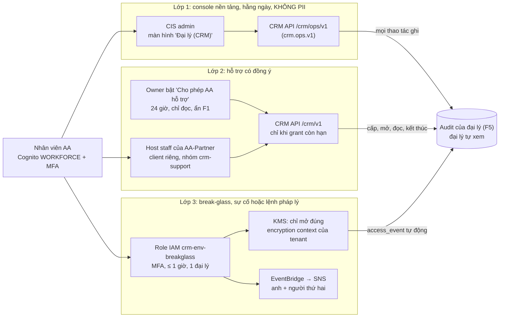

# Tenant CRM v2.2: làm gọn theo thị trường, dễ vận hành, rẻ hơn (AA-821 / PR-19)

Ngày 20/10/2026, phiên S245, vòng 4. Tác nhân: Claude Code. Bản tư vấn cho anh Nghiệp. Tài liệu chỉ đọc và viết:
không đổi repo, không ghi AWS, Linear hay Jira, không gọi API trả phí.

**Đầu vào:**
- Đọc hết: `owner-approvals-r2.md` (vòng 2, vòng 3), spec của chị Thư `docs/research/partner-crm-spec.md`,
  `r3/crm-design-v2.1-tech.md` và ba file vòng 4 (`r4/market-travel-crm.md`, `r4/market-saas-patterns.md`,
  `r4/gap-and-simplify.md` kể cả mục **Phản biện độc lập**).
- Lướt khi cần chi tiết: `out/crm-design-v2.md` (§9.3 chi phí prod).

**Quy ước:**
- Chỉ dùng những đề xuất **còn đứng sau phản biện**, và dùng **bản đã sửa** của chúng (G1'–G9' trong mục D của phần phản
  biện). Đề xuất gốc nào bị phản biện bác hay hoãn thì ghi rõ như vậy.
- Mỗi khẳng định về bên ngoài có mã `[Wn]`, URL ở §10, **tất cả đọc ngày 20/10/2026**.
- Ghi **(ước tính)** khi là suy luận hoặc phép tính của tôi. Số giờ vận hành và số issue luôn là ước tính.
- Engineering chỉ chốt chuyện kỹ thuật. Câu hứa với đại lý, chọn vendor có phí, thời hạn lưu dữ liệu, giá gói đều nằm ở
  §9 (câu hỏi cho chị Thư).

---

## 0. TL;DR

1. **Khung chính của v2.1 vốn đã giống cách thị trường làm, nên giữ nguyên.** Gồm: Postgres dùng chung + `tenant_id` +
   RLS, Cognito, job runner trên Postgres, SES nhận mail qua địa chỉ chuyển tiếp, Fargate sau CloudFront, đại lý tự
   kết nối Stripe của mình, AI chỉ soạn nháp. AWS hướng dẫn đúng như vậy [W20]. Phần nhìn thấy được từ bên ngoài cũng
   giống HubSpot, Pipedrive, Travefy [W12][W14][W3].
2. **Bảy chỗ tự chế được làm gọn (S1–S7):**
   - **S1:** một khoá KMS cho mỗi môi trường, mỗi đại lý một DEK, thay cho mỗi đại lý một khoá KMS;
   - **S2:** audit chỉ ghi sự kiện bảo mật và mọi lần đọc F1, export mỗi giờ lên S3 Object Lock, thay cho niêm phong
     Merkle mỗi phút;
   - **S3:** e-sign chạy stub trên Dev, bỏ container Documenso khỏi CI;
   - **S4:** builder fork một lần từ TripPlanner, bỏ job đối chiếu byte hằng đêm;
   - **S5:** Cognito M2M (pool riêng) thay cho JWT tự ký bằng KMS;
   - **S6:** service công khai thứ hai **hoãn quyết** tới Go-real, nhưng làm ngay guard ranh giới;
   - **S7:** WhatsApp trước, Messenger/IG để sau 23 module.
3. **Tiền tiết kiệm được (ước tính):**
   - Dev: chỉ **≈ $2–4/tháng**, vì Dev vốn rẻ (v2.1 $14–21 → v2.2 **$11–18** ở trạng thái ổn định).
   - Prod: **≈ −$10/tháng** ở 10 đại lý, **≈ −$50** ở 50, **≈ −$200** ở 200. Gần như toàn bộ là nhờ S1.
   - Chưa tính khoản e-sign. Khoản này tuỳ chị Thư: $0 tới $250/tháng.
4. **Lợi chính là vận hành và bảo mật, không phải tiền:**
   - bớt **≈ 5–8 giờ trực/tháng** khi chạy thật, **≈ 3–5 giờ/tháng** trên Dev (ước tính);
   - bỏ được quyền nguy hiểm nhất của task role: `kms:CreateKey` kèm `BypassPolicyLockoutSafetyCheck` (B2);
   - bỏ ba thành phần tự chế: Merkle mỗi phút, JWT tự ký, job đối chiếu TripPlanner.
5. **AA admin vào quản lý CRM theo ba lớp**, giống HubSpot, Zoho, Okta [W13][W15][W16]:
   - **Lớp 1, console nền tảng.** Nằm trong CIS admin, **không có PII**, dùng hằng ngày.
   - **Lớp 2, hỗ trợ có đồng ý.** Owner đại lý cấp, có hạn, chỉ đọc, ẩn F1.
   - **Lớp 3, break-glass.** Cần MFA, tối đa 1 giờ, mỗi lần một đại lý, tự hiện trong audit của đại lý.

   Phản biện đã bắt sửa hai chỗ: AA **không** được tự gán owner mới bằng email lạ, và **không** tự bấm export/xoá.
6. **Số issue:**
   - Lát cắt 1 vẫn **18 issue** (CRM-07 và CRM-11 nhỏ đi), ≈ 3 phiên thay vì 3–4.
   - Lát cắt 2 vẫn **≈ 9–10 issue**.
   - Cả kế hoạch: **≈ 125 → ≈ 118–123 issue**. Làm gọn bớt 8–11 issue, nhưng console và luồng hỗ trợ (T9) thêm 4–6.
7. **Cần anh quyết lại:** D7 a, N11 a, B2 (S1); D21 c (S4); T8 (S5); D19 a (S7); và mô hình AA admin (A1). Mười một
   câu mới cho chị Thư nằm ở §9.

---

## 1. Thị trường làm thế nào (rút gọn)

| Việc | Thị trường làm | v2.1 | v2.2 |
|---|---|---|---|
| Tách tenant | Pool: chung bảng + `tenant_id` + RLS cho nhiều tenant nhỏ [W20] | Pool + FORCE RLS | Giữ |
| Mã hoá PII | Khoá dịch vụ chung, phân biệt tenant bằng encryption context (AAD) [W21][W23]. Khoá riêng từng khách là **add-on** của gói Enterprise (Atlassian CMK [W22]). Tern chỉ mã hoá trường hộ chiếu [W7] | 1 khoá KMS/đại lý, tạo lúc chạy, + DEK/khách | **S1** |
| Audit | Bảng append-only + trang cho tenant + export. AWS khai tử QLDB, chỉ sang pgAudit + S3 [W27]. Chống sửa bằng S3 Object Lock [W28] | Merkle mỗi phút + Object Lock | **S2** |
| E-sign | Công cụ du lịch có sẵn trong app (Travefy, Safari Portal) [W2][W9] | Documenso trong CI + stub | **S3** (stub; vendor → chị Thư) |
| Xác thực service-to-service | OAuth2 client credentials (Cognito M2M) [W29] | JWT tự ký bằng KMS | **S5** |
| WhatsApp | Công cụ du lịch thường **không có** (Tern, Travefy, Safari Portal: không tìm thấy; TravelJoy chỉ SMS ở Premium [W1]) | WhatsApp + Messenger + IG | **S7** |
| Nhân viên vendor vào tài khoản khách | Tắt mặc định → khách cấp → có hạn → thu hồi được → ghi log. HubSpot 24 giờ [W13]; Zoho chặn export/integrations, mỗi lần 1 người [W15]; Okta chỉ đọc [W16]; WorkOS: lý do + banner + 60 phút [W18]. Công cụ du lịch không công bố gì [W4][W11] | Chỉ break-glass | **§3** |
| Quản trị nền tảng | Control plane (onboarding, quản lý tenant, billing, metric) tách khỏi application plane [W39]; host agency của Tern quản lý team/subscription [W8] | `ops-feed.v1` chỉ đọc | Gộp thành `crm.ops.v1` (đọc + ghi) |
| Job queue | Queue trên Postgres với `SKIP LOCKED` là chuẩn (Solid Queue, Rails 8) [W32] | `crm.job` | Giữ |
| Nhận mail | Địa chỉ BCC hoặc chuyển tiếp riêng cho mỗi tài khoản (HubSpot, Pipedrive) [W12][W14]. Đọc Gmail trên server thì phải qua CASA [W37] | 1 rule SES cho cả domain | Giữ |
| Thanh toán | Đại lý tự kết nối tài khoản của mình (Travefy, Safari Portal) [W3][W10]. Stripe xếp đặt chỗ du lịch vào nhóm rủi ro cao [W36] | Stripe Connect Standard | Giữ, qua adapter trung lập |
| AI | Soạn nháp, người duyệt rồi mới gửi, có trần dùng theo gói (Tern) [W6][W5] | Gateway riêng + trần chi tiêu | Giữ. Lọc PII trước LLM là **hơn** những gì vendor công bố |
| Hosting Next.js | Container, hoặc Amplify/OpenNext; ALB nhận CloudFront qua VPC origin hoặc header bí mật [W40] | Fargate + VPC origin | Giữ + test thứ tự rule ALB (V3) |

---

## 2. Các đề xuất làm gọn còn đứng sau phản biện

Mỗi mục ghi: bản cuối (đã sửa theo phản biện), tiết kiệm, ảnh hưởng vận hành và bảo mật, và quyết định cũ bị lật.

### S1. Một khoá KMS mỗi môi trường + DEK theo đại lý (G1')

- **Làm gì:**
  - Một khoá `alias/crm-<env>/data`, do Terraform quản lý, dùng key policy ba câu (dùng / quản trị / `Deny` mọi
    principal khác).
  - Mỗi đại lý một DEK, lưu ở dạng đã bọc, encryption context `{tenant_id, purpose}`, cache khoảng 5 phút. Khoá AA-ops
    (module 8) chỉ là một `purpose` khác.
  - Mã hoá bằng AES-GCM của thư viện `cryptography`. AAD = tenant/bảng/cột/id. Không tự chế định dạng.
  - Blind index dùng khoá dẫn xuất (HKDF) từ DEK của tenant, và được cắt ngắn, theo cách của CipherSweet.
  - **Giữ alarm** EventBridge khi có `PutKeyPolicy`, `CreateGrant`, `ScheduleKeyDeletion`, `DisableKey` hoặc `Decrypt`
    bởi principal lạ, và so `GetKeyPolicy` với Terraform mỗi đêm. Một khoá hỏng là hỏng cho mọi đại lý, nên alarm
    không được bỏ.
  - `KeyProvider` có chỗ lưu DEK cắm-rút được (E2). Dev lưu trong bảng `crm.tenant_key`. Nếu Go-real dùng RDS chung thì
    chuyển sang S3 có hạn giữ riêng, để lời hứa xoá không phụ thuộc snapshot của CIS/Booking.
  - Bỏ DEK riêng cho từng khách.
- **Vì sao giống thị trường:** Atlassian dùng khoá chung trong một ranh giới dịch vụ, gắn tenant context vào ciphertext
  [W21], và bán CMK như add-on [W22]. AWS khuyên đặt `tenant_id` trong encryption context [W23].
- **Tiết kiệm:**
  - KMS $1/khoá/tháng; N11 a không xoay khoá [W24].
  - Dev ≈ −$2 tới −$4. Prod −$10 (10 đại lý), −$50 (50), −$200 (200).
  - Vận hành −2 giờ/tháng: không có N policy, không có khoá mồ côi, không có job dọn khoá, không có lỗi `CreateKey`
    lúc chạy (ước tính).
- **Bảo mật:**
  - **Tốt hơn:** task role mất `kms:CreateKey` + `BypassPolicyLockoutSafetyCheck`. AWS chỉ khuyên bật cờ này khi cố ý
    chặn principal gọi `PutKeyPolicy` về sau [W25].
  - **Không đổi:** cách ly giữa đại lý (AAD + RLS); break-glass vẫn mỗi lần một đại lý, nhờ điều kiện
    `kms:EncryptionContext:tenant_id`. Với cả hai thiết kế, task role vốn giải mã được mọi đại lý.
  - **Yếu hơn ở lời hứa xoá:** xoá DEK chỉ "không đọc lại được" khi mọi backup cũ đã hết hạn. Lưu ý backup RDS có thể
    giữ lâu hơn hạn nếu instance từng bị stop [W26]. Vì vậy cần luật V1, và câu H3 phải quay lại chị Thư (Q2).
- **Lật:** D7 a, N11 a, B2.
- **Công:** −2 tới −3 issue (ở D1, D7); CRM-07 và CRM-11 nhỏ đi.

### S2. Audit gọn (G2')

- **Làm gì:**
  - `crm.audit_event` chỉ cho `INSERT, SELECT`; trigger chặn `UPDATE`/`DELETE`; partition theo tháng.
  - Ghi: đăng nhập, đổi quyền, **mọi lần đọc trường F1**, export, xoá, thao tác khoá.
  - Ghi đủ các loại actor spec đòi (`user | ai_agent | aa_ops`): AI dựng context, AA-ops đọc bản ops-release, export danh
    sách gửi NCC, mọi lần đọc trong phiên hỗ trợ (`support:<staff>`).
  - Audit **không chứa PII**, chỉ có id ngẫu nhiên, tên trường và lý do. Có unit test kiểm.
  - **Export mỗi giờ** lên bucket Object Lock, kèm manifest SHA-256 nối chuỗi (≈ 720 PUT/tháng, vài cent; ước tính).
  - Dev dùng chế độ governance. Chế độ compliance chỉ bật sau khi chị Thư trả lời Q1, vì ở chế độ này không ai xoá hay
    rút ngắn được, kể cả root [W28].
  - Bỏ job niêm phong Merkle mỗi phút.
- **Tiết kiệm:** ≈ $0. Vận hành −1 tới −1,5 giờ/tháng (ước tính).
- **Bảo mật:** cửa sổ sửa lén ≤ 1 giờ. Vì master DB được DB Migrate dùng thường xuyên, alarm "dùng master" không phải
  là một kiểm soát thật; cửa sổ ngắn bù cho điều đó.
- **Lật:** chi tiết S8 của v2.1 (đã duyệt ở vòng 3).
- **Công:** −1 tới −2 issue (D1).

### S3. E-sign: adapter + stub, bỏ Documenso khỏi CI (G3')

- **Làm gì:** giữ adapter trung lập `esign.*`. Dev và CI dùng **stub** (đúng định nghĩa B5 a "vendor ở chế độ test hoặc
  stub"). Bỏ container Documenso.
- **Không làm lúc này:** chưa xây provider tự làm. Chọn tự làm, BoldSign hay Documenso là việc của chị Thư, sau khi hãng
  bảo hiểm trả lời (Q6).
- **Tiết kiệm:** Dev $0 (vốn đã $0). Vận hành −0,5 tới −1 giờ/tháng (không phải giữ container AGPL trong CI; ước tính).
  Khoản −$40 tới −$250/tháng ở prod chỉ có nếu chị Thư chọn tự làm.
- **Lật:** F17 và §7.2 của v2.1 (Documenso trong CI). N8 vẫn hoãn như T3.
- **Công:** −1 issue (D5).

### S4. Builder: fork một lần, kèm guard cấm import backend TP (G4)

- **Làm gì:**
  - Fork component bản đồ vào AA-Partner, ghi trong ADR "nguồn gốc TP commit X, từ nay Partner sở hữu".
  - Bỏ manifest sha256 và job hằng đêm mở issue.
  - Thêm test CI: code đã fork **không** import `@/lib/api`, `@/lib/useTrip`, `@/lib/tileLoader` của TP (K20).
- **Tiết kiệm:** $0. Vận hành −1 tới −2 giờ/tháng (không phải phân loại issue tự mở; ước tính).
- **Rủi ro:** hai bản UI lệch dần. Chấp nhận được. Phần khó thật là logic ghép tuyến (T13), vẫn chờ issue điều tra.
- **Lật:** D21 c, vừa được anh xác nhận lại ở vòng 2.
- **Công:** −1 issue (D4).

### S5. Cognito M2M trên pool riêng thay cho JWT tự ký (G5')

- **Làm gì:**
  - Tạo pool `aa-m2m-<env>` riêng, **không** dùng pool WORKFORCE, để token máy không bao giờ lọt vào route của người.
  - CRM (và sau này Booking) mỗi bên một app client. Mỗi API có một resource server với scope riêng
    (`booking.b2b/quote`, `cis.catalog/read`…). Route ghim `client_id` + `scope`.
  - Bên nhận kiểm JWT bằng cùng đoạn code JWKS đang dùng cho token người dùng.
- **Chi phí (đã sửa so với phản biện):**
  - Cognito tính theo lượt phát token M2M, không có free tier, ví dụ $0,00225/token [W29]. Không tính phí theo số app
    client [W29].
  - Access token đặt được từ 5 phút tới 1 ngày cho mỗi app client [W30]. Đặt 6 giờ và cache trong process thì
    ≈ 2 task × 4 × 30 ≈ 240 token/tháng ≈ **$0,5** (ước tính). Cộng 1 secret $0,40 → **≈ +$1/tháng**, thay vì
    +$3–10 như phản biện tính với token 1 giờ.
  - Bỏ khoá ký JWT (−$1). Thành ra gần như hoà.
- **Vận hành:** −0,25 tới −0,5 giờ/tháng; không còn code mật mã tự giữ (định dạng token, xoay khoá, JWKS).
- **Bảo mật:**
  - Có thêm một client secret tĩnh. Từ 02/2026 Cognito hỗ trợ hai secret song song để xoay không gián đoạn [W31].
  - T8 không có secret nào, nên về độ chặt T8 nhỉnh hơn. Về "giống thị trường" và "ít code tự giữ" thì M2M hơn.
  - Token M2M không thu hồi được trước khi hết hạn, vì không có refresh token [W30]. Đây là lý do chọn 6 giờ chứ không
    1 ngày.
- **Lật:** T8. Ưu tiên thấp: giữ T8 cũng an toàn.
- **Công:** 0 (đổi cách làm hai issue ở D4).

### S6. Service công khai thứ hai: hoãn quyết, làm guard ngay (G6')

- **Bản gốc** (bỏ N15) **không đứng được**. N15 a vốn đã là "pilot dùng một task role, tách trước đại lý thứ 11 hoặc
  trước AA-880", nên quyết bỏ ngay bây giờ không tiết kiệm đồng nào.
- **Làm gì:**
  - Giữ N15 a. Quyết lại ở Go-real, **sau pentest**.
  - Làm ngay hàm hẹp `traveller_self_reveal(session)`: chỉ mở được dữ liệu của khách thuộc trip gắn với cookie của
    link. Hàm này cần cho module 11 và Rule 4 (điền sẵn form cho khách quay lại).
  - Test ranh giới: router công khai **cấm** `reveal()` tổng quát, chỉ được dùng hàm hẹp trên.
  - Webhook Twilio phải kiểm chữ ký HMAC (trong request, hoặc trong worker rồi bỏ nếu sai). Không chấp nhận payload chưa
    kiểm.
- **Tiết kiệm:** $0 bây giờ. Nếu pentest ở Go-real không đòi tách thì −$8–17/tháng từ đại lý thứ 11.
- **Công:** 0 (nằm trong issue module 11).

### S7. WhatsApp trước, Messenger/IG sau (G7)

- **Làm gì:** module 9 v1 gồm một channel adapter chung, WhatsApp, và SMS bằng Twilio của đại lý. Messenger/IG có sẵn
  chỗ trong adapter nhưng dời khỏi "đủ 23 module".
- **Đúng spec:** bảng module 9 chỉ ghi WhatsApp/SMS; Messenger/IG chỉ có trong enum kênh của data model.
- **Thị trường:** công cụ du lịch không có WhatsApp [W1]. Muốn làm Tech Provider thì Meta đòi xác minh doanh nghiệp và
  app review kèm video [W33]. Mỗi permission Messenger/IG là thêm một vòng review (ước tính).
- **Tiết kiệm:** $0 tiền. Vận hành −0,5 tới −1 giờ/tháng (ước tính).
- **Lật:** D19 a, nếu chị Thư trả lời Q7 là "không bắt buộc".
- **Phương án thêm (E1, thuộc chị Thư, Q11):** WhatsApp qua tài khoản Twilio của chính đại lý. Cách này đúng chữ spec
  "Twilio / 360dialog", và AA không phải làm Tech Provider. Twilio có luồng self sign-up cho chính thương hiệu của đại
  lý [W35], nhưng đại lý trả thêm $0,005 mỗi tin [W34]. Điều khoản cho nền tảng bên thứ ba dùng key của đại lý: **chưa
  kiểm**.
- **Công:** −2 tới −3 issue (D6).

### Những gì phản biện bác hoặc chưa làm

- Câu "tiết kiệm $13–16 ở 10 đại lý" và "$200–860 ở 200": thổi phồng, đã sửa ở §5.
- Khoản e-sign tự làm: không cộng vào tiết kiệm của engineering.
- Prod dùng RDS prod chung: **không quyết bây giờ**. N4 a vẫn giữ và đã hoãn tới Go-real.

### Bảng tổng (ước tính)

| Mục | Dev $/tháng | Prod 10 / 50 / 200 $/tháng | Giờ vận hành/tháng | Issue | Quyết định bị lật |
|---|---|---|---|---|---|
| S1 | −2 tới −4 | −10 / −50 / −200 | −2 | −2 tới −3 | D7 a, N11 a, B2 |
| S2 | ≈ 0 | ≈ 0 | −1 tới −1,5 | −1 tới −2 | v2.1 S8 |
| S3 | 0 | 0 (tuỳ chị Thư: tới −250) | −0,5 tới −1 | −1 | F17 |
| S4 | 0 | 0 | −1 tới −2 | −1 | D21 c |
| S5 | ≈ 0 tới +1 | ≈ 0 tới +1 | −0,25 tới −0,5 | 0 | T8 |
| S6 | 0 | 0 (nếu pentest ổn: −8 tới −17 từ đại lý 11) | 0 | 0 | — (giữ N15 a) |
| S7 | 0 | 0 | −0,5 tới −1 | −2 tới −3 | D19 a |
| `crm.ops.v1` gộp (S8 cũ) | 0 | 0 | 0 | −1 | T7 (mở rộng) |
| Console + hỗ trợ (A1, việc mới) | 0 | 0 | +0,5 | +4 tới +6 | — |
| **Cộng** | **≈ −2 tới −4** | **≈ −10 / −50 / −200** | **≈ −5 tới −8** (Dev thấy ≈ −3 tới −5) | **≈ −2 tới −7** | |

---

## 3. AA admin vào và quản lý CRM thế nào (trả lời câu hỏi T9)

**Nguyên tắc** (theo HubSpot, Zoho, Okta, WorkOS [W13][W15][W16][W18] và control plane của AWS [W39]):
quản lý nền tảng **không cần** nhìn dữ liệu khách. Chỉ khi đại lý đồng ý, hoặc khi có sự cố có ghi log, nhân viên AA
mới chạm được vào dữ liệu đại lý. Đây cũng là cách giữ được câu F1 của spec ("No access outside the agency, AA
included") và quyết định T9 ("CRM nắm quyền, CIS chỉ được gỡ").

### Lớp 1: console nền tảng (hằng ngày, không có PII)

- **Ở đâu:** CIS admin. Staff đã đăng nhập bằng WORKFORCE + MFA. API trả về không có PII, nên CIS admin chạy trên
  Vercel vẫn ổn.
- **Quyền:** nhóm `cis-admin` chỉ xem; nhóm mới `crm-platform-admin` (ít người) được thao tác.
- **Xem được:**
  - danh sách đại lý với một bộ **usage meter cố định**: seat, user hoạt động, dung lượng, mail nhận, chi phí AI, job
    lỗi, lần hoạt động cuối;
  - tab Jobs/LLM "CRM", health, alarm.

  **Không có** số trip, pipeline hay doanh thu theo từng đại lý; có test kiểm response không chứa các khoá này. Mấy số đó
  chỉ đi qua module 17 (k ≥ 10). Nếu gói giá tính theo trip thì đổi theo Q8.
- **Làm được** (đã sửa theo phản biện G8'):
  - Tạo đại lý. CIS vẫn là danh bạ tenant (AA-813); CRM nhận qua `tenant.membership.v1`.
  - Mời owner đầu tiên, **chỉ khi** đại lý chưa từng có owner và chưa có khách nào. Sau đó nút này bị khoá.
  - Khoá hoặc mở lại đại lý; thử lại job.
  - Đổi gói/quyền lợi. Chỉ được **cho phép** tính năng, không được **bật** (ví dụ không bật được AI thay đại lý; có test
    `ai_enabled`).
  - Export/xoá: AA chỉ tạo **yêu cầu**. Owner xác nhận trong app, và chỉ owner tải được file. Xoá chạy DRY RUN trước.
  - **Khôi phục owner** (owner nghỉ việc hoặc mất tài khoản): chỉ được **thăng một thành viên đang hoạt động của chính
    đại lý**, không bao giờ mời email mới. Có thời gian chờ (Q10), mọi thành viên nhận mail và ai cũng huỷ được. Chạy
    dưới kiểm soát kiểu break-glass. Đại lý không còn thành viên nào thì không khôi phục: onboard lại.
  - Mọi thao tác ghi sinh một event trong audit của đại lý đó (`actor = aa-staff:<id>`).

### Lớp 2: hỗ trợ trong dữ liệu đại lý (chỉ khi owner đồng ý)

- **Owner bật** ở Cài đặt → "Cho phép AA hỗ trợ":
  - thời hạn mặc định 24 giờ, giống HubSpot [W13] (con số cuối do chị Thư chốt, Q4);
  - **chỉ đọc** ở bản đầu, giống Okta [W16];
  - thông tin danh tính khách (F1) bị ẩn, trừ khi owner tick cho xem.
- **Cơ chế:**
  - CRM tạo một support membership có hạn (`expires_at`, `granted_by`, `scope`). Đây **không** phải tính năng "đăng
    nhập thay".
  - Nhân viên vào qua host staff của AA-Partner, bằng **app client WORKFORCE riêng**, nhóm `crm-support`.
  - `/crm/v1` **không bao giờ** nhận token của client `cis-admin` hay `breakglass`.
  - Mỗi lần một nhân viên (như Zoho [W15]); bắt nhập lý do hoặc mã ticket; có banner trong UI đại lý (như WorkOS [W18]).
- **Luôn bị chặn,** kể cả về sau có quyền sửa (như Zoho [W15]): gửi tin cho khách, export, đổi hoặc cấp quyền, đổi tích
  hợp, đổi chính cài đặt hỗ trợ.
- **Kết thúc:** grant tự hết hạn, hoặc owner thu hồi bất cứ lúc nào. Cấp, gia hạn, thu hồi, bắt đầu, kết thúc và mọi
  lần đọc đều vào audit của đại lý.

### Lớp 3: break-glass (sự cố, lệnh pháp lý)

- **Cơ chế:**
  - role IAM `crm-<env>-breakglass`, chỉ assume được từ admin role có MFA, tối đa 1 giờ;
  - bắt buộc `sts:TagSession` với tenant, và KMS chỉ cho đúng encryption context của tenant đó → **mỗi lần một đại lý**;
  - EventBridge → SNS cho anh và **một người thứ hai không phải kỹ sư**. Người đó được báo chứ không duyệt, vì đội chỉ
    có một kỹ sư (Q5);
  - `access_event` tự hiện trong audit của đại lý; lý do ghi vào Linear; review lại sau mỗi lần dùng.
- **Phần pháp lý:** đại lý được báo sau sự việc. Thời hạn báo và điều khoản kiểu Zendesk ("không báo trước") phải nằm
  trong DPA, tức là việc của chị Thư (Q5) [W19].

### Riêng module 8 (AA-ops nhận thông tin khách của chuyến đã chốt)

Không thuộc ba lớp trên. Đây là luồng nghiệp vụ theo spec: trang `crm-ops` trong AA-Partner, nhóm WORKFORCE `crm-ops`
(T12), dữ liệu tự xoá sau 90 ngày, mọi lần đọc vào audit.

### Công

- Lớp 1: +2–3 issue (route ghi, nhóm `crm-platform-admin`, màn hình CIS, luồng thăng owner).
- Lớp 2: +2 issue (grant + middleware + banner + che trường + audit).
- Lớp 3: đã nằm trong CRM-07 / D1.
- Chi phí hạ tầng: $0.

---

## 4. Kiến trúc sau v2.2: cái gì giữ, cái gì đổi

**Giữ nguyên từ v2.1:**
- **Hosting:** CloudFront PAYG → VPC origin → NLB nội bộ → rule ALB (web ở priority < 100, rồi rule "có `X-AA-Origin`
  → 403") → Fargate ARM (web + api, Spot trên Dev) (T1, B1).
- **Dữ liệu:** schema `crm` trong RDS Dev, role `crm_app` (pool 3, limit 6; T4); FORCE RLS + `tenant_tx()`.
- **Job và AI:** `crm.job` riêng, chép từ Booking; gateway LLM riêng `crm.llm_call` + trần chi tiêu; AI tắt mặc định.
- **Định danh và mail:** Cognito EXTERNAL cho đại lý (Dev: client `cis-portal`); SES một rule cho cả domain.
- **Đại lý giả** trên Dev; Go-real là đợt riêng (prod cell N4, WAF, passkey, vendor).
- Preview chạy tạm trong CI (T5); ECS exec bật trên Dev, tắt ở prod (T10).

**Đổi:**

| Thành phần | v2.1 | v2.2 |
|---|---|---|
| Khoá F1 | 1 khoá KMS/đại lý tạo lúc chạy + DEK/khách; `CreateKey` + bypass (B2) | 1 khoá/env do Terraform quản lý + DEK/đại lý (bọc, có context) + alarm + so policy mỗi đêm; kho DEK cắm-rút được |
| Audit | Merkle mỗi phút | Bảng append-only + export Object Lock mỗi giờ, manifest nối chuỗi; đủ actor; không PII |
| Giám sát chéo app | `ops-feed.v1` chỉ đọc | `crm.ops.v1`: phần đọc (`cis-admin`) + phần ghi (`crm-platform-admin`) |
| Truy cập của AA | Chỉ break-glass | 3 lớp (§3) |
| Service-to-service | JWT ký bằng KMS (T8) | Cognito M2M, pool `aa-m2m-<env>`, token 6 giờ |
| E-sign Dev/CI | Documenso trong CI + stub | Chỉ stub qua adapter |
| Builder | Chép byte + manifest + job hằng đêm | Fork một lần + test cấm import backend TP |
| Kênh nhắn tin | WhatsApp + Messenger + IG | WhatsApp + SMS; Messenger/IG sau |
| Đường công khai | N15 hoãn | N15 a giữ; thêm `traveller_self_reveal` + test ranh giới ngay |
| Luật mới | — | V1 backup ≤ 30 ngày (Go-real); V2 không dùng `tenant_id` làm chiều metric; V3 test thứ tự rule ALB |

**Điều chỉnh nhỏ, không cần quyết lại** (từ `market-saas-patterns.md` §13, không bị phản biện):
- Thứ tự lọc PII: token hoá cột PII đã biết → regex → Guardrails chỉ cho text tự do (bớt lượt Guardrails).
- Ở Go-real: tách pool Cognito riêng cho partner (không chỉ client riêng), và mỗi đại lý một SES tenant ở chiều gửi
  đi.

---

## 5. Chi phí

### 5.1 Dev, tăng thêm mỗi tháng (đại lý giả, không prod)

Gốc là v2.1 §5. Chỉ các dòng dưới đây thay đổi; các dòng khác giữ nguyên.

| Dòng | v2.1 T11 / T12 / T1→ | v2.2 T11 / T12 / T1→ | Ghi chú |
|---|---|---|---|
| KMS | 2–3 / 4–5 / 5–6 | 1 / 1–2 / 1–2 | 1 khoá dữ liệu (+ khoá ingest nếu tách); bỏ khoá ký JWT, khoá AA-ops, khoá đại lý giả [W24] |
| Khoá canary (chưa tính ở v2.1) | +1 | 0 | Không cần khi không có `CreateKey` lúc chạy |
| Cognito M2M + 1 secret | — | 0 / ≈ 1 / ≈ 1 | Token 6 giờ (ước tính) [W29][W30] |
| Export audit mỗi giờ | — | ≈ 0 / ≈ 0,1 / ≈ 0,1 | PUT S3 (ước tính) |
| **Tổng** | **$10–15 / $13–18 / $14–21** | **≈ $9–13 / $11–16 / $11–18** | |
| Xấu nhất (hết Spot) | $23–26 / $25–29 / $26–32 | ≈ $22–24 / $23–27 / $23–29 | |

Kết luận: trên Dev gần như hoà, bớt khoảng $2–4/tháng. Không nên chọn S1–S7 vì tiền Dev.

### 5.2 Prod (lúc Go-real), phần CRM tăng thêm mỗi tháng, **chưa tính e-sign**

Cơ sở là v2 §9.3, sửa theo v2.1 như sau:
- bỏ Documenso;
- web Fargate on-demand thay cho Lambda;
- cộng WAF CloudFront;
- giữ prod cell (N4 a);
- N15 a: service thứ hai có từ đại lý thứ 11;
- LLM giả định 100 % đại lý bật AI.

Mọi số đều là **ước tính**, trừ đơn giá có nguồn.

| Dòng | 10 đại lý | 50 | 200 | Cơ sở |
|---|---|---|---|---|
| API CRM (ARM on-demand) | 8,3 | 33 | 66–100 | v2 §9.3 |
| Web Fargate + CloudFront | ≈ 10 | ≈ 22 | ≈ 55–70 | 1 / 2 / 3 task (ước tính) |
| DB (prod cell, hoặc AA-880) | 19 | 133 | 141–216 | v2 §9.3 |
| LLM (Haiku, 100 % bật) | 13 | 67 | 268 | v2 §9.3 |
| Guardrails, SES, S3, log, secret, ECR | 10 | 30 | 110 | v2 §9.3 |
| Mapbox | 0 | 0 | ≈ 70 | v2 §9.3 |
| WAF CloudFront | ≈ 7,5 | ≈ 8 | ≈ 10 | v2.1 T2 |
| Service công khai thứ hai (N15 a) | 0 | 8,3 | 8,3–17 | N15 a |
| **KMS v2.1** (N khoá đại lý + AA-ops + JWT + ingest) | 13 | 53 | 203 | $1/khoá, không xoay [W24] |
| **KMS + M2M v2.2** | ≈ 3 | ≈ 3 | ≈ 3–4 | 1–2 khoá + M2M ≈ $1 |
| **Tổng v2.1** | **≈ $81** | **≈ $354** | **≈ $930–1.065** | |
| **Tổng v2.2** | **≈ $71** | **≈ $304** | **≈ $730–865** | |
| Mỗi đại lý (v2.2) | ≈ $7,1 | ≈ $6,1 | ≈ $3,7–4,3 | |

**Tuỳ chị Thư (cộng thêm vào cả hai bản):**
- E-sign: $0–1 nếu tự làm (và hãng bảo hiểm chấp nhận); BoldSign từ $30; Documenso Teams $40 hoặc Platform $250 (v2.1
  §7.2).
- WhatsApp qua Twilio của đại lý: đại lý trả thêm, AA $0 (Q11).

**Rủi ro chi phí đã biết:**
- Nếu acc3 không có Haiku 5.5 qua profile `us.` (T11) thì LLM đắt hơn khoảng 10 lần (+≈ $38 ở 10 đại lý).
- Luật V2 tránh được một cái bẫy ≈ $300/tháng ở 200 đại lý, nếu ai đó lỡ dùng `tenant_id` làm chiều metric [W38].

---

## 6. Ảnh hưởng tới số issue

### 6.1 Lát cắt 1 (W0 + W1, 18 issue): vẫn 18, nhẹ hơn

| Issue | Đổi gì |
|---|---|
| CRM-01 ADR | Ghi: S1 (một khoá + DEK theo đại lý + kho DEK cắm-rút được), mô hình AA admin 3 lớp, M2M, fork builder, N15 a + `traveller_self_reveal`. Bỏ B2 |
| CRM-02 hợp đồng | Đổi tên `ops-feed.v1` → `crm.ops.v1`. Lát cắt chỉ làm phần đọc; phần ghi để D1–D2 |
| CRM-03 bootstrap role apply | Không cần quyền `kms:CreateKey` lúc chạy cho task role, nên bớt một statement |
| CRM-04 / CRM-05 | Thêm test CI kiểm thứ tự rule ALB (V3); không thêm issue |
| CRM-07 rào chắn KMS | **M → S:** một khoá Terraform + policy ba câu + alarm EventBridge + so `GetKeyPolicy` mỗi đêm. Không còn canary, không còn `CreateKey` |
| CRM-11 KeyProvider | **M → S:** DEK theo đại lý, AES-GCM thư viện, interface lưu DEK. Không còn tạo khoá lười |
| CRM-15 seeder | Không còn tạo và dọn khoá KMS cho đại lý giả |

**Ước tính:** ≈ 3 phiên thay vì 3–4. Điểm nghẽn còn lại vẫn là MFA của anh (CRM-03) và spike O2 (CRM-04).

### 6.2 Lát cắt 2 (trọn vòng đời bằng hàng của đại lý, ≈ 9–10 issue): không đổi số

- Module 12 vốn đã dùng stub (S3 khớp sẵn).
- Module 11 thêm `traveller_self_reveal` + test ranh giới, nằm trong issue sẵn có (S6).
- **Gợi ý (không bắt buộc):** cho hoá đơn chạy "chuyển khoản + đánh dấu đã trả" trước, Stripe test sau. Như vậy lát cắt
  2 không bị chặn nếu tài khoản Stripe test (B4) chưa có.

### 6.3 Các đợt sau

| Đợt | Thay đổi | Issue |
|---|---|---|
| D1 | S2 bỏ Merkle (−1..−2); S1 bỏ job dọn khoá + kiểm lệch N khoá (−1); lớp 2 hỗ trợ (+2); lớp 1 route ghi + thăng owner (+2..+3) | ≈ +1 tới +3 |
| D2 | Màn hình "Đại lý (CRM)" trong CIS (đã tính ở lớp 1); gộp hợp đồng (−1) | −1 |
| D4 | S4 (−1); S5 đổi cách làm (0) | −1 |
| D5 | S3 bỏ Documenso CI (−1) | −1 |
| D6 | S7 (−2..−3) | −2 tới −3 |
| D7 | S1 bỏ crypto-shred từng khách (−1) | −1 |
| **Cộng** | | **≈ −2 tới −7** |

**Toàn kế hoạch:** ≈ 125 → **≈ 118–123 issue**, ≈ 21–22 → **≈ 20–21 phiên** (ước tính). Mốc "đủ 23 module trên Dev"
gần như không đổi (giữa 12/2026 – giữa 1/2027). Lợi lớn nhất nằm ở thời gian trực sau khi chạy, không phải ở lịch.

---

## 7. Rủi ro

| Rủi ro | Mức | Giảm thiểu |
|---|---|---|
| Lời hứa xoá phụ thuộc kỷ luật backup (S1) | TB | V1: backup ≤ 30 ngày, snapshot tay ≤ 30 ngày, kể cả bản chép sang region khác và AWS Backup; prod không stop; alarm khi có snapshot DB chứa `crm`; diễn tập khôi phục với một đại lý giả đã xoá. Kho DEK cắm-rút được (E2) nếu dùng RDS chung. Câu chữ → chị Thư (Q2) |
| Một khoá cho mọi đại lý thành một điểm hỏng chung (S1) | TB | Giữ alarm `PutKeyPolicy`/`CreateGrant`/`Decrypt` lạ; so policy mỗi đêm; không task role nào có quyền quản trị khoá |
| Cửa sổ sửa audit ≤ 1 giờ (S2) | Thấp | Runtime chỉ được `INSERT`; manifest nối chuỗi; compliance mode ở prod sau Q1 |
| Hãng bảo hiểm đòi nhà cung cấp e-sign có tên (S3) | TB | Adapter trung lập; vendor cắm vào sau, 2–3 issue |
| Client secret M2M bị lộ (S5) | Thấp | Secrets Manager; xoay bằng hai secret [W31]; token 6 giờ; scope hẹp; SG vẫn là lớp ngoài |
| RCE ở đường công khai lấy được quyền giải mã (S6, trong lúc giữ một service) | Thấp–TB | Test ranh giới, `traveller_self_reveal` hẹp, WAF ở Go-real, alarm khi số lần giải mã tăng vọt; tách service bất cứ lúc nào (cùng image) |
| Console lộ số liệu kinh doanh từng đại lý (lớp 1) | TB | Usage meter cố định + test cấm khoá trip/revenue; Q8 |
| Thăng owner bị lạm dụng (lớp 1) | TB | Chỉ thăng thành viên có sẵn, có thời gian chờ, ai cũng huỷ được, kiểm soát kiểu break-glass; Q10 |
| Token sai client lọt vào `/crm/v1` (lớp 2) | TB | App client riêng, ghim `client_id` + nhóm + grant còn hạn; test âm cho token `cis-admin`/`breakglass` |
| Hai bản builder lệch dần (S4) | Thấp | Chấp nhận; tách package nếu cả hai bên cùng phát triển mạnh |
| ⚠️ Biến môi trường có dấu gạch dưới (cấu hình Cognito M2M, web) | — | **This contains underscore env vars — edit manually in VSCode.** Agent không sinh script cho các biến này |

---

## 8. Cần anh quyết (chi tiết trong `decisions-v2.2.json`)

- **S1–S7:** đồng ý bản đã sửa, hay giữ như v2.1.
- **A1:** mô hình AA admin 3 lớp.
- **V1–V3:** ba luật vận hành đi kèm.

---

## 9. Câu hỏi thêm cho chị Thư (kinh doanh, pháp lý, vendor; engineering không quyết)

Gộp với `r3/thu-questions.md` và `r4/market-travel-crm.md` §9 khi gửi.

| # | Câu hỏi | Vì sao hỏi bây giờ |
|---|---|---|
| Q1 | Giữ nhật ký audit bao lâu? Đại lý có cần tải hoặc stream nhật ký không? | Chế độ compliance của Object Lock không rút ngắn được [W28] |
| Q2 | Câu hứa xoá: "sau khi xoá, không đọc lại được ở bất kỳ đâu, kể cả bản sao lưu, sau tối đa 30 ngày", thay cho câu H3 "khi xoá khoá…" | S1 làm lời hứa dựa trên thời hạn backup [W26] |
| Q3 | "Khoá riêng của đại lý" / BYOK (spec §8): cần cho đại lý đầu tiên, hay để thành tuỳ chọn trả phí sau? | Thị trường bán dưới dạng add-on [W22] |
| Q4 | Thời hạn mặc định đại lý cấp quyền hỗ trợ cho AA: 24 giờ, 7 ngày hay 14 ngày? | HubSpot 24 giờ [W13]; Zoho theo ngày [W15] |
| Q5 | Có điều khoản cho AA vào khẩn cấp không cần đồng ý trước không, và báo đại lý trong bao lâu? Ai là người thứ hai nhận báo động? | Zendesk có điều khoản này [W19]; đội chỉ có một kỹ sư |
| Q6 | Hãng bảo hiểm có nhận chữ ký điện tử đơn giản tự làm cho waiver trekking không? Chọn tự làm, BoldSign hay Documenso? | Spec module 12 đòi "accepted by insurer". Bản niêm phong tự ký có thể hiện "validity unknown" trong Adobe (ước tính) |
| Q7 | Messenger/Instagram có bắt buộc cho các đại lý thật đầu tiên không? | S7 |
| Q8 | Gói giá có tính theo số trip hoặc doanh số không? Nếu có thì AA phải thấy số đó của từng đại lý | Lớp 1 hiện chỉ có seat, dung lượng, chi phí AI |
| Q9 | Duyệt câu hứa quyền riêng tư (thay 2.2 + 2.3 cũ): "AA quản lý tài khoản đại lý mà không xem hồ sơ khách. Nhân viên AA chỉ xem được dữ liệu khi chủ đại lý tự cấp quyền hỗ trợ có thời hạn, mặc định chỉ đọc và ẩn thông tin danh tính khách. Khẩn cấp về an ninh hoặc pháp lý thì AA có thể mở dữ liệu của một đại lý, phải đăng nhập hai bước, và việc đó tự hiện trong nhật ký của đại lý." | Câu chữ hứa với khách |
| Q10 | Khi chủ đại lý nghỉ hoặc mất tài khoản: AA được thăng một nhân viên có sẵn của đại lý lên chủ sau bao lâu chờ? | Liên quan câu F1 |
| Q11 | WhatsApp qua tài khoản Twilio của chính đại lý (+$0,005/tin cho đại lý [W34]), hay AA làm Meta Tech Provider [W33]? | Spec ghi "Twilio / 360dialog"; D9 a chọn Tech Provider |

---

## 10. Nguồn (tất cả đọc ngày 20/10/2026)

| Mã | Nội dung dùng | URL |
|---|---|---|
| W1 | TravelJoy: SMS chỉ ở Premium; giá | <https://www.traveljoy.com/pricing> |
| W2 | Travefy: T&C + chữ ký khách trong form; Gmail/Outlook/IMAP | <https://agentstudio.travefy.com/crm> |
| W3 | Travefy: Stripe của đại lý, chỉ phí lập kế hoạch | <https://intercom.help/travefy/en/articles/7045165-planning-fees-overview-stripe> |
| W4 | Travefy: điều khoản, xoá dữ liệu ≤ 30 ngày | <https://travefy.com/termsandprivacy> |
| W5 | Tern: giá, giới hạn dùng AI theo gói | <https://www.tern.travel/pricing> |
| W6 | Tern: AI soạn email, advisor duyệt trước khi gửi | <https://help.tern.travel/en/articles/15373196-what-we-launched-at-the-june-2026-webinar> |
| W7 | Tern: mã hoá trường hộ chiếu ở tầng app | <https://help.tern.travel/en/articles/8126635-data-privacy-and-security-in-tern> |
| W8 | Tern host agency: quản lý team, subscription | <https://help.tern.travel/en/articles/14327284-host-agency-overview> |
| W9 | Safari Portal: e-sign gõ/vẽ, xác minh email | <https://help.safariportal.app/en/articles/20902-march-12-2026-esignatures-made-easy> |
| W10 | Safari Portal: nhiều cổng thanh toán của đại lý | <https://help.safariportal.app/en/articles/20631-choosing-your-preferred-payment-processors-in> |
| W11 | Safari Portal: bảo mật, không có SOC 2/ISO | <https://help.safariportal.app/en/articles/11143-how-does-safari-portal-handle-data-security-and> |
| W12 | HubSpot: địa chỉ BCC/chuyển tiếp | <https://knowledge.hubspot.com/connected-email/log-email-in-your-crm-with-the-bcc-or-forwarding-address> |
| W13 | HubSpot: "access to your account for 24 hours" | <https://knowledge.hubspot.com/account-security/limit-logins-to-trusted-ip-addresses> |
| W14 | Pipedrive Smart BCC | <https://support.pipedrive.com/article/smart-email-bcc> |
| W15 | Zoho Support Access: theo ngày, chặn export/integrations, mỗi lần 1 người, có audit | <https://help.zoho.com/portal/en/community/topic/support-access-for-zoho-crm> |
| W16 | Okta: mạo danh chỉ đọc, ghi log cấp/thu hồi/bắt đầu/kết thúc | <https://support.okta.com/help/s/article/read-only-impersonation-access-system-logs-audit-events> |
| W17 | Intercom: sự kiện đồng ý mạo danh trong activity log | <https://www.intercom.com/help/es/articles/12323918-tipos-de-eventos-en-los-registros-de-actividad-de-teammate> |
| W18 | WorkOS: lý do, banner, 60 phút, claim `act`, che trường | <https://workos.com/blog/support-impersonation-delegated-sessions> |
| W19 | Zendesk: account assumption, vào khẩn cấp | <https://support.zendesk.com/hc/en-us/articles/4408824477082> |
| W20 | AWS: pool + RLS cho SaaS trên PostgreSQL | <https://docs.aws.amazon.com/prescriptive-guidance/latest/saas-multitenant-managed-postgresql/rls.html> |
| W21 | Atlassian: khoá chung theo ranh giới dịch vụ, tenant context là AAD | <https://support.atlassian.com/security-and-access-policies/docs/what-is-cmk-encryption/> |
| W22 | Atlassian CMK là add-on của Cloud Enterprise (trích từ kết quả tìm kiếm) | <https://www.atlassian.com/platform/infrastructure/cmk> |
| W23 | KMS encryption context: AAD, ghi trong CloudTrail, dùng được trong policy | <https://docs.aws.amazon.com/kms/latest/developerguide/encrypt_context.html> |
| W24 | KMS: $1/khoá/tháng; xoay khoá thêm $1; khoá chờ xoá miễn phí | <https://aws.amazon.com/kms/pricing/> |
| W25 | CreateKey và `BypassPolicyLockoutSafetyCheck` | <https://docs.aws.amazon.com/kms/latest/APIReference/API_CreateKey.html> |
| W26 | RDS: giữ backup 0–35 ngày; có thể giữ lâu hơn nếu instance bị stop | <https://docs.aws.amazon.com/AmazonRDS/latest/UserGuide/USER_WorkingWithAutomatedBackups.BackupRetention.html> |
| W27 | AWS khai tử QLDB, chỉ sang pgAudit + S3 | <https://www.infoq.com/news/2024/07/aws-kill-qldb> |
| W28 | S3 Object Lock: compliance mode, kể cả root không xoá được | <https://docs.aws.amazon.com/AmazonS3/latest/userguide/object-lock.html> |
| W29 | Cognito: M2M tính theo token ($0,00225 trong ví dụ us-east-1), không free tier, không tính phí app client | <https://aws.amazon.com/cognito/pricing/> |
| W30 | Cognito access token: 5 phút tới 1 ngày mỗi app client; token M2M không có refresh token | <https://docs.aws.amazon.com/cognito/latest/developerguide/amazon-cognito-user-pools-using-the-access-token.html> |
| W31 | Cognito: xoay client secret, hai secret song song (02/2026; trích từ kết quả tìm kiếm) | <https://aws.amazon.com/about-aws/whats-new/2026/02/amazon-cognito-client-secret-lifecycle> |
| W32 | Solid Queue: queue trên DB với `SKIP LOCKED` | <https://dev.37signals.com/introducing-solid-queue/> |
| W33 | Meta Tech Provider: xác minh doanh nghiệp, app review hai video | <https://developers.facebook.com/documentation/business-messaging/whatsapp/solution-providers/get-started-for-tech-providers> |
| W34 | Twilio WhatsApp: $0,005 mỗi tin vào/ra | <https://www.twilio.com/en-us/whatsapp/pricing> |
| W35 | Twilio self sign-up WhatsApp (trích từ kết quả tìm kiếm) | <https://www.twilio.com/docs/whatsapp/self-sign-up> |
| W36 | Stripe: đặt chỗ du lịch thuộc nhóm hạn chế | <https://support.stripe.com/questions/prohibited-and-restricted-business-list-faqs> |
| W37 | Gmail: scope Restricted cần security assessment | <https://developers.google.com/workspace/gmail/api/auth/scopes> |
| W38 | CloudWatch: $0,30/metric tuỳ chỉnh | <https://aws.amazon.com/cloudwatch/pricing/> |
| W39 | AWS SaaS: control plane và application plane, admin app của nhà cung cấp | <https://docs.aws.amazon.com/whitepapers/latest/saas-architecture-fundamentals/control-plane-vs.-application-plane.html> |
| W40 | CloudFront → ALB: VPC origin hoặc header bí mật + mặc định 403 | <https://docs.aws.amazon.com/AmazonCloudFront/latest/DeveloperGuide/restrict-access-to-load-balancer.html> |

**Mức độ kiểm:**
- W29, W30: tôi tự mở trang trong vòng này.
- W31: lấy từ kết quả tìm kiếm.
- Các mã còn lại lấy từ ba file vòng 4. Mỗi file đã ghi mức độ kiểm riêng (đã mở trang, hay chỉ trích từ kết quả tìm
  kiếm).

**Ước tính chưa kiểm:**
- số giờ vận hành, số issue, số phiên;
- số task web ở 50/200 đại lý, chi phí CloudFront và WAF ở quy mô;
- số token M2M; giá Cognito ở us-west-1;
- PUT S3 của export mỗi giờ;
- điều khoản Twilio cho nền tảng bên thứ ba;
- chữ ký tự ký có được trình đọc PDF tin hay không;
- thời gian chờ khôi phục owner.
