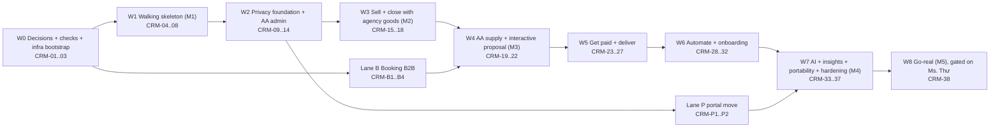

# Partner CRM v3: delivery plan (AA-821 / PR-19)

S246, 21/10/2026. Agent: Claude Code (delivery-planner lane). Draft only: no repo, AWS, Linear or Jira writes, no paid
calls. Every number marked *(est.)* is my estimate; unit prices are the ones already cited in v2/v2.1/v2.2.

**Inputs read in full:** spec `docs/research/partner-crm-spec.md` (the task path `v2.1/partner-crm-spec.md` does not
exist); v2.2 `.tmp-session/s245-r2/r4/crm-v2.2-simplified.md` + `decisions-v2.2.json` (not yet copied into
`docs/audits/`); v2.1 tech §3–§6 and `crm-w0-w1-issues.json`; v2 §5, §7, §8; `owner-approvals-r2.md`
(rounds 2–3); teardown R1–R16; ideas R17–R44 + C12/C31; questionnaire answers v1 (41), `reply-to-notes.md`, answers v2
(12); Booking `CONTEXT.md` (at bk-018); CIS `CONTEXT.md` (portal, AA-885); ADR 0008 §8; OpenBA D1; backlog README.

**Planning rules used**
- One issue = one deliverable (~1 PR or a small PR group). Detail lives in the issue checklist, not in sub-issues.
- Sizes: **S** = 1 PR (~0.25 session), **M** = 2 PRs (~0.5), **L** = 3–4 PRs (~1 session) *(est.)*.
- Every Done-when has at least **one refusal case** and **one edge case** (OpenBA D1), with the error code where one
  exists.
- Global Done (applies to every issue, not repeated): merged + CI green + Dev rollout COMPLETED + live check
  (skill `aa-ship`); `Refs AA-821` in commits; implementation notes `docs/implementation-notes/<id>.md`.
- Dev only, synthetic agencies only (C7.1a); vendors in test mode; nothing reaches a real traveller before W8.

---

## 0. Summary

1. **44 issues in 9 waves (W0–W8) plus two side lanes** (Booking B2B, portal move), all children of **AA-821**. The
   v2.1/v2.2 plan had ≈ 118–123 small issues; the same work is regrouped into deliverables with checklists, so the
   Linear footprint is ≈ 44, and **at most ~10–12 open at once** if issues are created one wave ahead.
2. **Scope:** all 23 spec modules (F1–F5, 1–18), all approved R-items (R1–R10, R15–R44; R11–R14 and R38/R43/R44 as
   answered in the questionnaire), C12 (one cancel-trip action) and C31 (deposit link valid only while the AA hold
   lives). Explicitly **after** 23 modules: group departures (R12), in-app insurance sales (R13), Messenger/IG,
   BYOK, help bot, paid flight-status API (R44 step 2), two-way mail sync, Zalo, tier billing.
3. **Milestones:** M1 "CRM runs on Dev" (end W1); M2 "full lifecycle with the agency's own goods" (end W3, the
   approved Slice 2 / B3 a); M3 "AA supply inside the CRM" (end W4); M4 "23 modules on Dev" (end W7); M5 "Go-real"
   (W8, opens only when Ms. Thư names the first real agency).
4. **Effort *(est.)*:** ≈ 32 sessions of work (W8 excluded); ≈ 28 on the critical path because the Booking and portal lanes run
   beside the CRM lane. At ~2.8 CRM sessions/week from S247: **23 modules on Dev ≈ late Dec 2026 – end Jan 2027**.
5. **Cost (AWS, AA side, per month, *est.*):** **0 agencies (Dev)** ≈ $12–20 (worst $25–31 without Spot);
   **10 agencies** ≈ $83–94 (prod ≈ $71–74 + Dev); **50 agencies** ≈ $317–337 (prod ≈ $305–317 + Dev).
   AA vendor cost $0 under the decided options; agencies pay their own Stripe/Twilio/Meta fees.
6. **Longest pole:** Booking has **no departure, capacity, hold or B2B API** today (checked: latest migration
   bk-018; not in ERD v2 either). The teardown line "Booking already has departure/allotment" (R12) is wrong. Lane B
   must start right after the ADR.
7. **People:** agents build everything in code. Nghiệp: ADR read-through, MFA applies (5 points), secret values,
   free vendor test accounts, one question to Twilio. Ms. Thư: 12 v2 questionnaire confirmations (names, legal
   entity, B2B terms), AA "before you go" content, terms/waiver templates, insurer contact, help videos, real net
   rates, and naming the first real agency.

---

## 1. Decisions this plan builds on (and where they changed the earlier design)

| Source | Decision | Effect on the plan |
|---|---|---|
| Owner | Separate app (AA-Partner) integrated with the tenant portal; free now, tiers later; all 23 modules before real agencies; fake agencies on Dev | Waves W0–W7 on Dev; W8 gated |
| v2.2 S1 | One KMS key per env + per-agency DEK, pluggable DEK store | CRM-04 (key), CRM-06 (KeyProvider) |
| v2.2 S2 | Append-only audit, hourly Object Lock export, chained manifest | CRM-12 |
| v2.2 S3 + Q 4.1 | E-sign: **self-built simple e-sign** (email code, typed name, consent, sealed PDF); BoldSign only if the insurer refuses | CRM-18 (minimal), CRM-25 (full) |
| v2.2 S4 | Fork the TP map component once + import guard | CRM-20 |
| v2.2 S5 | Cognito M2M pool `aa-m2m-<env>`, 6 h tokens | CRM-B1 |
| v2.2 S6 | `traveller_self_reveal(session)` + boundary test now; second public service decided at Go-real | CRM-09, CRM-38 |
| v2.2 S7 + Q 4.3 | WhatsApp + SMS in the 23 modules; Messenger/IG after | CRM-28 |
| v2.2 A1 + Q 3.4/3.5/6.3 | AA admin in 3 layers; support grant 1–7 days (default 24 h), read-only, F1 hidden; break-glass ≤ 1 h, one agency, 2nd person alerted; owner recovery = promote existing member after 14 days | CRM-13, CRM-11 |
| v2.2 V1–V3 | Backups ≤ 30 days; no `tenant_id` metric dimension; ALB rule-order test | CRM-14, CRM-34, CRM-03 |
| Q 1.1 | Free now; tiers when CRM cost > $150/month or 20 agencies; AI fair use | Entitlement fields in CRM-11, no billing |
| Q 1.2/1.4 | B2B net table (15 % margin); quote under AA "from" price = warn, not block | CRM-B1, CRM-19 |
| Q 3.7/3.8 | Deletion unreadable everywhere ≤ 30 days; audit 12 months in-app (Object Lock compliance), then 6 years governance; agency download | CRM-12, CRM-14, CRM-35 |
| Q 3.9/3.10 | Agency audit shows "AA ops viewed trip X"; supplier export = minimal fields, passport only if required | CRM-26 |
| Q 3.12 | Insights k ≥ 10 **and** ≥ 3 agencies, **default on with opt-out** (D24 opt-in dropped) | CRM-34 |
| Q 3.13 | MFA mandatory for owner + agent (passkey or authenticator app) | CRM-11 |
| Q 4.2/4.4 | WhatsApp and SMS through the **agency's own Twilio** (D9 a reversed); risk: Twilio ISV rule | CRM-02 check, CRM-28 |
| Q 4.5/4.6 | Stripe Connect Standard where Stripe exists, no stored cards; VN = manual "mark paid" | CRM-23 |
| v2 Q 4.1 + Q 4.8 | Send from agency Gmail **and** Outlook; inbound by forwarding/BCC; no two-way sync (no CASA) | CRM-17 |
| Q 2.3 (R38) | AA writes prep packs; visa = official link only; insurance = reminder + decline form | CRM-22, CRM-25 |
| Q 5.1 | First version: "I decline travel insurance" signed with the waiver | CRM-25 |
| Q 6.1 | Meta/Google/Microsoft verifications start the day 23 modules are done | CRM-38 |
| Q 6.2 | Fixed departures auto-confirm; others on-request, AA ops confirm in 1 business day | CRM-B2, CRM-B3 |
| Q 2.1 v2 (R43) | Self-serve onboarding: in-app checklist, help pages + 15–20 videos, office hours, shared inbox; bot later | CRM-31, CRM-37 |
| Q 2.2 (R14) | Consent-only campaigns, unsubscribe, sent as the agency, AA content blocks | CRM-36 |

---

## 2. Waves and lanes

| Wave | Goal / exit criterion | Issues | Effort *(est.)* |
|---|---|---|---|
| W0 | ADR + contracts merged; readiness verdicts; CloudFront → VPC origin proven | CRM-01..03 | ≈ 1.25 sessions + MFA wait |
| W1 (M1) | Synthetic agency signs in; traveller form → Inquiry card < 1 min; F1 ciphertext only; CIS sees CRM jobs | CRM-04..08 | ≈ 3.5 |
| W2 | F1–F5 complete; roles + MFA; AA admin 3 layers; trash/archive/retention rules | CRM-09..14 | ≈ 4.5 |
| W3 (M2) | One trip from Inquiry to Completed with the agency's own suppliers (text proposal, manual payment, Stage 3, e-sign) | CRM-15..18 | ≈ 3.5 |
| W4 (M3) | AA products quoted, held and confirmed from the interactive proposal | CRM-19..22 | ≈ 3 |
| W5 | Stripe test deposits, full client portal, waiver, ops release + 90-day deletion, commission, cancel-trip | CRM-23..27 | ≈ 4 |
| W6 | WhatsApp/SMS, workflows, duty of care, onboarding/import, search/templates | CRM-28..32 | ≈ 4 |
| W7 (M4) | AI drafts, reports, insights, export/deletion, campaigns, security review, load test | CRM-33..37 | ≈ 4 |
| W8 (M5) | Prod placement, WAF, passkeys, vendor verifications, DPA/data page | CRM-38 | ≈ 2–3 + external clocks |
| Lane B | Booking B2B API: M2M, quote, departures/holds, event feed; CIS catalog over HTTP | CRM-B1..B4 | ≈ 3 (parallel W1–W3) |
| Lane P | Membership feed + portal moved into AA-Partner behind CloudFront | CRM-P1..P2 | ≈ 1.5 (parallel W3–W6) |

**Linear quota rule:** create issues one wave ahead (current + next wave + the active lane), archive closed ones at
session end (`linear_export.py --archive --apply`). Peak ≈ 10–12 open CRM issues; project "Tenant CRM" stays far
below 100.

---

## 3. Issues

Columns in each card: **Repo**, **Size**, **Depends on**, **Implements** (spec modules / R-ids), **Who**,
**Checklist** (what the PRs contain), **Done when** (R = refusal case, E = edge case).

### W0 — Decisions, readiness, infra bootstrap

#### CRM-01 ADR + contracts + spec errata for the Partner app
- **Repo:** root. **Size:** M. **Depends on:** none. **Implements:** spec §8, §9, §10 deps; F1–F5 framing; v2.2 S1–S7, A1, V1–V3; questionnaire deltas.
- **Who:** agent writes; Nghiệp reads before status Accepted (it reverses D7 a, N11 a, B2, D21 c, T8, D9 a, D19 a, D24).
- **Checklist:** ADR amending ADR 0008 §8 (next free number; 0009/0012 reserved elsewhere) • JSON-schema contracts `crm.ops.v1` (read + write), `booking.b2b.v1` (quote, hold, confirm, cancel, events), `catalog.http.v1`, `tenant.membership.v1` under `docs/contracts/` • spec errata note for Ms. Thư (F1 "agency's own key", §8 "agency-held keys", module 5 "two-way sync", module 9 provider) • data-standards C2.2 row (`crm_app` limit 6, pool 3) • AA-813 comment with the CRM-role rule • copy v2.2 into `docs/audits/`.
- **Done when:** ADR Accepted and linked from `docs/adr/README.md`; contract schemas validated in CI. **R:** a sample `crm.ops.v1` response containing `trip_count`, `revenue` or any `pii:` field fails the schema test. **E:** ADR number check fails the PR if the chosen number is already used or reserved.

#### CRM-02 Readiness checks before code (read-only)
- **Repo:** root (`docs/audits/` note). **Size:** S. **Depends on:** none. **Implements:** T11, Q 3.11, Q 4.2, R15, R17, Q 3.13.
- **Who:** agent; Nghiệp sends the Twilio question and runs MFA for the IAM listing.
- **Checklist:** acc3 Bedrock: Haiku 5.5 via `us.` profile + `ApplyGuardrail` (catalog read only) and the CRM invoker role design • Guardrails availability on acc2 • Twilio: may a platform use the agency's own Twilio for WhatsApp without AA being a Meta Tech Provider • list third-party IAM roles on acc2/acc3 (TrueIDC, eCloudvalley) for the sub-processor page • Google scope class of `gmail.send` and `calendar.events`; Microsoft `Mail.Send`/`Calendars.ReadWrite` publisher-verification needs • Cognito feature tier needed for passkeys/MFA on the EXTERNAL pool and its MAU price • a free FX source that has VND.
- **Done when:** each check has a verdict, a source URL with date, and the plan delta. **R:** if Haiku 5.5 `us.` is missing, the note picks a fallback and records the monthly delta (≈ +$38 at 10 agencies for Haiku 4.5). **E:** if Twilio requires Tech Provider, the note switches CRM-28 to the subaccount fallback and adds the 3–4 week clock to W8.

#### CRM-03 Infra bootstrap + CloudFront VPC-origin spike
- **Repo:** AA-CIS-Infra. **Size:** M. **Depends on:** none. **Implements:** T1, V3, N3 b.
- **Who:** agent; Nghiệp applies the apply-role bootstrap with MFA.
- **Checklist:** apply-role permissions (CloudFront VPC origins, CRM ECR names); quota request "managed policies per role" if needed • hello container behind CloudFront PAYG → VPC origin on the internal NLB → ALB host rule (priority < 100), then "any `X-AA-Origin` → 403" • ALB rule-order test in CI (V3) • fallback O1 documented.
- **Done when:** hello page served on the partner Dev host with SSR streaming. **R:** a request through CloudFront with a non-partner Host (or the raw `*.cloudfront.net` name) gets 403, never CIS or Booking. **E:** page loads from a country outside the shared WAF's 10-country list (VPN check); a 30 s SSR response is not cut.

### W1 — Walking skeleton (M1)

#### CRM-04 Infra for the Partner app on Dev + DB owner `crm`
- **Repo:** AA-CIS-Infra (+ root C2.2). **Size:** L. **Depends on:** CRM-01, CRM-03. **Implements:** F4 isolation, F5 storage, S1 key, S2 bucket, T4, T6.
- **Who:** agent; Nghiệp: MFA apply, secret values (DSN, Cognito client), DB Migrate `set-password`.
- **Checklist:** ECR ×2, task defs, api + web services (desired 0, Fargate ARM Spot), SGs, ALB rules, secrets, GitHub OIDC, CloudFront + DNS + ACM, budget `crm` • KMS `alias/crm-dev/data` with 3-statement policy, EventBridge alarms (`PutKeyPolicy`, `CreateGrant`, `ScheduleKeyDeletion`, `DisableKey`, foreign `Decrypt`), nightly `GetKeyPolicy` drift check • `owners.yaml` owner `crm` (`crm_owner` NOLOGIN, `crm_app` LOGIN), `IDLE_EXEMPT_KINDS` for CRM periodic kinds, isolation probe • audit bucket with Object Lock (governance on Dev) • e2e mailbox addresses for synthetic agencies, readable by AA-Partner.
- **Done when:** `terraform plan` clean after apply; probe green. **R:** `crm_app` → `booking.customers` and `cis_app` → any `crm.*` table both fail with 42501. **E:** a CIS DB Migrate `apply` while the CRM heartbeat job is running is not blocked; a test `PutKeyPolicy` event matches the alarm pattern (unit test on the rule).

#### CRM-05 AA-Partner repo, API skeleton and job runner
- **Repo:** AA-Partner (new, public). **Size:** L. **Depends on:** CRM-04 (ECR/OIDC for Done). **Implements:** F4 base, D22 change, S4 guard.
- **Who:** agent.
- **Checklist:** repo layout `web/` + `api/`, CI on ARM, DM-6.10 scan (no account IDs), import-boundary test (no TP backend modules, no CIS code) • FastAPI `/crm/health` + ready (schema versions) • Cognito EXTERNAL verification (Dev client `cis-portal`), `tenant_tx()`, ENABLE + FORCE RLS from `crm-001` • `crm.job` runner copied from Booking with the shared conformance tests, PII-free `error_class`, deploy gate • `crm.ops.v1` job summary.
- **Done when:** deployed, `/crm/health` 200, CIS can read the job summary. **R:** a WORKFORCE `cis-admin` or `breakglass` token on `/crm/v1/*` → 403; a cross-tenant SELECT under RLS returns 0 rows. **E:** CI fails a job enqueue whose payload has a `pii:`-tagged key; a worker stopped mid-job releases its lease and the job is re-claimed.

#### CRM-06 KeyProvider and field encryption
- **Repo:** AA-Partner. **Size:** M. **Depends on:** CRM-04, CRM-05. **Implements:** F1 (core), S1, Q 3.6.
- **Who:** agent.
- **Checklist:** per-agency DEK, wrapped under the env key with context `{tenant_id, purpose}`, 5-minute cache • AES-GCM (library), AAD = tenant/table/column/id • HKDF-derived truncated blind index • DEK store interface (table on Dev, S3 option later) • `crm-002` vault columns • KeyProvider contract test: rewrap DEK under a new wrapping key, data still readable (BYOK path).
- **Done when:** a DB dump of the vault shows ciphertext only. **R:** decrypt with another tenant's context fails and writes an `access_event` with outcome `denied`. **E:** DEK cache expiry mid-request re-unwraps transparently; rewrap test passes.

#### CRM-07 Web skeleton + synthetic agencies
- **Repo:** AA-Partner. **Size:** M. **Depends on:** CRM-05. **Implements:** F4 sign-in, NFR (EN/VI), R32 (date helper), C7.1a.
- **Who:** agent; Nghiệp creates `e2e-test-crm-*` Cognito users/secrets with the MFA profile (names only in repo).
- **Checklist:** Next 16 standalone, host routing partner/traveller, server-side Cognito session, BFF allow-list, EN/VI • locale-aware date input/display (dates spelled with month names outward) • seeder: 2–3 synthetic agencies, Faker EN/VI travellers, DRY RUN default.
- **Done when:** a seeded agency user signs in on the partner host. **R:** on Dev, creating a tenant without `is_synthetic = true` → 422. **E:** a Vietnamese name with diacritics round-trips; `03/04` renders "3 Apr" for en-AU and "Apr 3" for en-US.

#### CRM-08 Slice 1: intake → Inquiry → board, observed by CIS
- **Repo:** AA-Partner + AA-CIS-App. **Size:** L. **Depends on:** CRM-06, CRM-07. **Implements:** module 1 (base), module 2 (Inquiry column), F1/F2 minimal, F5 minimal, D12 change.
- **Who:** agent.
- **Checklist:** public intake endpoint (honeypot, rate limit on `CloudFront-Viewer-Address`), `crm_intake_process` (traveller F1, profile F2, trip at Inquiry, agent e-mail) • board page • CIS: `AppInfo("crm")`, read-only CRM jobs tab • LLM gateway skeleton with stub provider, `crm.llm_call`, `llm-usage`, CRM row on the CIS cost page • Playwright E2E on Dev.
- **Done when:** E2E green: form submit → card on the board < 1 min; viewing the name writes an `access_event`; CIS tab shows CRM job counts. **R:** a submission with the honeypot filled or without the consent box creates no row (422 or silent drop, logged as count only). **E:** the same e-mail submitting again while an Inquiry is open attaches to that trip instead of creating a second one (C47).

### Lane B — Booking B2B (starts after CRM-01, parallel to W1–W3)

#### CRM-B1 M2M auth + B2B quote
- **Repo:** AA-Booking + AA-CIS-Infra (M2M pool). **Size:** L. **Depends on:** CRM-01. **Implements:** spec §1 "live AA supply", §9 inventory API, S5, Q 1.2, Q 1.4.
- **Who:** agent; Nghiệp MFA apply for the `aa-m2m-dev` pool.
- **Checklist:** pool + resource server scopes `booking.b2b/*`; route pins `client_id` + scope • `GET` B2B offers (catalog key, components), `POST` quote on pricing channel `b2b` with FX lock and price hash, fake net rates on Dev • flag `below_public_from_price` (warn only).
- **Done when:** the CRM client gets a quote with price hash. **R:** a token with the wrong client or scope → 403; the response never contains net cost (schema test, ADR 0005). **E:** quote in VND and AUD with the FX row in force on the pricing day; a price below the public "from" price returns the warning flag, not an error.

#### CRM-B2 Departures, capacity and holds
- **Repo:** AA-Booking. **Size:** L. **Depends on:** CRM-B1. **Implements:** spec §9 hold/confirm/expiry, Q 6.2, C31 (source of hold expiry), prerequisite of R12 later.
- **Who:** agent (migration = risky change → independent review before merge).
- **Checklist:** migration `bk-0NN`: `departures` (fixed or on-request), capacity, `b2b_holds` with TTL + reaper job, B2B trip case carrying an agency reference and **no traveller PII** • confirm / cancel / release endpoints, idempotency keys • auto-confirm for fixed departures, `on_request` state for others.
- **Done when:** hold on a fixed departure confirms automatically; on-request hold waits for ops. **R:** hold with capacity 0 → 409 `sold_out`; confirm after expiry → 409 `hold_expired`. **E:** two concurrent holds for the last seat: exactly one wins (concurrency test); a repeated confirm with the same idempotency key returns the first result.

#### CRM-B3 B2B event feed + ops on-request desk
- **Repo:** AA-Booking. **Size:** M. **Depends on:** CRM-B2. **Implements:** module 6 "AA lines fill themselves", R18 (status source), R23 (sold-out reason), R37 (incident flag), Q 6.2.
- **Who:** agent.
- **Checklist:** cursor feed `booking.b2b.events.v1` (hold/confirm/cancel, on-request accepted/declined, voucher ready, departure incident flag with `departure_id` only) • staff admin page to accept/decline on-request lines within 1 business day (SLA badge).
- **Done when:** CRM test consumer replays the feed. **R:** feed call by a non-CRM client → 403. **E:** replay from an old cursor yields no duplicates; an incident flag never carries traveller data (schema test).

#### CRM-B4 CIS catalog over HTTP for the CRM
- **Repo:** AA-CIS-App. **Size:** M. **Depends on:** CRM-01, CRM-B1 (M2M pool). **Implements:** modules 3/4/22 content, R25 (exclusions), R29 (system tags), R33 (location → time zone), R38 (catalog fields).
- **Who:** agent.
- **Checklist:** `catalog.http.v1` read endpoints over published views (tour, days, places, exclusions, activity tags, intensity) with M2M scope `cis.catalog/read`; ETag caching.
- **Done when:** CRM fetches a tour with days and tags. **R:** unpublished or tenant-private tour → 404; wrong scope → 403. **E:** a tour removed from the catalog returns 410 and the CRM marks cached lines "no longer offered".

### W2 — Privacy foundation + AA admin

#### CRM-09 F1/F2 complete
- **Repo:** AA-Partner. **Size:** M. **Depends on:** CRM-06, CRM-08. **Implements:** F1, F2, spec §5 data placement, S6, R7 (relationships), R32 (age band).
- **Who:** agent.
- **Checklist:** `reveal(field, reason)` with F5 event • exact search by e-mail/phone blind index • F2 profile with bands/flags, NOLOGIN roles `crm_ai_reader`, `crm_insights` • `traveller_self_reveal(session)` + CI boundary test (public router may not import `reveal`) • document bucket SSE-KMS with tenant context • traveller relationships with automatic inverse (family, referrer) • age band at departure in F2, recomputed only on DOB/date change.
- **Done when:** F2 queries need no decrypt. **R:** `crm_ai_reader` selecting an F1 column → 42501; a public route importing `reveal` fails CI. **E:** a companion with no e-mail is valid; changing an unrelated field does not recompute age bands (no F5 noise).

#### CRM-10 F3 PII scrubber
- **Repo:** AA-Partner. **Size:** M. **Depends on:** CRM-09, CRM-02. **Implements:** F3, spec §8 "scrub before AI".
- **Who:** agent (Guardrails corpus in CI ≈ $0.70/month).
- **Checklist:** pass 1 known-values tokenization, pass 2 regex (intl + VN phone, passport, DOB, card, signing links), pass 3 Guardrails detect mode on free text only • fail closed • placeholder map encrypted with the DEK, TTL 24 h, restore only in the agency session • EN/VI corpus ≥ 200 samples, 0-leak gate.
- **Done when:** corpus gate green. **R:** Guardrails timeout → no LLM call, draft state `manual_reply_needed`. **E:** an unaccented Vietnamese name and a person named like a place ("Ha Giang") are both caught; restore maps `<PERSON_2>` back correctly.

#### CRM-11 F4 tenancy, roles, MFA, client ownership
- **Repo:** AA-Partner (+ Infra for Cognito MFA settings). **Size:** L. **Depends on:** CRM-09. **Implements:** F4, spec §3 roles, R8, Q 3.13, Q 6.3, Q 1.1 (entitlements).
- **Who:** agent; Nghiệp applies the Cognito pool change.
- **Checklist:** owner / agent / assistant (assistant: no margin fields) • invite → active < 5 min • MFA mandatory for owner and agent (passkey or TOTP) • clients belong to the agency: reassign on member leave, agents cannot delete or export clients • owner recovery: promote an existing active member after a 14-day wait, e-mail to all members, cancellable, audit • plan/entitlement columns (allow-only; AI fair-use cap) with no billing.
- **Done when:** a new user is invited and working in < 5 min (timed E2E). **R:** assistant GET trip has no margin/commission keys (contract test); agent DELETE traveller → 403; owner recovery targeting a non-member e-mail → 422. **E:** last owner deactivated → only recovery by promoting a member; a deactivated agent's open trips appear in the owner's reassign queue.

#### CRM-12 F5 audit
- **Repo:** AA-Partner + AA-CIS-Infra. **Size:** M. **Depends on:** CRM-09. **Implements:** F5, S2, Q 3.8, Q 3.9.
- **Who:** agent.
- **Checklist:** `crm.audit_event` INSERT/SELECT only, trigger blocks UPDATE/DELETE, monthly partitions • actors `user | ai_agent | aa_ops | support:<staff> | aa-staff:<id>`; every F1 read logged; no PII in events (unit test) • hourly export to Object Lock with chained SHA-256 manifest; retention plan 12 months compliance then 6 years governance (Dev: governance only) • agency audit page (12 months) + download.
- **Done when:** the agency sees its own log and downloads a copy. **R:** UPDATE on an audit row as `crm_app` → error. **E:** an export retry after an S3 failure keeps the chain intact; the verify script detects a deleted row in a test copy.

#### CRM-13 AA admin in three layers
- **Repo:** AA-Partner + AA-CIS-App + AA-CIS-Infra. **Size:** L. **Depends on:** CRM-11, CRM-12. **Implements:** v2.2 A1, T9, Q 3.4, Q 3.5, Q 6.2 (second person).
- **Who:** agent; Nghiệp MFA apply for the break-glass role; Ms. Thư names the second alarm recipient.
- **Checklist:** L1 console in CIS admin over `crm.ops.v1`: fixed usage meter (seats, active users, storage, mail in, AI cost, failed jobs, last active), create agency, invite first owner only if never owned and no travellers, suspend/resume, retry job, entitlements allow-only, export/delete **requests** only • group `crm-platform-admin` • L2 support grant: owner enables 1–7 days (default 24 h), read-only, F1 hidden unless ticked, separate WORKFORCE client `crm-support`, reason/ticket required, banner, blocked actions (send, export, roles, integrations, support settings) • L3 break-glass IAM role: MFA, ≤ 1 h, session tag = tenant, KMS context condition, EventBridge → SNS to Nghiệp + second person, auto `access_event`.
- **Done when:** each layer's actions show in the agency audit. **R:** support token after grant expiry → 403; support trying export/send → 403; L1 response contains no trip/pipeline/revenue keys (test); AA cannot invite an owner into an agency that has travellers. **E:** owner revokes mid-session → next request 403; break-glass session tagged for tenant A cannot decrypt tenant B (KMS deny).

#### CRM-14 Data lifecycle rules
- **Repo:** AA-Partner + AA-CIS-Infra. **Size:** M. **Depends on:** CRM-12. **Implements:** R21, R23 (archive + Lost reasons), V1, Q 3.7, module 18 (deletion bypass).
- **Who:** agent.
- **Checklist:** one trash for all objects with restore window; delete blocked when money, signature, commission or an AA-Booking line exists → action becomes "Cancel trip" • contact archive: suppress every automated send at the dispatcher, keep history • fixed Lost reason codes (AA-aware) • deletion requests bypass trash • V1: alarm on any manual DB snapshot older than 30 days; retention ≤ 30 days documented.
- **Done when:** trash/archive work from the UI. **R:** delete a trip with a paid invoice → 409 `has_money`; an archived contact's queued message is dropped at the dispatcher and logged. **E:** restore of a trip whose AA hold expired succeeds and flags the line "re-check availability"; a deletion request on a trashed trip purges immediately.

### W3 — Sell and close with the agency's own goods (M2 = approved Slice 2)

#### CRM-15 Modules 1 + 2 complete
- **Repo:** AA-Partner. **Size:** L. **Depends on:** CRM-09, CRM-11. **Implements:** module 1, module 2, spec §4 pipeline + gates, §5 Stage 1/2 + rules 1–5 + panel + 80 % automation, R1, R7 (form), R15 (slot picker), R31, C47.
- **Who:** agent (UI-heavy: Claude, not Kiro).
- **Checklist:** embeddable widget + traveller-host form; companions in one form • Stage 2 auto-send + "fill from call"; completeness per stage; Traveler info panel • conditional, paged forms with jump to first error; hidden-branch answers dropped server-side; health questions only after consent, stored as flags • 7 stages + Lost, transition table + trigger, Proposal gate (Stage 2 ≥ 80 % or logged override), task "Get planning info" • board: "waiting on" (agent/client/AA), bulk stage moves with count preview, timeline • call-slot picker on the form • repeat traveller prefill through `traveller_self_reveal` • metric "no lead quiet > 3 days".
- **Done when:** a trip moves Inquiry → Qualifying → Proposal on the board. **R:** Qualifying → Proposal with Stage 2 < 80 % and no override → 409 `stage2_incomplete`. **E:** repeat traveller sees prefilled answers and only confirms; a hidden-branch answer posted by a crafted request is discarded.

#### CRM-16 Bookings ledger (agency lines) + supplier directory
- **Repo:** AA-Partner. **Size:** M. **Depends on:** CRM-15. **Implements:** module 6 (non-AA), module 15, R17, R18.
- **Who:** agent.
- **Checklist:** `crm.booking_line` with status Planning / Confirmed / Cancelled (only Confirmed counts) • money columns store amount, converted amount, rate, rate date, source (revenue at booking date, receipts at receipt date) • `crm.fx_rate` from the CRM-02 source, owner manual entry for VND if needed • strictness levels Off/Basic/Strict; conf number unique per supplier under Strict • supplier directory with AA as a read-only default entry.
- **Done when:** margin per trip shows without a spreadsheet. **R:** duplicate conf number for one supplier under Strict → 409 `duplicate_confirmation`. **E:** a later FX row does not change past margins; a VND line without a rate requires manual entry before Confirmed.

#### CRM-17 Module 5: e-mail inbox
- **Repo:** AA-Partner + AA-CIS-Infra (SES rule). **Size:** L. **Depends on:** CRM-15, CRM-10. **Implements:** module 5 (as decided: send from agency Gmail/Outlook, inbound by forwarding/BCC), R24, C39, Q 4.8.
- **Who:** agent; Nghiệp creates the Google "Testing" project and the Microsoft test app registration (free).
- **Checklist:** one SES rule for the domain → S3 → `crm_mail_ingest` (re-encrypt, link to trip by reply-to token + `Message-ID`/`References`) • send via `gmail.send` and Graph `Mail.Send`, mail lands in the agency's Sent • saved replies, internal notes, autosaved drafts • sender table generated from code (agency mailbox vs system) • token loss: hold outgoing mail in "Waiting for reconnect", red banner, nightly token check, never fall back to platform sending • Gmail forwarding confirmation code shown in the UI • mbox/CSV history import.
- **Done when:** a client e-mail thread lives on the trip timeline. **R:** mail to an unknown agency slug is discarded with a count-only log (no body stored); sending with a revoked token → message held, not sent through SES. **E:** a forwarded thread without `References` is still matched by the trip token; an attachment over the size limit is refused with a visible note.

#### CRM-18 Slice 2: thin full lifecycle
- **Repo:** AA-Partner. **Size:** L. **Depends on:** CRM-16, CRM-17. **Implements:** module 4 (base), 7 (manual payment), 11 (base), 12 (minimal self-built e-sign), spec §4 Booked → Completed, §5 Stage 3.
- **Who:** agent.
- **Checklist:** text proposal from agency lines (e-mail/WhatsApp-length) + accept page • invoice schedule with "mark paid" (bank transfer) → Booked • client link with per-person OTP, Stage 3 form unlocked after deposit • e-sign v0: e-mail code, typed name, consent, sealed PDF + hash in the tenant bucket • date-driven Pre-departure / Travelling / Completed tick.
- **Done when:** E2E on Dev: one synthetic trip from Inquiry to Completed. **R:** Stage 3 form before the deposit → locked (403 `stage3_locked`); a wrong e-sign code is refused and the attempt logged. **E:** a trip with no return date stays Travelling and raises a task instead of auto-completing.

### W4 — AA supply inside the CRM (M3)

#### CRM-19 B2B client + auto-filled AA lines
- **Repo:** AA-Partner. **Size:** M. **Depends on:** CRM-B1..B4, CRM-16. **Implements:** spec §1 (1), module 6 AA lines, R17 (FX lock from Booking), R18 (status from feed only), R23 (AA-aware Lost reasons), Q 1.4.
- **Who:** agent.
- **Checklist:** M2M client with token cache • catalog cache via `catalog.http.v1` • AA lines created from quote/hold, status from the event feed only • price-below-"from" warning on the line • "Sold out (AA)" Lost reason preselected from the feed • Booking outage handling (spec §11.2): queue and banner.
- **Done when:** an AA hold appears as a ledger line with conf number. **R:** manual edit of an AA line's status → 403 `aa_line_read_only`. **E:** Booking down → actions queue, trip shows "AA pending", retried on recovery without duplicates.

#### CRM-20 Builder fork
- **Repo:** AA-Partner (reads AA-TripPlanner-Web once). **Size:** M. **Depends on:** CRM-07 and the TripPlanner route-stitching investigation (T13). **Implements:** spec §9 visual builder, S4.
- **Who:** agent (UI: Claude).
- **Checklist:** fork the TP map component at a pinned commit; ADR note "origin TP commit X, owned by Partner" • CI guard: no import of TP `@/lib/api`, `@/lib/useTrip`, `@/lib/tileLoader` • builder events `itinerary.sent/accepted/updated` + line-item sync per spec §9 • Mapbox under the shared free tier.
- **Done when:** an agent arranges days on the map and the proposal model updates. **R:** importing a banned TP module fails CI. **E:** a day without a location renders without a map pin and without errors.

#### CRM-21 Module 3: interactive proposal
- **Repo:** AA-Partner. **Size:** L. **Depends on:** CRM-19, CRM-20. **Implements:** module 3, spec §1 (2), rule 5, §11.2 (option unavailable, concurrent edits), R4, R19, R26, R33, C13, C31.
- **Who:** agent (UI: Claude).
- **Checklist:** proposal / day / option block / option / selection; defaults from Stage 2; requires/excludes rules; live price + availability; keep / swap / request change; signed link, no client login • "viewed" event + nudge • selection diff in the timeline ("Day 3 Homestay → Lodge, +$40 sell / +$12 margin", margin agent-only), batched notification • acceptance page grouped: confirmed now / AA confirms in 1 business day / agency booking; hold expiry shown • per-day time zone from the AA location; overnight arrival on the landing day • "show total only" default for clients.
- **Done when:** a client swaps an option and accepts; the hold is placed. **R:** a selection that violates an `excludes` rule → 422 `option_conflict`; accept after the hold expired → 409 `hold_expired` with a re-quote offer. **E:** an option sells out mid-session → block shows "no longer available" and the total recomputes; an agent edit and a client selection at the same time → version conflict surfaced to the agent; a Nepal day shows +05:45.

#### CRM-22 Module 4 complete + "Before you go"
- **Repo:** AA-Partner. **Size:** M. **Depends on:** CRM-21. **Implements:** module 4, R38, R9 (itinerary sections).
- **Who:** agent; Ms. Thư's team writes ~10 AA prep packs (content, not code).
- **Checklist:** e-mail and WhatsApp renderers EN/VI with option-picker link, same price hash as the visual version • "Before you go" section before Day 1: catalog fields, AA prep pack by activity type, agency checklist; visa = official link only; insurance reminder linking the decline form; fitness warning when the client band is below the tour's • agency can edit before sending.
- **Done when:** finished trip → sent text in < 2 min (timed). **R:** sending text whose price hash differs from the visual version → blocked, "regenerate". **E:** a trip with only non-AA lines renders without prep packs; text longer than the WhatsApp limit is cut with the link kept.

### W5 — Get paid and deliver

#### CRM-23 Module 7: invoices and payments
- **Repo:** AA-Partner. **Size:** L. **Depends on:** CRM-18, CRM-21. **Implements:** module 7, Q 4.5, Q 4.6, R25, R26 (payment side), R27, C31, spec §11.2 failed payment.
- **Who:** agent; Nghiệp creates the Stripe test platform account (free).
- **Checklist:** payment adapter: Stripe Connect Standard (test) and manual "mark paid" • deposit/balance schedule, pay links, reminders, refunds, multi-currency • webhook signature + idempotency (`UNIQUE(source, contract, idempotency_key)`) • deposit paid → Booked + Booking confirm • pay-on-arrival lines excluded from links/reminders/commission, suggested from catalog exclusions • `invoice.kind = service_fee` (off by default, not in trip margin) • pay link valid only while the AA hold lives.
- **Done when:** test deposit flips the trip to Booked and confirms the hold. **R:** webhook with a bad signature → 400, no state change; opening a pay link after hold expiry → "expired" page and no Stripe session. **E:** webhook replay is idempotent; failed card → reminder + agent task; partial refund recalculates the balance.

#### CRM-24 Module 11: client portal complete
- **Repo:** AA-Partner. **Size:** L. **Depends on:** CRM-18, CRM-23. **Implements:** module 11, R22, R16, R33 (flights in Stage 3), S6.
- **Who:** agent (UI: Claude).
- **Checklist:** one link, per-person OTP, two levels (lead / companion) • Stage 3: passport etc. upload-only, never shown back; structured arrival/departure flights • per-document visibility flag; cancelled lines hidden; vouchers to the right person; masked OTP e-mail hint • invoices, itinerary • installable PWA with offline itinerary (no identity fields cached).
- **Done when:** "Can you resend…" flows are all self-serve in the portal. **R:** a companion's OTP cannot open the lead's passport or another companion's documents (403). **E:** two travellers sharing one family e-mail get separate OTP sessions; offline mode shows the last synced itinerary only.

#### CRM-25 Module 12: contracts and waivers
- **Repo:** AA-Partner. **Size:** M. **Depends on:** CRM-18. **Implements:** module 12, Q 4.1, Q 5.1, Q 5.3, R34, R13 (decline form only).
- **Who:** agent; Ms. Thư: bilingual terms + trekking waiver templates (business review), insurer approval.
- **Checklist:** `crm.agreement_doc` versions (terms, waiver template, consents); each acceptance pinned to doc version + price hash • self-built e-sign v1 (audit trail, sealed PDF, signer evidence) behind the `esign.*` adapter; BoldSign slot kept • waiver + "I decline travel insurance" signed together • gate: Pre-departure needs a signed waiver.
- **Done when:** 100 % of synthetic Booked trips have signed PDFs before departure. **R:** expired signing code → refused, attempt logged. **E:** terms updated after the client viewed the old version → re-acceptance required before payment.

#### CRM-26 Module 8: AA ops release
- **Repo:** AA-Partner (+ Booking link). **Size:** M. **Depends on:** CRM-B3, CRM-24. **Implements:** module 8, T12, Q 3.9, Q 3.10, R33 (flights to ops), R44 step 1 data.
- **Who:** agent.
- **Checklist:** release on confirmed departure, re-encrypted under `purpose = aa_ops` • `crm-ops` page in AA-Partner staff host (WORKFORCE group `crm-ops`) • supplier export with minimal fields (name, pax, dietary/mobility flags; passport only if the supplier requires it) • every view/export → agency audit line "AA ops viewed trip X on Y" • auto-delete 90 days after return with a deletion receipt.
- **Done when:** ops see the release for a confirmed departure; the agency sees the view in its audit. **R:** release for an unconfirmed departure → 404; staff without `crm-ops` → 403. **E:** trip dates moved after release → deletion date recomputed; time-travel test deletes at return + 90 days and the receipt appears.

#### CRM-27 Module 13 commission + one cancel-trip action
- **Repo:** AA-Partner. **Size:** M. **Depends on:** CRM-23. **Implements:** module 13, C12, R17 (receipt-date FX), R21 (cancel instead of delete).
- **Who:** agent.
- **Checklist:** expected vs received commission, overdue flags • cancel trip: release AA holds via Booking, void open pay links/invoices, refund flow, commission reversal, tasks for agency-booked lines, client notice draft.
- **Done when:** a cancelled synthetic trip leaves no live hold, link or expected commission. **R:** cancel while Booking is down → state "cancellation pending", retried, never shows "cancelled" early. **E:** commission received in another currency uses the receipt-date rate; a partial refund keeps the non-refundable part on the ledger.

### W6 — Automate and onboard

#### CRM-28 Module 9: WhatsApp + SMS
- **Repo:** AA-Partner. **Size:** L. **Depends on:** CRM-02 (Twilio verdict), CRM-17. **Implements:** module 9, Q 4.2, Q 4.4, S6 (HMAC), R23 (archived suppression), spec §11.2 unknown number.
- **Who:** agent; Nghiệp opens a Twilio trial (free).
- **Checklist:** channel adapter (WhatsApp, SMS; Messenger/IG slot unimplemented) • agency Twilio credentials wrapped by the agency DEK • approved templates, 24-hour window enforcement • inbound match by E.164 blind index; unknown numbers → triage queue • webhook HMAC check.
- **Done when:** two-way WhatsApp (Twilio sandbox) on a trip timeline. **R:** free-form message outside the 24-hour window → 409 `template_required`; webhook with an invalid signature → 403, dropped. **E:** status callbacks arriving out of order keep the latest state; a message from an unknown number lands in triage, not on a random trip.

#### CRM-29 Module 10: workflow automation
- **Repo:** AA-Partner. **Size:** L. **Depends on:** CRM-15, CRM-28. **Implements:** module 10, spec §5 automation (T-21), R2, R3, R20, R29, R30, R36, R44 step 1, R9 (task lists).
- **Who:** agent.
- **Checklist:** templates per stage, tick runner, idempotent rules • task due groups (Overdue / Today / Upcoming / Later / Waiting for date); due relative to departure; manually edited dues never recomputed; morning digest e-mail without PII • T-21 Stage 3 nudge + agent alert; T-48h "confirm arrival flight" task with status link • special dates: passport expiry (200 days), birthday/anniversary (marketing consent only) • tags + tag workflows + bulk apply with count preview; system tags from catalog (`aa:trekking` → Trekking pack, T-21 waiver alert) • "N trips in stage X missing workflow Y" + bulk fix • rule-based "ready to travel again" list with reasons, send gated by consent.
- **Done when:** nothing in the synthetic trip set is forgotten before departure (report shows 0 missing). **R:** birthday e-mail for a traveller without marketing consent → not sent, logged; workflow on an archived contact → suppressed. **E:** a trip without dates keeps tasks in "Waiting for date" and dates them when set; re-running a tick creates no duplicate tasks.

#### CRM-30 Duty of care + calendar
- **Repo:** AA-Partner. **Size:** M. **Depends on:** CRM-B3, CRM-17. **Implements:** R37, R15 (calendar sync).
- **Who:** agent.
- **Checklist:** "Where are my clients" view grouped by AA region, names hidden until reveal (F5) • Booking incident flag by `departure_id` → banner + drafted WhatsApp to affected travellers (agent sends) • Google/Outlook calendar sync for booked calls (scope per CRM-02).
- **Done when:** a synthetic incident on a departure shows the affected trips only for agencies that have them. **R:** bulk reveal above a threshold needs a reason and is rate-limited. **E:** a traveller on two overlapping trips appears once with both; revoked calendar token pauses sync with a banner, bookings kept.

#### CRM-31 Onboarding and import
- **Repo:** AA-Partner. **Size:** L. **Depends on:** CRM-17, CRM-11. **Implements:** spec §11.5, R6, R43 (in-app part), C34, Q 2.1 v2.
- **Who:** agent; Ms. Thư's team records the help videos.
- **Checklist:** first-run checklist (connect mail, invite team, import CSV, "view as client") • phased CSV import (travellers → relationships → past trips → notes), dry-run counts only • duplicate merge screen (blind index) merging both F1 ciphertexts • help links per screen to the help pages.
- **Done when:** a synthetic agency onboards from CSV in one sitting. **R:** import file with a missing required column → refused before any write, row-level report. **E:** merging two travellers keeps both trip histories and one F1 record; re-running the same import creates no duplicates.

#### CRM-32 Global search + template library
- **Repo:** AA-Partner. **Size:** M. **Depends on:** CRM-19, CRM-29. **Implements:** R35, R9.
- **Who:** agent.
- **Checklist:** search box on every screen + Ctrl/Cmd+K; query typing: `bk-` code, supplier conf no, E.164 phone / e-mail via blind index, accent-insensitive on non-PII fields; history only in the browser • template library: itinerary sections, task lists, e-mail templates; bilingual AA seed content for new agencies.
- **Done when:** finding any trip by any reference takes one query. **R:** partial-name search on F1 fields is not offered (exact only), test proves no plaintext index. **E:** "Đà Lạt" and "Da Lat" match the same trip title.

### W7 — AI, insights, portability, hardening (M4)

#### CRM-33 Module 14: AI agent layer
- **Repo:** AA-Partner + AA-CIS-Infra (acc3 role). **Size:** L. **Depends on:** CRM-10, CRM-12, CRM-17, CRM-28, CRM-21. **Implements:** module 14, spec §2 "AI drafts, humans send", R5, R10, R39, R40, R41.
- **Who:** agent; Nghiệp MFA apply for `AA3-Bedrock-Invoker-CRM`. Paid calls on Dev: trial ~3, then ≤ 50 (memory paid-runs-subset), cap enforced.
- **Checklist:** real model behind the gateway (choice from CRM-02); AI off by default per tenant; scrub mandatory; per-tenant cap $2 fail-closed; usage meter at 75/90/100 % • drafts for replies, follow-ups, proposals; no send path without an approved draft • rule checks before the preview card (availability, net unchanged); chip questions; thumbs with fixed reason codes • voice profiles (structured, ≤ 4 per agent, opt-in) • supplier confirmation parsing (PDF/forwarded e-mail → suggested lines, accept to write; no passport images) • call notes → option blocks from the closed list of that day's AA inventory, server re-check, names from catalog • edit-distance metric.
- **Done when:** synthetic drafts flow through approve → send with zero PII in prompts/logs (log scan). **R:** tenant at 100 % cap → draft refused, state `manual`; a model answer naming an option code outside the closed list is rejected server-side; send without approval → 403. **E:** scrubber failure → no model call; placeholders restored only in the agency session.

#### CRM-34 Reports (module 16) + AA insights (module 17)
- **Repo:** AA-Partner + AA-CIS-App. **Size:** M. **Depends on:** CRM-21, CRM-23. **Implements:** module 16, module 17, spec §11.7, R23 (Lost analytics), R28, Q 3.12, V2.
- **Who:** agent.
- **Checklist:** `crm.metric_event` events for every spec success metric • reports: conversion by stage, margin, lead source, option picks, upgrade rate • KPI tiles vs same period last year (3-month trend if no history), "AA product share" tile, tiles link to work lists • insights rollups k ≥ 10 and ≥ 3 agencies, default on with opt-out; CIS admin page; no `tenant_id` metric dimension.
- **Done when:** every success metric in spec §6 has a source query. **R:** any cell with n < 10 or < 3 agencies is suppressed (property test); an opted-out agency never contributes. **E:** agency with no prior year shows the 3-month trend; day boundaries use the agency time zone.

#### CRM-35 Module 18: portability and verified deletion
- **Repo:** AA-Partner. **Size:** M. **Depends on:** CRM-14, CRM-13. **Implements:** module 18, Q 3.7, A1 (AA requests only).
- **Who:** agent (deletion = risky → independent review).
- **Checklist:** full export CSV/JSON (agency + traveller scope); owner-only download • deletion: DRY RUN → run → verify (DEK destroyed, receipts), traveller and whole-agency scope, offboarding • AA L1 can only create requests.
- **Done when:** export of a synthetic agency re-imports into a fresh synthetic agency with equal counts. **R:** AA staff download of an export → 403. **E:** deletion of a traveller on a trip currently Travelling is deferred to trip completion unless the owner confirms; verify step proves ciphertext is unreadable.

#### CRM-36 Consent-based e-mail campaigns (R14)
- **Repo:** AA-Partner. **Size:** M. **Depends on:** CRM-17, CRM-29. **Implements:** R14 (Q 2.2), spec §2 "AA never markets to an agency's travelers".
- **Who:** agent.
- **Checklist:** audience = marketing-consented, non-archived contacts • unsubscribe link + suppression list • sent from the agency mailbox (batched to provider limits) • AA content blocks the agency can pick; AA itself never sends.
- **Done when:** a synthetic campaign reaches only consented contacts. **R:** contact without consent excluded (count shown); an unsubscribed contact re-imported by CSV stays suppressed. **E:** a list larger than the daily mailbox limit is spread over days with progress shown.

#### CRM-37 Hardening and readiness for real agencies
- **Repo:** all. **Size:** L. **Depends on:** W1–W7. **Implements:** spec §11.6 NFR, R42, R43 (help pages), Q 3.11, Q 3.14.
- **Who:** agent panel for the security review; Nghiệp reads the findings.
- **Checklist:** independent security review + fixes • load test with 200 synthetic tenants (job fairness, RLS cost) • SLOs + alarms (latency, job lag, decrypt spike) • Dev cost vs estimate • monthly release train, bilingual "What's new", one preview toggle in L1 • help pages EN • draft public data page + sub-processor page ("Amazon Web Services, Inc.: hosting + AI") + DPA technical annex.
- **Done when:** no open High finding; SLO dashboard live. **R:** a noisy tenant flooding jobs cannot delay another tenant's jobs beyond the SLO (test). **E:** Spot interruption of the api task during the load test recovers without lost jobs.

### Lane P — Portal joins the Partner app (parallel W3–W6)

#### CRM-P1 Membership feed + tenant API contract
- **Repo:** AA-CIS-App. **Size:** M. **Depends on:** CRM-11, AA-813 (re-scoped). **Implements:** F4 (CIS directory → CRM), T9.
- **Who:** agent.
- **Checklist:** `tenant.membership.v1` (CIS can create agencies and revoke members only; CRM owns roles) • `cis.tenant-api.v1` for brand identity and tenant catalog.
- **Done when:** a membership change in CIS reaches the CRM in ≤ 1 min. **R:** a CIS event trying to grant a CRM role → rejected by the CRM consumer. **E:** revoke for a member who is the last owner → CRM keeps the agency locked until recovery (CRM-11).

#### CRM-P2 Move `portal/` into AA-Partner
- **Repo:** AA-CIS-App + AA-Partner + AA-CIS-Infra. **Size:** L. **Depends on:** CRM-P1, CRM-07. **Implements:** owner decision "integrated into the tenant portal", D2 lane (reduced: AA-885 already split the portal app).
- **Who:** agent.
- **Checklist:** move with history; flip `portal.` host to CloudFront → Fargate web; delete the CIS copy and invert the guard tests; keep Vercel one week for rollback; 301 `/trip/*` to the traveller host.
- **Done when:** portal E2E (24 smoke checks as in AA-885) green on the new host. **R:** a staff (`cis-admin`) token gets no portal session. **E:** old Vercel URLs redirect with path preserved; rollback drill back to Vercel works.

### W8 — Go-real (M5; opens when Ms. Thư names the first real agency)

#### CRM-38 Go-real
- **Repo:** AA-CIS-Infra + AA-Partner + root. **Size:** L (+ external clocks). **Depends on:** CRM-37 and the first agency. **Implements:** spec §10 pilot, v2.1 §3.5, Q 4.9, Q 6.1, V1, S6 decision.
- **Who:** agent + Nghiệp (MFA, cost approval); Ms. Thư (DPA, lawyer milestone, insurer, agency).
- **Checklist:** prod placement (CRM prod cell or AA-880) with backups ≤ 30 days, never stopped; Object Lock compliance mode • separate partner Cognito pool with passkeys • CloudFront WAF (no geo block) • ECS exec off • pentest, then decide the second public service (N15) • submit Google (`gmail.send`, calendar), Microsoft publisher, Twilio/Meta if CRM-02 requires — the day 23 modules are done • Stripe live per agency • publish data page, sub-processor page, DPA.
- **Done when:** first real agency invited on prod. **R:** prod refuses `is_synthetic` tenants and Dev refuses real ones. **E:** a vendor verification still pending at launch disables only that channel (feature flagged by entitlement), not the agency.

---

## 4. Coverage check

| Spec item | Issues |
|---|---|
| F1 | CRM-06, 09, 13 (L3), 24 (`traveller_self_reveal`) |
| F2 | CRM-09, 08 |
| F3 | CRM-10, 33 |
| F4 | CRM-05, 07, 11, 13, P1 |
| F5 | CRM-08, 12, 13, 26 |
| 1 Intake | CRM-08, 15 |
| 2 Pipeline | CRM-08, 15 |
| 3 Interactive proposal | CRM-20, 21 (+ B1–B4, 19) |
| 4 Text proposal | CRM-18, 22 |
| 5 E-mail inbox | CRM-17 |
| 6 Bookings ledger | CRM-16, 19 |
| 7 Invoices & payments | CRM-18, 23 |
| 8 AA ops release | CRM-26 |
| 9 WhatsApp/SMS | CRM-28 |
| 10 Workflow automation | CRM-29 |
| 11 Client portal | CRM-18, 24 |
| 12 Contracts & waivers | CRM-18, 25 |
| 13 Commission | CRM-27 |
| 14 AI layer | CRM-08 (stub), 33 |
| 15 Supplier directory | CRM-16 |
| 16 Agency reports | CRM-34 |
| 17 AA insights | CRM-34 |
| 18 Data portability | CRM-14, 35 |
| §11 gaps 1–4 (stories, edge cases, walkthrough, mockups) | Done-when lines per issue; mockups inside each UI issue's first PR |
| §11.5 onboarding, §11.6 NFR, §11.7 events | CRM-31; CRM-07/37; CRM-34 |

| R / C | Issue | R / C | Issue | R / C | Issue |
|---|---|---|---|---|---|
| R1 | 15 | R17 | 16, 19, 27 | R31 | 15 |
| R2 | 29 | R18 | 16, 19, B3 | R32 | 07, 09 |
| R3 | 29 | R19 | 21 | R33 | 21, 24, 26 |
| R4 | 21 | R20 | 29 | R34 | 25 |
| R5 | 33 | R21 | 14, 27 | R35 | 32 |
| R6 | 31 | R22 | 24 | R36 | 29 |
| R7 | 09, 15 | R23 | 14, 19, 34 | R37 | 30, B3 |
| R8 | 11 | R24 | 17 | R38 | 22 |
| R9 | 22, 29, 32 | R25 | 23 | R39 | 33 |
| R10 | 33 | R26 | 21, 23 | R40 | 33 |
| R11 | 11 (entitlements only) | R27 | 23 | R41 | 33 |
| R13 | 25 (decline form only) | R28 | 34 | R42 | 37 |
| R14 | 36 | R29 | 29 | R43 | 31, 37 |
| R15 | 15, 30 | R30 | 29 | R44 | 26, 29 (step 1) |
| R16 | 24 | C12 | 27 | C31 | B2, 21, 23 |

**After 23 modules (backlog, not issues):** R12 group departures, R13 in-app insurance sales, Messenger/IG, BYOK,
help bot, R44 paid flight API, two-way mail sync, Zalo, tier billing, VN payment gateway.

---

## 5. Monthly cost (AA side, *est.*)

Base: v2.2 §5 (Dev) and §5.2 (prod, v2.2 column), adjusted for the questionnaire answers and the R-items. Unit prices
as cited there (KMS $1/key, Secrets $0.40, CloudFront PAYG, Cognito M2M per token, Guardrails $0.10/1k units).

| Line | 0 agencies (Dev, synthetic) | 10 agencies (prod) | 50 agencies (prod) |
|---|---|---|---|
| API + web Fargate (Spot on Dev) | 5.4–7.2 | 18 | 55 |
| CloudFront PAYG / WAF | ≤ 0.2 / 0 | ≈ 0 / 7.5 | ≈ 0 / 8 |
| DB (shared Dev RDS / prod cell or AA-880) | 0 | 19 | 133 |
| LLM (Haiku 5.5, AI on for all) incl. R40 | ≤ 2 (test cap) | 13–15 | 67–75 |
| Guardrails, SES, S3, logs, secrets, ECR, alarms | 4–6 | 10 | 30 |
| KMS + Cognito M2M | 2–3 | ≈ 3 | ≈ 3 |
| Second public service (N15) | 0 | 0 | 8.3 |
| Audit Object Lock storage, help bot (later) | ≈ 0 | ≈ 0.5 | 1–4 |
| E-sign self-built | 0 | 0–1 | 0–1 |
| **Prod subtotal** | — | **≈ $71–74** | **≈ $305–317** |
| Dev keeps running | **$12–20** (worst $25–31) | 12–20 | 12–20 |
| **Total AA AWS** | **≈ $12–20** | **≈ $83–94** | **≈ $317–337** |
| Per agency (incl. Dev) | — | ≈ $8.3–9.4 | ≈ $6.3–6.7 |
| Upper bound if every agency hits the $2 AI cap | — | +$5–7 | +$25–33 |

**Vendor costs for AA: $0 under the decided options.** Agencies pay Stripe card fees, Twilio ($0.005/WhatsApp
message + Meta template fees), SMS. Conditional costs that would land on AA:
- insurer refuses self-built e-sign → BoldSign from ≈ $30/month (v2.1 §7.2 figure, not re-checked);
- Twilio requires AA as Meta Tech Provider → $0 fees but 3–4 weeks and subaccount billing to recharge;
- two-way Gmail sync requested later → CASA ≈ $675–5,400/year;
- R44 paid flight API → price unknown, needs approval before use;
- Haiku 5.5 not on acc3 `us.` → ≈ +$38/month at 10 agencies (Haiku 4.5).

**Pricing trigger (Q 1.1):** tiers when CRM cost > $150/month or 20 agencies. On these numbers the cost trigger fires
around 18–25 agencies *(est.)*, so the entitlement fields in CRM-11 are needed before the pilot grows.

---

## 6. Risks

| Risk | Level | Mitigation / early signal |
|---|---|---|
| Booking has no departures, capacity, holds or B2B API (bk-018; ERD v2 has none) | **High** | Lane B right after CRM-01; fake prices on Dev; `on_request` mode; independent review of the migration |
| Real net rates entered by ops before the pilot (Q 1.5) | High | Dev uses fake rates; W8 checklist blocks without the named owner's sign-off |
| Builder depends on the TP route-stitching investigation (T13) | High | CRM-20 waits; CRM-18/22 give a text-only proposal path so M2 does not wait |
| Twilio ISV rule forces AA to be a Meta Tech Provider | Medium | CRM-02 question first; fallback recorded; clock moves to W8 |
| Insurer rejects self-built e-sign | Medium | Adapter keeps a BoldSign slot (+2–3 PRs, ≈ $30/month) |
| Haiku 5.5 / Guardrails not available where planned | Medium | CRM-02 read-only check in W0; AI off by default |
| CloudFront VPC-origin spike fails | Medium | CRM-03 before CRM-04; fallback O1 |
| RDS connection budget near the ceiling (~132/135) | Medium | `crm_app` limit 6 / pool 3 in C2.2; alarm per role |
| One KMS key for all agencies (S1) | Medium | Alarms + nightly policy drift; no task role administers the key |
| Deletion promise depends on backup discipline (V1, Q 3.7) | Medium | ≤ 30-day backups, snapshot alarm, restore drill with a deleted synthetic agency; 90-day fallback wording |
| Questionnaire answers are Nghiệp's on Ms. Thư's behalf (v2 not yet asked) | Medium | Changes most likely in v2 4.1 (mail sync → +CASA, +issues) and 3.3 (promise wording, docs only) |
| 44 issues / ≈ 32 sessions for one engineer with agents | Medium | Per-wave creation; M2 and M3 are usable checkpoints; cut line = W7 items R14/R41 first |
| Portal move breaks live content features | Medium | Staged steps, Vercel kept one week, rollback drill |
| Public repo leaks account IDs or NLB names | Medium | DM-6.10 scan in AA-Partner CI |
| Calendar scope class (R15) unverified | Low | CRM-02; drop to ICS link if it needs CASA |
| Spec text vs design (F1 key wording, module 5 sync, module 9 provider) | Low | Errata in CRM-01 for Ms. Thư |
| Config with underscore env vars (Cognito, DSN, Mapbox) | — | ⚠️ This contains underscore env vars — edit manually in VSCode. Agents never generate scripts for them |

---

## 7. Who does what

| Work | Agent | Nghiệp | Ms. Thư |
|---|---|---|---|
| All code, migrations, Terraform, tests, docs | ✔ (backend/logic suits Kiro if "dùng kiro-cli" is on; UI by Claude) | — | — |
| ADR acceptance (reverses earlier decisions) | writes | reads, accepts | — |
| MFA applies: CRM-03, CRM-04, CRM-B1 (M2M), CRM-11 (Cognito MFA), CRM-13 (break-glass), CRM-33 (acc3 role) | prepares | ✔ | — |
| Secret values, DB Migrate `set-password`, test Cognito users | — | ✔ (manual, underscore env vars) | — |
| Free test accounts: Stripe, Twilio trial, Google Testing project, Microsoft app | — | ✔ | — |
| Twilio ISV question | drafts | sends | — |
| v2 questionnaire: names (ops price entry, departure owner, alarm second person, support person, insurer contact), legal entity, B2B terms | — | — | ✔ |
| "Before you go" prep packs (~10), bilingual terms + waiver templates | format/import | — | ✔ (team) |
| Help videos (15–20), office hours, shared inbox | help pages | — | ✔ (team) |
| Insurer approval, lawyer milestones, DPA, first real agency | tech annex | — | ✔ |
| Risky PR review (auth, migration, CI/secret, deletion) | independent reviewer agent | — | — |

---

## 8. Open points

1. v2.2 decisions page (S1–S7, A1, V1–V3): approval is not recorded in the repo; this plan assumes "approved as
   recommended", per the task statement.
2. Spec path in the task is wrong; v2.2 still lives only in `.tmp-session/` — copy both into `docs/audits/` in the
   next root PR.
3. The TripPlanner route-stitching investigation issue (T13) has no ID in my inputs; CRM-20 depends on it.
4. AA-813 must be re-scoped (CRM owns roles; CIS only creates agencies and revokes) before CRM-P1.
5. R12's premise "Booking has departure/allotment" is false; group departures after 23 modules need CRM-B2 as base.
6. Module 17 on Dev only proves the k-guards; the spec's "3–6 months of real data" means its value starts after W8.
