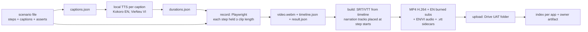

# UAT video plan and overall design audit plan (S260)

**Ask (tech lead, S260):** as code work completes, audit the overall design; run the UAT as recorded videos, built
and checked gradually as features ship; videos may carry TTS narration or subtitles. This page is the approach and
the plan. Tracking issue: AA-855 (one issue for the whole UAT). A $0 pilot was recorded in S260 (section 7).

**Change to the earlier rule:** AA-855 said "UAT after all technical work". The tech lead now asks for it
**gradually**: a feature is recorded once it is Done and live, and re-recorded only when it changes. The final pass
(all apps, sign-off) still happens after the last technical lane.

## 1. Approach

**One scenario = one user story = one video = one regression test.**

- **Scenario file** (Playwright, one per story): an id, the app, a title, a Given/When/Then header, and a list of
  steps. Each step has a caption in English and Vietnamese and a `run()` that performs the action **and asserts the
  result** (heading text, URL, a row count, a status badge). A failed assertion stops the run, marks the step FAIL
  in the video and in `result.json`, and keeps the video as evidence of the defect.
- **Two modes, same file:** UAT mode (video on, `slowMo` ~60 ms, animated cursor, each step held as long as its
  narration) and fast mode (video off, no holds) so the scenario also runs as a normal Playwright check in CI.
- **Recording:** Playwright `recordVideo` at **1440 × 900** (desktop) and **390 × 844** (phone, for TripPlanner,
  the traveller trip pages and CRM pages used on a phone). One Chromium at a time on the 8 GB WSL machine, closed
  after each scenario.
- **Visible interaction:** an injected overlay draws a cursor dot that follows Playwright mouse moves and a ripple on
  every click; the mouse travels to each target in ~30 steps; scrolling is smooth. Step captions become the
  subtitles and the narration text (section 3).
- **Sign-in (never recorded):** each identity signs in once in an **unrecorded** setup context, saves a Playwright
  `storageState`, and the recorded context starts already signed in. A code, TOTP or password screen is never on
  video. Identities are the existing E2E paths (see the table below); secrets are read at run time into env vars and
  never printed or written to files.
- **Data:** Dev only, synthetic E2E tenants, agencies, travellers and staff. No paid LLM call while recording: flows
  that would call a writer or judge either show existing output (read path) or wait until an LLM path exists.
  Screens that show a secret (API key, webhook secret) are masked by the overlay before recording.
- **Language:** every product page opens in English by default, so videos are recorded in English. A short
  "switch to Vietnamese" step is included once per app where a VI switch exists.

### Sign-in paths for recording

| Login type | Identity | Host | Can write? | Notes |
|---|---|---|---|---|
| none | — | public pages | — | TripPlanner browse, legal pages, CRM traveller links |
| CIS reviewer | Cognito E2E staff `e2e@e2e-mail…` (role reviewer) | CIS admin production host | reviewer actions only | email code read from the e2e mail bucket with the admin profile (needs a fresh MFA session) |
| CIS admin (read-only) | E2E CIS admin `e2e-cis-admin@…` (A10b) | CIS admin production host | **no** (403 `e2e_read_only`, except Cut / Edit in Content Quality) | admin-only pages; local run only |
| Booking staff (two) | WORKFORCE E2E staff for Booking (maker + checker) | Booking admin | yes (Dev) | maker-checker flows need both |
| Portal studio | partner pool E2E studio user + TOTP, per E2E tenant | agency host `portal.` | yes, on E2E tenants | TOTP code generated locally from the seed in Secrets Manager |
| CRM staff | `e2e-test-crm-*` users | agency host `portal.` | yes, on E2E agencies | |
| Traveller | `e2e-test-traveller-*` addresses | TripPlanner | yes | email code from the e2e mailbox |

**Gap:** CIS admin write flows (approve in the review queue, change a tenant limit, create a fact) cannot be
recorded: the only admin E2E session is read-only by design. Section 8 lists the options.

## 2. Narration options

Text volume assumed: ~60 scenarios × ~8 steps × ~90 characters ≈ **45,000 characters per language per full pass**;
re-recording after fixes adds maybe 3–5 passes over the project.

| Option | Quality | Vietnamese | Licence | Cost | Verdict |
|---|---|---|---|---|---|
| (a) Burned-in subtitles only (SRT/WebVTT from the captions, ffmpeg + libass) | clear, no voice | yes (soft track or second burned version) | — | **$0** | always on |
| (b1) Local TTS **Kokoro-82M** via `kokoro-onnx` (int8 model, 92 MB) | natural English, several US/UK voices | **no Vietnamese voice** | weights Apache-2.0, runtime MIT | **$0** (CPU, ~0.3 GB RAM, seconds per clip) | **recommended for English** |
| (b2) Local TTS **Piper** (`piper-tts`) | robotic-ish, medium quality | **yes**: `vi_VN-vais1000-medium`, but a **Northern** voice | engine GPL-3.0 (used as a local tool, not shipped); each voice has its own licence: vais1000 = CC BY 4.0 (attribution), `en_US-ryan` = CC BY-NC-SA (**do not use**, non-commercial) | **$0** (~0.2 GB RAM) | **replaced** (v1 pilot only): the tech lead heard it and rejected it |
| (b3) Local TTS **VieNeu-TTS v3 Turbo** (`vieneu` SDK, torch-free ONNX on CPU) | natural, 48 kHz, reads English names inside Vietnamese text | **yes**: 23 presets, 8 of them **Southern** (4 female, 4 male); also clones a consenting speaker from a 5–8 s clip | code, weights and preset voices **Apache-2.0**, commercial use and monetised audio allowed, preset speakers consented (model card FAQ) | **$0** (~1.9 GB peak RAM, ~1.4 s CPU per second of speech) | **chosen for Vietnamese** |
| (c) Amazon Polly (neural) | very natural English | **no Vietnamese voice** | AWS terms | ~$16 per 1M characters → **~$0.70 per full pass, < $5 for the project**; a new AWS service, so it needs an explicit yes | not needed |
| (d) OpenAI TTS | natural, multilingual incl. Vietnamese | yes | OpenAI terms | ~$15 per 1M characters (~$0.70 per pass) | blocked: the OpenAI API has no credits (S259) |

Rejected: unofficial wrappers around browser read-aloud services (terms of use), cloning a real person's voice
without consent.

**Decided (tech lead, S260): only free local TTS; Amazon Polly and OpenAI TTS are not used.** After listening to
the pilot: **English = Kokoro `af_heart` (female), approved, unchanged.** The Northern Piper voice is replaced by a
**Southern Vietnamese** voice.

### 2.1 Vietnamese voice shortlist (S260)

Same 4 TP-PUB-01 caption lines with every candidate (samples in `.tmp-session/S260/uat/out/vi-voice-samples/`).
"ASR WER" = word error rate when the sample is transcribed back by Whisper small (local, MIT), a rough
intelligibility check only (Whisper leans Northern, so Southern vowels such as "tour" → "tui" count as errors).
The agent cannot judge naturalness; the tech lead listens.

| Candidate | Accent | Gender | Licence (code / weights) | Peak RAM / CPU time here | ASR WER | Verdict |
|---|---|---|---|---|---|---|
| VieNeu v3 Turbo, preset **Thục Đoan** (storytelling) | South | F | Apache-2.0 / Apache-2.0 incl. presets ([card](https://huggingface.co/pnnbao-ump/VieNeu-TTS-v3-Turbo), [LICENSE](https://github.com/pnnbao97/VieNeu-TTS/blob/main/LICENSE)) | 1.9 GB / 27 s for 18 s speech | 0.14 | **default VI voice (pending listening)**, pace closest to the English clips |
| VieNeu v3 Turbo, **Mỹ Duyên** / **Kim Thanh** (storytelling) | South | F | same | same / ~32 s | 0.13 / 0.14 | alternates; slower reading (+15–25 % video length) |
| VieNeu v3 Turbo, **Thùy Dung** (news) | South | F | same | same / 24 s | 0.22 | fastest female; less clear in ASR |
| VieNeu v3 Turbo, **Adam** (natural) | South | M | same | same / 22 s | **0.06** | best male option |
| VieNeu v3 Turbo, **Đức Trí** / **Thái Sơn** / **Minh Triết** | South | M | same | same | 0.13 / 0.17 / 0.27 | alternates |
| VieNeu v3 Nano, **Ái Hân** / **Adam** | South | F / M | Apache-2.0 / Apache-2.0 ([card](https://huggingface.co/pnnbao-ump/VieNeu-TTS-v3-Nano)) | 0.6 GB / ~6 s | 0.14 / 0.10 | fallback for a weak CPU; preview model, flatter prosody, 24 kHz |
| Piper `vi_VN-vais1000-medium` (v1 baseline) | North | F | GPL-3.0 engine / CC BY 4.0 data | 0.2 GB / ~1 s | 0.19 | rejected by the tech lead (accent); also reads "Adventure Asia" as "VA" |

Rejected on licence (weights not usable commercially): Piper `vi_VN-vivos-x_low` (VIVOS, CC BY-NC-SA 4.0,
[card](https://huggingface.co/rhasspy/piper-voices/blob/main/vi/vi_VN/vivos/x_low/MODEL_CARD)); Piper
`vi_VN-25hours_single-low` (dataset licence "Unknown", [card](https://huggingface.co/rhasspy/piper-voices/blob/main/vi/vi_VN/25hours_single/low/MODEL_CARD));
VietTTS / dangvansam (code Apache-2.0, **weights CC BY-NC**, [repo](https://github.com/dangvansam/viet-tts));
F5-TTS base (CC BY-NC, [card](https://huggingface.co/SWivid/F5-TTS)) and its Vietnamese fine-tunes
`hynt/F5-TTS-Vietnamese-ViVoice` (CC BY-NC-SA 4.0) and EraX-Smile F5 (CC BY-NC 4.0); viXTTS / XTTS-v2 (CPML);
Facebook MMS-TTS `vie` (CC BY-NC 4.0); Fish-Speech 1.5 / OpenAudio S1-mini (CC BY-NC-SA 4.0). No Vietnamese:
CosyVoice 2/3 (Apache-2.0, 9 languages without Vietnamese), Chatterbox multilingual (MIT, 23 languages without
Vietnamese), MeloTTS (MIT, no Vietnamese). Zalo AI and VinAI publish no open TTS weights (Zalo TTS is a paid
cloud API). Not tested: Kani-TTS-Vie (`pnnbao-ump/kani-tts-370m-vie`, Apache-2.0 tag, Southern voices "Hùng"/"Trinh"),
because it needs PyTorch + NeMo (heavier than the 2 GB budget), its card gives no speaker-consent statement and
the same author's v3 Turbo supersedes it.

**Own voice (tech lead's request, he consents):** VieNeu v3 Turbo clones from a 5–8 s clip on the same CPU path
(Apache-2.0; the card makes the user responsible for consent, which he gives). Recording guide and script:
`.tmp-session/S260/uat/own-voice/README.vi.md` and `clone.py` (enrol in one process ~1.9 GB, synthesize in another
~1.6 GB, ~2.3 min CPU per minute of speech). Fallback: VieNeu v3 Nano cloning (lower timbre fidelity). A further
option, not tested: OpenVoice v2 tone-colour converter (MIT, [repo](https://github.com/myshell-ai/OpenVoice)) on top
of a Southern preset, which keeps the preset's accent and swaps the timbre; needs PyTorch.

**Recommendation:** English subtitles burned in on every video **plus** the Kokoro English voice-over (default
audio track) **plus** a Vietnamese audio track from **VieNeu v3 Turbo, Southern female "Thục Đoan"** (switch with
`UAT_VI_VOICE`, e.g. `Adam` for a male voice or an enrolled own-voice file) and the Vietnamese subtitle sidecar.
Credit line in the index: "Vietnamese voice: VieNeu-TTS v3 Turbo (Apache-2.0)". Cost $0.

## 3. Pipeline

1. **Captions first.** `record --captions` writes `captions.json` from the scenario.
2. **TTS before recording.** One clip per step and language; `durations.json` keeps the longer of the EN/VI clips.
3. **Record held to narration.** Each step is held for max(clip length + 0.6 s, 2.5 s), so the voice always fits
   its step with no audio stretching and no drift. `timeline.json` keeps each step's start/end (ms from video start).
4. **Build.** Subtitles come from the timeline (cue = step start → step end; a failed step is prefixed `[FAIL]`).
   Narration tracks are assembled by placing each clip at its step start + 0.25 s. ffmpeg burns the English
   subtitles (DejaVu Sans, boxed, bottom), encodes H.264 CRF 26 at 25 fps with `+faststart`, and muxes the EN
   (default) and VI audio streams. Sidecars: `.en.vtt`, `.vi.vtt`, `.en.srt`, `.vi.srt`, `.result.json`.
5. **Measured in the pilot:** ~0.8 Mbit/s → **~9 MB for a 90 s video**; ~0.6 GB per full pass of ~60 scenarios.

**Where videos live** (not in any repo: binary, large, and the root repo is public until November):

| Place | Use | Cost | Verdict |
|---|---|---|---|
| Google Drive folder AdventureAsia → `UAT/<round>/<app>/` | master copy, shared with the business owner by the tech lead | $0 within the existing Drive quota | **recommended** |
| Private prefix `uat-videos/` in the existing bronze S3 bucket (acc2) | optional archive | ~$0.03 per GB-month (~$0.02/month for one pass); presigned links expire, so not for sharing | optional, not a new service |
| claude.ai artifact asset store | the index page can embed or link the videos | $0; 15 MB per file | index only |

Upload: the Drive connector takes base64 file content, which is impractical for 9 MB files; test it on one pilot
video in S261, and fall back to `rclone` with a Drive OAuth token (one browser consent by the tech lead) or a
drag-and-drop of the batch folder.

**Naming and versions:** `<SCENARIO-ID>_<yyyymmdd>_v<n>.mp4` (e.g. `TP-PUB-01_20261030_v1.mp4`); a re-recording
after a fix bumps `v<n>`, the old file stays so findings keep their timestamps. A **round** is a dated folder
(`2026-11-R1`).

**Index per app:** `docs/audits/<date>-S<nnn>-uat/<app>.md` in the root repo (scenario, story, verdict, duration,
failed step + timestamp, Drive link, recorded commit SHA of the app) plus one owner-facing artifact page with a tab
per app, which goes into the session-end Jira draft.

## 4. Scenario catalogue

Status: **Done now** = live and stable, record from S261. **After lanes** = waiting on an S260–S262 code lane.
**Blocked** = waiting on an external dependency. Length target 60–120 s unless noted. Order of recording follows
the order below inside each app: Done now first, then as lanes ship.

### TripPlanner (B2C, Vercel)

| Id | Feature / story | Status | Login | Length |
|---|---|---|---|---|
| TP-PUB-01 | Browse home → destinations → Bhutan → a tour (pilot scenario written) | Recorded S260: v1 (Piper VI) and v2 (VieNeu Southern VI), 7/7 PASS | none | 60 s |
| TP-02 | Destination page: tours list, places the tours visit, "Make it yours" | Done now | none | 60 s |
| TP-03 | Plan on the map: pin places, reorder, set days | Done now | none | 90–120 s |
| TP-04 | Start from a real tour, then edit it on the map | Done now | none | 90 s |
| TP-05 | Ask an advisor with registration (email code) → confirmation | Done now | traveller | 90 s |
| TP-06 | Sign in, "My trips", reopen a saved trip | Done now | traveller | 60 s |
| TP-07 | Phone 390: browse + plan | Done now | none | 60 s |
| TP-08 | AI labels and AI narration on a trip | Blocked if it calls an LLM (no LLM path since S259) | none | 60 s |

### CIS admin (Vercel)

| Id | Feature / story | Status | Login | Length |
|---|---|---|---|---|
| CIS-01 | Admin shell: overview, navigation, EN/VI switch, light/dark | Done now | reviewer | 60 s |
| CIS-02 | Review queue: open a tour, read the review drawer, approve | read: Done now; approve: needs write identity (§8) | reviewer | 90 s |
| CIS-03 | Master content and S1 rewrite results | Done now (read) | reviewer | 60 s |
| CIS-04 | Content Quality labels (Cut / Edit a sentence) | Done now | admin RO | 90 s |
| CIS-05 | Atom curation tabs (held, flags, QA) | Done now (read) | admin RO | 60 s |
| CIS-06 | Tenants: Tenant 360, limits | read: Done now; limit change: write identity | admin RO | 60 s |
| CIS-07 | Places and photos (map, place card, geocode state) | After lanes (geocode chain ends ~31/10) | reviewer | 90 s |
| CIS-08 | Jobs and Cost Operations | Done now (read) | admin RO | 60 s |
| CIS-09 | Reports catalog and a report run | After lanes (report catalog slices) | admin RO | 60 s |
| CIS-10 | Model gateway settings / LLM routes | After lanes (gateway slices) | admin RO | 60 s |
| CIS-11 | Docs reader with EN/VI toggle | Done now | reviewer | 45 s |
| CIS-12 | Writing memory and Releases tab | Done now (read); new runs blocked (LLM) | admin RO | 60 s |
| CIS-13 | Facts entry (platform facts) | write identity (§8) | admin | 60 s |
| CIS-14 | Staff management page | After lanes (staff user management) | admin RO | 45 s |

### Tenant portal / Content studio (agency host)

| Id | Feature / story | Status | Login | Length |
|---|---|---|---|---|
| PRT-01 | Sign-in result, dashboard, English default | Done now | portal studio | 45 s |
| PRT-02 | Onboarding and brand (T0) | Done now | portal studio | 90 s |
| PRT-03 | Marketplace: catalog grid, filters, detail drawer | Done now | portal studio | 90 s |
| PRT-04 | Tour page with an existing rewrite (writer panel, read) | Done now (read); new rewrite blocked (LLM) | portal studio | 60 s |
| PRT-05 | Slate, angle, quarter plan | read: Done now; generation blocked (LLM) | portal studio | 60 s |
| PRT-06 | Write a social piece / article | Blocked (LLM) | portal studio | 90 s |
| PRT-07 | Publish / unpublish to the WordPress test site | Done now | portal studio | 90 s |
| PRT-07b | Publish to the Facebook test Page | real Meta UI: the tech lead records it with Claude in the desktop browser | — | 90 s |
| PRT-08 | Export | Done now | portal studio | 45 s |
| PRT-09 | Tenant facts | Done now | portal studio | 60 s |
| PRT-10 | Account, API key (masked), help | Done now | portal studio | 45 s |
| PORTAL-PUB-01 | Public partner terms → privacy notice (pilot, recorded) | Done now | none | 33 s |

### CRM web (agency host)

| Id | Feature / story | Status | Login | Length |
|---|---|---|---|---|
| CRM-01 | Sign in, select agency, home and pipeline board | Done now | CRM staff | 60 s |
| CRM-02 | Clients and client 360 | Done now | CRM staff | 90 s |
| CRM-03 | Inbox: forwarded mail in, reply through Gmail send-as | Done now (Gmail); Microsoft 365 blocked (app registration) | CRM staff | 90 s |
| CRM-04 | Pipeline → trip → proposal → confirm in Booking after deposit | Done now (confirm slice); invoices and payments after lanes | CRM staff + Booking staff | 120 s |
| CRM-05 | Suppliers and bookings | Done now | CRM staff | 60 s |
| CRM-06 | Traveller pages: join link, trip page, "Before you go" (phone 390) | Done now | none (link) | 60 s |
| CRM-07 | Settings, preferences, EN/VI | Done now | CRM staff | 45 s |
| CRM-08 | Builder map fork | Blocked (route stitching issue not created yet + Mapbox) | CRM staff | 90 s |

### AA-Booking staff admin (Vercel)

| Id | Feature / story | Status | Login | Length |
|---|---|---|---|---|
| BK-01 | Sign in, dashboard, notifications | Done now | Booking staff | 45 s |
| BK-02 | Inquiry → trip case (from TP-05) | Done now | Booking staff | 90 s |
| BK-03 | Trip case versions and proposals | Done now | Booking staff | 90 s |
| BK-04 | Pricing rule + FX change with maker-checker approval (two staff) | Done now | two Booking staff | 120 s |
| BK-05 | Suppliers and contracts | Done now | Booking staff | 60 s |
| BK-06 | Hotels, room types, services, net rates | Done now | Booking staff | 90 s |
| BK-07 | Sellable trip plans → "Use for trip case" | Done now | Booking staff | 90 s |
| BK-08 | Operations: supplier bookings, trip checks, invoices, payments, supplier bills | Done now | Booking staff | 120 s |
| BK-09 | B2B desk | Done now | Booking staff | 60 s |
| BK-10 | Customers, audit log, staff list | Done now | Booking staff | 60 s |

### Cross-app journeys (most useful for a business reader)

| Id | Story | Status | Login | Length |
|---|---|---|---|---|
| X-01 | Traveller plans in TripPlanner → asks an advisor → Booking staff sees the inquiry → trip case → proposal | Done now | traveller + Booking staff | 120 s (two clips joined) |
| X-02 | Agency builds a trip in the CRM → Booking confirms after deposit → the trip shows Booked in the CRM | Done now | CRM + Booking staff | 120 s |
| X-03 | A catalog tour shows the same in TripPlanner, the portal marketplace and the Booking catalog | Done now | none + portal + Booking | 90 s |

About 60 scenarios; ~45 are recordable now, the rest follow the lanes.

## 5. Overall design audit (when code work completes)

**Entry criteria:** the technical lanes of the current milestone are Done (backlog §3); no wave or job batch is
running; all six repos on `main` with clean trees; the schema reference is fresh (last nightly dump merged); the UAT
recordings of the Done features exist (the UX dimension reuses them); the LLM path state is known.

**Dimensions** (each with its source of truth):

| # | Dimension | Checked against | Evidence |
|---|---|---|---|
| D1 | Architecture boundaries | each repo's `CONTEXT.md`, `docs/ecosystem-architecture.md`, ADRs | imports and calls across repo boundaries, who calls whose API or schema |
| D2 | Data model and ownership | `docs/database/schema-ownership.md`, the schema reference, data standards | grants vs owners, cross-schema reads, dead tables, naming |
| D3 | Security and identity | ADR 0006 family, secrets register, access review | auth paths per surface, role caps, secret use, public repo hygiene |
| D4 | Cost and operations | FinOps docs, capacity review, alarms catalog | idle resources, per-app cost, runbooks tested, alarms with owners |
| D5 | UI kit conformance, UX consistency, Figma parity | ADR 0016 (kit), the Figma files | kit lint, one pattern per interaction across apps, Figma vs screenshots |
| D6 | Accessibility | WCAG 2.2 AA | axe-core run on every UAT scenario page (`@axe-core/playwright`, MIT, $0), keyboard path, contrast in light/dark |
| D7 | Performance | budgets in the data standards, Core Web Vitals | Lighthouse mobile on public pages, API p95, `pg_stat_statements` top queries |

**Method (Ultracode multi-agent panel):** one reviewer agent per dimension, in parallel, each reading the sources
above and the code, and probing live Dev read-only. Every finding needs evidence (file and line, a live URL, a query
result or a video timestamp). Then an **adversarial verifier** agent tries to refute each finding against the code
and the ADRs; only findings that survive are kept, with severity (S1 blocker … S4 polish), effort, and the owning
repo. Findings that contradict an ADR are listed as "decision needed", not as bugs.

**Deliverable:** one owner-report artifact (plain-language summary, top risks, the recommended long-term changes,
Dev numbers flagged as unstable) plus `docs/audits/<date>-S<nnn>-design-audit/` (one file per dimension, the
verified findings table, method and raw evidence) in a root PR. Fixes become issues only after the tech lead picks
them.

**Estimate:** one Ultracode session (~4–6 h wall time: 1 h set-up and evidence collection, 2–3 h panel, 1 h verify,
1 h report). AWS cost $0 (read-only probes on existing resources); no paid LLM through the gateway; agent tokens
only.

## 6. Timeline (S260–S263)

> **Decided (tech lead, S260):** from S261 the scenarios run as internal dry runs and regression checks; videos stay
> internal. The official round 1 (Drive `UAT/round-1/` + owner page) is recorded only when the AA-994 page migration
> is done, an LLM path is back, and the Dev-only UAT write permission for the E2E CIS admin is merged. Later rounds
> re-record only new or changed features.

| Session | Slices |
|---|---|
| **S260** (today) | This plan + the pilot pipeline (done). The tech lead listens to the pilot and picks the narration. Re-run TP-PUB-01 with the VPN off (one command). |
| **S261** | Move the pipeline to a root tool folder `tools/uat/` (runner, overlay, TTS, build, a `package.json` pinning Playwright; scenarios under `tools/uat/scenarios/<app>/`), add fast mode and the unrecorded sign-in setup per identity. Test the Drive upload on one file. Record **round 1, public + read-only**: TP-PUB-01…TP-07, CIS-01, -03, -04, -05, -08, -11, PRT-01…-05 read, -08…-10. First index pages + owner artifact. |
| **S262** | Writable identities: BK-01…BK-10 (maker-checker with two staff), CRM-01…-07, PRT-07, the cross-app X-01…X-03, phone 390 variants. Decide the CIS admin write path (§8) and record CIS-02 approve, CIS-06, CIS-13 if built. Findings list with timestamps; defects go to existing or new issues (asked first). |
| **S263** | Scenarios that the S260–S262 lanes unblocked (CIS-07, -09, -10, -14, CRM-04 invoices); LLM-dependent ones only if an LLM path exists. Final round index + Jira draft for the business owner (approved before posting). Start the overall design audit if its entry criteria are met, otherwise schedule it for the first session after the last lane. |

Each session records at most ~15 scenarios (~2 min each including build), one browser at a time, inside the normal
RAM budget.

## 7. Pilot (S260, $0)

Scripts in the workspace scratch folder `.tmp-session/S260/uat/` (move to `tools/uat/` in S261): `record.cjs`,
`lib/overlay.js`, `tts.py`, `build.py`, `run.sh`, scenarios `tp-pub-01.cjs` and `portal-pub-01.cjs`.

- **TP-PUB-01 (TripPlanner production host): recorded later in S260 with the VPN off** — v1 7/7 PASS (4.2 MB, Piper VI), v2 38.3 s with the VieNeu Southern VI track. Earlier attempt: The first headless probe loaded the home page, then
  every Vercel host (TripPlanner, CIS admin) answered `403` with `x-vercel-mitigated: challenge` (Vercel Security
  Checkpoint), also with a desktop user agent and full Chromium. The machine's traffic left through a VPN exit in a
  data centre (Netherlands), which Vercel challenges. The scenario, captions and narration are ready; re-run
  `bash run.sh scenarios/tp-pub-01.cjs` with the VPN off. Every Vercel host (TripPlanner, CIS admin, Booking admin)
  needs the same for recording.
- **PORTAL-PUB-01 (agency host on CloudFront, public terms → privacy): recorded, 6/6 steps PASS.** 32.9 s,
  3.4 MB, 1440 × 900 H.264, burned English subtitles, two AAC audio tracks (English Kokoro `af_heart` default,
  Vietnamese Piper vais1000), sidecar `.en/.vi` VTT + SRT and `result.json`. Whole pipeline 59 s wall time, peak
  memory ~0.8 GB (Chromium). Frames checked: the cursor dot and the click ripple show, subtitles readable.
- **Nits found and fixed in the pilot:** subtitle font too large (now 11 at the libass reference height); line
  breaks at "AI-generated" (hyphens between letters are made non-breaking); subtitle box made more opaque.
- **TP-PUB-01 v2 (Southern Vietnamese voice):** `out/TP-PUB-01_20261030_v2.mp4`, 7/7 steps PASS, 38.3 s, English
  Kokoro track (default) + Vietnamese VieNeu "Thục Đoan" track (48 kHz); v1 (Piper) kept for comparison. Whole
  pipeline 2 min 20 s, peak ~1.5 GB (Kokoro is freed before VieNeu loads; one model in RAM at a time).
- **Not verified by the agent:** how natural the voices sound (the agent cannot listen); the tech lead decides.

## 8. Decisions for the tech lead

| # | Decision | Proposed answer | Cost |
|---|---|---|---|
| 1 | Narration | **decided S260:** English subtitles + Kokoro `af_heart` English voice always; Vietnamese subtitles as a sidecar track; Vietnamese audio = VieNeu v3 Turbo Southern voice (default "Thục Đoan", pending the tech lead's listening of v2 and the samples; or his own cloned voice) | $0 |
| 2 | Recording Vercel hosts | VPN off on the WSL machine while recording (the recorder stops with a clear "checkpoint" error otherwise); no change to the Vercel firewall | $0 |
| 3 | CIS admin write flows | a Dev-only UAT grant for the E2E CIS admin limited to the synthetic UAT rows, as an auth change with an independent review; alternative: the tech lead records those 3–4 flows himself with Claude in the desktop browser | $0 |
| 4 | Video storage | Drive AdventureAsia `UAT/<round>/<app>/` as master; S3 archive not needed now | $0 (S3 would be ~$0.02/month) |
| 5 | Amazon Polly / OpenAI TTS | **decided S260: not used** — free local TTS only; if a voice is not good enough, try another free open-source model instead | $0 |
| 6 | Gradual start | record "Done now" features from S261 (this changes the AA-855 timing from "after all technical work") | $0 |
