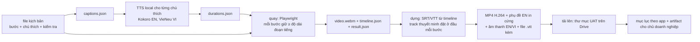

# Kế hoạch quay video UAT và kế hoạch audit thiết kế tổng thể (S260)

**Yêu cầu (tech lead, S260):** khi phần code hoàn thành dần, audit thiết kế tổng thể; làm UAT bằng video quay lại,
xây và kiểm dần theo từng tính năng đã xong; video có thể có thuyết minh TTS hoặc phụ đề phù hợp. Trang này là cách
làm và kế hoạch. Issue theo dõi: AA-855 (một issue cho toàn bộ UAT). Một bản thử $0 đã được quay trong S260 (mục 7).

**Thay đổi so với quy tắc cũ:** AA-855 ghi "UAT sau khi xong toàn bộ phần kỹ thuật". Nay tech lead yêu cầu làm
**dần dần**: một tính năng được quay khi nó đã Done và chạy live, chỉ quay lại khi nó thay đổi. Vòng cuối (mọi app,
ký duyệt) vẫn làm sau lane kỹ thuật cuối cùng.

## 1. Cách làm

**Một kịch bản = một user story = một video = một test hồi quy.**

- **File kịch bản** (Playwright, mỗi story một file): id, app, tiêu đề, phần đầu Given/When/Then và danh sách bước.
  Mỗi bước có chú thích tiếng Anh và tiếng Việt, và một hàm `run()` vừa thao tác **vừa kiểm kết quả** (nội dung
  tiêu đề, URL, số dòng, nhãn trạng thái). Một kiểm tra thất bại sẽ dừng lượt chạy, đánh dấu bước FAIL trong video và
  trong `result.json`, và giữ video làm bằng chứng lỗi.
- **Hai chế độ, cùng một file:** chế độ UAT (bật video, `slowMo` ~60 ms, con trỏ chuyển động, mỗi bước giữ đủ lâu
  theo lời thuyết minh) và chế độ nhanh (tắt video, không giữ) để kịch bản cũng chạy như một kiểm tra Playwright bình
  thường trong CI.
- **Quay:** Playwright `recordVideo` ở **1440 × 900** (máy tính) và **390 × 844** (điện thoại, cho TripPlanner, các
  trang chuyến đi của khách và các trang CRM dùng trên điện thoại). Mỗi lần chỉ một Chromium trên máy WSL 8 GB, đóng
  sau mỗi kịch bản.
- **Thao tác nhìn thấy được:** một lớp phủ chèn vào trang vẽ chấm con trỏ đi theo chuột của Playwright và một vòng
  gợn sóng mỗi lần bấm; chuột di tới từng mục tiêu qua ~30 bước; cuộn trang mượt. Chú thích của mỗi bước thành phụ đề
  và văn bản thuyết minh (mục 3).
- **Đăng nhập (không bao giờ quay):** mỗi danh tính đăng nhập một lần trong một context **không quay**, lưu
  `storageState` của Playwright, và context có quay bắt đầu ở trạng thái đã đăng nhập. Màn hình mã, TOTP hay mật khẩu
  không bao giờ xuất hiện trong video. Danh tính là các đường E2E sẵn có (bảng bên dưới); secret được đọc lúc chạy vào
  biến môi trường, không bao giờ in ra hay ghi vào file.
- **Dữ liệu:** chỉ Dev, tenant, agency, khách và staff E2E tổng hợp. Không gọi LLM trả phí khi quay: luồng nào cần
  writer hay judge thì hoặc chỉ hiển thị kết quả đã có (đường đọc), hoặc chờ tới khi có đường LLM. Màn hình hiện secret
  (API key, webhook secret) được lớp phủ che trước khi quay.
- **Ngôn ngữ:** mọi trang sản phẩm mở bằng tiếng Anh mặc định, nên video quay bằng tiếng Anh. Mỗi app có chỗ chuyển
  sang tiếng Việt thì thêm một bước ngắn "chuyển sang tiếng Việt" một lần.

### Các đường đăng nhập khi quay

| Kiểu đăng nhập | Danh tính | Host | Ghi được? | Ghi chú |
|---|---|---|---|---|
| không | — | trang công khai | — | xem TripPlanner, trang pháp lý, link CRM cho khách |
| CIS reviewer | staff E2E Cognito `e2e@e2e-mail…` (vai trò reviewer) | host production CIS admin | chỉ thao tác reviewer | mã email đọc từ bucket thư e2e bằng profile admin (cần phiên MFA còn hạn) |
| CIS admin (chỉ đọc) | E2E CIS admin `e2e-cis-admin@…` (A10b) | host production CIS admin | **không** (403 `e2e_read_only`, trừ Cut / Edit ở Content Quality) | trang chỉ-admin; chỉ chạy local |
| Staff Booking (hai người) | staff E2E WORKFORCE cho Booking (maker + checker) | Booking admin | có (Dev) | luồng maker-checker cần cả hai |
| Portal studio | user studio E2E của partner pool + TOTP, theo từng tenant E2E | host agency `portal.` | có, trên tenant E2E | mã TOTP sinh local từ seed trong Secrets Manager |
| Staff CRM | các user `e2e-test-crm-*` | host agency `portal.` | có, trên agency E2E | |
| Khách du lịch | các địa chỉ `e2e-test-traveller-*` | TripPlanner | có | mã email từ hộp thư e2e |

**Khoảng trống:** các luồng ghi của CIS admin (duyệt ở review queue, đổi hạn mức tenant, tạo fact) chưa quay được:
phiên E2E admin duy nhất là chỉ-đọc theo thiết kế. Mục 8 nêu các phương án.

## 2. Các phương án thuyết minh

Giả định khối lượng chữ: ~60 kịch bản × ~8 bước × ~90 ký tự ≈ **45.000 ký tự mỗi ngôn ngữ cho một lượt đầy đủ**;
quay lại sau khi sửa lỗi có thể thêm 3–5 lượt trong cả dự án.

| Phương án | Chất lượng | Tiếng Việt | Giấy phép | Chi phí | Kết luận |
|---|---|---|---|---|---|
| (a) Chỉ phụ đề in cứng (SRT/WebVTT sinh từ chú thích, ffmpeg + libass) | rõ, không có giọng | có (track mềm hoặc bản in cứng thứ hai) | — | **$0** | luôn bật |
| (b1) TTS local **Kokoro-82M** qua `kokoro-onnx` (model int8, 92 MB) | tiếng Anh tự nhiên, nhiều giọng Mỹ/Anh | **không có giọng Việt** | trọng số Apache-2.0, runtime MIT | **$0** (CPU, ~0,3 GB RAM, vài giây mỗi đoạn) | **đề xuất cho tiếng Anh** |
| (b2) TTS local **Piper** (`piper-tts`) | hơi máy móc, chất lượng trung bình | **có**: `vi_VN-vais1000-medium`, nhưng là giọng **miền Bắc** | engine GPL-3.0 (dùng như công cụ local, không phân phối); mỗi giọng có giấy phép riêng: vais1000 = CC BY 4.0 (ghi nguồn), `en_US-ryan` = CC BY-NC-SA (**không dùng**, phi thương mại) | **$0** (~0,2 GB RAM) | **đã thay** (chỉ dùng ở bản thử v1): tech lead nghe và không chọn |
| (b3) TTS local **VieNeu-TTS v3 Turbo** (SDK `vieneu`, ONNX trên CPU, không cần torch) | tự nhiên, 48 kHz, đọc được tên tiếng Anh trong câu tiếng Việt | **có**: 23 giọng có sẵn, 8 giọng **miền Nam** (4 nữ, 4 nam); nhân bản được giọng của người đồng ý từ đoạn 5–8 s | code, trọng số và giọng có sẵn đều **Apache-2.0**, được dùng thương mại và cho nội dung kiếm tiền, người nói của các giọng có sẵn đã đồng ý (mục FAQ trên model card) | **$0** (RAM đỉnh ~1,9 GB, ~1,4 s CPU cho mỗi giây giọng đọc) | **chọn cho tiếng Việt** |
| (c) Amazon Polly (neural) | tiếng Anh rất tự nhiên | **không có giọng Việt** | điều khoản AWS | ~$16 mỗi 1 triệu ký tự → **~$0,70 mỗi lượt đầy đủ, < $5 cho cả dự án**; là dịch vụ AWS mới nên cần một câu "đồng ý" rõ ràng | không cần |
| (d) OpenAI TTS | tự nhiên, đa ngôn ngữ kể cả tiếng Việt | có | điều khoản OpenAI | ~$15 mỗi 1 triệu ký tự (~$0,70 mỗi lượt) | bị chặn: API OpenAI hết credit (S259) |

Loại bỏ: các wrapper không chính thức bọc dịch vụ đọc to của trình duyệt (điều khoản sử dụng), nhái giọng người thật
khi không có sự đồng ý.

**Đã quyết (tech lead, S260): chỉ dùng TTS miễn phí chạy local; không dùng Amazon Polly và OpenAI TTS.** Sau khi nghe
bản thử: **tiếng Anh = Kokoro `af_heart` (nữ), đã duyệt, giữ nguyên.** Giọng Piper miền Bắc được thay bằng một giọng
**tiếng Việt miền Nam**.

### 2.1 Danh sách giọng tiếng Việt (S260)

Cùng 4 câu phụ đề của TP-PUB-01 cho mọi ứng viên (mẫu ở `.tmp-session/S260/uat/out/vi-voice-samples/`).
"ASR WER" = tỉ lệ lỗi từ khi chép ngược mẫu bằng Whisper small (local, MIT), chỉ để kiểm sơ độ rõ (Whisper thiên
về giọng Bắc nên các nguyên âm miền Nam như "tour" → "tui" bị tính là lỗi). Agent không đánh giá được độ tự nhiên;
tech lead nghe.

| Ứng viên | Vùng | Giới | Giấy phép (code / trọng số) | RAM đỉnh / thời gian CPU ở máy này | ASR WER | Kết luận |
|---|---|---|---|---|---|---|
| VieNeu v3 Turbo, giọng **Thục Đoan** (kể chuyện) | Nam | Nữ | Apache-2.0 / Apache-2.0 kể cả giọng có sẵn ([card](https://huggingface.co/pnnbao-ump/VieNeu-TTS-v3-Turbo), [LICENSE](https://github.com/pnnbao97/VieNeu-TTS/blob/main/LICENSE)) | 1,9 GB / 27 s cho 18 s giọng | 0,14 | **giọng VI mặc định (chờ tech lead nghe)**, nhịp gần với các đoạn tiếng Anh nhất |
| VieNeu v3 Turbo, **Mỹ Duyên** / **Kim Thanh** (kể chuyện) | Nam | Nữ | như trên | như trên / ~32 s | 0,13 / 0,14 | dự phòng; đọc chậm hơn (video dài thêm 15–25 %) |
| VieNeu v3 Turbo, **Thùy Dung** (tin tức) | Nam | Nữ | như trên | như trên / 24 s | 0,22 | giọng nữ nhanh nhất; ASR kém rõ hơn |
| VieNeu v3 Turbo, **Adam** (tự nhiên) | Nam | Nam | như trên | như trên / 22 s | **0,06** | lựa chọn giọng nam tốt nhất |
| VieNeu v3 Turbo, **Đức Trí** / **Thái Sơn** / **Minh Triết** | Nam | Nam | như trên | như trên | 0,13 / 0,17 / 0,27 | dự phòng |
| VieNeu v3 Nano, **Ái Hân** / **Adam** | Nam | Nữ / Nam | Apache-2.0 / Apache-2.0 ([card](https://huggingface.co/pnnbao-ump/VieNeu-TTS-v3-Nano)) | 0,6 GB / ~6 s | 0,14 / 0,10 | dự phòng cho CPU yếu; bản preview, ngữ điệu phẳng hơn, 24 kHz |
| Piper `vi_VN-vais1000-medium` (mốc v1) | Bắc | Nữ | engine GPL-3.0 / dữ liệu CC BY 4.0 | 0,2 GB / ~1 s | 0,19 | tech lead không chọn (giọng vùng); còn đọc "Adventure Asia" thành "VA" |

Loại vì giấy phép (trọng số không dùng thương mại được): Piper `vi_VN-vivos-x_low` (VIVOS, CC BY-NC-SA 4.0,
[card](https://huggingface.co/rhasspy/piper-voices/blob/main/vi/vi_VN/vivos/x_low/MODEL_CARD)); Piper
`vi_VN-25hours_single-low` (giấy phép dữ liệu "Unknown", [card](https://huggingface.co/rhasspy/piper-voices/blob/main/vi/vi_VN/25hours_single/low/MODEL_CARD));
VietTTS / dangvansam (code Apache-2.0, **trọng số CC BY-NC**, [repo](https://github.com/dangvansam/viet-tts));
F5-TTS gốc (CC BY-NC, [card](https://huggingface.co/SWivid/F5-TTS)) và các bản fine-tune tiếng Việt
`hynt/F5-TTS-Vietnamese-ViVoice` (CC BY-NC-SA 4.0), EraX-Smile F5 (CC BY-NC 4.0); viXTTS / XTTS-v2 (CPML);
Facebook MMS-TTS `vie` (CC BY-NC 4.0); Fish-Speech 1.5 / OpenAudio S1-mini (CC BY-NC-SA 4.0). Không có tiếng Việt:
CosyVoice 2/3 (Apache-2.0, 9 ngôn ngữ, không có tiếng Việt), Chatterbox multilingual (MIT, 23 ngôn ngữ, không có
tiếng Việt), MeloTTS (MIT, không có tiếng Việt). Zalo AI và VinAI không công bố trọng số TTS mở (Zalo TTS là API cloud
trả phí). Chưa thử: Kani-TTS-Vie (`pnnbao-ump/kani-tts-370m-vie`, tag Apache-2.0, giọng miền Nam "Hùng"/"Trinh"),
vì cần PyTorch + NeMo (nặng hơn ngân sách 2 GB), card không có cam kết về sự đồng ý của người nói và bản v3 Turbo
cùng tác giả đã thay thế nó.

**Giọng của chính tech lead (anh yêu cầu, anh đồng ý):** VieNeu v3 Turbo nhân bản từ đoạn 5–8 s, cùng đường chạy CPU
(Apache-2.0; card để người dùng tự chịu trách nhiệm về sự đồng ý, ở đây anh đồng ý). Hướng dẫn thu âm và script:
`.tmp-session/S260/uat/own-voice/README.vi.md` và `clone.py` (ghi danh giọng trong một tiến trình ~1,9 GB, đọc trong
tiến trình khác ~1,6 GB, ~2,3 phút CPU cho mỗi phút giọng đọc). Dự phòng: nhân bản bằng VieNeu v3 Nano (độ giống
âm sắc thấp hơn). Một hướng nữa, chưa thử: bộ chuyển âm sắc OpenVoice v2 (MIT, [repo](https://github.com/myshell-ai/OpenVoice))
chạy trên một giọng miền Nam có sẵn: giữ giọng vùng của giọng có sẵn và đổi âm sắc; cần PyTorch.

**Đề xuất:** phụ đề tiếng Anh in cứng trên mọi video **cộng** thuyết minh tiếng Anh bằng Kokoro (track âm thanh mặc
định) **cộng** track âm thanh tiếng Việt từ **VieNeu v3 Turbo, giọng nữ miền Nam "Thục Đoan"** (đổi bằng
`UAT_VI_VOICE`, ví dụ `Adam` cho giọng nam hoặc file giọng tự thu đã ghi danh) và file phụ đề tiếng Việt kèm theo.
Dòng ghi nguồn trong trang mục lục: "Vietnamese voice: VieNeu-TTS v3 Turbo (Apache-2.0)". Chi phí $0.

## 3. Quy trình

1. **Chú thích trước.** `record --captions` ghi `captions.json` từ kịch bản.
2. **TTS trước khi quay.** Mỗi bước và mỗi ngôn ngữ một đoạn; `durations.json` giữ độ dài của đoạn dài hơn giữa EN/VI.
3. **Quay, giữ theo thuyết minh.** Mỗi bước được giữ max(độ dài đoạn + 0,6 s, 2,5 s), nên giọng luôn vừa bước của nó,
   không phải kéo giãn âm thanh và không bị lệch. `timeline.json` lưu thời điểm bắt đầu/kết thúc của mỗi bước (ms tính
   từ đầu video).
4. **Dựng.** Phụ đề lấy từ timeline (mỗi cue = đầu bước → cuối bước; bước lỗi có tiền tố `[FAIL]`). Track thuyết minh
   được ghép bằng cách đặt mỗi đoạn ở đầu bước + 0,25 s. ffmpeg in cứng phụ đề tiếng Anh (DejaVu Sans, có nền, ở
   dưới), mã hoá H.264 CRF 26 ở 25 fps với `+faststart`, và ghép các luồng âm thanh EN (mặc định) và VI. File kèm:
   `.en.vtt`, `.vi.vtt`, `.en.srt`, `.vi.srt`, `.result.json`.
5. **Số đo trong bản thử:** ~0,8 Mbit/s → **~9 MB cho video 90 s**; ~0,6 GB cho một lượt đầy đủ ~60 kịch bản.

**Nơi lưu video** (không để trong repo nào: file nhị phân, dung lượng lớn, và repo gốc đang public tới tháng 11):

| Nơi | Dùng cho | Chi phí | Kết luận |
|---|---|---|---|
| Thư mục Google Drive AdventureAsia → `UAT/<vòng>/<app>/` | bản chính, tech lead mở chia sẻ cho chủ doanh nghiệp | $0 trong dung lượng Drive hiện có | **đề xuất** |
| Prefix riêng tư `uat-videos/` trong bucket S3 bronze hiện có (acc2) | lưu trữ tuỳ chọn | ~$0,03 mỗi GB-tháng (~$0,02/tháng cho một lượt); link presigned hết hạn nên không dùng để chia sẻ | tuỳ chọn, không phải dịch vụ mới |
| Kho asset của artifact claude.ai | trang mục lục có thể nhúng hoặc dẫn link video | $0; 15 MB mỗi file | chỉ cho mục lục |

Tải lên: connector Drive nhận nội dung file dạng base64, không thực tế với file 9 MB; thử với một video của bản thử
trong S261, nếu không được thì dùng `rclone` với token OAuth của Drive (tech lead đồng ý một lần trên trình duyệt) hoặc
kéo-thả cả thư mục của đợt quay.

**Đặt tên và phiên bản:** `<ID-KỊCH-BẢN>_<yyyymmdd>_v<n>.mp4` (ví dụ `TP-PUB-01_20261030_v1.mp4`); quay lại sau khi
sửa thì tăng `v<n>`, file cũ giữ lại để các phát hiện vẫn đúng mốc thời gian. Một **vòng** là một thư mục có ngày
(`2026-11-R1`).

**Mục lục theo app:** `docs/audits/<ngày>-S<nnn>-uat/<app>.md` trong repo gốc (kịch bản, story, kết quả, thời lượng,
bước lỗi + mốc thời gian, link Drive, commit SHA của app khi quay) cộng một trang artifact cho chủ doanh nghiệp, mỗi app
một tab, đưa vào bản nháp Jira cuối phiên.

## 4. Danh mục kịch bản

Trạng thái: **Done now** = đã live và ổn định, quay từ S261. **After lanes** = chờ một lane code S260–S262.
**Blocked** = chờ một phụ thuộc bên ngoài. Độ dài mục tiêu 60–120 s trừ khi ghi khác. Thứ tự quay theo thứ tự dưới
đây trong từng app: Done now trước, rồi tới các mục khác khi lane xong.

### TripPlanner (B2C, Vercel)

| Id | Tính năng / story | Trạng thái | Đăng nhập | Độ dài |
|---|---|---|---|---|
| TP-PUB-01 | Xem trang chủ → điểm đến → Bhutan → một tour (đã viết kịch bản thử) | Đã quay S260: v1 (Piper VI) và v2 (VieNeu giọng Nam), 7/7 PASS | không | 60 s |
| TP-02 | Trang điểm đến: danh sách tour, các nơi tour đi qua, "Make it yours" | Done now | không | 60 s |
| TP-03 | Lập kế hoạch trên bản đồ: ghim địa điểm, đổi thứ tự, đặt số ngày | Done now | không | 90–120 s |
| TP-04 | Bắt đầu từ một tour thật, rồi sửa nó trên bản đồ | Done now | không | 90 s |
| TP-05 | Hỏi tư vấn viên kèm đăng ký (mã email) → xác nhận | Done now | khách | 90 s |
| TP-06 | Đăng nhập, "My trips", mở lại một chuyến đã lưu | Done now | khách | 60 s |
| TP-07 | Điện thoại 390: xem + lập kế hoạch | Done now | không | 60 s |
| TP-08 | Nhãn AI và thuyết minh AI trên chuyến đi | Blocked nếu có gọi LLM (không có đường LLM từ S259) | không | 60 s |

### CIS admin (Vercel)

| Id | Tính năng / story | Trạng thái | Đăng nhập | Độ dài |
|---|---|---|---|---|
| CIS-01 | Khung admin: tổng quan, điều hướng, chuyển EN/VI, sáng/tối | Done now | reviewer | 60 s |
| CIS-02 | Review queue: mở một tour, đọc drawer review, duyệt | đọc: Done now; duyệt: cần danh tính ghi (mục 8) | reviewer | 90 s |
| CIS-03 | Master content và kết quả S1 rewrite | Done now (đọc) | reviewer | 60 s |
| CIS-04 | Nhãn Content Quality (Cut / Edit một câu) | Done now | admin chỉ đọc | 90 s |
| CIS-05 | Các tab atom curation (held, flags, QA) | Done now (đọc) | admin chỉ đọc | 60 s |
| CIS-06 | Tenants: Tenant 360, hạn mức | đọc: Done now; đổi hạn mức: danh tính ghi | admin chỉ đọc | 60 s |
| CIS-07 | Địa điểm và ảnh (bản đồ, thẻ địa điểm, trạng thái geocode) | After lanes (chuỗi geocode xong ~31/10) | reviewer | 90 s |
| CIS-08 | Jobs và Cost Operations | Done now (đọc) | admin chỉ đọc | 60 s |
| CIS-09 | Danh mục báo cáo và một lần chạy báo cáo | After lanes (các lát danh mục báo cáo) | admin chỉ đọc | 60 s |
| CIS-10 | Cài đặt model gateway / route LLM | After lanes (các lát gateway) | admin chỉ đọc | 60 s |
| CIS-11 | Trang đọc tài liệu với nút EN/VI | Done now | reviewer | 45 s |
| CIS-12 | Writing memory và tab Releases | Done now (đọc); lượt chạy mới bị chặn (LLM) | admin chỉ đọc | 60 s |
| CIS-13 | Nhập facts (fact cấp nền tảng) | danh tính ghi (mục 8) | admin | 60 s |
| CIS-14 | Trang quản lý staff | After lanes (quản lý user staff) | admin chỉ đọc | 45 s |

### Tenant portal / Content studio (host agency)

| Id | Tính năng / story | Trạng thái | Đăng nhập | Độ dài |
|---|---|---|---|---|
| PRT-01 | Kết quả đăng nhập, dashboard, mặc định tiếng Anh | Done now | portal studio | 45 s |
| PRT-02 | Onboarding và thương hiệu (T0) | Done now | portal studio | 90 s |
| PRT-03 | Marketplace: lưới danh mục, bộ lọc, drawer chi tiết | Done now | portal studio | 90 s |
| PRT-04 | Trang tour với bản rewrite có sẵn (writer panel, đọc) | Done now (đọc); rewrite mới bị chặn (LLM) | portal studio | 60 s |
| PRT-05 | Slate, angle, kế hoạch quý | đọc: Done now; sinh mới bị chặn (LLM) | portal studio | 60 s |
| PRT-06 | Viết bài social / bài viết | Blocked (LLM) | portal studio | 90 s |
| PRT-07 | Đăng / gỡ đăng lên site WordPress thử nghiệm | Done now | portal studio | 90 s |
| PRT-07b | Đăng lên Facebook Page thử nghiệm | giao diện Meta thật: tech lead tự quay bằng Claude trên trình duyệt desktop | — | 90 s |
| PRT-08 | Xuất (export) | Done now | portal studio | 45 s |
| PRT-09 | Facts của tenant | Done now | portal studio | 60 s |
| PRT-10 | Tài khoản, API key (được che), trợ giúp | Done now | portal studio | 45 s |
| PORTAL-PUB-01 | Điều khoản đối tác công khai → thông báo quyền riêng tư (bản thử, đã quay) | Done now | không | 33 s |

### CRM web (host agency)

| Id | Tính năng / story | Trạng thái | Đăng nhập | Độ dài |
|---|---|---|---|---|
| CRM-01 | Đăng nhập, chọn agency, trang chủ và bảng pipeline | Done now | staff CRM | 60 s |
| CRM-02 | Khách hàng và client 360 | Done now | staff CRM | 90 s |
| CRM-03 | Hộp thư: thư chuyển tiếp vào, trả lời qua Gmail send-as | Done now (Gmail); Microsoft 365 bị chặn (đăng ký app) | staff CRM | 90 s |
| CRM-04 | Pipeline → chuyến đi → đề xuất → xác nhận trong Booking sau khi đặt cọc | Done now (lát xác nhận); hoá đơn và thanh toán sau các lane | staff CRM + staff Booking | 120 s |
| CRM-05 | Nhà cung cấp và booking | Done now | staff CRM | 60 s |
| CRM-06 | Trang cho khách: link tham gia, trang chuyến đi, "Before you go" (điện thoại 390) | Done now | không (link) | 60 s |
| CRM-07 | Cài đặt, tuỳ chọn, EN/VI | Done now | staff CRM | 45 s |
| CRM-08 | Fork bản đồ Builder | Blocked (chưa tạo issue nối tuyến đường + Mapbox) | staff CRM | 90 s |

### AA-Booking staff admin (Vercel)

| Id | Tính năng / story | Trạng thái | Đăng nhập | Độ dài |
|---|---|---|---|---|
| BK-01 | Đăng nhập, dashboard, thông báo | Done now | staff Booking | 45 s |
| BK-02 | Yêu cầu tư vấn → trip case (từ TP-05) | Done now | staff Booking | 90 s |
| BK-03 | Các phiên bản trip case và đề xuất | Done now | staff Booking | 90 s |
| BK-04 | Quy tắc giá + thay đổi tỷ giá với duyệt maker-checker (hai staff) | Done now | hai staff Booking | 120 s |
| BK-05 | Nhà cung cấp và hợp đồng | Done now | staff Booking | 60 s |
| BK-06 | Khách sạn, loại phòng, dịch vụ, giá net | Done now | staff Booking | 90 s |
| BK-07 | Trip plan bán được → "Use for trip case" | Done now | staff Booking | 90 s |
| BK-08 | Vận hành: booking với nhà cung cấp, kiểm chuyến, hoá đơn, thanh toán, hoá đơn nhà cung cấp | Done now | staff Booking | 120 s |
| BK-09 | B2B desk | Done now | staff Booking | 60 s |
| BK-10 | Khách hàng, audit log, danh sách staff | Done now | staff Booking | 60 s |

### Hành trình xuyên app (hữu ích nhất cho người đọc phía kinh doanh)

| Id | Story | Trạng thái | Đăng nhập | Độ dài |
|---|---|---|---|---|
| X-01 | Khách lập kế hoạch trên TripPlanner → hỏi tư vấn viên → staff Booking thấy yêu cầu → trip case → đề xuất | Done now | khách + staff Booking | 120 s (ghép hai đoạn) |
| X-02 | Agency dựng chuyến đi trong CRM → Booking xác nhận sau khi đặt cọc → chuyến đi hiện Booked trong CRM | Done now | CRM + staff Booking | 120 s |
| X-03 | Một tour trong danh mục hiển thị giống nhau trên TripPlanner, marketplace của portal và danh mục Booking | Done now | không + portal + Booking | 90 s |

Khoảng 60 kịch bản; ~45 quay được ngay, phần còn lại theo các lane.

## 5. Audit thiết kế tổng thể (khi phần code hoàn thành)

**Điều kiện bắt đầu:** các lane kỹ thuật của milestone hiện tại đã Done (backlog §3); không có wave hay đợt job nào
đang chạy; cả sáu repo ở `main` với cây sạch; schema reference còn mới (bản dump đêm gần nhất đã merge); đã có video UAT
của các tính năng Done (chiều UX dùng lại chúng); đã biết trạng thái đường LLM.

**Các chiều** (mỗi chiều có nguồn sự thật riêng):

| # | Chiều | Đối chiếu với | Bằng chứng |
|---|---|---|---|
| D1 | Ranh giới kiến trúc | `CONTEXT.md` của từng repo, `docs/ecosystem-architecture.md`, các ADR | import và lời gọi vượt ranh giới repo, ai gọi API hay schema của ai |
| D2 | Mô hình dữ liệu và quyền sở hữu | `docs/database/schema-ownership.md`, schema reference, data standards | grant so với owner, đọc chéo schema, bảng chết, cách đặt tên |
| D3 | Bảo mật và danh tính | họ ADR 0006, secrets register, access review | đường xác thực theo từng bề mặt, giới hạn vai trò, cách dùng secret, vệ sinh repo public |
| D4 | Chi phí và vận hành | tài liệu FinOps, capacity review, danh mục alarm | tài nguyên nhàn rỗi, chi phí theo app, runbook đã thử, alarm có người phụ trách |
| D5 | Tuân thủ UI kit, nhất quán UX, khớp Figma | ADR 0016 (kit), các file Figma | kit lint, mỗi kiểu tương tác một pattern trên mọi app, Figma so với ảnh chụp |
| D6 | Khả năng tiếp cận | WCAG 2.2 AA | chạy axe-core trên mọi trang của kịch bản UAT (`@axe-core/playwright`, MIT, $0), đường đi bằng bàn phím, độ tương phản ở chế độ sáng/tối |
| D7 | Hiệu năng | ngân sách trong data standards, Core Web Vitals | Lighthouse mobile trên trang công khai, p95 của API, các query hàng đầu trong `pg_stat_statements` |

**Phương pháp (hội đồng nhiều agent trong Ultracode):** mỗi chiều một agent reviewer, chạy song song, mỗi agent đọc các
nguồn trên và code, và thăm dò Dev live ở chế độ chỉ đọc. Mỗi phát hiện cần bằng chứng (file và dòng, URL live, kết quả
query hoặc mốc thời gian trong video). Sau đó một agent **phản biện** tìm cách bác bỏ từng phát hiện dựa trên code và
ADR; chỉ giữ các phát hiện đứng vững, kèm mức độ (S1 chặn … S4 trau chuốt), công sức và repo chịu trách nhiệm. Phát hiện
mâu thuẫn với một ADR được ghi là "cần quyết định", không phải lỗi.

**Sản phẩm:** một artifact báo cáo cho chủ doanh nghiệp (tóm tắt bằng lời dễ hiểu, rủi ro hàng đầu, các thay đổi dài
hạn được đề xuất, số liệu Dev được đánh dấu là chưa ổn định) cộng thư mục `docs/audits/<ngày>-S<nnn>-design-audit/`
(mỗi chiều một file, bảng phát hiện đã kiểm chứng, phương pháp và bằng chứng thô) trong một root PR. Việc sửa chỉ thành
issue sau khi tech lead chọn.

**Ước tính:** một phiên Ultracode (~4–6 giờ: 1 giờ chuẩn bị và gom bằng chứng, 2–3 giờ hội đồng, 1 giờ phản biện,
1 giờ viết báo cáo). Chi phí AWS $0 (thăm dò chỉ đọc trên tài nguyên có sẵn); không gọi LLM trả phí qua gateway; chỉ tốn
token của agent.

## 6. Lộ trình (S260–S263)

> **Đã quyết (tech lead, S260):** từ S261 các kịch bản chạy như bản thử nội bộ và test hồi quy; video chỉ dùng nội bộ.
> Vòng 1 chính thức (Drive `UAT/round-1/` + trang cho chủ doanh nghiệp) chỉ quay khi AA-994 chuyển xong các trang, có
> lại đường LLM và PR quyền UAT ghi trên Dev cho E2E CIS admin đã merge. Các vòng sau chỉ quay lại tính năng mới hoặc
> có đổi.

| Phiên | Các lát việc |
|---|---|
| **S260** (hôm nay) | Kế hoạch này + quy trình thử (đã xong). Tech lead nghe bản thử và chọn cách thuyết minh. Chạy lại TP-PUB-01 khi tắt VPN (một lệnh). |
| **S261** | Chuyển quy trình vào thư mục công cụ ở repo gốc `tools/uat/` (runner, lớp phủ, TTS, dựng, một `package.json` ghim phiên bản Playwright; kịch bản ở `tools/uat/scenarios/<app>/`), thêm chế độ nhanh và bước đăng nhập không quay cho từng danh tính. Thử tải lên Drive với một file. Quay **vòng 1, công khai + chỉ đọc**: TP-PUB-01…TP-07, CIS-01, -03, -04, -05, -08, -11, PRT-01…-05 phần đọc, -08…-10. Các trang mục lục đầu tiên + artifact cho chủ doanh nghiệp. |
| **S262** | Danh tính ghi được: BK-01…BK-10 (maker-checker với hai staff), CRM-01…-07, PRT-07, các hành trình xuyên app X-01…X-03, bản điện thoại 390. Chốt đường ghi cho CIS admin (mục 8) và quay CIS-02 phần duyệt, CIS-06, CIS-13 nếu đã có. Danh sách phát hiện kèm mốc thời gian; lỗi đưa vào issue có sẵn hoặc issue mới (hỏi trước). |
| **S263** | Các kịch bản được các lane S260–S262 mở khoá (CIS-07, -09, -10, -14, CRM-04 hoá đơn); các kịch bản cần LLM chỉ khi đã có đường LLM. Mục lục vòng cuối + bản nháp Jira cho chủ doanh nghiệp (duyệt trước khi đăng). Bắt đầu audit thiết kế tổng thể nếu đủ điều kiện, nếu chưa thì xếp vào phiên đầu tiên sau lane cuối. |

Mỗi phiên quay tối đa ~15 kịch bản (~2 phút mỗi kịch bản kể cả dựng), mỗi lần một trình duyệt, trong ngân sách RAM
thông thường.

## 7. Bản thử (S260, $0)

Script ở thư mục nháp của workspace `.tmp-session/S260/uat/` (chuyển sang `tools/uat/` trong S261): `record.cjs`,
`lib/overlay.js`, `tts.py`, `build.py`, `run.sh`, kịch bản `tp-pub-01.cjs` và `portal-pub-01.cjs`.

- **TP-PUB-01 (host production TripPlanner): đã quay sau trong S260 khi tắt VPN** — v1 7/7 PASS (4,2 MB, giọng Piper), v2 38,3 s với track tiếng Việt VieNeu giọng Nam. Lần thử đầu: Lần thăm dò headless đầu tiên tải được trang chủ, sau
  đó mọi host Vercel (TripPlanner, CIS admin) trả `403` với `x-vercel-mitigated: challenge` (Vercel Security
  Checkpoint), kể cả với user agent desktop và Chromium đầy đủ. Lưu lượng của máy đi ra qua một điểm thoát VPN trong
  trung tâm dữ liệu (Hà Lan), loại IP mà Vercel thách thức. Kịch bản, chú thích và thuyết minh đã sẵn sàng; chạy lại
  `bash run.sh scenarios/tp-pub-01.cjs` khi tắt VPN. Mọi host Vercel (TripPlanner, CIS admin, Booking admin) cần như
  vậy khi quay.
- **PORTAL-PUB-01 (host agency trên CloudFront, điều khoản công khai → quyền riêng tư): đã quay, 6/6 bước PASS.**
  32,9 s, 3,4 MB, 1440 × 900 H.264, phụ đề tiếng Anh in cứng, hai track âm thanh AAC (tiếng Anh Kokoro `af_heart` mặc
  định, tiếng Việt Piper vais1000), file kèm `.en/.vi` VTT + SRT và `result.json`. Cả quy trình 59 s, bộ nhớ đỉnh
  ~0,8 GB (Chromium). Đã kiểm khung hình: chấm con trỏ và vòng gợn khi bấm hiện rõ, phụ đề đọc được.
- **Lỗi nhỏ phát hiện và đã sửa trong bản thử:** chữ phụ đề quá to (nay cỡ 11 theo chiều cao tham chiếu của libass);
  xuống dòng ở "AI-generated" (dấu gạch nối giữa hai chữ cái được đổi thành gạch nối không ngắt dòng); nền phụ đề đậm
  hơn.
- **TP-PUB-01 v2 (giọng tiếng Việt miền Nam):** `out/TP-PUB-01_20261030_v2.mp4`, 7/7 bước PASS, 38,3 s, track tiếng
  Anh Kokoro (mặc định) + track tiếng Việt VieNeu "Thục Đoan" (48 kHz); giữ v1 (Piper) để so sánh. Cả quy trình
  2 phút 20 s, bộ nhớ đỉnh ~1,5 GB (giải phóng Kokoro trước khi nạp VieNeu; mỗi lúc chỉ một model trong RAM).
- **Agent chưa kiểm được:** giọng đọc nghe có tự nhiên không (agent không nghe được); tech lead quyết định.

## 8. Các quyết định cho tech lead

| # | Quyết định | Câu trả lời đề xuất | Chi phí |
|---|---|---|---|
| 1 | Thuyết minh | **đã quyết S260:** luôn có phụ đề tiếng Anh + giọng tiếng Anh Kokoro `af_heart`; phụ đề tiếng Việt dạng track kèm; âm thanh tiếng Việt = giọng miền Nam VieNeu v3 Turbo (mặc định "Thục Đoan", chờ tech lead nghe v2 và các mẫu; hoặc giọng nhân bản của chính anh) | $0 |
| 2 | Quay các host Vercel | tắt VPN trên máy WSL khi quay (nếu không, bộ quay dừng với lỗi "checkpoint" rõ ràng); không đổi firewall của Vercel | $0 |
| 3 | Các luồng ghi của CIS admin | một quyền UAT chỉ ở Dev cho E2E CIS admin, giới hạn trong các dòng UAT tổng hợp, làm như một thay đổi xác thực có review độc lập; phương án khác: tech lead tự quay 3–4 luồng đó bằng Claude trên trình duyệt desktop | $0 |
| 4 | Nơi lưu video | Drive AdventureAsia `UAT/<vòng>/<app>/` là bản chính; chưa cần lưu trữ S3 | $0 (S3 khoảng $0,02/tháng) |
| 5 | Amazon Polly / OpenAI TTS | **đã quyết S260: không dùng** — chỉ TTS miễn phí local; giọng chưa đạt thì thử model mã nguồn mở miễn phí khác | $0 |
| 6 | Bắt đầu dần dần | quay các tính năng "Done now" từ S261 (điều này đổi thời điểm của AA-855 từ "sau khi xong toàn bộ phần kỹ thuật") | $0 |
