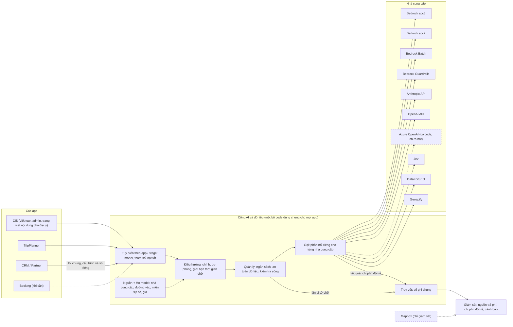

# Cổng AI và dữ liệu (AI gateway) v2: thiết kế đã duyệt (S261, 31/10/2026)

Tác nhân: Claude Code. Chỉ là tài liệu: không đổi code, không gọi AWS, DB hay LLM, không đổi route nào.
Quyết định kiến trúc đi kèm: [root ADR 0009](../../adr/0009-ai-platform-and-provider-gateway.md). Anh đã duyệt cả 3
câu ngày 31/10, nên phần ADR mà 3 câu phủ đã chuyển sang Accepted; 3 điểm còn lại vẫn là đề xuất, duyệt riêng khi tới
bước cần nó.

## Cổng là gì, phạm vi tới đâu

Tech lead định nghĩa (31/10): *"LLM gateway là nơi dùng gọi, quản lý, điều hướng, giám sát, truy vết cho tất cả
nguồn, họ model, và có setup tùy biến cho mỗi loại app, stage, hay nơi nào cần dùng llm trong hệ sinh thái"*, cộng
*"còn cả Jev và DFS nữa"*. Bản này lấy đúng câu đó làm mục tiêu. Phạm vi: **mọi nhà cung cấp AI và dữ liệu mà AA trả
tiền**, gồm LLM ở mọi nguồn (Bedrock trên acc3 và acc2, API trực tiếp của Anthropic và OpenAI, Azure OpenAI) và mọi
họ model (Claude, GPT, Cohere; thêm Nova, Llama, Kimi: chạy được trên Bedrock acc2, hôm nay chưa stage nào dùng),
Jev, DataForSEO, Geoapify, Bedrock Guardrails và Bedrock Batch; cho **mọi app** (CIS, TripPlanner, CRM/Partner,
Booking khi cần) và **mọi stage**. Thiết kế đã duyệt ở S258 phủ LLM của CIS (TripPlanner và CRM sẽ dùng chung lõi ở
một bước sau) và có Jev như một loại nguồn; chưa phủ DataForSEO và Geoapify. Bản v2 mở rộng nó và giữ những gì S258
đã đúng: tách tài khoản / nơi chạy / model; có thứ tự dự phòng; quy định dữ liệu được đi đâu nằm riêng; chi phí lấy
từ sổ ghi.

Hai từ dùng trong cả bài:

- **Miền sự cố**: nhóm nguồn có thể hỏng cùng lúc vì cùng người trả tiền / cùng tổ chức có thể chặn.
- **Đường dự phòng ấm**: đường thứ hai đã có tiền, có khoá, được gọi thử định kỳ, nên khi nguồn chính hỏng thì dùng
  được ngay.

## 8 chức năng

| Chức năng | Mục tiêu | Hôm nay | Cần làm |
|---|---|---|---|
| **Gọi** | Mọi app gọi mọi nhà cung cấp trả phí qua một cửa, mỗi loại việc một cách gọi (viết chữ, embedding (biến chữ thành số để tìm nội dung giống nhau), quyết định của Jev, tra SEO, tra toạ độ) | Chỉ LLM của CIS đi qua cổng; Jev, DataForSEO, Geoapify mỗi thứ một client riêng; TripPlanner có bản sao cổng riêng; CRM còn giả lập; có vài chỗ code gọi thẳng nhà cung cấp, không qua cổng | Một lõi dùng chung, với phần nối riêng cho từng nhà cung cấp; đóng các chỗ code gọi thẳng nhà cung cấp, không qua cổng; xoá code DataForSEO cũ |
| **Nguồn** | Mỗi đường vào (tài khoản, API, khoá, vùng) là một dòng trong sổ nguồn, có ngân sách, phạm vi dữ liệu và miền sự cố | Sổ nguồn chỉ có cho LLM của CIS (5 nguồn); không ghi miền sự cố; Jev, DataForSEO, Geoapify nằm trong biến môi trường và code | Đưa mọi nhà cung cấp trả phí vào sổ nguồn, thêm miền sự cố |
| **Họ model** | Hãng làm model, nơi chạy model và khả năng của model (suy luận, xuất JSON, cache) là ba thứ riêng, ghi bằng dữ liệu; thêm họ mới không cần sửa code | Muốn thêm một hãng model mới phải sửa code | Thêm hãng / model mới chỉ bằng cấu hình |
| **Điều hướng** | Mỗi stage có model chính, dự phòng theo thứ tự, ít nhất một đường dự phòng ấm ở miền sự cố khác, và giới hạn tổng thời gian chờ, kể cả khi chuyển sang dự phòng | Có route theo stage, nhưng gần hết stage chạy trên acc3; 29/10 acc3 bị chặn thì không stage viết nào chạy; code chọn model ở nhiều chỗ khác nhau; vài chỗ dùng model cố định, không theo cấu hình | Chọn model ở một chỗ duy nhất; luật "luôn có đường dự phòng khác miền sự cố"; giới hạn tổng thời gian chờ |
| **Tuỳ biến theo app / stage** | Mỗi app, mỗi stage có hồ sơ: model, tham số (độ dài tối đa, mức suy nghĩ, nhiệt độ), phạm vi dữ liệu, ngân sách, bật/tắt | Chỉ CIS đổi model theo stage trong admin; tham số rải trong code; TripPlanner chỉ dùng một phần cấu hình của CIS; CRM có cấu hình riêng theo đại lý | Bảng tham số theo stage × model; hồ sơ theo app (CIS, TripPlanner, CRM; Booking khi cần) |
| **Quản lý** (ngân sách, an toàn dữ liệu, kiểm tra sống) | Không lần gọi trả phí nào chạy mà không qua trần tiền; dữ liệu chỉ tới nơi được phép (theo hãng, vùng địa lý, tenant); biết trước khi một nguồn mất quyền hay hết tiền | Trần chi tiêu chỉ có hiệu lực ở những chỗ code nhớ bật nó; Jev không có trần trước khi gọi; một đường DataForSEO không có trần; TripPlanner vẫn gọi tiếp khi không đọc được số đã tiêu; mất quyền chỉ phát hiện khi việc thật hỏng; Jev có danh sách tenant được phép, LLM thì không | Trần bắt buộc ở cổng cho mọi nguồn; chính sách dữ liệu theo nguồn (hãng, vùng, tenant); kiểm tra sống định kỳ (chi phí nằm trong quyết định 2) |
| **Giám sát** | Một trang: nguồn nào sống, còn bao nhiêu tiền, đã chi bao nhiêu theo app / stage / tenant, độ trễ, tỉ lệ lỗi; cảnh báo ngay khi có chuyện | LLM có ô trạng thái trên trang admin, bản tin hằng ngày, đối soát hoá đơn; DataForSEO có số dư hằng ngày; Jev chỉ có số dư ước tính; Geoapify đếm credit; TripPlanner không có gì; không có độ trễ | Trang "Nguồn trả phí" chung, độ trễ theo stage, cảnh báo tức thì qua chuông admin và email vận hành đã có |
| **Truy vết** | Mỗi lần gọi (kể cả bị từ chối) để lại một dòng cùng dạng: app, stage, nguồn, model, tenant, job, độ trễ, kết quả, chi phí; xem được theo job và tour | 5 nơi ghi, mỗi nơi ghi một kiểu, không cộng gộp được; lần gọi bị từ chối ở CIS không để lại dòng; không có độ trễ; không xem được theo job | Một mẫu ghi chung cho mọi nhà cung cấp (sổ CRM cùng mẫu), màn xem theo job / tour |

## Từng nhà cung cấp: hôm nay và trong cổng

| Nhà cung cấp | Dùng cho | Hôm nay (31/10) | Trong cổng v2 |
|---|---|---|---|
| Bedrock acc3 (Claude, GPT trên Bedrock) | Gần hết stage viết, chấm, kiểm của CIS; soạn lịch trình TripPlanner | Bị chặn từ 29/10 (Error 002); là nguồn chính duy nhất | Một miền sự cố; luôn có đường dự phòng ở miền khác |
| Bedrock acc2 (Cohere Embed; chat: Nova, Llama, Kimi) | Embedding cho CIS và tìm kiếm TripPlanner | Embedding chạy được. Chat: acc2 không gọi được Claude hay GPT (nhà bán lại TrueIDC chặn), chỉ Nova, Llama, Kimi trả lời; chưa stage nào dùng chat trên acc2. Nếu bật, lần gọi chat đó sẽ bị ghi thiếu tài khoản nên không vào ngân sách (sửa ở bước 1) | Ghi đúng tài khoản; có thể làm miền thứ hai cho chấm / kiểm (quyết định 3) |
| Anthropic API trực tiếp | Đường thứ hai cho Claude (stage viết) | Đã chuẩn bị đường Dev, trần 150 USD/tháng; chưa nạp tiền, chưa có khoá | **Đường dự phòng ấm** cho stage viết, khác miền sự cố; đã duyệt nạp 50 USD, trần 150 USD/tháng, kiểm tra sống hằng ngày (quyết định 2) |
| OpenAI API trực tiếp | Đường thứ hai cho model chấm GPT | **Khoá chạy được** (gọi thử 31/10 17:45: 200, hạn mức còn nguyên). Hệ thống dùng rất ít: tháng 9 khoảng 1,72 USD, tháng 10 khoảng 0,73 USD, lần gọi cuối 02/10. Ghi chú "hết tiền (429)" ở S257 đã cũ | **Đường dự phòng ấm** cho stage chấm, khác miền sự cố, đứng trước acc2 (anh chốt 31/10: "API ngoài là cả Anthropic và OpenAI"); có trần, kiểm tra sống hằng ngày; chưa cần nạp thêm, đặt trần chi tháng (số trình anh duyệt) |
| Azure OpenAI | Một đường GPT ngoài AWS, nếu sau này cần | Đã có code nối (làm ở AA-1002, có kiểm thử) nhưng chưa có tài khoản Azure, chưa bật nguồn nào, không tốn tiền; không phải code chết | Giữ code, không bật; chỉ bật khi cần thêm một đường GPT và anh đã duyệt chi phí |
| Bedrock Batch (acc3) | Viết lại tour hàng loạt (chạy theo lô) | Không ghi sổ (đã kiểm code: ba file chạy theo lô không có dòng ghi chi phí nào) | Đi qua cổng, ghi sổ như lần gọi thường |
| **Jev** | Quyết định có kiểu (chọn, chấm điểm), không ra chữ | Client riêng ngoài cổng; ghi hai sổ; không trần trước khi gọi; số dư chỉ ước tính; có danh sách tenant được phép | Một loại nguồn "quyết định" trong cổng; trần trước khi gọi (hết trần thì coi như Jev lỗi, việc vẫn chạy theo luật cũ); giữ danh sách tenant và các chế độ tắt / thử / áp dụng |
| **DataForSEO** | Khối lượng từ khoá, kết quả tìm kiếm Google, câu hỏi người tìm | Client riêng; sổ riêng; một đường chính không có trần; số dư đọc hằng ngày | Một loại nguồn "dữ liệu" trong cổng; trần bắt buộc ở mọi đường; giữ đọc số dư |
| DataForSEO (code cũ) | Không còn ai dùng | Code chết; nếu sống lại sẽ chạy không sổ, không trần | Xoá |
| **Geoapify** | Xác nhận toạ độ, hình dạng tuyến | Gói miễn phí 3.000 credit/ngày, code tự dừng ở 2.500; sổ riêng | Nguồn "dữ liệu" trong cổng; hạn mức là dữ liệu của nguồn |
| Bedrock Guardrails (CRM) | Lọc thông tin cá nhân trước khi gọi model | Đã có code trong bộ lọc của CRM, nhưng phần gọi model của CRM còn giả lập; không ghi chi phí | Đi qua cổng của CRM, có dòng chi phí |
| CRM (LLM) | Bản nháp AI cho đại lý | Cổng riêng, gọi model còn giả lập | Dùng chung lõi code; giữ cấu hình và sổ riêng trong CRM; sổ cùng mẫu với sổ chung |
| Mapbox | Bản đồ trên trình duyệt khách | Gọi thẳng từ trình duyệt, không ghi gì trong app | Ngoài đường gọi (không thể đi qua máy chủ); chỉ đưa vào trang giám sát và cảnh báo mức dùng |
| AWS Cost Explorer | Đối soát hoá đơn | Bấm tay, khoảng 0,01 USD mỗi lần đọc | Công cụ đối soát của cổng, không phải nguồn để route |
| Nguồn miễn phí (Google Drive, Overpass, tỉ giá) và kênh của tenant (Facebook, WordPress, mail) | — | Không mất tiền, hoặc tenant tự trả | Ngoài phạm vi; ghi trong sổ nguồn là "miễn phí" để biết dữ liệu đi đâu |

## Hình tổng thể

## Thứ tự làm

Luật chung: **không lần chạy trả phí nào khi anh chưa đồng ý; không đổi route nào khi anh chưa duyệt bản thiết kế
này.** Mỗi bước là một lát việc nhỏ, có bằng chứng. Cỡ việc tính theo phiên làm việc của agent (một phiên khoảng
nửa ngày).

| Bước | Làm gì | Chức năng nào trong 8 | Cỡ việc | Chi phí | Anh thấy gì khi xong |
|---|---|---|---|---|---|
| 0. Đo trước | Đếm trong sổ ghi: stage nào còn gọi qua đường cũ, chỗ nào còn dùng model cố định, để biết bỏ gì trước (chỉ đọc) | Điều hướng, Truy vết | Nửa phiên | 0 USD | Bảng số đếm; bước 4 bỏ đường nào là dựa vào số này |
| 1. Sửa lỗi không tốn tiền | Ghi đúng tài khoản cho lần gọi chat trên acc2; nhận đúng câu "hết tiền" của Anthropic để không gọi lại mãi; thêm trần cho đường DataForSEO đang không có trần; thêm trần trước khi gọi cho Jev; TripPlanner dừng gọi khi không biết đã tiêu bao nhiêu; xoá code DataForSEO cũ | Quản lý, Truy vết, Gọi | 1 phiên | 0 USD | Mỗi lỗi có bài kiểm thử xanh; bảng kiểm: mọi chỗ gọi trả phí đều có trần; không route nào đổi |
| 2. Anh duyệt (không phải việc code) | **Xong 31/10:** anh đồng ý cả 3 câu; phần ADR 0009 mà 3 câu phủ chuyển sang Accepted | — | Khoảng 1 giờ của anh | 0 USD | ADR 0009 được merge với trạng thái Accepted |
| 3. Sổ ghi chung và trang giám sát | Mỗi lần gọi (cả bị từ chối) có một dòng cùng dạng, có độ trễ; Jev, DataForSEO, Geoapify nối vào cùng dạng; màn xem theo job / tour; trang "Nguồn trả phí" với số dư, chi tiêu, lỗi, độ trễ | Truy vết, Giám sát | 2–3 phiên | 0 USD | Một trang trong admin cho thấy mọi nguồn trả phí với số thật của Dev; mở một job thấy từng lần gọi theo thời gian |
| 4. Sổ nguồn mở rộng, họ model, tham số | Jev, DataForSEO, Geoapify thành dòng trong sổ nguồn; miền sự cố; họ model và khả năng là dữ liệu; tham số theo stage × model; chọn model ở một chỗ duy nhất | Nguồn, Họ model, Tuỳ biến, Điều hướng | 3–4 phiên | 0 USD | Thêm nhà cung cấp hay model mới = một thay đổi cấu hình nhỏ, không sửa code; trong admin chỉ việc bật / tắt; vẫn chưa route nào đổi |
| 5. Độ tin cậy | Đường dự phòng ấm khác miền sự cố; kiểm tra sống định kỳ; giới hạn tổng thời gian chờ; tự tạm ngừng một nguồn đang lỗi liên tục; việc bị từ chối tự chạy lại sau; diễn tập chuyển dự phòng hằng tháng trên Dev | Điều hướng, Quản lý, Giám sát | 2–3 phiên | Theo quyết định 2: nạp 50 USD Anthropic một lần, rồi khoảng 1–2 USD/tháng; tiền nạp OpenAI trình anh riêng | Ô trạng thái trên trang admin hiện xanh cho hai miền sự cố; báo cáo diễn tập: tắt nguồn chính, stage chuyển sang dự phòng trong giới hạn thời gian, kèm chi phí |
| 6. Dùng chung cho các app, thử model mới | TripPlanner và CRM dùng lõi chung (CRM giữ cấu hình và sổ riêng). Model mới được thử từng bước nhỏ, so với model đang dùng, chạy song song không ảnh hưởng thật, rồi mới chuyển; lỗi thì quay lại. Trước lần đổi đầu tiên: đo mức hiện tại của model viết, kiểm model chấm với 40 mẫu anh gán nhãn (khoảng 2 giờ của anh) | Gọi, Họ model | 3–5 phiên | Mỗi model mới vài USD (thử nhanh dưới 0,10 USD; so sánh tối đa 50 tour khoảng 4 USD); mỗi lần chạy trả phí xin anh riêng | TripPlanner và CRM hiện cùng trang giám sát. Đổi model ở stage viết chính: chờ anh duyệt, kèm báo cáo so sánh, chi phí mỗi tour và độ trễ. Đổi ở stage chấm / kiểm: làm khi thử đạt, báo anh sau với cùng báo cáo đó |

**Vì sao đường dự phòng ấm ở bước 5, và không phải chờ tới đó.** Bước 5 làm cho việc dự phòng tự động (tự kiểm tra,
tự chuyển, diễn tập). Nhưng bài học 29/10 không cần chờ: anh đã chọn Có ở quyết định 2, nên đường Anthropic bật tay được
ngay sau bước 2 (hướng dẫn đã có: nạp tiền, tạo khoá, bật trong admin, rồi thử khoảng 5 tour, dưới 0,50 USD), trong lúc
bước 3–4 vẫn tiếp tục.

## Anh đã quyết định (31/10): đồng ý cả 3 câu

Anh trả lời ngày 31/10: **đồng ý hết đề xuất**, kèm một ý: *"API ngoài là cả Anthropic và OpenAI"*. Nghĩa là cả hai
đường gọi thẳng (không qua AWS) đều là đường dự phòng ấm: có tiền, có trần chi, được gọi thử mỗi ngày.

1. **Một cổng cho mọi nhà cung cấp AI và dữ liệu trả phí** (LLM, Jev, DataForSEO, Geoapify, Guardrails), mọi app,
   mọi stage. CRM dùng chung code của cổng nhưng giữ cấu hình và sổ riêng, như quy định đã có.
   - **Đã duyệt: Có.** Làm bước 3, 4 và 6; hạ tầng 0 USD, chỉ tốn thời gian code. Tạo 2 issue mới AA-1018 và AA-1017 (mục
     "Issue" bên dưới).
2. **Đường dự phòng ấm, khác miền sự cố, là bắt buộc**, và gồm **cả Anthropic lẫn OpenAI**.
   - **Đã duyệt: Có.**
   - **Anthropic API** (dự phòng cho stage viết, vì model viết là Claude): nạp **50 USD** một lần (đủ khoảng 800 tour
     viết lại, khoảng 0,06 USD/tour), trần chi **150 USD/tháng** đã đặt.
   - **OpenAI API** (dự phòng cho stage chấm, vì model chấm hôm nay là GPT): **khoá đang chạy được, còn tiền** (gọi thử
     31/10; cả tháng 9–10 hệ thống chỉ dùng khoảng 2,45 USD). Chưa cần nạp thêm; tôi trình con số trần chi tháng (tính từ
     chi phí chấm mỗi tour đo ở bước 0) để anh duyệt.
   - Kiểm tra sống hằng ngày mọi nguồn trên Dev: dưới 1 USD/tháng. Diễn tập chuyển dự phòng mỗi tháng: khoảng
     0,25 USD một lần, mỗi lần thử một stage viết chuyển sang Anthropic và một stage chấm chuyển sang OpenAI.
     Cảnh báo qua chuông admin và email vận hành đã có, 0 USD.
3. **acc2 được chạy model chat, chỉ cho chấm và kiểm** (không cho stage viết chính, không cho stage của tenant).
   acc2 chạy được **Nova (Amazon), Llama 4 (Meta) và Kimi K3 (Moonshot)**, không phải Claude hay GPT (TrueIDC chặn).
   - **Đã duyệt: Có.** Stage viết giữ Claude (Sonnet 5.5) cho tới khi bước thử chứng minh model khác không kém hơn.
   - Thứ tự dự phòng cho stage chấm: GPT trên acc3 → OpenAI API → model trên acc2 (chỉ sau khi model đó qua bước
     thử). acc2 giúp phần chấm / kiểm vẫn chạy khi cả acc3 và OpenAI cùng lỗi.
   - Mỗi model trên acc2 thử dưới 2 USD; mỗi lần chạy trả phí vẫn xin anh riêng.
   - Lưu ý: acc2 "khác người trả tiền" với acc3 là sự thật hôm nay. Khi đổi cách thanh toán (dự kiến 01/12) hay acc2
     rời TrueIDC thì phải kiểm lại, vì rời TrueIDC có thể làm acc2 mất quyền AI.

**Chưa cần trả lời.** ADR 0009 còn 3 đề xuất được duyệt riêng (luật model viết / model chấm theo hãng, kèm 2
giờ anh gán nhãn ở bước 6; cấu hình nguồn chỉ đổi qua migration; vùng dữ liệu được phép cho tenant) và 4 việc hoãn
(vùng AWS thứ hai, lọc thông tin cá nhân cho TripPlanner, lưu nội dung prompt, luật chất lượng mới cho bước viết
tour). Mỗi điểm sẽ được trình kèm đề xuất khi tới bước cần nó.

## Giao diện (UI): làm lại thế nào, ảnh hưởng gì

Tóm gọn: **thêm 1 trang mới, không xoá trang nào, dời hoặc gộp 5 tab** cho gọn. Mọi thay đổi chỉ ở trang admin của
CIS, nơi nhân viên AA làm việc. Trang mới dựng bằng đúng bộ khung giao diện chung (UI kit) như các trang khác, không tự
vẽ riêng. Công sức khoảng **5 phiên agent**, đã nằm trong cỡ việc của các bước 3–6 ở trên, không cộng thêm.

### Trang mới: "Nhà cung cấp AI"

Hôm nay thông tin về nguồn AI nằm rải ở ba nơi: trang Cài đặt (tab Model, tab Credit Jev), trang Chi phí (tab LLM,
DataForSEO, Jev, Ngân sách) và ô trạng thái LLM. Trang mới gom tất cả vào nhóm menu "AI & chi phí", gồm 5 tab:

| Tab | Anh thấy gì | Thay cho | Làm ở bước |
|---|---|---|---|
| **Nhà cung cấp** | Mỗi nguồn một dòng: Bedrock acc3, Bedrock acc2, Anthropic API, OpenAI API, Azure (đang tắt), Jev, DataForSEO, Geoapify, Guardrails, Mapbox (chỉ xem). Mỗi dòng: sống hay không, còn quyền không, thuộc miền sự cố nào, còn bao nhiêu tiền, đã chi bao nhiêu so với trần, nhanh hay chậm, tỉ lệ lỗi, lần kiểm tra gần nhất, nút "Thử". Anthropic và OpenAI hiện rõ là đường dự phòng ấm; OpenAI hiện đỏ "chưa có tiền" cho tới khi nạp. Bấm vào dòng mở chi tiết nguồn | Tab Model / Kết nối và tab Credit Jev ở Cài đặt, ô trạng thái LLM, phần số dư ở trang Chi phí | 3 (xem), 4 (nguồn mới), 5 (kiểm tra sống, tự tạm ngừng) |
| **Điều hướng** | Mỗi app × stage một dòng: model chính và dự phòng, ngân sách, nút tắt, phần chạy thử song song. Một nhãn cho biết stage đó đã có đường dự phòng khác miền sự cố chưa (stage viết: Claude trên acc3 → Anthropic API; stage chấm: GPT trên acc3 → OpenAI API → acc2 sau khi thử đạt) | Phần chọn model theo stage ở Cài đặt | 4, nhãn ở 5 |
| **Model và thử nghiệm** | Danh sách họ model, hãng, nơi chạy, khả năng, giá (chỉ xem, chỉ bật / tắt được); kết quả so sánh model; kết quả thử model mới | Tab danh mục model, báo cáo so sánh | 4, 6 |
| **Ngân sách** | Một bảng cho mọi tầng trần: theo nguồn, app, stage, đại lý, thử nghiệm; danh sách "mọi chỗ gọi trả phí đều có trần" | Tab Ngân sách ở trang Chi phí, trần theo nguồn | 4 |
| **Lần gọi** | Tìm mọi lần gọi theo app, nguồn, stage, job, tour, đại lý, kết quả; độ trễ. Bấm một dòng mở **màn truy vết**: mọi lần gọi của job / tour đó theo thời gian, kể cả lần bị từ chối. Màn này cũng mở được từ trang job, trang tour và trang quyết định Jev | Mới hoàn toàn | 3 |

### Trang cũ thay đổi

| Trang | Thay đổi | Làm ở bước |
|---|---|---|
| Chi phí | Thành trang tiền: giữ Tổng quan, Dự báo, Hoá đơn AWS; gộp 3 tab LLM, DataForSEO, Jev thành một tab "Chi cho AI và dữ liệu"; tab Ngân sách dời sang trang mới | 3, 4 |
| Cài đặt | Bỏ tab Model và tab Credit Jev (đã dời sang trang mới) | 4 |
| Tổng quan admin | Bảng chi phí thành ô tóm tắt "Nguồn trả phí", bấm vào sang trang mới | 3 |
| Chi phí theo app | Phần AI của mỗi app lấy từ sổ ghi chung (có cả CRM) | 3 |
| Quyết định Jev | Mỗi kết quả có link tới lần gọi và màn truy vết | 3 |
| Viết lại S1 | Bỏ ô chọn model cố định cho từng lần chạy | 4 |
| Tenant 360 | Thêm ô ngân sách AI của đại lý và trạng thái | riêng (AA-1016) |
| Bảng các app | Chữ cho TripPlanner: "AI tạm dừng (không đọc được số đã tiêu)" | 1 |

### Ai nhận ra điều gì

- **Nhân viên admin CIS:** mọi thứ về nguồn AI ở một trang. Có mấy thứ cố ý không sửa được trên giao diện nữa: giá,
  khoá bí mật, địa chỉ nhà cung cấp, phạm vi dữ liệu (chỉ đổi qua thay đổi cấu hình có duyệt); không còn chọn tài
  khoản AWS cho từng stage. Lưu một route làm mất đường dự phòng thì bị chặn (trên Dev chỉ cảnh báo). Xem cần quyền
  xem chi phí, sửa cần quyền quản trị AI; mọi lần sửa được ghi lại.
- **Đại lý dùng Content studio:** chỉ đổi đoạn chữ chính sách riêng tư và điều khoản (danh sách nhà cung cấp AI).
  Ngân sách AI của từng đại lý chỉ nhân viên AA thấy, vì đại lý chỉ thấy nội dung.
- **Đại lý dùng CRM:** chưa đổi gì; phần cài đặt AI làm trong CRM ở issue riêng (AA-964).
- **Khách dùng TripPlanner:** có thể thấy bản lịch trình đơn giản (không AI) thường hơn một chút, vì khi không biết
  đã tiêu bao nhiêu thì TripPlanner dừng gọi AI thay vì gọi tiếp.
- **Booking:** không ảnh hưởng.
- **Link cũ** (Cài đặt › Model, Chi phí › Ngân sách / LLM / DataForSEO / Jev, trang LLM usage cũ) vẫn mở được, tự
  chuyển sang chỗ mới.
- **Kiểm thử và video UAT:** 7 bài kiểm thử tự động có sẵn được sửa theo đường dẫn mới; mỗi PR giao diện có ảnh chụp
  máy tính và điện thoại, nền sáng và tối; kịch bản UAT nào mở Cài đặt hay Chi phí thì đổi đường dẫn.

## Issue: cập nhật hay tạo mới (ít nhất có thể)

**Tạo mới 2, cập nhật 6, chỉ thêm ghi chú 2, không đụng 4, không đóng issue nào.** Tạo 2 issue mới vì bước 4 và
bước 5 mỗi bước 2–4 phiên; nhét vào AA-642 (vốn đã nhiều lát việc) thì một issue kéo dài cả tháng, khó chốt xong.
Hạn có chữ "đề xuất" là hạn mới, anh sửa được.

| Issue | Loại | Thêm gì (nói gọn) | Xong khi | Bước | Trạng thái, ưu tiên, hạn |
|---|---|---|---|---|---|
| AA-804 | Cập nhật | Sửa tên "ADR 0006" thành "0009"; thay luật cũ "chỉ Bedrock" bằng luật mới (Anthropic và OpenAI là đường ấm có trần, có kiểm tra; acc2 chỉ chấm / kiểm); sổ ghi chung cho mọi nhà cung cấp. Giao diện: khung trang mới, tab Nhà cung cấp (chỉ xem), tab Lần gọi và màn truy vết, gộp tab chi phí, ô tóm tắt ở Tổng quan, chi phí theo app | ADR 0009 merge (Accepted); lần gọi bị từ chối có dòng 0 USD; mở một job thấy đủ các lần gọi trên Dev; tab Nhà cung cấp có số thật của Dev cho mọi nguồn trả phí; sổ ghi lệch hoá đơn AWS không quá 5%; 7 bài kiểm thử xanh; có ảnh chụp | 2, 3 | Backlog → Todo, High, hạn 14/11 (đề xuất) |
| AA-642 | Cập nhật | Lát mới "S0" (0 USD): bước 0 đo; bước 1 sửa lỗi không tốn tiền (tài khoản acc2, câu "hết tiền" của Anthropic, trần DataForSEO và Jev, TripPlanner dừng khi không đọc được số tiêu, xoá code DataForSEO cũ, sửa link Jev, chữ trên Bảng các app). Gộp các đường gọi cũ vào một đường, có ngày bỏ; bỏ chọn model cố định ở Viết lại S1. Giữ các lát cũ (TripPlanner dùng lõi chung, dung lượng) | S0: mỗi lỗi có bài kiểm thử xanh, danh sách trần đủ, không route nào đổi; ngày bỏ đường cũ theo số đo ở bước 0 | 0, 1, 4, 6 | Todo, Medium → High, hạn 13/12 giữ |
| AA-900 | Cập nhật | Thang thử model mới (thử nhanh → kiểm model chấm với 40 mẫu anh gán nhãn → so sánh → chạy song song → chuyển, quay lại được bằng một lần sửa); kiểm "model chấm khác hãng model viết" theo họ model; mục Thử nghiệm trên trang mới | Một model chấm trên acc2 đi tới bước kiểm với 40 mẫu, có báo cáo chi phí; mục Thử nghiệm hiện kết quả | 6 | Todo, Low → Medium |
| AA-1016 | Cập nhật | Ô ngân sách AI ở Tenant 360 và trạng thái ở thẻ chi phí; tầng đại lý hiện trong tab Ngân sách | Như cũ, cộng ảnh chụp hai màn | 4 / riêng | Backlog, Medium, hạn trước tenant trả tiền đầu tiên |
| AA-820 | Cập nhật | Danh sách nhà cung cấp AI trong chính sách riêng tư / điều khoản khớp sổ đăng ký AI cho dữ liệu đại lý (Anthropic qua Bedrock; Anthropic trực tiếp có được dùng không; model chấm do OpenAI làm). Nova, Llama, Kimi không cần liệt kê vì acc2 không chạy stage của đại lý. Chốt stage đại lý có rời "chỉ AWS" không; nếu không thì giữ cách xử lý khi AI không có | Trang chính sách và điều khoản sửa cùng PR với sổ đăng ký AI | — | Todo, High, hạn 11/11 giữ |
| AA-964 | Cập nhật | Cài đặt AI và bản nháp AI trong CRM, theo cùng mẫu sổ ghi; Guardrails ghi chi phí; trang đại lý hiện số thật | Dòng của CRM hiện trong tab Lần gọi và chi phí của CIS | 6 | Backlog, giữ |
| AA-1004 | Chỉ ghi chú | Kiểm lại miền sự cố và thử mọi nguồn trước và sau lần đổi người trả tiền 01/12; vùng us-west-2 chỉ cho thử nghiệm | — | 5 | In Progress, giữ |
| AA-842 | Chỉ ghi chú | Vẫn hoãn (giám sát trả phí đang dừng); sổ ghi và màn truy vết là bản 0 USD thay thế; Langfuse Cloud bị loại | — | — | Backlog, giữ |
| **AA-1017 (mới)** | Tạo | "Sổ nguồn v2": Jev, DataForSEO, Geoapify, Guardrails thành dòng nguồn có miền sự cố; họ model và khả năng là dữ liệu; tham số theo stage × model; route có thêm app; bỏ chọn tài khoản theo stage; cấu hình đổi qua thay đổi có duyệt; chọn model ở một chỗ. Giao diện: tab Điều hướng, tab Model, chi tiết nguồn cho nguồn mới, gộp Ngân sách, bỏ 2 tab ở Cài đặt (link cũ tự chuyển) | Thêm model hay nguồn loại đã biết = một thay đổi cấu hình, không sửa code; admin chỉ còn bật / tắt; không route nào đổi; kiểm thử và ảnh chụp xanh | 4 | Mới, High, hạn 28/11 (đề xuất) |
| **AA-1018 (mới)** | Tạo | "Độ tin cậy": đường ấm Anthropic và OpenAI; kiểm tra sống hằng ngày; giới hạn tổng thời gian chờ; tạm ngừng cả tài khoản bị chặn; "hết tiền" thì dừng nguồn đó; chạy lại việc bị từ chối; cảnh báo ngay qua chuông admin và email; luật dự phòng (trên Dev chỉ báo); diễn tập hằng tháng; phần nhà cung cấp trong bản tin hằng ngày. Giao diện: trạng thái kiểm tra trên tab Nhà cung cấp, nhãn luật dự phòng ở Điều hướng, nút chạy lại, báo cáo diễn tập | Cả hai API trực tiếp có tiền, có trần, kiểm tra xanh; ô trạng thái xanh cho hai miền sự cố; báo cáo diễn tập: một stage viết sang Anthropic và một stage chấm sang OpenAI trong giới hạn thời gian, kèm chi phí | 5 | Mới, High, hạn 05/12 (đề xuất) |

**Không đụng:** AA-1002 (đã Done; phần dung lượng S12 đã chuyển sang AA-642), AA-1015 (không có phần giao diện),
AA-896 và AA-1003 (đọc cùng sổ ghi; phần nhà cung cấp trong bản tin hằng ngày nằm trong AA-1018).

**Cần lưu ý trước khi làm:**

1. **OpenAI không cần nạp thêm lúc này.** Khoá đang chạy được, còn tiền (kiểm 31/10). Chỉ trình anh số trần chi tháng
   trước khi bật kiểm tra sống.
2. **Giới hạn số issue trên Linear.** Project CIS Core tối đa 100 issue chưa lưu trữ; đếm lại trước khi tạo AA-1018 và AA-1017.

## Phụ lục: tên kỹ thuật

Phần này dành cho engineer và agent. Nguồn: các audit S261 trong `docs/audits/2026-10-31-S261-llm-gateway-design-gap/`,
`docs/audits/2026-10-31-S261-llm-gateway-readiness/`, `docs/audits/2026-10-31-S261-llm-capacity-plan/`, bảng kiểm kê
nhà cung cấp trả phí S261 [`inventory.md`](inventory.md) (đọc code, không gọi live), và thiết kế đã duyệt
[S258 blueprint](../2026-10-29-S258-aws-org-blueprint/README.md) mục "AI / LLM Gateway".

**ADR liên quan** (tiền tố bắt buộc: CIS ADR khác root ADR cùng số):
root ADR 0001 quyết định 2 (Single Model Gateway, sẽ được sửa) và 4 (cost guard); root ADR 0001a (LLM chat chỉ trên
acc3, sẽ được sửa); root ADR 0008 quyết định 5 (ngoại lệ SELECT cấu hình gateway, sẽ đóng); root ADR 0008a §5–6 (CRM
có gateway và sổ riêng, giữ nguyên); root ADR 0018 (`aa-ai`, sẽ được sửa, có ghi chú trong cùng PR); CIS ADR 0005
quyết định 4 và 9 (catalog), CIS ADR 0006 §4–5 (luật writer/judge theo vendor), CIS ADR 0007 (Jev verdict, giữ
nguyên), CIS ADR 0008 (validate mọi vendor), CIS ADR 0012 (data scope theo stage); data standards DM-10.4 (bản sau).

**Sổ ghi hôm nay:** `shared.llm_call_log` (LLM CIS + TripPlanner, Jev cost), `shared.decision_log` (Jev verdict),
`shared.dfs_call_log` (DataForSEO), `geo.geocode_call` (Geoapify), `crm.llm_call` (CRM), `shared.cost_explorer_snapshot`;
không có sổ: Mapbox, Guardrails, Bedrock Batch (đã kiểm bằng grep: `s1_batch.py`, `s1_batch_ingest_job.py`,
`bedrock_batch.py` không có `record_call`, `llm_call_log` hay `cost_usd`).

**Registry hôm nay:** `shared.llm_provider_connection` (kind có `azure_openai`, chưa dòng nào), `llm_model_deployment`,
`llm_model_catalog`, `llm_role_config` (`allowed_scopes`, mig 311), `llm_model_alias`, `llm_provider_health`; Jev:
`shared.decision_question`, `shared.jev_tenant_allowlist`, `shared.jev_credit_topup`; ngân sách: `CIS
shared/cost_guard.py` (`PROVIDERS` = dfs, bedrock, openai, jev, geocoder, anthropic, azure_openai),
`connection_budget.py`.

**acc2 chat (ma trận truy cập 31/10):** Claude bị từ chối ("not available for channel program accounts"),
`openai.gpt-5.5` bị từ chối; Nova Lite / Pro / 2 Lite, Llama 4 Maverick / Scout (`us.`) và Kimi K3 trả lời.

**Bước 1 (0 USD), vị trí lỗi:**
- acc2 `account=NULL`: `CIS shared/llm_client/client.py:1375-1380` (chưa stage nào route chat sang acc2; lỗi sẽ lộ
  khi thêm Nova / Llama / Kimi).
- Anthropic 429 `enforced_spend_limit_reached` bị coi là throttled: `adapters/anthropic_messages.py:303`. Nguồn: tài
  liệu rate limits của Anthropic, trích ở S257 `docs/audits/2026-10-29-S257-llm-access-options/anthropic-api-evaluation.md:164-169`
  (429 khi chạm trần tier; 400 khi chạm trần workspace do mình đặt). Fixture dựng từ thân lỗi trong tài liệu, không
  nạp tiền chỉ để gây lỗi.
- DataForSEO không trần: `CIS services/seo_intelligence/handler.py:186` (`process_seo`).
- Jev không có `load_run_budget(..., "jev")`: `CIS shared/llm_client/decide.py`.
- TripPlanner fail-open: `TP backend/shared/llm_gateway.py:580-590`.
- Code chết: `CIS services/acp_produce/dataforseo.py` (chỉ test `test_aa298_dataforseo.py` import).
- Ngưỡng cứng cần thành dữ liệu: Jev low-credit 3 USD (`shared/jev_credit.py`), DFS
  `DFS_BALANCE_ALERT_THRESHOLD_USD` 10 USD (`admin_llm_ops.py:62`).

**Bước 3–6, ánh xạ sang thiết kế** (mã D lấy từ audit design-gap §3): D1 họ model (`llm_model_family`, bỏ CHECK vendor
đóng), D2 `api_style` xuống deployment, D3 capabilities hiệu lực + `stage_model_params`, D4 một dispatch pipeline (bỏ
`_legacy_chain`, vendor path, direct OpenAI sau khi đo ở bước 0; `model_tier` chỉ trong eval/probe), D5
`failure_domain` + bất biến dự phòng + route deadline + canary + circuit cấp connection + re-queue, D6 lớp lỗi
`truncated`, D7 thang thẩm định, D8 `model_maker` / `inference_geo` trong data scope, D9 cấu hình bằng migration, D10
bỏ `account_route` (sau khi đo ở bước 0), thay bằng cột role theo connection, D11 eval spend có scope. Điều kiện trước
mọi lần đổi route / họ model (gap §6): baseline Sonnet 5.5, judge calibration 40 mẫu, canary chéo đường
`s1_generate` trên anthropic-direct, contract smoke mỗi ứng viên.

**Chi phí, cách tính:** probe dưới 0,001 USD mỗi lần (blueprint checklist A4); probe mọi deployment Dev hằng ngày
dưới 1 USD/tháng khi tối đa 30 deployment bật; diễn tập ≈ 3 tour × 0,0768 USD (wave S249); 50 USD / 0,06 USD mỗi tour
cho `s1_generate` ≈ 800 tour.

**Issue:** AA-804 (ADR 0009, ledger v2, AI Use Register), AA-642 (dispatch, S3-rest, S8 lõi dùng chung, S7 batch, S12
dung lượng), AA-900 (thang thẩm định, judge calibration, R2 candidate arm), AA-1002 (đã Done-with-scope; S12 chuyển
đi), AA-820 (điều khoản tenant: hãng và vùng được phép), AA-842 (OTel / Langfuse tự host, đang hoãn vì chi phí),
AA-1004 (SCP cho us-west-2), AA-1016 (ngân sách AI theo tenant Content studio), AA-1015 (giới hạn TripPlanner), AA-964
(gateway CRM), AA-896 (alarm). Mới (anh chọn Có ở quyết định 1): AA-1018 (độ tin cậy, bước 5) và AA-1017 (sổ nguồn v2, bước
4); bảng đầy đủ ở mục "Issue".

**Giao diện, tên kỹ thuật:** trang mới `/admin/ai-gateway` (nhóm nav "AI & spend", `_kit/adminNav.tsx`), 5 tab
Providers / Routing / Models & trials / Budgets / Calls + Trace drawer (mở từ JobDrawer, tour detail, decisions). Gom
vào: ConnectionsTab, LlmAvailabilityCard, JevCreditTab, CatalogTab, ModelsTab Stages + StageRouteEditor, ShadowReportTab,
cost-ops BudgetsPanel và phần số dư của tab DFS / Jev (DfsRunsPanel, IncidentCard giữ ở cost-ops). Bỏ select
`account_route` (D10) và `model_tier` ở `/admin/s1-rewrite`. Redirect: `settings?tab=models|jev-credit`,
`cost-ops?tab=budgets|llm|dfs|jev`, `/admin/llm-usage`, link JevPanel. RBAC: xem `spend.read`, sửa `ai.admin`, mọi
thay đổi có audit. Kit (ADR 0016): chỉ AdminMain, PageHeader, Tabs, DataTable, Drawer, Field, Badge, tab Guide;
component mới (timeline truy vết, dải độ trễ) chỉ thêm ở `_kit/core` canonical của CIS rồi `kit-sync`; các file làm
lại ra khỏi `eslint-suppressions.json` (BudgetsPanel, trang cost-ops, CatalogTab, ModelsTab, StageRouteEditor,
JevCreditTab). Kiểm thử cần sửa: e2e `ui-smoke.spec.ts`, `aa663-admin-ia.spec.ts`, `aa660-jev-decisions.spec.ts`,
`aa566-partE-sticky-audit.spec.ts`; unit `llmConnections.test.mjs`, `llmAvailability.test.mjs`, `guides.test.mjs`;
ảnh qua aa-ui-verify; kịch bản UAT AA-1009. Chữ: file EN/VI, không mã issue, không nhãn acc trên UI, account ID
lấy từ `useAwsAccounts`.

**Langfuse:** Cloud bị loại (dữ liệu ra ngoài AWS, trái CIS ADR 0012 và root ADR 0008a); tự host hoãn (ước 60–150
USD/tháng hạ tầng, chưa kiểm, theo audit AA-842 `docs/audits/2026-10-29-S257-aa842-otel/README.md:487`; ClickHouse
trên Fargate, thêm kết nối vào RDS chung). Sổ ghi chung + màn truy vết tự làm, 0 USD hạ tầng.

## Artifact

- Trang để duyệt: <https://claude.ai/artifact/Mhw2JBwZQBW5DEzpuPG1pc> (private, tài khoản nghieppham@adventure.asia); nguồn `page.html`.
