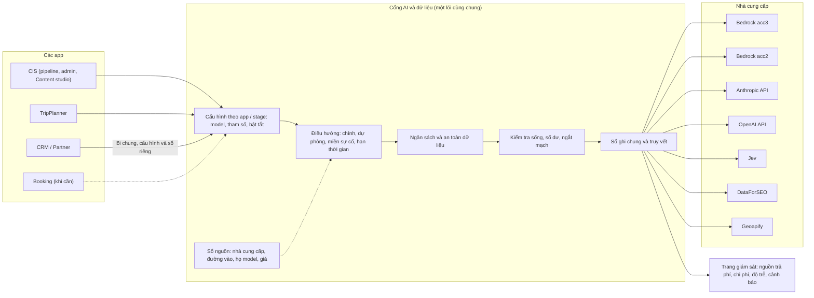

# Cổng AI và dữ liệu (AI gateway) v2: thiết kế đề xuất (S261, 31/10/2026)

Tác nhân: Claude Code. Chỉ là tài liệu: không đổi code, không gọi AWS, DB hay LLM, không đổi route nào.
Quyết định kiến trúc đi kèm: [root ADR 0009](../../adr/0009-ai-platform-and-provider-gateway.md) (Proposed, AA-804).

## Cổng là gì, phạm vi tới đâu

Tech lead định nghĩa (31/10): *"LLM gateway là nơi dùng gọi, quản lý, điều hướng, giám sát, truy vết cho tất cả
nguồn, họ model, và có setup tùy biến cho mỗi loại app, stage, hay nơi nào cần dùng llm trong hệ sinh thái"*, cộng
*"còn cả Jev và DFS nữa"*. Bản này lấy đúng câu đó làm mục tiêu. Phạm vi: **mọi nhà cung cấp AI và dữ liệu mà AA trả
tiền**, gồm LLM ở mọi nguồn (Bedrock trên acc3 và acc2, API trực tiếp của Anthropic và OpenAI) và mọi họ model
(Claude, GPT, Cohere, Nova, Llama, Kimi…), Jev, DataForSEO, Geoapify, Bedrock Guardrails và Bedrock Batch; cho
**mọi app** (CIS, TripPlanner, CRM/Partner, Booking khi cần) và **mọi stage**. Thiết kế đã duyệt ở S258 chỉ phủ LLM
của CIS và để Jev "như hiện nay"; bản v2 mở rộng nó, giữ nguyên những phần đã đúng (ba lớp nguồn → đường chạy →
model, dự phòng theo thứ tự rõ ràng, phạm vi dữ liệu là chính sách riêng, sổ ghi là nguồn sự thật về chi phí).
Tour viết bằng **tiếng Anh**; không stage nào viết tiếng Việt, nên mọi tiêu chí chất lượng chỉ tính tiếng Anh.

## 8 chức năng

| Chức năng | Mục tiêu | Hôm nay | Cần làm |
|---|---|---|---|
| **Gọi** | Mọi app gọi mọi nhà cung cấp trả phí qua một cửa, mỗi loại việc một cách gọi (viết chữ, embedding, quyết định của Jev, tra SEO, tra toạ độ) | Chỉ LLM của CIS đi qua cổng; Jev, DataForSEO, Geoapify mỗi thứ một client riêng; TripPlanner có bản sao cổng riêng; CRM còn giả lập; có vài đường gọi tắt | Một lõi dùng chung, mỗi loại nhà cung cấp một bộ chuyển; đóng đường gọi tắt và xoá code DataForSEO cũ |
| **Nguồn** | Mỗi đường vào (tài khoản, API, khoá, vùng) là một dòng trong sổ nguồn, có ngân sách, phạm vi dữ liệu và "miền sự cố" (ai trả tiền, tổ chức nào có thể chặn nó) | Sổ nguồn chỉ có cho LLM của CIS (5 nguồn); không ghi miền sự cố; Jev, DataForSEO, Geoapify nằm trong biến môi trường và code | Đưa mọi nhà cung cấp trả phí vào sổ nguồn, thêm miền sự cố |
| **Họ model** | Hãng làm model, nơi chạy model và khả năng của model (suy luận, xuất JSON, cache) là ba thứ riêng, ghi bằng dữ liệu; thêm họ mới không cần sửa code | Một ô gộp cả hãng, nơi chạy và đường đi; danh sách hãng đóng cứng; khả năng có chỗ ghi nhưng không ai đọc | Bảng họ model và khả năng; chuyển "kiểu gọi" xuống từng đường chạy |
| **Điều hướng** | Mỗi stage có model chính, dự phòng theo thứ tự, ít nhất một đường dự phòng ấm ở miền sự cố khác, và hạn thời gian cho cả tuyến | Có route theo stage, nhưng gần hết stage chạy trên acc3; 29/10 acc3 bị chặn thì không stage viết nào chạy; nhiều đường điều phối song song; vài chỗ ép model bỏ qua route | Một đường điều phối duy nhất; luật "luôn có đường dự phòng khác miền sự cố"; hạn thời gian tuyến |
| **Tuỳ biến theo app / stage** | Mỗi app, mỗi stage có hồ sơ: model, tham số (độ dài tối đa, mức suy nghĩ, nhiệt độ), phạm vi dữ liệu, ngân sách, bật/tắt | Chỉ CIS đổi model theo stage trong admin; tham số rải trong code; TripPlanner đọc 2 trên 5 bảng cấu hình; CRM có cấu hình riêng theo đại lý | Bảng tham số theo stage × model; hồ sơ theo app (CIS, TripPlanner, CRM; Booking khi cần) |
| **Quản lý** (ngân sách, an toàn dữ liệu, kiểm tra sống) | Không lần gọi trả phí nào chạy mà không qua trần tiền; dữ liệu chỉ tới nơi được phép (theo hãng, vùng địa lý, tenant); biết trước khi một nguồn mất quyền hay hết tiền | Trần chỉ áp khi nơi gọi tự nạp; Jev không có trần trước khi gọi; một đường DataForSEO không có trần; trần TripPlanner "mở cửa khi lỗi"; mất quyền chỉ phát hiện khi việc thật hỏng; Jev có danh sách tenant được phép, LLM thì không | Trần bắt buộc ở cổng cho mọi nguồn; chính sách dữ liệu theo nguồn (hãng, vùng, tenant); kiểm tra sống định kỳ (có phí nhỏ, cần anh duyệt) |
| **Giám sát** | Một trang: nguồn nào sống, còn bao nhiêu tiền, đã chi bao nhiêu theo app / stage / tenant, độ trễ, tỉ lệ lỗi; cảnh báo ngay khi có chuyện | LLM có thẻ sẵn sàng, bản tin hằng ngày, đối soát hoá đơn; DataForSEO có số dư hằng ngày; Jev chỉ có số dư ước tính; Geoapify đếm credit; TripPlanner không có gì; không có độ trễ | Trang "Nguồn trả phí" chung, độ trễ theo stage, cảnh báo tức thì |
| **Truy vết** | Mỗi lần gọi (kể cả bị từ chối) để lại một dòng cùng dạng: app, stage, nguồn, model, tenant, job, độ trễ, kết quả, chi phí; xem được theo job và tour | 5 sổ ghi, 5 dạng khác nhau; lần gọi bị từ chối ở CIS không để lại dòng; không có độ trễ; không xem được theo job | Một hợp đồng sổ ghi chung (sổ CRM cùng dạng), màn xem theo job / tour |

## Từng nhà cung cấp: hôm nay và trong cổng

| Nhà cung cấp | Dùng cho | Hôm nay (31/10) | Trong cổng v2 |
|---|---|---|---|
| Bedrock acc3 (Claude, GPT trên Bedrock) | Gần hết stage viết, chấm, kiểm của CIS; soạn lịch trình TripPlanner | Bị chặn từ 29/10 (Error 002); là nguồn chính duy nhất | Một miền sự cố; luôn có đường dự phòng ở miền khác |
| Bedrock acc2 (Cohere Embed) | Embedding cho CIS và tìm kiếm TripPlanner | Chạy được; lần gọi chat trên acc2 bị ghi thiếu tài khoản nên không vào ngân sách | Ghi đúng tài khoản; có thể làm miền thứ hai cho đánh giá / chấm / kiểm (quyết định 3) |
| Anthropic API trực tiếp | Đường thứ hai cho Claude | Đã chuẩn bị đường Dev, trần 150 USD; chưa nạp tiền, chưa có khoá | Đường dự phòng ấm, khác miền sự cố (quyết định 2) |
| OpenAI API trực tiếp | Dự phòng cuối cho vài stage chấm | Hết credit (429) | Giữ là dự phòng cuối, có trần, có kiểm tra sống |
| Bedrock Batch (acc3) | Viết lại S1 theo lô | Chưa chắc có ghi sổ | Đi qua cổng, ghi sổ như lần gọi thường |
| **Jev** | Quyết định có kiểu (chọn, chấm điểm), không ra chữ | Client riêng ngoài cổng; ghi hai sổ; không trần trước khi gọi; số dư chỉ ước tính; có danh sách tenant được phép | Một loại nguồn "quyết định" trong cổng; trần trước khi gọi; giữ danh sách tenant và các chế độ tắt / thử / áp dụng |
| **DataForSEO** | Khối lượng từ khoá, SERP, câu hỏi người tìm | Client riêng; sổ riêng; một đường chính không có trần; số dư đọc hằng ngày | Một loại nguồn "dữ liệu" trong cổng; trần bắt buộc ở mọi đường; giữ đọc số dư |
| DataForSEO (code cũ) | Không còn ai dùng | Code chết; nếu sống lại sẽ chạy không sổ, không trần | Xoá |
| **Geoapify** | Xác nhận toạ độ, hình dạng tuyến | Gói miễn phí 3.000 credit/ngày, code tự dừng ở 2.500; sổ riêng | Nguồn "dữ liệu" trong cổng; hạn mức là dữ liệu của nguồn |
| Bedrock Guardrails (CRM) | Lọc thông tin cá nhân trước khi gọi model | Chưa được nối vào luồng thật; không ghi chi phí | Đi qua cổng của CRM, có dòng chi phí |
| CRM (LLM) | Bản nháp AI cho đại lý | Cổng riêng, gọi model còn giả lập | Dùng chung lõi code; giữ cấu hình và sổ riêng trong CRM (ADR 0008a); sổ cùng dạng với sổ chung |
| Mapbox | Bản đồ trên trình duyệt khách | Gọi thẳng từ trình duyệt, không ghi gì trong app | Ngoài đường gọi (không thể đi qua máy chủ); chỉ đưa vào trang giám sát và cảnh báo mức dùng |
| AWS Cost Explorer | Đối soát hoá đơn | Bấm tay, khoảng 0,01 USD mỗi lần đọc | Công cụ đối soát của cổng, không phải nguồn để route |
| Nguồn miễn phí (Google Drive, Overpass, tỉ giá) và kênh của tenant (Facebook, WordPress, mail) | — | Không mất tiền, hoặc tenant tự trả | Ngoài phạm vi; ghi trong sổ nguồn là "miễn phí" để biết dữ liệu đi đâu |

## Hình tổng thể

## Thứ tự làm

Luật chung: **không lần chạy trả phí nào khi anh chưa đồng ý; không đổi route nào khi anh chưa duyệt bản thiết kế
này.** Mỗi bước là một lát việc nhỏ, có bằng chứng.

| Bước | Làm gì | Anh thấy gì khi xong |
|---|---|---|
| 1. Sửa lỗi không tốn tiền (0 USD) | Ghi đúng tài khoản cho lần gọi trên acc2; nhận đúng câu "hết tiền" của Anthropic để không gọi lại mãi; thêm trần cho đường DataForSEO đang không có trần; thêm trần trước khi gọi cho Jev; TripPlanner "đóng cửa" khi không đọc được bộ đếm chi tiêu; xoá code DataForSEO cũ | Mỗi lỗi có bài kiểm thử xanh; danh sách "mọi đường trả phí đều có trần" đủ dấu; không route nào đổi |
| 2. Duyệt thiết kế | Anh đọc bản này và ADR 0009, trả lời 3 câu ở dưới; ADR chuyển sang Accepted | ADR 0009 được merge với trạng thái Accepted |
| 3. Sổ ghi chung và trang giám sát | Mỗi lần gọi (cả bị từ chối) có một dòng cùng dạng, có độ trễ; Jev, DataForSEO, Geoapify nối vào cùng dạng; màn xem theo job / tour; trang "Nguồn trả phí" với số dư, chi tiêu, lỗi, độ trễ | Một trang trong admin cho thấy mọi nguồn trả phí với số thật của Dev; mở một job thấy từng lần gọi theo thời gian |
| 4. Sổ nguồn mở rộng, họ model, tham số | Jev, DataForSEO, Geoapify thành dòng trong sổ nguồn; miền sự cố; họ model và khả năng là dữ liệu; tham số theo stage × model; một đường điều phối, bỏ các đường cũ | Thêm một nguồn hay họ model = một PR cấu hình, trong admin chỉ việc bật / tắt; vẫn chưa route nào đổi |
| 5. Độ tin cậy | Đường dự phòng ấm khác miền sự cố; kiểm tra sống định kỳ (sau khi anh duyệt chi phí); hạn thời gian tuyến; ngắt mạch cả một nguồn; đưa lại job bị từ chối vào hàng; diễn tập chuyển dự phòng hằng tháng trên Dev | Thẻ sẵn sàng hiện xanh cho hai miền sự cố; báo cáo diễn tập: tắt nguồn chính, stage chuyển sang dự phòng trong hạn thời gian, kèm chi phí |
| 6. Dùng chung cho các app, thẩm định model mới | TripPlanner và CRM dùng lõi chung (CRM giữ cấu hình và sổ riêng); model mới đi qua thang: tắt sẵn → thử quyền → kiểm nhanh → A/B với bản đối chứng → chạy bóng → chuyển, có cách quay lại một bước | TripPlanner và CRM hiện cùng trang giám sát; mọi lần đổi route có báo cáo A/B kèm chi phí mỗi tour và độ trễ, chờ anh duyệt |

## Cần anh quyết định (3 câu)

1. **Phạm vi: một cổng cho mọi nhà cung cấp AI và dữ liệu trả phí** (LLM, Jev, DataForSEO, Geoapify, Guardrails),
   CRM dùng chung lõi nhưng giữ cấu hình và sổ riêng như ADR 0008a?
   Đề xuất: **Có**, duyệt bản này và ADR 0009 như đang viết.
2. **Đường dự phòng ấm, khác miền sự cố, là bắt buộc**: nạp tiền cho đường Anthropic API (trần 150 USD đã đặt), giữ
   nó ấm bằng kiểm tra sống định kỳ (chi phí ước tính được trình riêng trước khi bật)?
   Đề xuất: **Có**; sự cố 29/10 cho thấy chỉ một nguồn là dừng toàn bộ việc viết.
3. **acc2 được chạy model chat cho đánh giá, chấm và kiểm** (không cho stage viết chính, không cho stage của tenant)
   để có miền sự cố thứ hai trong AWS; việc này sửa ADR 0001a.
   Đề xuất: **Có**, chỉ cho đánh giá / chấm / kiểm; stage viết vẫn giữ Claude (Sonnet 5.5) cho tới khi thang thẩm định
   chứng minh model khác không kém hơn.

## Phụ lục: tên kỹ thuật

Phần này dành cho engineer và agent. Nguồn: các audit S261 trong `docs/audits/2026-10-31-S261-llm-gateway-design-gap/`,
`docs/audits/2026-10-31-S261-llm-gateway-readiness/`, `docs/audits/2026-10-31-S261-llm-capacity-plan/`, bảng kiểm kê
nhà cung cấp trả phí S261 (đọc code, không gọi live), và thiết kế đã duyệt
[S258 blueprint](../2026-10-29-S258-aws-org-blueprint/README.md) mục "AI / LLM Gateway".

**ADR liên quan** (tiền tố bắt buộc: CIS ADR khác root ADR cùng số):
root ADR 0001 quyết định 2 (Single Model Gateway) và 4 (cost guard); root ADR 0001a (LLM chat chỉ trên acc3, sẽ được
sửa); root ADR 0008a §5–6 (CRM có gateway và sổ riêng, giữ nguyên); root ADR 0018 (`aa-ai`); CIS ADR 0005 (catalog),
CIS ADR 0006 §5 (luật writer/judge theo vendor), CIS ADR 0007 (Jev verdict), CIS ADR 0008 (validate mọi vendor),
CIS ADR 0012 (data scope theo stage).

**Sổ ghi hôm nay:** `shared.llm_call_log` (LLM CIS + TripPlanner, Jev cost), `shared.decision_log` (Jev verdict),
`shared.dfs_call_log` (DataForSEO), `geo.geocode_call` (Geoapify), `crm.llm_call` (CRM), `shared.cost_explorer_snapshot`;
không có sổ: Mapbox, Guardrails, Bedrock Batch (chưa kiểm `s1_batch.py`).

**Registry hôm nay:** `shared.llm_provider_connection`, `llm_model_deployment`, `llm_model_catalog`,
`llm_role_config` (`allowed_scopes`, mig 311), `llm_model_alias`, `llm_provider_health`; Jev: `shared.decision_question`,
`shared.jev_tenant_allowlist`, `shared.jev_credit_topup`; ngân sách: `CIS shared/cost_guard.py` (`PROVIDERS` = dfs,
bedrock, openai, jev, geocoder, anthropic, azure_openai), `connection_budget.py`.

**Bước 1 (0 USD), vị trí lỗi:**
- acc2 `account=NULL`: `CIS shared/llm_client/client.py:1375-1380`.
- Anthropic 429 `enforced_spend_limit_reached` bị coi là throttled: `adapters/anthropic_messages.py:303` (cần bản
  ghi phản hồi thật làm fixture).
- DataForSEO không trần: `CIS services/seo_intelligence/handler.py:186` (`process_seo`).
- Jev không có `load_run_budget(..., "jev")`: `CIS shared/llm_client/decide.py`.
- TripPlanner fail-open: `TP backend/shared/llm_gateway.py:588-590`.
- Code chết: `CIS services/acp_produce/dataforseo.py` (chỉ test `test_aa298_dataforseo.py` import).
- Ngưỡng cứng cần thành dữ liệu: Jev low-credit 3 USD (`shared/jev_credit.py`), DFS
  `DFS_BALANCE_ALERT_THRESHOLD_USD` 10 USD (`admin_llm_ops.py:62`).

**Bước 3–6, ánh xạ sang thiết kế** (mã D lấy từ audit design-gap §3): D1 họ model (`llm_model_family`, bỏ CHECK vendor
đóng), D2 `api_style` xuống deployment, D3 capabilities hiệu lực + `stage_model_params`, D4 một dispatch pipeline (bỏ
`_legacy_chain`, vendor path, direct OpenAI; `model_tier` chỉ trong eval/probe), D5 `failure_domain` + bất biến dự
phòng + route deadline + canary + circuit cấp connection + re-queue, D6 lớp lỗi `truncated`, D7 thang thẩm định, D8
`model_maker` / `inference_geo` trong data scope, D9 cấu hình bằng migration, D10 bỏ `account_route`, thay bằng cột
role theo connection, D11 eval spend có scope.

**Issue:** AA-804 (ADR 0009, ledger v2, AI Use Register), AA-642 (dispatch, S3-rest, S8 lõi dùng chung, S7 batch),
AA-900 (thang thẩm định, judge calibration, R2 candidate arm), AA-1002 (đã Done-with-scope; S12 chuyển đi), AA-820
(điều khoản tenant: hãng và vùng được phép), AA-842 (OTel / Langfuse tự host, đang hoãn vì chi phí), AA-1004 (SCP
cho us-west-2). Hai issue mới N1 (độ tin cậy) và N2 (họ model) chỉ tạo khi tech lead đồng ý.

**Langfuse:** Cloud bị loại (dữ liệu ra ngoài AWS, trái CIS ADR 0012 và root ADR 0008a); tự host hoãn (ước 60–150
USD/tháng, ClickHouse trên Fargate, thêm kết nối vào RDS chung). Sổ ghi chung + màn truy vết tự làm phủ khoảng 80%
nhu cầu, 0 USD hạ tầng.
