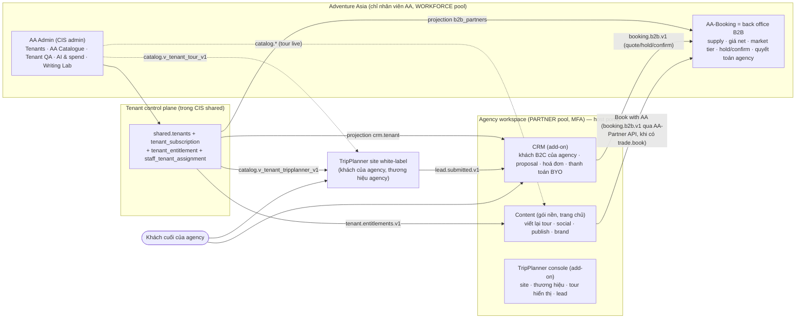

# Tái cấu trúc hệ sinh thái AA theo mô hình chỉ B2B (S265, 03/11/2026)

> Bản audit tư vấn cho tech lead (được viết tiếng Việt theo `language-convention.md`). Tên bảng, route, contract, repo giữ nguyên tiếng Anh.
> Không có thay đổi code, không gọi AWS, không gọi LLM trả phí trong lúc làm audit này. Số liệu schema lấy từ
> `docs/architecture/db-schema-reference.md` (dump 2026-11-02: CIS 346, bk-035, crm-040, tp-023).
>
> Cách làm: 8 lane đọc hiện trạng + nghiên cứu (arch, admin, portal, tp, prior, market-b2b, market-ai, regulation), 3 đề xuất độc lập
> (lean, platform, commercial), 2 judge chấm. Bản này lấy **đề xuất lean làm khung** (khả thi nhất, ít thay đổi nhất), ghép phần
> **vận hành thương mại** của đề xuất commercial và **danh sách xung đột + bảng hạng mục trả phí** của đề xuất platform, và **sửa các
> lỗi thực tế** mà hai judge tìm ra (ghi ở cuối mục 5).

---

## 0. Tóm tắt

1. Mô hình mới là một **nền tảng SaaS B2B**: mọi tenant bắt buộc đăng ký **CIS Content** (viết lại tour + bài social). **CRM** và **TripPlanner** là add-on trả phí. **Booking** trở thành back office B2B của AA (supply, giá net, giữ chỗ, quyết toán với agency). AA không bán và không giữ dữ liệu khách B2C.
2. Codebase đã có phần lớn mảnh ghép (RLS theo tenant, partner pool có MFA, vault mã hoá của CRM, contract catalog, quy tắc tour live ADR 0015). Thứ còn thiếu là **một control plane cho tenant**: một bản ghi tenant, một mô hình gói + entitlement, phân tenant cho account manager, và `tenant_id` cho TripPlanner.
3. Hiện một agency nằm ở **3 bản ghi** (`shared.tenants`, `crm.tenant`, `booking.b2b_partners`), cần **7 bước tay qua 3 UI**, có **3 bộ từ vựng trạng thái** và **3 bộ tên gói**. TripPlanner không có tenant nào.
4. Xung đột trực tiếp với mô hình mới: TripPlanner B2C mang thương hiệu AA đẩy lead thành **case B2C của AA** trong Booking; Booking giữ PII khách B2C; CRM cho phép agency bán nhà cung cấp riêng (kể cả tour không phải của AA).
5. Đề xuất: đặt control plane trong **CIS `shared`** (không thêm app thứ năm), CRM và Booking chỉ là **bản chiếu (projection)** đọc qua contract mới `tenant.entitlements.v1`. App kiểm **feature key**, không kiểm tên gói.
6. Nhân viên AA: thêm vai trò `customer_success`, `support`, `finance`, `ai_ops`, `content_lead`, `tenant_qa`; gộp `reviewer` vào `content`; bảng `shared.staff_tenant_assignment` để mỗi account manager chỉ thấy "book" tenant của mình; "view as tenant" chỉ đọc, 60 phút, có lý do và log.
7. CIS admin tách thành: Home, **Tenants** (nhóm lớn mới, có trang Tenant 360 riêng), **AA Catalogue** (kho atom/segment/route/hub), **Tenant content QA**, **AI & spend**, **Writing Lab** (theo stage), Platform.
8. Portal tenant: **Content là trang chủ**, CRM và TripPlanner hiện như app trong app switcher khi có entitlement. Phần B2C của Booking **không di chuyển code** mà đóng băng rồi gỡ, vì CRM đã có bản tương đương tốt hơn.
9. TripPlanner: dựng lại **tại chỗ** (giữ backend), thêm `tenant_id` + RLS, lớp thương hiệu theo tenant, lead đi về CRM của tenant; pilot chạy theo **path trên host hiện có** + nút launcher, không cần DNS/cert mới. **Lưu ý Vercel:** gói Hobby chỉ dành cho dùng cá nhân, phi thương mại; pilot B2B của một công ty là dùng thương mại dù đối tác có trả tiền hay không, nên trước khi một tenant bên ngoài dùng bề mặt nào trên Vercel phải lên Pro (TL-23). Kèm gói nâng cấp UX (ảnh theo điểm dừng, icon, sắp xếp trên mobile, chat lập kế hoạch có ràng buộc tour thật).
10. Dữ liệu toàn cầu: không luật nào trong phạm vi nghiên cứu **bắt buộc** đặt dữ liệu EU ở EU (với điều kiện SCC đi kèm đánh giá tác động chuyển dữ liệu (TIA) đứng vững); làm ngay bộ DPA + SCC + phụ lục theo nước và cột `data_region` (mặc định `us`); chỉ dựng **cell EU** (~150–250 USD/tháng, single-AZ, ước tính) khi có trigger. Điểm pilot đầu tiên (1 agency dùng Content + CRM) đạt sau **khoảng 5 phiên**; Content chạy được trên Dev, còn dữ liệu khách thật trong CRM chờ `aa-prod` (TL-16).
11. Cách đọc yêu cầu: câu "Booking chỉ quản lý tenant/agency (B2B)" được đọc là **Booking chỉ còn làm việc B2B với tenant** (không còn B2C), **không** phải "hồ sơ master của tenant nằm ở Booking". Bản này đặt master ở CIS (TL-1, lý do ở mục 2.2). Nếu ý của tech lead là cách đọc thứ hai, chọn phương án `booking` ở TL-1.
12. Thứ tự và năng lực: R0 bắt đầu ngay (mô hình B2B-only đã chốt ở cuộc họp 02/11, không chờ thêm câu trả lời); lộ trình ~25–30 phiên được ánh xạ vào slot của `plan.json` và nêu rõ issue nào tạm dừng (mục 11.1, TL-15).

---

## 1. Hiện trạng và chỗ lệch với mô hình mới

### 1.1 App, repo, runtime hôm nay

| Repo | Vai trò hôm nay | Runtime (Dev) | Lệch với mô hình mới |
|---|---|---|---|
| `AA-CIS-App` | Hệ thống gốc của nội dung: A-series (master), T-series (T0–T4 rewrite, T5–T11 social), Content studio API `/v1/*`, AI gateway control plane, danh bạ staff | ECS `aa-cis-dev-api` + `aa-cis-dev-worker`; Vercel admin | Admin hiển thị số liệu khách B2C (thẻ TripPlanner customers, Booking funnel); không có control plane tenant thật |
| `AA-Booking` | Back office AA: inquiry, trip case, proposal, giá/FX, supplier, departure/hold, ops, hoá đơn; API B2B cho CRM; route B2C "My Payments" | ECS `aa-booking-dev-api`; Vercel `aa-booking-admin` | Nửa B2C (khách hàng, case B2C, kênh giá `b2c_tailor_made`, My Payments) không còn người mua |
| `AA-Partner` | CRM `api/` + `web/`, Content studio `portal/` (UI, logic ở CIS), client portal của traveller, staff console | ECS ARM64 `aa-crm-dev-api`, `aa-crm-dev-web`, `aa-crm-dev-portal` | Hai sidebar, hai lời mời, hai bộ vai trò; CRM web đang là "chủ" session nên tenant không có CRM bị vướng |
| `AA-TripPlanner-Web` | Planner bản đồ **B2C mang thương hiệu AA** (CONTEXT.md l.28–32) | Vercel (gói **Hobby**) + 3 Lambda | Không có tenant; lead thành case B2C của AA; ~110 chuỗi "Adventure…" cứng trong 32 file |
| `AA-CIS-Infra` | Toàn bộ Terraform, DB Migrate, Schema Dump | GitHub Actions | ADR 0018 d7 ghi "residency đã chốt: US" |
| root `AA-Ecosys` | Docs, ADR, contract | — | ~25 file contract trong `docs/contracts/`, **chưa có** `tenant.entitlements.v1` |

### 1.2 Bảng khái niệm → nơi ở hôm nay → chỗ lệch

| Khái niệm | Nơi ở hôm nay (bằng chứng) | Lệch / thiếu |
|---|---|---|
| AA bán B2C | TripPlanner B2C; `inquiry.submitted` v1.4 → `booking.customers` + `trip_cases.channel='b2c'`; `pricing_rules` channel `b2c_tailor_made`; `booking.customer.v1` | Trái trực tiếp cam kết "AA không bán B2C". ADR 0001 d5–6, ADR 0004 O6/O8, ADR 0006 Phase 4 giả định B2C |
| Bản ghi tenant | 3 bản ghi cùng UUID: `shared.tenants`, `crm.tenant`, `booking.b2b_partners`; tạo bằng 3 thao tác ở 3 nơi | 3 bộ trạng thái (active/suspended/offboarded; active/locked/offboarding/offboarded; active/suspended); khoá/xoá không lan sang Booking |
| Gói nền CIS | `shared.tenants.plan_tier` / `plan_id` → `shared.membership_plans` (không có trang sửa); `PLAN_LIMITS` cứng trong `api/routers/admin.py`; quota ledger cứng 10/10/50 | Không có catalogue gói, không có add-on, không ràng buộc "phải có CIS trước" |
| Add-on CRM | `crm.tenant_entitlement` (free/core/pro, `member_limit`, `allowed_features`) | Là gói riêng của CRM; chỉ `member_limit` và `ai_assist` được thực thi; không có route đổi `plan`/`member_limit` |
| Add-on TripPlanner | Không có gì; schema `tripplanner` không có cột `tenant_id` | Cần tenant key mọi bảng, cấu hình thương hiệu, định tuyến lead |
| Khách hàng cuối | 3 kho: `booking.customers` (PII thô), `tripplanner.customers` / `traveller_accounts` (email/phone UNIQUE toàn cục), `crm.traveler` (mã hoá, RLS) | Chỉ `crm.traveler` hợp mô hình tenant-là-controller |
| "Chỉ tour thật của AA" | Phía content đã đúng (T1 chọn tour A3, ADR 0015 trả 409 `tour_discontinued`); **nhưng** `crm.agency_supplier.kind='own'` và `crm.booking_line.supplier_kind='agency'` | CRM cho bán dòng của nhà cung cấp riêng, gồm cả tour — cần chính sách |
| Vai trò staff AA | `shared.admin_role` (enum: admin/reviewer/content/viewer) + `is_owner`; `shared.staff_app_grant` (booking: admin/sales/contracting/content_creator); `shared.staff_crm_grant` (platform_admin/ops/support) | `reviewer` = `content` (cùng `_CONTENT_WORK`); mọi thứ về tenant/tiền/AI chỉ `admin`; không có vai trò CSKH/account manager |
| Manager chỉ thấy tenant của mình | **Không có.** Chỉ có `booking.staff_assignments` (theo trip case) và `crm.support_grant` (tenant cấp 1–7 ngày) | Cần bảng phân tenant + lọc phía server |
| Người của agency | `shared.tenant_members.content_studio_role` (owner/editor/viewer) + `crm.member.role` (owner/agent/assistant) | Hai lời mời, hai bộ vai trò cho một người |
| Tách nội dung tenant / kho dữ liệu | Schema đã tách phần lớn (`acp_contract`, `geo` vs `acp_shared`, `acp_deliver`); ngoại lệ: `gold_aa_internal.tenant_tour_versions` | UI trộn: `/admin/atom-curation` nhãn "Social Content" nhưng là kho atom/segment/route/hub, chứa cả Slate (theo tenant) |
| AI theo tenant | `shared.tenant_ai_budget`, `crm.tenant_settings.ai_budget_usd`, `crm.llm_call`; TripPlanner truyền `tenant_id` = NULL | Không có đồng hồ AI một nơi; ngân sách không gắn gói |
| Vùng dữ liệu | Một vùng us-west-1; không cột vùng cho tenant; ADR 0018 d7 "đã chốt US"; legal packet §7 "[to be confirmed]" | Khách B2B toàn cầu → cần `data_region` + trigger cho cell vùng |

### 1.3 Quy trình tạo một tenant hôm nay (7 bước tay)

1. CIS `/admin/tenants` → `shared.tenants` (API key trả một lần, quota 10/10/50).
2. Tenant 360 › Members → mời thành viên studio (relay `crm.ops.v1 .../studio-invitations`).
3. Người được mời claim `/join` → tài khoản partner pool (MFA).
4. CIS `/admin/platform/agencies` → tạo `crm.tenant` (+ dòng supplier AA dựng sẵn).
5. Mời CRM owner (lời mời thứ hai).
6. Bật feature CRM (`entitlements-allowed`), không đổi được plan/seat.
7. Booking: chỉ có API `POST /booking/b2b-partners` (không có trang UI); bản ghi Dev đến từ script seed.

---

## 2. Mô hình hệ sinh thái mới

### 2.1 Sơ đồ



### 2.2 Bảng app và người dùng

| Sản phẩm (tên dùng trong UI/docs) | Ai dùng | Repo | Vai trò mới | Không bao giờ thấy |
|---|---|---|---|---|
| **AA Admin** | Nhân viên AA | AA-CIS-App `frontend/` | Quản lý tenant, kho catalogue, QA nội dung tenant, AI và chi phí | Khách cuối, PII traveller (trừ khi tenant cấp quyền) |
| **Tenant control plane** | Mọi app, qua contract | AA-CIS-App (`shared`) | Nguồn sự thật: tài khoản, gói, add-on, entitlement, usage, phân tenant cho staff, vùng dữ liệu | — |
| **Content** (gói nền) | Người của agency | AA-Partner `portal/` + CIS `/v1/*` | Trang chủ của tenant | QA gate, held, flag |
| **CRM** (add-on) | Người của agency có `crm.core` | AA-Partner `api/` + `web/` | Quản lý khách B2C của agency; nhận phần B2C của Booking | Giá net AA |
| **TripPlanner** (add-on) | Agency cấu hình; khách của agency dùng | AA-TripPlanner-Web | Planner AI white-label, chỉ tour live của AA, lead về agency | Thương hiệu AA (trừ "Powered by" tuỳ chọn) |
| **AA-Booking** (back office B2B) | Contracting, agency desk, ops, finance của AA; CRM và Content ("Book with AA") qua M2M | AA-Booking | AA là nhà cung cấp/DMC | Không còn B2C |

**Cách đọc câu "Booking chỉ quản lý tenant/agency (B2B)" (nói rõ vì khác nghĩa đen).** Câu này đọc được hai cách:
(a) Booking chỉ còn làm việc **B2B** với tenant (bỏ B2C); (b) **hồ sơ master** của tenant (tài khoản, gói, add-on) nằm ở
Booking. Bản này đọc theo (a) và đặt master ở CIS `shared` (TL-1), vì: Content là gói bắt buộc nên mọi tenant có trong
CIS trước; `shared.tenants` đã là master thực tế và CRM dùng chung UUID; Booking giữ giá net của AA, thứ tenant không
bao giờ được thấy; và một tenant chỉ dùng Content không cần bản ghi đặt tour. Booking vẫn **quản lý phần B2B của
tenant**: partner, hạng giá, công nợ, hold, quyết toán (mục 7.3). Nếu tech lead muốn nghĩa (b), chọn phương án
`booking` ở TL-1; đánh đổi đã ghi ở đó.

### 2.3 Bất biến (đề xuất ghi vào ADR 0019 "B2B-only ecosystem model")

1. AA chỉ bán cho tenant. Sau cut-over không tạo bản ghi khách cuối nào do AA sở hữu.
2. Tenant là **controller** dữ liệu khách cuối, AA là **processor**, trên toàn nền tảng (mở rộng ADR 0008a d1 từ CRM ra mọi app).
3. Mọi thứ tenant hiển thị/bán có tham chiếu tour hoặc trải nghiệm phải trỏ tới `tour_id` hoặc atom **live** của AA (ADR 0002 + 0015). Không có tour ngoài AA.
4. Tenant chỉ thấy nội dung; QA, held, flag ở lại AA Admin (giữ nguyên).
5. Mail, thanh toán, nhắn tin là tài khoản của agency (BYO, giữ nguyên).
6. App kiểm **feature key**, không kiểm tên gói.

### 2.4 Quyết định cũ bị thay đổi (nói rõ)

| Quyết định cũ | Thay đổi |
|---|---|
| ADR 0001 d5–6 (Booking sở hữu danh tính khách) | Bị thay thế: khách cuối chỉ ở `crm.traveler` |
| ADR 0004 O6 / O8 (TripPlanner là cửa trước B2C; lead → case) | Bị thay thế |
| ADR 0005 (kênh margin B2C 30 %/25 %, giá "from" = giá B2C thấp nhất) | Sửa: giữ engine, kênh `b2b` + `fixed_departure`; "from" = **giá bán lẻ khuyến nghị (RRP)** = giá B2B + markup gợi ý (AA-1029) |
| ADR 0005a "không có dòng subscription, CRM miễn phí khi ra mắt" | Bị thay thế: có subscription, CRM là add-on trả phí |
| ADR 0006 EXTERNAL pool cho traveller | Sửa: đóng băng client `tripplanner`, `booking-customer` |
| ADR 0010 d5 (CRM sở hữu "nhà cung cấp riêng") | Thu hẹp: chỉ dịch vụ bổ trợ, không tour |
| ADR 0010a (Proposed: CRM web sở hữu session) | Sửa nhẹ: giữ CRM web làm host đăng nhập, nhưng tenant không có CRM vẫn vào được và đáp xuống Content |
| ADR 0016 (kit core cố định) | Bổ sung: lớp token thương hiệu theo tenant lúc runtime, xây một lần ở bản CIS canonical rồi sync |
| ADR 0018 d7 ("residency đã chốt: US") | Sửa tiền đề: thêm trigger cell vùng; làm **trước khi tạo `aa-prod`** (AA-1004) |
| S261 BO-1 ("AA bán trực tiếp trước") | Trả lời ngược lại: B2B content trước |
| CRM spec + S246 "miễn phí cho agency" | Bị thay thế |
| **S253 "Booking: build mọi màn Figma"** | Đảo một phần: bỏ màn B2C (Customers, case/proposal B2C, My Payments, funnel B2C); giữ supply, giá, catalog, ops, B2B, thêm Partners + Settlement |
| Giữ nguyên | S262 TL-3 phần còn lại (đóng băng CRM W6–W8, chỉ thêm entitlement + shell; xem TL-15), S262 TL-11 (đóng băng logic học của Writing memory), "tenant chỉ thấy content", hạ tầng lean (không account mới ngoài mô hình ADR 0018; **không thêm dịch vụ trả phí nào khi chưa có một "đồng ý" riêng, nêu chi phí tháng trước**, kể cả những khoản lộ trình biết trước là sẽ cần như Vercel Pro ở TL-23 hay `aa-prod` ở TL-16) |

> Ghi chú đánh số: "S262 TL-3" và "S262 TL-11" là quyết định cũ trong `docs/audits/2026-10-31-S262-tl-decisions/`.
> TL-3 và TL-11 không có tiền tố trong bản này là quyết định **mới** (vai trò staff; danh tính traveller).

---

## 3. Quản lý tenant: vòng đời, gói, add-on, entitlement, tính phí

### 3.1 Thị trường làm thế nào (có nguồn, truy cập 03/11/2026)

| Sản phẩm | Mô hình | Ghi chú dùng cho AA | Độ tin |
|---|---|---|---|
| Travefy | Core 39 USD/tháng seat đầu + 20 USD/seat thêm; Premium 59 + 39; Agency tier "Contact Sales" (báo cáo hoa hồng, thư viện mẫu chung, quản lý supplier tập trung, onboarding agent, account manager riêng); trial 10 ngày; white-label là sản phẩm riêng cho DMC | Mẫu "seat đầu + seat thêm"; account manager là quyền lợi gói cao | Trang giá vendor |
| TravelJoy | Starter 19 USD/tháng (12 trip/năm, không AI); Pro 39 USD/tháng (32 nếu trả năm), thành viên team là add-on; Premium thêm Zapier, SMS; trial 7 ngày không thẻ | Gói thấp có trần dùng, add-on theo team | Trang giá vendor |
| Safari Portal | Essentials 299 USD/tháng (1 user), Pro 399 (3 user), +50 USD/user; white-label cho đối tác B2B chỉ ở Enterprise | Tầm giá gần gói Content của AA (starter 299) | Trang giá vendor |
| Tern | ~35–49 USD/seat cho advisor đơn lẻ, giảm còn ~22–29 USD/seat ở 100–499 seat; có seat miễn phí và trả phí; host agency quản lý sub-agency | Mốc giá seat CRM; mô hình host/sub-agency để sau | Tóm tắt tìm kiếm, cần kiểm lại |
| Stripe Entitlements | Feature có `lookup_key`, gắn vào Product; ActiveEntitlement theo khách; app kiểm `lookup_key`, không kiểm tên gói | Mẫu cho `shared.tenant_entitlement` | Docs vendor |
| Stripe subscription status | trialing, active, incomplete, past_due, unpaid, canceled, paused; khuyên cắt quyền ở `unpaid`, giữ dịch vụ khi `past_due` | Dùng cùng từ vựng ngay cả khi lập hoá đơn tay | Docs vendor |
| Bókun Marketplace | Hợp đồng của supplier quy định hoa hồng **và** sản phẩm được bán; reseller thu tiền khách, supplier lập hoá đơn cho reseller | Đúng mô hình "chỉ bán tour thật của AA" + tenant là merchant of record | Docs vendor |
| Lemax markets | Hoa hồng theo **market**, agent gán vào market (vd. silver/bronze/gold) | Mẫu cho bảng giá theo tier (AA-1030) | Docs vendor |

### 3.2 Vòng đời: một máy trạng thái cho tài khoản, trạng thái riêng cho từng sản phẩm

```
lead → applied (xác minh doanh nghiệp, gửi hợp đồng + DPA) → trial (14 ngày) → active
active ⇄ past_due (ân hạn 14 ngày, dịch vụ vẫn chạy) → suspended → offboarding (30 ngày xuất dữ liệu) → closed (xoá theo retention)
suspended → active (khôi phục)
```

- **Xác minh ở bước `applied` (BO-21):** giấy đăng ký kinh doanh; giấy phép lữ hành nếu nước của agency đòi (vd. giấy phép lữ hành quốc tế ở Việt Nam, bảo hiểm mất khả năng thanh toán của organiser ở EU); tra tay danh sách trừng phạt công khai miễn phí (OFAC, EU, UN) theo tên pháp nhân và người đại diện; người duyệt = account owner, business owner duyệt ngoại lệ. Lưu kết quả trong `shared.tenant_account_event` (không lưu bản scan giấy tờ ở bảng `shared`; file đi vào kho tài liệu có retention riêng). Không dùng dịch vụ KYC trả phí ở v1.
- `suspend_reason` ∈ `billing`, `compliance` (vd. bán tour không phải của AA), `security`, `tenant_request`.
- **Suspended** nghĩa là: Content chỉ đọc + dừng publish; CRM chỉ đọc (`crm.tenant.status='locked'`); site TripPlanner hiện trang "tạm dừng"; Booking `b2b_partners.status='suspended'` (không tạo hold mới). Dữ liệu giữ nguyên.
- **Closed** chạy luồng DSAR/xoá đã có (`/admin/data-erasure`, chuyển vào nhóm Tenants), DRY RUN trước.
- Trạng thái từng sản phẩm dùng từ vựng Stripe (`trialing, active, past_due, unpaid, canceled, paused`).
- 14/14/30 ngày là **giá trị mặc định đề xuất** (thị trường 7–14 ngày trial), không phải gate.

### 3.3 Catalogue gói và add-on

| Sản phẩm | Bắt buộc? | Gói | Đo/giới hạn theo | Feature key (ví dụ) |
|---|---|---|---|---|
| **Content** | Có | Starter / Growth / Business / Enterprise (tái dùng `plan_tier_enum`; giá hiện có trong `membership_plans`: 299 / 799 / 1 499 USD/tháng; **Enterprise chưa có giá** → đề xuất "liên hệ sales", giá theo hợp đồng, sàn = giá Business, gồm CSM riêng, SLA cao hơn, tuỳ chọn lưu trữ EU có tính phí; BO-2) | rewrite/tháng, post/tuần, kênh, seat, API call, AI USD | `content.rewrite`, `content.social`, `content.article`, `channel.wordpress`, `channel.facebook`, `api.access`, `content.seats` |
| **CRM** (add-on) | Không, cần Content active | Core / Pro (tái dùng free/core/pro) | seat CRM, AI credit | `crm.core`, `crm.seats`, `crm.ai_assist`, `crm.whatsapp_sms`, `crm.stripe_connect`, `crm.campaigns`, `crm.custom_domain`, `crm.insights_export` |
| **TripPlanner** (add-on) | Không, cần Content active | Hosted / Embed / API | phiên AI/tháng, lead, map load | `tp.hosted`, `tp.launcher`, `tp.embed`, `tp.custom_domain`, `tp.api`, `tp.ai_sessions`, `tp.branding` |
| **AA tour supply** | Ngầm định (miễn phí) | — | — | `trade.book` (bật thì Booking tự tạo/kích hoạt `b2b_partners`). Tenant **không có CRM** vẫn đặt được tour AA qua nút "Book with AA" trong Content hoặc qua e-mail tới agency desk (TL-17); giá net, hạng giá, đặt cọc, công nợ theo BO-15/BO-16 |
| Chung | — | — | — | `ai.budget_usd_monthly` (thay `shared.tenant_ai_budget` rời rạc, khép AA-1016); giá trị theo gói và chính sách vượt mức do business owner chốt (BO-19) |

### 3.4 Bảng mới/sửa trong CIS (owner CIS, key `NNN`)

| Đối tượng | Nội dung |
|---|---|
| `shared.tenants` (thêm cột) | `account_status` (enum ở 3.2), `suspend_reason`, `data_region` text mặc định `'us'`, `kind` ∈ `agency, demo, internal` (thay vì dùng `is_synthetic`, cột này **chỉ có ở `crm.tenant`**), `legal_entity_name`, `billing_email`, `billing_country`, `contract_version`, `segment` ∈ `high_touch, tech_touch`. `is_active`/`cancelled_at` thành cột dẫn xuất (trigger) để code cũ không vỡ. `aa_internal` có `kind='internal'` và biến khỏi mọi danh sách/đếm tenant |
| `shared.product` (seed) | `content`, `crm`, `tripplanner`, `trade` |
| `shared.plan` | Tổng quát hoá `membership_plans` (giữ view tương thích): `plan_key, product, name, price_usd_monthly, seats_included, price_extra_seat, is_public, version, retired_at` |
| `shared.plan_feature` | `plan_key, feature_key, limit_value` (null = không giới hạn) |
| `shared.tenant_subscription` | `tenant_id, product, plan_key, status, trial_ends_at, paid_through, billing_ref, seats`; unique `(tenant_id, product)`; trigger kiểm: dòng `crm`/`tripplanner` cần dòng `content` active |
| `shared.tenant_entitlement` + `tenant_entitlement_override` | Bảng vật chất hoá `(tenant_id, feature_key, limit_value, source ∈ plan/override/trial, expires_at)`; override có `reason`, `granted_by` |
| `shared.tenant_account_event` | Append-only: `account.status_changed`, `subscription.changed`, `entitlement.changed` (cùng kiểu `tenant_membership_event`) |
| `shared.staff_tenant_assignment` | Xem mục 4 |

### 3.5 Contract `tenant.entitlements.v1` (file mới trong `docs/contracts/`)

- HTTP (M2M scope mới, vd. `cis.tenant/entitlements.read`): `GET /tenant/v1/tenants/{id}/account` (status, data_region, subscriptions, entitlements) và `GET /tenant/v1/account-events?after=`.
- View DB `shared.v_tenant_entitlement_v1` grant cho `crm_app`, `tripplanner`, `booking`.
- Bên tiêu thụ:
  - **CRM**: job mới `crm_entitlement_pull` (cùng mẫu `crm_membership_pull`) chiếu vào `crm.tenant_entitlement` và `crm.tenant.status`. Trigger `crm.guard_platform_write` giữ nguyên; feed của CIS thành **người ghi duy nhất**; `/entitlements` trong `crm.ops.v1` thành chỉ đọc. Thực thi nốt các feature đang chỉ lưu (`whatsapp_sms`, `stripe_connect`, `campaigns`, `custom_domain`, `insights_export`).
  - **Booking**: job `bk_tenant_pull` chiếu vào `b2b_partners.status`; `trade.book` bật thì upsert partner. Khoá/xoá cuối cùng cũng tới Booking.
  - **TripPlanner**: đọc view `catalog.v_tenant_tripplanner_v1`.
- Usage của CRM: route `GET /tenants/{tenant_id}/usage` **đã có trong `crm.ops.v1` 1.9** — tái dùng, không thêm route mới.

### 3.6 Tạo tenant thành một thao tác

1. "Create tenant" trong CIS admin ghi `shared.tenants` + subscription `content` (trial) + gán account owner.
2. Đẩy job `tenant_provision` (`shared.job`), saga idempotent, mỗi bước ghi trạng thái để trang tenant hiện "CRM: provisioned":
   - CRM add-on bật → `crm.ops.v1 POST /tenants` (agency + supplier AA dựng sẵn).
   - Gửi **một** lời mời owner (mục 4.4).
   - `trade.book` → route Booking mới `POST /booking/ops/v1/partners` qua relay WORKFORCE (thay script seed).
   - TripPlanner → không ghi gì, view tự có cấu hình.
3. Thêm/bớt add-on sau này chỉ ghi `tenant_subscription`; feed + projection lo phần còn lại.

### 3.7 Tính phí và đo lường (lean)

- **Hai dòng tiền tách nhau:** (a) phí SaaS (gói, seat, vượt mức) — thuộc control plane; (b) quyết toán tour wholesale (AA lập hoá đơn cho agency theo giá B2B) — thuộc Booking vì gắn với dữ liệu supply.
- **Billing v1 làm tay, không tốn thêm:** finance phát hành hoá đơn ngoài hệ thống, nhập `paid_through` / `billing_ref`; job hằng ngày `tenant_billing_tick` chuyển `past_due` → `suspended` khi quá `paid_through` + ân hạn. Dùng từ vựng Stripe để sau này chuyển sang Stripe Billing chỉ là ánh xạ. Khi cần sinh hoá đơn SaaS trong hệ thống: bảng `shared.billing_invoice` (+ line) ở CIS, maker-checker như bk-028.
- **Quyết toán tour ở Booking cần migration bk mới.** `booking.invoices` hiện **không có `party_tenant_id`** (cột này ở `booking.trip_cases`), bắt buộc `trip_case_id` (và `version_id`) NOT NULL, và CHECK `invoices_bill_to_kind_chk` chỉ cho `bill_to_kind='customer'` (`invoices_customer_chk` buộc có customer). Lựa chọn: bảng mới `booking.agency_invoice` (+ line, `party_tenant_id`, kỳ quyết toán gom nhiều B2B case) — **khuyến nghị**, sạch hơn nới CHECK của bảng B2C cũ.
- **Stripe Billing** là dịch vụ trả phí mới (~0,7 % doanh thu lập hoá đơn, cần xác minh) → cần một "đồng ý" riêng có nêu chi phí (business owner, BO-14).
- **Tiền tệ, thuế:** hoá đơn SaaS và hoá đơn quyết toán tour là hai loại dịch vụ khác nhau về thuế (phần mềm dùng ở nước ngoài so với dịch vụ tour tiêu dùng tại Việt Nam). Tiền tệ hoá đơn, VAT Việt Nam, reverse charge EU, thuế nhà thầu / khấu trừ ở nước của agency → ghi chú cho kế toán (BO-17, mục 10.5).
- **Đo lường:** view `shared.v_tenant_usage_monthly` gộp `tenant_rewrite_usage`, post, `tenant_api_usage_monthly`, `llm_call_log` theo `tenant_id` (mọi app phải truyền `tenant_id`, CI guard ở từng app), CRM usage (route 1.9 sẵn có), TripPlanner `tripplanner.v_tenant_usage_v1` (session, trip, lead, phiên AI, map load).

### 3.8 Nhân viên AA vận hành hằng ngày (mẫu thương mại)

| Chức năng | Công cụ hằng ngày | Việc làm |
|---|---|---|
| Sales / onboarding | Tenants › Onboarding (kanban) | lead → applied → hợp đồng/DPA → trial; gán account manager |
| Account manager (CSM) | Tenants › "My tenants" | Sức khoẻ (usage %, lần publish cuối, chi AI), trial sắp hết, past due, upsell CRM/TripPlanner, ghi chú review quý |
| Support (tier 1) | Tenant 360 › Support | Gửi lại lời mời, reset MFA, "view as" chỉ đọc có lý do |
| Content ops | AA Catalogue | Wave, review queue, master content, atom/route, place/photo |
| Tenant content QA | Tenant content QA | Held/flag trên output tenant, Jev decisions; tenant chỉ thấy nội dung |
| Finance | Tenants › Billing + Booking › Settlement | Phát hành hoá đơn, đánh dấu đã trả, suspend vì billing |
| Contracting | Booking | Supplier, rate, market/price tier, tour bán được |
| AI ops | AI & spend + Writing Lab | Routing, provider, ngân sách, thí nghiệm, release |

Phân nhóm kiểu Gainsight: **high-touch** 5–25 tenant mỗi CSM (gói Business/Enterprise), **tech-touch** 50–150+ tenant trong hàng đợi chung "Unassigned/team". Giai đoạn đầu: mọi tenant có một người phụ trách có tên.

---

## 4. Vai trò nhân viên AA, phân tenant, "view as", vai trò tenant/CRM

### 4.1 Vai trò staff (WORKFORCE, `ROLE_PERMS` của CIS + Cognito group)

| Vai trò | Năng lực | Phạm vi tenant |
|---|---|---|
| `admin` | Tất cả; `staff.write` vẫn cần `is_owner` + Cognito session | tất cả |
| `content_lead` | content.*, review.act, master.admin, atoms.write, photos.write, quality.write, a4.unpublish, content.settings.write | không có PII tenant |
| `content` (gộp `reviewer`) | content.read/write, review.act | không |
| `tenant_qa` | quality.write trên output tenant, Content Trace, held, flag | tất cả hoặc được giao |
| `customer_success` (account manager) | tenant.read, tenant.write (vòng đời trừ billing, add-on, seat, member, lời mời, ghi chú), view-as | **chỉ tenant được giao** |
| `support` | tenant.read, member actions (gửi lại lời mời, reset MFA), ghi chú, view-as chỉ đọc | chỉ được giao |
| `finance` | spend.read, billing.* (`paid_through`, suspend/unsuspend vì billing) | tất cả, chỉ trường billing |
| `ai_ops` | ai.admin, spend.read/write, ops.read, Writing Lab | không có dữ liệu tenant |
| `viewer` | chỉ đọc (E2E, Preview — giữ nguyên, không gán được) | tất cả |

Cách làm cụ thể (sửa lỗi các đề xuất):
- `shared.admin_role` là **enum PostgreSQL**, không phải bảng grant → thêm vai trò bằng `ALTER TYPE shared.admin_role ADD VALUE ...` (không chạy được trong transaction cùng lệnh dùng giá trị mới trên PG 15; tách migration). Chỉ có **hai** bảng grant (`staff_app_grant`, `staff_crm_grant`) và cả hai giữ nguyên.
- Gộp `reviewer` → `content`: ánh xạ dữ liệu + giữ group `cis-reviewer` làm alias một release. **Phải sửa luôn CHECK `admin_users_email_chk`** (dòng E2E staff đang bị ghim `role='reviewer'`) trong cùng migration CIS, và cập nhật `e2e_staff.py`.
- Booking: giữ `admin/sales/contracting`; "sales" đổi nghĩa thành **agency desk**; `content_creator` chuyển sang vai trò CIS `content` (`staff_app_grant` cho phép `content_creator` hôm nay).
- CRM: giữ `platform_admin/ops/support`.

### 4.2 "Book of business" — mỗi manager chỉ thấy tenant của mình

Thị trường: HubSpot đặt quyền xem/sửa theo "All / Team's / Own records" + "Unassigned"; Salesforce Account Teams gán thành viên + vai trò + mức truy cập; Zendesk custom role "assigned only / own groups".

- Bảng `shared.staff_tenant_assignment (admin_user_id, tenant_id, relation ∈ owner|backup|support, assigned_at, assigned_by)`, partial UNIQUE một `owner` mỗi tenant.
- Thực thi **phía server**: một dependency trung tâm `require_tenant_scope` trong `api/core/staff_authz.py`; `denial_reason` kiểm `{tenant_id}` trên route; endpoint danh sách (`/admin/tenants`, relay agencies, Content Trace, Content Quality, usage) lọc theo tập tenant nhìn thấy. `admin` bỏ qua scope.
- **CI test**: mọi route có `{tenant_id}` phải dùng `require_tenant_scope` + probe cô lập kiểu probe 42501 của CRM.
- Relay `crm.ops.v1` chuyển kèm scope của staff, để CRM console lọc giống hệt.
- Saved view: My tenants, Unassigned, Trials ending, Past due, At risk. Gán lại hàng loạt có audit.
- **Team** (sách của cả team) để sau, trigger: hơn ~5 CSM.

### 4.3 "View as tenant" (đăng nhập thay) có audit

Thị trường: Shopify collaborator (merchant duyệt quyền, không bao giờ là owner, hết hạn sau 90 ngày không dùng, log giữ lại); Salesforce "Grant Account Login Access" (người dùng cấp có hạn); WorkOS (bắt buộc lý do, tối đa 60 phút, banner, audit actor/target/reason/session_id).

- **Dữ liệu Content (CIS):** "View as tenant" chỉ khởi động từ Tenant 360; bắt buộc lý do/ticket; **chỉ đọc**; tối đa 60 phút; banner suốt phiên; chặn mọi mutation và gửi ra ngoài. Ghi `shared.staff_view_as_session (session_id, admin_user_id, tenant_id, reason, ticket_ref, started_at, expires_at, ended_at)`. Kỹ thuật: CIS phát một tenant JWT chỉ đọc có claim `act` (actor).
- **Dữ liệu khách cuối trong CRM:** chỉ qua `crm.support_grant` do owner của tenant cấp (1–7 ngày) như hôm nay; break-glass L3 giữ nguyên; `crm_support_reader` (chỉ cột tên/trạng thái/locale) là mức nền không cần đồng ý. Đây là mô hình đồng ý của Shopify/Salesforce và khớp vị thế tenant-là-controller.

### 4.4 Người của tenant

- **Một người, một lời mời, mang bản đồ vai trò:** `{"content": "owner|editor|viewer", "crm": "owner|agent|assistant"}`; khoá `crm` chỉ hợp lệ khi có `crm.core`. Thị trường: Tern Owner/Admin/Collaborator/Agent, Tourwriter 4 vai trò cố định — tập nhỏ, cố định là chuẩn.
- Giữ **ADR 0006b d4** (sự kiện của CIS không bao giờ cấp vai trò CRM): lời mời đi qua API của AA-Partner (đơn vị duy nhất tạo tài khoản partner pool); vai trò CRM được ghi vào `crm.member` bởi chính hành động của owner/admin tenant mang trong lời mời. UX một lời mời; dữ liệu vẫn hai bản ghi (`shared.tenant_members.content_studio_role` do CIS sở hữu, `crm.member.role` do CRM sở hữu). Bỏ checkbox "also invite to Content studio".
- Có thể thêm `admin` cho Content (mọi quyền trừ billing và chuyển owner) — để sau nếu tenant yêu cầu.
- Cấu hình TripPlanner dùng quyền `owner/editor` của Content, không thêm bộ vai trò.
- Trang Members trong portal (hiện chỉ đọc) thành màn mời duy nhất; owner tự xoay API key thay vì e-mail cho AA.

### 4.5 Khách cuối

- Kho duy nhất: `crm.traveler` (vault F1, RLS theo tenant).
- TripPlanner: khách vãng lai (guest cookie) + e-mail khi gửi yêu cầu; quay lại bằng link client portal của CRM (ADR 0008a d4).
- **Không còn traveller trong EXTERNAL pool của AA:** đóng băng client `tripplanner`, `booking-customer`; AA-1005 đổi phạm vi thành "tenant traveller access via CRM link".

---

## 5. Mô hình dữ liệu

### 5.1 Chủ sở hữu canonical

| Khái niệm | Chủ canonical | Hành động |
|---|---|---|
| Tài khoản tenant, vòng đời, vùng dữ liệu, `kind` | CIS `shared.tenants` (mở rộng) | Mới/sửa (3.4) |
| Gói, subscription, entitlement, usage | CIS `shared.plan*`, `tenant_subscription`, `tenant_entitlement`, `v_tenant_usage_monthly` | Mới; bỏ `PLAN_LIMITS` cứng, ledger 10/10/50, `PLAN_OPTIONS` của UI |
| Staff, vai trò, phân tenant | CIS `shared.admin_users`, `staff_app_grant`, `staff_crm_grant`, `staff_tenant_assignment` | Thêm giá trị enum + bảng phân tenant |
| Bản ghi agency trong CRM | `crm.tenant` | **Projection** (status, entitlement) |
| Bản ghi người mua B2B | `booking.b2b_partners` | Projection + credit terms, market tier (AA-1030), tiền tệ |
| Người của tenant | `shared.tenant_members` + `crm.member` | Một luồng mời, hai bản ghi vai trò |
| Khách cuối | `crm.traveler` | Kho duy nhất từ nay |
| Nội dung tenant | `acp_shared`, `acp_deliver`, `gold_aa_internal.tenant_tour_versions` | Giữ chỗ; lộ qua view `catalog.v_tenant_tour_v1` (phạm vi tenant + bản đã publish + liveness). Chuyển bảng ra khỏi `gold_aa_internal` chỉ là thẩm mỹ → hoãn, ghi nhận là "mụn cóc" đã biết |
| Phạm vi tour của tenant | CIS (bảng mới, vd. `shared.tenant_catalogue (tenant_id, tour_id, enabled, display_price)`) | Mới, đọc bởi TripPlanner và CRM |
| Kho AA (atom/segment/route/hub, geo, published) | CIS `acp_contract`, `geo`, `gold_aa_internal.published_tours` | Không đổi |
| Trip/lead TripPlanner | `tripplanner.*` + `tenant_id` + RLS FORCE | Migration tp (mục 8) |
| Supply, giá net, B2B order, quyết toán | `booking.*` | Giữ; thêm `booking.agency_invoice`, market tier |
| `llm_call_log.tenant_id` | CIS | Bắt buộc với mọi lời gọi trong ngữ cảnh tenant |

### 5.2 Gộp / chuyển / gỡ

| Đối tượng | Đích | Cách |
|---|---|---|
| `booking.customers`, `customer_identities`, `customer_otps`, `customer_sessions`, `/booking/customer/v1` | Gỡ; tương đương ở `crm.traveler` + client portal `/c/t` | **Đóng băng ngay** (feature flag + `REVOKE INSERT`), drop sau theo DRY RUN (`destructive-ops.md`). Dev ~1 dòng |
| `booking.trip_cases` `channel='b2c'` | Gỡ | CHECK mới `NOT VALID` rồi validate: chỉ `b2b`; dòng Dev cũ lưu trữ |
| `pricing_rules` channel `b2c_tailor_made` | Gỡ | Giữ `b2b`, `fixed_departure`; "from" = RRP (sửa ADR 0005) |
| Case/proposal/hoá đơn/thanh toán B2C của Booking | CRM `crm.trip`, `proposal*`, `invoice`, `payment*` (đã có; bảng đối chiếu ở mục 7.3) | **Không chuyển code**, trừ một lát port maker-checker cho thanh toán tay vào CRM (7.3, TL-8); helper tiền của Booking chỉ làm tham chiếu |
| `tripplanner.customers` (email/phone UNIQUE toàn cục), `traveller_accounts` | Gỡ hoặc tenant-scope | Đóng băng; drop nếu chọn guest + CRM link |
| `bk_inquiry_pull` + `inquiry.submitted` v1.4 | Thay bằng `lead.submitted.v1` (contract mới, có `tenant_id`, `site_id`, `lead_route ∈ crm|webhook|email`) | Chạy song song một release; tắt consumer Booking trước khi dừng producer v1 |
| Dòng CRM nhà cung cấp riêng | Chỉ dịch vụ bổ trợ | `crm.agency_supplier` **đã có cột `category` với CHECK** (accommodation, transport, activity, guide, restaurant, flight, insurance, …) — thiếu ở `crm.booking_line`. Thêm `booking_line.category` (hoặc suy ra từ supplier) + CHECK: dòng tour/activity nhiều ngày phải là `supplier_kind='aa'`. Chờ quyết định kinh doanh |

### 5.3 Contract

| Contract | Trạng thái |
|---|---|
| `tenant.entitlements.v1` | Mới (ADR 0010 §4 có nêu tên nhưng chưa có file) |
| `tenant.membership.v1` 1.3 | Bổ sung bản đồ vai trò trong lời mời |
| `catalog.v_tenant_tour_v1`, `catalog.v_tenant_tripplanner_v1` | Mới |
| `lead.submitted.v1` | Mới, thay `inquiry.submitted` (v1.4 đóng băng rồi gỡ) |
| `tripplanner.v_tenant_usage_v1`, view usage theo tenant (vì `ops.overview.v1` chỉ append) | Mới |
| `booking.b2b.v1` 1.3 | Thêm market tier + sự kiện quyết toán |
| Route Booking `POST /booking/ops/v1/partners` | Mới (thay script seed) |
| `crm.ops.v1` | `/entitlements` thành chỉ đọc; `/tenants/{id}/usage` **đã có ở 1.9** |
| `booking.customer.v1` | Deprecated rồi gỡ |

### 5.4 Lỗi thực tế trong các đề xuất đã sửa ở bản này

- `crm.ops.v1` 1.9 đã có `/tenants/{tenant_id}/usage` (dòng 144 của file OpenAPI) — không cần route mới.
- `booking.invoices` không có `party_tenant_id`, bắt buộc `trip_case_id`/`version_id`, CHECK chỉ cho `bill_to_kind='customer'` → quyết toán cần migration bk (bảng `agency_invoice`).
- `shared.tenants` không có `is_synthetic` → dùng cột mới `kind`.
- `shared.admin_role` là enum, không phải bảng grant; chỉ có hai bảng grant.
- Gộp `reviewer` phải sửa `admin_users_email_chk`.
- `crm.agency_supplier` đã có `category` CHECK; khoảng trống chỉ ở `booking_line`.
- CIS không "mint session" portal: CRM web sở hữu session partner pool, CIS chỉ đổi access token lấy tenant JWT ≤ 15 phút (`api/routers/tenant_session.py`, ADR 0010a Proposed).
- `docs/contracts/` có ~25 file; `tenant.membership.v1` chỉ là contract `tenant.*` duy nhất.
- Không có trang `/admin/waves` trong `frontend/app/admin` → không liệt kê như trang có sẵn.
- Một tên contract cho lead: `lead.submitted.v1` (không trộn "inquiry.submitted v2").

### 5.5 Tour AA ngừng bán: lan sang mọi kênh của tenant (TL-20)

Quy tắc "tenant chỉ bán tour live của AA" cần một hành vi rõ khi tour chuyển sang không live (ADR 0015, `master_status`
khác live hoặc `deleted_at`). Hôm nay chỉ phía content làm đúng (409 `tour_discontinued`); phía kênh của tenant chưa có
gì. Đề xuất một sự kiện `catalog.tour_liveness_changed` (CIS phát, append-only, có `tour_id`, trạng thái mới, lý do) và
mỗi bên tiêu thụ làm một việc:

| Bề mặt | Hành vi khi tour hết live | Ai thấy |
|---|---|---|
| TripPlanner (mọi site tenant) | Ẩn ngay khỏi tìm kiếm, kế hoạch đã lưu hiện "tour không còn bán, xem tour gần nhất" (view `catalog.v_tenant_tour_v1` lọc liveness; purge cache theo tenant) | Khách cuối |
| Bài đăng / trang tour WordPress của tenant (`acp_deliver.tenant_tour_pages`, publish log) | Thông báo tenant + flag compliance ngay; sau thời hạn thông báo (mặc định đề xuất 7 ngày, theo BO-7) hệ thống tự chuyển trang tour về draft qua kết nối WordPress của tenant | Tenant, Tenant QA |
| Bài Facebook / social đã đăng | Không tự xoá (bài cũ là lịch sử, Graph API không bảo đảm sửa được mọi loại bài); thông báo tenant + flag compliance; không lên lịch bài mới cho tour đó | Tenant, Tenant QA |
| Hàng đợi publish chưa đăng | Huỷ các mục còn chờ của tour đó, ghi lý do | Tenant |
| CRM: proposal / trip đang mở có dòng tour đó | Dòng đánh dấu "tour retired", tạo task cho agent, không xác nhận được (Booking từ chối hold mới) | Agent của tenant |
| Booking: hold / booking đã xác nhận | Giữ nguyên booking đã xác nhận (xử lý theo điều khoản huỷ của AA); chặn hold mới | Agency desk |
| "Book with AA" trong Content | Ẩn nút | Tenant |

Flag compliance chỉ hiện ở AA Admin (Tenant QA › Compliance); tenant thấy thông báo dạng nội dung ("tour này không còn
bán"), không thấy cờ QA.

---

## 6. CIS admin: IA mới, AI gateway, Writing Lab, tách nội dung tenant khỏi kho

### 6.1 Hiện trạng tóm tắt

36 file `page.tsx`, 34 mục nav trong hai section "Platform" và "CIS Content". Chồng lấn chính: tenant nằm ở 3 trang + 2 app; 3 bộ tên gói; `/admin/atom-curation` nhãn "Social Content" nhưng là kho atom; tiền và AI rải 4 trang + 2 tab (Jev xuất hiện 3 nơi); vòng học rải 6 nơi; Settings brand/SEO là của tenant `aa_internal`; thẻ B2C trên Overview; vai trò quá thô.

### 6.2 Nav mới (URL cũ redirect)

| Nhóm | Trang | Gộp / chuyển / bỏ |
|---|---|---|
| **Home** | Tổng quan kinh doanh: tenant theo trạng thái, MRR, trial sắp hết, past due, usage theo sản phẩm, dải sức khoẻ app | **Bỏ** thẻ TripPlanner customers, Booking funnel; `/admin/platform/apps` gộp vào dải sức khoẻ; thẻ cost per app bỏ (đã có ở Spend) |
| **Tenants** (nhóm lớn mới) | Directory `/admin/tenants` (cột: tên, trạng thái, gói Content, chip add-on, account manager, vùng, MRR, % quota, sức khoẻ, hoạt động cuối) · Onboarding `/admin/tenants/onboarding` · **Tenant 360 `/admin/tenants/[id]`** (route thật) · Plans & add-ons `/admin/tenants/plans` · Assignments `/admin/tenants/assignments` · Billing · Data requests & erasure · Compliance flags · Reports (MRR, chuyển đổi trial, churn) | Gộp Tenant 360 inline + drawer Agencies (CRM); `/admin/platform/agencies` → tab CRM của 360; `/admin/data-erasure` chuyển từ Jobs |
| **AA Catalogue** (kho của AA) | Pipeline (Upload S0, Rewrite S1, Review, Master) · **Atoms & routes** (atomize, segment, score, route/hub) · Places & photos (gộp Cards của content-quality) · Facts · Supply copy · AA content for agencies · SEO intelligence · Catalogue settings (gate, "AA house style") | `atom-curation` **bỏ nhãn "Social Content", đưa Slate ra**; bỏ hậu tố "(CRM)", "(Booking)"; bỏ tab Spend của SEO; Settings brand/SEO chuyển về đây, không gọi là tenant |
| **Tenant content QA** | Queue (held/flag theo scope) · Content Trace · Review log (đổi `platform-stats` → `/admin/tenant-qa/review-log`) · Pieces & versions · **Slate** (theo tenant) · Compliance (URL tenant không khớp tour AA) | Mọi danh sách tuân scope của staff |
| **AI & spend** | AI gateway: Connections, Routing (có `pii_class` + geo `us`/`global` mỗi stage, chuỗi fallback), Models & experiments, App profiles, Budgets (một cây platform › app › tenant › stage), Calls (lọc tenant/stage/app) · **Spend** một trang (LLM, DataForSEO, Jev, AWS, forecast, theo app, theo tenant) | Gộp `cost-ops`, `platform/cost`, tab Jev credit trùng; Jev Decisions chuyển sang Writing Lab / quality gate |
| **Writing Lab** | `/admin/lab/[stage]` | Thay Writing memory (6.4) |
| **Platform** | Staff & access (vai trò + grant Booking/CRM + phân tenant + phiên view-as) · Audit log · Jobs · Alert recipients (chuyển khỏi "People") · Developer (API docs, Data model, Docs) · UI kit | — |

**Tab của Tenant 360:** Overview (sức khoẻ, dòng thời gian, account manager) · Subscription & add-ons · Members & access (Content + CRM owner/recovery + support grant + view-as) · Brand & voice (brand rules + Voice memory) · Channels (WordPress, Facebook, site TripPlanner) · Content (chỉ đọc, link sang QA) · Usage & AI · Booking B2B (projection partner, credit, market, hold mở, quyết toán) · Billing · Compliance (phiên bản hợp đồng, DPA, `data_region`, flag) · Support (ghi chú, log view-as) · Audit.

### 6.3 Trang AI gateway

**Hiện trạng (đọc code `frontend/app/admin`, đối chiếu audit S261 và S263; chưa kiểm live hôm nay).** Các trang đang có:

| Trang / tab | Đang có | Chỗ hỏng hoặc thiếu (nguồn) | Đang sửa ở |
|---|---|---|---|
| `/admin/ai-gateway` › Providers (view overview, `?view=connections`, `?view=credit`) | Danh sách nguồn + trần ngày; Connections (bật/tắt, Test; API `/admin/llm-connections`); credit ledger và ngưỡng số dư; ô `LlmAvailabilityCard` | Không ghi "miền sự cố"; Jev/DataForSEO/Geoapify chưa là nguồn trong sổ (S261 v2); stage có degrade mode đã khai vẫn hiện như vi phạm (S263 A1) | AA-1024, AA-1025 |
| Routing (`StageRouteEditor`) | Route theo stage, thứ tự dự phòng | Chưa có `pii_class` và geo cho phép; lưu route chưa kiểm invariant "luôn có đường ấm khác miền" (S263 A6); đổi route chưa bắt buộc bằng chứng eval (S263 D7) | AA-1024, AA-1026 |
| Models (+ Experiments, Shadow report) | Catalog model, thí nghiệm, shadow | Hãng / nơi chạy / khả năng chưa tách (S261 design gap); `capabilities` không được đọc | AA-1024 |
| Budgets (+ App profiles) | Trần theo phạm vi | Trần chỉ có hiệu lực ở chỗ code tự bật (S263 A7); ngân sách tenant chưa fail closed (A8); chưa gắn gói | AA-1025 |
| Calls (+ TraceDrawer) | Sổ gọi, xem trace | Embedding chưa vào sổ (A9); dòng chat acc2 có thể ghi thiếu `account` (S261 readiness); lần gọi bị từ chối thiếu dòng ở vài đường | AA-1024 |
| Guide | Hướng dẫn EN/VI | — | — |
| `/admin/cost-ops` (DFS runs, Forecast, Jev, Incident) và `/admin/platform/cost` | Chi phí DataForSEO, dự báo, Jev, sự cố | Chi phí rải 3 nơi; Jev hiện ở 3 chỗ (`cost-ops` › Jev, Providers › `JevCreditPanel`, Jev Decisions của quality gate) | R6 (gộp Spend) |
| TripPlanner / CRM | Ledger riêng (`crm.llm_call`), stage profile CRM (crm-037) | Chưa dùng chung trang giám sát (S261 v2 bước 6) | AA-1027 |

Kết luận: không cần dựng lại trang; việc của R6 là **gom** (một nhóm AI & spend, một trang Spend) và **thêm** cột
`pii_class` / geo trên Routing sau khi AA-1024…1027 merge. Không mở thêm lane gateway mới trong lúc bốn issue này đang
In Progress / In Review.

**Thứ tự chuyển stage khi có khoá Anthropic (TL-18)**, theo ADR 0009 (writer: AWS trước, Anthropic API sau khi có
khoá, OpenAI API là bậc cuối, amendment S264; judge: GPT acc3 → OpenAI API → acc2 sau ladder):
1. Stage chỉ có nội dung AA, không PII: `s1_generate` (A-series writer, Sonnet 5.5), `place_card`. Shadow → 3 tour →
   tối đa ~50 tour (luật paid-run subset), báo chi phí mỗi tour.
2. Stage viết của tenant (`t2_generate`, `t9_write`, `t8_angle_gen` …): sau khi điều khoản AI AA-820 có hiệu lực (BO-20).
3. `tp_compose` (TripPlanner narration): sau khi trần AI theo tenant có ở R5.
4. Stage có PII (`crm_draft_reply`): cuối cùng, chỉ geo `us` (+10 % cho lời gọi đó, tech lead cho "đồng ý" riêng).
Judge / validate giữ OpenAI API làm đường ấm; không đặt judge cùng family với writer (ADR 0009 d12).

- **Connections** (registry AA-1002, UI `/admin/ai-gateway?tab=providers&view=connections`, API `/admin/llm-connections`): thêm khoá Anthropic thành một dòng. Quy trình 5 bước khi nhận khoá: (1) lưu secret (chỉ tên trong repo); (2) thêm dòng Connections + Test; (3) chạy shadow trên một stage **chỉ có nội dung**; (4) so chi phí/chất lượng ở Calls; (5) chuyển route từng stage. Runbook AA-1026 giữ nguyên.
- **Routing** hiện chuỗi primary → fallback, `pii_class` (content | pii) và geo cho phép. Stage có PII chỉ dùng profile Bedrock `us.` hoặc Anthropic `inference_geo:"us"` (+10 % chi phí lời gọi đó, cần "đồng ý"); stage chỉ nội dung dùng `global` được.
- **Health strip** theo provider (acc3 đang bị chặn, OpenAI, model acc2, Anthropic).
- **Budgets** một tab, có công tắc thực thi (AA-1016); ngân sách tenant lấy từ entitlement `ai.budget_usd_monthly`. Trần tháng của tài khoản Anthropic giữ mức 150 USD/tháng tech lead đã duyệt 31/10 (S261 v2); chủ tài khoản và người trả tiền do business owner chốt (BO-19).

### 6.4 Writing memory → Writing Lab theo stage

Mỗi stage một workspace: `a1_s1`, `t2_rewrite`, `t9_social` (+T5), `place_card`, `tp_compose`, sau này `tp_plan_chat`. Thanh chọn stage là điều hướng duy nhất. Bảng giữ nguyên (`writing_signal`, `writing_rule`, exemplar, release) → chủ yếu là sắp xếp lại UI.

| Tab | Nội dung |
|---|---|
| Evidence | Signal (sửa tay, nhãn), cut/rewrite từ Pieces & versions, verdict Jev, lỗi gate, edit distance |
| Hypotheses | Rule ứng viên (`writing_rule` candidates) |
| Experiments | A/B và shadow từ `llm_shadow_log` + Models › Experiments, chi phí mỗi lần chạy |
| Regression set | Bộ eval đóng băng của stage; release phải không hồi quy |
| Releases | Phiên bản prompt/rule, rollback, bump prompt registry |
| Metrics | Pass rate, edit distance, held rate, $/output, $/tour theo thời gian |

Vòng: observe → hypothesise → test → release → monitor (khớp hướng "regression-gated, self-learning"). Tenant 360 › Voice giữ như lát cắt theo tenant. **Xung đột:** S262 TL-11 đóng băng AA-919…923, AA-790, AA-1000 → làm phần regroup UI trước (không thêm logic học), gỡ băng từng stage sau.

### 6.5 Tách nội dung tenant khỏi kho atom/segment/route/hub

- **Kho AA (không có `tenant_id`, dùng chung):** `acp_contract` atoms/segments/routes/hubs/search demand, `geo.*`, `published_tours`, `aa_content_*`, Facts `scope='platform'`. → nhóm **AA Catalogue**, vai trò `content_lead`/`content`.
- **Nội dung tenant:** `acp_shared.*` (Slate/Subject/Piece/publish log), `acp_deliver.tenant_tour_pages`, `tenant_tour_versions`, Facts theo tenant. → nhóm **Tenant content QA**, vai trò `tenant_qa`, lọc theo scope.
- Quy tắc UI: một trang chỉ thuộc một phía; trang nào cần cả hai thì chỉ **link** sang (vd. Tenant 360 › Content chỉ đọc, link sang QA).
- Cơ chế chéo tenant (Search Demand, gate F10 so embedding giữa tenant) giữ ở kho chung — **cần xác nhận F10 không bao giờ embed PII** trước khi coi nó là "global".
- **"Chỉ tour AA" phía nội dung tenant viết (TL-21).** T2 rewrite đã chỉ nhận tour A3 live. Article (`content.article`) và bài social (T5–T11) thì hôm nay viết về chủ đề tuỳ ý. Đề xuất một gate không gọi LLM ở bước tạo và trước publish: (1) mỗi piece phải gắn ít nhất một chủ thể AA (tour live, atom/place của kho AA, hoặc nội dung thương hiệu của tenant không có CTA bán); (2) link và CTA bán chỉ trỏ tới trang tour AA của tenant (hoặc site TripPlanner của tenant); domain/tour ngoài danh sách → giữ lại (held) vào Tenant QA › Compliance kèm lý do; (3) tenant thấy lý do bằng lời nội dung ("bài này dẫn tới tour không có trong danh mục AA"), không thấy cờ QA. Bộ phân loại bằng LLM để nhận ra tour ngoài AA nhắc trong văn bản chỉ làm sau nếu gate cấu trúc bỏ lọt (chi phí, xin riêng).

---

## 7. Portal tenant + CRM (gộp Booking)

### 7.1 Shell

- **Một shell, một sidebar, app switcher** (kit shell AA-1007/1008). Sản phẩm chưa có entitlement hiện thẻ khoá "Add CRM"/"Add TripPlanner" với nút "Request" (tạo yêu cầu add-on cho account manager, không tự thanh toán ở v1); không bao giờ hiện route của app đó.
- **Session:** giữ CRM web làm host đăng nhập kỹ thuật (đang sở hữu `/join` và luồng partner pool), sau đăng nhập đáp xuống `/portal` (Content). CRM web phải cho đăng nhập cả khi tenant chưa có dòng `crm.tenant` (đường chỉ-đăng-nhập). Sửa ADR 0010a (đang Proposed) theo hướng này — rẻ hơn chuyển quyền sở hữu session.
- **Ngôn ngữ, múi giờ, tiền tệ cho agency toàn cầu (TL-22):** UI portal + CRM dùng cùng message catalogue của kit (mẫu `messages.ts` + `.vi` đã có ở CIS admin), mặc định tiếng Anh, có tiếng Việt; thêm ngôn ngữ khác bằng file catalogue khi một tenant trả tiền yêu cầu (không dịch trước). Cột `shared.tenants.time_zone` (IANA) + múi giờ theo người dùng; mọi thời gian lưu UTC, hiển thị theo người xem; lịch đăng bài theo múi giờ của tenant. Tiền: `display_currency` theo tenant cho phần hiển thị (FX từ `crm.fx_rate_platform`), hoá đơn AA cho agency giữ USD trừ khi hợp đồng ghi khác. Ngôn ngữ **nội dung** tenant viết là việc khác (pipeline T-series viết tiếng Anh hôm nay).
- **Lựa chọn sau:** gộp `portal/` vào `web/` thành một app Next.js (route group `(studio)`, `(crm)`, `(planner)`), bỏ service `aa-crm-dev-portal` (tiết kiệm một Fargate service). Để sau R3, khi shell ổn định.

### 7.2 Sidebar

| Nhóm | Mục |
|---|---|
| **Home** (Content) | Việc cần làm (tour AA mới, bản nháp chờ, post đã lên lịch), đồng hồ quota |
| **Tours** | Marketplace tour live của AA (bật để bán, viết lại) · My tours (phiên bản, export) · **Book with AA** (khi `trade.book`: yêu cầu báo giá / giữ chỗ cho tenant không có CRM, TL-17) · Bookings với AA (trạng thái, hoá đơn quyết toán) |
| **Create** | Social posts · Articles · Trip reallocation |
| **Publish** | Hàng đợi · Kênh (WordPress, Facebook) |
| **Brand & voice** | Identity · Facts |
| **CRM** (khi `crm.core`) | Pipeline · Clients · Inbox · Proposals · Bookings (dòng AA qua Booking) · Payments · Commissions · Tasks · Automations · Reports |
| **TripPlanner** (khi `tp.*`) | Site & thương hiệu · Tour hiển thị (scope) · Leads (vào CRM hoặc log + webhook) · Mã nút launcher/embed · Analytics |
| **Account** | Plan & add-ons (chỉ đọc + Request) · Team (một lời mời, vai trò theo app) · Billing (hoá đơn từ finance) · API keys (owner tự xoay) · Integrations · Activity · Support access (cấp/thu quyền view-as, CRM grant) |

### 7.3 Booking gộp vào CRM — cái gì đi, cái gì ở

| Phần của Booking | Số phận | Đích |
|---|---|---|
| Khách B2C, OTP, session, My Payments | Gỡ | `crm.traveler`, client portal |
| TripPlanner inquiry → lead + case B2C | Gỡ | `lead.submitted.v1` → `crm.intake_form` / `crm_intake_process` (đã có dedupe blind index, gắn vào trip đang mở) |
| Case/proposal B2C, kênh `b2c_tailor_made` | Gỡ (CRM đã có) | `crm.trip`, `proposal`, `option_block` (keep/swap tương tác) |
| Hoá đơn/thanh toán B2C | Gỡ | `crm.invoice`, `payment*`, `refund_request`, Stripe BYO |
| Check duty-of-care B2C | Gỡ | CRM duty of care, task, `ops_release` |
| Supply, contract, rate, hotel, service, `v_supply_*` | **Ở lại** | — |
| Engine giá, FX, `trip_plans`, departure, cancellation | **Ở lại** | Kênh `b2b` + `fixed_departure`; "from" = RRP |
| `b2b_partners`, quote, hold, cancel, `/events`, desk, incident | **Ở lại + lớn lên** | Market tier (AA-1030), partner page, projection vòng đời |
| Fulfilment (supplier booking, ops file, bill, payout) | **Ở lại** | — |
| Mới | Thêm | `booking.agency_invoice` (quyết toán), trang Partners, trang Settlement |

**Bảng đối chiếu tính năng (kiểm "CRM đã có, giàu hơn" thay vì khẳng định).** Yêu cầu là "gộp Booking vào CRM, dùng
lại tính năng Booking để quản lý khách B2C". Đối chiếu theo `db-schema-reference.md` (dump 02/11) và `CONTEXT.md` hai repo:

| Tính năng B2C của Booking | Bản trong CRM | Kết luận |
|---|---|---|
| Maker-checker (người tạo không tự duyệt, 403 `own_row`) cho ghi/verify thanh toán, rule giá/FX, publish hợp đồng supplier | `crm.refund_request` có bước duyệt (proposed → approved/rejected → executed, niêm phong); hoá đơn niêm phong sau khi phát hành (`guard_sealed_row`). **Chưa thấy** bước hai người cho ghi/verify thanh toán tay | **Port**: maker-checker cho thanh toán tay (provider `manual`) vào CRM, tuỳ chọn theo tenant (agency nhỏ một người không bật được) |
| FX và helper tiền (`booking.fx_rates`, engine giá) | `crm.fx_rate_platform` (~189 dòng) + `fx_rate_override`, `booking_line_money` | Tương đương. Engine giá net AA ở lại Booking (CRM chỉ thấy giá bán cho agency) |
| Kiểm duty-of-care | CRM-30: "Travelling now", `crm.incident_flag` từ feed Booking, `ops_release` | Tương đương |
| Đánh số hoá đơn (`INV-<6+ số>`, duy nhất toàn bảng) | `crm.invoice_sequence` liên tục theo tenant, prefix của tenant (`<PREFIX>-<6+ số>`) | CRM tốt hơn cho nhiều tenant |
| Lịch đặt cọc / số dư, hoá đơn, refund | `crm.payment_schedule`, `invoice`, `payment` (manual / stripe / vn_gateway), `refund_request` | Tương đương |
| Khách đăng nhập OTP, "My Payments" | Client portal qua link (`client_link`, `otp_challenge`) | Tương đương |
| Case / proposal có phiên bản | `crm.trip`, `proposal`, `proposal_day`, `option_block` | CRM giàu hơn (keep/swap) |

Vậy "gộp" = **không chuyển code**, trừ **một** lát port (maker-checker thanh toán tay), rồi đóng băng và gỡ phần B2C
của Booking (TL-8). Kiểm lại code CRM `payments` trước khi mở lát port (bảng trên dựa vào schema + CONTEXT, chưa đọc
từng route).

Nav Booking mới: **Agency desk** (B2B order, hold, on-request, departure) · Supply · Pricing & markets · Catalogue (từ CIS) · Settlement (hoá đơn agency, bill supplier) · Admin. Bỏ Sales › Customers và case/proposal B2C.

Màn Figma B2C của Booking dùng làm tham chiếu cho trang CRM khi có ích; tạm dừng audit hình ảnh cho các frame bị bỏ.

---

## 8. TripPlanner đa tenant white-label + cải thiện UX

### 8.1 Kết luận

Backend tốt và dùng lại gần nguyên: đọc catalog-only, ràng buộc tuyến theo tour thật, AI gateway, trip event-sourced, AI fail-closed. Phải dựng lại quanh `tenant_id`: lớp thương hiệu, danh tính, chuyển lead, hosting. **Dựng lại tại chỗ, không repo mới, không app thứ năm** (ADR 0008).

### 8.2 Các lớp

| Lớp | P0 (pilot, lean) | Sau (theo trigger) |
|---|---|---|
| Tenancy | `tenant_id NOT NULL` trên `sessions`, `trip_drafts`, `trip_events`, `outbox`, `narration_cache`, `ai_rate_counter`; unique thành `(tenant_id, …)`; ENABLE + FORCE RLS trên `app.tenant_id` (mẫu CRM). Backfill toàn bộ về tenant demo trước; chạy RLS "shadow" (policy + log) một deploy rồi mới FORCE. Tenant nhận diện trong `proxy.ts` từ **path** `/{tenant-slug}/…` trên host hiện có; BFF ký HMAC `{tenant_id, site_id}` gửi Lambda | Wildcard `<slug>.<planner-domain>`, rồi CNAME của tenant (cần Vercel Pro) |
| Nguồn tenant | Không tạo bảng tenant riêng trong TripPlanner; đọc `catalog.v_tenant_tripplanner_v1` (slug, status, entitlement, token thương hiệu, locale, lead route, nước được phép) | — |
| Catalogue | `catalog.v_tenant_tour_v1`: chỉ tour trong scope tenant, **văn bản tenant viết lại trước**, master text dự phòng, liveness ADR 0015; purge webhook fan-out theo tenant | SEO theo tenant với canonical về URL tenant |
| Thương hiệu | Token thương hiệu ánh xạ vào `--aa-*` của kit (sửa ADR 0016: lớp token runtime xây một lần ở bản CIS canonical rồi sync); `brand.ts` thành cấu hình; logo, ảnh hero từ ảnh CIS; nhãn AI "{Brand} assistant"; prompt narration tham số hoá (`--bump`); link privacy/terms của tenant; ~110 chuỗi vào message catalogue; mặc định tiếng Anh | Locale từ `crm.tenant.default_locale` |
| Lead | "Request this trip" (theo tour và cả kế hoạch, kèm ngày, số khách, ngân sách) → `lead.submitted.v1`; CRM job `crm_tp_lead_pull` vào intake của tenant; không có CRM → webhook ký hoặc e-mail (mail BYO của tenant, hoặc SES của AA với Reply-To tenant). **Tắt `bk_inquiry_pull`**. Gỡ My Payments | — |
| Danh tính | Guest cookie + e-mail lúc gửi lead; quay lại bằng link CRM | Tài khoản theo tenant nếu được yêu cầu |
| Phân phối | Trang hosted + **snippet launcher** (nút mở planner ở tab mới/cửa sổ top-level → không vướng cookie bên thứ ba, CSP vẫn `frame-ancestors 'none'`) | iframe với allow-list `frame-ancestors` theo tenant chỉ trên route embed + cookie CHIPS (cần security review); headless Trip API (publishable + secret key theo tenant, scope `catalog:read`, `trip:write`, `lead:create`); plugin WordPress |
| Đo lường | `tenant_id` trên mọi dòng `llm_call_log` (tham số đã có, chưa ai truyền); trần AI hằng ngày theo tenant (`tp.ai_sessions`), `ai_rate_counter` theo tenant — để một tenant không làm dừng AI của mọi tenant; tải Mapbox lười (chỉ khi người dùng mở bản đồ) | — |
| Giá hiển thị | Giá của tenant (từ CRM/price list) hoặc ẩn; **không bao giờ hiện giá B2B của AA** | — |
| Pháp lý mỗi site | Privacy/terms của tenant (tenant là controller), khối thông tin Package Travel EU (organiser, bảo hiểm mất khả năng thanh toán, liên hệ khiếu nại), AI notice (AI Act Art. 50), WCAG 2.1 AA | — |
| Site của AA | `aa-tripplanner` thành tenant demo (`kind='demo'`), noindex, lead vào sink nội bộ (không mất SEO vì hôm nay đã noindex) | — |

**Vercel (TL-23):** gói Hobby chỉ dành cho dùng **cá nhân, phi thương mại**. Một pilot B2B của công ty với tenant bên
ngoài là dùng thương mại **dù design partner có trả tiền hay không**, nên **không** coi pilot TripPlanner trên Hobby là
hợp lệ. Câu hỏi tương tự đặt ra cho frontend admin của công ty (CIS admin, Booking admin) nếu chúng nằm cùng team Hobby
(cần kiểm gói của từng project). Portal tenant và CRM web chạy trên ECS, không vướng. Đề xuất: nếu kiểm thấy các
project admin đang ở team Hobby thì lên Pro **ngay** (staff của công ty dùng công cụ nội bộ đã là dùng thương mại);
chậm nhất là trước khi bất kỳ người ngoài AA nào dùng một bề mặt trên Vercel (~20 USD/thành viên/tháng + usage, cần xác
minh; số seat có thể chỉ 1 nếu deploy qua GitHub App) — tech lead cho "đồng ý" riêng có nêu chi phí. Hobby giới hạn 50 custom domain/project; Pro không
giới hạn (soft 100k), domain API 100 lần thêm/giờ.

### 8.3 So sánh cách tích hợp white-label

| Cách | Công tenant | Công AA | SEO tenant | Bảo mật / cookie |
|---|---|---|---|---|
| A. Hosted trên subdomain AA | Không | Thấp | Yếu | Mạnh, first-party |
| B. Custom domain (CNAME) | 1 bản ghi DNS | Trung bình, **cần Vercel Pro** | Tốt nhất | Mạnh |
| C. Loader JS + iframe (kiểu Cal.com, FareHarbor, Rezdy) | Dán 1 snippet | Trung bình | Không | Sandbox mạnh nhất; cookie bên thứ ba cần CHIPS; host phải truyền consent |
| D. Web component | Snippet | Cao | Một phần | Yếu hơn (chạy trong trang tenant) |
| E. Headless API + SDK (Viator merchant, Rezdy Agent API) | Cao | Trung bình | Toàn quyền | Key server, scope theo tenant; "chỉ tour AA" phải thực thi ở API |
| F. Plugin WordPress | Rất thấp | Thấp (bọc C) | như C | như C |

Thứ tự đề xuất: path-based + launcher (P0) → subdomain/custom domain khi có tenant trả tiền → iframe + plugin WP → headless API. Web component để khi có tenant yêu cầu.

### 8.4 Cải thiện UX (benchmark, đã gắn ràng buộc "chỉ tour thật")

Benchmark: Trip.com TripGenie (lịch trình từ một câu hỏi, chỉnh nhịp compact/leisurely, nhiều điểm đến, cùng sửa nhiều người, link đặt trong lịch trình), Tripadvisor AI (nhập điểm đến, ngày, ai đi, sở thích → lịch trình theo ngày sửa/sắp xếp/chia sẻ được), Wanderlog (pin nối tuyến, kéo thả, tối ưu tuyến, thời gian giữa điểm, cùng sửa realtime), Mindtrip (chat + bản đồ song song, "Start Anywhere" từ link/ảnh chụp, bản business nhúng vào site đối tác và thu liên hệ khi lưu kế hoạch), Layla (bản nháp chat + chuyên gia người thật hoàn tất), Google Gemini (canvas lịch trình theo ngày, xuất sang Maps/Docs).

Hiện trạng yếu: AI chỉ search/gợi ý/narrate một lần (không chat); kéo thả HTML5 không chạy trên mobile, không bàn phím, không undo; không chọn ngày, không số khách; `DestinationPopup` chỉ một ảnh, 8/14 tile thiếu ảnh (S252); chỉ 8 icon hoạt động; không share/PDF/.ics; chỉ tiếng Anh.

Danh sách theo giá trị/công sức:
1. **Thẻ ảnh theo điểm dừng + dải ảnh theo ngày + mosaic điểm đến**, chỉ từ ảnh CIS (`shared.place_photo`) — phụ thuộc lấp độ phủ ảnh (AA-997, backfill ảnh); đưa độ phủ ảnh thành KPI của Catalogue. Không dùng ảnh Google Places (bắt ghi nguồn, hạn chế cache, không phải nội dung AA).
2. **Bộ icon rộng hơn** (~25 lớp): loại địa điểm (đền chùa, chợ, điểm ngắm, biển, homestay), phương tiện mỗi chặng (thuyền, tàu, xe, bay), bữa ăn; dùng làm glyph pin bản đồ và chip lọc. Mở rộng `ActivityIcon.tsx`.
3. **Sắp xếp bằng bàn phím và chạm + undo** (store đã event-sourced), đổi tour/ngày, khoá điểm neo.
4. **Chọn ngày + số khách** (người lớn/trẻ em/phòng), gợi ý mùa từ dữ liệu tour.
5. **Dòng thời gian di chuyển giữa điểm + cảnh báo nhịp** từ đồ thị tour.
6. **Chia sẻ link chỉ đọc + PDF mang thương hiệu tenant + `.ics`**.
7. **Split view chat + bản đồ + timeline**, chọn đồng bộ hai chiều, màu tuyến theo ngày.
8. **Planner hội thoại `tp_plan_chat`**: "10 ngày Việt Nam có trẻ nhỏ, đi chậm" → chỉ ghép từ scope tour của tenant, trả lời "chúng tôi không chạy X; tour thật gần nhất là Y"; streaming. **Chỉ bật sau khi có trần AI theo tenant.**
9. Lưu/collection trên bản đồ → "biến thành trip".
10. Bảng insight cho tenant: tour được xem/lưu/yêu cầu theo campaign tag.

**Không sao chép:** kho POI mở, đặt vé máy bay/khách sạn, hoạt động AI bịa ra (giữ chính sách source-fidelity của writer).

Về sau: cùng engine làm proposal builder của CRM (S245 D21-a, AA-948) — một engine, hai bề mặt.

---

## 9. Tổ chức lại repo/app

- **Giữ 6 repo, không monorepo, không app thứ năm.** Repo public, CI + merge queue riêng, quy tắc schema-per-owner đang chạy tốt; gộp tốn vài tuần mà không thêm giá trị B2B.

| Repo | Thay đổi sở hữu |
|---|---|
| AA-CIS-App | Thêm **tenant control plane** (gói, entitlement, phân tenant staff, view-as, producer `tenant.entitlements.v1`), Writing Lab, lớp token thương hiệu runtime trong kit. Viết lại `CONTEXT.md` |
| AA-Partner | Shell tenant (Content là home + app switcher), lời mời hợp nhất, projection + thực thi entitlement cho mọi feature CRM, intake lead từ TripPlanner. Tên sản phẩm trong UI: "Agency workspace"; giữ tên repo |
| AA-Booking | Chỉ B2B: trang Partners, Settlement (`agency_invoice`), projection vòng đời, gỡ B2C (flag trước, xoá sau). Viết lại `CONTEXT.md` |
| AA-TripPlanner-Web | Tenant-aware tại chỗ; viết lại phần audience của `CONTEXT.md` |
| AA-CIS-Infra | Bản copy migration, grant cho view contract mới, M2M scope mới; dọn Cognito (đóng băng client EXTERNAL `tripplanner`, `booking-customer`); sau này wildcard DNS/cert và module cell vùng. Không tài nguyên AWS mới cho tới trigger |
| root | ADR 0019 + ghi chú sửa các ADR, contract mới, backlog re-scope, bản này |

Tên sản phẩm trong docs/UI: AA Admin · Content · CRM · TripPlanner · AA-Booking (back office B2B, có thể gọi "AA Trade" trong docs khách hàng — quyết định nhỏ, không cần đổi repo).

---

## 10. Quy định dữ liệu toàn cầu + kế hoạch vùng

### 10.1 Mô hình mới thay đổi gì về pháp lý

- AA thành **processor** cho mọi dữ liệu khách cuối; vẫn là controller cho tài khoản staff tenant, liên hệ billing, staff AA. Privacy notice TripPlanner đang ghi AA là controller → phải thay bằng notice của tenant.
- Nội dung CIS (tour, atom, segment, route, hub) **không phải dữ liệu cá nhân** → ở global us-west-1 không hạn chế.
- Pháp nhân và quốc gia hợp đồng của AA quyết định chuỗi chuyển dữ liệu (vd. tenant EU → AA ở Việt Nam → AWS ở Mỹ). Nếu AA là pháp nhân Việt Nam thì không tham gia EU-US DPF được; DPF chỉ liên quan sub-processor Mỹ.
- **SCC không tự đủ:** SCC phải đi kèm một đánh giá tác động chuyển dữ liệu (TIA) đứng vững cho nước nhận (Việt Nam, Mỹ), kèm biện pháp bổ sung nếu cần (mã hoá, kiểm soát truy cập). Nếu TIA không đứng vững trong thực tế (vd. DPF bị huỷ và luật nước nhận cho cơ quan nhà nước truy cập rộng), SCC không còn là cơ sở hợp lệ → đó chính là trigger (c) của cell EU (mục 10.4).
- **Độ tin của các mốc pháp lý:** những dòng đánh dấu "nguồn thứ cấp" hoặc "từ trí nhớ" ở bảng 10.2 (mốc EU Data Act, số hiệu sửa đổi Package Travel 2026/1024, các hạn của AI Act Art. 50 sau AI Omnibus, giấy phép theo Nghị định 356, mức phạt 5 %, hạn 60 ngày) **chưa được kiểm trên văn bản gốc**; luật sư kiểm trước khi đưa vào hợp đồng hay nói với khách.

### 10.2 Bảng theo vùng

| Vùng / luật | Yêu cầu chính | Áp dụng cho AA khi nào | Làm ngay (0 chi phí) | Khi có trigger |
|---|---|---|---|---|
| EU GDPR | Không có quy định chung buộc lưu ở EU; Chương V về chuyển dữ liệu; SCC 2021/914 Module 2 (controller EU → processor ngoài EU); Art. 28 DPA; Art. 3(2) có thể chạm tenant ngoài EU nhắm khách EU (câu hỏi đại diện Art. 27) | Tenant EU đầu tiên lưu PII | DPA + SCC Module 2, danh sách sub-processor + thông báo thay đổi, mẫu TIA, sổ Art. 30(2), điều khoản breach 24–48 h, ý kiến luật sư về Art. 27 | Cell EU nếu hợp đồng đòi |
| EU-US DPF | General Court giữ nguyên (3/9/2025, T-553/23); kháng cáo C-703/25 P đang chờ | Gián tiếp (sub-processor Mỹ) | Đảm bảo DPA của sub-processor có cả SCC | Cập nhật TIA nếu bị huỷ |
| UK GDPR + DUAA 2025 | IDTA hoặc UK Addendum; phép thử "not materially lower" từ 5/2/2026 (nguồn thứ cấp) | Tenant UK đầu tiên | UK Addendum | Cùng quyết định cell |
| EU AI Act Art. 50 (sửa bởi AI Omnibus, nguồn thứ cấp) | 50(1) chatbot phải báo là AI (từ 2/8/2026); 50(2) đánh dấu máy đọc được cho văn bản AI (hệ thống có trước 2/8/2026 có hạn tới 2/12/2026) | AA có thể là "provider" khi output dùng ở EU | AI notice một lần trong kit (TripPlanner chat, CRM AI draft); metadata `ai_generated`, model, ngày trên export CIS + cờ "AI-assisted" cho tenant (TL-19) | **Làm xong trước 02/12/2026** (mốc nguồn thứ cấp, luật sư kiểm), không chờ tenant EU |
| EU Package Travel (sửa 2026/1024, áp dụng ~2029) | Bỏ "linked travel arrangement"; Art. 20: organiser ngoài EEA thì retailer EU gánh nghĩa vụ | Thương mại: tenant EU sẽ đòi bằng chứng/bồi hoàn | Ô pháp lý theo tenant trong TripPlanner | — |
| EU Data Act (từ trí nhớ, cần kiểm) | Cho phép chuyển đổi nhà cung cấp, xuất dữ liệu; cấm phí chuyển từ 12/1/2027 | CRM, TripPlanner | Xuất dữ liệu tenant đầy đủ (CSV/JSON) + điều khoản chuyển đổi | — |
| EU Accessibility Act (từ trí nhớ) | Dịch vụ e-commerce/booking cho người tiêu dùng phải accessible | Qua tenant, TripPlanner | WCAG 2.1 AA toàn kit | — |
| Việt Nam PDPL (Luật 91/2025) + Nghị định 356/2025 (hiệu lực 1/1/2026) | Thoả thuận văn bản; DPIA cho controller và processor; TIA khi chuyển ra nước ngoài nộp Bộ Công an trong 60 ngày (cần kiểm văn bản); phạt tới 5 % doanh thu; có thể cần giấy phép "dịch vụ xử lý dữ liệu" | Rủi ro cao nhất, từ lần chuyển thật đầu tiên | Ý kiến luật sư về giấy phép; chuẩn bị DPIA + TIA; phụ lục DPA tiếng Việt | — |
| Việt Nam Luật An ninh mạng 2025 (Luật 116/2025, hiệu lực 1/7/2026; nguồn thứ cấp) | Lưu trữ trong nước chỉ khi Bộ Công an ra yêu cầu, cho một số loại dịch vụ | Có thể, không tự động | Theo dõi; hỏi luật sư | Lưu ở VN hoặc qua đối tác (AWS không có region VN) |
| Singapore PDPA | Bên nhận ở nước ngoài phải bị ràng buộc mức bảo vệ tương đương | Qua hợp đồng | Điều khoản tương đương | — |
| Thái Lan PDPA s.28/29 | Adequacy, BCR hoặc SCC (mẫu Thái) | Qua hợp đồng | Phụ lục SCC Thái | — |
| Nhật APPI Art. 28 | Đồng ý hoặc bên nhận có "hệ thống tương đương" + thông tin cho chủ thể | Qua hợp đồng | Điều khoản APPI + mô tả biện pháp | — |
| Úc Privacy Act APP 8 | OAIC 8.14: cloud ở nước ngoài có thể là "use" khi hợp đồng giới hạn mục đích; doanh nghiệp ≤ 3 triệu AUD thường được miễn | Qua hợp đồng | Viết DPA đạt phép thử 8.14 | Xem lại khi Tranche 2 thành luật |
| Mỹ CCPA/CPRA + luật bang | Điều khoản "service provider" | Chỉ agency lớn ở Mỹ | Phụ lục bang Mỹ | — |
| Trung Quốc PIPL | Đánh giá an ninh / hợp đồng chuẩn / chứng nhận; miễn dưới 100k người/năm; cần đại diện tại chỗ | Chỉ nếu nhận agency đại lục lưu PII | Agency đại lục: chỉ gói Content | Quyết định riêng (đối tác địa phương) |
| Ấn Độ DPDP 2023 + Rules (phần lớn nghĩa vụ từ ~5/2027) | Chuyển ra ngoài được trừ nước bị cấm; processor ràng buộc bằng hợp đồng | Qua hợp đồng | Phụ lục Ấn Độ | — |

### 10.3 Quy tắc làm ngay (0 chi phí)

1. PII khách cuối chỉ nằm trong bảng có `tenant_id` + RLS trong `crm` và `tripplanner`; không trong `shared`, nội dung CIS, log (DM-6.4), text ledger.
2. Mỗi tenant có `data_region` (mặc định `us`); mọi bảng PII khoá theo `tenant_id` → tách cell sau không cần thiết kế lại.
3. Gateway: mỗi stage khai `pii_class`; PII → `us.` Bedrock hoặc Anthropic `inference_geo:"us"` (+10 %); content → `global` (Bedrock global rẻ hơn ~10 %). Anthropic direct **không có geo EU** → PII của EU chỉ đi Bedrock `eu.`, mà Bedrock LLM đang bị chặn ở acc3 và acc2 → **không hứa "AI xử lý trong EU"** cho tới khi gỡ chặn.
4. AI Act Art. 50 notice + metadata (mục 10.2), một thành phần trong kit, hạn 02/12/2026 (TL-19).
5. WCAG 2.1 AA toàn kit; xuất dữ liệu tenant đầy đủ.
6. Bộ hợp đồng: DPA Art. 28 + SCC Module 2 + UK Addendum + phụ lục VN/SG/TH/JP/AU/bang Mỹ/IN + danh sách sub-processor (AWS, Vercel, Mapbox, Geoapify, Cohere, OpenAI, Anthropic, Sentry) + mẫu TIA. Mở rộng AA-820 (điều khoản AI theo Anthropic Usage Policy, **business owner duyệt câu chữ trước 11/11**, BO-20). Câu hỏi đại diện EU theo GDPR Art. 27 nằm trong BO-10.

### 10.4 Cell EU (chỉ khi có trigger)

- **Trigger** (một trong): (a) hợp đồng tenant EU/UK đã ký đòi lưu trữ ở EU; (b) ~3–5 tenant EU trả tiền với doanh thu ≈ 3× chi phí cell; (c) cú sốc pháp lý (DPF bị huỷ và TIA cho SCC thất bại trong thực tế).
- **Vị trí:** account prod, region thứ hai (eu-west-1 mặc định; eu-central-1 nếu tenant Đức yêu cầu; chọn sau khi kiểm model Bedrock mỗi region). Cần sửa ADR 0018 d7 + chính sách region (hiện chỉ cho us-west-1/us-west-2).
- **Trong cell:** DB `crm` + `tripplanner` (+ PII quyết toán nếu có), S3, worker, SES, KMS, backup ở EU, Sentry EU, Bedrock `eu.`. **Ở trung tâm:** control plane, catalogue, danh tính staff, chính sách gateway. Frontend tenant chọn cell theo `data_region`.

| Hạng mục (ước tính, kiểm bằng AWS Pricing Calculator) | Single-AZ USD/tháng | Multi-AZ USD/tháng |
|---|---|---|
| RDS PostgreSQL db.t4g.small + 50 GB gp3 + backup | ~35–45 | ~70–90 |
| Fargate ARM api + worker (2 × 0,5 vCPU / 1 GB) | ~30–40 | ~30–40 |
| ALB | ~20–25 | ~20–25 |
| NAT gateway (tránh bằng VPC endpoint hoặc task public subnet) | ~40–50 | ~40–50 |
| KMS, Secrets Manager, CloudWatch, S3, WAF | ~25–45 | ~25–45 |
| **Tổng** | **~150–250** | **~250–350** |

Cộng tiền token AI. Chi phí lớn hơn là công vận hành định kỳ (migration, deploy, chạy xoá/DSAR, giám sát, diễn tập restore cho mỗi cell).

**Giai đoạn 2, chỉ khi có luật/lệnh cụ thể:** lệnh lưu trữ trong nước ở VN, PII đại lục Trung Quốc, khách chính phủ/doanh nghiệp đòi lưu trong nước (vd. Úc) — từng trường hợp.

Ai cho "đồng ý" chi phí cell: business owner quyết định **có chào bán** "EU hosting" và giá (BO-11); tech lead cho
"đồng ý" khoản chi hạ tầng khi trigger tới (mục 13, quy tắc chi phí).

### 10.5 Thuế và hoá đơn xuyên biên giới (BO-17, ghi chú cho kế toán)

Kiến thức nền, **chưa kiểm** với kế toán hay văn bản thuế; mục đích là liệt kê câu hỏi, không phải kết luận:

| Câu hỏi | Vì sao quan trọng | Đề xuất cách hỏi |
|---|---|---|
| Tiền tệ hoá đơn | Agency toàn cầu muốn USD/EUR; pháp nhân Việt Nam có quy định về hoá đơn ngoại tệ và hoá đơn điện tử | Hoá đơn USD cho agency nước ngoài, VND cho agency Việt Nam; kế toán xác nhận cách xuất hoá đơn điện tử |
| VAT Việt Nam | Phí SaaS dùng ở nước ngoài có thể là dịch vụ xuất khẩu (thuế suất 0 % nếu đủ điều kiện); **tour** tiêu dùng tại Việt Nam thường không được coi là xuất khẩu | Tách hai loại hoá đơn (SaaS và quyết toán tour, mục 3.7); kế toán xác nhận thuế suất từng loại |
| Agency ở EU | Dịch vụ B2B cho doanh nghiệp EU thường theo cơ chế reverse charge (bên mua tự kê VAT); OSS dành cho B2C nên không áp dụng | Thu mã số VAT của agency khi onboarding; hoá đơn ghi "reverse charge"; kế toán xác nhận |
| Khấu trừ thuế tại nước agency (thuế nhà thầu, withholding) | Một số nước khấu trừ một tỷ lệ trên phí trả cho dịch vụ nước ngoài; AA nhận ít hơn giá niêm yết | Hợp đồng ghi "giá chưa gồm thuế; thuế khấu trừ (nếu có) xử lý theo hiệp định tránh đánh thuế hai lần"; có gross-up hay không là quyết định kinh doanh |
| Agency Việt Nam mua phí SaaS | VAT đầu ra thông thường | Theo kế toán |

### 10.6 Tiêu chuẩn tin cậy thương mại, SLA, sao lưu (BO-18, TL-16)

Agency B2B toàn cầu (nhất là agency lớn và EU) thường hỏi: bảng câu hỏi bảo mật, SOC 2 / ISO 27001, pen test, SLA
uptime và SLA hỗ trợ theo gói, sao lưu (RPO/RTO). Đề xuất nói rõ đây là lựa chọn "**chưa làm bây giờ**", có trigger:

| Hạng mục | Bây giờ (0 chi phí) | Trigger |
|---|---|---|
| Bảng câu hỏi bảo mật | Trả lời từ tài liệu sẵn có (ADR, `docs/security/`, legal packet); một trang "Security overview" công khai không có ID tài khoản | — |
| SOC 2 / ISO 27001 | Không làm; ghi "chưa có chứng chỉ, đang theo các kiểm soát tương đương" | RFP đầu tiên của agency enterprise hoặc EU đòi chứng chỉ |
| Pen test bên ngoài | Không làm trên Dev | Trước go-live `aa-prod` với dữ liệu khách thật; báo giá riêng, business owner cho "đồng ý" |
| SLA uptime | Không hứa trên Dev; đề xuất cho prod: 99,5 % theo tháng cho Business/Enterprise, best-effort cho gói thấp | Khi có `aa-prod` |
| SLA hỗ trợ | Đề xuất: phản hồi trong 1 ngày làm việc (mọi gói), 4 giờ làm việc cho Business/Enterprise | Khi có tenant trả tiền đầu tiên |
| Sao lưu | Dev: backup tự động của RDS hiện có, không cam kết | `aa-prod` (TL-16): PITR (RPO mục tiêu ≤ 15 phút), bản sao backup sang region thứ hai, RTO mục tiêu ≤ 4 giờ, diễn tập restore trước go-live |

---

## 11. Lộ trình theo giai đoạn

Cỡ tính bằng phiên (1 phiên = 3–5 issue).

| Pha | Nội dung | Cỡ | Phụ thuộc |
|---|---|---|---|
| **R0 Quyết định + đóng băng** | ADR 0019 "B2B-only ecosystem model" (một ADR thay thế + ghi chú sửa ngắn ở 0001, 0004, 0005, 0005a, 0006, 0010, 0010a, 0016, 0018); re-scope backlog/Linear (AA-1005, 990, 1003, 855, 703, 965); **feature flag tắt** `bk_inquiry_pull` và nút "Send to advisor" của TripPlanner (hiện thông báo demo); bỏ thẻ B2C trên Overview; `REVOKE INSERT` trên `booking.customer*` | 1 | Không chờ: mô hình B2B-only đã chốt ở cuộc họp 02/11. Câu chữ cam kết và điều khoản hợp đồng (BO-1) đi song song, không chặn R0 |
| **R1 Control plane v1** | Migration CIS (3.4), `tenant.entitlements.v1`, nhóm Tenants (Directory, route 360, tab Subscription, Plans catalogue), job `tenant_provision`, CRM `crm_entitlement_pull` + thực thi nốt `allowed_features`, Booking `bk_tenant_pull` + route partner, `tenant_billing_tick` | 2–3 | R0; AA-1028 trở thành pha này |
| **R2 Vai trò staff + scope** | Giá trị enum mới, reviewer → content (+ sửa `admin_users_email_chk`), `staff_tenant_assignment`, `require_tenant_scope` + CI test + probe, trang Assignments, view-as chỉ đọc | 2 | R1 (rủi ro auth → review độc lập) |
| **R3 Portal shell** | Content là home, app switcher, nav CRM theo entitlement, lời mời hợp nhất, đăng nhập cho tenant không có CRM, "Request add-on" | 2 | R1; AA-1007/1008 |
| **R4 Booking chỉ B2B** | CHECK chỉ `b2b`, dọn nav, trang Partners + Settlement, migration `booking.agency_invoice`, RRP "from" | 1–2 | R1 |
| **R5 TripPlanner tenancy** | Migration tp (tenant_id + RLS), tenant theo path, view contract, scope tour + văn bản tenant, token thương hiệu (sửa kit), prompt tham số, `lead.submitted.v1` → CRM/webhook/e-mail, trần AI theo tenant, view usage, tenant demo, snippet launcher | 3–4 | R1; view CIS |
| **R6 Admin IA + Lab** | Tách AA Catalogue / Tenant QA, gộp AI & spend, `pii_class` routing, dòng Anthropic khi có khoá, Writing Lab theo stage (regroup UI), gate "chỉ chủ thể AA" cho article/post (TL-21), sự kiện tour hết live + lan kênh (TL-20) | 2–3 | Song song R3–R5; sau AA-1024…1027 |
| **Hạn cố định** | AI notice + metadata `ai_generated` trong kit (TL-19) | ≤ 1 | **Trước 02/12/2026** |
| **R7 TripPlanner UX** | Mục 1–7 của 8.4 | 2–3 | R5; độ phủ ảnh CIS |
| **R8 Theo trigger** | Planner hội thoại, subdomain/custom domain (Vercel Pro), iframe embed, headless API, Stripe Billing, cell EU, scope theo team, gộp `portal/` vào `web/` | — | Trigger / "đồng ý" chi phí |
| **Pháp lý (song song)** | AA-820 điều khoản AI (business owner duyệt câu chữ trước 11/11, BO-20) mở rộng thành bộ DPA; ý kiến luật sư VN; privacy text tenant-là-controller | Theo lịch business owner | — |

- **Điểm pilot đầu tiên** (1 design-partner dùng Content + CRM): sau R1 + R3, **~5 phiên**. Pilot Content + TripPlanner: sau R5, **~8–9 phiên**. Tổng toàn bộ: **~25–30 phiên** — cạnh tranh năng lực với beachhead nội dung CIS; thứ tự ở 11.1.
- **Môi trường pilot (TL-16):** Content chạy pilot được trên Dev (không có PII khách cuối; chỉ tài khoản người của agency, AA là controller phần đó), kèm thư ghi rõ "môi trường thử, không SLA". **Dữ liệu khách thật trong CRM chỉ vào `aa-prod`** (AA-1004; S258 ước tính 280–410 USD/tháng có tiết kiệm, 410–580 niêm yết, dựng 3–5 ngày bằng module có sẵn) với PITR, bản sao backup sang region thứ hai, RPO/RTO mục tiêu ở 10.6 và một lần diễn tập restore. `aa-prod` dựng khi business owner chốt ngày go-live (BO-18); tech lead cho "đồng ý" chi phí tháng. Trước ngày đó, pilot CRM dùng dữ liệu mẫu.

### 11.1 Ánh xạ vào slot của `plan.json` và việc tạm dừng (TL-15)

Theo `docs/backlog/tracker/plan.json` (trạng thái S264). Content là gói nền, nên R0, R1, R3, R6 **là** việc của
beachhead nội dung (bán được và phục vụ được Content), không cạnh tranh với nó. Thứ cạnh tranh là CRM W6–W8 và các
pha TripPlanner.

| Slot | Đề xuất | Issue liên quan |
|---|---|---|
| S265 (phiên này) | R0; khép các issue gateway đang In Review (AA-1023, AA-1025, AA-1027); AA-820 (hạn 11/11); AA-1020 cập nhật docs theo ADR 0019 | AA-1024 tiếp tục (In Progress) |
| S266–S268 | R1 control plane (kéo AA-1028 từ ≥S267 lên, AA-1028 trở thành R1); lane song song R6 phần gom AI & spend | AA-1026 theo lịch đầu tháng 12 |
| S268–S269 | R3 portal shell (gộp với AA-1007, AA-1008); TL-19 trước 02/12 | — |
| ~S270 | **Pilot Content** trên Dev (TL-16) | — |
| S270–S271 | R2 vai trò + scope (trước CSM thứ hai hoặc trước pilot CRM với dữ liệu thật) | — |
| S271–S272 | R4 Booking chỉ B2B, cùng AA-1029 (RRP) và AA-1030 (hạng giá) | AA-1029, AA-1030 |
| S272–S275 | R5 TripPlanner tenancy (cần Vercel Pro trước khi tenant ngoài dùng, TL-23) | AA-1005, AA-703 re-scope |
| S276–S278 | R7 TripPlanner UX | AA-997 (ảnh) |
| Khi có ngày go-live | `aa-prod` (AA-1004) → pilot CRM với dữ liệu thật; AA-969 security review chạy trước mốc này | AA-1004, AA-969 |

**Tạm dừng (đề xuất, khép S262 TL-3 phần còn lại):** CRM W6–W8 AA-960, AA-963, AA-968, AA-970, AA-980 (giữ issue, đổi
slot sang "sau R3"); AA-965 chờ BO-6 rồi re-scope; AA-1003 (report engine, 63 báo cáo) tạm dừng và re-scope vì nhiều báo
cáo B2C mất ý nghĩa; AA-855 (UAT) giữ "later" và re-scope kịch bản B2C. **Không dừng:** AA-969 (security review CRM, cần
trước dữ liệu thật), AA-1024…1027 (gateway), AA-820, AA-896, AA-873. Phần M2a chờ LLM (AA-900, 790, 788, 1000, 920–922)
giữ nguyên theo S262 TL-11. Năng lực: khi LLM chạy lại, giữ ≥ 60 % cho beachhead nội dung như S262 TL-3, với R0/R1/R3/R6
được tính vào phần beachhead. `plan.json` chỉ được cập nhật sau khi tech lead duyệt TL-15 (cuối phiên).
- **Việc làm ngay (không cần chờ ai, chi phí 0):** soạn ADR 0019 draft; flag tắt hai đường B2C trên Dev; bỏ thẻ B2C ở Overview; viết file contract `tenant.entitlements.v1` draft; thêm cột `data_region` vào thiết kế migration R1; đề xuất danh sách issue mới (hỏi trước khi tạo): ADR 0019; Tenant control plane v1; Staff roles + scope; Portal shell; Booking B2B-only; TripPlanner multi-tenant P0; Admin IA + Writing Lab; TripPlanner UX; DPA/regional pack (mở rộng AA-820).

---

## 12. Rủi ro

| Rủi ro | Giảm thiểu |
|---|---|
| Projection lệch (trạng thái CRM/Booking khác CIS) | Một người ghi (feed), pull job idempotent, kiểm đối soát hằng đêm (CIS vs `crm.tenant` vs `b2b_partners`) hiện trên trang Tenants + cảnh báo |
| Hồi quy auth khi thêm vai trò có scope; account manager thấy tenant của người khác | Test deny-by-default theo vai trò × route; dependency trung tâm + CI test + probe cô lập; review độc lập; admin giữ "all" |
| RLS TripPlanner làm vỡ trip cũ | Backfill về tenant demo trước; policy shadow một deploy rồi FORCE |
| Vỡ contract (`inquiry.submitted`, `booking.customer.v1`) | Chạy song song v1 + `lead.submitted.v1` một release; tắt consumer Booking trước; chỉ Dev nên rủi ro thấp |
| Vercel Hobby chỉ cho dùng cá nhân, phi thương mại; pilot B2B của công ty là dùng thương mại dù đối tác chưa trả tiền; frontend admin cùng team Hobby cũng vướng | Lên Pro trước khi người ngoài AA dùng bề mặt trên Vercel (TL-23); kiểm gói của từng project admin ngay |
| Tenant tiếp tục quảng bá / bán tour AA đã ngừng; article/post quảng bá tour ngoài AA | Sự kiện `catalog.tour_liveness_changed` + lan kênh (5.5, TL-20); gate chủ thể AA + link (6.5, TL-21); điều khoản BO-7 |
| Pilot CRM với dữ liệu khách thật trên Dev | Chỉ dữ liệu mẫu trên Dev; dữ liệu thật chờ `aa-prod` có backup/PITR (TL-16) |
| Phụ thuộc B2C ẩn (báo cáo TP-03 P0, BK-02, CX-01; kịch bản UAT AA-855) | Re-scope ở R0; grep contract và catalog báo cáo; KPI đối tác (K-PART-PAYING, MRR, churn) thành chính |
| Dòng supplier ngoài AA trái "chỉ tour AA" | CHECK theo category sau quyết định kinh doanh |
| Bán cho EU trước khi có cell | Bộ DPA/SCC; "EU hosting theo yêu cầu, có giá"; `data_region` từ ngày đầu |
| Không có AI ở EU (Bedrock bị chặn; Anthropic direct không có geo EU) | Không hứa xử lý AI tại EU; định tuyến PII `us` |
| Chi phí AI bùng khi nhiều tenant | Trần theo tenant từ gói trước khi bật `tp_plan_chat`; cây Budgets |
| Độ phủ ảnh yếu làm UX hình ảnh kém | KPI độ phủ ảnh ở Catalogue; AA-997 |
| Trùng nội dung SEO giữa site tenant | Văn bản T2 của tenant + canonical → cũng là lý do gói Content tạo giá trị cho planner |
| Phạm vi trượt thành hệ thống billing đầy đủ | `paid_through` làm tay ở v1; Stripe chỉ sau "đồng ý" |
| Năng lực (~25–30 phiên) | Đi đường găng R0 → R1 → R3 → R5; R6 song song; giữ S262 TL-3 (đóng băng CRM W6–W8); ánh xạ slot ở 11.1 (TL-15) |
| Linear Free quota | ~9 issue cỡ lát giao được; chi tiết trong plan local |

---

## 13. Danh sách quyết định (tóm tắt; chi tiết, phương án và khuyến nghị nằm ở trang artifact quyết định)

**Quy tắc chi phí (nói một lần):** mỗi khoản trả phí mới cần một "đồng ý" riêng, nêu chi phí tháng trước, và chỉ một
người cho "đồng ý" đó. **Tech lead** cho mọi khoản hạ tầng và AI: Vercel Pro (TL-23), `aa-prod` (TL-16), phụ phí
Anthropic geo `us` +10 % (TL-12), chi hạ tầng của cell EU khi tới trigger (TL-12). **Business owner** cho các khoản gắn
doanh thu, hợp đồng hoặc dịch vụ chuyên môn bên ngoài: phí Stripe Billing (BO-14), luật sư (BO-10), kế toán (BO-17),
pen test / chứng chỉ (BO-18), và việc có chào bán "EU hosting" hay không (BO-11).

**Cho business owner (chị Thư) — kinh doanh, pháp lý, hợp đồng:**
- BO-1 Duyệt câu chữ cam kết "AA không bán trực tiếp cho khách cuối" và điều khoản hợp đồng tương ứng (mô hình đã chốt 02/11; R0 không chờ câu này).
- BO-2 Giá gói Content, gồm Enterprise (khuyến nghị: 299 / 799 / 1 499 USD/tháng làm điểm xuất phát, Enterprise "liên hệ sales" với sàn = giá Business; trial 14 ngày).
- BO-3 Giá add-on CRM (khuyến nghị: theo seat, dưới mốc Tern 35–49 USD và TravelJoy Pro 39 USD).
- BO-4 Đóng gói TripPlanner (khuyến nghị: thuê bao theo site; custom domain + API là tier cao; không hoa hồng trên tour).
- BO-5 Ai thu tiền khách cuối (khuyến nghị: tenant thu, AA xuất hoá đơn cho tenant theo giá B2B — mẫu Bókun).
- BO-6 Sản phẩm ngoài AA trong CRM (khuyến nghị: chỉ dịch vụ bổ trợ; "cho mọi thứ" đã bị loại vì trái quy tắc chỉ bán tour AA).
- BO-7 Điều khoản "chỉ tour thật của AA" và xử lý vi phạm (khuyến nghị: điều khoản + cảnh báo rồi tạm ngưng sau thông báo).
- BO-8 Nhãn "Powered by Adventure Asia" (khuyến nghị: tuỳ chọn, mặc định tắt).
- BO-9 Vai trò trong DPA (khuyến nghị: tenant = controller, AA = processor; joint-controller cho embed; luật sư xác nhận).
- BO-10 Pháp nhân ký hợp đồng, giấy phép Nghị định 356, đại diện EU theo GDPR Art. 27 (khuyến nghị: xác nhận pháp nhân; xin ý kiến luật sư trước khi agency VN lưu dữ liệu khách hoặc trước tenant EU đầu tiên).
- BO-11 Vùng phục vụ trước và lời hứa lưu trữ dữ liệu (khuyến nghị: bán từ Mỹ với SCC + TIA; "EU hosting" chỉ theo yêu cầu, có giá; Trung Quốc đại lục chỉ gói Content).
- BO-12 Package Travel EU (khuyến nghị: tenant vẫn là organiser, AA cung cấp gói thông tin).
- BO-13 Mô hình chăm sóc khách hàng (khuyến nghị: mọi tenant có người phụ trách; high-touch cho Business/Enterprise).
- BO-14 Stripe Billing (khuyến nghị: chưa dùng; lập hoá đơn tay ở v1; hỏi lại khi số hoá đơn tháng vượt sức làm tay).
- BO-15 Giá bán buôn cho agency: giá net, hạng giá, giá bán lẻ khuyến nghị (khuyến nghị: một giá net mỗi tour + 3 hạng giảm theo hợp đồng; RRP = net × markup gợi ý).
- BO-16 Đặt cọc, thanh toán, công nợ của agency với AA (khuyến nghị: trả trước theo lịch cọc / số dư cho agency mới; công nợ chỉ sau lịch sử tốt, theo hợp đồng).
- BO-17 Thuế và hoá đơn xuyên biên giới (khuyến nghị: ghi chú 10.5 gửi kế toán trước hoá đơn nước ngoài đầu tiên).
- BO-18 Ngày go-live, SLA, tiêu chuẩn tin cậy (khuyến nghị: SLA gọn cho prod, SOC 2 / ISO chưa làm, trigger = RFP enterprise/EU đầu tiên; pen test trước go-live).
- BO-19 Tài khoản Anthropic và ngân sách AI theo gói (khuyến nghị: tài khoản của pháp nhân AA, business owner là chủ thanh toán; trần 150 USD/tháng; AI kèm gói, vượt mức dừng mềm, chưa tính tiền ở v1).
- BO-20 Câu chữ điều khoản AI (AA-820) **trước 11/11/2026** (khuyến nghị: duyệt bản nháp ngay, luật sư rà trước tenant trả tiền đầu tiên).
- BO-21 Xác minh doanh nghiệp ở bước `applied` (khuyến nghị: đăng ký kinh doanh + giấy phép lữ hành nếu nước đó đòi + tra danh sách trừng phạt công khai, account owner duyệt).

**Cho tech lead — kiến trúc, hạ tầng, repo, triển khai:**
- TL-1 Nơi đặt control plane (khuyến nghị: CIS `shared`; đọc "Booking chỉ quản lý B2B" theo nghĩa (a), mục 2.2).
- TL-2 Feature key + `tenant.entitlements.v1`.
- TL-3 Tập vai trò staff mới + gộp `reviewer` (không phải S262 TL-3).
- TL-4 Scope phía server + `shared.staff_tenant_assignment`.
- TL-5 View-as chỉ đọc; PII khách cuối trong CRM chỉ qua `support_grant`.
- TL-6 Host đăng nhập (giữ CRM web, đáp xuống Content; gộp app sau).
- TL-7 Một lời mời mang bản đồ vai trò, giữ ADR 0006b d4.
- TL-8 Booking B2C: đóng băng, port một lát (maker-checker thanh toán tay) sang CRM, rồi DRY RUN drop; đảo S253 cho màn B2C.
- TL-9 Billing v1 làm tay ở CIS; quyết toán bằng `booking.agency_invoice`.
- TL-10 TripPlanner dựng lại tại chỗ, path + launcher trước.
- TL-11 Danh tính traveller = guest + link CRM; lead qua `lead.submitted.v1` (không phải S262 TL-11).
- TL-12 `data_region` ngay, `pii_class` trong gateway, cell theo trigger, sửa ADR 0018 d7 trước `aa-prod`.
- TL-13 CIS admin regroup + Writing Lab chỉ regroup UI (giữ S262 TL-11).
- TL-14 Giữ 6 repo, một ADR 0019 + ghi chú sửa.
- TL-15 Thứ tự và năng lực: ánh xạ R0–R8 vào slot, tạm dừng CRM W6–W8 + AA-1003 (mục 11.1).
- TL-16 Môi trường pilot: Content trên Dev, dữ liệu khách thật trong CRM chỉ trên `aa-prod` có PITR + RPO/RTO.
- TL-17 Đường đặt tour cho tenant chỉ có Content: "Book with AA" trong portal qua `booking.b2b.v1`, e-mail làm dự phòng, API B2B khi có trigger.
- TL-18 Thứ tự chuyển stage sang Anthropic / OpenAI và chuỗi dự phòng (mục 6.3).
- TL-19 AI notice + metadata trong kit trước 02/12/2026.
- TL-20 Tour hết live lan sang kênh tenant (mục 5.5).
- TL-21 Gate "chỉ chủ thể AA" cho article / post của tenant (mục 6.5).
- TL-22 Ngôn ngữ, múi giờ, tiền tệ cho portal + CRM (mục 7.1).
- TL-23 Gói Vercel: lên Pro ngay nếu các project admin đang ở Hobby; chậm nhất trước khi người ngoài AA dùng một bề mặt trên Vercel.

---

## 14. Nguồn

### 14.1 Nguồn ngoài (truy cập 03/11/2026)

**[V] = trang vendor/chính thức đã đọc; [S] = tóm tắt tìm kiếm/bên thứ ba, cần kiểm lại trước khi trích cho người ngoài.**

B2B travel SaaS, vai trò, quyền:
- [V] Travefy pricing — https://travefy.com/pricing ; Travefy PRO — https://travefy.com/PRO
- [V] TravelJoy pricing — https://traveljoy.com/pricing
- [V] Safari Portal pricing — https://www.safariportal.app/pricing
- [S] Tern pricing — https://tern.travel/pricing ; https://help.tern.travel/en/articles/9620209-what-is-agency-pricing ; free/paid seats — https://help.tern.travel/en/articles/10387358-how-does-tern-handle-free-and-paid-seats-when-adding-an-ic
- [V] Tern roles — https://help.tern.travel/en/articles/9621179-what-is-the-difference-between-agency-roles-in-tern-owner-admin-collaborator-agent ; host agency — https://help.tern.travel/en/articles/14327284-host-agency-overview
- [V] Tourwriter roles — https://learn.tourwriter.com/portal/en/kb/articles/user-roles
- [S] Moonstride — https://www.moonstride.com/pricing/
- [V] Stripe Entitlements — https://docs.stripe.com/billing/entitlements.md?dashboard-or-api=api ; subscription statuses — https://docs.stripe.com/billing/subscriptions/overview
- [V] Lemax markets — https://support.lemax.net/article/introduction-to-markets/
- [V] HubSpot record access — https://knowledge.hubspot.com/records/assign-access-to-records
- [S] Salesforce Account Team — https://developer.salesforce.com/docs/atlas.en-us.api.meta/api/sforce_api_objects_accountteammember.htm ; login access — https://developer.salesforce.com/docs/platform/pkg1-dev/guide/lma-requesting-login-access.html
- [S] Zendesk custom roles — https://developer.zendesk.com/api-reference/ticketing/account-configuration/custom_roles/
- [S] Gainsight tech-touch — https://www.gainsight.com/blog/tech-touch-customer-success/
- [V] Shopify collaborator accounts — https://help.shopify.com/en/manual/your-account/staff-accounts/collaborator-accounts
- [V] WorkOS impersonation — https://workos.com/blog/support-impersonation-delegated-sessions
- [V/S] Bókun contracts — https://docs.bokun.io/docs/marketplace-pro/marketplace/how-to-create-contracts-to-add-resellers-or-suppliers-pro ; widgets — https://helpdesk.bokun.io/en/articles/2845602-what-is-a-booking-widget-pro
- [S] Viator Partner API — https://docs.viator.com/partner-api/
- [S] TourRadar partners — https://www.tourradar.com/partner-solutions
- [S] Rezdy resellers / Agent API — https://rezdy.com/resellers/ ; https://developers.rezdy.com/rezdyapi/index-agent.html
- [S] Asian Trails eConnect — https://ttrweekly.com/site/2025/03/asian-trails-blazing-new-trails-in-digital-space

AI trip planner và white-label:
- [V] Trip.com TripGenie — https://www.trip.com/newsroom/tripgenie-new-features-2/
- [S] Tripadvisor AI — https://www.tripadvisor.com/AIAssistant
- [S] Wanderlog — https://apps.apple.com/us/app/wanderlog/id1476732439
- [S] Mindtrip — https://techcrunch.com/2024/07/31/travel-startup-mindtrips-new-feature-lets-you-build-an-itinerary-from-a-screenshot-youtube-or-tiktok-video ; https://www.phocuswire.com/mindtrip-ai-travel-b2b-destination-marketing
- [S] Layla — https://www.endlesstravelplans.com/guides/planning-tools/layla-ai-review
- [S] Expedia Romie — https://www.expedia.com/newsroom/spring-product-release-2024
- [S] Google Gemini trips — https://blog.google/products-and-platforms/products/gemini/how-gemini-plans-trips/
- [S] GetYourGuide partner API — https://github.com/getyourguide/partner-api-spec
- [V] Cal.com embeds — https://cal.com/docs/developing/guides/embeds/embed-events
- [V] Vercel for Platforms + limits — https://vercel.com/docs/platforms ; https://vercel.com/docs/platforms/multi-tenant-platforms/limits
- [V] CHIPS — https://developer.chrome.com/docs/privacy-sandbox/chips/ ; frame-ancestors — https://developer.mozilla.org/en-US/docs/Web/HTTP/Headers/Content-Security-Policy/frame-ancestors
- [V] CJEU Fashion ID (C-40/17) — https://curia.europa.eu/jcms/upload/docs/application/pdf/2018-12/cp180206en.pdf
- [V/S] Mapbox pricing — https://docs.mapbox.com/mapbox-gl-js/guides/pricing/ ; Google Places policies — https://developers.google.com/maps/documentation/places/web-service/policies

Quy định và lưu trữ dữ liệu:
- [V] Anthropic data residency — https://platform.claude.com/docs/en/build-with-claude/data-residency
- [V] AWS Bedrock cross-Region inference — https://docs.aws.amazon.com/bedrock/latest/userguide/cross-region-inference.html
- [V] EDPB Guidelines 3/2018 — https://www.edpb.europa.eu/our-work-tools/our-documents/guidelines/guidelines-32018-territorial-scope-gdpr-article-3-version_en
- [V] EU revised Package Travel Directive — https://transition-pathways.europa.eu/tourism/legislation/revised-package-travel-directive-now-force ; https://data.europarl.europa.eu/distribution/doc/TA-10-2026-0085_en.pdf
- [V] ICO IDTA/Addendum — https://ico.org.uk/for-organisations/uk-gdpr-guidance-and-resources/international-transfers/appropriate-safeguards/what-are-standard-data-protection-clauses-the-uk-idta-and-the-addendum
- [V] PDPC Transfer Limitation ch.19 — https://www.pdpc.gov.sg/-/media/Files/PDPC/PDF-Files/Advisory-Guidelines/the-transfer-limitation-obligation---ch-19-(270717).pdf
- [V] OAIC APP 8 — https://www.oaic.gov.au/privacy/australian-privacy-principles-guidelines/chapter-8-app-8-cross-border-disclosure-of-personal-information/
- [V] California CPPA — https://privacy.ca.gov/laws-and-regulations/ccpa-cyber-risk-admt-insurance/
- [S] DPF appeal (WilmerHale) — https://www.wilmerhale.com/insights/blogs/wilmerhale-privacy-and-cybersecurity-law/20251201-european-court-of-justice-to-review-challenge-to-eu-us-data-privacy-framework
- [S] AI Omnibus (Garrigues, Cooley, CMS) — https://www.garrigues.com/en_GB/garrigues-digital/ai-digital-omnibus-regulation-has-been-published-redefining-deadlines-and ; https://cdp.cooley.com/digital-ai-omnibus-delays-key-deadlines-introduces-new-rules/
- [S] Vietnam PDPL / Decree 356 (Rajah & Tann, Tilleke, EY) — https://www.rajahtannasia.com/viewpoints/new-decree-implementing-the-law-on-personal-data-protection-passed/ ; https://www.tilleke.com/insights/vietnams-new-personal-data-protection-law-a-closer-look/82/
- [S] Vietnam Cybersecurity Law 2025 — https://letranlaw.com/?p=30079
- [S] China cross-border (Latham) — https://lw.com/en/admin/upload/SiteAttachments/china-finalises-exemptions-to-cross-border-data-transfer-rules-and-eases-restrictions.pdf
- [S] India DPDP (Hogan Lovells) — https://www.hoganlovells.com/en/publications/indias-digital-personal-data-protection-act-2023-brought-into-force-
- [S] Thailand transfers (Tilleke) — https://www.tilleke.com/insights/thailand-unveils-regulations-for-cross-border-personal-data-transfer
- [S] Australia Tranche 2 (HSF Kramer) — https://www.hsfkramer.com/insights/2026-09/the-draft-tranche-2-privacy-act-reforms-whats-there-whats-new-and-whats-missing
- Từ kiến thức nền, chưa kiểm lại hôm nay: mốc EU Data Act, EU Accessibility Act, PTD Art. 20, quy tắc đại diện Art. 27, số liệu chi phí AWS và Vercel Pro, phí Stripe Billing.

Chưa xác minh được (ghi rõ): giấy phép white-label của Mindtrip, API của Layla, trạng thái Romie, white-label chính thức của Trip.com, giá team add-on TravelJoy, agent portal của Kaptio, markup của Asian Trails, giá Tern chính xác.

### 14.2 Tài liệu nội bộ đã dùng

- `docs/ecosystem-architecture.md`, `docs/database/schema-ownership.md`, `docs/architecture/db-schema-reference.md` (dump 2026-11-02)
- ADR `docs/adr/0001`–`0018` (đặc biệt 0002, 0004, 0005, 0005a, 0006, 0006a, 0006b, 0008, 0008a, 0010, 0010a, 0012, 0015, 0016, 0018)
- `docs/contracts/` (catalog.*, crm.ops.v1, booking.b2b.v1, booking.customer.v1, inquiry.submitted v1–v1.4, tenant.membership.v1, ops.*, supply.*)
- `CONTEXT.md` của AA-CIS-App, AA-Booking, AA-Partner, AA-TripPlanner-Web
- `apps/AA-CIS-App/frontend/app/_kit/adminNav.tsx`, `frontend/lib/rbac.ts`, `api/core/staff_authz.py`, `api/core/staff_identity.py`, `api/core/e2e_staff.py`, `api/services/staff_directory.py`, `api/routers/tenant_session.py`
- `docs/audits/2026-11-01-S263-pricing-and-plans/README.md`
- Gateway: `docs/audits/2026-10-31-S261-ai-gateway-design-v2/` (thiết kế đã duyệt, đường ấm, trần Anthropic 150 USD/tháng), `docs/audits/2026-10-31-S261-llm-gateway-design-gap/`, `docs/audits/2026-10-31-S261-llm-gateway-readiness/`, `docs/audits/2026-11-01-S263-gateway-gap-audit/plan.md` (59 gap, lát A–G); `docs/adr/0009-ai-platform-and-provider-gateway.md` (chuỗi dự phòng, amendment S264); `apps/AA-CIS-App/frontend/app/admin/ai-gateway/`, `cost-ops/`, `writing-memory/`
- `docs/audits/2026-10-31-S262-tl-decisions/README.md` (S262 TL-3, TL-11 — khác TL-3, TL-11 của bản này), `docs/audits/2026-11-01-S262-capacity-review/`
- `docs/backlog/tracker/plan.json` (slot S264/S265), `docs/audits/2026-10-29-S258-aws-org-blueprint/README.md` (chi phí và thời gian dựng `aa-prod`)
- `docs/audits/2026-10-31-S261-architecture-review/`, S262 assessment follow-up
- `docs/audits/2026-10-20-S245-tenant-crm/` (gồm research 04 economics-compliance-security, crm-tern-traveljoy), `docs/audits/2026-10-21-S246-crm-design-v3/` (final, lanes data-privacy-integrations)
- `docs/audits/2026-10-22-S247-crm-w0/booking-commercial-core-memo.md`
- `docs/audits/2026-10-27-S252-aa995-tripplanner-design/`, `docs/audits/2026-10-28-S254-booking-figma-audit/README.md`
- S258 aws-org-blueprint (AA-1002) và report-catalog (AA-1003)
- `docs/research/partner-crm-spec.md`, `docs/research/2026-10-15-asian-trails-b2b-benchmark.md`, `docs/research/2026-10-14-cognito-identity.md`
- `docs/legal/readiness-packet.md`, `docs/legal/dpa-template.md`
- `docs/backlog/README.md` (trạng thái S264)
