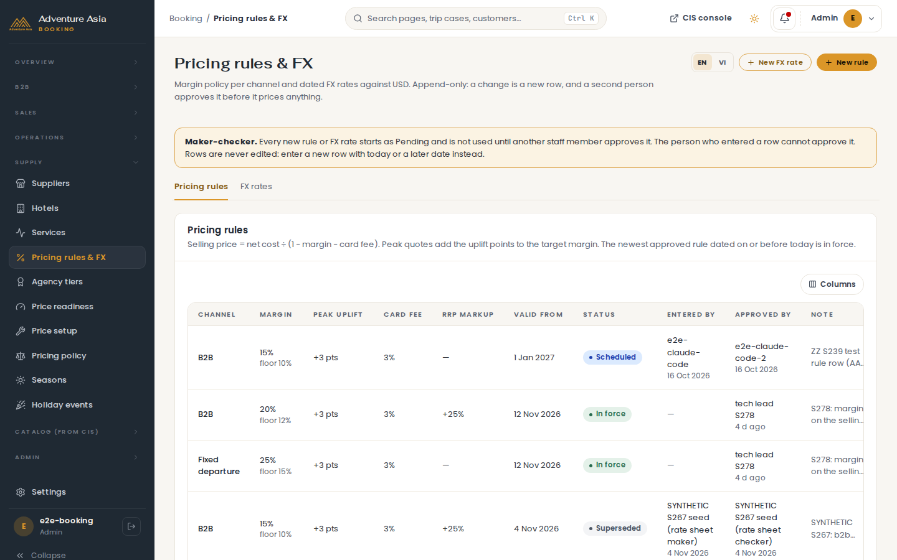

# Frontend audit, Dev, 17/11/2026 (S283, AA-1123)

Read-only audit of the four staff and customer front ends on Dev: CIS admin, Booking admin, the agency app
(CRM web, Content studio, client host, Academy) and TripPlanner (AA site and agency sites). Every finding below was
re-checked once (live where the saved session still worked, otherwise from the captured API bodies and the current
code on `main`). Machine-readable rows: [`rows.json`](rows.json). Vietnamese summary for the tech lead:
[`tom-tat.vi.md`](tom-tat.vi.md).

## Summary

| App | Rows | OK | Issues | Redirected | Not opened | Findings | High | Medium | Low |
|---|---:|---:|---:|---:|---:|---:|---:|---:|---:|
| CIS admin | 59 | 9 | 34 | 1 | 15 | 84 | 0 | 19 | 65 |
| Booking admin | 44 | 5 | 28 | 0 | 11 | 56 | 1 | 12 | 43 |
| Agency app (CRM, studio, client host, Academy) | 107 | 19 | 48 | 5 | 35 | 94 | 0 | 27 | 67 |
| TripPlanner | 15 | 6 | 5 | 1 | 3 | 10 | 0 | 1 | 9 |
| **Total** | **225** | **39** | **115** | **7** | **64** | **244** | **1** | **59** | **184** |

- **No page was broken.** Every opened page rendered with HTTP 200 (the TripPlanner `/trips` 404 is intended),
  0 real console errors except one hydration error on CRM `/settings/access-log`, and 0 failed reads.
- The brief counts 188 pages. The inventory file has 221 route entries; this report has 225 rows because the four
  Writing Lab stages and the AA demo tenant planner are listed as their own rows.
- **Findings by kind:** other 47, data mismatch 41, stale text 38, accessibility 31, i18n 28, kit 17,
  broken layout 14, mobile 11, empty state 8, performance 3, error 3, security 2, dark mode 1. About 15 of the low
  items are audit notes or data checks that passed (kept so the next run knows what was verified).
- **Cross-app patterns** (one fix, many pages):
  1. The kit `DataTable` page-size `<select>` has no accessible name. It shows on about 30 routes in all four apps
     (`_kit/core/DataTable.tsx:791`, identical in every copy).
  2. Raw ids where people expect names: party/tenant UUIDs, Cognito subjects, `admin:<uuid>` actors, member hashes,
     tour UUIDs in notifications, departure UUIDs as headings.
  3. Half-translated Vietnamese: the kit `I18nProvider` is missing in the CRM layout, Booking has VI on five pricing
     pages only with an English shell, and many labels come from the API in English.
  4. Dev seed and test data with issue ids and session codes in names that staff and agencies see.

## Method

- **Hosts:** CIS admin `aa-cis.lumiguides.it.com`, Booking admin `booking.lumiguides.it.com`, agency app
  `portal.lumiguides.it.com` (CRM web and Content studio), client host `go-dev.lumiguides.it.com`, Academy
  `academy.lumiguides.it.com`, TripPlanner `tripplanner.lumiguides.it.com`. Live hosts only; no local build or dev
  server.
- **Sign-ins** (one per app, never two at once on the shared code mailbox):
  CIS = the E2E CIS admin (Cognito WORKFORCE, read-only server side, `403 e2e_read_only` on writes);
  Booking = the E2E Booking admin; CRM = the partner-pool E2E owner of the synthetic agency "Lữ hành Sen Vàng";
  Content studio = the E2E studio user of the synthetic tenant "Atlas & Hearth"; Academy = the E2E CIS admin as a
  test learner; TripPlanner and the client host are public.
- **Viewports:** 1440×900 light, 1440×900 dark, 390×844 light (touch) and 1440 light in Vietnamese, per page; tabs
  and drawers opened by click where that is a read.
- **Write guard:** after sign-in every Playwright context aborted each request whose method was not GET, HEAD or
  OPTIONS and logged it as "write blocked by audit". The blocked requests were Sentry envelopes, the CIS
  `POST /api/auth/refresh`, the studio CTA check and one Booking quote preview. None of them changed what a page
  showed, except where a row says so.
- **Checks per page:** HTTP status, console errors, failed requests, unlabelled controls, horizontal overflow,
  issue ids in visible text, and a cross-check of the numbers on screen against the GET responses the page made.
- **Verification pass:** every high and medium finding (and most low ones) went to a second agent that tried to
  refute it: reproduce live, rule out the write guard, rule out text that is correct today. Rows marked
  `CONFIRMED`, `PARTLY CONFIRMED` or `NOT REPRODUCED` carry that result; refuted parts were removed or noted.
- **Session limits:** the CIS session expired at about 09:05 because parallel chunks rotated the same refresh
  token; the Booking and studio sessions expired before the re-check. Re-checks then relied on the captured API
  bodies and code at CIS `dd6e49e97`, Booking `31b6122`, Partner `2a402000`/`9ec86b8a`, TripPlanner `#274`.
- **Public-repo rule:** no account ids, ARNs, e-mails, tokens or personal names in this folder. Account ids in
  `rows.json` are replaced by `<LLM serving account>` / `<LLM fallback account>`; Cognito subjects and staff UUIDs by
  placeholders. Screenshots here were each viewed before copying; shots with real staff names, e-mails, Cognito
  subjects, internal hostnames or account ids stayed in the gitignored scratch folder.

## Top findings

### High

1. **Booking: a test pricing rule takes over the B2B margin on 1 Jan 2027** (`/pricing/rules`, size S).
   The scheduled row "ZZ S239 test rule row (AA-683 …)" is approved for B2B at 15 % (floor 10 %, no RRP markup) from
   2027-01-01. The pricing engine (`backend/app/pricing/repository.py` `RULE_SQL`) takes the newest approved row on
   or before the day, so on 1 Jan it replaces the rule in force (20 %, floor 12 %, +25 % RRP). The UI cannot
   withdraw it (`can_withdraw=false` for approved rows). The note "prices do not change" has been false since S278.
   

### Medium, CIS admin

| # | Page | Finding | Size | Shot |
|---|---|---|---|---|
| 1 | `/admin/overview` | Funnel "In review" 75 vs Review Queue 73: the funnel query counts tenant review rows (`admin_overview.py` `rev_c` has no `tenant_id` filter). | S | [health](shots/cis-overview-health.png) |
| 2 | `/admin/overview` | Apps health shows CIS, TripPlanner, Booking only; Partner CRM has no card although Cost per app lists it and `/admin/platform/apps` probes it. | M | [health](shots/cis-overview-health.png) |
| 3 | `/admin/overview` | Alerts show only raw event codes; the readable `payload.message` from the API is never rendered. | S | [alerts](shots/cis-overview-alerts.png) |
| 4 | `/admin/master-content` | Versions "Audit" shows "—" for `brand_audit_status = fixed`. | XS | [versions](shots/cis-master-content-versions.png) |
| 5 | `/admin/review` | 3 filter selects and the page-size select have no accessible name. | S | — |
| 6 | `/admin/supply-content/[id]` | Publish stays enabled while the page says "Publish would be refused" (backend 409). | XS | [supply](shots/cis-supply-content-publish.png) |
| 7 | `/admin/tenants/[id]` | "Tours (25)" is the page length, not the 892 total; no pager; "Pipeline (20)" is a query cap. | S | [tours tab](shots/cis-tenant360-tours-tab.png) |
| 8 | `/admin/tenants/[id]` | Social Content note says a merge decision is pending and Trace cannot filter by tenant; both are false today. | XS | [note](shots/cis-tenant360-social-note.png) |
| 9 | `/admin/tenant-qa/quality` | At 390 px the tenant and gate selects overflow the viewport. | XS | [390](shots/cis-tenant-qa-quality-390.png) |
| 10 | `/admin/tenant-qa/quality` | At 1440 the Blocking/Warnings columns sit behind a horizontal scroll (duplicate local sub-nav eats 200 px). | S | [1440](shots/cis-tenant-qa-quality-1440.png) |
| 11 | `/admin/tenant-qa/trace` | Page-local FilterField renders `
`: 5 filters have no accessible name. | S | [trace](shots/cis-tenant-qa-trace.png) |
| 12 | `/admin/lab/writing-memory` | Run and paid buttons stay enabled in a read-only session; only the AI gateway reads the read-only hint. | S | [actions](shots/cis-writing-memory-actions.png) |
| 13 | `/admin/ai-gateway` | "Need a look" counts idle connections (`unknown` after `STALE_OK_HOURS = 6`); the number moves with probe timing (8 of 13, then 4 of 13). | S | [8](shots/cis-ai-gateway-need-a-look.png), [4](shots/cis-ai-gateway-providers.png) |
| 14 | `/admin/spend` | Anthropic API spend ($28.90 MTD) falls under "Other LLM providers" with no budget. | S | — (shows account ids) |
| 15 | `/admin/spend` | The LLM serving account shows as "Retired account" on the AWS bill tab and by number elsewhere. | S | — (shows account ids) |
| 16 | `/admin/spend` | Per-account Cost Explorer snapshot is about 8 days stale; nothing schedules the check. | M | — (shows account ids) |
| 17 | `/admin/seo-intelligence` | Keywords sorted by raw volume: generic terms ("hotel", "homes", "santander") with 0 linked tours on top; market totals include this noise. | M | [keywords](shots/cis-seo-keywords.png) |
| 18 | `/admin/platform/staff/[id]` | Kit Drawer has no accessible name, no focus move, no focus trap, no focus return. | S | [drawer, redacted](shots/cis-staff-drawer-redacted.png) |
| 19 | `/admin/platform/staff/[id]` | Staff rows open the drawer by mouse only (kit DataTable `onRowClick` rows are not focusable). | S | — |

### Medium, Booking admin

| # | Page | Finding | Size | Shot |
|---|---|---|---|---|
| 1 | `/` | "Awaiting activation 9 — staff signed in, waiting for a role": all 9 have a role, 7 never signed in. | XS | [dashboard](shots/booking-dashboard.png) |
| 2 | `/` and `/cases` | B2B cases show the agency as a raw `party_tenant_id` UUID; the API sends no name. | S | [dashboard](shots/booking-dashboard.png) |
| 3 | `/cases/[code]` | "Confirmed & Booked" next to "Suppliers 0/1": the counter mixes version items and bookings. | XS | [TC-000038](shots/booking-tc38-suppliers-counter.png) |
| 4 | `/notifications` | Tour retired/reinstated notifications name the tour only by its CIS UUID. | S | [notifications](shots/booking-notifications.png) |
| 5 | `/audit-log` | `price_list_version` and `tenant` rows have no label, no filter option and no link. | S | — (shows a staff name) |
| 6 | `/catalog/destinations` | Country filter uses the 21-country Booking list; destinations span 24 countries (8 unreachable by filter). | S | [destinations](shots/booking-destinations.png) |
| 7 | `/catalog/trip-plans` + price pages | 48 paused CIS tours show as "No longer in the catalog" with raw UUIDs, and the next step links to a 404. | M | — |
| 8 | `/catalog/trip-plans/[id]` | A test trip plan is still Sellable at the top of the list with "Revert sellable=false when done". | XS | [trip plan](shots/booking-trip-plan-test-row.png) |
| 9 | `/pricing/workbench` | 129 reference amounts under 20 USD are pax counts: Booking's `parse_reference()` takes the first number when CIS says `needs_review`. | M | — |
| 10 | `/pricing/workbench` | VI body inside an English shell (breadcrumb, search, sidebar). | L | [VI](shots/booking-pricing-workbench-vi.png) |
| 11 | `/pricing/seasons` | 0 calendars: the sync step times out on every run (405/405 in 5 days) and the job still reports "succeeded". | S | [seasons](shots/booking-seasons-empty.png) |
| 12 | `/agency-billing/invoices/[ref]` | "Recorded by" shows a raw Cognito subject. | S | — (shows a subject) |

### Medium, agency app (CRM web, Content studio, client host, Academy)

| # | Page | Finding | Size | Shot |
|---|---|---|---|---|
| 1 | `/` | A CRM-only owner lands on "No Content studio access" with no link to the CRM. | S | — (shows the E2E e-mail) |
| 2 | `/home` | "Needs you" is a hard-coded empty state while 107 tasks are overdue and 29 payments late. | M | [home](shots/crm-home.png) |
| 3 | `/home` | "Next group departures" date differs from `/departures` (trip start vs AA line service date). | S | [home](shots/crm-home.png) |
| 4 | `/inbox` | Unmatched threads show date, channel and a bare number; no sender, subject or preview. | M | [inbox](shots/crm-inbox.png) |
| 5 | `/calendar` | Task events show raw slugs ("reply inquiry", "stage3 due t21"), English in VI; labels already exist. | XS | [VI](shots/crm-calendar-vi.png) |
| 6 | `/travelling` | A trip leaving in 3 days shows "Day 1" (API sets `day_no` for future trips). | S | [travelling](shots/crm-travelling.png) |
| 7 | `/payments` (all kit tables) | CRM layout has no kit `I18nProvider`: kit strings stay English in VI. | S | [VI](shots/crm-payments-vi.png) |
| 8 | `/reports` | Team members appear as "Agent · d476": the members API has no name. | M | [reports](shots/crm-reports-members.png) |
| 9 | `/settings` | Subtitle says team, channels, payments, forms, AI and privacy "arrive with the next cards"; all 14 panels exist. | XS | [390](shots/crm-settings-390.png) |
| 10 | `/settings/access-log` | Hydration error #418: server renders UTC, browser renders local time. | S | — |
| 11 | `/settings/access-log` | Every bell poll is logged as "opened the agency · bell". | S | — |
| 12 | `/settings/agreements` | 58 versions rendered as full cards (6,227 px); the New version form is at the bottom. | M | — |
| 13 | `/settings/data` | 134 trash items say "Removed for good on <past date>" but are still there with Restore (deletion is a dry run on Dev). | S | — |
| 14 | `/settings/data` | No paging: 20,396 px tall at 390 px; Exports and Requests are about 15,000 px down. | M | — |
| 15 | `/settings/forms` | Owner picker lists members as `#a78e8cf1` (or an e-mail). | S | — (shows an e-mail) |
| 16 | `/c/f/[publicKey]` | The agency's public inquiry form shows "Adventure Asia Partner" as brand and tab title (white-label leak). | S | [form](shots/crm-client-form.png) |
| 17 | `/trip/[tourId]` | Itinerary day titles run into the day text (single newline collapsed). | S | [itinerary](shots/crm-trip-itinerary.png) |
| 18 | `/portal/dashboard` | Amount due $409.50 next to a $349 plan fee with "Within plan"; the quote lines and combo discount are not shown. | S | [dashboard](shots/studio-dashboard.png) |
| 19 | `/portal/dashboard`, `/portal/account/billing` | Two rewrite counters: billing says 2 used, quota says 0; overage is charged on the view count. | S–M | [dashboard](shots/studio-dashboard.png), [billing](shots/studio-billing.png) |
| 20 | `/portal/content` | A newer draft of an already published request is offered on Publish: one click makes a second WordPress post. | S | [my content](shots/studio-my-content.png), [publish](shots/studio-publish.png) |
| 21 | `/portal/content/publish`, `/portal/account/integrations` | Facebook and WordPress connect inputs are named only by placeholder. | S | [publish](shots/studio-publish.png) |
| 22 | `/portal/account/activity` | Action labels stay English in VI (API sends English labels). | S | [VI](shots/studio-activity-vi.png) |
| 23 | `/portal/account/add-ons` | The staff approval note "S269 live check (AA-1036)…" is shown to the agency. | S | [add-ons](shots/studio-add-ons.png) |
| 24 | `/portal/account/billing` | "Plan fee, no overage" under $409.50 that includes add-ons and a discount. | S | [billing](shots/studio-billing.png) |
| 25 | `/academy/modules/[id]` | Planned prerequisites link to a page that only says "does not exist" (soft 200). | XS | [F3](shots/academy-module-f3.png) |

### Medium, TripPlanner

| # | Page | Finding | Size | Shot |
|---|---|---|---|---|
| 1 | `/[tenant]/plan` | The agency planner's route finder proposes AA tours the agency does not sell, with AA tour names, under the agency brand (known deferral in ADR 0019 S278, conflicts with its "never AA text under an agency's brand"). | M | [route finder](shots/tp-tenant-route-finder.png) |

## Thresholds: keep the admin settings pages in sync

The user asked that every threshold change is also made on the admin page where that threshold is set. Policy
(tech lead, S278/S279): every threshold, limit or cap is editable by an administrator, never hard-coded or env-only.
These proposals touch a threshold; each PR must add or change the setting on the admin settings page in the same PR
and read it from there on both sides (tile and badge, job and page):

| Proposal | Threshold | Today | Where it must be editable |
|---|---|---|---|
| AI gateway "Need a look" uses the badge's rule | idle window for "No recent calls" | `STALE_OK_HOURS = 6`, hard-coded in `api/services/llm_availability.py:148` | CIS settings registry (`api/services/settings_registry.py`) → admin Settings, AI gateway group; the tile and the row badge read the same value |
| Daily Cost Explorer check + stale badge | fetch window (about 3 days), stale after (proposed 2 days) | no schedule, no badge | CIS admin Settings, Spend group, next to the existing DFS balance check settings |
| Jobs tiles window label | job summary window | 30 days, implicit | same setting drives the tiles, the label and the tile-click filter |
| Booking reference-price guard | "too small to be a price" floor (proposed 5 per unit) and pax-count match | none | Booking `/pricing/policy` (maker-checker like the other pricing values) |
| Booking season calendar sync | batch size (50) and the read timeout for the step | `LIMIT 50`, pool `command_timeout` 5 s | Booking policy or job settings page, shown with the job result |
| Booking rules warning | warn when a scheduled row lowers margin, floor or RRP markup | none | rule, not a number; show on `/pricing/rules` next to the maker-checker banner |
| CRM trash wording | trash retention days and the dry-run switch | `trash_days = 7`, `deletion_dry_run` | already CRM settings; the row text must read the same values |
| CIS places validity cache | how long a computed report is reused | none (cold load 22 s) | CIS admin Settings, catalogue group |
| SEO keyword relevance | generic-term exclusion list, "linked only" default | none | CIS Catalogue settings |

## Proposals (PR-sized batches, ranked by severity, then value)

Issue column: an existing Linear issue where one fits (check its state first); otherwise "new issue needed" (ask the
tech lead before creating it, per the Linear rule).

| Rank | Batch | App / repo | Contents | Size | Issue |
|---:|---|---|---|---|---|
| 1 | **B0 Close the test pricing rule before 1 Jan 2027** | Booking (+ Infra DB Migrate run-script) | Close or neutralise the scheduled "ZZ S239" B2B row (closure for approved-but-not-started rows, or a one-off run-script); add `approved_at DESC` tie-break to `RULE_SQL` and `FX_SQL`; warn on `/pricing/rules` when a scheduled row lowers margin/floor/RRP. Data change needs the tech lead's approval. | S | new issue needed (P1, due before 01/01/2027) |
| 2 | **B1 Season calendars actually assigned** | Booking | Rewrite `UNASSIGNED_SQL` to pick the batch from `booking.trip_plans` first, then look up tours one by one; mark the job degraded when a step is skipped; surface it on the job view; CI guard. Thresholds per the table above. | S | new issue needed |
| 3 | **S1 Studio money and counters** | CIS (`v1_tours`, mig 439 view, `v1_publish`) + Partner web | One ledger for rewrites (quota vs billing view); refuse publishing a second piece of an already-live request (`_PENDING_SQL` + 409); dashboard and billing show quote lines and discount; "Live: earlier version" label. | M | related AA-1116 (usage view), new issue needed |
| 4 | **C1 CIS numbers that disagree** | CIS | `rev_c` tenant filter; `fixed` audit badge; Tenant 360 Tours total + server pager, "Latest 20" pipeline; Supply publish disabled on blockers; AI gateway tile rule + setting; SEO default sort, linked-only filter, demand totals limited to `_MARKETS`; reference-prices "Suggested" filter; photos coverage base. | M | new issue needed |
| 5 | **C2 Spend truth** | CIS | `anthropic` provider family + label + budget; `account_key()` resolves satellites; daily Cost Explorer check (about $0.02/run) + stale badge, with settings. | M | related AA-1095 (acc1 serving), new issue needed |
| 6 | **K1 Kit accessibility** | CIS canonical `_kit/core` → `tools/kit/kit-sync.sh` (all apps) | DataTable page-size `aria-label`; keyboard-openable rows when `onRowClick`; Drawer name, initial focus, trap, return; PageHeader text basis; PageFrame `main` `position: relative`; sidebar footer pinned; dark-mode danger badge tone; Select needs a name; axe/role-name check in UI smoke. | M | new issue needed (relates AA-994 kit lint) |
| 7 | **P1 CRM home and routing** | Partner web + api | `/` sends CRM-only owners to `/home` (or a CRM link on `/portal-access/none`); "Needs you" from agenda + tasks; agenda departure date from AA line + tour title; current subtitle. | M | new issue needed |
| 8 | **P2 People and labels in the CRM** | Partner api + web | Members API display name, `memberLabel()` never a bare hash (reports, forms, trip panel, calendar); inbox sender/subject/preview; calendar task labels via `taskTitle()`; access-log labels, no self bell audit, hydration-safe times. | M | new issue needed |
| 9 | **B2 Booking catalog and prices** | Booking | One catalog state (served/paused/retired) for trip plans, readiness and workbench; no `add_components` step for paused tours; `parse_reference()` keeps `needs_review` raw, guard on tiny amounts (setting); destinations filter from geo countries; tariff and calculator currencies from FX in force, inline 422 notice; past departures marked. | M | new issue needed |
| 10 | **B3 Booking names, not ids** | Booking | Agency name on trip cases; tour title in lifecycle notifications; staff names on agency payments; audit-log labels for `price_list_version`/`tenant`; supplier counter fix; trip-case countries from B2B confirm + backfill. | S | new issue needed |
| 11 | **P3 CRM translation and formats** | Partner web | Kit `I18nProvider` in the CRM layout; plurals (trips, lines, clients, adults, days); VI number formats; structured refund reason; one spelling for "huỷ/Xoá"; studio activity labels; studio brand name and per-page titles. | S | related AA-1036 (studio i18n lane), new issue needed |
| 12 | **P4 CRM settings pages** | Partner web | Settings subtitle; trash "would have been removed" wording; paging/collapse for trash, exports, requests and agreement versions; hold reason label; search box hidden under 600 px (CSS override bug). | M | new issue needed |
| 13 | **P5 Client host** | Partner web | Agency brand and title on `/c/f`; real 404 for unknown forms; no dead Home link; privacy fallback; EN/VI switch; exact dates or remove them from the definition; itinerary day headings on `/trip`. | S | new issue needed |
| 14 | **T1 TripPlanner agency planner** | TripPlanner | Route finder and "Heading to" limited to the agency's tours (or hidden) until the per-tenant graph; legal links on tenant pages; tinted thumbnails; "Heading to" from countries with tours; "Full route · days 1–7 of 8" label; attribution above the toggle; CTA near the top of the agency tour page; 7 country cover photos. | M | AA-1115 (tenant site legal/branding follow-up), ADR 0019 S278 per-tenant graph (AA-1094) |
| 15 | **C3 CIS read-only hint and copy** | CIS | Read-only hint in the kit identity hook; hide run/paid buttons on Writing memory, Usage, Spend; overview CRM health card; readable alerts; Tenant 360 notes and labels; slate help path; VI titles; jobs/decisions number formats; tab deep links on SEO. | M | new issue needed |
| 16 | **C4 Tenant QA layout** | CIS | Quality table columns at 1440 and filters at 390; Trace filters via kit FilterField/DateField and filters moved into the content column; single search box on server-paged tables. | S | new issue needed |
| 17 | **B4 Booking copy** | Booking | Activation tile hint, "Pre-sale" tab, B2B wording on versions and preview, settings sign-in text, "(UI spec Q18)", readiness plural, MoM comparison on the dashboard, manifest breadcrumb and ref. | S | new issue needed |
| 18 | **B5 Booking Vietnamese** | Booking | Translate the shell first so VI pages stop mixing languages, then move the switch to the shell and add catalogues page by page. | L | related AA-1091 (opt-in roll-out) |
| 19 | **A1 Academy small fixes** | Partner web | Planned prerequisites as plain text + real 404; quiz page context; lesson source headings; singular plural. | S | new issue needed |
| 20 | **D1 Dev data hygiene** (writes, tech lead approval) | CIS, Booking, Partner data | Rename/retire test tenants, agencies, suppliers and staff with issue ids; un-sell the test trip plan; replace test FX rows; reword seed notes (no person names); clear the add-on decision note; retire old agreement versions; enter 2026–2027 holidays; seed-data lint against `AA-\d+` / `S\d{3}`. | S | new issue needed |
| 21 | **H1 Audit harness** | root `.tmp-session` scripts / skill `aa-ui-verify` | Run CIS chunks one after another and save `storageState` after each context; map studio chunks to the studio user and Academy to its session; drop `/trips` and the auth reads from the inventory; re-run the 64 not-opened rows. | XS | AA-1123 |

## Pages not opened

- **CIS session expired before the route was reached (re-run needed)** (13): CIS admin `/admin/settings`, CIS admin `/admin/platform`, CIS admin `/admin/platform/staff`, CIS admin `/admin/platform/apps`, CIS admin `/admin/platform/alerts`, CIS admin `/admin/platform/audit`, CIS admin `/admin/platform/catalogue`, CIS admin `/admin/platform/delivery`, CIS admin `/admin/platform/infra`, CIS admin `/admin/platform/settings`, CIS admin `/admin/platform/ui-kit`, CIS admin `/admin/docs`, CIS admin `/admin/api-docs`
- **Excluded by scope (login, legal and health pages)** (11): CIS admin `/login`, Booking admin `/login`, Agency app `/legal/terms`, Agency app `/legal/data`, Agency app `/legal/partner-terms`, Agency app `/legal/privacy`, Agency app `/legal/subprocessors`, Agency app `/health`, TripPlanner `/sign-in`, TripPlanner `/privacy`, TripPlanner `/terms`
- **Gated route (exists only in a KIT_GALLERY=1 build; 404 when deployed)** (3): CIS admin `/kit-gallery`, Booking admin `/kit-gallery`, Agency app `/kit-gallery`
- **Booking: no result returned, session expired by the re-check (re-run needed)** (9): Booking admin `/departures`, Booking admin `/agency-billing`, Booking admin `/billing`, Booking admin `/finance`, Booking admin `/suppliers`, Booking admin `/suppliers/new`, Booking admin `/suppliers/rate-sheets/[id]`, Booking admin `/services`, Booking admin `/hotels`
- **CRM settings: chunk did not reach the route (re-run needed)** (9): Agency app `/settings/team`, Agency app `/settings/import`, Agency app `/settings/mailbox`, Agency app `/settings/payments`, Agency app `/settings/pricing`, Agency app `/settings/saved-replies`, Agency app `/settings/tags`, Agency app `/settings/templates`, Agency app `/settings/travel`
- **Needs a token, invitation or sign-in step that only a write creates (or unreachable placeholder)** (13): Agency app `/[section]`, Agency app `/select-agency`, Agency app `/portal-access/none`, Agency app `/portal-access/select`, Agency app `/join/accept`, Agency app `/join/invite`, Agency app `/c/[...slug]`, Agency app `/c/a`, Agency app `/c/p`, Agency app `/c/r/[token]`, Agency app `/c/s/[token]`, Agency app `/c/t`, Agency app `/c/u/[token]`
- **AA staff console: no E2E user in crm-ops or crm-support** (6): Agency app `/staff`, Agency app `/staff/ops`, Agency app `/staff/ops/[tenantId]/[tripId]`, Agency app `/staff/support`, Agency app `/staff/support/[tenantId]`, Agency app `/staff/support/[tenantId]/trips/[tripId]`

The notes per route are in `rows.json` (`note`).

## All pages

| App | Route | Status | Findings | Worst |
|---|---|---|---:|---|
| CIS admin | `/` | redirected | 0 | — |
| CIS admin | `/admin/overview` | issues | 4 | medium |
| CIS admin | `/admin/upload` | issues | 1 | low |
| CIS admin | `/admin/master-content` | issues | 2 | medium |
| CIS admin | `/admin/review` | issues | 1 | medium |
| CIS admin | `/admin/s1-rewrite` | issues | 2 | low |
| CIS admin | `/admin/atom-curation` | issues | 3 | low |
| CIS admin | `/admin/aa-content` | issues | 1 | low |
| CIS admin | `/admin/facts` | issues | 1 | low |
| CIS admin | `/admin/places` | issues | 2 | low |
| CIS admin | `/admin/places/cards` | issues | 1 | low |
| CIS admin | `/admin/photos` | issues | 1 | low |
| CIS admin | `/admin/reference-prices` | issues | 1 | low |
| CIS admin | `/admin/supply-content` | issues | 1 | low |
| CIS admin | `/admin/supply-content/[id]` | issues | 1 | medium |
| CIS admin | `/admin/tenants` | issues | 3 | low |
| CIS admin | `/admin/tenants/[id]` | issues | 5 | medium |
| CIS admin | `/admin/tenants/agencies` | ok | 0 | — |
| CIS admin | `/admin/tenants/assignments` | issues | 1 | low |
| CIS admin | `/admin/tenants/plans` | issues | 2 | low |
| CIS admin | `/admin/tenants/view-as` | issues | 2 | low |
| CIS admin | `/admin/tenants/data-erasure` | issues | 1 | low |
| CIS admin | `/admin/tenant-qa` | ok | 0 | — |
| CIS admin | `/admin/tenant-qa/quality` | issues | 4 | medium |
| CIS admin | `/admin/tenant-qa/compliance` | issues | 1 | low |
| CIS admin | `/admin/tenant-qa/review-log` | ok | 0 | — |
| CIS admin | `/admin/tenant-qa/slate` | issues | 2 | low |
| CIS admin | `/admin/tenant-qa/trace` | issues | 2 | medium |
| CIS admin | `/admin/lab/writing-memory` | issues | 4 | medium |
| CIS admin | `/admin/ai-gateway` | issues | 5 | medium |
| CIS admin | `/admin/spend` | issues | 5 | medium |
| CIS admin | `/admin/seo-intelligence` | issues | 4 | medium |
| CIS admin | `/admin/jobs` | issues | 5 | low |
| CIS admin | `/admin/decisions` | issues | 4 | low |
| CIS admin | `/admin/data-coverage` | issues | 3 | low |
| CIS admin | `/admin/reports` | issues | 2 | low |
| CIS admin | `/admin/usage` | issues | 1 | low |
| CIS admin | `/admin/data-model` | ok | 0 | — |
| CIS admin | `/admin/lab` | ok | 0 | — |
| CIS admin | `/admin/lab/a1-s1` | ok | 0 | — |
| CIS admin | `/admin/lab/t2-rewrite` | ok | 0 | — |
| CIS admin | `/admin/lab/t9-blog` | ok | 0 | — |
| CIS admin | `/admin/lab/t9-social` | ok | 0 | — |
| CIS admin | `/admin/settings` | not opened | 0 | — |
| CIS admin | `/admin/platform` | not opened | 0 | — |
| CIS admin | `/admin/platform/staff` | not opened | 0 | — |
| CIS admin | `/admin/platform/apps` | not opened | 0 | — |
| CIS admin | `/admin/platform/alerts` | not opened | 0 | — |
| CIS admin | `/admin/platform/audit` | not opened | 0 | — |
| CIS admin | `/admin/platform/catalogue` | not opened | 0 | — |
| CIS admin | `/admin/platform/delivery` | not opened | 0 | — |
| CIS admin | `/admin/platform/infra` | not opened | 0 | — |
| CIS admin | `/admin/platform/settings` | not opened | 0 | — |
| CIS admin | `/admin/platform/ui-kit` | not opened | 0 | — |
| CIS admin | `/admin/docs` | not opened | 0 | — |
| CIS admin | `/admin/api-docs` | not opened | 0 | — |
| CIS admin | `/admin/platform/staff/[id]` | issues | 6 | medium |
| CIS admin | `/login` | not opened | 0 | — |
| CIS admin | `/kit-gallery` | not opened | 0 | — |
| Booking admin | `/` | issues | 5 | medium |
| Booking admin | `/cases` | issues | 1 | low |
| Booking admin | `/cases/[code]` | issues | 2 | medium |
| Booking admin | `/cases/[code]/proposals/[n]` | issues | 1 | low |
| Booking admin | `/cases/[code]/proposals/[n]/preview` | issues | 2 | low |
| Booking admin | `/proposals` | issues | 1 | low |
| Booking admin | `/trip-checks` | issues | 1 | low |
| Booking admin | `/notifications` | issues | 1 | medium |
| Booking admin | `/audit-log` | issues | 3 | medium |
| Booking admin | `/staff` | issues | 1 | low |
| Booking admin | `/staff/[cisUserId]` | ok | 0 | — |
| Booking admin | `/settings` | issues | 1 | low |
| Booking admin | `/catalog/countries` | ok | 0 | — |
| Booking admin | `/catalog/countries/[iso]` | issues | 1 | low |
| Booking admin | `/catalog/destinations` | issues | 2 | medium |
| Booking admin | `/catalog/trip-plans` | issues | 1 | medium |
| Booking admin | `/catalog/trip-plans/[sourceId]` | issues | 2 | medium |
| Booking admin | `/catalog/trip-plans/[sourceId]/commercial` | ok | 0 | — |
| Booking admin | `/pricing/workbench` | issues | 2 | medium |
| Booking admin | `/pricing/readiness` | issues | 1 | low |
| Booking admin | `/pricing/rules` | issues | 2 | high |
| Booking admin | `/pricing/seasons` | issues | 1 | medium |
| Booking admin | `/pricing/holiday-events` | issues | 1 | low |
| Booking admin | `/pricing/policy` | ok | 0 | — |
| Booking admin | `/pricing/calculator` | ok | 1 | low |
| Booking admin | `/pricing/agency-tiers` | issues | 1 | low |
| Booking admin | `/pricing/agency-tiers/tariff` | issues | 1 | low |
| Booking admin | `/b2b-desk` | issues | 3 | low |
| Booking admin | `/b2b-desk/manifest/[id]` | issues | 4 | low |
| Booking admin | `/departures` | not opened | 0 | — |
| Booking admin | `/agency-billing` | not opened | 0 | — |
| Booking admin | `/agency-billing/invoices/[ref]` | issues | 4 | medium |
| Booking admin | `/billing` | not opened | 0 | — |
| Booking admin | `/finance` | not opened | 0 | — |
| Booking admin | `/suppliers` | not opened | 0 | — |
| Booking admin | `/suppliers/[id]` | issues | 5 | low |
| Booking admin | `/suppliers/[id]/edit` | issues | 2 | low |
| Booking admin | `/suppliers/new` | not opened | 0 | — |
| Booking admin | `/suppliers/rate-sheets/[id]` | not opened | 0 | — |
| Booking admin | `/services` | not opened | 0 | — |
| Booking admin | `/services/[id]` | issues | 3 | low |
| Booking admin | `/hotels` | not opened | 0 | — |
| Booking admin | `/login` | not opened | 0 | — |
| Booking admin | `/kit-gallery` | not opened | 0 | — |
| Agency app | `/` | redirected | 1 | medium |
| Agency app | `/home` | issues | 5 | medium |
| Agency app | `/pipeline` | issues | 1 | low |
| Agency app | `/pipeline/[tripId]` | issues | 3 | low |
| Agency app | `/pipeline/[tripId]/proposal/[proposalId]` | issues | 1 | low |
| Agency app | `/pipeline/[tripId]/proposal/[proposalId]/text` | issues | 1 | low |
| Agency app | `/inbox` | issues | 1 | medium |
| Agency app | `/tasks` | ok | 0 | — |
| Agency app | `/calendar` | issues | 1 | medium |
| Agency app | `/travelling` | issues | 2 | medium |
| Agency app | `/departures` | issues | 1 | low |
| Agency app | `/departures/[ref]` | issues | 2 | low |
| Agency app | `/onboarding` | ok | 0 | — |
| Agency app | `/help` | ok | 0 | — |
| Agency app | `/clients` | issues | 2 | low |
| Agency app | `/clients/[travelerId]` | issues | 2 | low |
| Agency app | `/clients/duplicates` | ok | 0 | — |
| Agency app | `/bookings` | issues | 1 | low |
| Agency app | `/aa-bookings` | ok | 0 | — |
| Agency app | `/aa-tariff` | issues | 1 | low |
| Agency app | `/payments` | issues | 3 | medium |
| Agency app | `/commissions` | ok | 0 | — |
| Agency app | `/partners` | issues | 1 | low |
| Agency app | `/suppliers` | issues | 1 | low |
| Agency app | `/services` | ok | 0 | — |
| Agency app | `/marketing` | issues | 1 | low |
| Agency app | `/reports` | issues | 2 | medium |
| Agency app | `/automations` | issues | 1 | low |
| Agency app | `/library` | ok | 0 | — |
| Agency app | `/settings` | issues | 2 | medium |
| Agency app | `/settings/team` | not opened | 0 | — |
| Agency app | `/settings/access-log` | issues | 3 | medium |
| Agency app | `/settings/add-ons` | ok | 1 | low |
| Agency app | `/settings/agreements` | issues | 2 | medium |
| Agency app | `/settings/ai` | issues | 1 | low |
| Agency app | `/settings/cancellation` | ok | 1 | low |
| Agency app | `/settings/channels` | ok | 1 | low |
| Agency app | `/settings/connections` | ok | 1 | low |
| Agency app | `/settings/data` | issues | 4 | medium |
| Agency app | `/settings/forms` | issues | 2 | medium |
| Agency app | `/settings/import` | not opened | 0 | — |
| Agency app | `/settings/inclusions` | redirected | 0 | — |
| Agency app | `/settings/mailbox` | not opened | 0 | — |
| Agency app | `/settings/payments` | not opened | 0 | — |
| Agency app | `/settings/pricing` | not opened | 0 | — |
| Agency app | `/settings/saved-replies` | not opened | 0 | — |
| Agency app | `/settings/tags` | not opened | 0 | — |
| Agency app | `/settings/templates` | not opened | 0 | — |
| Agency app | `/settings/travel` | not opened | 0 | — |
| Agency app | `/signed-out` | issues | 1 | low |
| Agency app | `/staff/signed-out` | issues | 1 | low |
| Agency app | `/c/f/[publicKey]` | issues | 8 | medium |
| Agency app | `/trip/[tourId]` | issues | 1 | medium |
| Agency app | `/portal` | redirected | 1 | low |
| Agency app | `/portal/dashboard` | issues | 4 | medium |
| Agency app | `/portal/tours` | issues | 2 | low |
| Agency app | `/portal/tours/mine` | issues | 2 | low |
| Agency app | `/portal/content` | issues | 2 | medium |
| Agency app | `/portal/content/publish` | issues | 1 | medium |
| Agency app | `/portal/create` | redirected | 0 | — |
| Agency app | `/portal/create/article` | issues | 1 | low |
| Agency app | `/portal/create/social` | ok | 0 | — |
| Agency app | `/portal/create/write` | issues | 1 | low |
| Agency app | `/portal/brand` | issues | 1 | low |
| Agency app | `/portal/facts` | issues | 2 | low |
| Agency app | `/portal/help/facebook` | ok | 0 | — |
| Agency app | `/portal/account` | redirected | 1 | low |
| Agency app | `/portal/account/activity` | issues | 2 | medium |
| Agency app | `/portal/account/add-ons` | issues | 1 | medium |
| Agency app | `/portal/account/billing` | issues | 2 | medium |
| Agency app | `/portal/account/integrations` | issues | 1 | medium |
| Agency app | `/portal/account/members` | issues | 1 | low |
| Agency app | `/portal/account/settings` | ok | 0 | — |
| Agency app | `/academy` | issues | 2 | low |
| Agency app | `/academy/certificates` | ok | 0 | — |
| Agency app | `/academy/modules/[moduleId]` | issues | 1 | medium |
| Agency app | `/academy/lessons/[lessonId]` | issues | 1 | low |
| Agency app | `/academy/quiz/[scope]/[targetId]` | issues | 1 | low |
| Agency app | `/academy/review` | ok | 0 | — |
| Agency app | `/academy/signed-out` | ok | 0 | — |
| Agency app | `/verify/[code]` | ok | 1 | low |
| Agency app | `/legal/terms` | not opened | 0 | — |
| Agency app | `/legal/data` | not opened | 0 | — |
| Agency app | `/legal/partner-terms` | not opened | 0 | — |
| Agency app | `/legal/privacy` | not opened | 0 | — |
| Agency app | `/legal/subprocessors` | not opened | 0 | — |
| Agency app | `/health` | not opened | 0 | — |
| Agency app | `/kit-gallery` | not opened | 0 | — |
| Agency app | `/[section]` | not opened | 0 | — |
| Agency app | `/select-agency` | not opened | 0 | — |
| Agency app | `/portal-access/none` | not opened | 0 | — |
| Agency app | `/portal-access/select` | not opened | 0 | — |
| Agency app | `/join/accept` | not opened | 0 | — |
| Agency app | `/join/invite` | not opened | 0 | — |
| Agency app | `/c/[...slug]` | not opened | 0 | — |
| Agency app | `/c/a` | not opened | 0 | — |
| Agency app | `/c/p` | not opened | 0 | — |
| Agency app | `/c/r/[token]` | not opened | 0 | — |
| Agency app | `/c/s/[token]` | not opened | 0 | — |
| Agency app | `/c/t` | not opened | 0 | — |
| Agency app | `/c/u/[token]` | not opened | 0 | — |
| Agency app | `/staff` | not opened | 0 | — |
| Agency app | `/staff/ops` | not opened | 0 | — |
| Agency app | `/staff/ops/[tenantId]/[tripId]` | not opened | 0 | — |
| Agency app | `/staff/support` | not opened | 0 | — |
| Agency app | `/staff/support/[tenantId]` | not opened | 0 | — |
| Agency app | `/staff/support/[tenantId]/trips/[tripId]` | not opened | 0 | — |
| TripPlanner | `/` | issues | 1 | low |
| TripPlanner | `/destinations` | ok | 0 | — |
| TripPlanner | `/destinations/[country]` | issues | 1 | low |
| TripPlanner | `/tours/[slug]` | ok | 0 | — |
| TripPlanner | `/plan` | issues | 3 | low |
| TripPlanner | `/plan/shared` | ok | 0 | — |
| TripPlanner | `/trips` | ok | 1 | low |
| TripPlanner | `/[tenant]` | redirected | 0 | — |
| TripPlanner | `/[tenant]/plan` | issues | 3 | medium |
| TripPlanner | `/[tenant]/plan (AA demo tenant)` | ok | 0 | — |
| TripPlanner | `/[tenant]/plan/shared` | ok | 0 | — |
| TripPlanner | `/[tenant]/tours/[tour]` | issues | 1 | low |
| TripPlanner | `/sign-in` | not opened | 0 | — |
| TripPlanner | `/privacy` | not opened | 0 | — |
| TripPlanner | `/terms` | not opened | 0 | — |
