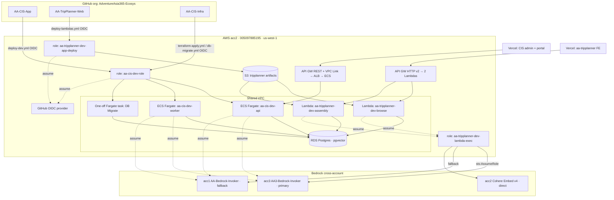

# AA-Ecosys — Ecosystem architecture

> **Status:** updated 11/10/2026 (S225, AA-654 — translated to English and refreshed; previous
> revision 25/09/2026). Items marked **[FACT]** were verified by reading code, migrations or live
> state; **[TO CONFIRM]** marks an inference or gap that Nghiệp still has to confirm.
> Target direction and decisions: [ADR 0001](adr/0001-ecosystem-target-architecture.md),
> [ADR 0002](adr/0002-only-cis-writes-content.md), [ADR 0003](adr/0003-one-durable-job-model.md),
> [ADR 0004](adr/0004-aa-booking-stack-and-bootstrap.md) (AA-Booking stack and bootstrap, Proposed).

## 1. Overview

AA-Ecosys is a **multi-repo**: each app deploys on its own; locally they are gathered under one folder
`~/projects/AA-Ecosys/`, and all repos live in the GitHub org `AdventureAsia365-Ecosys` (renamed from
`AdventureAsia365-CIS`).

| Local folder | GitHub repo | Role | Deploy |
|---|---|---|---|
| `apps/AA-CIS-App` | `AA-CIS-App` | Content system of record: FastAPI backend (CIS core, A-series, T-series), durable job worker, admin frontend + tenant portal | ECS Fargate (`aa-cis-dev-api` + `aa-cis-dev-worker`, one image) + Vercel (frontend) |
| `apps/AA-TripPlanner-Web` | `AA-TripPlanner-Web` | B2C web app: browse destinations and plan a trip (Next.js FE + 2 Lambda BE) | Vercel (FE) + Lambda (BE) |
| `infra/AA-CIS-Infra` | `AA-CIS-Infra` | Terraform — VPC, RDS, ECS, Lambda, API GW, OIDC, alarms, cross-account Bedrock; DB Migrate workflow | GitHub Actions (`accounts/aa365` root) + a human with MFA (acc1/acc3 roots) |
| — (coming) | `AA-Booking` | AAA: advisor workflow and booking lifecycle | acc2, inside the same VPC (ADR 0001) |

**Boundary rule [FACT]:** *apps own code, Infra owns resources.* The clearest example is TripPlanner:
`infra/AA-CIS-Infra/accounts/aa365/tripplanner.tf` creates the 2 Lambdas from a 209-byte placeholder zip;
the `AA-TripPlanner-Web` repo builds the real code and ships it with `lambda:UpdateFunctionCode`
(Terraform `ignore_changes` covers the code attributes, so it never overwrites them). Source:
`infra/AA-CIS-Infra/docs/implementation-notes/AA-TripPlanner-backend.md`.

**AWS accounts [FACT]:** acc2 `005097885195` (us-west-1) holds all infrastructure. acc3 `786888028788`
(primary) and acc1 `867490540162` (fallback) only host Bedrock invoker roles and Cost Explorer readers.

## 2. System diagram

## 3. Database schema roles (shared RDS, acc2)

CIS, TripPlanner and (later) AA-Booking use **one RDS Postgres** in the acc2 VPC, with **fully separate
schemas**. Each schema has exactly one owner repo, and only that repo writes migrations for it — see
[`database/schema-ownership.md`](database/schema-ownership.md) (owners, `shared.*` table owners, version
keys `NNN` / `tp-NNN` / `bk-NNN`). Migrations reach Dev through the **DB Migrate** workflow of
AA-CIS-Infra (an identical copy in `db/migrations/<owner>/`, check → apply), never from a laptop.
Column-level truth: [`architecture/db-schema-reference.md`](architecture/db-schema-reference.md).

### 3.1 CIS — medallion + multi-tenant RLS [FACT]

Source: `apps/AA-CIS-App/api/migrations/*` (the old `infra/AA-CIS-Infra/modules/rds/migrations/` copy
was deleted in S225).

| Schema | Role | Scope |
|---|---|---|
| `shared` | Platform tables: tenants, brand rules, SEO config, API usage, jobs (`shared.job`), LLM gateway + cost logs, destinations, photos | Platform-wide |
| `silver_aa_internal` / `gold_aa_internal` | Medallion for the internal tenant `aa_internal` (Master Content) | Platform (sentinel tenant) |
| `silver_{id}` / `gold_{id}` | Medallion created dynamically for each new tenant | Per tenant |
| `acp_contract` | Atom / Segment / Ranking / Route / Hub / Search Demand | Mixed (see 3.2) |
| `acp_shared` | Subject (Slate) / Piece / Gate / Facts / tenant_config / marketplace / publish log | Mixed |
| `acp_deliver` | Pages delivered to tenants (`tenant_tour_pages`) | Per tenant |

Tenants are isolated with **RLS** (`SET LOCAL app.tenant_id` per transaction) and, where keys could
collide, by **folding `tenant_id` into the row identity** (e.g. `segment_id = sha256(tenant_id, place, action)`).

### 3.2 CIS — Master Content (platform-wide) vs Tenant Content [FACT]

Source: `apps/AA-CIS-App/CONTEXT.md` (ownership table, AA-540).

- **Master Content (admin, A-series):** computed **once, shared** by every tenant. A0 Upload → A3
  Master Content Pool (`gold_aa_internal.published_tours`) + **Atoms** (`owner_scope='platform'`). Atom
  reads go through `acp_contract.v_active_tour_atoms`, which follows the Master status (AA-713).
- **Platform-wide derived data:** **Segment / Score / Route / Hub** — platform-wide since AA-545
  (migration 146, 06/09/2026), no `tenant_id` column. Score = rank-sum over 4 dimensions (Demand /
  Recurrence / Questions / Said, AA-610), one pass per buyer market.
- **Tenant Content (T-series):** from **Slate** onward — Slate / Subject / Goal / Angle / Piece /
  Publish — **per tenant**. Slate has a **Debate** layer (AA-631: contested + brand-fit, advisory, never
  cuts more than 50%).

**Shared across tenants [FACT]:**

1. **Master Content pool + Atom pool** — a shared source every tenant reads directly (not a cache).
2. **Segment / Score / Route / Hub** — platform-wide rows.
3. **Search Demand + research log** — a real cache keyed `(keyword, market)` / `(place, market)`, **no
   `tenant_id` column**; stores `serp_domains` since AA-631.
4. **Facts Entry `scope='platform'`** — deliberate sharing, enforced by RLS.

Plus one **cross-tenant read (not a cache):** Gate F10 (cannibalization) compares a Piece's embedding
with every other tenant's.

### 3.3 TripPlanner — separate schema [FACT]

Source: `apps/AA-TripPlanner-Web/migrations/*`.

- Schema `tripplanner` is **fully independent** of CIS and uses `pgvector`. Its migrations register
  `tp-NNN` in `shared.schema_versions` (from tp-007).
- `shared.destinations` is **owned by CIS** (ADR 0002, CIS migration 201). The DB role `tripplanner` only
  has `SELECT` on it; TripPlanner also reads `gold_aa_internal.published_tours`,
  `acp_contract.v_active_tour_atoms` (CIS migration 216) and the photo views.
- **Photos (AA-708, 01/10/2026):** CIS owns `shared.place_photo` (CIS migration 198, FK to
  `shared.destinations`) and the `photo_sync` job. See 4.5.

### 3.4 AA-Booking — schema `booking` (coming) [FACT]

Decided 28/09/2026 (ADR 0001 decisions 6–7): AA-Booking runs on acc2 and shares the RDS with its own
schema `booking` (version key `bk-NNN`). AA-CIS-Infra provisions it inside acc2 (ECS service, ECR, DB
role, API route); there are no new accounts. It never writes another app's schema. Contracts are
versioned JSON in `docs/contracts/`, carried by a **transactional outbox table** consumed by the
receiving app's job runner with an idempotency key: `catalog.tour.*` (CIS → AA-Booking, photos via
`shared.v_tour_photos`; contract not written yet, AA-679) and `inquiry.submitted` (TripPlanner →
AA-Booking, with the multi-tour leg chain; v1 published as `docs/contracts/inquiry.submitted.v1.json`).
AA-Booking owns the customer identity (OTP). Stack, runtime and the health-only bootstrap slice are
proposed in [ADR 0004](adr/0004-aa-booking-stack-and-bootstrap.md) (Proposed, open decisions pending).

## 4. Data contracts

### 4.0 Write rule — only CIS writes content (ADR 0002, 01/10/2026) [FACT]

- **Content** (tours, atoms, places in `shared.destinations`, itinerary places / tour graph, photos) is
  created, changed and deleted **only by CIS** — through a job or an admin action with a tracking page.
- Other apps (TripPlanner, AA-Booking) **read through views only** and write only their own schema
  (+ `shared.llm_call_log`, cost logs). Enforced with DB grants: role `tripplanner` has only `SELECT` on
  `shared.destinations` (CIS migration 201).
- The place pipeline (itinerary extraction, Mapbox geocode, tour graph) still lives in TripPlanner and is
  **frozen**; it moves to CIS under AA-712.

### 4.1 Frontend ⇄ backend

| Edge | Contract | Source |
|---|---|---|
| CIS FE (Vercel) ⇄ CIS API | REST through API GW (REST + VPC Link) → ALB → ECS. Auth: tenant JWT, admin secret added by the BFF | `AA-CIS-App/CONTEXT.md` |
| TripPlanner FE (Vercel) ⇄ BE | The Next.js BFF calls 2 Lambda URLs through API GW HTTP v2: `ANY /browse/{proxy+}` → browse, `ANY /trip/{proxy+}` → assembly; header `X-TripPlanner-Key`. Env `BROWSE_API_URL` / `TRIP_API_URL` | `tripplanner.tf`, `docs/vercel-setup.md` |

Contracts between apps (views, grants, events) are listed in each repo's `CONTEXT.md`
("Contracts with other apps").

### 4.2 App / infra boundary (deploy contract) [FACT]

- **TripPlanner:** Infra creates the Lambdas from a placeholder zip; the app builds and calls
  `UpdateFunctionCode`. Terraform `ignore_changes` on code attributes. Artifacts bucket
  `aa-tripplanner-dev-lambda-artifacts-<acct>`.
- **CIS:** Infra creates ECS / RDS / API GW; the app builds an image → ECR → new task definitions for api
  and worker on the same image (`Deploy Dev`, blocked while `shared.job` has queued/running jobs).
- **Migrations:** the owner repo authors them; Infra's DB Migrate applies them to Dev before the app code
  that needs them merges.

### 4.3 Bedrock (cross-account) [FACT]

Source: `infra/AA-CIS-Infra/docs/implementation-notes/AA-TripPlanner-backend.md`, `accounts/acc1-bedrock`,
`accounts/acc3-bedrock`.

- **Embeddings (Cohere Embed v4):** acc2 calls `bedrock:InvokeModel` directly, no satellite.
- **Claude / other chat models:** acc2 cannot call them directly → `sts:AssumeRole` into
  **acc3 (primary)** / **acc1 (fallback)**.
  - acc3 role `AA3-Bedrock-Invoker`, ExternalId `aa296-satellite-bedrock-acc3`.
  - acc1 role `AA-Bedrock-Invoker`, ExternalId `aa296-satellite-bedrock`.
- Cross-account trust references the **role ARNs** (`aa-tripplanner-dev-lambda-exec`, the ECS task role) —
  nothing tied to GitHub names, so the org rename did not affect them.
- The satellite roles trust only the **ECS task role** (and the TripPlanner Lambda exec role) → Claude
  cannot be called from a laptop; real measurements / A-B runs go through ECS exec in the `api` container.
- **The model per stage is decided by the DB (Model Gateway)**: `shared.llm_role_config` +
  `shared.llm_model_catalog`, editable in CIS admin Settings → LLM Models (shadow switch and sample %),
  every call logged to `shared.llm_call_log`. Do not memorize the current routing — read the Settings
  page. Policy (S222): every LLM path prefers Bedrock; judges default to GPT Luna via Bedrock acc3, OpenAI
  kept as a fallback; one judge model is picked by 31/10/2026.
- **Bedrock Batch (AA-606):** the S3 prefix `batch-*/s1-rewrite/*` and the acc1/acc3 batch service roles
  exist, but AWS **has not enabled Batch Inference for acc3** (case 178979743800653, blocker AA-624) → no
  real batch job has run yet. **[TO CONFIRM]** current status of the AWS case.

### 4.4 Cost monitoring (cross-account) [FACT]

Source: epic AA-616 (AA-617/618/619/620/622/623/625/627/635), `infra/AA-CIS-Infra/CONTEXT.md`.

- **Token-based estimate:** `shared.llm_call_log` (account acc1/acc3, provider, fallback) +
  `shared.dfs_call_log` (real DataForSEO cost, cache hits). DFS cache TTL 7 days. Ad-hoc scripts must log
  too (`stage="adhoc_<issue>"`).
- **Real AWS bills:** acc2 is a **member account**, not the AWS Organizations payer → no consolidated Cost
  Explorer call. Each account has its own CE reader role (`AA-CostExplorer-Reader` acc1,
  `AA3-CostExplorer-Reader` acc3) that the acc2 ECS task role assumes; acc2 calls CE directly. Snapshots
  live in `shared.cost_explorer_snapshot`, refreshed by `POST /admin/cost-explorer/check`.
- **Admin page "External Spend"** (`/admin/llm-usage`): estimate vs real bill, Bedrock split from
  infrastructure per account, date-range filter.
- **DFS balance alert:** Lambda `aa-cis-dev-dfs-balance-check` + a daily EventBridge Scheduler (group
  `aa-cis-dev-acp`); the same probe also calls `/admin/waves/check` (AA-727).
- **Log-write failure alarms (AA-756):** CloudWatch metric filters + alarms on `/ecs/aa-cis-dev` for
  `llm_call_log` / `decision_log` / `llm_shadow_log` / `dfs_call_log` write failures (namespace
  `aa-cis/ops`).

### 4.5 AA photos (AA-708, 01/10/2026) [FACT]

One photo source for the whole ecosystem, per ADR 0001 decision 1 (CIS is the content source, other apps
read a read model):

| Part | Owner | Notes |
|---|---|---|
| Originals | Content team | PHOTOS folder on Jira CON (Google Drive, public link) |
| Sync + match | CIS — job `photo_sync`, page Admin › Photos | Drive → S3 (WebP 1600/600) → `shared.place_photo` |
| Reading photos | Every app | **Views only:** `shared.v_tour_photos` (per tour) and `shared.v_destination_photos` (per place, cover = `position` 1); never the tables |
| Photo URL | CIS public API | `{CIS_API_BASE}{path}?size=large\|small` (302 → S3; later CloudFront, same path) |
| TripPlanner destination cover | CIS writes `shared.destinations.cover_image_url` | Only empty cells, or cells this job set earlier |

Order per country (rerun wave): S1 rewrite → A3 atomize → **re-extract places** (still in TripPlanner,
moving to CIS under AA-712) (`tripplanner.itinerary_components` / `tour_stop`) → Admin › Photos:
"Sync <country>" + "Match places + covers". A photo is only matched against places in **that tour's own
itinerary**. Filling destination covers stays off until places are re-extracted. AA-Booking (AA-679
catalog sync) gets tour photos from `shared.v_tour_photos` by `tour_id`.

## 5. OIDC / CI-CD

| Role | File | Current `sub` | Used by |
|---|---|---|---|
| `aa-cis-dev-role` | `accounts/aa365/cicd.tf` | `repo:AdventureAsia365-Ecosys*/*:*` (org-wide; the `*` after the org name is required by "include repo ID in subject") | AA-CIS-App, AA-CIS-Infra (Terraform, DB Migrate) |
| `aa-tripplanner-dev-app-deploy` | `accounts/aa365/tripplanner.tf` | `repo:AdventureAsia365-Ecosys*/AA-TripPlanner-Web*:*` | AA-TripPlanner-Web |

**Safe rename rule:** widen trust to accept **both** the old and the new org (additive) **first**, rename
the org **after**, remove the old trust last. Role ARNs in workflows come from `secrets` / `vars`, and
resource names use the `aa-cis-*` / `aa-tripplanner-*` prefixes (independent of GitHub names) → only the
`sub` match is affected.

> **[FACT — G5 done 21/09/2026, AA-588]** Trust for the old org `AdventureAsia365-CIS` was removed from
> both roles; `sub` now matches only `AdventureAsia365-Ecosys` (verified live with `aws iam get-role`).
>
> **OIDC correction (checked in CloudTrail 21/09/2026, AA-588):** the org `AdventureAsia365-Ecosys`
> **does** enable "include repo ID in the subject". The real `sub` looks like
> `repo:AdventureAsia365-Ecosys@<orgid>/<repo>@<repoid>:<ref>`, so trust **must** use a wildcard after the
> org name. The flat pattern `repo:AdventureAsia365-Ecosys/*:*` (no `*`) **fails with AccessDenied** —
> reproduced in CI Terraform Plan #94, then fixed, applied and green again.

## 6. Debt / future work

- **AA-Booking (AAA):** new product and repo `AA-Booking` on acc2 (3.4). Handoff from TripPlanner:
  [`tripplanner-to-aaa-handoff.md`](tripplanner-to-aaa-handoff.md).
- **Place pipeline to CIS (AA-712):** required before destination covers are switched on.
- **[TO CONFIRM]** CloudFront in front of TripPlanner browse routes (listed as a later change).
- **CIS data rerun:** waves are registered and reported through `/admin/waves` (`shared.rerun_wave`,
  AA-727); Batch Inference on acc3 (AA-624) is still blocked.
- `AA-Bedrock-Invoker` on acc1 was created by hand and is not in Terraform state — import or recreate it
  through IaC.

## 7. References

- `apps/AA-CIS-App/CONTEXT.md` — repo context (stack, deploy, boundaries), glossary, ownership /
  cross-tenant table (AA-540), contracts with other apps.
- `apps/AA-TripPlanner-Web/CONTEXT.md` — B2C map planner, Next.js FE + 2 Lambdas (browse stateless /
  cacheable, assembly stateful + Bedrock), event-sourced trip, schema `tripplanner.*`.
- `infra/AA-CIS-Infra/CONTEXT.md` — 3-account model, S3 state, OIDC / CI-CD, how to apply, DB Migrate,
  the "apps own code, Infra owns resources" boundary.
- `docs/adr/` — ecosystem ADRs; `docs/database/schema-ownership.md` — schema owners.
- `infra/AA-CIS-Infra/docs/implementation-notes/AA-TripPlanner-backend.md` — TripPlanner Terraform report.
- `infra/AA-CIS-Infra/accounts/aa365/{cicd.tf, tripplanner.tf}` — OIDC roles.
- `apps/AA-TripPlanner-Web/docs/{vercel-setup,architecture-overview,smoke-test-runbook}.md`.
- `docs/inventory-old-refs.md` — inventory of references to old names.
