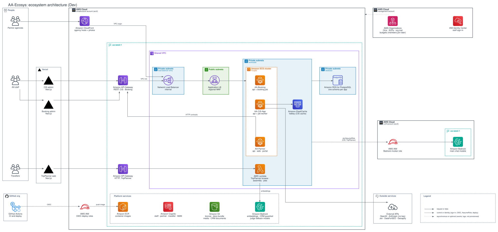
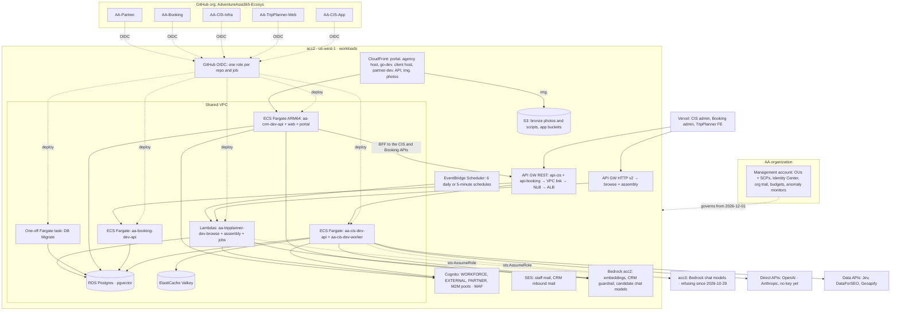

# AA-Ecosys — Ecosystem architecture

> **Status:** reviewed 2026-11-01 (S263, AA-1020) against code and migrations on `main`, Terraform on `main`, and live
> reads of that day (STS, ECS services and task definitions, Lambda functions, EventBridge Scheduler, CloudFront
> aliases, ElastiCache, the Organizations and Identity Center state of the management account). The newest migrations
> are CIS 324, tp-023, bk-035 and crm-035. Earlier revisions: 2026-10-28 (S255, acc1 retired, Content studio on
> Fargate), 2026-10-18 (S242), 2026-10-16 (S239), 2026-10-14 (S235–S236), 2026-10-11 (S225), 2026-09-25. Items marked
> **[FACT]** were checked in code, migrations or live state; **[TO CONFIRM]** marks an inference or gap the tech lead
> still has to confirm.
>
> Decisions behind this page (index: [`adr/README.md`](adr/README.md)):
> [ADR 0001](adr/0001-ecosystem-target-architecture.md) (target architecture) with
> [0001a](adr/0001a-retire-acc1-llm-on-acc3-only.md) (acc1 retired),
> [ADR 0002](adr/0002-only-cis-writes-content.md) (only CIS writes content),
> [ADR 0003](adr/0003-one-durable-job-model.md) with [0003a](adr/0003a-per-owner-job-tables.md) (one job table per owner),
> [ADR 0004](adr/0004-aa-booking-stack-and-bootstrap.md) with [0004a](adr/0004a-supply-content-ownership.md) and
> [0004b](adr/0004b-per-app-security-groups.md),
> [ADR 0005](adr/0005-pricing-and-supplier-rates.md) with [0005a](adr/0005a-b2b-resale-warn-and-vnd.md),
> [ADR 0006](adr/0006-ecosystem-identity.md) with [0006a](adr/0006a-identity-phase1-amendments.md) and
> [0006b](adr/0006b-partner-pool-and-mfa.md) (identity on Cognito),
> [ADR 0007](adr/0007-place-pipeline-in-cis.md) (place pipeline in CIS),
> [ADR 0008](adr/0008-new-app-integration-and-data-platform-rules.md) with
> [0008a](adr/0008a-crm-separate-app-exceptions.md) (integration rules, CRM exceptions),
> [ADR 0009](adr/0009-ai-platform-and-provider-gateway.md) (one AI gateway for every paid AI and data provider; as
> built: [AI gateway](architecture/ai-gateway.md)),
> [ADR 0010](adr/0010-aa-partner-app.md) with [0010a](adr/0010a-content-studio-partner-sign-in.md) (AA-Partner),
> [ADR 0011](adr/0011-github-app-identity-and-merge-rights.md) with [0011a](adr/0011a-ci-bot-merges-copy-and-dump-prs.md),
> [ADR 0012](adr/0012-environment-model.md) (environments, partly superseded by 0018),
> [ADR 0014](adr/0014-repo-visibility-and-github-plan.md), [ADR 0015](adr/0015-tour-liveness-and-retirement-propagation.md),
> [ADR 0016](adr/0016-one-design-system-guarded-kit-copies.md) (one UI kit),
> [ADR 0017](adr/0017-migrations-in-app-pr-expand-auto-apply.md) (migrations: expand auto-apply, contract by hand),
> [ADR 0018](adr/0018-lean-aws-account-model.md) (lean AWS account model). Contract rules between apps:
> [`contracts/README.md`](contracts/README.md).

## 1. Overview

AA-Ecosys is a **multi-repo**. Each app deploys on its own. Locally the repos sit under one folder,
`~/projects/AA-Ecosys/`, and all of them live in the GitHub org `AdventureAsia365-Ecosys` (renamed from
`AdventureAsia365-CIS`).

| Local folder | GitHub repo | Role | Deploy |
|---|---|---|---|
| `apps/AA-CIS-App` | `AA-CIS-App` | Content system of record: FastAPI backend (CIS core, A-series, T-series, the Content studio API `/v1/*`), durable job worker, admin frontend. The tenant portal UI moved to AA-Partner (AA-979 P2a); the frozen copy left here was deleted at the P2b clean-up. The admin host answers `/portal*` and `/tenant-login` with 308 to `portal.` and `/trip/*` with 308 to the client host | ECS Fargate (`aa-cis-dev-api` + `aa-cis-dev-worker`, one image) + Vercel `aa-cis-frontend` (admin) |
| `apps/AA-TripPlanner-Web` | `AA-TripPlanner-Web` | B2C web app: browse destinations, plan a trip, sign in and keep trips. Next.js FE + 3 Lambdas: `browse` (stateless reads, search embeddings), `assembly` (trip writes, narration) and `jobs` (no HTTP route; the `tripplanner.job` worker woken by a daily EventBridge Scheduler tick, tp-021). AI through the shared gateway core (3.3, [AI gateway](architecture/ai-gateway.md)) | Vercel `aa-tripplanner` (FE) + Lambda (BE) |
| `infra/AA-CIS-Infra` | `AA-CIS-Infra` | Terraform for every AWS resource, one root per account: `accounts/aa365` (acc2: VPC, RDS, ECS, Lambda, API GW, CloudFront, Cognito, OIDC, alarms), `accounts/acc3-bedrock` (the Bedrock chat account) and `accounts/management` (the organization, ADR 0018). DB Migrate, Migration Sync / Apply (ADR 0017) and DB Schema Dump workflows | GitHub Actions (`accounts/aa365`) + a human with MFA (`accounts/acc3-bedrock`, bootstrap objects, `accounts/management`) |
| `apps/AA-Booking` | `AA-Booking` | AAA: advisor workflow and booking lifecycle. Live on Dev since 2026-10-14: inquiry intake, staff trip cases and proposals, pricing and FX, suppliers and supply, sellable trip plans, operations (supplier bookings, invoices, payments, supplier bills), the B2B API for AA-Partner; staff admin frontend (see 3.4) | ECS Fargate `aa-booking-dev-api` on the CIS cluster `aa-cis-dev-cluster` (acc2, same VPC, ADR 0004) + Vercel `aa-booking-admin` |
| `apps/AA-Partner` (public) | `AA-Partner` | Partner agencies' app (ADR 0010, accepted 2026-10-22): the agency CRM and the tenant Content studio (`portal/`, moved from AA-CIS-App with its history by AA-979 P2a). Own schema `crm` (`crm-001` to `crm-035`): clients and the identity vault, pipeline, proposals, invoices and payments, e-sign, duty of care, portability and deletion, onboarding and import, AA insights, the AA staff console with owner-granted support access and audited break-glass (crm-033), ops releases to AA ground operations (crm-034), commissions and one-action cancel (crm-035), an offline-capable traveller portal on the client host `go-dev.`. AI through its own control plane and ledger on the shared gateway core (ledger v2, crm-032; the provider is the stub on Dev), PII scrubbed first by the F3 scrubber with Bedrock Guardrails. Partner Cognito pool with MFA (ADR 0006b). Integrations are bring-your-own (agency Twilio/WhatsApp, Stripe, mailbox, e-sign); AA provides the maps. The API runs the `crm.job` worker in its own process | ECS Fargate ARM64 on `aa-cis-dev-cluster`: `aa-crm-dev-api`, `aa-crm-dev-web` and `aa-crm-dev-portal` (Content studio), all on the agency host `portal.` (its own CloudFront distribution → VPC origin → NLB → ALB host rules: `/crm*` API, studio paths, the rest the CRM web). The old host `partner-dev.` keeps only the API paths `/crm` and `/crm/*` and answers 301 to `portal.` for everything else (AA-979 P2b clean-up, a CloudFront Function). Images in IMMUTABLE ECR repos tagged with the git SHA; deploy by the GitHub OIDC role `aa-crm-dev-app-deploy`. No Vercel project (the P2a project `aa-cis-portal` was deleted at the clean-up) |

**Boundary rule [FACT]:** *apps own code, Infra owns resources.* TripPlanner shows it best:
`infra/AA-CIS-Infra/accounts/aa365/tripplanner.tf` and `tripplanner_jobs.tf` create the 3 Lambdas from a placeholder zip.
The `AA-TripPlanner-Web` repo builds the real code and ships it with `lambda:UpdateFunctionCode`.
Terraform `ignore_changes` covers the code attributes, so it never overwrites them. Source:
`infra/AA-CIS-Infra/docs/implementation-notes/AA-TripPlanner-backend.md`.

**AWS accounts [FACT] (ADR 0018).** Today:

| Account (target name) | Holds today | State on 2026-11-01 |
|---|---|---|
| Management account (`aa-management`) | AWS Organizations (all features), OUs `NonProd`, `Prod`, `Suspended`, three SCPs attached to the OUs (deny leave or close, protect audit and billing, Region allow-list), the organization CloudTrail `aa-org-trail` with its bucket, IAM Identity Center (groups `aa-admins`, `aa-developers`, `aa-billing`; permission sets `AA-Admin`, `AA-Developer`, `AA-ReadOnly`, `AA-Billing`), the organization budget and its own budget, Cost Anomaly Detection. **No workload** | **Live** since S259; Terraform root `accounts/management`. It is the only member of its organization: no workload account has joined yet |
| acc2 (`aa-nonprod`) | Every workload: VPC, RDS, ECS, Lambda, API Gateway, CloudFront, Cognito, S3, SES, Valkey, Bedrock embeddings, the Bedrock Guardrail of the CRM scrub, and five candidate Bedrock chat models catalogued for eval, judge and validate stages (ADR 0009 decision 14, not routed) | Live. Still a member of the reseller's organization; joining the AA organization and moving the payer are planned for 2026-12-01 |
| acc3 (`aa-ai`) | The main Bedrock chat account: invoker role, Bedrock Batch service role, Cost Explorer reader | Live, but Bedrock refuses every model since 2026-10-29 (Error 002); see the [AI gateway](architecture/ai-gateway.md) |
| `aa-prod` | Does not exist | Created by the management root when the go-live date is set (ADR 0018 decision 3) |

acc1 (a personal account) was removed from the ecosystem on 2026-10-28 (AA-998,
[ADR 0001a](adr/0001a-retire-acc1-llm-on-acc3-only.md)). Account IDs and profiles: the account map in
[onboarding](onboarding.md); never in a repo page.

## 2. System diagram

The deployment view with the official AWS Architecture Icons (AA-697). The same folder holds one view per repo:
[AA-CIS-Infra](architecture/diagrams/infra.svg), [AA-CIS-App](architecture/diagrams/cis.svg),
[AA-Booking](architecture/diagrams/booking.svg), [AA-TripPlanner-Web](architecture/diagrams/tripplanner.svg) and
[AA-Partner](architecture/diagrams/partner.svg); sources, conventions and how to re-render them:
[architecture diagrams](architecture/diagrams/README.md).

The same view as a Mermaid flowchart (text, for readers that show no images). Dashed lines are control, identity or
not-live paths:

Every paid AI or data call goes through the AI gateway (4.3), which picks the provider per stage, enforces the budgets
and writes one ledger row per attempt.

## 3. Database schema roles (shared RDS, acc2)

CIS, TripPlanner, AA-Booking and AA-Partner (CRM) use **one RDS Postgres** in the acc2 VPC, with **fully separate
schemas**. Each schema has exactly one owner repo, and only that repo writes migrations for it. See
[`database/schema-ownership.md`](database/schema-ownership.md) for the owners, the `shared.*` table owners and the
version keys `NNN` / `tp-NNN` / `bk-NNN` / `crm-NNN` / `rl-NNN`. Migrations reach Dev through the **DB Migrate**
workflow of AA-CIS-Infra (an identical copy in `db/migrations/<owner>/`, check → apply), never from a laptop.
Column-level truth: [`architecture/db-schema-reference.md`](architecture/db-schema-reference.md).

### 3.1 CIS — medallion + multi-tenant RLS [FACT]

Source: `apps/AA-CIS-App/api/migrations/*`.

| Schema | Role | Scope |
|---|---|---|
| `shared` | Platform tables: tenants, brand rules, SEO config, API usage, jobs (`shared.job`), LLM gateway + cost logs, destinations, photos, countries | Platform-wide |
| `silver_aa_internal` / `gold_aa_internal` | Medallion for the internal tenant `aa_internal` (Master Content) | Platform (sentinel tenant) |
| `acp_contract` | Atom / Segment / Ranking / Route / Hub / Search Demand | Mixed (see 3.2) |
| `acp_shared` | Subject (Slate) / Piece / Gate / Facts / tenant_config / publish log | Mixed |
| `acp_deliver` | Pages delivered to tenants (`tenant_tour_pages`) | Per tenant |
| `geo` | Place pipeline: tour builds, itinerary components, place names, tour graph (ADR 0007) | Platform |
| `catalog` | Read-only contract views for other apps (`catalog.tour.v1`, `catalog.graph.v1`) | Platform |
| `retired` | Quarantine of dead tables before their drop (CIS 294, AA-850) | Platform |

No per-tenant schema exists: the `silver_<id>` / `gold_<id>` plan of migration 003 is not used. Tenants are isolated
with **RLS** (`SET LOCAL app.tenant_id` per transaction). Where keys could collide, `tenant_id` is **folded into the
row identity** (for example `segment_id = sha256(tenant_id, place, action)`).

### 3.2 CIS — Master Content (platform-wide) vs Tenant Content [FACT]

Source: `apps/AA-CIS-App/CONTEXT.md` (ownership table, AA-540).

- **Master Content (admin, A-series):** computed **once, shared** by every tenant. A0 Upload → A3
  Master Content Pool (`gold_aa_internal.published_tours`) + **Atoms** (`owner_scope='platform'`). Atom
  reads go through `acp_contract.v_active_tour_atoms`, which follows the Master status (AA-713).
- **Platform-wide derived data:** **Segment / Score / Route / Hub**, platform-wide since AA-545
  (migration 146, 2026-09-06), with no `tenant_id` column. Score = rank-sum over 4 dimensions (Demand /
  Recurrence / Questions / Said, AA-610), one pass per buyer market.
- **Tenant Content (T-series):** from **Slate** onward (Slate / Subject / Goal / Angle / Piece /
  Publish), **per tenant**. Slate has a **Debate** layer (AA-631: contested + brand-fit, advisory, never
  cuts more than 50%).

**Shared across tenants [FACT]:**

1. **Master Content pool + Atom pool:** a shared source every tenant reads directly (not a cache).
2. **Segment / Score / Route / Hub:** platform-wide rows.
3. **Search Demand + research log:** a real cache keyed `(keyword, market)` / `(place, market)`, with **no
   `tenant_id` column**. It stores `serp_domains` since AA-631.
4. **Facts Entry `scope='platform'`:** deliberate sharing, enforced by RLS.

Plus one **cross-tenant read (not a cache):** Gate F10 (cannibalization) compares a Piece's embedding
with every other tenant's.

### 3.3 TripPlanner — separate schema [FACT]

Source: `apps/AA-TripPlanner-Web/migrations/*`.

- Schema `tripplanner` (owner role `tp_owner` since tp-013) is **fully independent** of CIS. It holds the trip user
  state: `sessions`, `customers`, `trip_drafts`, `trip_events`, `outbox`, `narration_cache`, `llm_spend_daily`,
  `component_id_map`, `traveller_accounts` (tp-019, AA-908), the job table `job` (tp-021, worked by the jobs Lambda)
  and `ai_rate_counter` (tp-023, per-visitor AI limits). Its migrations register `tp-NNN` in `shared.schema_versions`
  (from tp-007).
- TripPlanner reads CIS only through `catalog.*` views: tours, days, places, photos, destinations, the place graph
  and vector search (`catalog.v_component_embedding`, CIS 253). Its direct grants on CIS tables (`raw_tours`,
  `tour_atoms`, `published_tours`, `shared.destinations`, the `shared` photo views) were revoked by CIS 254 and
  CIS 270 (AA-712). Its AI configuration and today's spend come from the gateway contract views
  `catalog.v_llm_gateway_config_v1` and `catalog.v_llm_app_spend_today_v1` (CIS 323); the grandfathered SELECT on two
  gateway tables is still granted until a later CIS migration revokes it. The one standing write exception is INSERT on
  `shared.llm_call_log`.
- **Place read models (ADR 0007):** the frozen pilot tables (`itinerary_components`, `tour_day`, `tour_stop`,
  `tour_graph_*`, `tour_leg`, `tour_junction`) were dropped by tp-018 on 2026-10-23. CIS builds places in its own
  schema `geo` and serves them through `catalog.*` views.
- TripPlanner publishes views to other apps: `v_inquiry_outbox` to Booking (tp-009) and the ops views to `cis_app`
  (`v_ops_traffic_daily` tp-015; `v_ops_data_totals`, `v_ops_pin_components`, `v_ops_component_id_map` tp-020;
  `v_ops_inquiry_keys` tp-022 for the CIS inquiry hand-off check).

### 3.4 AA-Booking — schema `booking` [FACT]

Decided 2026-09-28 (ADR 0001 decisions 6–7): AA-Booking runs on acc2 and shares the RDS with its own
schema `booking` (version key `bk-NNN`). AA-CIS-Infra provisions it inside acc2 (ECS service, ECR, DB
role, API route); there are no new accounts. It never writes another app's schema. Contracts are
versioned JSON in `docs/contracts/` (rules: [`contracts/README.md`](contracts/README.md)):

- **`inquiry.submitted`** (TripPlanner → AA-Booking, with the multi-tour leg chain; files
  `docs/contracts/inquiry.submitted.v1*.json`) is carried by a **transactional outbox**. TripPlanner's
  `tripplanner.v_inquiry_outbox` (grant `tp-009`) is pulled by Booking's `booking.job` worker into
  `booking.inbox_events` with an idempotency key. Booking then creates the lead customer, the trip case and the staff
  notification.
- **CIS catalog** (contract `catalog.tour.v1`, CIS migration 225 grant to role `booking`) is **read live at request
  time, never copied** (S237 decision D4, AA-679). Booking reads `catalog.v_tour` / `v_tour_day` / `v_tour_photo` for
  sellable trip plans and keeps only the commercial rows keyed on the CIS `source_id`. It reads
  `catalog.v_destination` and `catalog.v_country` for places and countries, and `catalog.v_supply_content` for the
  AA-written supply content (CIS 278).
- **Supply feed** (Booking → CIS, contracts `supply.hotel.v1` / `supply.service.v1`, bk-023): CIS pulls
  `booking.v_supply_outbox` and keeps the AA-written content per Booking entity.
- **B2B API** (`booking.b2b.v1`, `/booking/b2b/v1`) serves AA-Partner over HTTP with Cognito M2M tokens.

Identity: ADR 0001 decision 6 gave AA-Booking the customer identity (its own OTP stack, tables in `bk-001`).
[ADR 0006](adr/0006-ecosystem-identity.md) amends this: the target is the shared Cognito EXTERNAL pool
for travellers and Booking customers (AA-680), so the `bk-001` OTP tables are interim and not built out.
`bk-024` links a signed-in traveller's `(iss, sub)` to a customer. Staff sign-in: see 4.6.
Stack, runtime and decisions O1–O9: [ADR 0004](adr/0004-aa-booking-stack-and-bootstrap.md) (Accepted
2026-10-14); prices and suppliers: [ADR 0005](adr/0005-pricing-and-supplier-rates.md).

Live on Dev since 2026-10-14 (AA-678, `infra/AA-CIS-Infra/accounts/aa365/booking.tf`):

| Item | Value |
|---|---|
| Repo | `AdventureAsia365-Ecosys/AA-Booking` |
| Runtime | ECS service `aa-booking-dev-api` on `aa-cis-dev-cluster`, own ECR `aa-booking-dev-api`, log group `/ecs/aa-booking-dev`, own execution and task roles |
| Entry | Separate REST API `aa-booking-dev-api` on the **shared VPC link** → NLB → ALB listener rule `/booking`, `/booking/*` → Booking target group. Custom sub-domain `api-booking.lumiguides.it.com` (ADR 0004 O2) |
| Database | Schema `booking`, owner role `bk_owner` (since bk-014), login role `booking` (DSN in Secrets Manager `booking/dev/database-url`). Migrations applied through Infra DB Migrate from `bk-001` (2026-10-14) to `bk-035` (2026-10-31); `bk-034` was the first expand file applied with no hand step (ADR 0017) |
| Slices | `bk-001` foundation (customers, OTP tables, audit log, inbox events) · `bk-002` inquiry intake + `booking.job` worker (AA-681) · `bk-003` staff profiles, trip case workflow, proposal versions · `bk-004` / `bk-006` / `bk-007` pricing engine, rules + FX with maker-checker (AA-810, ADR 0005) · `bk-008` suppliers + contracts (AA-822) · `bk-009` sellable trip plans over the live catalog (AA-679) · `bk-010` hotels, room types, services, supplier net rates (AA-823) · `bk-011` catalog tour key on trip case legs (AA-830) · `bk-020` to `bk-022` departures and holds, B2B commercial rules, B2B event feed · `bk-023` supply outbox and media (AA-835) · `bk-024` customer identities (AA-908) · `bk-026` to `bk-028`, `bk-030` operations MVP: supplier bookings, trip checks, invoices and payments, supplier bills and payouts (AA-682) · `bk-029`, `bk-031` Booking state of CIS countries and destinations, `bk-032` / `bk-033` trip plan supplier and price matrix (AA-996) · `bk-034` index for the tour lifecycle read (AA-993) · `bk-035` inquiry inbox key view for the CIS hand-off check (AA-1003). Staff "new inquiry" e-mail through SES (`bk_notify_email` job, AA-811). Staff admin frontend in `frontend/` (Next.js, Vercel `aa-booking-admin`, AA-683) |
| Health | `/booking/health` (liveness, reports `git_sha`), `/booking/health/ready` (DB + every required `bk-NNN`) |

## 4. Data contracts

### 4.0 Write rule — only CIS writes content (ADR 0002, 2026-10-01) [FACT]

- **Content** (tours, atoms, places in `shared.destinations`, itinerary places and tour graph, photos) is
  created, changed and deleted **only by CIS**, through a job or an admin action with a tracking page.
- Other apps (TripPlanner, AA-Booking, AA-Partner) **read through views or HTTP contracts only** and write only their
  own schema. The one standing write exception is INSERT on `shared.llm_call_log` for TripPlanner. DB grants enforce
  it: since CIS 270 the role `tripplanner` has no grant on a CIS table and reads `catalog.*` views.
- The place pipeline (itinerary extraction, geocode, tour graph) runs in CIS (AA-712,
  [ADR 0007](adr/0007-place-pipeline-in-cis.md)): CIS-owned schema `geo`, job kinds `place_extract` /
  `place_geocode` / `tour_graph_build` on `shared.job`, `shared.destinations` unique on
  `(name_norm, country, locality_norm)`, and Geoapify (OSM data, storable) as the confirming geocoder for all
  countries, with Mapbox as basemap only. TripPlanner reads the `catalog.*` place and graph views.

### 4.0a Tour liveness and retirement (ADR 0015, Accepted, AA-986)

- Whether an AA tour is **served** is one CIS-owned state per catalog key `(source_system, source_id)`:
  `served` / `retired` / `paused` / `restored`. It is derived from `raw_tours` and `published_tours` status columns,
  changed only by one CIS write service, and read inside CIS from one view.
- Other apps learn about a retirement from a CIS-owned change record, read through the tombstone and outbox contract
  views `catalog.v_tour_retired` and `catalog.v_tour_lifecycle_outbox` (CIS 274, contract `catalog.tour.v1.3`,
  additive). They do not infer it from a tour missing in `catalog.v_tour`. A `paused` key is a temporary absence
  (404, not 410).
- Per app: tenants keep their T2 copies and posts with a warning, and new work is refused (409 `tour_discontinued`).
  Booking keeps confirmed bookings with a staff flag and refuses new quotes and holds. TripPlanner answers 410 and
  flags saved trips. SEO answers 410 for retired and 301 for superseded. A supersede is not a deletion.
- Rule and open questions: [ADR 0015](adr/0015-tour-liveness-and-retirement-propagation.md); evidence:
  [S248 audit memo](audits/2026-10-23-S248-tour-deletion-propagation/memo.md).

### 4.1 Frontend ⇄ backend

| Edge | Contract | Source |
|---|---|---|
| CIS FE (Vercel) ⇄ CIS API | REST through API GW (REST + VPC Link) → ALB → ECS. Auth: tenant JWT; staff = Cognito WORKFORCE access token as `Authorization: Bearer` (legacy HS256 sessions refused since AA-816 S2, `LEGACY_ADMIN_LOGIN_ENABLED` off by default), plus the admin secret added by the BFF for paths outside the staff prefixes (4.6) | `AA-CIS-App/CONTEXT.md` |
| Content studio (`aa-crm-dev-portal`) ⇄ CIS API | The portal BFF calls the CIS API. A partner-pool access token is exchanged at `POST /auth/tenant-session` for a 15-minute tenant JWT ([ADR 0010a](adr/0010a-content-studio-partner-sign-in.md)) | `AA-Partner/CONTEXT.md` |
| AA-Booking ⇄ clients | REST through API GW `aa-booking-dev-api` (shared VPC Link) → ALB `/booking/*` → ECS `aa-booking-dev-api`. The staff admin frontend calls it through its Next.js BFF. Staff auth: see 4.6 | `booking.tf`, ADR 0004 |
| TripPlanner FE (Vercel) ⇄ BE | The Next.js BFF calls 2 Lambda URLs through API GW HTTP v2: `ANY /browse/{proxy+}` → browse, `ANY /trip/{proxy+}` → assembly; header `X-TripPlanner-Key`. Env `BROWSE_API_URL` / `TRIP_API_URL` | `tripplanner.tf`, `docs/vercel-setup.md` |

Contracts between apps (views, grants, events) are listed in each repo's `CONTEXT.md`
("Contracts with other apps").

### 4.2 App / infra boundary (deploy contract) [FACT]

- **TripPlanner:** Infra creates the three Lambdas (browse, assembly, jobs) from a placeholder zip; the app builds
  and calls `UpdateFunctionCode`. Terraform `ignore_changes` covers the code attributes. The jobs Lambda has no HTTP
  route: a daily EventBridge Scheduler entry wakes it to work `tripplanner.job`. Artifacts bucket
  `aa-tripplanner-dev-lambda-artifacts-<acct>`.
- **CIS:** Infra creates ECS / RDS / API GW; the app builds an image → ECR → new task definitions for api
  and worker on the same image (`Deploy Dev`). The deploy is blocked only while a rerun wave is open or a
  deploy-blocking job kind runs or is due; other jobs are drained and re-claimed (C6.3a, AA-993 G5).
- **AA-Booking:** Infra creates ECR / ECS service / roles / REST API (`booking.tf`, task definition and
  desired count in `ignore_changes`). The app builds an image tagged with the git SHA, deploys through
  its own least-privilege role `aa-booking-dev-app-deploy`, then smoke-tests `/booking/health` (same `git_sha`) and
  `/booking/health/ready`. Booking has its own `booking.job` table (`bk-002`, ADR 0004 O3). The `preflight` job of
  Booking `deploy-dev.yml` calls `GET /booking/ops/deploy-gate` with its GitHub OIDC token. Since AA-993 G5 it waits
  only while a retention job (the deploy-blocking kinds) runs or is due within 15 minutes (C6.3a).
- **AA-Partner:** Infra creates ECR / ECS services / roles / CloudFront (`crm_app.tf`, `crm_web.tf`, `crm_portal.tf`,
  `crm_agency_edge.tf`). The app deploys through its role `aa-crm-dev-app-deploy`.
- **Migrations (ADR 0017):** the owner repo authors them; its CI job **Migration preflight** checks the number
  (`main` max + 1) and the class. After the merge, the repo rings the Infra **Migration Sync** doorbell, which opens
  the byte copy in `db/migrations/<owner>/`. An **expand** file (header `-- migrate: expand`) is applied on Dev with no
  hand step; a **contract** file waits for a manual DB Migrate `apply`. Each app's Deploy Dev waits at its
  **schema-gate** job until the migrations its code needs are registered. DB Migrate `apply` still waits until every
  job table is idle.

### 4.3 AI gateway and Bedrock [FACT]

The full as-built description, with a live / planned table: [AI gateway](architecture/ai-gateway.md)
([ADR 0009](adr/0009-ai-platform-and-provider-gateway.md)). In short:

- **One gateway for every paid AI and data provider:** LLM generation, embeddings, Bedrock Batch, Jev decisions,
  DataForSEO, Geoapify and Bedrock Guardrails. The control plane (registry v2, routes per stage, data scopes,
  budgets, circuit state, ledger v2) lives in CIS schema `shared`; CIS calls it in process, TripPlanner and the CRM
  vendor the shared core `aa_llm`. Booking makes no AI call.
- **Providers and failure domains:** acc3 is the main Bedrock chat account, reached by `sts:AssumeRole` from the ECS
  task role and the TripPlanner Lambda role (it refuses every model since 2026-10-29). acc2 serves embeddings
  (Cohere Embed v4), the CRM guardrail and five catalogued candidate chat models with no route. The OpenAI API is the
  last resort of the judge routes; the Anthropic API path is built but has no key.
- **Where to look:** CIS admin **AI providers** (`/admin/ai-gateway`) for providers, routing, models, budgets, calls
  and traces; [`generated/llm-routes.md`](generated/llm-routes.md) for a route snapshot; the
  [AI Use Register](architecture/ai-use-register.md) for owners, scopes and kill switches. Do not memorize routes.
- **Bedrock Batch (AA-606):** the S3 prefix and the acc3 batch service role exist, but AWS has not enabled Batch
  Inference for acc3 (AA-624); the ingest writes ledger rows once a batch runs.

### 4.4 Cost monitoring [FACT]

- **Per call:** the ledger v2 (`shared.llm_call_log`, `crm.llm_call`) plus the domain ledgers `dfs_call_log`,
  `decision_log` and `geo.geocode_call`. Ad-hoc scripts log too (`stage="adhoc_<issue>"`).
- **Caps:** connection, app, job, stage and tenant budgets in the gateway (see the AI gateway page, §5); CIS admin
  **AI providers › Budgets** lists every layer.
- **Real bills:** acc2 calls Cost Explorer for itself and assumes the acc3 reader role; snapshots live in
  `shared.cost_explorer_snapshot`. A nightly `llm_cost_reconcile` job compares the ledger with the provider figure per
  connection. The admin page **Cost Operations** (`/admin/cost-ops`; the old `/admin/llm-usage` redirects there) shows
  Overview with the month-end forecast, the **AI & data spend** tab built from the ledger, and the AWS bill.
- **AWS budgets and anomaly alerts:** acc2 has an account budget, one budget per `App` tag and an immediate anomaly
  subscription; acc3 has its own budget and anomaly alerts. The management account holds the organization budget and
  a Cost Anomaly Detection monitor; the per-account budgets and the `App`-tag monitors start when the workload
  accounts join the organization.
- **Probes:** Lambda `aa-cis-dev-dfs-balance-check` on a daily schedule (DataForSEO balance, waves, staff directory
  reconcile) and the CIS daily LLM connection probe.
- **Log-write failure alarms (AA-756):** CloudWatch metric filters + alarms on the ledger writes. Full list:
  [alarm catalog](generated/alarms.md).

### 4.5 AA photos (AA-708, 2026-10-01) [FACT]

One photo source for the whole ecosystem, per ADR 0001 decision 1 (CIS is the content source, other apps
read a read model):

| Part | Owner | Notes |
|---|---|---|
| Originals | Content team | PHOTOS folder on Jira CON (Google Drive, public link) |
| Sync + match | CIS — job `photo_sync`, page Admin › Photos | Drive → S3 (WebP 1600/600) → `shared.place_photo` |
| Reading photos | Every app | **Views only.** Other apps read `catalog.v_tour_photo` (per tour) and `catalog.v_destination_photo` (per place); CIS reads its `shared` photo views. Never the tables |
| Photo URL | CIS public API | `{CIS_API_BASE}{path}?size=large\|small` (302 → S3; later CloudFront, same path) |
| TripPlanner destination cover | CIS writes `shared.destinations.cover_image_url` | Only empty cells, or cells this job set earlier |

Order per country (rerun wave): S1 rewrite → A3 atomize → place extraction (the CIS `place_extract` job, enqueued by
atomize, writes `geo.*`; the graph build enqueues the cover and photo match) → Admin › Photos: "Sync <country>" +
"Match places + covers". A photo is matched only against places in **that tour's own itinerary**.

### 4.6 Identity (ADR 0006 + 0006a + 0006b) [FACT]

One identity service for the ecosystem: Amazon Cognito in acc2, Essentials plan, Terraform in AA-CIS-Infra
`accounts/aa365/identity*.tf`. Pool IDs: Terraform outputs, not prose.

| Population | Pool / client | State |
|---|---|---|
| CIS staff | WORKFORCE, client `cis-admin` | **Live.** Email one-time code on managed login at `https://staff-auth.lumiguides.it.com` (AA-branded). The CIS BFF runs auth code + PKCE. The CIS API verifies the access token (WORKFORCE issuer only, `client_id` ∈ {cis-admin, breakglass}, `token_use=access`) and resolves the `shared.admin_users` row by `(iss, sub)`; role = highest `cis-*` group. Legacy password login off since AA-816 S2 (2026-10-22; `LEGACY_ADMIN_LOGIN_ENABLED` off by default, ADR 0006a A12). Preview signs in on `aa-cis-preview.lumiguides.it.com` with client `cis-admin-preview`, capped at viewer (A11) |
| Break-glass | WORKFORCE, client `breakglass` | **Live, disabled at rest.** `admin@adventure.asia`, password + TOTP. Secret `aa-identity/dev/breakglass` is readable only by the MFA admin role; every read, write and token issue alerts |
| Booking staff | WORKFORCE, clients `booking-staff`, `booking-staff-preview` | **Phase 2, in transition.** The Booking API verifies WORKFORCE access tokens (roles from `cognito:groups`, mirrored from CIS `shared.staff_app_grant`). It still accepts the CIS bridge token (ADR 0004 O1, `aud=booking`) until AA-680 removes it (ADR 0006a A6) |
| Content studio users | PARTNER pool (ADR 0006b, MFA) | **Live since the AA-979 P2b cutover.** People re-enrol through a CIS-created, CRM-delivered invitation; CIS exchanges the partner access token for a 15-minute tenant JWT ([ADR 0010a](adr/0010a-content-studio-partner-sign-in.md)). Since the P2b clean-up the studio has no API-key sign-in (`PORTAL_API_KEY_SIGNIN=false`, `/tenant-login` → 308 to the partner sign-in); API keys are for machines only |
| Agency CRM users | PARTNER pool, AA-Partner web | **Live.** Membership in `crm.member` by `(iss, sub)`, then the CRM permission matrix |
| AA staff in the CRM | WORKFORCE, client `crm-staff`; groups `crm-platform-admin`, `crm-ops`, `crm-support` | **Live.** The AA staff console in CRM web: ops releases, support access inside a window the agency owner grants, audited break-glass (crm-033) |
| Machines | M2M pool `aa-m2m-dev`, client-credentials client of the CRM; resource servers `booking.b2b`, `cis.catalog`, `cis.tenant` | **Live.** AA-Partner calls the Booking B2B API, the CIS catalog and the CIS tenant membership feed; each receiver checks only its own scope |
| Travellers | EXTERNAL, client `tripplanner` | **Built (AA-908, tp-019).** E-mail code sign-in and My Trips; the guest trip is claimed into `tripplanner.traveller_accounts` at first sign-in |
| Booking customers | EXTERNAL, client `booking-customer` | Phase 4 (AA-680). No customer-facing Booking app yet |

- **Staff directory = CIS.** `shared.admin_users` (+ `email`, `cognito_iss`/`cognito_sub`, `is_owner`, CIS 247)
  and `shared.staff_app_grant` (per-app roles) are the source of truth. Only owners write it, from the CIS admin
  Staff page. Each write goes to the DB first, then to Cognito through the CIS task role's allow-list.
  A report-only job `staff_directory_reconcile` compares the two.
- Apex `lumiguides.it.com` is an A record to Vercel (the `aa-cis-frontend` project redirects it to
  `aa-cis.lumiguides.it.com`); Cognito requires a parent A record for its custom domains.

## 5. OIDC / CI-CD

Every CI job assumes its **own** role through GitHub OIDC (AA-806 role split, `cicd_split.tf`). The
legacy shared `aa-cis-dev-role` was retired in AA-806 step 3 (S239), and the apply boundary denies recreating it.
The repos use GitHub's immutable subject claim, so every trust pins the org id and the repo id
(`repo:AdventureAsia365-Ecosys@<org_id>/<repo>@<repo_id>:<context>`). The exact values live in Terraform
(`local.oidc_sub_cis_app`, `local.oidc_sub_cis_infra`, `local.tp_oidc_subjects`, `local.bk_oidc_subjects`,
`local.crm_oidc_subjects`, `local.docs_sync_oidc_sub`; in the management root `var.github_oidc_subject_prefix`), not in
prose. Checked against AA-CIS-Infra `main` on 2026-11-01. The management account has its own OIDC provider and
roles (ADR 0018 decision 5); nothing crosses accounts on the CI path.

| Role | File | Trusted context | Used by |
|---|---|---|---|
| `aa-cis-dev-app-deploy` | `accounts/aa365/cicd_split.tf` | AA-CIS-App, `environment:dev` | CIS `Deploy Dev` (ECR push, CIS task families and services only) |
| `aa-cis-infra-tf-plan` | `accounts/aa365/cicd_split.tf` | AA-CIS-Infra, `pull_request` | `Terraform Plan` (read only) |
| `aa-cis-infra-tf-apply` | `accounts/aa365/cicd_split.tf` | AA-CIS-Infra, `environment:prod` | `Terraform Apply Prod`, `DB Migrate`, `DB Schema Dump`, `DB Isolation Probe` (boundary `aa-cis-infra-tf-apply-boundary`) |
| `aa-booking-dev-app-deploy` | `accounts/aa365/booking.tf` | AA-Booking, `environment:dev` or `ref:refs/heads/main` | Booking `Deploy Dev` (Booking ECR, task family and service only) |
| `aa-tripplanner-dev-app-deploy` | `accounts/aa365/tripplanner.tf` | AA-TripPlanner-Web, `ref:refs/heads/main` | `deploy-lambdas.yml` (artifact zip + the two Lambdas' code) |
| `aa-crm-dev-app-deploy` | `accounts/aa365/crm_app.tf` | AA-Partner, `environment:dev` | AA-Partner deploy workflows (CRM api, web and portal) |
| `aa-cis-dev-docs-sync` | `accounts/aa365/docs_reader.tf` | AA-Ecosys (root), `ref:refs/heads/master` | Root `Docs sync` (the `/admin/docs` bundle in the bronze bucket, `docs-reader/` only) |
| `aa-cis-infra-db-auto-apply` | `accounts/aa365/cicd_db_auto_apply.tf` | AA-CIS-Infra, `environment:dev-db-auto` + `ref:refs/heads/main` | Migration Apply of expand files (ADR 0017 decision 6): the migrator task family only |
| `aa-crm-dev-scrub-corpus` | `accounts/aa365/crm_scrub.tf` | AA-Partner, `environment:scrub-corpus` | The CRM `Scrub corpus` workflow (ApplyGuardrail only) |
| `aa-terraform-plan` | `accounts/management/cicd.tf` (management account) | AA-CIS-Infra, `pull_request` and `ref:refs/heads/main` | Plan and drift of the management root (read only) |
| `aa-terraform-apply` | `accounts/management/cicd.tf` (management account) | AA-CIS-Infra, `environment:org` (the tech lead as required reviewer) | Apply of the management root (boundary `aa-terraform-apply-boundary`) |

Bootstrap objects (the CI roles, both boundaries, the OIDC provider, the agent session role) are applied
locally with the MFA admin profile; CI apply cannot rewrite them (AA-CIS-Infra `CONTEXT.md`, "CI/CD and
OIDC"). Every new IAM role must carry the workload boundary `aa-workload-boundary`.

**Safe rename rule:** widen trust to accept **both** the old and the new org (additive) **first**, rename
the org **after**, and remove the old trust last. Role ARNs in workflows come from `secrets` / `vars`, and
resource names use the `aa-cis-*` / `aa-tripplanner-*` / `aa-booking-*` / `aa-crm-*` prefixes (independent of GitHub
names), so only the `sub` match is affected.

> **[FACT — G5 done 2026-09-21, AA-588]** Trust for the old org `AdventureAsia365-CIS` was removed from
> every role; `sub` now matches only `AdventureAsia365-Ecosys` (verified live with `aws iam get-role`).
>
> **OIDC subject form (checked in CloudTrail 2026-09-21, AA-588):** the repos enable "include repo ID
> in the subject", so the real `sub` is `repo:AdventureAsia365-Ecosys@<orgid>/<repo>@<repoid>:<ref>`. The flat
> pattern `repo:AdventureAsia365-Ecosys/*:*` **fails with AccessDenied** (CI Terraform Plan #94). Since AA-678 /
> S235 Phase 0 every role pins the exact ids (table above).

## 6. Debt / future work

- **AA-Booking (AAA):** slices live through `bk-035` (3.4). Open: removing the CIS bridge token for staff
  (AA-680, 4.6), the customer-facing app and customer identity on Cognito (AA-680, ADR 0006), and a Playwright smoke
  of the staff admin in Booking CI. The hand-off from TripPlanner is live (outbox → `bk_inquiry_pull`); the
  pre-build draft is archived at [`archive/2026/tripplanner-to-aaa-handoff.md`](archive/2026/tripplanner-to-aaa-handoff.md).
- **AA-Partner Content studio (AA-979 P2b clean-up, S256):** done in code (runbook §4.5): Vercel project
  `aa-cis-portal` and its workflow removed, frozen CIS `portal/` deleted, API-key sign-in off, `partner-dev.` → `portal.`
  301 except `/crm` and `/crm/*`, the CRM API's join-link and mail OAuth origins on `portal.`. Rollback to Vercel is no longer
  possible; a bad studio deploy is rolled back on ECS (previous task definition revision).
- **Place pipeline in CIS (AA-712, [ADR 0007](adr/0007-place-pipeline-in-cis.md)):** done. TripPlanner reads the
  `catalog.*` views, its vector search runs on `catalog.v_component_embedding`, and its legacy tables are dropped
  (tp-018).
- **[TO CONFIRM]** CloudFront in front of TripPlanner browse routes (listed as a later change).
- **CIS data rerun:** waves are registered and reported through `/admin/waves` (`shared.rerun_wave`,
  AA-727); Batch Inference on acc3 (AA-624) is still blocked.
- **Account model (ADR 0018, AA-1004):** the management account runs with no member. Open: acc2 and acc3 join the AA
  organization and the payer moves (planned 2026-12-01), each account moves to its OU after a quiet week, the
  per-account budgets and `App`-tag anomaly monitors switch on, the acc2 trail is removed after the organization trail
  delivers cleanly for 7 days, and `aa-prod` with `accounts/prod` is created when the go-live date is set.
- **AI gateway (ADR 0009):** the acc3 refusal case; the Anthropic API key with its workspace spend limit; the OpenAI
  API monthly cap; the monthly failover drill; the qualification ladder before any acc2 chat route (AA-900); the revoke
  of TripPlanner's grandfathered SELECT on the gateway tables; removing the legacy `haiku` / `sonnet` paths; a real
  CRM provider. Details and state: [AI gateway](architecture/ai-gateway.md) §8.

## 7. References

- `apps/AA-CIS-App/CONTEXT.md`: repo context (stack, deploy, boundaries), glossary, ownership /
  cross-tenant table (AA-540), contracts with other apps.
- `apps/AA-TripPlanner-Web/CONTEXT.md`: B2C map planner, Next.js FE + 3 Lambdas (browse stateless /
  cacheable, assembly stateful + AI, jobs for `tripplanner.job`), event-sourced trip, schema `tripplanner.*`.
- [`architecture/ai-gateway.md`](architecture/ai-gateway.md): the AI gateway as built, with the live / planned table.
- `apps/AA-Booking/CONTEXT.md` and `apps/AA-Partner/CONTEXT.md`: Booking and the partner CRM / Content studio.
- `infra/AA-CIS-Infra/CONTEXT.md`: account model, S3 state, OIDC / CI-CD, how to apply, DB Migrate,
  the "apps own code, Infra owns resources" boundary.
- `docs/adr/`: ecosystem ADRs; `docs/database/schema-ownership.md`: schema owners.
- `infra/AA-CIS-Infra/docs/implementation-notes/AA-TripPlanner-backend.md`: TripPlanner Terraform report.
- `infra/AA-CIS-Infra/accounts/aa365/{cicd_split.tf, cicd.tf (bootstrap locals), tripplanner.tf, tripplanner_jobs.tf, booking.tf, crm_app.tf}`: OIDC roles and app runtimes; `accounts/management/` and its README: the organization root.
- `docs/contracts/README.md`: contract rules between apps; `docs/adr/0005-pricing-and-supplier-rates.md`.
- `apps/AA-TripPlanner-Web/docs/{vercel-setup,architecture-overview,smoke-test-runbook}.md`.
- `docs/archive/`: retired one-off pages (org-rename inventory, CIS data reset S182-S183, pre-build Booking hand-off).
