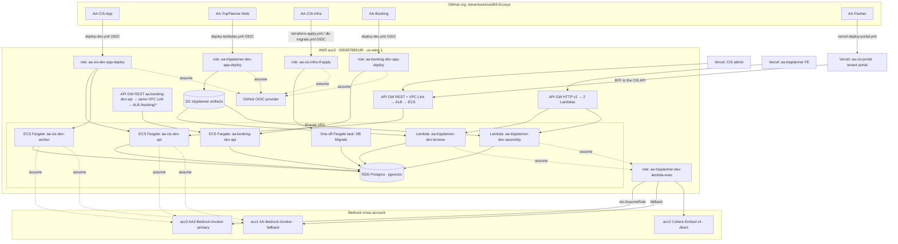

# AA-Ecosys — Ecosystem architecture

> **Status:** updated 18/10/2026 (S242 — §4.6 identity: Cognito WORKFORCE live for CIS staff, ADR 0006a; Booking
> staff still on the bridge until Phase 2); 16/10/2026 (S239 — AA-Booking §3.4 refresh: slices live through `bk-011`, live catalog read (S237 D4),
> customer identity per ADR 0006, `api-booking` sub-domain live); 14/10/2026 (S236 — ADR 0007 place pipeline in CIS; S235 — AA-Booking bootstrap live, OIDC trust narrowed, ADRs
> 0001/0004/0005 Accepted; previous revisions 11/10/2026 S225 AA-654, 25/09/2026). Items marked **[FACT]** were verified by reading code, migrations or live
> state; **[TO CONFIRM]** marks an inference or gap that Nghiệp still has to confirm.
> Target direction and decisions: [ADR 0001](adr/0001-ecosystem-target-architecture.md),
> [ADR 0002](adr/0002-only-cis-writes-content.md), [ADR 0003](adr/0003-one-durable-job-model.md),
> [ADR 0004](adr/0004-aa-booking-stack-and-bootstrap.md) (AA-Booking stack and bootstrap) with
> [amendment A1](adr/0004a-supply-content-ownership.md) (supply content ownership),
> [ADR 0005](adr/0005-pricing-and-supplier-rates.md) (pricing and supplier rates),
> [ADR 0006](adr/0006-ecosystem-identity.md) (ecosystem identity on Cognito) with
> [amendment A](adr/0006a-identity-phase1-amendments.md) (Phase 1 as shipped),
> [ADR 0007](adr/0007-place-pipeline-in-cis.md) (place pipeline in CIS: `geo` schema, `catalog.*` views). Contract rules
> between apps: [`contracts/README.md`](contracts/README.md).

## 1. Overview

AA-Ecosys is a **multi-repo**: each app deploys on its own; locally they are gathered under one folder
`~/projects/AA-Ecosys/`, and all repos live in the GitHub org `AdventureAsia365-Ecosys` (renamed from
`AdventureAsia365-CIS`).

| Local folder | GitHub repo | Role | Deploy |
|---|---|---|---|
| `apps/AA-CIS-App` | `AA-CIS-App` | Content system of record: FastAPI backend (CIS core, A-series, T-series, and the Content studio API `/v1/*` + `/auth/tenant-login`), durable job worker, admin frontend. The tenant portal UI moved to AA-Partner (AA-979 P2a); the `portal/` folder here is a frozen, undeployed copy until it is deleted at P2b + 7 days | ECS Fargate (`aa-cis-dev-api` + `aa-cis-dev-worker`, one image) + Vercel `aa-cis-frontend` (admin) |
| `apps/AA-TripPlanner-Web` | `AA-TripPlanner-Web` | B2C web app: browse destinations and plan a trip (Next.js FE + 2 Lambda BE) | Vercel (FE) + Lambda (BE) |
| `infra/AA-CIS-Infra` | `AA-CIS-Infra` | Terraform — VPC, RDS, ECS, Lambda, API GW, OIDC, alarms, cross-account Bedrock; DB Migrate workflow | GitHub Actions (`accounts/aa365` root) + a human with MFA (acc1/acc3 roots) |
| `apps/AA-Booking` | `AA-Booking` | AAA: advisor workflow and booking lifecycle (live on Dev since 14/10/2026: inquiry intake, staff trip case workflow and proposals, pricing + FX, suppliers and supply, sellable trip plans; staff admin frontend; see 3.4) | ECS Fargate `aa-booking-dev-api` on the CIS cluster `aa-cis-dev-cluster` (acc2, same VPC, ADR 0004) |
| `apps/AA-Partner` (public) | `AA-Partner` | Partner agencies' app (ADR 0010, accepted 22/10/2026): the agency CRM and the tenant portal (Content studio, `portal/`, moved from AA-CIS-App with its history by AA-979 P2a on 25/10/2026; still the CIS tenant API-key sign-in, business logic in the CIS API, ADR 0010 §7); own schema `crm` (`crm-001` job table, `crm-002` agency + member tables), own LLM gateway, partner Cognito pool with MFA; integrations are bring-your-own (agency Twilio/WhatsApp, Stripe, mailbox, e-sign), maps provided by AA. Skeleton from AA-933: `/crm/health` + `/crm/health/ready`, route classes `/crm/v1` / `/crm/ops/v1` / `/crm/staff/v1`, `tenant_tx()`, `crm.job` worker in the API process | ECS Fargate ARM64 `aa-crm-dev-api` and `aa-crm-dev-web` on `aa-cis-dev-cluster` (each desired 1, running 1 on 25/10/2026), reached only through CloudFront `partner-dev.` -> VPC origin -> NLB -> ALB `/crm/*` rule (AA-931 edge, AA-933 rule); image ECR `aa-crm-dev-api` (IMMUTABLE, git SHA); deploy by GitHub OIDC role `aa-crm-dev-app-deploy`. Tenant portal: Vercel project `aa-cis-portal` (`portal.lumiguides.it.com`, same project and host as before the move), deployed only by AA-Partner `vercel-deploy-portal.yml`; it moves to CloudFront -> Fargate at P2b (ADR 0010 §6). P2b prepared S252 ([ADR 0010a](adr/0010a-content-studio-partner-sign-in.md)): Fargate service `aa-crm-dev-portal` (ECR `aa-crm-dev-portal`, deploy `deploy-portal-dev.yml`) behind its own CloudFront distribution for `portal.` (AA-CIS-Infra `crm_agency_edge.tf`), partner-pool sign-in with the CIS exchange `POST /auth/tenant-session`; the cutover is the `portal.` CNAME (`crm_agency_live`), Vercel stays the rollback target for 7 days after it |

**Boundary rule [FACT]:** *apps own code, Infra owns resources.* The clearest example is TripPlanner:
`infra/AA-CIS-Infra/accounts/aa365/tripplanner.tf` creates the 2 Lambdas from a 209-byte placeholder zip;
the `AA-TripPlanner-Web` repo builds the real code and ships it with `lambda:UpdateFunctionCode`
(Terraform `ignore_changes` covers the code attributes, so it never overwrites them). Source:
`infra/AA-CIS-Infra/docs/implementation-notes/AA-TripPlanner-backend.md`.

**AWS accounts [FACT]:** acc2 `005097885195` (us-west-1) holds all infrastructure. acc3 `786888028788`
(primary) and acc1 `867490540162` (fallback) only host Bedrock invoker roles and Cost Explorer readers.

## 2. System diagram

## 3. Database schema roles (shared RDS, acc2)

CIS, TripPlanner and (later) AA-Booking use **one RDS Postgres** in the acc2 VPC, with **fully separate
schemas**. Each schema has exactly one owner repo, and only that repo writes migrations for it — see
[`database/schema-ownership.md`](database/schema-ownership.md) (owners, `shared.*` table owners, version
keys `NNN` / `tp-NNN` / `bk-NNN`). Migrations reach Dev through the **DB Migrate** workflow of
AA-CIS-Infra (an identical copy in `db/migrations/<owner>/`, check → apply), never from a laptop.
Column-level truth: [`architecture/db-schema-reference.md`](architecture/db-schema-reference.md).

### 3.1 CIS — medallion + multi-tenant RLS [FACT]

Source: `apps/AA-CIS-App/api/migrations/*` (the old `infra/AA-CIS-Infra/modules/rds/migrations/` copy
was deleted in S225).

| Schema | Role | Scope |
|---|---|---|
| `shared` | Platform tables: tenants, brand rules, SEO config, API usage, jobs (`shared.job`), LLM gateway + cost logs, destinations, photos | Platform-wide |
| `silver_aa_internal` / `gold_aa_internal` | Medallion for the internal tenant `aa_internal` (Master Content) | Platform (sentinel tenant) |
| `silver_{id}` / `gold_{id}` | Medallion created dynamically for each new tenant | Per tenant |
| `acp_contract` | Atom / Segment / Ranking / Route / Hub / Search Demand | Mixed (see 3.2) |
| `acp_shared` | Subject (Slate) / Piece / Gate / Facts / tenant_config / marketplace / publish log | Mixed |
| `acp_deliver` | Pages delivered to tenants (`tenant_tour_pages`) | Per tenant |

Tenants are isolated with **RLS** (`SET LOCAL app.tenant_id` per transaction) and, where keys could
collide, by **folding `tenant_id` into the row identity** (e.g. `segment_id = sha256(tenant_id, place, action)`).

### 3.2 CIS — Master Content (platform-wide) vs Tenant Content [FACT]

Source: `apps/AA-CIS-App/CONTEXT.md` (ownership table, AA-540).

- **Master Content (admin, A-series):** computed **once, shared** by every tenant. A0 Upload → A3
  Master Content Pool (`gold_aa_internal.published_tours`) + **Atoms** (`owner_scope='platform'`). Atom
  reads go through `acp_contract.v_active_tour_atoms`, which follows the Master status (AA-713).
- **Platform-wide derived data:** **Segment / Score / Route / Hub** — platform-wide since AA-545
  (migration 146, 06/09/2026), no `tenant_id` column. Score = rank-sum over 4 dimensions (Demand /
  Recurrence / Questions / Said, AA-610), one pass per buyer market.
- **Tenant Content (T-series):** from **Slate** onward — Slate / Subject / Goal / Angle / Piece /
  Publish — **per tenant**. Slate has a **Debate** layer (AA-631: contested + brand-fit, advisory, never
  cuts more than 50%).

**Shared across tenants [FACT]:**

1. **Master Content pool + Atom pool** — a shared source every tenant reads directly (not a cache).
2. **Segment / Score / Route / Hub** — platform-wide rows.
3. **Search Demand + research log** — a real cache keyed `(keyword, market)` / `(place, market)`, **no
   `tenant_id` column**; stores `serp_domains` since AA-631.
4. **Facts Entry `scope='platform'`** — deliberate sharing, enforced by RLS.

Plus one **cross-tenant read (not a cache):** Gate F10 (cannibalization) compares a Piece's embedding
with every other tenant's.

### 3.3 TripPlanner — separate schema [FACT]

Source: `apps/AA-TripPlanner-Web/migrations/*`.

- Schema `tripplanner` is **fully independent** of CIS and uses `pgvector`. Its migrations register
  `tp-NNN` in `shared.schema_versions` (from tp-007).
- `shared.destinations` is **owned by CIS** (ADR 0002, CIS migration 201). The DB role `tripplanner` only
  has `SELECT` on it; TripPlanner also reads `gold_aa_internal.published_tours`,
  `acp_contract.v_active_tour_atoms` (CIS migration 216) and the photo views.
- **Photos (AA-708, 01/10/2026):** CIS owns `shared.place_photo` (CIS migration 198, FK to
  `shared.destinations`) and the `photo_sync` job. See 4.5.
- **Place read models (ADR 0007, 14/10/2026):** `tripplanner.itinerary_components`, `tour_day`,
  `tour_stop`, `tour_graph_*`, `tour_leg`, `tour_junction` are frozen. CIS rebuilds them in its own schema
  `geo` (CIS 226+) and TripPlanner reads them through `catalog.*` views (CIS 228) behind a runtime flag;
  the legacy tables are dropped 14 days after the cut-over.

### 3.4 AA-Booking — schema `booking` [FACT]

Decided 28/09/2026 (ADR 0001 decisions 6–7): AA-Booking runs on acc2 and shares the RDS with its own
schema `booking` (version key `bk-NNN`). AA-CIS-Infra provisions it inside acc2 (ECS service, ECR, DB
role, API route); there are no new accounts. It never writes another app's schema. Contracts are
versioned JSON in `docs/contracts/` (rules: [`contracts/README.md`](contracts/README.md)):

- **`inquiry.submitted`** (TripPlanner → AA-Booking, with the multi-tour leg chain; current version v1.2,
  `docs/contracts/inquiry.submitted.v1.2.json`: the guest always gives name + email + consent, each leg carries the
  catalog tour key `source_system` + `source_id`) is carried by a **transactional outbox**: TripPlanner's
  `tripplanner.v_inquiry_outbox` (grant `tp-009`), pulled by Booking's `booking.job` worker into
  `booking.inbox_events` with an idempotency key, then lead customer + trip case + staff notification.
- **CIS catalog** (contract `catalog.tour.v1`, CIS migration 225 grant to role `booking`) is **read live at request
  time, never copied** (S237 decision D4, AA-679; it replaced the planned `catalog.tour.*` outbox and sync job):
  `catalog.v_tour` / `v_tour_day` / `v_tour_photo` for sellable trip plans (Booking keeps only the commercial row,
  `booking.trip_plans`, keyed on the CIS `source_id`) and `catalog.v_destination` for the supplier place picker
  (AA-822).

Identity: ADR 0001 decision 6 gave AA-Booking the customer identity (its own OTP stack, tables in `bk-001`).
[ADR 0006](adr/0006-ecosystem-identity.md) amends this: the target is the shared Cognito EXTERNAL pool
(`aa-external`) for travellers and Booking customers (AA-703 epic, AA-680), so the `bk-001` OTP tables are interim and
not built out. Booking staff sign in today through the interim bridge of ADR 0004 O1 (CIS-issued RS256 JWT,
`aud=booking`, verified against the CIS JWKS), to be swapped for the Cognito WORKFORCE pool in Phase 2 (see 4.6;
Booking's verifier needs code changes, not only configuration).
Stack, runtime and decisions O1–O9: [ADR 0004](adr/0004-aa-booking-stack-and-bootstrap.md) (Accepted
14/10/2026); prices and suppliers: [ADR 0005](adr/0005-pricing-and-supplier-rates.md).

Live on Dev since 14/10/2026 (AA-678, `infra/AA-CIS-Infra/accounts/aa365/booking.tf`):

| Item | Value |
|---|---|
| Repo | `AdventureAsia365-Ecosys/AA-Booking` (repo id `1418188499`) |
| Runtime | ECS service `aa-booking-dev-api` on `aa-cis-dev-cluster`, own ECR `aa-booking-dev-api`, log group `/ecs/aa-booking-dev`, own execution/task roles |
| Entry | Separate REST API `aa-booking-dev-api` (`9z3xnalp59`) on the **shared VPC link** → NLB → ALB listener rule `/booking`, `/booking/*` → Booking target group. Custom sub-domain `api-booking.lumiguides.it.com` live (ADR 0004 O2; `/booking/health` 200 on 16/10/2026); the execute-api URL still answers |
| Database | Schema `booking`, login role `booking` (created by `bk-001`, password set out-of-band; DSN in Secrets Manager `booking/dev/database-url`). Migrations applied through Infra DB Migrate from `bk-001` (14/10/2026) to the latest, `bk-011` (15/10/2026) |
| Slices | `bk-001` foundation (customers, OTP tables, audit log, inbox events) · `bk-002` inquiry intake + `booking.job` worker (AA-681) · `bk-003` staff profiles, trip case workflow (DB-enforced status transitions), proposal versions (AA-680 staff half, AA-681) · `bk-004` / `bk-006` / `bk-007` pricing engine, rules + FX with maker-checker approval (AA-810, ADR 0005) · `bk-005` wave 1 staff admin backend · `bk-008` suppliers + contracts (AA-822) · `bk-009` sellable trip plans over the live catalog (AA-679) · `bk-010` hotels, room types, services, supplier net rates (AA-823) · `bk-011` catalog tour key on trip case legs (AA-830). Staff "new inquiry" e-mail through SES (`bk_notify_email` job, AA-811). Staff admin frontend in `frontend/` (Next.js, Vercel `aa-booking-admin`, AA-683) |
| Health | `/booking/health` (liveness, reports `git_sha`), `/booking/health/ready` (DB + every required `bk-NNN`; reported `bk-011` on 16/10/2026) |

## 4. Data contracts

### 4.0 Write rule — only CIS writes content (ADR 0002, 01/10/2026) [FACT]

- **Content** (tours, atoms, places in `shared.destinations`, itinerary places / tour graph, photos) is
  created, changed and deleted **only by CIS** — through a job or an admin action with a tracking page.
- Other apps (TripPlanner, AA-Booking) **read through views only** and write only their own schema
  (+ `shared.llm_call_log`, cost logs). Enforced with DB grants: role `tripplanner` has only `SELECT` on
  `shared.destinations` (CIS migration 201).
- The place pipeline (itinerary extraction, geocode, tour graph) still lives in TripPlanner and is
  **frozen**; it moves to CIS under AA-712 as designed in [ADR 0007](adr/0007-place-pipeline-in-cis.md):
  CIS-owned schema `geo`, job kinds `place_extract` / `place_geocode` / `tour_graph_build` on `shared.job`
  (background priority, cap 1), `shared.destinations` unique on `(name_norm, country, locality_norm)`,
  Geoapify (OSM data, storable) as the confirming geocoder for all countries with Mapbox as basemap only,
  and TripPlanner reading `catalog.*` place and graph views. TripPlanner cuts over only when the views cover every tour the
  legacy tables cover.

### 4.0a Tour liveness and retirement (ADR 0015, Proposed, AA-986)

- Whether an AA tour is **served** is one CIS-owned state per catalog key `(source_system, source_id)`:
  `served` / `retired` / `paused` / `restored`, derived from `raw_tours` and `published_tours` status columns, changed
  only by one CIS write service, read inside CIS from one view.
- Other apps learn about a retirement from a CIS-owned change record (a table in a CIS schema) read through tombstone
  / outbox contract views in `catalog` (contract `catalog.tour.v1.3`, additive), not by noticing a tour is gone from
  `catalog.v_tour`. A `paused` key is a temporary absence (404, not 410).
- Per app: tenants keep their T2 copies and posts with a warning, and new work is refused (409 `tour_discontinued`);
  Booking keeps confirmed bookings with a staff flag and refuses new quotes and holds; TripPlanner answers 410 and
  flags saved trips; SEO 410 for retired, 301 for superseded. A supersede is not a deletion.
- Rule and open questions: [ADR 0015](adr/0015-tour-liveness-and-retirement-propagation.md); evidence:
  [S248 audit memo](audits/2026-10-23-S248-tour-deletion-propagation/memo.md).

### 4.1 Frontend ⇄ backend

| Edge | Contract | Source |
|---|---|---|
| CIS FE (Vercel) ⇄ CIS API | REST through API GW (REST + VPC Link) → ALB → ECS. Auth: tenant JWT; staff = Cognito WORKFORCE access token as `Authorization: Bearer` (legacy HS256 sessions refused since AA-816 S2, `LEGACY_ADMIN_LOGIN_ENABLED` off by default), plus the admin secret added by the BFF for paths outside the staff prefixes (4.6) | `AA-CIS-App/CONTEXT.md` |
| AA-Booking ⇄ clients | REST through API GW `9z3xnalp59` (shared VPC Link) → ALB `/booking/*` → ECS `aa-booking-dev-api`. Staff auth: CIS-issued JWT verified by Booking (`aud=booking`, ADR 0004 O1; built in `bk-003`, interim until Cognito per ADR 0006). The staff admin frontend calls it through its Next.js BFF | `booking.tf`, ADR 0004 |
| TripPlanner FE (Vercel) ⇄ BE | The Next.js BFF calls 2 Lambda URLs through API GW HTTP v2: `ANY /browse/{proxy+}` → browse, `ANY /trip/{proxy+}` → assembly; header `X-TripPlanner-Key`. Env `BROWSE_API_URL` / `TRIP_API_URL` | `tripplanner.tf`, `docs/vercel-setup.md` |

Contracts between apps (views, grants, events) are listed in each repo's `CONTEXT.md`
("Contracts with other apps").

### 4.2 App / infra boundary (deploy contract) [FACT]

- **TripPlanner:** Infra creates the Lambdas from a placeholder zip; the app builds and calls
  `UpdateFunctionCode`. Terraform `ignore_changes` on code attributes. Artifacts bucket
  `aa-tripplanner-dev-lambda-artifacts-<acct>`.
- **CIS:** Infra creates ECS / RDS / API GW; the app builds an image → ECR → new task definitions for api
  and worker on the same image (`Deploy Dev`, blocked while `shared.job` has queued/running jobs).
- **AA-Booking:** Infra creates ECR / ECS service / roles / REST API (`booking.tf`, task definition and
  desired count in `ignore_changes`); the app builds an image tagged with the git SHA and deploys through
  its own least-privilege role `aa-booking-dev-app-deploy`, then smoke-tests `/booking/health` (same `git_sha`) and
  `/booking/health/ready`. Booking has its own `booking.job` table (`bk-002`, ADR 0004 O3), so the CIS guard is
  unaffected. Its own deploy guard is built (AA-751 / X6, S240–S241): the `preflight` job of Booking
  `deploy-dev.yml` calls `GET /booking/ops/deploy-gate` with its GitHub OIDC token and waits until `booking.job`
  is idle (the always-queued `bk_inquiry_pull` singleton is not counted).
- **Migrations:** the owner repo authors them; Infra's DB Migrate applies them to Dev before the app code
  that needs them merges.

### 4.3 Bedrock (cross-account) [FACT]

Source: `infra/AA-CIS-Infra/docs/implementation-notes/AA-TripPlanner-backend.md`, `accounts/acc1-bedrock`,
`accounts/acc3-bedrock`.

- **Embeddings (Cohere Embed v4):** acc2 calls `bedrock:InvokeModel` directly, no satellite.
- **Claude / other chat models:** acc2 cannot call them directly → `sts:AssumeRole` into
  **acc3 (primary)** / **acc1 (fallback)**.
  - acc3 role `AA3-Bedrock-Invoker`, ExternalId `aa296-satellite-bedrock-acc3`.
  - acc1 role `AA-Bedrock-Invoker`, ExternalId `aa296-satellite-bedrock`. Created by hand for AA-296,
    now imported into Terraform (`accounts/acc1-bedrock/bedrock_invoker_import.tf`, AA-302).
- Cross-account trust references the **role ARNs** (`aa-tripplanner-dev-lambda-exec`, the ECS task role) —
  nothing tied to GitHub names, so the org rename did not affect them.
- The satellite roles trust only the **ECS task role** (and the TripPlanner Lambda exec role) → Claude
  cannot be called from a laptop; real measurements / A-B runs go through ECS exec in the `api` container.
- **The model per stage is decided by the DB (Model Gateway)**: `shared.llm_role_config` +
  `shared.llm_model_catalog`, editable in CIS admin Settings → LLM Models (shadow switch and sample %),
  every call logged to `shared.llm_call_log`. Do not memorize the current routing — read the Settings
  page. Policy (S222): every LLM path prefers Bedrock; judges default to GPT Luna via Bedrock acc3, OpenAI
  kept as a fallback; one judge model is picked by 31/10/2026.
- **Bedrock Batch (AA-606):** the S3 prefix `batch-*/s1-rewrite/*` and the acc1/acc3 batch service roles
  exist, but AWS **has not enabled Batch Inference for acc3** (case 178979743800653, blocker AA-624) → no
  real batch job has run yet. **[TO CONFIRM]** current status of the AWS case.

### 4.4 Cost monitoring (cross-account) [FACT]

Source: epic AA-616 (AA-617/618/619/620/622/623/625/627/635), `infra/AA-CIS-Infra/CONTEXT.md`.

- **Token-based estimate:** `shared.llm_call_log` (account acc1/acc3, provider, fallback) +
  `shared.dfs_call_log` (real DataForSEO cost, cache hits). DFS cache TTL 7 days. Ad-hoc scripts must log
  too (`stage="adhoc_<issue>"`).
- **Real AWS bills:** acc2 is a **member account**, not the AWS Organizations payer → no consolidated Cost
  Explorer call. Each account has its own CE reader role (`AA-CostExplorer-Reader` acc1,
  `AA3-CostExplorer-Reader` acc3) that the acc2 ECS task role assumes; acc2 calls CE directly. Snapshots
  live in `shared.cost_explorer_snapshot`, refreshed by `POST /admin/cost-explorer/check`.
- **Admin page "External Spend"** (`/admin/llm-usage`): estimate vs real bill, Bedrock split from
  infrastructure per account, date-range filter.
- **DFS balance alert:** Lambda `aa-cis-dev-dfs-balance-check` + a daily EventBridge Scheduler (group
  `aa-cis-dev-acp`); the same probe also calls `/admin/waves/check` (AA-727).
- **Log-write failure alarms (AA-756):** CloudWatch metric filters + alarms on `/ecs/aa-cis-dev` for
  `llm_call_log` / `decision_log` / `llm_shadow_log` / `dfs_call_log` write failures (namespace
  `aa-cis/ops`).

### 4.5 AA photos (AA-708, 01/10/2026) [FACT]

One photo source for the whole ecosystem, per ADR 0001 decision 1 (CIS is the content source, other apps
read a read model):

| Part | Owner | Notes |
|---|---|---|
| Originals | Content team | PHOTOS folder on Jira CON (Google Drive, public link) |
| Sync + match | CIS — job `photo_sync`, page Admin › Photos | Drive → S3 (WebP 1600/600) → `shared.place_photo` |
| Reading photos | Every app | **Views only:** `shared.v_tour_photos` (per tour) and `shared.v_destination_photos` (per place, cover = `position` 1); never the tables |
| Photo URL | CIS public API | `{CIS_API_BASE}{path}?size=large\|small` (302 → S3; later CloudFront, same path) |
| TripPlanner destination cover | CIS writes `shared.destinations.cover_image_url` | Only empty cells, or cells this job set earlier |

Order per country (rerun wave): S1 rewrite → A3 atomize → **re-extract places** (still in TripPlanner,
moving to CIS under AA-712 / ADR 0007, where it becomes the `place_extract` job enqueued by atomize and
the graph build enqueues cover/photo match) (`tripplanner.itinerary_components` / `tour_stop`, later
`geo.*`) → Admin › Photos:
"Sync <country>" + "Match places + covers". A photo is only matched against places in **that tour's own
itinerary**. Filling destination covers stays off until places are re-extracted. AA-Booking (AA-679,
S237 D4) reads tour photos live from `catalog.v_tour_photo`.

### 4.6 Identity (ADR 0006 + 0006a, 18/10/2026) [FACT]

One identity service for the ecosystem: Amazon Cognito in acc2, Essentials plan, Terraform in AA-CIS-Infra
`accounts/aa365/identity*.tf`. Phase 0 (pools, triggers) and Phase 1 for CIS staff are live on Dev.

| Population | Pool / client | State |
|---|---|---|
| CIS staff | WORKFORCE `us-west-1_bCcFvbSOS`, client `cis-admin` | **Live.** Email one-time code on managed login at `https://staff-auth.lumiguides.it.com` (AA-branded, own domain since S242). The CIS BFF runs auth code + PKCE; the CIS API verifies the access token (WORKFORCE issuer only, `client_id` ∈ {cis-admin, breakglass}, `token_use=access`) and resolves the `shared.admin_users` row by `(iss, sub)`; role = highest `cis-*` group. Legacy password login off since AA-816 S2 (22/10/2026; `LEGACY_ADMIN_LOGIN_ENABLED` off by default, ADR 0006a A12). Preview signs in on `aa-cis-preview.lumiguides.it.com` with client `cis-admin-preview`, capped at viewer (A11) |
| Break-glass | WORKFORCE, client `breakglass` | **Live, disabled at rest.** `admin@adventure.asia`, password + TOTP; secret `aa-identity/dev/breakglass` readable only by the MFA admin role, every read/write and token issue alerts |
| Booking staff | WORKFORCE, client `booking-staff` (callbacks on `booking.lumiguides.it.com`) | **Phase 2, not started.** Booking still verifies the CIS bridge token (ADR 0004 O1) issued by `/auth/booking-token` from a CIS password session; Booking roles are already stored in CIS `shared.staff_app_grant` and mirrored to `booking-*` groups |
| Tenant users | EXTERNAL `us-west-1_nKOvHan0W`, client `cis-portal` | Phase 3 (AA-813), not started; tenants keep `/auth/tenant-login` with the API key. AA-979 P2b ([ADR 0010a](adr/0010a-content-studio-partner-sign-in.md), prepared S252): Content studio people move to the **partner pool** (re-enrolment by a CIS-created, CRM-delivered invitation; CIS exchanges the partner access token for a 15-minute tenant JWT); API keys stay for machines, the studio's API-key sign-in ends at the P2b clean-up |
| Travellers / Booking customers | EXTERNAL, clients `tripplanner`, `booking-customer` | Phase 4 (AA-680), not started; native self sign-up stays off until WAF is on |

- **Staff directory = CIS.** `shared.admin_users` (+ `email`, `cognito_iss`/`cognito_sub`, `is_owner`, CIS 247)
  and `shared.staff_app_grant` (per-app roles) are the source of truth. Only owners write it, from the CIS admin
  Staff page; each write goes to the DB first, then to Cognito through the CIS task role's allow-list.
  A report-only job `staff_directory_reconcile` compares the two and shows cutover readiness.
- **Cutover (not started):** every active staff row linked by its own sign-in, managed-login break-glass tested,
  the admin-secret check made principal-aware and the secret rotated, then the legacy flag off for the CIS UI.
  `/auth/admin-login` and `/auth/booking-token` stay until Booking Phase 2.
- Apex `lumiguides.it.com` is an A record to Vercel (the `aa-cis-frontend` project redirects it to
  `aa-cis.lumiguides.it.com`); Cognito requires a parent A record for its custom domains.

## 5. OIDC / CI-CD

Every CI job assumes its **own** role through GitHub OIDC (AA-806 role split, `cicd_split.tf`). The
legacy shared `aa-cis-dev-role` was retired in AA-806 step 3 (S239, last use 14/10/2026) and the apply
boundary denies recreating it. The repos use GitHub's immutable subject claim, so every trust pins the
org id and the repo id (`repo:AdventureAsia365-Ecosys@<org_id>/<repo>@<repo_id>:<context>`); the exact
values live in Terraform (`local.oidc_sub_cis_app`, `local.oidc_sub_cis_infra`, `local.tp_oidc_subjects`,
`local.bk_oidc_subjects`), not in prose. Checked against AA-CIS-Infra `main` on 19/10/2026.

| Role | File | Trusted context | Used by |
|---|---|---|---|
| `aa-cis-dev-app-deploy` | `accounts/aa365/cicd_split.tf` | AA-CIS-App, `environment:dev` | CIS `Deploy Dev` (ECR push, CIS task families and services only) |
| `aa-cis-infra-tf-plan` | `accounts/aa365/cicd_split.tf` | AA-CIS-Infra, `pull_request` | `Terraform Plan` (read only) |
| `aa-cis-infra-tf-apply` | `accounts/aa365/cicd_split.tf` | AA-CIS-Infra, `environment:prod` | `Terraform Apply Prod`, `DB Migrate`, `DB Schema Dump`, `DB Isolation Probe` (boundary `aa-cis-infra-tf-apply-boundary`) |
| `aa-booking-dev-app-deploy` | `accounts/aa365/booking.tf` | AA-Booking, `environment:dev` or `ref:refs/heads/main` | Booking `Deploy Dev` (Booking ECR, task family and service only) |
| `aa-tripplanner-dev-app-deploy` | `accounts/aa365/tripplanner.tf` | AA-TripPlanner-Web, `ref:refs/heads/main` (pinned S235 Phase 0) | `deploy-lambdas.yml` (artifact zip + the two Lambdas' code) |

Bootstrap objects (these roles, both boundaries, the OIDC provider, the agent session role) are applied
locally with the MFA admin profile; CI apply cannot rewrite them (AA-CIS-Infra `CONTEXT.md`, "CI/CD and
OIDC"). Every new IAM role must carry the workload boundary `aa-workload-boundary`.

**Safe rename rule:** widen trust to accept **both** the old and the new org (additive) **first**, rename
the org **after**, remove the old trust last. Role ARNs in workflows come from `secrets` / `vars`, and
resource names use the `aa-cis-*` / `aa-tripplanner-*` prefixes (independent of GitHub names) → only the
`sub` match is affected.

> **[FACT — G5 done 21/09/2026, AA-588]** Trust for the old org `AdventureAsia365-CIS` was removed from
> both roles; `sub` now matches only `AdventureAsia365-Ecosys` (verified live with `aws iam get-role`).
>
> **OIDC subject form (checked in CloudTrail 21/09/2026, AA-588):** the repos enable "include repo ID
> in the subject", so the real `sub` is `repo:AdventureAsia365-Ecosys@<orgid>/<repo>@<repoid>:<ref>`. The flat
> pattern `repo:AdventureAsia365-Ecosys/*:*` **fails with AccessDenied** (CI Terraform Plan #94). History: the
> trusts first used a wildcard after the org name; since AA-678 / S235 Phase 0 every role pins the exact ids
> (table above).

## 6. Debt / future work

- **AA-Booking (AAA):** slices live through `bk-011` (3.4). Open: staff sign-in on Cognito WORKFORCE (ADR 0006
  Phase 2, 4.6), customer-facing app and customer identity on Cognito (AA-680, ADR 0006), Playwright smoke of the staff admin in
  Booking CI (the non-required "Frontend Build" job already runs eslint, tsc and `next build`). The hand-off
  from TripPlanner is live (outbox → `bk_inquiry_pull`, contract `docs/contracts/inquiry.submitted.v1*.json`); the
  pre-build draft is archived at [`archive/2026/tripplanner-to-aaa-handoff.md`](archive/2026/tripplanner-to-aaa-handoff.md).
- **Place pipeline to CIS (AA-712, [ADR 0007](adr/0007-place-pipeline-in-cis.md)):** required before
  destination covers are switched on. Geocoder decided (Geoapify, S236; surfaces showing coordinates need
  "Powered by Geoapify" + "© OpenStreetMap contributors"). Open: TripPlanner vector search must be
  rewritten (HNSW top-k or destination centroid) before the catalog-wide run.
- **[TO CONFIRM]** CloudFront in front of TripPlanner browse routes (listed as a later change).
- **CIS data rerun:** waves are registered and reported through `/admin/waves` (`shared.rerun_wave`,
  AA-727); Batch Inference on acc3 (AA-624) is still blocked.

## 7. References

- `apps/AA-CIS-App/CONTEXT.md` — repo context (stack, deploy, boundaries), glossary, ownership /
  cross-tenant table (AA-540), contracts with other apps.
- `apps/AA-TripPlanner-Web/CONTEXT.md` — B2C map planner, Next.js FE + 2 Lambdas (browse stateless /
  cacheable, assembly stateful + Bedrock), event-sourced trip, schema `tripplanner.*`.
- `infra/AA-CIS-Infra/CONTEXT.md` — 3-account model, S3 state, OIDC / CI-CD, how to apply, DB Migrate,
  the "apps own code, Infra owns resources" boundary.
- `docs/adr/` — ecosystem ADRs; `docs/database/schema-ownership.md` — schema owners.
- `infra/AA-CIS-Infra/docs/implementation-notes/AA-TripPlanner-backend.md` — TripPlanner Terraform report.
- `infra/AA-CIS-Infra/accounts/aa365/{cicd_split.tf, cicd.tf (bootstrap locals), tripplanner.tf, booking.tf}` — OIDC roles, Booking runtime.
- `docs/contracts/README.md` — contract rules between apps; `docs/adr/0005-pricing-and-supplier-rates.md`.
- `apps/AA-TripPlanner-Web/docs/{vercel-setup,architecture-overview,smoke-test-runbook}.md`.
- `docs/archive/` — retired one-off pages (org-rename inventory, CIS data reset S182-S183, pre-build Booking hand-off).
