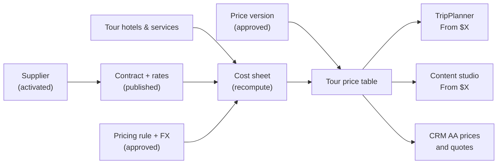

# Business owner onboarding and the price system

> [!WARNING]
> UNTESTED - do not follow in an incident without checking each step.

This runbook takes the business owner from no access to working with the price system on **Dev**. It has two
readers:

- **The tech lead** creates the accounts and sits with the business owner for the first sign-in (Parts A and B).
- **The business owner** tests the admin and the agency app, then works with the price system (Parts C and D).

Every page address, button and rule below comes from the app code on `main` and the Dev evidence of 2026-11-23.
Anything not confirmed is marked **to confirm with the tech lead**. Button names are the English screen text; the
apps open in English. The Vietnamese translation of this page, [business-owner-onboarding-and-pricing.vi.md](business-owner-onboarding-and-pricing.vi.md),
also gives the Vietnamese screen labels.

## At a glance

| Part | What | Who | Time |
|---|---|---|---|
| [Before you start](#before-you-start) | Prepare, decide two open points | Tech lead | 15 min |
| [A](#part-a-the-staff-account) | Staff account in CIS and Booking, business-owner marker, authenticator | Tech lead with the business owner | 30-45 min |
| [B](#part-b-the-test-agency-account) | Test agency, owner invitation, agency sign-in | Tech lead, then the business owner | 30 min |
| [C](#part-c-the-price-system) | Every price-system task: where, who, approval | Business owner | reference |
| [D](#part-d-safe-end-to-end-test-on-dev) | One synthetic tour from supplier to agency price, then revert | Business owner, tech lead for two steps | 60-90 min |
| [E](#part-e-clean-up-and-removing-access) | Remove the test agency, change or remove access | Tech lead | 15 min |

The Dev addresses used on this page:

| App | Address |
|---|---|
| CIS admin | <https://aa-cis.lumiguides.it.com> |
| Staff sign-in (company e-mail) | <https://staff-auth.lumiguides.it.com> |
| Booking admin | <https://booking.lumiguides.it.com> |
| Agency app (CRM and Content studio) | <https://portal.lumiguides.it.com> |
| TripPlanner (travellers) | <https://tripplanner.lumiguides.it.com> |

## Start at My work

After sign-in both apps open on **My work**: CIS on **Home › My work**, Booking on the **Dashboard** with its My work
band. Start there every day.

- **Needs your approval** (CIS) and **To approve or pay** (Booking) list what another person prepared and you may
  approve: Settings changes, compliance exceptions and data erasure in CIS; supplier bills, agency payments,
  stop-sales, suppliers, billing and bank changes, **price versions**, **add-ons**, **season changes** and **holiday
  events** in Booking. Each tile opens the list it counts. Your own proposals and requests appear only where you may
  approve them yourself: in Booking while the business-owner self-approval switch is on (never a stop-sale or a
  removal), in CIS Settings while two-person approval is off or for a setting that needs only one person.
- Tiles with nothing waiting fold into one line, "Nothing waiting in N queues". Open it to see them.
- **Keep an eye on** (CIS) shows items that wait for a policy decision, such as the tours held by the elephant-riding
  policy. They are not counted as work.
- The price setup team also sees **Price setup progress**: tours by their next setup step.

## Before you start

### What the tech lead prepares

1. Confirm the AWS account.

   ```bash
   aws sts get-caller-identity --profile aa365-admin
   ```

   Expected: the acc2 account of the [account map](../onboarding.md). Abort if it is another account.
2. Open CIS admin **Platform › Staff & access**. Expected: the text "As a platform owner you can add accounts…". If
   the page says "Read-only: only a platform owner can change accounts.", stop: only a platform owner can do Part A.
3. Check that e-mail can reach a real mailbox.

   ```bash
   aws sesv2 get-account --profile aa365-admin --region us-west-1 --query ProductionAccessEnabled
   ```

   Expected: `true`. If `false`, invitations reach only verified addresses; fix that first.
4. Decide two open points and write the answer in the session log:
   - **The business owner's CIS role.** The business-owner preset gives the full CIS administrator role. A narrower
     role is still an open decision. This runbook uses the preset.
   - **The business owner's address on the agency sign-in.** The Dev agency sign-in holds synthetic users only.
     Inviting the real work address puts one real address there. The alternative is an address on the E2E test
     mailbox, but then the business owner does not get the mail directly.
5. Have your AWS admin profile and its MFA ready for step [A7](#a7-set-up-the-authenticator-for-staff-sign-in).
6. Pick one CIS tour for Part D. In Booking **Price setup**, choose a tour whose status is **No components** and
   that has one night only (a 2-day tour), or whose nights are all in the same CIS place. Never pick "Tour X" (the
   E2E test tour). Note the CIS place of its night (the **Hotels & services** drawer shows it as "Night at …") and its
   TripPlanner address, `https://tripplanner.lumiguides.it.com/tours/<slug>` (`<slug>` is the tour's web name shown
   in the address bar).

### What the business owner needs

- A phone with an authenticator app that keeps a backup, for example Google Authenticator, Microsoft Authenticator
  or 1Password. It gets two entries: one for staff sign-in, one for the agency app.
- An own `@adventure.asia` mailbox open on the same computer. The shared `admin@adventure.asia` address is the
  emergency account and cannot be used.
- A password manager. It holds two passwords: the staff one (after step A7) and the agency one (Part B).
- Two browser windows: the normal window for staff pages, and a private window (or another browser profile) for the
  agency app. The two sign-ins are separate and must not mix.
- No VPN, or a VPN that exits in Vietnam. The staff pages accept visitors from a fixed list of countries only.

### Ground rules on Dev

- Real AA business data is allowed (tech lead decision, 2026-11-24): real suppliers, hotels, room types, services,
  optional activities, contracts and prices may be entered on Dev and kept. Dev is the only environment for now, so
  this is where the catalogue is built.
- Personal data stays invented: never type a real customer, lead, traveller or agency contact. Use addresses ending in
  `example.invalid`.
- Supplier bank accounts: only invented numbers until production exists. Real bank details wait for production.
- Test records stay marked: name every record you create only to try a feature `SYNTHETIC …`, and put "Test" in a
  test agency name, so that tests and real data never mix.
- Leave the existing test agencies alone ("Lữ hành Sen Vàng", "E2E Pilot Rehearsal Travel", the load-test agencies,
  any "E2E …" agency) and every `e2e-` account.
- Never share a one-time code, a password or an authenticator code with anyone, the tech lead included.
- Some steps call paid AI. Each new hotel or service queues one AI draft (capped at 20 calls and 1 USD a day), and a
  content plan writes posts with AI. Keep the counts small.

## Part A: the staff account

One staff account gives access to CIS admin, Booking admin and the CRM staff console. Booking reads its role from
CIS, so every change is made on the CIS **Staff** page.

### A1. Find or create the staff row

1. The tech lead opens <https://aa-cis.lumiguides.it.com/admin/platform/staff> (sidebar **Platform › Staff & access**).
2. Look for the business owner's address in the list.
3. If the row is there, read its roles and sign-in state, then go to [A2](#a2-apply-the-business-owner-role).
4. If there is no row, click **Add staff**. In **Add staff account**:
   - **Work email**: the business owner's address. Only `@adventure.asia` addresses are accepted.
   - **Display name**: the name staff see.
   - **Role**: **Business owner**.
   - Keep **Send invitation email** ticked.
   - Click **Create account**.

Expected: the banner "Created … An invitation email with the sign-in steps goes to that address in about 2 minutes."

Verify: the row shows status **Active**.

If it fails:

- "A staff account with this address already exists; change it from its row": go back to step 3 and use that row.
- "Saved, sign-in update pending.": click **Retry Cognito**. On the row the same repair is **Retry Cognito sync**.
- "Invitation email is not set up on this server…": e-mail is off; give the business owner the sign-in steps of
  [A4](#a4-first-sign-in-to-cis) yourself.

### A2. Apply the business owner role

1. Open the row. The drawer **Manage access** opens.
2. In **Role**, find the card **Business owner** and click **Apply**.
3. Confirm "Apply the Business owner preset?" with **Apply**.

Expected: "Business owner preset saved in CIS and the company sign-in. The person signs in again to use it."

Verify: the row shows CIS role **Administrator** and Booking role **Booking admin**. The CRM role is kept as it was.

Roll back: apply another preset, or **Show all roles** → set each role → **Save roles**.

What the role gives:

| App | Role | What it allows |
|---|---|---|
| CIS | Administrator | Everything except managing staff accounts: settings and their approval, reference prices, publishing, billing, spend |
| Booking | Booking admin | Every Booking page and every approval, the audit log, payouts |

> [!NOTE]
> No preset makes anyone a platform owner or the business owner. The business-owner marker is set in
> [A5](#a5-set-the-business-owner-marker). The platform owner flag (manage staff accounts) is not needed for this work
> and is set only by the tech lead outside the app.

### A3. Send the invitation

1. If the account is new, the invitation is already queued. If the row exists but the business owner never signed
   in, open the row and, in **Manage access**, click **Send invite** (**Resend invite** if one was sent before). At
   most once every 10 minutes, five times a day.
2. Expected: within about 2 minutes the business owner gets "You've been added to Adventure Asia staff admin" from
   `no-reply@lumiguides.it.com`. It lists the CIS and Booking access and four sign-in steps.

The e-mail is in English and says "There is no password". It does not mention the authenticator: that comes in A7.

Verify: on the row, **Last invited** shows "Sent".

### A4. First sign-in to CIS

The business owner, with the tech lead alongside:

1. Open <https://aa-cis.lumiguides.it.com/login>. The page is titled "CIS Internal", "Staff sign-in".
2. Click **Sign in with company email**.
3. The Adventure Asia sign-in page opens on `staff-auth.lumiguides.it.com`. Type the work address.
4. Open the e-mail with the one-time code and type the code.

Expected: the CIS admin opens. This first sign-in links the company sign-in to the staff row.

Verify (tech lead): the row shows **Last sign-in** filled, and the drawer shows "Company sign-in: Linked" instead of
"Not linked yet (links on the first sign-in)".

If it fails: "Not authorised for AA staff sign-in" means the account has no staff role or no verified
`@adventure.asia` address. Check A2, click **Retry Cognito sync**, and sign in again.

> [!NOTE]
> Do A4 before A6. Booking finds the business-owner marker through the linked company sign-in, so the first CIS
> sign-in must have linked the account.

### A5. Set the business-owner marker

The marker lets the business owner approve some of their own work in Booking. Each such approval is flagged and
listed for review (see [approval rules](#c0-how-prices-flow-and-who-approves)).

1. The tech lead opens the row → section **Business owner** → **Make business owner**.
2. Confirm "Make this person the business owner?".

Expected: "Business owner set." and the badge **Business owner** on the row.

Rules: one person at most holds the marker. It cannot be set on an inactive or test account. Only a platform owner,
signed in with the company sign-in, sets it. Every change is in the audit log.

If it fails:

- "Another staff member is the business owner; clear that marker first": remove it from that person first.
- "An E2E test account can never be the business owner": wrong row.
- "This account is disabled; enable it first": click **Enable** on the row, then try again.

Roll back: **Remove business owner**.

### A6. First sign-in to Booking

1. The business owner opens <https://booking.lumiguides.it.com>. The page says "Sign in to Booking" (English only).
2. Click **Sign in with company email**. Usually no new code is asked: the staff sign-in stays open for about an
   hour.

Expected: the Booking dashboard opens. The Booking profile is created on this first visit, with the admin role. The
side menu shows **Supply** with the pricing pages.

Verify: the dashboard's **My work** band shows the tile "Business-owner self-approvals - None this month".

If it fails: "Your company account has no Booking role yet…" means the sign-in still carries the old role. Sign out,
wait up to 15 minutes, and sign in again.

Sessions: one sign-in per working day. After any role change, sign out and in again.

### A7. Set up the authenticator for staff sign-in

Staff sign-in has no authenticator setup in the browser. The tech lead runs a setup tool from a terminal, with the
business owner at the keyboard. Follow the Infra runbook "Staff administrators: TOTP enrolment and the MFA switches"
(`infra/AA-CIS-Infra/docs/runbooks/staff-admin-mfa.md`), sections A and B. In short:

1. The tech lead starts `staff-totp-enroll` for the business owner's address, with the tech lead's AWS admin profile
   and its MFA.
2. The business owner types a new password twice: at least 16 characters, with an upper-case letter, a lower-case
   letter, a digit and a symbol, and saves it in the password manager.
3. In the authenticator app, add the setup key shown on screen: name `AA Staff (dev)`, type **Time based**.
4. Type the 6-digit code from the app.
5. Expected: "mfa: TOTP enrolled, verified and preferred". The account is signed out everywhere.
6. The tech lead runs `staff-totp-check`. Expected last line: `OK amr=["pwd", "otp", "mfa"]`.
7. The business owner signs in again: **Sign in with company email** → work address → choose the **password**
   option → password → 6-digit code.

> [!CAUTION]
> Run the tool in a terminal only the two of you see, never through an agent: the setup key is shown once. After
> this step the e-mail code is no longer offered to this account. Lost phone: the tech lead reruns the tool with
> `--rotate`.

Three switches can force administrators to use the authenticator code. This page does not record their state, which
changes: read it live before Part A.

| App | Switch | Where | Who it checks |
|---|---|---|---|
| CIS | Staff sign-in: administrators must use an authenticator code | CIS **Platform › Settings** | CIS administrators and platform owners |
| Booking | Administrators need an authenticator code | Booking **Supply › Pricing policy**, section **Staff sign-in** | Booking admins |
| CRM | Staff sign-in: CRM operations staff must use an authenticator code | CRM tab of CIS **Platform › Settings** | crm-platform-admin, crm-ops, and cis-admin on CRM operations pages |

While the CIS or Booking switch is off, the e-mail-code sign-in of A4 and A6 works before A7. Turning a switch on is a
separate tech-lead decision (**to confirm with the tech lead**: whether the CIS and Booking switches go on after this
enrolment or stay off until prod).

> [!WARNING]
> If the CRM switch is on, then until A7 is done the CIS pages that call the CRM (the CRM tab of **Platform ›
> Settings**, the CRM jobs card on **Home › App health** (`/admin/platform/apps`), **Tenants › CRM agencies**
> (`/admin/tenants/agencies`)) can refuse the business owner with "Administrators must sign in with their password
> and the 6-digit code…". This follows from the code; it was not tried live.

### A8. Check that Part A worked

| Where | Expected |
|---|---|
| CIS **Platform › Staff & access**, the business owner's row | Active; CIS role Administrator; Booking role Booking admin; badge Business owner; Last sign-in filled; Last invited Sent; drawer "Company sign-in: Linked" |
| CIS Staff page, **Directory health** card → **Check now** | "In sync" |
| CIS **Platform › Audit log** (`/admin/platform/audit`) | `staff.roles_changed` (or `staff.created`), `staff.cognito_synced`, `staff.invite_sent`, `staff.business_owner_changed` |
| Booking **Admin › Staff** (`/staff`) | The business owner's profile, role admin, "Last seen" filled |
| Booking dashboard | Tile "Business-owner self-approvals" |

## Part B: the test agency account

The business owner tests the agency app as an agency owner would see it. The agency account is separate from the
staff account: different sign-in, different password, its own authenticator entry. It never counts as the business
owner in Booking.

### B1. Create the test agency

Who: the tech lead. It needs the CIS administrator role and the company group that may create CRM agencies. A test
account (`e2e-`) can never do it.

1. Open <https://aa-cis.lumiguides.it.com/admin/tenants> (**Tenants › Directory**).
2. Click **New Tenant**.
3. Fill in:
   - **Company Name**: `Test Agency - Business Owner`. The slug fills itself.
   - **Plan**: `starter`.
   - **Posts/week**: `1`, to keep AI writing low.
   - **CRM add-on**: **CRM Core (crm.core)**.
   - **Agency owner e-mail (optional)**: this field appears once a CRM add-on is picked. Leave it empty: B3 sends
     both invitations together.
   - **TripPlanner add-on**: leave empty unless the business owner wants to test it.
4. Click **Create Tenant**.

Expected: a result dialog with the rows **Tenant account**, **Content studio subscription**, **CRM add-on**,
**TripPlanner add-on**, **CRM agency** and **Owner invitation**. With no owner e-mail, **Owner invitation** says
nobody was invited.

On Dev a new agency is always a synthetic demo agency. Do not use the single pilot slot for this test.

If a row shows "attention": the CRM part failed, but the agency exists. Create the CRM agency from **Tenants › CRM
agencies › Create agency**. The dialog has no retry button.

### B2. Give it a small AI budget

1. Open the agency's **Tenant 360 › Cost › AI budget**.
2. Set a small monthly budget (amount to confirm with the tech lead). A budget of 0 stops all its content AI.

The CRM has its own AI budget, set by the agency owner in CRM **Settings › AI** (default 2 USD, AI off by default).

### B3. Invite the business owner to own the CRM and the Content studio

1. Open **Tenants › CRM agencies** (`/admin/tenants/agencies`) and open the test agency.
2. In **First owner**, click **Invite first owner**.
3. Fill **Owner's email** with the address decided in [Before you start](#what-the-tech-lead-prepares).
4. Tick **Also invite to the Content studio as owner**.
5. Click **Send invitation**.

Expected: two lines, "Partner CRM: first-owner invitation sent…" and "Content studio: owner invitation sent…". Two
e-mails arrive.

If one invitation fails: **Withdraw owner invitation** in the same drawer, then invite again. In **Tenant 360 ›
Members**, **Send invitation again…** resends the Content studio one.

### B4. Accept the first invitation

The business owner, in the **private window**:

1. Open the link in the first e-mail (`https://portal.lumiguides.it.com/join?t=…`). The page "Your invitation to AA
   Partner" opens.
2. Click **Open invitation**. The page shows the address to sign in with and a **one-time password**, shown only once.
   Keep the page open.
3. Click **Continue to sign in**. The agency sign-in page opens.
4. Type the address and the one-time password.
5. Choose an own agency password and save it.
6. Set up two-step sign-in: scan the QR code with the authenticator app, then type the 6-digit code. This is required
   for every agency user.
7. Click **Accept invitation**.

Expected: the agency app opens.

If it fails:

- "You are signed in with another account…": this is the staff window. Use the private window.
- The page was closed before the one-time password was used: the tech lead clicks **Withdraw owner invitation** and
  invites again.

### B5. Accept the second invitation

1. Open the link in the second e-mail. The page says the address already has an AA Partner account.
2. Sign in with the agency password and the 6-digit code, then accept.
3. Expected: "Your Content studio access is ready", or "…being set up. Open it in a minute". Click **Open the Content
   studio**.

### B6. What to test in the agency app

| Test | Where | Expected |
|---|---|---|
| App switcher | Top of the agency app | Content studio and CRM (and TripPlanner if added) |
| Vietnamese | Account menu › **Language and dates** | The app switches to Vietnamese |
| AA tours with a price | Content studio › Marketplace (`/portal/tours`), both views (**All tours**, **In my catalog**) | A priced tour shows "From $X per person" and "Suggested retail (RRP) for 2 travellers, not your agency's price". A tour without a price shows **Price on request**: expected for most Dev tours |
| AA prices for the agency | CRM sidebar › Money › **AA prices** (also Settings › **AA prices for your agency**, `/aa-tariff`) | A price list per tour, season and group size: price per person sharing a twin room, single supplement, child and infant prices, the agency's discount and the suggested retail price. Groups that AA quotes on request (8-10 and 11+ with the starting value 9) read **On request**. "Priced tours: N of M", currency, **Download CSV**, **Print**, and **Booking conditions with AA** under the table (deposit, balance, cancellation fees, quote validity, group size, child and infant ages, AA's terms). Few or no rows today. "Your agency is not linked to AA's agency prices…" during the first 5 minutes |
| The agency's own selling rules | CRM › Settings › **Pricing** (`/settings/pricing`) | Age bands, staff discount limit, markup on AA products |
| A test client | CRM | Only invented names and `example.invalid` addresses |

> [!NOTE]
> Staff test accounts can also see a synthetic agency. That is another reason to type invented clients only.

There is no self-service reset of the agency authenticator. If it is lost, the tech lead resets it by hand after the
business owner confirms, which raises a security alarm. Use an authenticator app with backup.

### B7. Check that Part B worked

| Where | Expected |
|---|---|
| New Tenant result dialog | Every row done |
| **Tenant 360 › Members** | The business owner's row: Owner, **Active** (before accepting: "Invited") |
| **Tenants › CRM agencies**, the agency | **Synthetic** ticked, one active owner, **Features allowed** shows the plan after the next sync |
| Booking **Partners** page | The agency is active within about 5 minutes, tier `standard` |
| CIS **Platform › Audit log** | `tenant.crm_onboarded` and the membership rows |
| Optional: **Tenant 360 › View as partner** | Read-only view of the agency's pages, 5-60 minutes, reason required, logged |

## Part C: the price system

All price pages are in Booking admin, <https://booking.lumiguides.it.com>, menu group **Supply**. Every Booking staff
page has the EN | VI switch in the top bar; the sign-in page is English only.

### C0. How prices flow and who approves

Booking owns every price. One price table feeds everything outside Booking.



- **Suggested retail price (RRP)** = the price from the pricing rule + 25 %. The same for every agency.
- **Public "from" price** = the cheapest RRP per person for 2 travellers still valid today.
- **Agency price** = the rule price minus the agency's tier or rate-card discount.
- **Provisional price** and **CIS reference price** are hints for staff. They are never a selling price.

Approval rules. A maker never approves their own work, with one exception: the business owner, while the switch
"The business owner may approve her own work" is on. Each such approval is flagged and listed in the audit log tab
**Business-owner self-approvals**. This switch and the payout switch are in **Supply › Pricing policy**, section
**Staff sign-in**: check that both are on before Part D.

| Task | Who can make it | Second person | Business owner may approve their own |
|---|---|---|---|
| Activate a supplier | Admin, Product & operations | Yes | **Yes, flagged** |
| Publish a supplier contract | Admin, Product & operations | Yes (no writer of the draft) | **Yes, flagged** |
| Approve a price version | Admin, Product & operations | Yes | **Yes, flagged** |
| Season range, holiday event | Admin, Product & operations | Yes | **Yes, flagged** |
| Calendar default, tour calendar | Admin, Product & operations | Yes | API yes, but the screen hides the button (see C9) |
| Departure price adjustment | Admin, Product & operations | Yes | **Yes, flagged** |
| Billing entity payment details | Admin, Finance | Yes | **Yes, flagged** |
| Approve a supplier bill | Admin, Product & operations | Yes (never who entered it or last changed its amounts) | **Yes, flagged** |
| Approve an agency payment | Admin, Finance | Yes (never who recorded it) | **Yes, flagged** |
| Record the payout of a supplier bill the business owner approved | Admin | Yes | **Yes, flagged** (second switch); never on a bill the business owner entered or edited |
| Pricing rule, FX rate, cancellation fees | Admin, Product & operations | Yes | **No** |
| Agency tier discount, rate card | Admin, Product & operations | Yes | **No** |
| Allotment | Admin, Product & operations | Yes | **No** |
| Stop-sale and lifting it | Admin, Product & operations | Yes | **No** |
| Pricing policy change | Admin, Product & operations, Finance (by section) | Yes | **No, never** |
| Any removal or rejection | - | Yes | **No, never** |
| Hotels and services | Admin, Product & operations | No (active at once when an admin creates them) | - |
| Make a tour sellable | Admin, Product & operations | No | - |
| Move an agency to another tier | Admin, Product & operations | No (audited) | - |
| Allow sale of a blocked tour | Admin only | No (audited) | - |

Withdrawals: a maker withdraws their own draft or pending row (price version, pricing rule, FX rate, season row)
without anyone else. Withdrawing a published price version needs a second person.

> [!NOTE]
> The team has three people, and the content and operations person can never approve. So for every "No" row above,
> the second person is the tech lead. The tech lead never self-approves: the tech lead holds no marker.

### C1. Watch readiness

**What:** the state of every tour's price and whether it can be operated.

**Where:** **Price readiness** (`/pricing/readiness`) and **Price setup** (`/pricing/workbench`).

**Who:** every Booking role except Content creator can read.

**Steps:**

1. Open **Price setup**. Read the top numbers: **Trip plans**, **Ready to sell**, **Need hotels and services**,
   **Need supplier rates**, **Provisional prices**.
2. Each tour shows seven checks and a **next step**: Add hotels & services, Replace an inactive item, Load supplier
   rates, Approve an exchange rate, Approve a pricing rule, Recompute prices, Make sellable, Ready to sell.
3. Open **Price readiness** for the price status (Priced, Priced by hand, Missing rates, Missing FX rate, No pricing
   rule, No components, Inactive component) and the **Can operate** column (Ready, Warnings, Blocked, Exception).
4. **Download CSV** exports the list.

**Today on Dev (2026-11-23):** 892 tours, 2 priced, 0 "Ready" on Can operate. No tour is sellable to agencies end to
end. The CIS **Data coverage** page (`/admin/data-coverage`) shows the same counts.

### C2. Suppliers

**Where:** **Supply › Suppliers** (`/suppliers`).

**Who:** Admin, Product & operations create; Admin, Product & operations activate.

**Approval:** a second person activates. The creator, or anyone who edited the supplier while it was waiting, can
never activate it. The business owner may activate their own, flagged.

**Steps:**

1. Click **Add supplier**, fill the name and the categories, then **Save supplier**.
2. Expected: the supplier is **Pending approval**, with the banner "This supplier waits for approval: a second person
   activates it before contracts can be added."
3. To activate, open the supplier and click **Activate**. For a maker who is not the business owner, the button
   reads **Activate (needs a second person)** and is disabled.
4. When the business owner activates their own supplier, the dialog says "You created this supplier. Activating it
   yourself is recorded as a business-owner self-approval."
5. **Reject** in the row menu turns down a waiting supplier.

**Downstream:** until a supplier is active, it cannot get hotels, services or contracts, and tours using it are
blocked. A supplier with a published contract in force or upcoming cannot be deactivated.

**Queue:** My work tile "Suppliers to activate".

**Gotcha:** activate from the supplier's page. The row menu does not show the self-approval notice.

### C3. Hotels and services

**Where:** **Supply › Hotels** (`/hotels`) and **Supply › Services** (`/services`).

**Approval:** none. A hotel or service created by an admin is active at once.

**Steps, a hotel:**

1. **Add hotel** → **Supplier** (an active supplier with the Hotel category), **Hotel name**, **City / place** (a CIS
   place; picking one fills the country) → **Save hotel**. Expected: "… added as … Add its room types next."
2. On the hotel, **Add room type** → **Name** (for example `Double`) → **Add room type**. Editing a
   room type later saves with **Save room type**.

**Steps, a service:** **Add service** → **Save service**.

The supplier must be active and have the matching category. Records are never deleted, only deactivated.

**Downstream:** tours point to these records. An inactive item blocks the tour's price ("Inactive component"). A
hotel without a room type is never suggested for a tour (C6).

**Cost:** each new hotel or service queues one AI draft in CIS.

### C4. Supplier contracts and rates

**Where:** a supplier's page, tabs **Contracts** and **Rates**.

**Approval:** a second person publishes. Nobody who wrote the draft or its rates may publish it, except the business
owner, flagged.

**Steps, one rate at a time:**

1. **New contract**: title, valid from, currency. It starts as a draft.
2. Tab **Rates** → **Add rate**. Rates can be added only while the contract is a draft.
3. In the contract's row menu, click **Publish**. For a writer who is not the business owner, it reads **Publish
   (needs a second person)**.

**Steps, many rates (Excel):**

1. **Import rate sheet** → **Download the template**.
2. Fill it, upload the filled sheet, and click **Check the sheet**. Nothing is written while a problem remains.
3. Click **Import as draft**. Expected: "Draft contract created with {n} rates. A second person publishes it."
4. Publish as above.

**Downstream:** publishing queues a price recompute. A published contract is fixed. New prices need a new contract.
**Expire** closes a published contract; it needs no second person.

**Gotcha:** when the business owner publishes their own draft, the dialog still says "You confirm you checked the
terms entered by …". The approval is flagged all the same.

### C5. Pricing rules and FX rates

**Where:** **Supply › Pricing rules & FX** (`/pricing/rules`), tabs **Pricing rules** and **FX rates**.

**Approval:** always a second person. **No business-owner self-approval.** If the business owner creates a row, the
tech lead approves it.

**Steps:** **New rule** or **New FX rate** → fill → save. The row shows **Pending approval** (an FX rate saves with
"… rate saved as Pending approval…"). The second person clicks **Approve**. If the maker clicks **Approve** on their
own row, the page answers "You created this row. A second person has to approve it (maker-checker)."

**Fields of a rule:** target margin, floor margin, peak uplift, card fee, RRP markup, early-booking points. Selling
price = net ÷ (1 − margin − card fee).

**Downstream:** without an approved agency (B2B) rule, no tour prices. Without an FX rate for a cost currency, the
status is "Missing FX rate". USD needs no FX rate.

### C6. Hotels and services on a tour

**Where:** **Price setup** → a tour → **Hotels & services**.

**Approval:** none.

**Steps:**

1. The drawer suggests items from the CIS itinerary, matched against existing Booking hotels and services. A hotel is
   suggested for a night when it scores enough: named in the day's text, at the night's CIS place, the place in its
   name or address, in the tour's country. Only hotels with a room type are suggested. A night with no suggestion
   shows **No match**: add a hotel at that night's CIS place (C3), or mark the night as needing no hotel (step 3).
2. Click **Accept**, **Reject** or **Other match** on each suggestion, then **Save {n} hotel and service item(s)**.
3. A night that needs no hotel (a night train, a cruise without a cabin room type): in the section **Can agencies
   buy it?**, tick **Night N: no hotel needed**, fill **Why do these nights need no hotel?** (at least 20
   characters), and click **Save nights**. This has its own Save button; it is not saved with the items. The mark
   lifts rule N1 for that night and is audited.

**Downstream:** the cost sheet uses these items. A night without a hotel and without the mark blocks agency quotes.

### C7. Recompute and make sellable

**Where:** **Price setup**, bulk actions.

**Approval:** none for the switch itself. **Make sellable** needs an approved price that is valid today.

**Steps:**

1. Select tours. **Recompute prices** (at most 50 at a time). Expected: status **Priced** and a value in **RRP for 2**.
2. **Make sellable**. A tour without an approved price is skipped: "no approved price yet (approve a price version or
   publish supplier rates)".
3. **Make not sellable** stops agency sales.
4. **Show CIS price as provisional** copies the CIS reference as a staff hint. Quotes, agency prices and the public
   price never use it, except the CRM's below-public-price warning, which uses it while the tour has no real price.
   **Clear provisional price** removes it.

**Many tours (Excel):** **Download workbook** → fill → **Import workbook** → **Check** → **Import**. Prices in the
workbook become **draft price versions**, never live prices. Only 50 tours are recomputed per import: use smaller
workbooks.

**Gotcha:** **Make not sellable** does not hide the public "from" price. Only removing the price does (C8 or C4
Expire, then recompute).

**Gotcha:** sellable does not mean an agency can buy. The agency quote still checks **Can operate** (C13).

**Gotcha:** computed prices use the **Group size bands** of the pricing policy (C10). After a band change, the computed
rows move only at the next recompute: **Recompute prices** here, **Recompute from rates** on a trip plan, or the
automatic recompute after the approval (or on the change's effective day). Until then the rows of the old bands stay.

### C8. Price versions (prices by hand)

**Where:** **Price setup** → a tour → **Price versions** → tab **Versions**.

**Approval:** a second person approves. The business owner may approve their own, flagged. Rejections always need a
second person. The maker withdraws their own draft or pending version; withdrawing a published version needs a
second person.

**Steps:**

1. **New draft from the prices in force** → edit → **Save draft**.
2. **Submit for approval** with a reason (up to 300 characters). The screen freezes the difference and its impact.
3. The approver opens the same tab and clicks **Approve**. If the draft changed meanwhile, the approval is refused.

**Downstream:** the tour price table is rebuilt. The new price reaches the agency prices, the Content studio and
TripPlanner (C16).

**Gotchas:**

- Prices cannot be edited directly. Every hand price goes through a version.
- There is no list of all waiting versions: the approver opens each tour's **Versions** tab.
- When the business owner approves their own version, the drawer does not say it is a self-approval. It is flagged
  all the same.
- A published version is removed only by a withdrawal, which needs a second person.

### C9. Seasons and holiday events

**Where:** **Supply › Seasons** (`/pricing/seasons`) and **Supply › Holiday events** (`/pricing/holiday-events`).

**Approval:** **Propose** with a reason, then a second person **Approve** or **Reject**. The business owner may
approve their own season range (low, high, peak, festive) and holiday event, flagged. Stop-sale ranges and removals
always need a second person.

**Steps:** **New calendar** (no approval, changes no price) → add a range → **Propose**. **New holiday event**: one
per country, code and year. **Remove** → **Approve removal** or **Keep it**. A tour's calendar is requested from its
**Versions** tab with **Ask for the change**.

**Downstream:** peak uplift and season cuts in prices, quotes and agency prices. Festive dates shorten quote validity.
Until a tour's calendar is set, every date is priced as low season.

**Gotcha:** the screen hides **Approve** for the business owner's own calendar default and own tour calendar,
although the rules allow it. Ask the tech lead to approve those.

### C10. Pricing policy

**Where:** **Supply › Pricing policy** (`/pricing/policy`), tabs **Parameters** and **Cancellation fees**.

**Approval:** always two people. Never self-approved, so nobody changes the approval rules alone. Approver groups:
"Pricing lead" (Admin, Product & operations), "Finance" (Admin, Finance), "Administrator" (Admin only).

**Steps:** **Change** → new value → takes effect on (today or later) → reason (required, up to 300 characters) →
**Submit for approval**. The other person opens the row and clicks **Approve** or **Reject**.

**Downstream:** a change applies from its day, never backwards, and only to new quotes, versions and agency price
lists. An approval after the day has passed is refused.

Key parameters: quote validity, hold hours, child and infant ages, rounding by currency, sale-exception days (14 by
default, 30 at most). Section **Staff sign-in** holds the authenticator switch and the two business-owner switches. A
badge "Not enforced yet" marks values that are stored but not used.

**Group size bands** (section **Prices**): the group sizes a tour's computed price table is priced for, typed as
`1, 2, 3, 4, 5-7, 8-10, 11+` (the starting value: the business owner's 2, 4, 5-7 and 8-10, with 3 on its own and an
open band from 11). Each band is priced for its smallest group, so 4 travellers on their own pay less per person than
in a 3-4 band. Rules: start at 1, no gap or overlap, only the last band may end with `+`, at most 8 bands.

- Existing computed prices change only at the next recompute (C7); until then the table keeps the old bands.
- Hand prices (C8) may use any group sizes and win over the computed rows they cover.
- More bands mean fewer future date ranges fit in a tour's price table (200 rows; the latest are left out first).
- The agency tariff lists one price per band, per person sharing a twin room, with a separate single supplement (a
  traveller alone in a room pays it on top; an odd group no longer costs more per person than the even group below
  it). Its suggested retail price is on the same basis: on an odd band of a computed price it is lowered to the twin
  share; a hand price (C8) is shown as entered, so enter hand prices per person sharing a twin room. An agency quote
  does not use the bands: it prices the real group from the tour's costs, so a group of 6 can be
  quoted below the 5-7 tariff row (priced for 5).
- A group at or above **Group quoted on request from** (starting value 9) is still quoted on request, whatever band
  holds it. The agency tariff shows every band that reaches this size as **On request** (8-10 and 11+ with the
  starting value), and the agency's **Booking conditions with AA** show the same value.

### C11. Agency tiers, discounts and rate cards

**Where:** **Supply › Agency tiers** (`/pricing/agency-tiers`).

**Approval:** discounts and rate cards always need a second person. **No business-owner self-approval yet.** Moving
an agency to another tier needs no second person and is audited.

**Steps:** **New tier**, **New discount**, **New rate card**. Rows wait in **Pending rows** until another person
clicks **Approve**. **View tariff** opens the price list one agency sees, with CSV and Print.

**Rules:** tiers start as standard 0 %, silver 3 %, gold 6 %. A discount counts only once approved. A rate card for
one tour beats a whole-catalogue card, which beats the tier. A price below the floor shows a warning, never a block.

**Downstream:** the agency's CRM page **AA prices for your agency** and its quotes, within about a minute.

### C12. Departures, allotments and price adjustments

**Where:** **Catalog (from CIS) › Trip Plans** → a tour → tab **Departures**; **Operations › Departures**
(`/departures`).

**Steps and approval:**

- **Add departure** or **Generate departures** (weekly or monthly, up to 400 days): no approval.
- Allotment: proposed by one person, approved by another. No self-approval.
- **Propose price adjustment** on a departure (percent or amount per traveller, with a reason): a second person
  approves. The business owner may approve their own, shown as "Recorded as a business-owner self-approval".

### C13. Can operate and "Allow sale…"

**What:** a tour can be sold to agencies only if it can be run. Rules: N1 a night without a hotel, N2 a missing rate,
N3 a supplier not active (blocks); N4 a destination change without a transfer, N5 a guide on some days only (warnings).

**Where:** **Price readiness**, column **Can operate**.

**Who:** Admin only, for the exception.

**Steps:** in the cell, **Allow sale…** → reason (at least 20 characters) → days (14 by default, 30 at most) →
**Allow sale**. **Revoke** ends it early.

**Limit:** the exception covers N1 and N3 only. A missing rate or an inactive item stays blocked.

### C14. Stop-sales

**Where:** **Supply › Stop-sales** (`/stop-sales`).

**Approval:** a new stop-sale works at once. Its review and its lifting need a second person. Never self-approved.

**Downstream:** a stop-sale date turns a quote line into "on request". Queue: My work tile "Stop-sales to review".

### C15. Billing entity payment details

**Where:** **B2B › Settlement** (`/agency-billing?tab=settings`) → entity row → **Change payment details**.

**Approval:** a second person with Admin or Finance. The business owner may approve their own; the dialog says "You
asked for this change. Approving it yourself is recorded as a business-owner self-approval."

**Downstream:** the change applies on approval. Invoices keep the old details until then. Queue: My work tile
"Billing changes to approve".

### C16. Where a price shows, and when

| Place | What it shows | When a change shows |
|---|---|---|
| TripPlanner tour page | "From $X per person", "Suggested price for 2 travellers. Your advisor confirms the final price." | Up to about 30 minutes |
| Agency's own TripPlanner site | No price (the agency sells under its own name) | - |
| Content studio › Marketplace (both views) | "From $X per person" with "Suggested retail (RRP) for 2 travellers, not your agency's price"; **Price on request** when there is none | At once |
| CRM › AA prices | The agency's twin-share price per tour, season and group size, single supplement, child and infant prices, its discount, suggested retail; **On request** for the group bands; Booking conditions with AA | Within about 1 minute |
| CRM proposal builder, AA item | A live AA quote. A sell price below AA's public price gives a warning only | Live per quote |
| Booking | Price readiness, Price setup, View tariff | At once |
| CIS admin | Reference prices (never a selling price), Data coverage | At once |

**Gotcha:** the public "from" price shows even when the tour is not sellable. Agencies still cannot quote it.

### C17. Pricing calculator

**Where:** **Sales › Pricing calculator** (`/pricing/calculator`). It prices cost lines with today's rule and FX.
Nothing is saved.

**Gotcha:** it opens on a retired traveller channel. Pick the B2B channel first.

### C18. Oversight of self-approvals

- Booking **Admin › Audit Log** (`/audit-log`) → tab **Business-owner self-approvals**
  (`/audit-log?owner_self_approved=true`). Every flagged approval is listed there.
- The dashboard tile "Business-owner self-approvals" counts this calendar month. Admins see it.
- Remaining risk: a platform owner can move the marker, including to themselves. Every move is in the CIS audit log.

## Part D: safe end-to-end test on Dev

One synthetic supplier, one hotel, one rate, on one unpriced tour (the tour picked in
[Before you start](#what-the-tech-lead-prepares): one night, or all nights in one CIS place). No money moves: agency
quotes and holds charge nothing. The first step also proves, live, that business-owner self-approval works.

### D1. Supplier and self-approval

1. **Supply › Suppliers** → **Add supplier**: name `SYNTHETIC price test`, category Hotel, a country of the chosen
   tour → **Save supplier**.
2. Expected: **Pending approval**.
3. Open it → **Activate**. Expected dialog: "You created this supplier. Activating it yourself is recorded as a
   business-owner self-approval." Confirm.
4. Expected: status Active. **Admin › Audit Log** → tab **Business-owner self-approvals** shows one row.

If it says **Activate (needs a second person)**, one of these is the cause:

- The marker is not set (A5).
- The company sign-in is not linked yet: no CIS sign-in has happened (A4).
- The switch "The business owner may approve her own work" is off (**Supply › Pricing policy**, section **Staff
  sign-in**).
- The session is not a company sign-in (**Sign in with company email**).

Fix the cause, then reload the page after a minute. The tech lead doing the same steps with their own supplier gets
"needs a second person": that is the expected contrast.

### D2. Hotel

1. **Supply › Hotels** → **Add hotel**: **Supplier** `SYNTHETIC price test`, **Hotel name** `SYNTHETIC hotel`,
   **City / place** the CIS place of the tour's night (noted in Before you start) → **Save hotel**.
2. On the hotel, **Add room type**: **Name** `Double` → **Add room type**.
3. Expected: the hotel is active at once, with one room type.

### D3. Contract and rate

1. Open the supplier → **New contract**: title `SYNTHETIC contract`, valid from today, currency USD.
2. Tab **Rates** → **Add rate** for the double room, for example 50 USD a night.
3. Contract row menu → **Publish**. Confirm. Expected: status published, flagged as a business-owner self-approval.

### D4. Rule and FX

1. Open **Price setup** and find the tour.
2. If its next step is **Approve a pricing rule** or **Approve an exchange rate**, stop and ask the tech lead. Rules
   and FX need a second person. With USD rates, no FX is needed, and an agency rule is already in force on Dev (to
   confirm with the tech lead).

### D5. Hotels on the tour

1. Price setup → the tour → **Hotels & services**.
2. On each night, `SYNTHETIC hotel` is suggested: click **Accept**. A night showing **No match** is in another CIS
   place: add another `SYNTHETIC` hotel there (D2), or, if the night truly needs no hotel, tick **Night N: no hotel
   needed**, fill **Why do these nights need no hotel?** (for example "Synthetic test tour, overnight transfer
   night") and click **Save nights**.
3. Click **Save {n} hotel and service item(s)**.

### D6. Price

1. Select the tour → **Recompute prices**.
2. Expected: status **Priced** and a value in **RRP for 2**. If it says **Missing rates**, another item on the tour
   has no rate: remove it from the tour (D5) and recompute.

### D7. Watch it appear

1. Agency window → Content studio › Marketplace → the tour. Expected at once: "From $X per person".
2. TripPlanner `https://tripplanner.lumiguides.it.com/tours/<slug>`. Expected within about 30 minutes: "From $X per
   person".

The tour is not sellable yet, but the public price already shows (C16).

### D8. Optional: sell to the test agency

1. Price setup → select the tour → **Make sellable**.
2. **Price readiness** → **Can operate** should read **Ready** or **Warnings** (N4 a hotel move with no transfer, N5 a
   guide on some days only; agencies can still buy). If it reads **Blocked**, open the tour's **Hotels & services**
   and read the findings in the section **Can agencies buy it?**: a night with no hotel (N1, fix D5), a missing rate
   (N2) or an inactive supplier or item (N3).
3. Agency window → CRM › Money › **AA prices**. Expected within a minute: the tour with the agency's price (tier
   standard, 0 % discount), its single supplement, **On request** on the 8-10 and 11+ rows, "Priced tours: N of M"
   and **Booking conditions with AA** under the table.
4. Optional: in a CRM proposal, add the tour as an AA item and click **Ask AA for a price**. Use an invented client.

### D9. Revert, in this order

| Step | Action | Who | Expected |
|---|---|---|---|
| 1 | Price setup → **Make not sellable** | Business owner | Tour not sellable; gone from the agency's AA prices within a minute |
| 2 | Supplier → contract row menu → **Expire** | Business owner | Contract expired |
| 3 | Price setup → **Recompute prices** | Business owner | Status back to Missing rates or No components; Marketplace shows no price; TripPlanner clears within about 30 minutes |
| 4 | **Hotels & services** → **Remove** the synthetic items → **Save {n} hotel and service item(s)**; then, in **Can agencies buy it?**, untick any **Night N: no hotel needed** → **Save nights** | Business owner | No synthetic item and no test mark left on the tour |
| 5 | Deactivate `SYNTHETIC hotel`, then the supplier | Business owner | Inactive. A supplier with a contract in force cannot be deactivated: do step 2 first |
| 6 | Revoke any **Allow sale…** exception | Admin | It also ends by itself after its days |
| 7 | Cancel any test agency case or hold | Business owner | Its supplier bookings are cancelled too |
| 8 | Check **Audit Log** | Business owner | The flagged rows stay as the record |

If a price version was used instead of D3: a published version is removed only by a withdrawal, and withdrawing a
published version needs a second person. Plan for the tech lead to withdraw it at step 2.

## Part E: clean-up and removing access

### E1. Remove the test agency

Order that works (read from the code, not tried live):

1. **Tenant 360 › Members** → the owner row → **Remove…**. The CRM member is disabled and the CRM agency is locked.
2. **Tenants › CRM agencies** → the agency → **Delete test agency**. Type the agency name exactly. This cannot be
   undone.

If **Delete test agency** is refused:

- "The agency still has active or invited members. Disable them first.": do step 1 first.
- "The agency holds travellers or inquiries, so it cannot be deleted here.": test clients or inquiries exist; use
  **Offboard** below.

The last active owner cannot be disabled in the drawer.

Alternative: **Offboard** on the Directory row, with a reason. This starts one erasure request across all apps
(**Tenants › Data erasure › Tenant offboarding**). The Booking partner becomes suspended at the next sync. A synthetic
agency may also stay offboarded.

The agency sign-in account stays: the code never deletes an account that set its own password. Keep it for future
tests, or the tech lead removes it by hand, which raises a security alarm.

### E2. Change or remove staff access

All on CIS **Platform › Staff & access** → the business owner's row:

| Goal | Action | Effect |
|---|---|---|
| Stop all access | **Disable** → "Disable this account?" | Sign-in blocked in CIS, Booking and CRM; sessions end; a live session lasts up to 15 more minutes. The row is kept |
| Allow again | **Enable** | Sign-in works again |
| End every session | **Sign out everywhere** | Also enables a disabled account |
| Remove Booking only | Booking role **No Booking access** → **Save roles** | CIS stays |
| Pause Booking only | Booking **Admin › Staff** → **Deactivate** | Booking only |
| Remove the marker | **Remove business owner** | The business owner's own approvals need a second person again |
| Lower the role | Change the CIS role | Nobody can lower their own role; the last owner cannot be lowered |

## Troubleshooting

| Symptom | Cause | Fix |
|---|---|---|
| "A staff account with this address already exists…" | The row exists | Use that row (A1 step 3) |
| "Saved, sign-in update pending." | The company sign-in update failed | **Retry Cognito** or **Retry Cognito sync** |
| No invitation e-mail | E-mail not set up, or sent within the last 10 minutes | **Manage access** → **Send invite** (or **Resend invite**) after 10 minutes; check spam |
| "Not authorised for AA staff sign-in" | No staff role or no verified company address | Check A2, **Retry Cognito sync**, sign in again |
| Booking: "Your company account has no Booking role yet…" | Old role in the session | Sign out, wait up to 15 minutes, sign in again |
| **Activate (needs a second person)** for the business owner | Marker not set; company sign-in not linked (no CIS sign-in yet); self-approval switch off; or not a company sign-in | A4, A5, the switch in **Pricing policy › Staff sign-in**; reload the page after a minute |
| "Administrators must sign in with their password and the 6-digit code…" | An authenticator switch is on and the e-mail code was used | Choose the password option with the code; or do A7 |
| E-mail code no longer offered at staff sign-in | A7 done: by design | Password + 6-digit code |
| Lost the staff authenticator | - | Tech lead reruns the setup tool with `--rotate` |
| Staff pages do not open at all | VPN exit country not allowed | Switch the VPN off |
| "You are signed in with another account…" on the invitation | Staff window used | Use the private window |
| One-time agency password lost | The page was closed | **Withdraw owner invitation**, invite again |
| "Your agency is not linked to AA's agency prices…" | Booking partner not created yet | Wait about 5 minutes |
| Tour shows **Price on request** in the Marketplace | No approved price | Expected for most Dev tours |
| Make sellable skipped: "no approved price yet…" | No published rate or approved version | C4 or C8, then recompute |
| **Hotels & services** shows **No match** for a night | No hotel with a room type at that night's CIS place | Add a hotel with that **City / place** and a room type (C3), or mark the night as needing no hotel |
| Agency quote refused, "night N has no hotel" | Can operate rule N1 | Hotel on every night, **Night N: no hotel needed** → **Save nights**, or **Allow sale…** |
| The business owner cannot approve their own FX, rule, tier discount or policy change | By design | The tech lead approves |
| No **Approve** for the business owner's own calendar default | The screen hides it | The tech lead approves |
| TripPlanner still shows the old price | Page cache | Wait up to 30 minutes |

## Not live yet

In plain words, what the business owner will not find today:

| Missing | Where it is planned |
|---|---|
| Real supplier prices and departures for the priority tours | Before the first real pilot |
| Business-owner approval of their own agency tier discounts, rate cards and cancellation-fee waivers | Next part of the approval rules |
| Database backstops: suppliers always created as waiting, and a guard on billing entities | Next part of the approval rules |
| Hotel supplements and promotions (minimum stay, compulsory gala dinners, early bird, free nights) | Later |
| A services sheet in the Excel workbook; per-vehicle and tiered prices | Later |
| Hiding tours that cannot be operated from the agency price list | Later |
| Authenticator setup in the browser for staff | Not planned (by design) |
| Self-service reset of an agency authenticator | Not planned yet |
| A retry button for a failed CRM set-up in the New Tenant dialog | Not planned yet |
| Trial and pilot fields in the New Tenant dialog | Not planned yet |

## Sources (for maintainers)

- CIS staff and tenants: `apps/AA-CIS-App/frontend/app/admin/platform/staff/messages.ts`, `StaffManage.tsx`,
  `BusinessOwner.tsx`, `api/services/staff_directory.py`, `staff_invite.py`, `staff_custom_roles.py`,
  `api/core/staff_mfa.py`, migrations 459, 462 and 465; `frontend/lib/adminIa.ts`,
  `frontend/app/admin/tenants/messages.ts`, `agencies/messages.ts`, `_components/CreateTenantModal.tsx`,
  `services/tenant_account/provision.py`.
- Booking: `backend/app/auth/staff.py`, `self_approval.py`, `backend/app/ops/bill_approvals.py`,
  `backend/app/pricing/policy_params_security.py`, `backend/app/suppliers/service.py`,
  `backend/app/catalog/component_suggest.py`, `frontend/ui/booking/priceVersions.ts`,
  `frontend/ui/local/nav.messages.ts`, the `*.messages.ts` files of the suppliers, hotels, workbench (including
  `NoHotelNights`), pricing rules, audit-log and agency-billing pages; `CONTEXT.md` (approval rules for a three-person
  team, price chain, workbench, versions).
- Agency app: `apps/AA-Partner/web/lib/i18n.ts` (join, tariff), `web/app/(crm)/aa-tariff/page.tsx`,
  `web/lib/studio/tours.ts` (Marketplace price), `api/migrations/082_crm_admin_mfa_setting.sql`.
- Identity: [ADR 0006a](../adr/0006a-identity-phase1-amendments.md), [ADR 0006b](../adr/0006b-partner-pool-and-mfa.md),
  [ADR 0006c](../adr/0006c-staff-admin-mfa.md), Infra `docs/runbooks/staff-admin-mfa.md`,
  [access register](../security/access-register.md).
- Dev evidence: the [access review of 2026-11-17](../audits/2026-11-17-S283-access-review/README.md), the
  [session log of 2026-11-19](../sessions/2026-11-19-S285-supply-replan-lean-roles-ui-fixes.md) (authenticator
  switches) and the live self-approval evidence of 2026-11-23,
  `docs/audits/2026-11-23-S288-session/live/aa-1158/evidence.md`. Step D1 of this page is the live hand check of
  business-owner self-approval that is still open.
