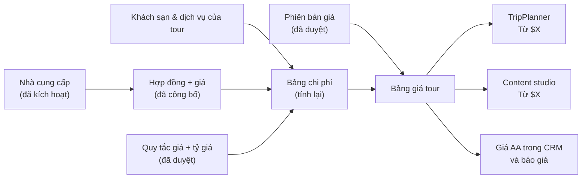

# Đưa chủ doanh nghiệp vào hệ thống và làm việc với hệ thống giá

> [!WARNING]
> CHƯA CHẠY THỬ - không làm theo trong sự cố khi chưa kiểm từng bước.

Runbook này đưa chủ doanh nghiệp từ chỗ chưa có quyền gì tới chỗ làm việc được với hệ thống giá trên **Dev**. Có hai
người đọc:

- **Tech lead** tạo tài khoản và ngồi cùng chủ doanh nghiệp trong lần đăng nhập đầu tiên (Phần A và B).
- **Chủ doanh nghiệp** thử trang quản trị và ứng dụng đại lý, rồi làm việc với hệ thống giá (Phần C và D).

Mọi địa chỉ trang, nút bấm và quy tắc dưới đây lấy từ mã nguồn trên `main` và bằng chứng trên Dev ngày 23/11/2026.
Điều gì chưa được xác nhận đều ghi **cần xác nhận với tech lead**. Các ứng dụng mở bằng tiếng Anh, nên trang này ghi
tên nút tiếng Anh trước, tên tiếng Việt trong ngoặc khi ứng dụng có bản tiếng Việt. Bản gốc tiếng Anh của trang này:
[business-owner-onboarding-and-pricing.md](business-owner-onboarding-and-pricing.md).

## Tóm tắt

| Phần | Nội dung | Ai làm | Thời gian |
|---|---|---|---|
| [Trước khi bắt đầu](#trước-khi-bắt-đầu) | Chuẩn bị, chốt hai điểm còn mở | Tech lead | 15 phút |
| [A](#phần-a-tài-khoản-nhân-sự) | Tài khoản nhân sự trong CIS và Booking, dấu chủ doanh nghiệp, ứng dụng xác thực | Tech lead cùng chủ doanh nghiệp | 30-45 phút |
| [B](#phần-b-tài-khoản-đại-lý-thử-nghiệm) | Đại lý thử nghiệm, lời mời chủ sở hữu, đăng nhập đại lý | Tech lead, rồi chủ doanh nghiệp | 30 phút |
| [C](#phần-c-hệ-thống-giá) | Mọi việc với hệ thống giá: ở đâu, ai làm, ai duyệt | Chủ doanh nghiệp | tra cứu |
| [D](#phần-d-thử-trọn-vòng-an-toàn-trên-dev) | Một tour giả lập từ nhà cung cấp tới giá đại lý, rồi hoàn tác | Chủ doanh nghiệp, tech lead làm hai bước | 60-90 phút |
| [E](#phần-e-dọn-dẹp-và-thu-hồi-quyền) | Xoá đại lý thử nghiệm, đổi hoặc thu hồi quyền | Tech lead | 15 phút |

Các địa chỉ Dev dùng trong trang này:

| Ứng dụng | Địa chỉ |
|---|---|
| CIS admin | <https://aa-cis.lumiguides.it.com> |
| Đăng nhập nhân sự (e-mail công ty) | <https://staff-auth.lumiguides.it.com> |
| Booking admin | <https://booking.lumiguides.it.com> |
| Ứng dụng đại lý (CRM và Content studio) | <https://portal.lumiguides.it.com> |
| TripPlanner (khách du lịch) | <https://tripplanner.lumiguides.it.com> |

## Trước khi bắt đầu

### Tech lead chuẩn bị

1. Xác nhận tài khoản AWS.

   ```bash
   aws sts get-caller-identity --profile aa365-admin
   ```

   Kết quả mong đợi: tài khoản acc2 trong [bảng tài khoản](../onboarding.md). Dừng lại nếu là tài khoản khác.
2. Mở CIS admin **Platform › Staff & access** (Nền tảng › Nhân sự & quyền). Mong đợi: dòng chữ "As a platform owner
   you can add accounts…". Nếu trang báo "Read-only: only a platform owner can change accounts.", dừng lại: chỉ
   platform owner mới làm được Phần A.
3. Kiểm e-mail gửi được tới hộp thư thật.

   ```bash
   aws sesv2 get-account --profile aa365-admin --region us-west-1 --query ProductionAccessEnabled
   ```

   Mong đợi: `true`. Nếu `false`, lời mời chỉ tới được các địa chỉ đã xác minh; sửa việc đó trước.
4. Chốt hai điểm còn mở và ghi câu trả lời vào log phiên:
   - **Vai trò CIS của chủ doanh nghiệp.** Preset chủ doanh nghiệp cho toàn quyền quản trị viên CIS. Một vai trò hẹp
     hơn vẫn là quyết định còn mở. Runbook này dùng preset.
   - **Địa chỉ của chủ doanh nghiệp ở đăng nhập đại lý.** Đăng nhập đại lý trên Dev chỉ chứa người dùng giả lập. Mời
     địa chỉ công việc thật sẽ đưa một địa chỉ thật vào đó. Cách khác là một địa chỉ thuộc hộp thư thử nghiệm E2E,
     nhưng khi đó chủ doanh nghiệp không tự nhận được thư.
5. Chuẩn bị sẵn profile quản trị AWS và MFA của nó cho bước [A7](#a7-cài-ứng-dụng-xác-thực-cho-đăng-nhập-nhân-sự).
6. Chọn một tour CIS cho Phần D. Trong Booking **Price setup** (Thiết lập giá), chọn một tour có trạng thái **No
   components** (Chưa có thành phần) và chỉ có một đêm (tour 2 ngày), hoặc mọi đêm đều ở cùng một địa điểm CIS. Không
   bao giờ chọn "Tour X" (tour thử nghiệm E2E). Ghi lại địa điểm CIS của đêm đó (ngăn kéo **Hotels & services** hiện
   là "Night at …" (Nghỉ đêm tại …)) và địa chỉ TripPlanner của tour,
   `https://tripplanner.lumiguides.it.com/tours/<slug>` (`<slug>` là tên web của tour, thấy trên thanh địa chỉ).

### Chủ doanh nghiệp cần có

- Điện thoại có ứng dụng xác thực có sao lưu, ví dụ Google Authenticator, Microsoft Authenticator hoặc 1Password. Sẽ
  thêm hai mục: một cho đăng nhập nhân sự, một cho ứng dụng đại lý.
- Hộp thư `@adventure.asia` riêng, mở sẵn trên cùng máy tính. Địa chỉ dùng chung `admin@adventure.asia` là tài khoản
  khẩn cấp và không dùng được.
- Một trình quản lý mật khẩu. Sẽ có hai mật khẩu: mật khẩu nhân sự (sau bước A7) và mật khẩu đại lý (Phần B).
- Hai cửa sổ trình duyệt: cửa sổ thường cho trang nhân sự, và một cửa sổ ẩn danh (hoặc một profile trình duyệt khác)
  cho ứng dụng đại lý. Hai kiểu đăng nhập tách biệt và không được lẫn vào nhau.
- Không dùng VPN, hoặc dùng VPN có điểm ra ở Việt Nam. Trang nhân sự chỉ nhận khách truy cập từ một danh sách quốc
  gia cố định.

### Quy tắc trên Dev

- Chỉ dùng dữ liệu bịa ra. Đặt tên mọi bản ghi bạn tạo là `SYNTHETIC …`, và có chữ "Test" trong tên đại lý.
- Không bao giờ gõ khách hàng, khách tiềm năng hay khách du lịch thật. Dùng địa chỉ kết thúc bằng `example.invalid`.
- Không động vào các đại lý thử nghiệm có sẵn ("Lữ hành Sen Vàng", "E2E Pilot Rehearsal Travel", các đại lý thử tải,
  mọi đại lý "E2E …") và mọi tài khoản `e2e-`.
- Không bao giờ chia sẻ mã dùng một lần, mật khẩu hay mã xác thực với bất kỳ ai, kể cả tech lead.
- Một số bước gọi AI tính phí. Mỗi khách sạn hoặc dịch vụ mới xếp hàng một bản nháp AI (giới hạn 20 lượt và 1 USD mỗi
  ngày), và một gói nội dung viết bài bằng AI. Giữ số lượng nhỏ.

## Phần A: tài khoản nhân sự

Một tài khoản nhân sự cho quyền vào CIS admin, Booking admin và trang nhân sự của CRM. Booking đọc vai trò từ CIS, nên
mọi thay đổi đều làm trên trang **Staff** (Nhân sự) của CIS.

### A1. Tìm hoặc tạo dòng của chủ doanh nghiệp

1. Tech lead mở <https://aa-cis.lumiguides.it.com/admin/platform/staff> (thanh bên **Platform › Staff & access**).
2. Tìm địa chỉ của chủ doanh nghiệp trong danh sách.
3. Nếu đã có dòng, đọc vai trò và tình trạng đăng nhập của dòng đó, rồi sang
   [A2](#a2-áp-dụng-vai-trò-chủ-doanh-nghiệp).
4. Nếu chưa có dòng, bấm **Add staff** (Thêm nhân sự). Trong **Add staff account** (Thêm tài khoản nhân sự):
   - **Work email** (E-mail công việc): địa chỉ của chủ doanh nghiệp. Chỉ nhận địa chỉ `@adventure.asia`.
   - **Display name** (Tên hiển thị): tên mà nhân sự thấy.
   - **Role** (Vai trò): **Business owner** (Chủ doanh nghiệp).
   - Để nguyên dấu tick **Send invitation email** (Gửi e-mail mời).
   - Bấm **Create account** (Tạo tài khoản).

Mong đợi: thông báo "Created … An invitation email with the sign-in steps goes to that address in about 2 minutes."

Kiểm: dòng của chủ doanh nghiệp có trạng thái **Active**.

Nếu lỗi:

- "A staff account with this address already exists; change it from its row": quay lại bước 3 và dùng dòng đã có.
- "Saved, sign-in update pending.": bấm **Retry Cognito**. Trên dòng, cách sửa tương tự là **Retry Cognito sync**.
- "Invitation email is not set up on this server…": e-mail đang tắt; tự đưa cho chủ doanh nghiệp các bước đăng nhập
  ở [A4](#a4-lần-đăng-nhập-cis-đầu-tiên).

### A2. Áp dụng vai trò chủ doanh nghiệp

1. Mở dòng của chủ doanh nghiệp. Ngăn kéo **Manage access** (Quản lý quyền truy cập) mở ra.
2. Trong **Role** (Vai trò), tìm thẻ **Business owner** (Chủ doanh nghiệp) và bấm **Apply** (Áp dụng).
3. Xác nhận "Apply the Business owner preset?" bằng **Apply**.

Mong đợi: "Business owner preset saved in CIS and the company sign-in. The person signs in again to use it."

Kiểm: dòng hiện vai trò CIS **Administrator** và vai trò Booking **Booking admin**. Vai trò CRM giữ như cũ.

Hoàn tác: áp dụng preset khác, hoặc **Show all roles** → đặt từng vai trò → **Save roles**.

Vai trò này cho gì:

| Ứng dụng | Vai trò | Cho phép |
|---|---|---|
| CIS | Administrator | Mọi thứ trừ quản lý tài khoản nhân sự: cài đặt và việc duyệt cài đặt, giá tham khảo, xuất bản, thanh toán, chi tiêu |
| Booking | Booking admin | Mọi trang Booking và mọi việc duyệt, nhật ký thao tác, chi trả |

> [!NOTE]
> Không preset nào biến ai thành platform owner hay chủ doanh nghiệp. Dấu chủ doanh nghiệp được đặt ở
> [A5](#a5-đặt-dấu-chủ-doanh-nghiệp). Cờ platform owner (quản lý tài khoản nhân sự) không cần cho công việc của chủ
> doanh nghiệp và chỉ tech lead đặt được, bên ngoài ứng dụng.

### A3. Gửi lời mời

1. Nếu tài khoản mới tạo, lời mời đã nằm trong hàng đợi. Nếu dòng đã có nhưng chủ doanh nghiệp chưa từng đăng nhập,
   mở dòng và trong **Manage access** bấm **Send invite** (Gửi lời mời; nút ghi **Resend invite** (Gửi lại lời mời)
   nếu đã gửi trước đó). Tối đa một lần mỗi 10 phút, năm lần mỗi ngày.
2. Mong đợi: trong khoảng 2 phút, chủ doanh nghiệp nhận thư "You've been added to Adventure Asia staff admin" từ
   `no-reply@lumiguides.it.com`. Thư liệt kê quyền CIS và Booking cùng bốn bước đăng nhập.

Thư viết tiếng Anh và ghi "There is no password". Thư không nhắc tới ứng dụng xác thực: việc đó làm ở A7.

Kiểm: trên dòng, **Last invited** hiện "Sent".

### A4. Lần đăng nhập CIS đầu tiên

Chủ doanh nghiệp làm, tech lead ngồi cạnh:

1. Mở <https://aa-cis.lumiguides.it.com/login>. Trang có tiêu đề "CIS Internal", "Staff sign-in".
2. Bấm **Sign in with company email** (Đăng nhập bằng email công ty).
3. Trang đăng nhập Adventure Asia mở trên `staff-auth.lumiguides.it.com`. Gõ địa chỉ công việc.
4. Mở thư chứa mã dùng một lần và gõ mã.

Mong đợi: CIS admin mở ra. Lần đăng nhập đầu tiên này liên kết đăng nhập công ty với dòng của chủ doanh nghiệp.

Kiểm (tech lead): dòng có **Last sign-in**, và ngăn kéo hiện "Company sign-in: Linked" (Đã liên kết) thay cho "Not
linked yet (links on the first sign-in)" (Chưa liên kết).

Nếu lỗi: "Not authorised for AA staff sign-in" nghĩa là tài khoản chưa có vai trò nhân sự hoặc chưa có địa chỉ
`@adventure.asia` đã xác minh. Kiểm A2, bấm **Retry Cognito sync**, rồi đăng nhập lại.

> [!NOTE]
> Làm A4 trước A6. Booking tìm dấu chủ doanh nghiệp qua đăng nhập công ty đã liên kết, nên lần đăng nhập CIS đầu
> tiên phải liên kết xong tài khoản.

### A5. Đặt dấu chủ doanh nghiệp

Dấu này cho phép chủ doanh nghiệp tự duyệt một số việc của chính mình trong Booking. Mỗi lần tự duyệt đều được đánh
dấu và liệt kê để rà soát (xem [quy tắc duyệt](#c0-giá-chảy-thế-nào-và-ai-duyệt)).

1. Tech lead mở dòng → mục **Business owner** (Chủ doanh nghiệp) → **Make business owner** (Đặt làm chủ doanh
   nghiệp).
2. Xác nhận "Make this person the business owner?".

Mong đợi: "Business owner set." (Đã đặt chủ doanh nghiệp.) và huy hiệu **Business owner** trên dòng.

Quy tắc: nhiều nhất một người giữ dấu. Không đặt được cho tài khoản đã ngưng hay tài khoản thử nghiệm. Chỉ platform
owner, đăng nhập bằng đăng nhập công ty, mới đặt được. Mọi thay đổi đều có trong nhật ký kiểm tra.

Nếu lỗi:

- "Another staff member is the business owner; clear that marker first": người khác đang giữ dấu; bỏ dấu của người
  đó trước.
- "An E2E test account can never be the business owner": chọn nhầm dòng.
- "This account is disabled; enable it first": bấm **Enable** trên dòng, rồi thử lại.

Hoàn tác: **Remove business owner** (Bỏ chủ doanh nghiệp).

### A6. Lần đăng nhập Booking đầu tiên

1. Chủ doanh nghiệp mở <https://booking.lumiguides.it.com>. Trang ghi "Sign in to Booking" (chỉ có tiếng Anh).
2. Bấm **Sign in with company email**. Thường không phải nhập mã mới: đăng nhập nhân sự giữ mở khoảng một giờ.

Mong đợi: bảng điều khiển Booking mở ra. Hồ sơ Booking được tạo ở lần vào đầu tiên này, với vai trò admin. Thanh bên
hiện **Supply** (Nguồn cung) với các trang giá.

Kiểm: dải **My work** của bảng điều khiển có ô "Business-owner self-approvals" (Chủ doanh nghiệp tự duyệt) - "None
this month".

Nếu lỗi: "Your company account has no Booking role yet…" nghĩa là phiên đăng nhập vẫn mang vai trò cũ. Đăng xuất, chờ
tối đa 15 phút, rồi đăng nhập lại.

Phiên làm việc: đăng nhập một lần mỗi ngày làm việc. Sau mỗi lần đổi vai trò, đăng xuất rồi đăng nhập lại.

### A7. Cài ứng dụng xác thực cho đăng nhập nhân sự

Đăng nhập nhân sự không có chỗ cài ứng dụng xác thực trên trình duyệt. Tech lead chạy một công cụ cài đặt từ terminal
của mình, chủ doanh nghiệp ngồi gõ phím. Làm theo runbook Infra "Staff administrators: TOTP enrolment and the MFA
switches" (`infra/AA-CIS-Infra/docs/runbooks/staff-admin-mfa.md`), mục A và B. Tóm tắt:

1. Tech lead chạy `staff-totp-enroll` cho địa chỉ của chủ doanh nghiệp, bằng profile quản trị AWS và MFA của nó.
2. Chủ doanh nghiệp gõ mật khẩu mới hai lần: ít nhất 16 ký tự, có chữ hoa, chữ thường, chữ số và ký hiệu. Lưu vào
   trình quản lý mật khẩu.
3. Trong ứng dụng xác thực, thêm khoá cài đặt hiện trên màn hình: tên `AA Staff (dev)`, loại **Time based**.
4. Gõ mã 6 số từ ứng dụng.
5. Mong đợi: "mfa: TOTP enrolled, verified and preferred". Chủ doanh nghiệp bị đăng xuất khỏi mọi nơi.
6. Tech lead chạy `staff-totp-check`. Dòng cuối mong đợi: `OK amr=["pwd", "otp", "mfa"]`.
7. Chủ doanh nghiệp đăng nhập lại: **Sign in with company email** → địa chỉ → chọn cách đăng nhập bằng **mật khẩu** →
   mật khẩu → mã 6 số.

> [!CAUTION]
> Chạy công cụ trong một terminal chỉ hai người nhìn thấy, không bao giờ qua agent: khoá cài đặt chỉ hiện một lần.
> Sau bước này, mã qua e-mail không còn được đưa ra cho chủ doanh nghiệp. Mất điện thoại: tech lead chạy lại công cụ
> với `--rotate`.

Có ba công tắc có thể buộc quản trị viên dùng mã xác thực. Trang này không ghi trạng thái của chúng, vì trạng thái
thay đổi: đọc trực tiếp trên hệ thống trước Phần A.

| Ứng dụng | Công tắc | Ở đâu | Kiểm ai |
|---|---|---|---|
| CIS | Staff sign-in: administrators must use an authenticator code | CIS **Platform › Settings** | Quản trị viên CIS và platform owner |
| Booking | Administrators need an authenticator code | Booking **Supply › Pricing policy**, mục **Staff sign-in** | Booking admin |
| CRM | Staff sign-in: CRM operations staff must use an authenticator code | Tab CRM của CIS **Platform › Settings** | crm-platform-admin, crm-ops, và cis-admin trên các trang vận hành CRM |

Khi công tắc CIS hoặc Booking đang tắt, đăng nhập bằng mã e-mail ở A4 và A6 dùng được trước A7. Bật một công tắc là
một quyết định riêng của tech lead (**cần xác nhận với tech lead**: công tắc CIS và Booking bật sau lần cài đặt này,
hay giữ tắt tới khi lên prod).

> [!WARNING]
> Nếu công tắc CRM đang bật, thì tới khi xong A7, các trang CIS gọi sang CRM (tab CRM của **Platform › Settings**, thẻ
> jobs CRM trên **Home › App health** (`/admin/platform/apps`), **Tenants › CRM agencies** (`/admin/tenants/agencies`))
> có thể từ chối chủ doanh nghiệp với thông báo "Administrators must sign in with their password and the 6-digit
> code…". Điều này suy ra từ mã nguồn; chưa thử thật.

### A8. Kiểm Phần A đã xong

| Ở đâu | Mong đợi |
|---|---|
| CIS **Platform › Staff & access**, dòng của chủ doanh nghiệp | Active; vai trò CIS Administrator; vai trò Booking Booking admin; huy hiệu Business owner; có Last sign-in; Last invited là Sent; ngăn kéo "Company sign-in: Linked" |
| Trang Staff của CIS, thẻ **Directory health** → **Check now** | "In sync" |
| CIS **Platform › Audit log** (Nhật ký kiểm tra, `/admin/platform/audit`) | `staff.roles_changed` (hoặc `staff.created`), `staff.cognito_synced`, `staff.invite_sent`, `staff.business_owner_changed` |
| Booking **Admin › Staff** (Quản trị › Nhân viên, `/staff`) | Hồ sơ của chủ doanh nghiệp, vai trò admin, có "Last seen" |
| Bảng điều khiển Booking | Ô "Business-owner self-approvals" |

## Phần B: tài khoản đại lý thử nghiệm

Chủ doanh nghiệp thử ứng dụng đại lý đúng như một chủ đại lý nhìn thấy. Tài khoản đại lý tách khỏi tài khoản nhân sự:
khác cách đăng nhập, khác mật khẩu, có mục riêng trong ứng dụng xác thực. Tài khoản này không bao giờ được tính là chủ
doanh nghiệp trong Booking.

### B1. Tạo đại lý thử nghiệm

Ai làm: tech lead. Cần vai trò quản trị viên CIS và nhóm công ty được phép tạo đại lý CRM. Tài khoản thử nghiệm
(`e2e-`) không bao giờ làm được việc này.

1. Mở <https://aa-cis.lumiguides.it.com/admin/tenants> (**Tenants › Directory**, Tenant › Danh bạ).
2. Bấm **New Tenant** (Đại lý mới).
3. Điền:
   - **Company Name** (Tên công ty): `Test Agency - Business Owner`. Slug tự điền.
   - **Plan** (Gói): `starter`.
   - **Posts/week** (Số bài/tuần): `1`, để AI viết ít.
   - **CRM add-on** (Add-on CRM): **CRM Core (crm.core)**.
   - **Agency owner e-mail (optional)** (E-mail chủ đại lý (không bắt buộc)): ô này hiện ra khi đã chọn một add-on
     CRM. Để trống: B3 gửi cả hai lời mời cùng lúc.
   - **TripPlanner add-on** (Add-on TripPlanner): để trống, trừ khi chủ doanh nghiệp muốn thử.
4. Bấm **Create Tenant** (Tạo đại lý).

Mong đợi: một hộp kết quả với các dòng **Tenant account**, **Content studio subscription**, **CRM add-on**,
**TripPlanner add-on**, **CRM agency** và **Owner invitation**. Khi không có e-mail chủ, **Owner invitation** báo chưa
mời ai.

Trên Dev, đại lý mới luôn là một đại lý demo giả lập. Không dùng suất pilot duy nhất cho lần thử này.

Nếu một dòng hiện "attention": phần CRM lỗi, nhưng đại lý đã tồn tại. Tạo đại lý CRM từ **Tenants › CRM agencies ›
Create agency**. Hộp kết quả không có nút thử lại.

### B2. Cho đại lý một ngân sách AI nhỏ

1. Mở **Tenant 360 › Cost › AI budget** (Chi phí › Ngân sách AI) của đại lý.
2. Đặt một ngân sách tháng nhỏ (số tiền cần xác nhận với tech lead). Ngân sách 0 dừng toàn bộ AI nội dung của đại lý.

CRM có ngân sách AI riêng, do chủ đại lý đặt trong CRM **Settings › AI** (mặc định 2 USD, AI mặc định tắt).

### B3. Mời chủ doanh nghiệp làm chủ sở hữu CRM và Content studio

1. Mở **Tenants › CRM agencies** (Đại lý CRM, `/admin/tenants/agencies`) và mở đại lý thử nghiệm.
2. Ở **First owner**, bấm **Invite first owner** (Mời chủ sở hữu đầu tiên).
3. Điền **Owner's email** bằng địa chỉ đã chốt ở [Trước khi bắt đầu](#tech-lead-chuẩn-bị).
4. Tick **Also invite to the Content studio as owner** (Mời luôn vào Content studio với vai trò chủ sở hữu).
5. Bấm **Send invitation** (Gửi lời mời).

Mong đợi: hai dòng, "Partner CRM: first-owner invitation sent…" và "Content studio: owner invitation sent…". Chủ doanh
nghiệp nhận hai thư.

Nếu một lời mời lỗi: **Withdraw owner invitation** (Rút lại lời mời chủ sở hữu) trong cùng ngăn kéo, rồi mời lại.
Trong **Tenant 360 › Members** (Thành viên), **Send invitation again…** (Gửi lại lời mời…) gửi lại lời mời Content
studio.

### B4. Chủ doanh nghiệp nhận lời mời thứ nhất

Trong **cửa sổ ẩn danh**:

1. Mở đường link trong thư thứ nhất (`https://portal.lumiguides.it.com/join?t=…`). Trang "Your invitation to AA
   Partner" (Lời mời tham gia AA Partner) mở ra.
2. Bấm **Open invitation** (Mở lời mời). Trang hiện địa chỉ dùng để đăng nhập và một **mật khẩu dùng một lần**, chỉ
   hiện một lần. Giữ trang mở.
3. Bấm **Continue to sign in** (Tiếp tục đăng nhập). Trang đăng nhập đại lý mở ra.
4. Gõ địa chỉ và mật khẩu dùng một lần.
5. Chọn mật khẩu đại lý của riêng mình và lưu lại.
6. Cài đăng nhập hai bước: quét mã QR bằng ứng dụng xác thực, rồi gõ mã 6 số. Việc này bắt buộc với mọi người dùng
   đại lý.
7. Bấm **Accept invitation** (Nhận lời mời).

Mong đợi: ứng dụng đại lý mở ra.

Nếu lỗi:

- "You are signed in with another account…": đang ở cửa sổ nhân sự. Dùng cửa sổ ẩn danh.
- Đã đóng trang trước khi dùng mật khẩu dùng một lần: tech lead bấm **Withdraw owner invitation** rồi mời lại.

### B5. Chủ doanh nghiệp nhận lời mời thứ hai

1. Mở đường link trong thư thứ hai. Trang báo địa chỉ này đã có tài khoản AA Partner.
2. Đăng nhập bằng mật khẩu đại lý và mã 6 số, rồi nhận lời mời.
3. Mong đợi: "Your Content studio access is ready", hoặc "…being set up. Open it in a minute". Bấm **Open the Content
   studio**.

### B6. Chủ doanh nghiệp thử gì trong ứng dụng đại lý

| Thử | Ở đâu | Mong đợi |
|---|---|---|
| Chuyển ứng dụng | Đầu trang ứng dụng đại lý | Content studio và CRM (và TripPlanner nếu đã thêm) |
| Tiếng Việt | Menu tài khoản › **Language and dates** | Ứng dụng chuyển sang tiếng Việt |
| Tour AA có giá | Content studio › Marketplace (`/portal/tours`) | Tour có giá hiện "From $X per person" (Từ $X mỗi khách). Phần lớn tour trên Dev không có dòng giá: đó là bình thường |
| Giá AA cho đại lý | CRM › Settings › **AA prices for your agency** (Giá AA cho đại lý của bạn, `/aa-tariff`) | Bảng giá theo tour, mùa và cỡ nhóm, có chọn tiền tệ, **Download CSV**, **Print**. Hôm nay ít hoặc không có dòng nào. Trong 5 phút đầu: "Your agency is not linked to AA's agency prices…" |
| Quy tắc bán của đại lý | CRM › Settings › **Pricing** (Giá bán, `/settings/pricing`) | Nhóm tuổi, mức giảm tối đa của nhân viên, mức cộng trên sản phẩm AA |
| Một khách hàng thử | CRM | Chỉ tên bịa và địa chỉ `example.invalid` |

> [!NOTE]
> Tài khoản thử nghiệm của nhân sự cũng nhìn thấy được một đại lý giả lập. Đó thêm một lý do để chỉ gõ dữ liệu bịa.

Ứng dụng xác thực của đại lý không có cách tự đặt lại. Nếu mất, tech lead đặt lại bằng tay sau khi chủ doanh nghiệp
xác nhận, việc này sẽ bật một cảnh báo bảo mật. Dùng ứng dụng xác thực có sao lưu.

### B7. Kiểm Phần B đã xong

| Ở đâu | Mong đợi |
|---|---|
| Hộp kết quả New Tenant | Mọi dòng xong |
| **Tenant 360 › Members** | Dòng của chủ doanh nghiệp: Owner, **Active** (trước khi nhận lời mời: "Invited") |
| **Tenants › CRM agencies**, đại lý thử nghiệm | **Synthetic** được tick, một chủ đang hoạt động, **Features allowed** hiện gói sau lần đồng bộ kế tiếp |
| Trang **Partners** (Đối tác) của Booking | Đại lý hoạt động trong khoảng 5 phút, hạng `standard` |
| CIS **Platform › Audit log** | `tenant.crm_onboarded` và các dòng thành viên |
| Tuỳ chọn: **Tenant 360 › View as partner** | Xem chỉ-đọc các trang của chủ doanh nghiệp, 5-60 phút, phải ghi lý do, có ghi nhật ký |

## Phần C: hệ thống giá

Mọi trang giá nằm trong Booking admin, <https://booking.lumiguides.it.com>, nhóm menu **Supply** (Nguồn cung). Mọi
trang nhân sự của Booking có nút chuyển EN | VI trên thanh trên cùng; trang đăng nhập chỉ có tiếng Anh.

### C0. Giá chảy thế nào và ai duyệt

Booking sở hữu mọi giá. Một bảng giá duy nhất cấp cho mọi nơi bên ngoài Booking.



- **Giá bán lẻ đề xuất (RRP)** = giá theo quy tắc giá + 25 %. Như nhau cho mọi đại lý.
- **Giá "từ" công khai** = RRP rẻ nhất mỗi khách cho 2 khách còn hiệu lực hôm nay.
- **Giá đại lý** = giá theo quy tắc trừ mức giảm theo hạng hoặc thẻ giá của đại lý.
- **Giá tạm** và **giá tham khảo CIS** là gợi ý cho nhân sự. Không bao giờ là giá bán.

Quy tắc duyệt. Người làm không bao giờ tự duyệt việc của mình, trừ một ngoại lệ: chủ doanh nghiệp, khi công tắc "The
business owner may approve her own work" đang bật. Mỗi lần như vậy được đánh dấu và liệt kê ở tab nhật ký
**Business-owner self-approvals** (Chủ doanh nghiệp tự duyệt). Công tắc này và công tắc chi trả nằm ở **Supply ›
Pricing policy**, mục **Staff sign-in**: kiểm cả hai đang bật trước Phần D.

| Việc | Ai làm được | Người thứ hai | Chủ doanh nghiệp tự duyệt việc của mình |
|---|---|---|---|
| Kích hoạt nhà cung cấp | Admin, Product & operations | Có | **Được, có đánh dấu** |
| Công bố hợp đồng nhà cung cấp | Admin, Product & operations | Có (không ai đã viết bản nháp) | **Được, có đánh dấu** |
| Duyệt phiên bản giá | Admin, Product & operations | Có | **Được, có đánh dấu** |
| Khoảng mùa, ngày lễ | Admin, Product & operations | Có | **Được, có đánh dấu** |
| Lịch mặc định, lịch của tour | Admin, Product & operations | Có | API cho phép, nhưng màn hình ẩn nút (xem C9) |
| Điều chỉnh giá chuyến khởi hành | Admin, Product & operations | Có | **Được, có đánh dấu** |
| Thông tin thanh toán của pháp nhân | Admin, Finance | Có | **Được, có đánh dấu** |
| Duyệt hoá đơn nhà cung cấp | Admin, Product & operations | Có (không bao giờ là người đã nhập hoặc sửa số tiền gần nhất) | **Được, có đánh dấu** |
| Duyệt khoản thanh toán của đại lý | Admin, Finance | Có (không bao giờ là người đã ghi nhận) | **Được, có đánh dấu** |
| Ghi nhận chi trả hoá đơn nhà cung cấp do chủ doanh nghiệp đã duyệt | Admin | Có | **Được, có đánh dấu** (công tắc thứ hai); không bao giờ với hoá đơn chủ doanh nghiệp đã nhập hoặc sửa |
| Quy tắc giá, tỷ giá, phí huỷ | Admin, Product & operations | Có | **Không** |
| Mức giảm theo hạng đại lý, thẻ giá | Admin, Product & operations | Có | **Không** |
| Allotment | Admin, Product & operations | Có | **Không** |
| Ngừng bán và gỡ ngừng bán | Admin, Product & operations | Có | **Không** |
| Thay đổi chính sách giá | Admin, Product & operations, Finance (theo mục) | Có | **Không, không bao giờ** |
| Mọi việc xoá hay từ chối | - | Có | **Không, không bao giờ** |
| Khách sạn và dịch vụ | Admin, Product & operations | Không (hoạt động ngay khi admin tạo) | - |
| Mở bán một tour | Admin, Product & operations | Không | - |
| Chuyển đại lý sang hạng khác | Admin, Product & operations | Không (có ghi nhật ký) | - |
| Cho phép bán một tour bị chặn | Chỉ Admin | Không (có ghi nhật ký) | - |

Rút lại: người làm tự rút lại dòng nháp hoặc dòng đang chờ của mình (phiên bản giá, quy tắc giá, tỷ giá, dòng mùa) mà
không cần ai khác. Rút lại một phiên bản giá đã công bố thì cần người thứ hai.

> [!NOTE]
> Nhóm có ba người, và người làm nội dung và vận hành không bao giờ duyệt được. Vì vậy với mọi dòng "Không" ở trên,
> người thứ hai là tech lead. Tech lead không bao giờ tự duyệt: tech lead không có dấu.

### C1. Theo dõi mức sẵn sàng

**Là gì:** tình trạng giá của mọi tour và tour có vận hành được không.

**Ở đâu:** **Price readiness** (Mức sẵn sàng giá, `/pricing/readiness`) và **Price setup** (Thiết lập giá,
`/pricing/workbench`).

**Ai:** mọi vai trò Booking trừ Content creator đều xem được.

**Các bước:**

1. Mở **Price setup**. Đọc các số trên cùng: **Trip plans** (Tour), **Ready to sell** (Sẵn sàng bán), **Need hotels
   and services**, **Need supplier rates**, **Provisional prices** (Giá tạm).
2. Mỗi tour có bảy mục kiểm và một **bước tiếp theo**: Add hotels & services (Thêm khách sạn & dịch vụ), Replace an
   inactive item, Load supplier rates (Nhập giá nhà cung cấp), Approve an exchange rate (Duyệt tỷ giá), Approve a
   pricing rule (Duyệt quy tắc giá), Recompute prices (Tính lại giá), Make sellable (Mở bán), Ready to sell (Sẵn sàng
   bán).
3. Mở **Price readiness** để xem trạng thái giá (Priced (Có giá), Priced by hand (Giá nhập tay), Missing rates (Thiếu
   giá), Missing FX rate, No pricing rule, No components (Chưa có thành phần), Inactive component) và cột **Can
   operate** (Vận hành được: Ready (Sẵn sàng), Warnings (Có cảnh báo), Blocked (Bị chặn), Exception (Ngoại lệ)).
4. **Download CSV** (Tải CSV) xuất danh sách.

**Hôm nay trên Dev (23/11/2026):** 892 tour, 2 tour có giá, 0 tour "Ready" ở cột Can operate. Chưa tour nào bán trọn
vòng được cho đại lý. Trang **Data coverage** (Độ phủ dữ liệu, `/admin/data-coverage`) của CIS hiện cùng các con số.

### C2. Nhà cung cấp

**Ở đâu:** **Supply › Suppliers** (Nguồn cung › Nhà cung cấp, `/suppliers`).

**Ai:** Admin, Product & operations tạo; Admin, Product & operations kích hoạt.

**Duyệt:** người thứ hai kích hoạt. Người tạo, hoặc bất kỳ ai đã sửa nhà cung cấp trong lúc nó đang chờ, không bao giờ
kích hoạt được. Chủ doanh nghiệp được kích hoạt nhà cung cấp của mình, có đánh dấu.

**Các bước:**

1. Bấm **Add supplier** (Thêm nhà cung cấp), điền tên và nhóm loại, rồi **Save supplier** (Lưu nhà cung cấp).
2. Mong đợi: nhà cung cấp ở trạng thái **Pending approval** (Chờ duyệt), với thông báo "This supplier waits for
   approval: a second person activates it before contracts can be added." (Nhà cung cấp này đang chờ duyệt: người thứ
   hai kích hoạt trước khi thêm được hợp đồng.)
3. Để kích hoạt, mở nhà cung cấp và bấm **Activate** (Kích hoạt). Với người làm không phải chủ doanh nghiệp, nút ghi
   **Activate (needs a second person)** (Kích hoạt (cần người thứ hai)) và bị khoá.
4. Khi chủ doanh nghiệp kích hoạt nhà cung cấp của mình, hộp thoại ghi "You created this supplier. Activating it
   yourself is recorded as a business-owner self-approval." (Bạn đã tạo nhà cung cấp này. Tự kích hoạt sẽ được ghi
   nhận là chủ doanh nghiệp tự duyệt.)
5. **Reject** (Từ chối) trong menu của dòng từ chối một nhà cung cấp đang chờ.

**Ảnh hưởng phía sau:** khi nhà cung cấp chưa hoạt động, nó không có được khách sạn, dịch vụ hay hợp đồng, và các tour
dùng nó bị chặn. Nhà cung cấp có hợp đồng đã công bố đang hiệu lực hoặc sắp hiệu lực thì không ngưng được.

**Hàng chờ:** ô My work "Suppliers to activate" (Nhà cung cấp cần kích hoạt).

**Lưu ý:** kích hoạt từ trang của nhà cung cấp. Menu của dòng không hiện thông báo tự duyệt.

### C3. Khách sạn và dịch vụ

**Ở đâu:** **Supply › Hotels** (Khách sạn, `/hotels`) và **Supply › Services** (Dịch vụ, `/services`).

**Duyệt:** không. Khách sạn hoặc dịch vụ do admin tạo hoạt động ngay.

**Các bước, một khách sạn:**

1. **Add hotel** (Thêm khách sạn) → **Supplier** (Nhà cung cấp; một nhà cung cấp đang hoạt động có nhóm Hotel),
   **Hotel name** (Tên khách sạn), **City / place** (Thành phố / địa điểm; một địa điểm CIS, chọn xong thì quốc gia tự
   điền) → **Save hotel** (Lưu khách sạn). Mong đợi: "… added as … Add its room types next." (Đã thêm … Tiếp theo hãy
   thêm loại phòng.)
2. Trên khách sạn, **Add room type** (Thêm loại phòng) → **Name** (Tên; ví dụ `Double`) → **Add room type**. Sau này
   sửa một loại phòng thì lưu bằng **Save room type** (Lưu loại phòng).

**Các bước, một dịch vụ:** **Add service** (Thêm dịch vụ) → **Save service**.

Nhà cung cấp phải đang hoạt động và có nhóm loại phù hợp. Bản ghi không bao giờ bị xoá, chỉ ngưng hoạt động.

**Ảnh hưởng phía sau:** các tour trỏ tới những bản ghi này. Một mục ngưng hoạt động chặn giá của tour ("Inactive
component"). Khách sạn chưa có loại phòng thì không bao giờ được gợi ý cho tour (C6).

**Chi phí:** mỗi khách sạn hoặc dịch vụ mới xếp hàng một bản nháp AI trong CIS.

### C4. Hợp đồng và giá nhà cung cấp

**Ở đâu:** trang của một nhà cung cấp, tab **Contracts** (Hợp đồng) và **Rates** (Giá).

**Duyệt:** người thứ hai công bố. Không ai đã viết bản nháp hay giá của nó được công bố, trừ chủ doanh nghiệp, có
đánh dấu.

**Các bước, từng giá một:**

1. **New contract** (Hợp đồng mới): tiêu đề, hiệu lực từ, tiền tệ. Hợp đồng bắt đầu là bản nháp.
2. Tab **Rates** → **Add rate** (Thêm giá). Chỉ thêm được giá khi hợp đồng còn là bản nháp.
3. Trong menu của dòng hợp đồng, bấm **Publish** (Công bố). Với người đã viết mà không phải chủ doanh nghiệp, nút ghi
   **Publish (needs a second person)** (Công bố (cần người thứ hai)).

**Các bước, nhiều giá (Excel):**

1. **Import rate sheet** (Nhập bảng giá) → **Download the template**.
2. Điền, tải file đã điền lên, và bấm **Check the sheet**. Không gì được ghi khi còn lỗi.
3. Bấm **Import as draft**. Mong đợi: "Draft contract created with {n} rates. A second person publishes it."
4. Công bố như trên.

**Ảnh hưởng phía sau:** công bố sẽ xếp hàng một lần tính lại giá. Hợp đồng đã công bố thì cố định. Giá mới cần hợp
đồng mới. **Expire** (Cho hết hạn) đóng một hợp đồng đã công bố; việc này không cần người thứ hai.

**Lưu ý:** khi chủ doanh nghiệp công bố bản nháp của mình, hộp thoại vẫn ghi "You confirm you checked the terms entered
by …". Việc duyệt vẫn được đánh dấu như thường.

### C5. Quy tắc giá và tỷ giá

**Ở đâu:** **Supply › Pricing rules & FX** (Quy tắc giá & tỷ giá, `/pricing/rules`), tab **Pricing rules** và **FX
rates**.

**Duyệt:** luôn cần người thứ hai. **Chủ doanh nghiệp không tự duyệt được.** Nếu chủ doanh nghiệp tạo một dòng, tech
lead duyệt.

**Các bước:** **New rule** (Quy tắc mới) hoặc **New FX rate** (Tỷ giá mới) → điền → lưu. Dòng hiện **Pending
approval** (Chờ duyệt; tỷ giá lưu xong báo "… rate saved as Pending approval…"). Người thứ hai bấm **Approve**. Nếu
người làm bấm **Approve** trên dòng của chính mình, trang trả lời "You created this row. A second person has to
approve it (maker-checker)." (Bạn đã nhập dòng này. Người thứ hai phải duyệt.)

**Các trường của quy tắc:** biên lợi nhuận mục tiêu, biên sàn, mức cộng mùa cao điểm, phí thẻ, mức cộng RRP, điểm đặt
sớm. Giá bán = giá net ÷ (1 − biên lợi nhuận − phí thẻ).

**Ảnh hưởng phía sau:** không có quy tắc đại lý (B2B) đã duyệt thì không tour nào có giá. Không có tỷ giá cho một tiền
tệ chi phí thì trạng thái là "Missing FX rate". USD không cần tỷ giá.

### C6. Khách sạn và dịch vụ của một tour

**Ở đâu:** **Price setup** → một tour → **Hotels & services** (Khách sạn & dịch vụ).

**Duyệt:** không.

**Các bước:**

1. Ngăn kéo gợi ý các mục từ lịch trình CIS, khớp với khách sạn và dịch vụ đã có trong Booking. Một khách sạn được
   gợi ý cho một đêm khi đủ điểm: có tên trong lời tả của ngày, ở đúng địa điểm CIS của đêm, tên hoặc địa chỉ chứa
   địa điểm đó, ở cùng quốc gia với tour. Chỉ khách sạn có loại phòng mới được gợi ý. Đêm không có gợi ý hiện **No
   match** (Không tìm thấy): thêm một khách sạn ở địa điểm CIS của đêm đó (C3), hoặc đánh dấu đêm đó không cần khách
   sạn (bước 3).
2. Bấm **Accept** (Chấp nhận), **Reject** (Từ chối) hoặc **Other match** (Lựa chọn khác) cho từng gợi ý, rồi **Save
   {n} hotel and service item(s)** (Lưu {n} khách sạn và dịch vụ).
3. Một đêm không cần khách sạn (tàu đêm, du thuyền không có loại phòng cabin): trong mục **Can agencies buy it?**
   (Đại lý mua được không?), tick **Night N: no hotel needed** (Đêm N: không cần khách sạn), điền **Why do these
   nights need no hotel?** (Vì sao các đêm này không cần khách sạn?; ít nhất 20 ký tự), rồi bấm **Save nights** (Lưu
   các đêm). Mục này có nút lưu riêng, không lưu cùng các mục khách sạn và dịch vụ. Dấu này gỡ quy tắc N1 cho đêm đó
   và có ghi nhật ký.

**Ảnh hưởng phía sau:** bảng chi phí dùng các mục này. Một đêm không có khách sạn và không có dấu chặn báo giá cho đại
lý.

### C7. Tính lại giá và mở bán

**Ở đâu:** **Price setup**, thao tác hàng loạt.

**Duyệt:** không, cho bản thân công tắc. **Make sellable** cần một giá đã duyệt còn hiệu lực hôm nay.

**Các bước:**

1. Chọn tour. **Recompute prices** (Tính lại giá, tối đa 50 tour mỗi lần). Mong đợi: trạng thái **Priced** (Có giá)
   và một con số ở **RRP for 2** (Giá bán lẻ cho 2 khách).
2. **Make sellable** (Mở bán). Tour chưa có giá đã duyệt bị bỏ qua: "no approved price yet (approve a price version or
   publish supplier rates)" (chưa có giá đã duyệt (duyệt một phiên bản giá hoặc công bố giá nhà cung cấp)).
3. **Make not sellable** (Ngừng bán) dừng bán cho đại lý.
4. **Show CIS price as provisional** (Dùng giá CIS làm giá tạm) chép giá tham khảo CIS làm gợi ý cho nhân sự. Báo
   giá, giá đại lý và giá công khai không bao giờ dùng nó, trừ cảnh báo "thấp hơn giá công khai" của CRM, cảnh báo
   này dùng nó khi tour chưa có giá thật. **Clear provisional price** gỡ nó.

**Nhiều tour (Excel):** **Download workbook** (Tải file Excel) → điền → **Import workbook** (Nhập file Excel) →
**Check** (Kiểm tra) → **Import** (Nhập). Giá trong file trở thành **bản nháp phiên bản giá**, không bao giờ là giá
đang áp dụng. Mỗi lần nhập chỉ tính lại 50 tour: dùng file nhỏ hơn.

**Lưu ý:** **Make not sellable** không ẩn giá "từ" công khai. Chỉ gỡ giá mới ẩn được (C8 hoặc Expire ở C4, rồi tính
lại).

**Lưu ý:** mở bán chưa có nghĩa là đại lý mua được. Báo giá cho đại lý vẫn kiểm **Can operate** (C13).

**Lưu ý:** giá tính tự động dùng **Group size bands** (Bậc cỡ đoàn) của chính sách giá (C10). Sau khi đổi bậc, các
dòng tính tự động chỉ đổi ở lần tính lại kế tiếp: **Recompute prices** ở đây, **Recompute from rates** (Tính lại từ
giá) trên một kế hoạch chuyến đi, hoặc lần tính lại tự động sau khi duyệt (hoặc vào ngày hiệu lực của thay đổi). Tới
lúc đó các dòng của bậc cũ vẫn giữ nguyên.

### C8. Phiên bản giá (giá nhập tay)

**Ở đâu:** **Price setup** → một tour → **Price versions** (Phiên bản giá) → tab **Versions** (Phiên bản).

**Duyệt:** người thứ hai duyệt. Chủ doanh nghiệp được duyệt phiên bản của mình, có đánh dấu. Từ chối luôn cần người
thứ hai. Người làm tự rút lại bản nháp hoặc phiên bản đang chờ của mình; rút lại một phiên bản đã công bố thì cần
người thứ hai.

**Các bước:**

1. **New draft from the prices in force** (Bản nháp mới từ giá đang áp dụng) → sửa → **Save draft** (Lưu nháp).
2. **Submit for approval** (Gửi duyệt) kèm lý do (tối đa 300 ký tự). Màn hình chốt lại phần chênh lệch và tác động
   của nó.
3. Người duyệt mở cùng tab và bấm **Approve** (Duyệt). Nếu bản nháp đã đổi trong lúc đó, việc duyệt bị từ chối.

**Ảnh hưởng phía sau:** bảng giá tour được dựng lại. Giá mới tới giá đại lý, Content studio và TripPlanner (C16).

**Lưu ý:**

- Không sửa giá trực tiếp được. Mọi giá nhập tay đều đi qua một phiên bản.
- Không có danh sách mọi phiên bản đang chờ: người duyệt mở tab **Versions** của từng tour.
- Khi chủ doanh nghiệp duyệt phiên bản của mình, ngăn kéo không báo đó là tự duyệt. Việc duyệt vẫn được đánh dấu như
  thường.
- Một phiên bản đã công bố chỉ gỡ được bằng cách rút lại, và việc rút lại cần người thứ hai.

### C9. Mùa và ngày lễ

**Ở đâu:** **Supply › Seasons** (Mùa, `/pricing/seasons`) và **Supply › Holiday events** (Sự kiện ngày lễ,
`/pricing/holiday-events`).

**Duyệt:** **Propose** (Đề nghị) kèm lý do, rồi người thứ hai **Approve** (Duyệt) hoặc **Reject** (Từ chối). Chủ
doanh nghiệp được duyệt khoảng mùa (low, high, peak, festive) và ngày lễ của mình, có đánh dấu. Khoảng ngừng bán và
việc xoá luôn cần người thứ hai.

**Các bước:** **New calendar** (Lịch mới; không cần duyệt, không đổi giá nào) → thêm một khoảng → **Propose**. **New
holiday event** (Ngày lễ mới): một ngày lễ cho mỗi quốc gia, mã và năm. **Remove** (Xoá) → **Approve removal** (Duyệt
xoá) hoặc **Keep it** (Giữ lại). Lịch của một tour được đề nghị từ tab **Versions** bằng **Ask for the change** (Gửi
đề nghị).

**Ảnh hưởng phía sau:** mức cộng cao điểm và mức cắt theo mùa trong giá, báo giá và giá đại lý. Ngày lễ rút ngắn hiệu
lực báo giá. Khi lịch của tour chưa được đặt, mọi ngày đều tính giá mùa thấp.

**Lưu ý:** màn hình ẩn nút **Approve** cho lịch mặc định và lịch tour do chính chủ doanh nghiệp đề nghị, dù quy tắc
cho phép. Nhờ tech lead duyệt những việc này.

### C10. Chính sách giá

**Ở đâu:** **Supply › Pricing policy** (Chính sách giá, `/pricing/policy`), tab **Parameters** (Tham số) và
**Cancellation fees** (Phí huỷ).

**Duyệt:** luôn hai người. Không bao giờ tự duyệt, nên không ai tự mình đổi được quy tắc duyệt. Các nhóm người duyệt:
"Pricing lead" (Trưởng sản phẩm/giá: Admin, Product & operations), "Finance" (Kế toán: Admin, Finance),
"Administrator" (Quản trị viên: chỉ Admin).

**Các bước:** **Change** (Thay đổi) → giá trị mới → có hiệu lực từ (hôm nay hoặc muộn hơn) → lý do (bắt buộc, tối đa
300 ký tự) → **Submit for approval** (Gửi duyệt). Người kia mở dòng và bấm **Approve** (Duyệt) hoặc **Reject** (Từ
chối).

**Ảnh hưởng phía sau:** thay đổi áp dụng từ ngày của nó, không bao giờ áp ngược, và chỉ cho báo giá, phiên bản và bảng
giá đại lý mới. Duyệt sau khi ngày đó đã qua sẽ bị từ chối.

Các tham số chính: hiệu lực báo giá, số giờ giữ chỗ, tuổi trẻ em và em bé, làm tròn theo tiền tệ, số ngày ngoại lệ bán
(mặc định 14, tối đa 30). Mục **Staff sign-in** chứa công tắc ứng dụng xác thực và hai công tắc chủ doanh nghiệp. Huy
hiệu "Not enforced yet" đánh dấu các giá trị đã lưu nhưng chưa được dùng.

**Group size bands** (Bậc cỡ đoàn, mục **Prices** (Giá)): các cỡ đoàn mà bảng giá tính tự động của một tour được tính
cho, nhập dạng `1, 2, 3, 4, 5-7, 8-10, 11+` (giá trị ban đầu: các bậc 2, 4, 5-7 và 8-10 của chủ doanh nghiệp, thêm bậc
3 riêng và một bậc mở từ 11). Mỗi bậc được tính giá cho đoàn nhỏ nhất của bậc, nên 4 khách đứng riêng trả mỗi người ít
hơn so với trong bậc 3-4. Quy tắc: bắt đầu từ 1, không hở, không chồng, chỉ bậc cuối được kết thúc bằng `+`, tối đa 8
bậc.

- Giá tính tự động đang có chỉ đổi ở lần tính lại kế tiếp (C7); tới lúc đó bảng giá giữ các bậc cũ.
- Giá nhập tay (C8) được dùng cỡ đoàn bất kỳ và thắng các dòng tính tự động mà nó phủ.
- Càng nhiều bậc thì càng ít khoảng ngày tương lai vừa bảng giá của một tour (200 dòng; khoảng xa nhất bị bỏ trước).
- Biểu giá đại lý ghi một giá cho mỗi bậc. Báo giá cho đại lý không dùng các bậc: nó tính giá cho đúng số khách của
  đoàn từ chi phí của tour, nên đoàn 6 khách có thể được báo thấp hơn dòng biểu giá bậc 5-7 (tính cho 5 khách).
- Đoàn từ cỡ **Group quoted on request from** (Đoàn báo giá theo yêu cầu từ, giá trị ban đầu 9) trở lên vẫn được báo
  giá theo yêu cầu, dù thuộc bậc nào.

### C11. Hạng đại lý, mức giảm và thẻ giá

**Ở đâu:** **Supply › Agency tiers** (Hạng đại lý, `/pricing/agency-tiers`).

**Duyệt:** mức giảm và thẻ giá luôn cần người thứ hai. **Chủ doanh nghiệp chưa tự duyệt được.** Chuyển một đại lý
sang hạng khác không cần người thứ hai và có ghi nhật ký.

**Các bước:** **New tier** (Hạng mới), **New discount** (Mức giảm mới), **New rate card** (Thẻ giá mới). Các dòng chờ
ở **Pending rows** (Dòng chờ duyệt) tới khi người khác bấm **Approve**. **View tariff** (Xem bảng giá) mở bảng giá mà
một đại lý nhìn thấy, có CSV và Print.

**Quy tắc:** các hạng khởi đầu là standard 0 %, silver 3 %, gold 6 %. Mức giảm chỉ tính khi đã duyệt. Thẻ giá cho một
tour thắng thẻ cho cả danh mục, thẻ cả danh mục thắng hạng. Giá dưới mức sàn hiện cảnh báo, không bao giờ chặn.

**Ảnh hưởng phía sau:** trang CRM **AA prices for your agency** của đại lý và báo giá của đại lý, trong khoảng một
phút.

### C12. Chuyến khởi hành, allotment và điều chỉnh giá

**Ở đâu:** **Catalog (from CIS) › Trip Plans** (Danh mục (từ CIS) › Kế hoạch chuyến đi) → một tour → tab
**Departures**; **Operations › Departures** (Vận hành › Chuyến khởi hành, `/departures`).

**Các bước và việc duyệt:**

- **Add departure** (Thêm chuyến khởi hành) hoặc **Generate departures** (Tạo chuyến khởi hành; hằng tuần hoặc hằng
  tháng, tối đa 400 ngày): không cần duyệt.
- Allotment: một người đề xuất, người khác duyệt. Không tự duyệt.
- **Propose price adjustment** (Đề xuất điều chỉnh giá) trên một chuyến khởi hành (phần trăm hoặc số tiền mỗi khách,
  kèm lý do): người thứ hai duyệt. Chủ doanh nghiệp được duyệt đề xuất của mình, hiện là "Recorded as a business-owner
  self-approval" (Được ghi nhận là chủ doanh nghiệp tự duyệt).

### C13. Vận hành được và "Allow sale…"

**Là gì:** một tour chỉ bán cho đại lý được khi nó chạy được. Các quy tắc: N1 một đêm không có khách sạn, N2 thiếu
giá, N3 nhà cung cấp chưa hoạt động (chặn); N4 đổi điểm đến mà không có xe chuyển, N5 hướng dẫn viên chỉ một số ngày
(cảnh báo).

**Ở đâu:** **Price readiness**, cột **Can operate** (Vận hành được).

**Ai:** chỉ Admin, cho ngoại lệ.

**Các bước:** trong ô, **Allow sale…** (Cho phép bán…) → lý do (ít nhất 20 ký tự) → số ngày (mặc định 14, tối đa 30)
→ **Allow sale** (Cho phép bán). **Revoke** (Thu hồi) kết thúc sớm.

**Giới hạn:** ngoại lệ chỉ áp cho N1 và N3. Thiếu giá hay một mục ngưng hoạt động vẫn bị chặn.

### C14. Ngừng bán

**Ở đâu:** **Supply › Stop-sales** (Ngừng bán, `/stop-sales`).

**Duyệt:** ngừng bán mới có hiệu lực ngay. Việc rà soát và gỡ ngừng bán cần người thứ hai. Không bao giờ tự duyệt.

**Ảnh hưởng phía sau:** một ngày ngừng bán biến dòng báo giá thành "theo yêu cầu". Hàng chờ: ô My work "Stop-sales to
review".

### C15. Thông tin thanh toán của pháp nhân

**Ở đâu:** **B2B › Settlement** (Quyết toán, `/agency-billing?tab=settings`) → dòng pháp nhân → **Change payment
details** (Đổi thông tin thanh toán).

**Duyệt:** người thứ hai có vai trò Admin hoặc Finance. Chủ doanh nghiệp được duyệt thay đổi của mình; hộp thoại ghi
"You asked for this change. Approving it yourself is recorded as a business-owner self-approval." (Bạn đã đề nghị thay
đổi này. Tự duyệt sẽ được ghi nhận là chủ doanh nghiệp tự duyệt.)

**Ảnh hưởng phía sau:** thay đổi áp dụng khi được duyệt. Hoá đơn giữ thông tin cũ tới lúc đó. Hàng chờ: ô My work
"Billing changes to approve" (Thay đổi thanh toán cần duyệt).

### C16. Giá hiện ở đâu, và khi nào

| Nơi | Hiện gì | Khi nào thấy thay đổi |
|---|---|---|
| Trang tour TripPlanner | "From $X per person", "Suggested price for 2 travellers. Your advisor confirms the final price." | Tối đa khoảng 30 phút |
| Trang TripPlanner riêng của đại lý | Không có giá (đại lý bán dưới tên của mình) | - |
| Content studio › Marketplace | "From $X per person"; không có dòng giá khi không có giá | Ngay lập tức |
| CRM › AA prices for your agency | Giá của đại lý theo tour, mùa và cỡ nhóm, mức giảm, giá bán lẻ đề xuất | Trong khoảng 1 phút |
| Trình soạn đề xuất CRM, mục AA | Báo giá AA trực tiếp. Giá bán thấp hơn giá công khai của AA chỉ hiện cảnh báo | Trực tiếp mỗi lần báo giá |
| Booking | Price readiness, Price setup, View tariff | Ngay lập tức |
| CIS admin | Reference prices (không bao giờ là giá bán), Data coverage | Ngay lập tức |

**Lưu ý:** giá "từ" công khai vẫn hiện cả khi tour chưa mở bán. Đại lý vẫn không báo giá được tour đó.

### C17. Máy tính giá

**Ở đâu:** **Sales › Pricing calculator** (Bán hàng › Máy tính giá, `/pricing/calculator`). Máy tính áp quy tắc và tỷ
giá hôm nay lên các dòng chi phí. Không lưu gì.

**Lưu ý:** máy tính mở trên một kênh khách lẻ đã ngừng dùng. Chọn kênh B2B trước.

### C18. Giám sát việc tự duyệt

- Booking **Admin › Audit Log** (Quản trị › Nhật ký thao tác, `/audit-log`) → tab **Business-owner self-approvals**
  (Chủ doanh nghiệp tự duyệt, `/audit-log?owner_self_approved=true`). Mọi lần duyệt có đánh dấu đều nằm ở đây.
- Ô "Business-owner self-approvals" trên bảng điều khiển đếm trong tháng hiện tại. Admin nhìn thấy ô này.
- Rủi ro còn lại: một platform owner có thể chuyển dấu, kể cả sang chính họ. Mọi lần chuyển đều có trong nhật ký
  kiểm tra CIS.

## Phần D: thử trọn vòng an toàn trên Dev

Một nhà cung cấp giả lập, một khách sạn, một giá, trên một tour chưa có giá (tour đã chọn ở
[Trước khi bắt đầu](#tech-lead-chuẩn-bị): một đêm, hoặc mọi đêm ở cùng một địa điểm CIS). Không có tiền nào chuyển
đi: báo giá và giữ chỗ cho đại lý không thu gì. Bước đầu tiên cũng chứng minh, trên hệ thống thật, rằng việc tự duyệt
của chủ doanh nghiệp hoạt động.

### D1. Nhà cung cấp và tự duyệt

1. **Supply › Suppliers** → **Add supplier**: tên `SYNTHETIC price test`, nhóm Hotel, một quốc gia của tour đã chọn →
   **Save supplier**.
2. Mong đợi: **Pending approval**.
3. Mở nó → **Activate**. Hộp thoại mong đợi: "You created this supplier. Activating it yourself is recorded as a
   business-owner self-approval." Xác nhận.
4. Mong đợi: trạng thái Active. **Admin › Audit Log** → tab **Business-owner self-approvals** có một dòng.

Nếu nút ghi **Activate (needs a second person)**, nguyên nhân là một trong các điều sau:

- Dấu chưa được đặt (A5).
- Đăng nhập công ty chưa được liên kết: chưa có lần đăng nhập CIS nào (A4).
- Công tắc "The business owner may approve her own work" đang tắt (**Supply › Pricing policy**, mục **Staff
  sign-in**).
- Phiên không phải đăng nhập công ty (**Sign in with company email**).

Sửa nguyên nhân, rồi tải lại trang sau một phút. Tech lead làm cùng các bước với nhà cung cấp của mình sẽ thấy "needs
a second person": đó là phép so sánh mong đợi.

### D2. Khách sạn

1. **Supply › Hotels** → **Add hotel**: **Supplier** `SYNTHETIC price test`, **Hotel name** `SYNTHETIC hotel`, **City
   / place** là địa điểm CIS của đêm trong tour (đã ghi ở Trước khi bắt đầu) → **Save hotel**.
2. Trên khách sạn, **Add room type**: **Name** `Double` → **Add room type**.
3. Mong đợi: khách sạn hoạt động ngay, có một loại phòng.

### D3. Hợp đồng và giá

1. Mở nhà cung cấp → **New contract**: tiêu đề `SYNTHETIC contract`, hiệu lực từ hôm nay, tiền tệ USD.
2. Tab **Rates** → **Add rate** cho phòng đôi, ví dụ 50 USD một đêm.
3. Menu của dòng hợp đồng → **Publish**. Xác nhận. Mong đợi: trạng thái đã công bố, được đánh dấu là chủ doanh nghiệp
   tự duyệt.

### D4. Quy tắc và tỷ giá

1. Mở **Price setup** và tìm tour.
2. Nếu bước tiếp theo là **Approve a pricing rule** hoặc **Approve an exchange rate**, dừng lại và nhờ tech lead. Quy
   tắc và tỷ giá cần người thứ hai. Với giá USD thì không cần tỷ giá, và trên Dev đã có một quy tắc đại lý đang hiệu
   lực (cần xác nhận với tech lead).

### D5. Khách sạn cho tour

1. Price setup → tour → **Hotels & services**.
2. Ở mỗi đêm, `SYNTHETIC hotel` được gợi ý: bấm **Accept**. Đêm hiện **No match** là ở một địa điểm CIS khác: thêm
   một khách sạn `SYNTHETIC` khác ở đó (D2), hoặc, nếu đêm đó thật sự không cần khách sạn, tick **Night N: no hotel
   needed**, điền **Why do these nights need no hotel?** (ví dụ "Synthetic test tour, overnight transfer night") rồi
   bấm **Save nights**.
3. Bấm **Save {n} hotel and service item(s)**.

### D6. Giá

1. Chọn tour → **Recompute prices**.
2. Mong đợi: trạng thái **Priced** và một con số ở **RRP for 2**. Nếu báo **Missing rates**, một mục khác của tour
   chưa có giá: gỡ mục đó khỏi tour (D5) rồi tính lại.

### D7. Xem giá xuất hiện

1. Cửa sổ đại lý → Content studio › Marketplace → tour. Mong đợi ngay lập tức: "From $X per person".
2. TripPlanner `https://tripplanner.lumiguides.it.com/tours/<slug>`. Mong đợi trong khoảng 30 phút: "From $X per
   person".

Tour chưa mở bán, nhưng giá công khai đã hiện (C16).

### D8. Tuỳ chọn: bán cho đại lý thử nghiệm của chủ doanh nghiệp

1. Price setup → chọn tour → **Make sellable**.
2. **Price readiness** → **Can operate** nên ghi **Ready** hoặc **Warnings** (N4 đổi khách sạn mà không có xe chuyển,
   N5 hướng dẫn viên chỉ một số ngày; đại lý vẫn mua được). Nếu ghi **Blocked**, mở **Hotels & services** của tour và
   đọc các phát hiện trong mục **Can agencies buy it?**: một đêm không có khách sạn (N1, sửa ở D5), thiếu giá (N2)
   hoặc nhà cung cấp hay mục ngưng hoạt động (N3).
3. Cửa sổ đại lý → CRM › Settings › **AA prices for your agency**. Mong đợi trong một phút: tour với giá của đại lý
   (hạng standard, giảm 0 %).
4. Tuỳ chọn: trong một đề xuất CRM, thêm tour làm mục AA và bấm **Ask AA for a price** (Hỏi giá AA). Dùng một khách
   hàng bịa.

### D9. Hoàn tác, theo đúng thứ tự

| Bước | Việc | Ai | Mong đợi |
|---|---|---|---|
| 1 | Price setup → **Make not sellable** | Chủ doanh nghiệp | Tour không mở bán; biến khỏi giá AA của đại lý trong một phút |
| 2 | Nhà cung cấp → menu dòng hợp đồng → **Expire** | Chủ doanh nghiệp | Hợp đồng hết hạn |
| 3 | Price setup → **Recompute prices** | Chủ doanh nghiệp | Trạng thái về Missing rates hoặc No components; Marketplace không hiện giá; TripPlanner hết giá trong khoảng 30 phút |
| 4 | **Hotels & services** → **Remove** (Bỏ) các mục giả lập → **Save {n} hotel and service item(s)**; rồi trong **Can agencies buy it?**, bỏ tick mọi **Night N: no hotel needed** → **Save nights** | Chủ doanh nghiệp | Không còn mục giả lập hay dấu thử nào trên tour |
| 5 | Ngưng hoạt động `SYNTHETIC hotel`, rồi nhà cung cấp | Chủ doanh nghiệp | Ngưng hoạt động. Nhà cung cấp còn hợp đồng hiệu lực thì không ngưng được: làm bước 2 trước |
| 6 | Thu hồi mọi ngoại lệ **Allow sale…** | Admin | Ngoại lệ cũng tự hết sau số ngày của nó |
| 7 | Huỷ mọi hồ sơ hoặc giữ chỗ thử của đại lý | Chủ doanh nghiệp | Các đặt chỗ nhà cung cấp của nó cũng bị huỷ |
| 8 | Kiểm **Audit Log** | Chủ doanh nghiệp | Các dòng có đánh dấu giữ lại làm hồ sơ |

Nếu chủ doanh nghiệp dùng phiên bản giá thay cho D3: một phiên bản đã công bố chỉ gỡ được bằng cách rút lại, và rút
lại một phiên bản đã công bố cần người thứ hai. Lên kế hoạch để tech lead rút lại ở bước 2.

## Phần E: dọn dẹp và thu hồi quyền

### E1. Xoá đại lý thử nghiệm

Thứ tự làm được (đọc từ mã nguồn, chưa thử thật):

1. **Tenant 360 › Members** → dòng chủ sở hữu → **Remove…**. Thành viên CRM bị vô hiệu hoá và đại lý CRM bị khoá.
2. **Tenants › CRM agencies** → đại lý → **Delete test agency** (Xoá đại lý thử nghiệm). Gõ đúng tên đại lý. Việc
   này không hoàn tác được.

Nếu **Delete test agency** bị từ chối:

- "The agency still has active or invited members. Disable them first.": làm bước 1 trước.
- "The agency holds travellers or inquiries, so it cannot be deleted here.": còn khách hàng hoặc yêu cầu thử; dùng
  **Offboard** bên dưới.

Chủ sở hữu hoạt động cuối cùng không vô hiệu hoá được trong ngăn kéo.

Cách khác: **Offboard** trên dòng ở Directory, kèm lý do. Việc này mở một yêu cầu xoá dữ liệu chung cho mọi ứng dụng
(**Tenants › Data erasure › Tenant offboarding**). Đối tác Booking chuyển sang tạm ngưng ở lần đồng bộ kế tiếp. Một
đại lý giả lập cũng có thể cứ để ở trạng thái offboard.

Tài khoản đăng nhập đại lý của chủ doanh nghiệp vẫn còn: mã nguồn không bao giờ xoá tài khoản đã tự đặt mật khẩu. Giữ
lại cho những lần thử sau, hoặc tech lead xoá bằng tay, việc này sẽ bật một cảnh báo bảo mật.

### E2. Đổi hoặc thu hồi quyền nhân sự

Tất cả trên CIS **Platform › Staff & access** → dòng của chủ doanh nghiệp:

| Mục tiêu | Việc | Tác động |
|---|---|---|
| Dừng mọi quyền | **Disable** (Vô hiệu hoá) → "Disable this account?" | Chặn đăng nhập ở CIS, Booking và CRM; các phiên kết thúc; một phiên đang chạy còn tối đa 15 phút. Dòng được giữ lại |
| Cho phép lại | **Enable** | Đăng nhập lại được |
| Kết thúc mọi phiên | **Sign out everywhere** (Đăng xuất mọi nơi) | Cũng bật lại tài khoản đã vô hiệu hoá |
| Chỉ bỏ Booking | Vai trò Booking **No Booking access** (Không có quyền Booking) → **Save roles** | CIS giữ nguyên |
| Chỉ tạm dừng Booking | Booking **Admin › Staff** → **Deactivate** | Chỉ Booking |
| Bỏ dấu | **Remove business owner** (Bỏ chủ doanh nghiệp) | Việc của chủ doanh nghiệp lại cần người thứ hai duyệt |
| Hạ vai trò | Đổi vai trò CIS | Không ai tự hạ vai trò của mình; owner cuối cùng không bị hạ được |

## Xử lý sự cố

| Triệu chứng | Nguyên nhân | Cách sửa |
|---|---|---|
| "A staff account with this address already exists…" | Dòng đã có | Dùng dòng đó (A1 bước 3) |
| "Saved, sign-in update pending." | Cập nhật đăng nhập công ty bị lỗi | **Retry Cognito** hoặc **Retry Cognito sync** |
| Không có thư mời | E-mail chưa cài, hoặc vừa gửi trong 10 phút qua | **Manage access** → **Send invite** (hoặc **Resend invite**) sau 10 phút; kiểm thư rác |
| "Not authorised for AA staff sign-in" | Chưa có vai trò nhân sự hoặc địa chỉ công ty đã xác minh | Kiểm A2, **Retry Cognito sync**, đăng nhập lại |
| Booking: "Your company account has no Booking role yet…" | Phiên còn vai trò cũ | Đăng xuất, chờ tối đa 15 phút, đăng nhập lại |
| Chủ doanh nghiệp thấy **Activate (needs a second person)** | Dấu chưa đặt; đăng nhập công ty chưa liên kết (chưa đăng nhập CIS lần nào); công tắc tự duyệt đang tắt; hoặc không phải đăng nhập công ty | A4, A5, công tắc ở **Pricing policy › Staff sign-in**; tải lại trang sau một phút |
| "Administrators must sign in with their password and the 6-digit code…" | Một công tắc ứng dụng xác thực đang bật và đã dùng mã e-mail | Chọn cách đăng nhập bằng mật khẩu kèm mã; hoặc làm A7 |
| Đăng nhập nhân sự không còn đưa mã e-mail | Đã làm A7: đúng thiết kế | Mật khẩu + mã 6 số |
| Mất ứng dụng xác thực nhân sự | - | Tech lead chạy lại công cụ cài đặt với `--rotate` |
| Trang nhân sự hoàn toàn không mở | Quốc gia điểm ra của VPN không được phép | Tắt VPN |
| "You are signed in with another account…" khi nhận lời mời | Dùng nhầm cửa sổ nhân sự | Dùng cửa sổ ẩn danh |
| Mất mật khẩu đại lý dùng một lần | Đã đóng trang | **Withdraw owner invitation**, mời lại |
| "Your agency is not linked to AA's agency prices…" | Đối tác Booking chưa được tạo | Chờ khoảng 5 phút |
| Tour không có giá trong Marketplace | Chưa có giá đã duyệt | Bình thường với phần lớn tour trên Dev |
| Make sellable bị bỏ qua: "no approved price yet…" | Chưa có giá công bố hay phiên bản đã duyệt | C4 hoặc C8, rồi tính lại |
| **Hotels & services** hiện **No match** cho một đêm | Không có khách sạn nào có loại phòng ở địa điểm CIS của đêm đó | Thêm một khách sạn với **City / place** đó và một loại phòng (C3), hoặc đánh dấu đêm đó không cần khách sạn |
| Báo giá đại lý bị từ chối, "night N has no hotel" | Quy tắc vận hành N1 | Khách sạn cho mọi đêm, **Night N: no hotel needed** → **Save nights**, hoặc **Allow sale…** |
| Chủ doanh nghiệp không tự duyệt được tỷ giá, quy tắc, mức giảm hạng hay thay đổi chính sách của mình | Đúng thiết kế | Tech lead duyệt |
| Không có **Approve** cho lịch mặc định do mình đề nghị | Màn hình ẩn nút | Tech lead duyệt |
| TripPlanner vẫn hiện giá cũ | Bộ nhớ đệm trang | Chờ tối đa 30 phút |

## Chưa có trên hệ thống

Nói đơn giản, những gì chủ doanh nghiệp chưa tìm thấy hôm nay:

| Còn thiếu | Dự kiến ở đâu |
|---|---|
| Giá nhà cung cấp thật và ngày khởi hành thật cho các tour ưu tiên | Trước pilot thật đầu tiên |
| Chủ doanh nghiệp tự duyệt mức giảm theo hạng đại lý, thẻ giá và miễn phí huỷ | Phần tiếp theo của quy tắc duyệt |
| Tài khoản ngân hàng nhà cung cấp, có thời gian chờ trước khi chi trả sau một lần đổi | Phần tiếp theo của quy tắc duyệt |
| Chốt chặn ở cơ sở dữ liệu: nhà cung cấp luôn được tạo ở trạng thái chờ, và một chốt cho pháp nhân thanh toán | Phần tiếp theo của quy tắc duyệt |
| Hoạt động tuỳ chọn do AA cung cấp, rồi hiện theo từng ngày cho đại lý | Các phiên tới |
| Hợp đồng khách sạn qua đại lý địa phương (gói bữa ăn, phụ thu, allotment, nhập file an toàn hơn) | Các phiên tới |
| Một sheet dịch vụ trong file Excel; giá theo xe và giá bậc thang | Sau này |
| Ẩn các tour không vận hành được khỏi bảng giá đại lý | Sau này |
| Danh sách mọi phiên bản giá đang chờ duyệt | Chưa có kế hoạch |
| Cài ứng dụng xác thực trên trình duyệt cho nhân sự | Không có kế hoạch (đúng thiết kế) |
| Tự đặt lại ứng dụng xác thực của đại lý | Chưa có kế hoạch |
| Nút thử lại khi phần CRM lỗi trong hộp New Tenant | Chưa có kế hoạch |
| Các trường dùng thử và pilot trong hộp New Tenant | Chưa có kế hoạch |

## Nguồn (cho người bảo trì)

- Nhân sự và tenant của CIS: `apps/AA-CIS-App/frontend/app/admin/platform/staff/messages.ts`, `StaffManage.tsx`,
  `BusinessOwner.tsx`, `api/services/staff_directory.py`, `staff_invite.py`, `staff_custom_roles.py`,
  `api/core/staff_mfa.py`, migration 459, 462 và 465; `frontend/lib/adminIa.ts`,
  `frontend/app/admin/tenants/messages.ts`, `agencies/messages.ts`, `_components/CreateTenantModal.tsx`,
  `services/tenant_account/provision.py`.
- Booking: `backend/app/auth/staff.py`, `self_approval.py`, `backend/app/ops/bill_approvals.py`,
  `backend/app/pricing/policy_params_security.py`, `backend/app/suppliers/service.py`,
  `backend/app/catalog/component_suggest.py`, `frontend/ui/booking/priceVersions.ts`,
  `frontend/ui/local/nav.messages.ts`, các file `*.messages.ts` của trang nhà cung cấp, khách sạn, thiết lập giá (kể
  cả `NoHotelNights`), quy tắc giá, nhật ký và quyết toán; `CONTEXT.md` (quy tắc duyệt cho nhóm ba người, chuỗi giá,
  thiết lập giá, phiên bản).
- Ứng dụng đại lý: `apps/AA-Partner/web/lib/i18n.ts` (lời mời, bảng giá), `web/app/(crm)/aa-tariff/page.tsx`,
  `web/lib/studio/tours.ts` (giá ở Marketplace), `api/migrations/082_crm_admin_mfa_setting.sql`.
- Danh tính: [ADR 0006a](../adr/0006a-identity-phase1-amendments.md), [ADR 0006b](../adr/0006b-partner-pool-and-mfa.md),
  [ADR 0006c](../adr/0006c-staff-admin-mfa.md), Infra `docs/runbooks/staff-admin-mfa.md`,
  [sổ quyền truy cập](../security/access-register.md).
- Bằng chứng trên Dev: [bản rà soát quyền ngày 17/11/2026](../audits/2026-11-17-S283-access-review/README.md),
  [log phiên ngày 19/11/2026](../sessions/2026-11-19-S285-supply-replan-lean-roles-ui-fixes.md) (công tắc ứng dụng
  xác thực) và bằng chứng tự duyệt trên hệ thống thật ngày 23/11/2026,
  `docs/audits/2026-11-23-S288-session/live/aa-1158/evidence.md`. Bước D1 của trang này là bước kiểm tay việc chủ
  doanh nghiệp tự duyệt, hiện vẫn còn mở.
