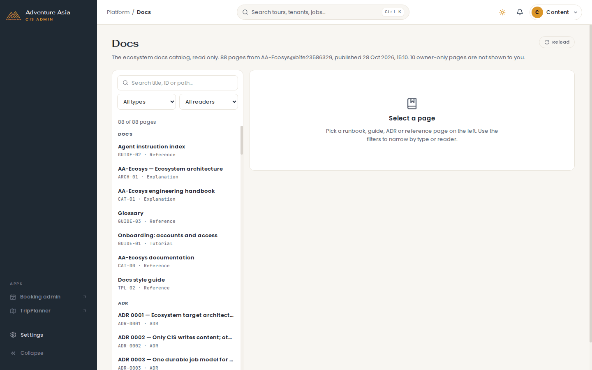

# CIS admin runbook

Part of [app access and operations](app-access-and-operations.md). A Vietnamese version of this page is
[cis-admin-runbook.vi.md](cis-admin-runbook.vi.md).

## 1. Who uses it

The CIS admin console is the staff website of the content system. Adventure Asia staff use it to bring tour files in,
rewrite and review tours, keep the tour catalog (Master Content), and look after tenants, partner agencies, jobs and
spend. The business owner uses it to see the whole platform. Partner agencies never use it.

## 2. Address

| What | Dev address |
|---|---|
| Admin console | `https://aa-cis.lumiguides.it.com` (opens the sign-in page) |
| Staff sign-in page | `https://staff-auth.lumiguides.it.com` (you reach it from the console; do not bookmark it) |
| API health, for engineers | `https://api-cis.lumiguides.it.com/health` |

## 3. Get an account

1. Ask a platform owner (today the tech lead) for access, with your `@adventure.asia` address and the work you do.
2. The owner opens **Platform › People & access › Staff**, chooses **Add staff**, types your name and work e-mail,
   and picks a **CIS role**, a **Booking role** if you also work in Booking, and one or more **CRM roles** if you
   look after partner agencies in the CRM.
3. You receive an invitation e-mail. If it does not arrive within a few minutes, the owner presses **Resend invite**
   on your row.

Only a platform owner who signed in with a company e-mail can add accounts, change roles or disable an account.
Leaving the company: the owner disables the row (it is never deleted, so the history stays).

## 4. Sign in and out

1. Open `https://aa-cis.lumiguides.it.com`.
2. Choose **Sign in with company email**.
3. On the Adventure Asia sign-in page, type your work e-mail address.
4. Type the one-time code from the e-mail. You land on the first page your role may open.
5. To sign out, open the account menu (your initial, top right) and choose **Sign out**. The next sign-in asks for a
   new code.

A session renews itself while you work and ends after about 12 hours. There is no password.

## 5. Roles

| Role | What it can do |
|---|---|
| **admin** | Every page, including the Platform section (people, apps, tenants, agencies, jobs, AI and spend, reports, docs) and the tenant-output quality pages. The business owner has this role |
| **reviewer** | Content work: **Upload (S0)**, **Rewrite (S1)**, **Review Queue**, **Master Content**, **AA content (CRM)**, **Supply (Booking)**, **Facts** (read), **Settings** |
| **content** | The same content pages as reviewer |
| **viewer** | Read only, used by the automated checks; it cannot be given to a person |
| **Owner flag** | An admin with the owner flag also manages staff accounts. Today: the tech lead and one locked emergency account |

Some buttons need more than the page: for example editing **Facts**, publishing **AA content (CRM)** and every tenant
setting are admin only. The server checks the role again on every change.

The same account also carries a **Booking role** (one of Booking admin, Sales, Contracting, Content creator, or none)
and any number of **CRM roles** for the CRM staff work (none by default):

| CRM role | What it allows |
|---|---|
| **Agency admin** | The write buttons of **Agencies (CRM)**: **Create agency**, **Invite first owner**, **Lock**, **Unlock** |
| **Operations** | The CRM staff console for AA ground operations (traveller details released for a trip with a confirmed AA line) |
| **Support** | The CRM staff console for support sessions; each session also needs the agency owner's grant in the CRM |

After a role change, ask the person to sign out and in again; until then the session may keep the old access for up
to 15 minutes.

## 6. The menu

The left menu has two sections.

- **Platform**: Overview (**Overview**, **Data coverage**, **Reports**); People & access (**Staff**, **Audit log**,
  **Alerts**); **Apps**; Tenants (**Tenants**, **Agencies (CRM)**); Jobs (**Jobs**, **Data erasure**);
  AI & spend (**AI providers**, **Cost Operations**, **Cost per app**, **Jev Decisions**); Developer (**API Docs**,
  **Data model**, **Docs**).
- **CIS Content**: Pipeline (**Upload (S0)**, **Content workspace**, **Rewrite (S1)**, **Review Queue**, **Master Content**); Assets
  (**Photos**, **Places**, **AA content (CRM)**, **Facts**, **Supply (Booking)**); Intelligence (**Social Content**,
  **SEO Intelligence**); Tenant output (**Content Trace**, **A4 Quality**, **Content Quality**, **Writing memory**).

**Settings** sits at the bottom of the menu. The UI opens in English; switch the language in the top bar.

**Docs** (Platform › Developer) is the reader for this documentation: search or filter the catalog on the left,
read the page on the right, and switch between English and Vietnamese when a page has a translation.

Screenshot: the **Docs** page on Dev, captured 28 Oct 2026.

## 7. Day-to-day tasks

### Bring new tours in

1. Open **Upload (S0)**.
2. Follow the steps on the page: **Select Files** (the tour Excel file), **Upload to S3**, **Parse & Review**,
   **Commit**, then **Dup Review** for tours that look like ones already in the catalog.
3. The new tours appear under **Tours Ready for Rewrite**. **Trash** removes a wrong source tour; **Show Trashed**
   lets you restore it.

### Make one tour by hand

Use this when a supplier sends a single tour by e-mail or PDF instead of an Excel sheet.

1. Open **Content workspace** and press **New tour**.
2. Fill **Basics**: the tour name, the country and the **AA supplier** (pick it from Booking's list; search by name or
   code). A supplier that is missing from the list is added in Booking by the contracting team. Do not type personal
   data (names, phone numbers or e-mail addresses of people).
3. Press **Create tour**. From now on the form saves by itself as you type ("Saved 10:42" under the title).
4. Add one **day card** per day: a title, at least one place, the meals included, where the travellers sleep and what
   happens. Then the items under **What is included** and **What is not included** (the quick-add chips help). The tour
   types and the quick-add chips are lists an administrator edits on **Platform › Settings** (content area).
5. Watch **Before you publish** on the right: every item must be green. The minimums (days, included and not included
   items) are settings an administrator changes on **Platform › Settings**.
6. Open **Customer wording**: the text starts from your facts. Rewrite it, give a reason, **Save draft**, then
   **Run checks** and, when they pass, **Publish**. With two-person publishing on, a content lead who did not write the
   wording **or the facts** publishes it. The required list is checked on every publish, also when a Rewrite (S1) run
   or a Review Queue approve would publish the tour: an incomplete hand-made tour stays unpublished.
7. **Preview** shows the tour as a traveller reads it, on a desktop or a phone width. **History** lists every change of
   the facts.

Once a tour is published, changes to its facts go live when you save them: write the reason and press **Save changes**.
While two-person publishing is on, the facts of a published hand-made tour are read-only here, because such a save would
go live without a second person; change the wording through a draft.

### Link old tours to their AA supplier

1. Open **Content workspace › Supplier links**. It lists the live tours whose supplier is only the text of their Excel
   sheet, with the AA supplier that text names when it names exactly one.
2. Press **Link to …** on a row to accept a suggestion, or select rows and press **Link selected** to choose the
   supplier yourself.
3. Content leads and administrators can press **Link suggestions…**: run the **Dry run** first, then **Link them**. Each
   run links at most the number set on **Platform › Settings** (100 by default); run it again for the rest.

### Rewrite tours

1. Open **Rewrite (S1)**, filter by country or file, and select the tours.
2. Check **Brand Identity** and **SEO Mode** (Standard, Aggressive or Minimal). The model is set on
   **AI providers › Routing**, not here.
3. Start the run and follow each tour through Generating content, Validating & scoring, Brand audit and Final check.

> [!WARNING]
> A rewrite calls paid AI models. Start with about three tours, then at most about fifty. A larger run needs the
> business owner's approval with a price first.

### Review and publish

1. Open **Review Queue** and keep the **Pending** filter.
2. Open a tour and read the new version against the source. Fix text in place and press **Save edits**; the page
   asks you to validate again before you approve.
3. Choose **Approve** to publish it to Master Content, **Reject** to keep it out, or **Regenerate** to rewrite it again
   (a paid call).

### Read and export Master Content

1. Open **Master Content** and search for the tour.
2. Use **+ Add Panel** to compare versions side by side, **Export Comparison XLSX** or **Export this version as
   DOCX** to share one.

### Manage staff (owners only)

1. **Staff**: add, change role, disable or sign someone out. **Open in Booking** opens the same person in Booking
   admin. The list shows the **CIS role**, **Booking role** and **CRM role** of every account (also in the CSV
   export).
   - Change roles: open the row, then **Manage access**. Pick the CIS role and Booking role, tick or untick the CRM
     roles, and press **Save roles**. The change is saved in CIS first, then in the company sign-in, and recorded in
     the **Audit log**. You cannot change your own CIS role; you can give yourself a Booking or CRM role.
   - **Platform owner preset**: in **Manage access**, **Apply preset** gives CIS Administrator, Booking admin and CRM
     Agency admin in one save (other CRM roles stay). It does not make the person an owner of the staff list; that
     stays a separate, recorded step by the tech lead.
   - If a save says the sign-in update is pending, press **Retry Cognito** (or **Retry Cognito sync**). A sync makes
     the company sign-in match the row exactly, so a CRM access given by hand outside this page is removed unless the
     row has that CRM role: set the role on the page first.
   - **Directory health** (top of the page) compares the sign-in groups with the list once a day or on **Check now**;
     a CRM role that differs is listed as a finding. The automated test accounts allowed on Dev are listed apart.
2. **Audit log**: who changed what and when.
3. **Alerts**: the **Catalogue** tab lists every alert condition of the platform (alarms, security and database rules,
   budgets, the in-app checks of CIS, Booking and the CRM) with its severity, threshold, where it is changed and its
   live state; the **Recipients** tab sets who receives alarm and budget e-mails ("All alerts" or "Page alerts only").

### Tenants and partner agencies

1. **Tenants**: **New Tenant**, then **Create Tenant**, creates a partner brand for the Content studio. Open a tenant
   for its tabs (Tours, Pipeline, Activity, API Usage, Brand, Social Content, Usage & Billing, Cost, Quality, Markets,
   Audit, Settings). Inviting tenant members has no button yet: see the
   [Content studio runbook](content-studio-runbook.md#3-get-an-account).
2. **Agencies (CRM)**: the partner agencies of the CRM. **Create agency**, **Invite first owner**, **Lock** and
   **Unlock** need the CRM role **Agency admin** (set on the Staff page, then sign in again) and a ticket reference;
   other admins can read the list and the usage. Details: [CRM runbook](crm-runbook.md#3-get-an-account).

### A person asks for their data to be deleted

1. Open **Data erasure**. Run the DRY RUN first and read what it would delete.
2. Apply only after the check, following the [data request and erasure runbook](../legal/dsar-erasure-runbook.md).
   Only the CIS part has a button; the other apps follow that runbook by hand.

### Watch the platform

- **Overview**: one screen with the state of the system. **Data coverage**: tours counted from upload to TripPlanner,
  Booking and the CRM.
- **Apps**: is each app up, which commit it runs (**Same commit** or **Mismatch**), and the **Deploy gate** (**Safe to
  deploy** or **Deploy waits**).
- **Jobs**: background work, queued, running and failed, with a drawer per job.
- Spend and reports: see the [AI providers and reports runbook](ai-providers-and-reports-runbook.md).

## 8. When something looks wrong

| You see | Look at | Then |
|---|---|---|
| A red dot on the bell (top bar) | The bell list: the newest notifications | Open the page it names |
| A page shows an error or stays empty | **Apps**: is CIS up and is the commit the same on API and workers? | Take a screenshot and send it with the time |
| Rewrites or reviews do not move | **Jobs** (failed jobs) and **AI providers** (a provider not OK) | If a provider refuses calls, tell the engineer on duty; refused jobs are put back in the queue once it answers again |
| The sign-in code does not arrive or the code page refuses you | Spam folder; wait two minutes, then ask for a new code | Still failing: the engineer on duty follows the [staff sign-in playbook](../ops/playbooks/cognito-login.md) |
| An alarm e-mail | The alarm name in the subject | Forward it to the engineer on duty if it stays in ALARM |

During the dev phase the tech lead is the engineer on duty. Normal issues go to Jira; urgent ones by direct message.

## 9. Dev-phase caveats

- Test data only. Tours, tenants and agencies on Dev are for testing.
- Chat models are refused since 2026-10-29 on the main model account, so **Rewrite (S1)**, **Regenerate** and the
  AI checks fail or wait until a model path is back. Refused jobs are put back in the queue from **AI providers**
  once the provider answers again.

## Sources (for maintainers)

Read from AA-CIS-App `main` on 2026-11-01: `frontend/app/_kit/adminNav.tsx` (menu), `frontend/lib/rbac.ts` (roles),
`frontend/app/login/page.tsx`, the `messages.ts` files of `admin/platform/staff`, `upload`, `s1-rewrite`, `review`,
`master-content`, `platform/apps`, `tenants`, `platform/agencies`, `_kit/Topbar.tsx` (bell), and `CONTEXT.md`
("Staff roles and permissions"). Sign-in design: root ADR 0006, 0006a and 0006b (CRM staff groups). Keep
[cis-admin-runbook.vi.md](cis-admin-runbook.vi.md) in step with this page.
