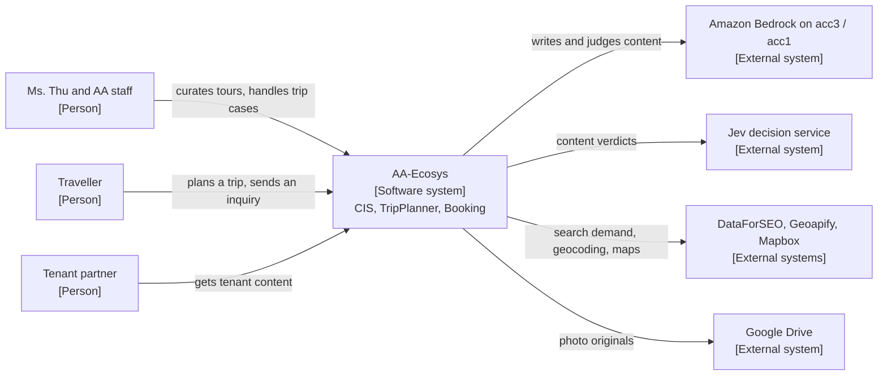
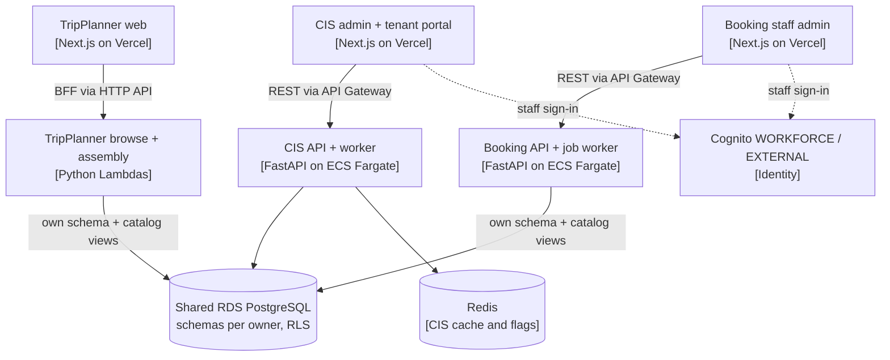

# CTO guide

How the whole delivery system works: [engineering handbook](../engineering-handbook.md).

## Who this is for

You own the technical direction: architecture, engineering process and technical risk. You do not need the
day-to-day runbooks. After this page you can explain the system on one slide, know which decisions are recorded where,
see which risks are open and how the roadmap is tracked. Every section points to the page that holds the facts.

## The system on one page

AA-Ecosys runs three apps on one AWS account (acc2, us-west-1) with one shared PostgreSQL instance, one schema owner
per schema and versioned contracts between apps. Only CIS writes content (ADR 0002). There is only a Dev environment,
holding test data only (D-01); prod will be a separate RDS instance on acc2 (ADR 0001, C7.2a, D-17), dated at
go-live. Full explanation: [ecosystem architecture](../ecosystem-architecture.md).

### C4 level 1 - system context

### C4 level 2 - containers

Diagrams here are a summary; the maintained C4 set belongs in `ecosystem-architecture.md` (AA-697, parked until
Nghiệp decides N-9).

## How decisions are recorded

| Record | Where | Rule |
|---|---|---|
| Ecosystem ADRs (≥ 2 repos affected if reversed) | [`docs/adr/`](../adr/README.md) | Placement rule DM-11.1. Amendments are separate `<nnnn>a-` files. Template: [`templates/adr.md`](../templates/adr.md) |
| Infra-only ADRs | `infra/AA-CIS-Infra/docs/adr/` | Same template |
| Single-app ADRs | `apps/<repo>/docs/adr/` | Cite the root ADR they implement |
| Decisions taken in a session (D-xx, Q-xx) | `docs/sessions/2026-10-17-S241-decisions.md` and later session logs | Vietnamese; promoted to an ADR or a standard when they change a rule |
| Decisions (D-01…D-25, N-1…N-12, all decided) | [Handbook §10](../engineering-handbook.md#10-decisions-log) | A new decision gets a row there |

Accepted ecosystem ADRs: 0001 target architecture, 0002 only CIS writes content, 0003/0003a durable jobs per owner,
0004/0004a/0004b Booking stack, supply ownership, one security group per caller, 0005 pricing, 0006/0006a identity,
0007 place pipeline in CIS, 0008 new-app integration and data platform rules. Reserved: 0009 AI platform (AA-804).
Planned: 0012 prod blueprint (AA-880), 0013 API versioning before any `/booking/v1` prefix (AA-899, N-11). Proposed
(U-25, AA-901): [0011](../adr/0011-github-app-identity-and-merge-rights.md) GitHub App identity for agents and bots with
merge rights per risk tier, [0014](../adr/0014-repo-visibility-and-github-plan.md) repo visibility and GitHub plan.

## Data standards

[Data standards v1.0](../architecture/data-standards/README.md) are the binding rules for the shared RDS: Part A
engineering (migrations MIG-x), Part B data management (DM-1 ownership … DM-11 change management), Part C scaling
(C-x, connection budget, job guard, prod layout). Schema owners: [schema ownership](../database/schema-ownership.md),
with Infra `db/owners.yaml` as the registry. Version 1.1 collects decided-but-unwritten changes (DM-11.5 merge rights
per D-13, C2.3g/DM-8.4 tenant pool per D-12, DM-7 log rows and C4.2b per D-09, DM-11.2, DM-1.2); wording waits for
Nghiệp (N-1, AA-889).

## Identity

One identity service: Amazon Cognito on acc2 ([ADR 0006](../adr/0006-ecosystem-identity.md),
[0006a](../adr/0006a-identity-phase1-amendments.md); architecture §4.6).

| Population | State on 2026-10-19 |
|---|---|
| CIS staff | Live: e-mail one-time code on `staff-auth.lumiguides.it.com`; directory in CIS (`shared.admin_users`, `shared.staff_app_grant`); only owners write it. Legacy password login still on until cutover (AA-816) |
| Break-glass | Live, disabled at rest, password + TOTP |
| Booking staff | Phase 2 in progress (AA-680): Booking accepts WORKFORCE tokens next to the CIS bridge token |
| Tenant users | Phase 3 (AA-813), not started |
| Travellers / customers | Phase 4 (AA-680), not started; WAF before self sign-up opens |

## Isolation: tenants, apps and roles

- **Tenants**: PostgreSQL row-level security plus a tenant connection pool that fails closed globally (D-12): an
  unreadable flag means the tenant pool. Probe: `db-isolation-probe.yml` (U-16).
- **Apps on the network**: one security group per caller ([ADR 0004b](../adr/0004b-per-app-security-groups.md)).
- **Apps in the database (X1)**: NOLOGIN owner roles per app (`bk_owner` and `tp_owner` live, `cis_owner` next),
  runtime login roles without DDL, DB Migrate running each file as the live owner. Steps S1-S16 shipped by 2026-10-19; the rest,
  ending with a dedicated `db_migrator` login, is AA-852 / AA-860. Plan:
  `docs/audits/2026-10-17-S241-x1/x1-plan.md`. While X1 runs, `catalog.*` views are frozen (backlog §1).

## Delivery model (SDLC and ADLC)

Kanban plus trunk-based development: one ordered [live backlog](../backlog/README.md), sessions of 3-5 issues, short
branches, squash merge to `main`. "ADLC" here means the SDLC plus control of AI agents plus the life cycle of LLM
features (the S243 guide, `docs/audits/2026-10-19-S243-sdlc-docs-versioning/README.md`, §2).

| Actor | Does | Guard |
|---|---|---|
| Nghiệp | Writes or approves the issue (DoR), ADRs, spend, prod decisions, deploy-gate overrides | - |
| Claude Code (main session) | Picks work, gates, merges and deploys on Dev (D-13 dev phase), Terraform, DB Migrate | Steering + skills; runs on `aa365-admin` (D-15) |
| Kiro / subagents | Code, tests, commits on a branch | `.claude/hooks/subagent-guardrails.sh` deny-list: no push, merge, apply or secret writes |
| `kiro-reviewer` | Reviews risky PRs (auth, migration, CI/secret, delete) | `kiro-delegate` skill |
| CI | Required checks | Branch protection on the public repos |

Human review becomes mandatory for risky classes from prod or the first paying tenant (D-13). A separate agent
identity (GitHub App) and least-privilege agent role are trigger items (U-25, U-53, D-14, D-15), not current work.

## Quality gates

| Gate | Where |
|---|---|
| Required CI: CIS 5 (Lint, Security Audit, Unit Tests, Integration Tests, Docker Build Check), Booking 5, TripPlanner 2 | Branch protection on the public repos; root and Infra (private, GitHub Free) have none, compensated by `main`-only OIDC trust (AA-866) |
| Security scans | CodeQL default setup, secret scanning + push protection (public repos), gitleaks (Infra), blocking `pip-audit` (CIS), Dependabot |
| Data | Migration Copy Guard, DB Migrate version check, isolation probe, no raw model calls test (`test_aa685_no_raw_model_calls.py`) |
| UI | Playwright UI smoke on every CIS admin and portal preview |
| Definition of Done | Merged + CI green + deploy COMPLETED + verified live with evidence (`skill/aa-ship`) |
| Definition of Ready | [`templates/definition-of-ready.md`](../templates/definition-of-ready.md) |
| LLM quality | Golden set of about 100 samples (AA-729); eval by hand or dispatch (D-23) |

## Risks and technical debt

Platform roadmap and status: [handbook §9](../engineering-handbook.md#9-roadmap). Risk ranking history: the S241
review (`docs/audits/2026-10-17-S241-sdlc-review/README.md`, superseded).

Debt that the docs track: Dead Table Registry (AA-850), connection budget check (U-61, folded into AA-879), contract
hash guard (AA-826), place pipeline move to CIS (AA-712, ADR 0007).

## Roadmap

- Platform roadmap U-01…U-61 and the S243 issues AA-887…AA-901, with status: [handbook §9](../engineering-handbook.md#9-roadmap);
  the order of the next picks is [backlog §3a](../backlog/README.md#3a-platform-roadmap-keys-plat-01) (PLAT-01).
- Order of work: Q10 - finish the platform block (admin, X1, Cognito, portal split), then return to CIS content.

## Recurring duties

| Cadence | Duty | Page |
|---|---|---|
| Each new boundary or stack choice | ADR or amendment, CONTEXT.md in the same PR | [ADR index](../adr/README.md) |
| Monthly | Read the cost and capacity review | `docs/audits/<date>-S<nnn>-capacity-review/` |
| Quarterly | Review the risk table above and the open N-x decisions | reconciliation report |
| Before prod | Prod blueprint ADR 0012 and readiness checklist | AA-880 |

## Related

- [CIO guide](cio.md), [PM guide](pm.md), [DevOps guide](devops.md)
- [Agent index](../agents.md), [glossary](../glossary.md)
