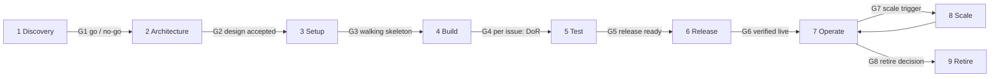

# New-project playbook

This playbook is the kit a new project applies on day 1. It covers the full lifecycle, from deciding whether to build
at all to shutting the product down. It is a thin profile over well-known standards, not a new method: each page
names the standard it follows and what it keeps or drops. AA-Ecosys is its reference application; the
[AA profile](aa-profile.md) maps the generic pages onto AA's own rules and tools.

The design and its fourteen decisions were approved by the tech lead in S279
([research](../research/new-project-playbook/README.md), handbook decision S279-K1).

## Start here

| You are | Read |
|---|---|
| Starting a project | [Adoption](adoption.md) (day-1 checklist), then [Discovery](01-discovery.md) |
| Business owner | This page, [Discovery](01-discovery.md), [Scale](08-scale.md), [Retire](09-retire.md) |
| Tech lead | [Principles](principles.md), every phase page, [Agents](agents.md) |
| Engineer or agent joining a running project | [Principles](principles.md), [Build](04-build.md), [Test](05-test.md), [Release](06-release.md), [Agents](agents.md) |
| Working on AA itself | [AA profile](aa-profile.md) |

## Lifecycle map

Nine phases, named after the UK GDS phases (discovery, alpha, beta, live, retirement). Each phase ends at a gate: a
short checklist rated red, amber or green (an AA choice, not a GDS rule). Green passes. Amber passes with a recorded
follow-up. Red stops.

| # | Phase | GDS phase | Gate | Accountable |
|---|---|---|---|---|
| 1 | [Discovery](01-discovery.md) | Discovery | G1 go / no-go | Business owner |
| 2 | [Architecture](02-architecture.md) | Alpha | G2 design accepted | Tech lead |
| 3 | [Setup](03-setup.md) | Alpha | G3 walking skeleton on Dev | Tech lead |
| 4 | [Build](04-build.md) | Beta | G4 per issue: Definition of Ready | Tech lead |
| 5 | [Test](05-test.md) | Beta | G5 release ready | Tech lead |
| 6 | [Release](06-release.md) | Beta / live | G6 Definition of Done, verified live | Tech lead |
| 7 | [Operate](07-operate.md) | Live | periodic reviews | Tech lead |
| 8 | [Scale](08-scale.md) | Live | G7 a measured scale trigger, or first prod | Business owner |
| 9 | [Retire](09-retire.md) | Retirement | G8 nothing left running or billed | Business owner |

G4 is the one gate that runs per issue; Build has no exit gate of its own, each issue leaves through G5 and G6. Phases 4
to 6 repeat for every issue, so a live project is in several phases at once.

## Roles (RACI per phase)

One human is Accountable for each phase. Agents may be Responsible, never Accountable (AA's own rule).

| Phase | Business owner | Tech lead | Orchestrator agent | Subagents / second agent | CI | Vendors |
|---|---|---|---|---|---|---|
| 1 Discovery | A | R | R (research, drafts) | C (research lanes) | - | C |
| 2 Architecture | C | A | R (ADR drafts) | C (reviews) | - | C |
| 3 Setup | I | A | R | R (scaffold tasks) | R (first green run) | C |
| 4 Build | I | A | R (gatekeeper) | R (code) | R | - |
| 5 Test | C (UAT) | A | R | R | R | - |
| 6 Release | I (business update) | A | R (merge, deploy, verify in the dev phase) | - | R | - |
| 7 Operate | I | A | R | C | R (scheduled guards) | C |
| 8 Scale | A (scale decision and new spend) | R (design, prod blueprint) | R | C | - | C |
| 9 Retire | A | R | R | C | R | C |

A = accountable, R = responsible, C = consulted, I = informed. From the first prod release or the first paying tenant,
the tech lead also approves risky merges before they land ([Scale](08-scale.md)).

### Other team shapes

| Team shape | What changes |
|---|---|
| Tech lead plus agents (default) | As above. Agents review agents for risky classes; code owners switch on at G7 |
| Several engineers plus agents | Each engineer can be R; the tech lead stays A. Code owners enforced from day 1; a risky-class PR needs one human approval as well as CI, not only an agent review. One engineer holds the orchestrator role per session |
| Engineers only, no agents | No agent files, hooks or skills. Tolerances become the team's working agreement. Human review on every PR; the session ritual becomes a short weekly review |

## The kit

| Part | Where |
|---|---|
| Principles and the tolerance table | [principles.md](principles.md) |
| One page per phase: goal, deliverables, gate checklist, templates, common mistakes | the nine phase pages above |
| Running a team of one human and several agents | [agents.md](agents.md) |
| Day-1 checklist and the 30 / 60 / 90-day plan | [adoption.md](adoption.md) |
| DORA, flow and AI-readiness metrics | [metrics.md](metrics.md) |
| How AA maps onto the kit | [aa-profile.md](aa-profile.md) |
| Templates | [`docs/templates/`](../templates/README.md) |
| Template repo (Copier) and generic agent skills | planned, AA-1103 |

## Standards it builds on

UK GDS service manual (phases), ISO/IEC/IEEE 12207 (coverage check), ISO/IEC 25010:2023 (quality names), PMBOK 7
(four performance domains), PRINCE2 7 (tolerances), Scrum Guide 2020 (product goal, Definition of Done), Kanban Guide
(WIP, flow metrics), Shape Up (appetite, circuit breaker), DORA (metrics, AI capabilities), Google SRE (SLOs,
postmortems), C4 and arc42 (architecture), MADR (ADRs), AGENTS.md (agent instructions), Twelve-Factor App, trunk-based
development, OWASP ASVS 5.0 and SAMM v2 (security), FinOps Framework (cost), RACI. Sources and the verdict on each are
in the [research](../research/new-project-playbook/README.md) sections 4 and 8.
