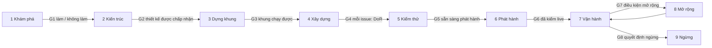

# Playbook cho dự án mới

Playbook này là bộ kit mà một dự án mới áp dụng ngay từ ngày đầu. Nó phủ trọn vòng đời, từ việc quyết định có nên xây
hay không tới lúc đóng sản phẩm lại. Đây là một bản áp dụng mỏng đặt trên các chuẩn quen thuộc, không phải một phương
pháp mới: mỗi trang nêu chuẩn nó theo và phần nó giữ hay bỏ. AA-Ecosys là ứng dụng tham chiếu; trang
[bản áp dụng AA](aa-profile.vi.md) ánh xạ các trang chung sang luật và công cụ riêng của AA.

Thiết kế và mười bốn quyết định của nó đã được tech lead duyệt ở S279
([nghiên cứu](../research/new-project-playbook/README.vi.md), quyết định S279-K1 trong sổ tay).

## Bắt đầu từ đây

| Bạn là | Đọc |
|---|---|
| Người khởi động một dự án | [Áp dụng](adoption.vi.md) (checklist ngày đầu), rồi [Khám phá](01-discovery.vi.md) |
| Chủ doanh nghiệp | Trang này, [Khám phá](01-discovery.vi.md), [Mở rộng](08-scale.vi.md), [Ngừng](09-retire.vi.md) |
| Tech lead | [Nguyên tắc](principles.vi.md), mọi trang pha, [Agent](agents.vi.md) |
| Kỹ sư hoặc agent vào một dự án đang chạy | [Nguyên tắc](principles.vi.md), [Xây dựng](04-build.vi.md), [Kiểm thử](05-test.vi.md), [Phát hành](06-release.vi.md), [Agent](agents.vi.md) |
| Người làm trên chính AA | [Bản áp dụng AA](aa-profile.vi.md) |

## Bản đồ vòng đời

Chín pha, đặt tên theo các pha của UK GDS (discovery, alpha, beta, live, retirement). Mỗi pha kết thúc ở một cổng: một
checklist ngắn chấm đỏ, vàng hoặc xanh (lựa chọn của AA, không phải luật của GDS). Xanh thì qua. Vàng thì qua kèm một
việc tiếp theo được ghi lại. Đỏ thì dừng.

| # | Pha | Pha GDS | Cổng | Người chịu trách nhiệm cuối |
|---|---|---|---|---|
| 1 | [Khám phá](01-discovery.vi.md) | Discovery | G1 làm / không làm | Chủ doanh nghiệp |
| 2 | [Kiến trúc](02-architecture.vi.md) | Alpha | G2 thiết kế được chấp nhận | Tech lead |
| 3 | [Dựng khung](03-setup.vi.md) | Alpha | G3 khung chạy được trên Dev | Tech lead |
| 4 | [Xây dựng](04-build.vi.md) | Beta | G4 mỗi issue: Definition of Ready | Tech lead |
| 5 | [Kiểm thử](05-test.vi.md) | Beta | G5 sẵn sàng phát hành | Tech lead |
| 6 | [Phát hành](06-release.vi.md) | Beta / live | G6 Definition of Done, đã kiểm live | Tech lead |
| 7 | [Vận hành](07-operate.vi.md) | Live | các đợt rà soát định kỳ | Tech lead |
| 8 | [Mở rộng](08-scale.vi.md) | Live | G7 một điều kiện mở rộng đo được, hoặc prod đầu tiên | Chủ doanh nghiệp |
| 9 | [Ngừng](09-retire.vi.md) | Retirement | G8 không còn gì chạy hay bị tính tiền | Chủ doanh nghiệp |

G4 là cổng duy nhất chạy cho từng issue; pha Xây dựng không có cổng ra riêng, mỗi issue ra qua G5 và G6. Pha 4 tới 6
lặp lại cho mỗi issue, nên một dự án đang live ở trong nhiều pha cùng lúc.

## Vai trò (RACI theo pha)

Mỗi pha có đúng một người chịu trách nhiệm cuối (Accountable). Agent có thể là người làm (Responsible), không bao giờ
là người chịu trách nhiệm cuối (luật riêng của AA).

| Pha | Chủ doanh nghiệp | Tech lead | Agent điều phối | Subagent / agent thứ hai | CI | Nhà cung cấp |
|---|---|---|---|---|---|---|
| 1 Khám phá | A | R | R (nghiên cứu, bản nháp) | C (lane nghiên cứu) | - | C |
| 2 Kiến trúc | C | A | R (nháp ADR) | C (review) | - | C |
| 3 Dựng khung | I | A | R | R (việc dựng khung) | R (lượt chạy xanh đầu tiên) | C |
| 4 Xây dựng | I | A | R (gác cổng) | R (code) | R | - |
| 5 Kiểm thử | C (UAT) | A | R | R | R | - |
| 6 Phát hành | I (cập nhật cho kinh doanh) | A | R (merge, deploy, kiểm live trong giai đoạn dev) | - | R | - |
| 7 Vận hành | I | A | R | C | R (guard theo lịch) | C |
| 8 Mở rộng | A (quyết định mở rộng và chi tiêu mới) | R (thiết kế, bản thiết kế prod) | R | C | - | C |
| 9 Ngừng | A | R | R | C | R | C |

A = chịu trách nhiệm cuối, R = người làm, C = được hỏi ý kiến, I = được báo. Từ bản phát hành prod đầu tiên hoặc tenant
trả tiền đầu tiên, tech lead còn duyệt các merge rủi ro trước khi chúng vào ([Mở rộng](08-scale.vi.md)).

### Các hình dạng đội khác

| Hình dạng đội | Điều gì thay đổi |
|---|---|
| Tech lead cùng agent (mặc định) | Như trên. Agent review agent cho các lớp rủi ro; code owner bật ở G7 |
| Nhiều kỹ sư cùng agent | Mỗi kỹ sư có thể là R; tech lead vẫn là A. Code owner được ép từ ngày đầu; một PR thuộc lớp rủi ro cần một người duyệt cùng với CI, không chỉ agent review. Mỗi phiên một kỹ sư giữ vai trò điều phối |
| Chỉ kỹ sư, không agent | Không có file agent, hook hay skill. Dung sai trở thành thoả thuận làm việc của đội. Người review mọi PR; nghi thức phiên thành một buổi rà soát ngắn hằng tuần |

## Bộ kit

| Phần | Ở đâu |
|---|---|
| Nguyên tắc và bảng dung sai | [principles.vi.md](principles.vi.md) |
| Mỗi pha một trang: mục tiêu, sản phẩm bàn giao, checklist cổng, mẫu, lỗi hay gặp | chín trang pha ở trên |
| Vận hành một đội gồm một người và nhiều agent | [agents.vi.md](agents.vi.md) |
| Checklist ngày đầu và kế hoạch 30 / 60 / 90 ngày | [adoption.vi.md](adoption.vi.md) |
| Chỉ số DORA, luồng và mức sẵn sàng AI | [metrics.vi.md](metrics.vi.md) |
| AA ánh xạ vào bộ kit thế nào | [aa-profile.vi.md](aa-profile.vi.md) |
| Mẫu | [`docs/templates/`](../templates/README.vi.md) |
| Repo mẫu (Copier) và skill chung cho agent | đã lên kế hoạch, AA-1103 |

## Các chuẩn làm nền

UK GDS service manual (các pha), ISO/IEC/IEEE 12207 (kiểm độ phủ), ISO/IEC 25010:2023 (tên các đặc tính chất lượng),
PMBOK 7 (bốn performance domain), PRINCE2 7 (dung sai), Scrum Guide 2020 (product goal, Definition of Done), Kanban
Guide (WIP, chỉ số luồng), Shape Up (appetite, circuit breaker), DORA (chỉ số, năng lực AI), Google SRE (SLO,
postmortem), C4 và arc42 (kiến trúc), MADR (ADR), AGENTS.md (chỉ dẫn cho agent), Twelve-Factor App, trunk-based
development, OWASP ASVS 5.0 và SAMM v2 (bảo mật), FinOps Framework (chi phí), RACI. Nguồn và kết luận cho từng chuẩn
nằm ở [nghiên cứu](../research/new-project-playbook/README.vi.md) mục 4 và 8.
