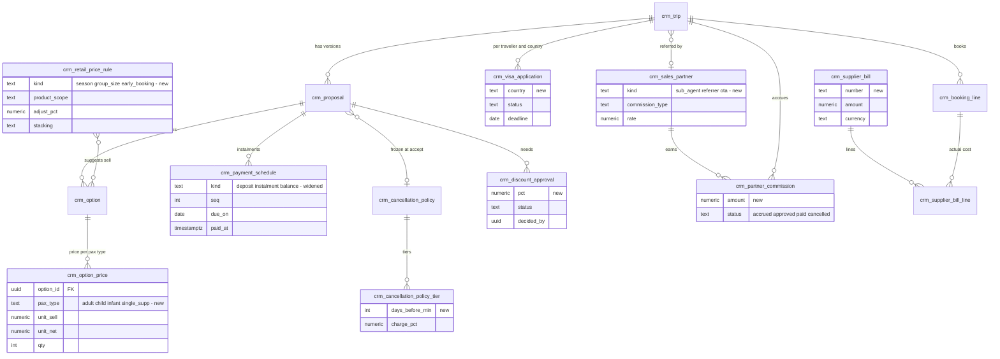
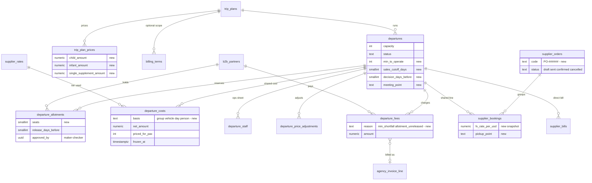

# Odoo tour and travel plugin compared with the AA ecosystem

Research note, S275, 2026-11-10 (AA-1065, second version). Author: Claude Code (research lane). Read-only: no code
change, no AWS call, no paid call. Our facts come from the repos and from
[`db-schema-reference.md`](../architecture/db-schema-reference.md) (live dump verified 2026-11-09: CIS 393, tp-027,
bk-044, crm-047). Every "we have" claim below was re-checked against code or schema; file paths are in the item list
`.tmp-session/S275/aa1065/items.json` (field `verify_note`).

## What changed in this version

> [!IMPORTANT]
> **Correction from the tech lead.** The first version compared the plugin only with AA-Booking and marked its retail
> features "not applicable" under [ADR 0019](../adr/0019-b2b-only-ecosystem-model.md). That was the wrong
> counterpart. The plugin is a **B2C travel CRM**. Its right counterpart is **our agency CRM (AA-Partner)**: each
> agency (our tenant) uses the CRM to sell trips to its own travellers. AA-Booking stays the AA-to-agency **B2B** side.

What follows from the correction:

- **Retail features are CRM candidates.** Traveller booking, deposits, payment schedules, child, infant and single
  pricing, passports and visas, vouchers, manifests, cancellation charges, sub-agent commission, profit per trip,
  website booking and multi-currency belong in AA-Partner. ADR 0019 still holds: AA never sells to a traveller; the
  agency does, through its own CRM, its own mailbox and its own payment account.
- **Booking takes the B2B upgrades.** Departures (minimum to operate, recurrence, allotments), cost against bill,
  profit, supplier purchase orders, vouchers for agencies and staff entry on behalf of an agency.
- **The goal is to build, not to compare.** Each feature is rebuilt in our own code and data model. Nothing is copied
  from the plugin (see [Licence](#licence)).

## Summary

- **53 items reviewed:** 35 for the CRM, 18 for Booking. CRM: 9 we have, 16 partly, 10 missing. Booking: 12 partly,
  6 missing.
- **The CRM already beats the plugin** on enquiry intake, holds with expiry, multi-currency with frozen FX, encrypted
  traveller records, the traveller portal, versioned itineraries, supplier commission and e-signed terms.
- **The CRM's biggest gaps for daily selling:** price per traveller type, a payment schedule with several instalments,
  payment reminders to the traveller, a cancellation charge table, discount approval, retail price rules, a "Book
  now" button on the agency's tour page and online payment through the agency's own gateway.
- **Booking's biggest gaps:** departure minimum to operate and sales cutoff, a recurring departure generator, staff
  entry on behalf of an agency, FX-normalised cost against bill, and profit per case, departure and agency.
- **Build order:** CRM first (ranks 1–26), then Booking (ranks 27–44), then the small add-ons to features we already
  have (ranks 45–53). Full plan in [Build plan](#build-plan).

## Plugin overview

| Item | Value |
|---|---|
| Technical name, version | `mdv_tour_travel` 19.0.1.1.0 (Odoo 19) |
| Vendor, price | Modvanta, listed at 17 USD |
| Licence | OPL-1 (Odoo Proprietary License) |
| Depends on | Odoo `website`, `sale`, `purchase`, `crm`, `account`, `portal`, `mail` |
| Size | About 4,800 lines of Python in 14 model files, 1 controller, 1 wizard; 123 test methods (not run here) |
| Shape | One central booking record hanging off Odoo's own documents: sale order (customer money), purchase order (supplier order), invoices and vendor bills |
| Channel model | B2C: invoices the end traveller; pays agents and sub-agents a commission |

Main areas, by model name only:

- **Product:** package, itinerary, package service, image, FAQ; destination tree, category, inclusion, terms.
- **Pricing:** adult, child, infant and single-supplement prices; price rules by season, group size and early booking.
- **Departures:** departure with seats, minimum to operate and guide; recurrence wizard; departure fee for empty seats.
- **Booking and money:** booking, booking service (cost line), payment schedule line, cancel wizard and policy table.
- **Finance:** service cost tier by group size; profit report as an SQL view.
- **Travellers and visas:** traveller rows, visa requirement, visa application and checklist.
- **Front end:** public `/tours` catalogue with live quote and online booking, customer portal, four PDF reports
  (confirmation, invoice, voucher, brochure).

The Odoo community scan from the first version still stands: no healthy open-source tour-operator module exists; OCA
`pms` (hotel PMS, AGPL-3) is the best data-model reference for quotas and channels. We take ideas only.

## CRM feature table (AA-Partner)

Rank 1 is built first. Status is ours against the plugin. "Have" rows need nothing or only a small add-on.

| Rank | ID | Feature | Status | What to build |
|---|---|---|---|---|
| 1 | crm-05 | Price per traveller type (adult, child, infant, single supplement) | partly | `crm.option_price` rows per pax type; option sell = sum; tenant child and infant age limits; per-type grid in the builder, prefilled from the Booking quote split times retail markup |
| 2 | crm-08 | Payment schedule with several instalments and live status | partly | Widen `payment_schedule.kind` to deposit, instalment, balance with `seq`; partial and overdue status in a view; tenant schedule template |
| 3 | crm-09 | Payment reminders to the traveller | partly | Workflow trigger "due in N days" plus two library templates (due soon, overdue), 3-day cool-down, opt-in, sent from the agency mailbox |
| 4 | crm-11 | Traveller cancellation policy (days-before charge table) | missing | `crm.cancellation_policy` + tiers; frozen on the proposal at accept; cancel dialog computes charge and refund due; warning when charge is below AA's fee |
| 5 | crm-07 | Discount with owner approval above a limit | missing | Proposal discount; tenant limit; `crm.discount_approval`; send blocked above the limit until the owner approves; same gate for sell below cost |
| 6 | crm-06 | Retail price rules: season, group size, early booking | partly | `crm.retail_price_rule` applied after markup; rule names stored on the option; owner-only pricing settings page |
| 7 | crm-02 | "Book now" on the agency's public tour page with live price | partly | Booking widget on `/trip/[tourId]`: departure, party, live retail price; creates traveller, trip, one-option proposal and AA hold, then sends the client to accept and pay |
| 8 | crm-03 | Online deposit and instalment payment (agency's own gateway) | missing | One bring-your-own Vietnamese gateway (agency's merchant account) behind the existing provider seam; signed webhook settles the schedule row; Stripe stays paused |
| 9 | crm-30 | Profit per trip (full P&L) | partly | View `crm.v_trip_pnl`: invoices net of refunds against AA cost, agency supplier cost, partner commission and cancellation cost; "Money" card on the trip |
| 10 | crm-26 | "Bookings with AA" page with AA invoices | missing | Read Booking `/invoices` and `/billing-status`; cache; link invoices to AA lines; mismatch flag; past-due banner before the credit stop |
| 11 | crm-28 | Sub-agent and referral partner commission payable | missing | `crm.sales_partner` and `crm.partner_commission` (percent, fixed per pax or net rate); cost in the trip P&L; statement per partner |
| 12 | crm-12 | Cancellation charge invoice and refund due | partly | Invoice kind `cancellation_fee` from the computed charge; refunds prefilled with paid minus charge |
| 13 | crm-22 | Departure roster: all the agency's travellers on one AA departure | partly | `/departures` page grouping trips by AA departure, guaranteed status from the feed, Stage 3 completeness, merged manifest for the agency's tour leader |
| 14 | crm-20 | Per-service vouchers for travellers | partly | Generated voucher per confirmed booking line (HTML on the traveller portal, print to PDF); AA lines from the Booking confirmation |
| 15 | crm-15 | Passport validity check against the trip | partly | `passport_ok` = expiry ≥ trip end + N months; badge, pipeline filter, workflow trigger |
| 16 | crm-13 | AA cancels a departure: waive and rebook flow | partly | On `departure.cancelled`: guided card to re-quote another date or cancel with the charge forced to zero and full refunds prefilled |
| 17 | crm-23 | Agency service catalogue (own ancillaries) | missing | `crm.agency_service` with unit net, unit sell and quantity basis (per person, room, night); "add from catalogue" in the builder |
| 18 | crm-24 | Supplier booking requests grouped per supplier | partly | Line status `requested`; one e-mail draft per supplier from the agency mailbox; reply with confirmation number confirms the line |
| 19 | crm-25 | Supplier bills and actual against planned cost | missing | `crm.supplier_bill` + lines; money kind `actual_cost`; variance shown only once billed |
| 20 | crm-31 | Profit reports by channel, product, travel month and seller | partly | Profit cube on `v_trip_pnl`; home tiles for deposits due, overdue instalments, passport and visa warnings, next departures |
| 21 | crm-21 | Server-side PDF documents | partly | One render job (HTML to PDF in the worker) storing confirmation, invoice, proposal and voucher PDFs as sealed documents with agency branding |
| 22 | crm-17 | Rooming list (who shares which room) | partly | `crm.room_assignment` editable by the agent and lead traveller, checked against the room mix, sent in the ops release |
| 23 | crm-16 | Visa tracker per traveller and country | missing | Agency-maintained visa templates; `crm.visa_application` + checklist per traveller and country; deadline task |
| 24 | crm-35 | Included and not-included lists on the proposal | partly | `crm.inclusion_item` library picked in the builder; AA tour inclusions from CIS as a fixed block |
| 25 | crm-32 | Group departure P&L with shared costs split per traveller | missing | `crm.departure_cost` for the agency's group costs, split by pax into each trip's P&L |
| 26 | crm-29 | Sub-agent portal | missing | Signed intake link per partner; light OTP view of referred trips and commission status |
| 45 | crm-34 | Message templates and WhatsApp share | have | Add a "booking confirmed" library template |
| 46 | crm-33 | Terms templates with acceptance | have | Add the cancellation policy as a merge field |
| 47 | crm-18 | Traveller self-service portal | have | Add vouchers and visa checklist when those ship |
| 48 | crm-01 | Enquiry to booking | have | Optional: show the source AA tour and departure on the trip header |
| 49 | crm-04 | Hold with expiry and "paid but cannot fulfil" safety | have | Nothing |
| 50 | crm-10 | Multi-currency booking with frozen FX | have | Nothing |
| 51 | crm-14 | Traveller records (passport, DOB, diet, medical) | have | Nothing; encrypted and stronger than the plugin |
| 52 | crm-19 | Itinerary copied and edited per booking | have | Nothing |
| 53 | crm-27 | Commission the agency earns from its own suppliers | have | Nothing |

> [!NOTE]
> A finding from the re-check: the white-label tour page `/trip/[tourId]` has no price and its only button is a
> `mailto` to AA's own support address, not the agency's, and it does not link to the agency's intake form. Fixing
> that link is a small part of crm-02.

## Booking feature table (AA-Booking)

| Rank | ID | Feature | Status | What to build |
|---|---|---|---|---|
| 27 | bk-01 | Departure minimum to operate, sales cutoff, guarantee decision date | partly | Columns `min_to_operate`, `sales_cutoff_days`, `decision_days_before`; daily job sets guaranteed or opens an at-risk task; B2B API shows seats to guarantee |
| 28 | bk-02 | Recurring departure generator | missing | `departures:generate` (weekly or monthly pattern, dry run, skip existing dates); preview drawer on the trip plan |
| 29 | bk-11 | Staff-entered bookings on behalf of an agency | missing | Staff route running quote, hold and confirm in one call; outbox event so the agency's CRM imports the booking |
| 30 | bk-10 | FX-normalised costs and realised FX difference | partly | `to_usd` helper with the approved plain rate; FX snapshots on supplier bookings and bills; USD and FX-difference columns |
| 31 | bk-07 | Planned against actual supplier cost, per case and per departure | partly | Variance view per supplier booking (empty until billed); departure costs endpoint; bills may point at a departure |
| 32 | bk-08 | Profit per trip case, departure and agency | missing | Views for case, departure and agency-month profit; staff page `/finance/profit` with CSV; new permission `profit.read` |
| 33 | bk-03 | Per-agency seat allotments with release dates | missing | `booking.departure_allotments` (maker-checker); usage counts allotments; release job and event |
| 34 | bk-04 | Departure board: calendar and occupancy | partly | Occupancy view; staff calendar page with per-agency seat breakdown |
| 35 | bk-06 | Supplier purchase orders, one per supplier, sent by e-mail | partly | `booking.supplier_orders` grouping pending lines; printable order; send through the existing mailer job |
| 36 | bk-05 | Departure shared costs priced by total group size | partly | `booking.departure_costs` re-tiered as the departure fills, frozen when ordered, split to cases by seats |
| 37 | bk-14 | Cancellation: override or waive, supplier penalties, partial cancel | partly | Maker-checker override and waive; supplier cancel fee recorded; reduce seats on a line |
| 38 | bk-15 | Child, infant and single-supplement net prices for agencies | partly | Extra price columns and age limits on trip plans; cost sheet computes them; CRM reads them for crm-05 |
| 39 | bk-16 | Departure operations sheet: guide, tour leader, meeting point and time | missing | Ops columns on departures; `booking.departure_staff`; event with meeting point and time only |
| 40 | bk-12 | Service vouchers for agencies | partly | Ops fields on supplier bookings; generated B2B vouchers without names or prices; the CRM merges the traveller name |
| 41 | bk-09 | Departure fees charged to agencies | missing | `booking.departure_fees` (shortfall, unreleased allotment); new settlement line role |
| 42 | bk-13 | Departure operations manifest and rooming list | partly | Step 1 counts-only manifest per departure; step 2 rooming names pushed from the CRM, only after a data-standard amendment |
| 43 | bk-17 | Departure price adjustments and early-booking rule | partly | `booking.departure_price_adjustments` (maker-checker); early-booking points on pricing rules |
| 44 | bk-18 | Per-product deposit and balance terms | partly | Optional `trip_plan_id` scope on `booking.billing_terms`; most specific row wins |

## Data model ideas to adopt

Ideas taken from the plugin, rebuilt in our conventions (tenant-scoped rows with RLS in `crm.*`, maker-checker and
append-only history in `booking.*`, money snapshots instead of live links):

| Idea | Plugin shape | Our shape |
|---|---|---|
| Price per pax type | Price fields per type on package and booking | Child rows `crm.option_price` under an option; option total stays the sum, covered by the price hash |
| Stackable price rules | Rule rows with kind, range and percent | `crm.retail_price_rule` with scope, priority and stacking mode; the applied rule names are stored on the option |
| Instalment schedule | Lines with planned, due, partial, paid, overdue | Widened `crm.payment_schedule` with `seq`; overdue derived in a view; `paid_at` kept per row |
| Cancellation table | Policy + lines "N days or less → X %" | Versioned `crm.cancellation_policy` + tiers, frozen on the proposal at accept |
| Discount gate | Discount above a limit needs a manager | `crm.discount_approval`, re-opened when the discount rises |
| Agent commission | Partner with commission type, booked as a cost | `crm.sales_partner` + `crm.partner_commission` accrued at booked, cost in the trip P&L |
| Planned against actual | Planned on the service line, actual from vendor bills | `crm.supplier_bill` (CRM) and `booking.supplier_bills` (Booking) linked per line; variance empty until billed |
| Departure seat control | Seats, minimum, guaranteed | Booking: minimum, cutoff, decision date, per-agency allotments with release |
| Shared group cost | Departure cost lines split by pax | `booking.departure_costs` (AA) and `crm.departure_cost` (agency group), both split by seats |
| Profit view | SQL view over bookings and fees | `crm.v_trip_pnl`, `booking.v_case_profit`, `booking.v_departure_profit`, `booking.v_agency_profit_month` |

Other new CRM tables named in the table above but left out of the diagram (15-node limit): `crm.room_assignment`,
`crm.agency_service`, `crm.aa_invoice_cache`, `crm.departure_cost`, `crm.inclusion_item`,
`crm.public_booking_attempt`, `crm.visa_template`, `crm.visa_checklist_item`.

### Proposed CRM additions

Existing tables show only key columns; tables marked "new" do not exist yet.

### Proposed Booking additions

## Build plan

Ranks combine value, effort and dependencies. CRM comes first, and inside the CRM the features that unlock the
agency's daily selling come first. Each item is about one PR or a small group of PRs.

### Phase 1: CRM daily selling (ranks 1–8)

1. crm-05 price per pax type (M). Base for crm-02, crm-06 and the Booking upgrade bk-15.
2. crm-08 multi-instalment schedule (M).
3. crm-09 payment reminders to the traveller (S, needs crm-08).
4. crm-11 cancellation charge table (M).
5. crm-07 discount with owner approval (S).
6. crm-06 retail price rules (M, needs crm-05).
7. crm-02 "Book now" on the agency tour page (L, needs crm-05 and crm-06; works with manual bank transfer).
8. crm-03 online payment through the agency's own gateway (L). Starts only after the gateway decision (open question
   1); until then crm-02 uses the existing bank-transfer flow.

### Phase 2: CRM money and profit (ranks 9–12)

9. crm-30 trip P&L view (M; works before crm-25, crm-26 and crm-28, which fill in more numbers).
10. crm-26 "Bookings with AA" page with AA invoices (M; the Booking contract already exists).
11. crm-28 sub-agent and referral commission (M).
12. crm-12 cancellation charge invoice and refund due (S, needs crm-11).

### Phase 3: CRM operations (ranks 13–19)

13. crm-22 departure roster, 14. crm-20 vouchers, 15. crm-15 passport check, 16. crm-13 AA-cancelled departure flow,
17. crm-23 agency service catalogue, 18. crm-24 supplier requests per supplier, 19. crm-25 supplier bills.

### Phase 4: CRM reports and extras (ranks 20–26)

20. crm-31 profit reports, 21. crm-21 server PDFs, 22. crm-17 rooming list, 23. crm-16 visa tracker,
24. crm-35 included and not-included lists, 25. crm-32 group P&L, 26. crm-29 sub-agent portal.

### Phase 5: Booking departures and staff entry (ranks 27–30)

27. bk-01 minimum to operate and sales cutoff, 28. bk-02 recurring generator, 29. bk-11 staff entry on behalf of an
agency, 30. bk-10 FX-normalised costs.

### Phase 6: Booking cost and profit (ranks 31–36)

31. bk-07 cost against bill (case level first; departure level after bk-05), 32. bk-08 profit pages,
33. bk-03 allotments, 34. bk-04 departure board, 35. bk-06 supplier purchase orders, 36. bk-05 departure shared costs.

### Phase 7: Booking remainder (ranks 37–44)

37. bk-14 cancellation override and partial cancel, 38. bk-15 child, infant and single net prices, 39. bk-16 ops sheet,
40. bk-12 agency vouchers, 41. bk-09 departure fees, 42. bk-13 manifest and rooming (step 2 needs a data-standard
amendment), 43. bk-17 departure price adjustments, 44. bk-18 per-product terms.

### Small add-ons to features we have (ranks 45–53)

crm-34 "booking confirmed" template, crm-33 cancellation policy merge field, crm-18 portal vouchers and visa checklist
(after crm-20 and crm-16), crm-01 source tour on the trip header. crm-04, crm-10, crm-14, crm-19 and crm-27 need
nothing.

Cross-app links to keep in mind:

- crm-05 uses the Booking quote's pax split today (children priced as adults). bk-15 makes that split real; until then
  the agency edits child and infant sells by hand.
- crm-22 shows "guaranteed" from the feed; bk-01 makes that status automatic.
- crm-20 can use the Booking confirmation for AA lines today; bk-12 adds pick-up times and points.
- crm-17 rooming and bk-13 step 2 share one contract; names reach Booking only after the data-standard amendment.

## Licence

The plugin is licensed **OPL-1**: a licensee may use it but not redistribute it. We read it to learn its features and
data-model ideas only. **Every feature above is rebuilt in our own code and schema; no plugin code, template or long
text is copied**, and only short model and field names appear in this note. The plugin zip and its extracted source
stay out of git (local exclude and the gitignored `.tmp-session/`). The OCA modules mentioned in the first version are
AGPL-3; our app repos are public and not AGPL, so we take ideas only from them as well.

## Open questions for the business owner

None blocks Phase 1; each answer sets a default.

1. **Online payment for agencies:** which Vietnamese gateway should come first (VNPay, MoMo or OnePay)? Should Stripe
   stay paused for now?
2. **"Book now" on the agency's tour page:** should travellers be able to hold a departure and pay a deposit on their
   own, or should every booking still go through an agent? The default proposal is a per-agency switch, off by default.
3. **Cancellation charges:** is there a usual table to offer agencies as a starting template (for example 30 days or
   less: 25 %, 14 days or less: 50 %, 7 days or less: 100 %)?
4. **Discount limit:** what discount may an agency's staff give without the owner's approval (proposed default 10 %)?
5. **Sub-agents and referrers:** do our agencies pay collaborators by percent, a fixed amount per traveller, or a net
   rate?
6. **Departures:** what minimum number of travellers and what sales cutoff are usual on fixed departures, and how many
   days before departure should AA decide to run or cancel?
7. **Allotments:** would any large agency want a fixed block of seats on a departure, released a set number of days
   before?
8. **Staff entry:** do agencies send bookings by e-mail or chat that AA staff then need to enter for them?
9. **Rooming names to AA:** may an agency's CRM send traveller names and room sharing to AA for hotels, deleted
   after the trip? This needs a data-standard amendment.
10. **Profit pages:** who in the company should see profit per booking, departure and agency?
