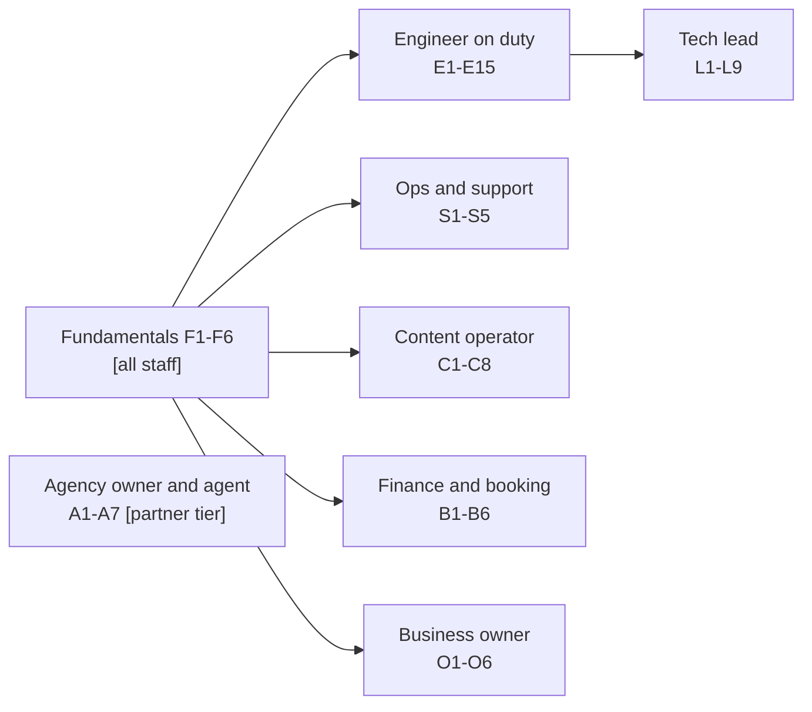
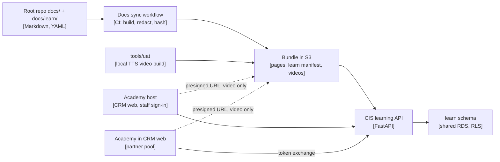

# AA Academy, the AA learning site

Research note, S279, 2026-11-13 (AA-1098). Author: Claude Code (research lane). Read-only: no code change, no AWS
call, no paid call. Repo facts come from the main branch of each repo on 2026-11-13. External facts carry their
source URL in the text and again in [Sources](#10-sources). The Vietnamese version is [README.vi.md](README.vi.md).
The full knowledge list is the [knowledge inventory](inventory.md). The sister research on the new-project playbook
(AA-1099) is in [`../new-project-playbook/`](../new-project-playbook/README.md); that playbook is a core course here.

## Summary

- **Build the learning site into the stack we already run.** Call it **AA Academy**. Everyone learns on the
  academy host `academy.<env domain>`, served by the CRM web app; CIS holds the courses and progress, and the CIS
  admin links to it (decision D17, S279). No separate LMS server, no new data store, no licence.
- **One source of truth.** Courses live as Markdown and YAML in the root repo (`docs/learn/`). A lesson points at
  a catalog page, an ADR or a section of a `CONTEXT.md` by ID and never copies it. The Docs sync workflow already
  builds a redacted, tiered, EN/VI bundle for `/admin/docs`; it is extended to publish the courses too.
- **241 knowledge items in 24 domains** are mapped to **62 modules** in **8 learning paths**: Fundamentals for every
  staff role, then one path each for the engineer on duty, the tech lead, ops and support, the content operator,
  finance and booking staff, agency owners and agents, and the business owner.
- **Every module ends in a retrieval quiz.** Missed items come back on a spaced schedule. Hands-on labs run on Dev
  in lab tenants that are isolated, budget-capped and checked by the system, not self-reported.
- **Cost.** Running cost about 0 to 3 USD a month in AWS (lesson video in S3, delivered by presigned URL). One-off
  agent drafting of lessons and quizzes about 35 to 45 USD at list price, plus about 0.5 to 1 USD of LLM calls per
  learner in the paid labs. No licence. Moodle would cost about 70 to 120 USD a month for two environments plus
  upkeep; TalentLMS starts at 119 USD a month.
- **Effort.** 31 to 39 sessions over all phases: 8 to 11 to build the platform and the lab environment, 22 to 26 to
  write the content of 62 modules (labs and videos included, from a per-module estimate in [§8.2](#82-per-module-authoring-estimate)),
  1 to 2 for measurement. Fundamentals can open after 6 to 8 sessions; the engineer-on-duty path after 17 to 21.
  Content lanes run in parallel, so calendar time is shorter than the session count.
- **Decisions for the tech lead** are in [§9](#9-decisions-for-the-tech-lead), each with a proposed answer.

## 1. Why and goals

### 1.1 The problem

The AA ecosystem is well documented but cannot be learned in order. Knowledge sits in the doc catalog
([`docs/README.md`](../../README.md)), 32 root ADRs ([`docs/adr/`](../../adr/README.md)) plus the app ADRs, the data standards, the
runbooks and playbooks, the agent skills (`skill/`), the lesson log (`skill/aa-lessons/lessons.md`), and each repo's
`CONTEXT.md`. Three facts show the size of the problem:

- The CIS `CONTEXT.md` is about 530 KB, Partner about 380 KB and Booking about 250 KB. They are precise, but nobody
  can read them start to finish.
- The admin docs reader (`/admin/docs`) is admin-only and shows root `docs/` pages only. Skills, steering files and
  app `CONTEXT.md` files are not in it ([publication rule v1](../../README.md#admin-docs-page-allowlist-aa-898)).
- Only 22 of the 6,771 tracked files under `docs/` have a `.vi.md` translation (`git ls-files` on the main branch,
  2026-11-13).

Many methods are written down but never taught: trunk-based flow, contract-first, ratchets, maker-checker, DRY RUN
first, shadow-then-enforce gates, evidence-gated Done. Most working rules that agents follow are already in repo
docs; two are still only in private agent notes (see G5 in [§2.3](#23-gaps-that-block-courses)).

### 1.2 Goals

1. **Every role has an ordered path** from day one to "can work alone", with clear objectives per module.
2. **One source of truth.** A docs change updates the course. Nothing is copied, so nothing drifts silently.
3. **Proof, not attendance.** Completion means a passed quiz and, where it matters, a lab the system checked.
4. **Bilingual where it matters.** English first; Vietnamese per path once the path is stable. Agency paths ship
   in both languages from day one, like their app runbooks today.
5. **Safe by design.** Agencies see only agency modules. Internal pages stay internal. No account IDs, no secrets.
6. **Measured.** Learning is measured on the four Kirkpatrick levels, using signals the platform already records.
7. **Reusable.** The same course format teaches a new project's team through the new-project playbook (AA-1099).

### 1.3 What success looks like

| Measure | Target after the first two paths open |
|---|---|
| A new engineer's first merged PR verified live on Dev | within 5 working days of starting Fundamentals |
| Fundamentals path completed by every staff member | 100% within 30 days of launch |
| Engineer-on-duty path passed by anyone holding on-duty | 100% before their first on-duty week |
| Modules whose source changed but whose lessons were not reviewed | 0 older than 14 days |
| Learner relevance score (Level 1 pulse, 1 to 5) | at least 4 on average per module |

All targets are settings in the settings registry, editable on an admin page ([§7.4](#74-every-threshold-is-a-setting)).

## 2. Knowledge inventory

### 2.1 Summary by domain

The full list, with source paths, audience and module per item, is the [knowledge inventory](inventory.md).

| Domain | Items | Main sources | Taught in |
|---|---|---|---|
| Architecture | 12 | `docs/ecosystem-architecture.md`, `docs/adr/` | F1, F2, E1, E3, E10, E11, L1, L8 |
| CIS content pipeline | 22 | `apps/AA-CIS-App/CONTEXT.md`, ADR 0020, `skill/aa-wave-rerun/` | C2 to C8, A2, E11 |
| CIS platform | 6 | `apps/AA-CIS-App/CONTEXT.md` | C7, S2, S3, E3, E5, F6 |
| Job runner | 5 | ADR 0003/0003a, `docs/ops/job-kinds.md` | E4 |
| AI platform | 17 | ADR 0009, `docs/architecture/ai-gateway.md`, CIS `docs/llm/` | E6, E9, E15, L1, A6 |
| TripPlanner | 7 | `apps/AA-TripPlanner-Web/CONTEXT.md` | E14, S2 |
| Booking | 12 | ADR 0004/0005 family, `apps/AA-Booking/CONTEXT.md`, booking guides | B1 to B6, E12 |
| Partner CRM | 13 | ADR 0010/0010a, `apps/AA-Partner/CONTEXT.md`, CRM guides | A2 to A7, E5, E13, S5 |
| Identity | 5 | ADR 0006 family | E5, S2, S4 |
| Data platform | 19 | `docs/architecture/data-standards/`, schema reference | E3, E9, F4, L1 |
| Scaling and reliability | 6 | `03-scaling.md`, ADR 0012/0018 | E9, E10, L5, L7 |
| Infrastructure | 11 | `infra/AA-CIS-Infra/CONTEXT.md`, `docs/generated/` | E1, E10, F5, S4 |
| Engineering practice | 19 | `docs/engineering-handbook.md`, `skill/aa-ship/`, CI workflows | F3, E2 |
| Frontend | 4 | ADR 0016, `skill/aa-ui-verify/` | E7 |
| Testing | 3 | CI workflows, `tools/uat/` | E8 |
| Observability and operations | 12 | `docs/ops/` | E9, S1, S2, S3 |
| Security | 8 | `docs/security/`, `docs/legal/`, STYLE SEC-06 | E5, F4, L9, O5, A5 |
| Cost and FinOps | 8 | `docs/ops/finops.md`, DM-10, `tools/llm/` | F5, C5, L5, O3 |
| Documentation | 8 | `docs/README.md`, `docs/STYLE.md` | F1, F6, L3, L4 |
| Agent operations | 11 | `docs/agents.md`, `skill/aa-session/`, `.claude/hooks/` | L3, L9 |
| Planning and issues | 9 | `docs/backlog/`, `skill/aa-linear-issue/` | L4, O6 |
| Governance and change control | 13 | handbook §1 and §10, DM-11 | F3, L1, L2, L6, B2, C3 |
| Stakeholders and vendors | 7 | `skill/aa-jira-update/`, `docs/reports/` | L6, O1, O2 |
| Lessons and learning | 4 | `skill/aa-lessons/`, `docs/guides/` | E1, E15, C1 |
| **Total** | **241** | | |

### 2.2 What the inventory tells us

- **About two thirds of the items are general practice with an AA implementation**: trunk-based delivery, contract
  views, expand/contract migrations, outbox/inbox, maker-checker, shadow-then-enforce gates, cost ledgers. They
  are the core of the new-project playbook (AA-1099) and teach well to any engineer.
- **About one third is AA-specific domain knowledge**: the A-series and T-series pipeline, the price chain, the
  tenant control plane. They need worked examples on Dev lab tenants, not only reading.
- **Agent knowledge and human knowledge are the same knowledge.** Skills and steering files tell agents how AA
  works. Humans need the same rules. One source must serve both (see [§6.6](#66-one-source-for-humans-and-agents)).
- **Recent changes already in the sources**: code-health ratchets and the settings registry shipped in S279
  (AA-1097, AA-1096 work in progress), so they are taught as current practice in E2 and C7.

### 2.3 Gaps that block courses

A course can only point at a source that exists. Each gap below has a phase, an effort and an owner in the
rollout plan ([§8](#8-rollout-plan)). Until its gap is closed, a module ships without the lesson named in the last
column, so no module waits on a page that is not written. Several gaps are shared with AA-1099, which plans to
write them.

| # | Gap | Blocks | Proposed fix | Phase, effort, owner | Until closed |
|---|---|---|---|---|---|
| G1 | No "add a new app / new project" how-to (catalog GUIDE-08 planned); the 12-step playbook lives only inside ADR 0008 | L8 | Written by AA-1099 as `docs/playbook/` | P1 (counted in AA-1099); tech lead | L8 is not offered |
| G2 | No ecosystem testing strategy page: the test pyramid is spread over workflows and skills | E8 | One explanation page linking each workflow | P1 (part of its 1 to 2 sessions); tech lead | E8 teaches from the workflow files only |
| G3 | No coding style page beyond tool configs (layering, error handling, async patterns) | E2, E11 to E14 | One page per language, from the ratchet configs and `CONTEXT.md` | P5b, 0.5; tech lead | E2 and the deep dives drop their "house style" lesson |
| G4 | UI kit has no Markdown usage guide; no accessibility standard | E7 | Kit guide generated from the kit's own component list (P5b); an accessibility rule set (P6) | P5b 0.5 + P6 0.5; tech lead | E7 ships without its accessibility lesson until P6 |
| G5 | Two working rules are still only in private agent notes: "decide, don't ask" and "no agent-made gates". The other rules are already in repo docs: the paid-run ladder is DM-10.6 in [`02-data-management.md`](../../architecture/data-standards/02-data-management.md); quote and explicit yes is in [`docs/ops/finops.md`](../../ops/finops.md) (S241 D-19); single-line AWS CLI and underscore env vars are in [`docs/STYLE.md`](../../STYLE.md) (Commands), with the `aws-multiline` check in `tools/docs/check_docs_text.py` and handbook §2.3, §4.7 and §5.3; "Done = verified live" is handbook §3 stage 8 and `skill/aa-ship/SKILL.md` | L3 | Add the two rules to the handbook operating model (§2); F3 and F5 lessons link the existing pages | P1 (part of its 1 to 2 sessions); tech lead | L3 omits the two rules |
| G6 | Skills are Vietnamese and tied to AA paths; the course is English first | L3, L4, L6 | Canonical English rule pages in `docs/`; skills keep the procedure | P1 (part of its 1 to 2 sessions); tech lead | Those lessons link the handbook only |
| G7 | No local development page per repo in the root catalog | E1 | One "run it locally" section per `CONTEXT.md`, linked from GUIDE-10 | P1 (part of its 1 to 2 sessions); tech lead | E1 lab is done with a guide session |
| G8 | No threat-model explainer for the multi-tenant system | E5, L9 | One STRIDE-style explanation page. It names threat categories and the controls that answer them, never open findings (SEC-06: the root repo is public) | P5b, 0.5; tech lead | E5 and L9 teach from ADR 0006 and the security baseline only |
| G9 | No travel domain primer (tour operations, B2B distribution, allotments, seasons, FX) | B1 to B6, A4 | One explanation page, reviewed by the business owner | P6, 0.5; tech lead writes, business owner reviews | B-path and A4 open without the primer lesson |
| G10 | No prompt-engineering method page (brand block, fact tags, repair prompts) | E6, C8 | One page next to the prompt register | P5b, 0.5; tech lead | E6 and C8 teach from the prompt register only |
| G11 | No agent-orchestration explainer (lanes, workflows, reviewers, worktrees) | L3 | One explanation page from `tools/workflows/lane.js` and the skills | P6, 0.5; tech lead | L3 teaches from `docs/agents.md` only |
| G12 | Runbooks that labs depend on are not yet tested: the [pilot rehearsal](../../ops/runbooks/pilot-rehearsal.md) is a draft marked UNTESTED, and the [rollback game day](../../ops/drills/rollback-game-day.md) is a plan not yet run | E9, S1, S3 and every tenant lab | Run the pilot rehearsal end to end once (P4b) and the rollback game day once (P5b); a lab may use a runbook only after it is tested (STYLE rule) | P4b 1 + P5b 0.5; engineer on duty | Labs that need a tenant wait for P4b; E9 uses the read-only dry run |
| G13 | Several sources disagree (for example where the CRM portal service runs; ADR 0009 called "not written" in DM-11.1; FinOps page predates the S278 LLM account move) | E6, E13, F5 | Fix each source; the drift check in §6.4 prevents new ones | P1 (part of its 1 to 2 sessions); tech lead | Affected lessons carry a "source under review" note |
| G14 | No discovery phase, risk register, RACI or vendor-selection template | L6, L8 | Delivered by AA-1099 | AA-1099 rollout (0 here); tech lead | L6 teaches the Jira and vendor rules only; L8 waits for AA-1099 |
| G15 | No learning measurement or competency record anywhere | §7 | Delivered by this design | P3 to P8 | Not applicable |

## 3. Audiences and learning paths

### 3.1 How paths are built

The pattern borrows from Microsoft Learn. There, a learning path is a collection of modules organised around a role
or a technology, and each module ends with a short knowledge check; a broader assessment proves a credential
([Microsoft Learn FAQ](https://learn.microsoft.com/en-us/training/support/faq)). The shared fundamentals level and
the hands-on labs are AA's own additions.



- **Path** = an ordered list of modules for one role. **Module** = one objective area, 30 to 120 minutes.
  **Lesson** = one objective, 5 to 15 minutes.
- **Required and elective.** Each path lists required modules. Deep dives (E11 to E14) are electives chosen by the
  tech lead per person.
- **Agencies never see internal modules.** The agency path does not start from Fundamentals. A1 gives agencies
  their own short orientation.
- **AI agents** do not take courses. They read the same sources through skills. Agents and people stay aligned
  because both read one source.

### 3.2 Fundamentals (every staff member, about 4 hours)

| Module | Objective: after it, the learner can… | Prerequisites | Main sources |
|---|---|---|---|
| F1 AA and how it sells | explain the B2B-only model, the four apps and who pays for what | none | ADR 0019; `docs/guides/` role guides |
| F2 The ecosystem map | name each app, what it owns and how the apps talk, on the C4 level 1 and 2 diagrams | F1 | `docs/ecosystem-architecture.md`; ADR 0001 |
| F3 How work flows | follow an idea through the 12-stage lifecycle to "Done = verified live"; say which source wins | F2 | handbook §1.3, §2, §3; DoR template; `skill/ai-nghiep/SKILL.md` §2 |
| F4 Data, privacy and public safety | classify a field as PII or not; say what must never go into a public repo or a prompt | F2 | DM-6; STYLE SEC-06; ADR 0014 |
| F5 Cost basics | read a cost line, quote a cost before a paid step, follow the paid-run ladder | F3 | `docs/ops/finops.md`; DM-10; tagging standard |
| F6 Docs, language and finding answers | find any fact through the catalog, `/admin/docs` and the glossary; write a page that passes docs lint | F3 | `docs/README.md`; `docs/STYLE.md`; glossary; language convention |

### 3.3 Engineer on duty (about 30 hours plus one deep dive)

Required for anyone who merges code or takes on-duty. The "on-duty ready" certificate needs E2, E3, E9 and their
labs.

| Module | Objective | Prerequisites | Main sources | Lab |
|---|---|---|---|---|
| E1 Workspace, access and repo context | get access, run each repo locally, read a `CONTEXT.md` before designing | F | `docs/onboarding.md`; GUIDE-10; `CONTEXT.md` per repo | Run one app locally against Dev |
| E2 Ship a change | take a change from branch to "Done verified live": PR rules, Refs line, pre-push, CI, ratchets, merge queue, post-deploy verify, flags | E1 | `skill/aa-ship/SKILL.md`; `tools/github/README.md`; handbook §5 | Ship a docs-only PR to the learning sandbox repo through its full gate (repo built in P4b, [§4.5](#45-lab-environments)) |
| E3 Data platform and migrations | write a migration that passes MIG-4 and expand/contract; add a contract view; read the schema reference | E2 | data standards; ADR 0017; `docs/architecture/db-schema-reference.md` | Write an expand migration on a scratch schema; pass preflight |
| E4 Job runner and the deploy gate | add a job kind, stop one, and know when a deploy waits | E3 | ADR 0003/0003a; `docs/ops/job-kinds.md`; deploy-gate runbook | Enqueue and drain a no-op job on a lab tenant |
| E5 Identity and security in code | pick the right pool and route class; verify tokens; keep secrets by name | E2 | ADR 0006 family; ADR 0010a; Partner route classes; secrets register | Call a lab endpoint with a wrong-class token and read the 403 |
| E6 AI gateway and LLMOps | add a stage route, log cost, run a shadow and an eval before promoting | E3 | ADR 0009; `docs/architecture/ai-gateway.md`; eval runbook; prompt register | Run a 3-item eval on the lab-only stage, capped by its own stage budget; no real stage route or shadow is touched ([§4.5](#45-lab-environments)) |
| E7 Frontend and the UI kit | build a page from the kit, never edit vendored copies, verify UI before Done | E2 | ADR 0016; `skill/aa-ui-verify/SKILL.md` | Add a lab page and pass UI smoke |
| E8 Testing strategy | put each test at the right level: unit, integration, contract, smoke, visual, E2E, eval, isolation probe | E2 | CI workflows; `tools/uat/`; gap G2 page | Write a contract sample that CI rejects, then fix it |
| E9 On duty: observe, respond, roll back | go from an alarm to its playbook, roll back an ECS service, run a DRY RUN delete | E4 | `docs/ops/README.md`; playbooks; rollback runbooks; destructive-ops | Read-only rollback dry run for each learner; a scheduled cohort seat at the [rollback game day](../../ops/drills/rollback-game-day.md) once it has been run (safety rules in [§4.5](#45-lab-environments)) |
| E10 Infrastructure as code | read a Terraform plan, apply only through the workflow, tag every resource | E2 | `infra/AA-CIS-Infra/CONTEXT.md`; tagging standard; generated refs | Read a sample plan and spot the guarded change |
| E11 Deep dive: CIS pipeline | trace a tour from A0 to A3 and a tenant piece from T0 to T11 | E3, E6 | CIS `CONTEXT.md`; ADR 0015, 0020 | Trace one already processed tour from A0 to A3 through its run history and ledger rows (read-only: A1 is platform-wide and writes the shared master pool), then run one T-series piece for it on the learner's lab tenant under that tenant's hard-stop AI budget (paid, capped) |
| E12 Deep dive: Booking | trace a quote to a confirmed booking and its supplier bill | E3 | Booking `CONTEXT.md`; ADR 0004/0005 family; `booking.b2b.v1` | Create a quote and a hold on a lab agency |
| E13 Deep dive: Partner CRM | explain tenancy, fair share, signed links and the PII scrubber | E5 | Partner `CONTEXT.md`; ADR 0010 | Create a client link on a lab agency and open it |
| E14 Deep dive: TripPlanner | explain the Lambda split, event-sourced trips and guest claim | E3 | TripPlanner `CONTEXT.md` | Create a guest trip and claim it |
| E15 Lessons, guards and postmortems | write a lesson with a guard, turn it into a test, write a blameless postmortem | E9 | `skill/aa-lessons/SKILL.md`; postmortem template | Convert one sample lesson into a guard test |

### 3.4 Tech lead (about 15 hours after E1 to E3)

| Module | Objective | Prerequisites | Main sources |
|---|---|---|---|
| L1 Architecture governance | decide when an ADR is needed, where it goes and how it is amended; use the technology selection frame | E3 | ADR README; `skill/ai-nghiep/references/adr.md`; AI Use Register; DM-1 to DM-5 |
| L2 Change control and merge rights | apply merge rights by phase, the approval matrix, risk classes and independent review | L1 | DM-11; ADR 0011; DoR risk classes |
| L3 Running an agent team | run a session ritual, dispatch lanes, read hooks, keep skills lean, keep evidence | L2 | `docs/agents.md`; `skill/aa-session/`; `tools/workflows/lane.js`; `.claude/hooks/` |
| L4 Planning, backlog and issues | order the backlog, cap WIP, write a Ready issue, keep the Linear quota | F3 | `docs/backlog/`; `skill/aa-linear-issue/`; plan sync |
| L5 Cost and capacity reviews | run the monthly cost and capacity review and act on a trigger | F5 | FinOps; capacity and cost templates; monthly cost tool |
| L6 Stakeholders and vendors | write a Jira update, split business from technical questions, handle a reseller | L4 | `skill/aa-jira-update/`; stakeholder guide |
| L7 Environments, scaling and prod readiness | apply the lean account model and scale on a measured trigger | L5 | ADR 0012, 0018; scaling C3, C9 |
| L8 New-project playbook | start a new project with the kit and run its full lifecycle | L1 to L7 | AA-1099 playbook (`docs/playbook/` once built); ADR 0008 |
| L9 Security and periodic reviews | run the access review, read the security baseline, triage vulnerabilities, watch CI hygiene | L2 | `docs/security/`; access review template; ADR 0021 |

### 3.5 Ops and support (about 8 hours)

For staff who handle access requests, sign-in problems and first response, without changing code.

| Module | Objective | Prerequisites | Main sources |
|---|---|---|---|
| S1 Incident first response | classify severity, open the right playbook, escalate, record a postmortem | F | `docs/ops/README.md`; incident response; postmortem template |
| S2 App access, staff accounts and roles | grant and remove app access in the staff directory; explain each role | S1 | GUIDE-12 index and app runbooks; CIS staff roles |
| S3 Tenant lifecycle and pilot onboarding | create, suspend and erase a tenant; run the pilot rehearsal | S2 | tenant control plane; pilot runbooks |
| S4 Sign-in and mail problems | diagnose a Cognito login failure and an SES bounce | S2 | Cognito login playbook; SES bounce runbook |
| S5 Support access to agency data | open and close an owner-granted support window and know what is audited | S3 | Partner `CONTEXT.md` (AA support access) |

### 3.6 Content operator (about 10 hours)

| Module | Objective | Prerequisites | Main sources |
|---|---|---|---|
| C1 CIS admin tour | find every content page and its role rules | F | `docs/guides/cis-admin-runbook.md` |
| C2 The A-series pipeline | explain A0 to A4 and read a tour's status | C1 | CIS `CONTEXT.md` (A-series) |
| C3 Quality gates and source fidelity | read a gate result: grounding, day oracle, F-codes; apply the source-fidelity policy | C2 | CIS `CONTEXT.md` §A1, §T10; ADR 0020 |
| C4 Review Queue in practice | approve, reject or regenerate with sentence-level labels | C3 | CIS `CONTEXT.md` §A2 |
| C5 Waves and paid runs | prepare a wave, set stop conditions, read the wave report and its cost | C4, F5 | `skill/aa-wave-rerun/SKILL.md`; cost estimate tool |
| C6 Places and photos | follow place extraction, geocoding and photo matching | C2 | ADR 0007; architecture §4.5 |
| C7 Settings and operator guides | change a threshold safely with its EN/VI guide | C3 | settings registry (CIS `CONTEXT.md`) |
| C8 Writing memory, facts and calibration | add a fact entry, pin an exemplar, label calibration samples | C4 | CIS ADR 0010, 0007; facts entries |

### 3.7 Finance and booking staff (about 8 hours)

| Module | Objective | Prerequisites | Main sources |
|---|---|---|---|
| B1 Booking admin basics | sign in, find each screen, know each role | F1, F3, F4 | `docs/guides/booking-admin-runbook.md` |
| B2 Pricing, versions and maker-checker | enter supplier rates and price rules, publish a price version as the second person | B1 | ADR 0005, 0005b; `docs/guides/booking-price-setup.md` |
| B3 Trip cases, departures and operations | run a trip case; manage departures, allotments, vouchers and cancellations | B2 | Booking `CONTEXT.md` |
| B4 Suppliers, bills and payouts | book suppliers, match bills, release payouts | B3 | Booking `CONTEXT.md` |
| B5 Finance and profit | read FX-normalised cost, purchase orders and profit per case, departure and agency | B4, F5 | Booking `CONTEXT.md` §Finance |
| B6 Selling to agencies | apply the B2B resale rules and agency price tiers | B2 | ADR 0005a; price tiers |

### 3.8 Agency owner and agent (partner tier, about 5 hours; EN and VI from day one)

Served in the CRM web app to users of the agency pool. The content is written for agencies, not linked from
internal pages, because internal pages can carry internal detail.

| Module | Objective | Prerequisites | Main sources |
|---|---|---|---|
| A1 Welcome to AA | explain what AA provides (content, CRM, TripPlanner, booking) and sign in with MFA | none | new agency page (from ADR 0019, written for agencies) |
| A2 Content studio | set the brand identity, pick tours, use the Slate, write, read quality signals, publish | A1 | `docs/guides/content-studio-runbook.md` |
| A3 CRM basics | run the pipeline from enquiry to invoice; send mail and SMS through the agency's own accounts | A1 | `docs/guides/crm-runbook.md` |
| A4 Booking with AA | request quotes and holds and read tariffs and departures from the CRM | A3 | CRM runbook (booking section); gap G9 primer |
| A5 Data duties and privacy | act as data controller for travellers; export and erase; grant a support window | A3 | tenant AI schedule; DPA; Partner data lifecycle |
| A6 AI marks and AI limits | explain the AI mark and why the tools refuse high-risk advice | A2 | ADR 0020; AI boundary |
| A7 Agency owner: users and settings | add users, set roles and agency settings | A3 | `docs/guides/crm-runbook.md` |

Agents take A1 to A6. Owners add A7.

### 3.9 Business owner (about 4 hours)

| Module | Objective | Prerequisites | Main sources |
|---|---|---|---|
| O1 Owner orientation | know which decisions are the owner's and where to find them | F1 | `docs/guides/ceo.md` |
| O2 Reports and progress | read the weekly platform report, the app epics and release notes | O1 | report catalog; release-note template |
| O3 Cost for the owner | read the monthly cost report, unit costs and the Spend page | F5 | cost report; Cost Operations page |
| O4 Content quality policy | explain the source-fidelity and review policies and what "held" means | O1 | ADR 0020; content policies |
| O5 Legal and privacy packet | know what the DPA, sub-processor list and AI schedule promise | O1 | `docs/legal/readiness-packet.md` |
| O6 Product map and roadmap | read the milestones and what each phase delivers | O2 | ADR 0019; master plan milestones |

### 3.10 The new-project playbook as a course

The AA-1099 playbook is taught three ways:

1. **L8** for the tech lead: run the kit end to end.
2. **A "project starter" path** for any new project team: F3, F6, E2, E3, L1, L2, L4 and L8, in that order. It
   teaches the general practices without AA domain modules.
3. **Labs from the kit's templates**: fill a project charter, write an ADR, scaffold a repo from the template and
   get its CI green. The lab checker reads the result, so the template and the course stay in step.

## 4. Course and module design

### 4.1 Lesson types

| Type | What it is | Source | When to use |
|---|---|---|---|
| Reading | Objective, short framing, then the linked source section rendered in place, then 2 to 3 "check yourself" questions | A catalog page, ADR or `CONTEXT.md` section by ID and anchor | Concepts, standards, decisions |
| Walkthrough video | 2 to 6 minutes of screen capture with narration and EN/VI captions | Script in git; screenshots on Dev lab tenants; free local TTS (`tools/uat/`) | UI work: content, booking, agency paths |
| Hands-on lab | Steps on a Dev lab tenant; a checker reads the expected state through the API | `lab.yaml` with steps and a check | Anything done in an app |
| Quiz | 5 to 10 retrieval questions, each citing its source anchor | `quiz.yaml` | End of every module |
| Worked example | A real past case (postmortem, audit, lesson) told as problem, cause, fix | `docs/ops/postmortems/`, `docs/audits/`, lessons | Judgement: operations, quality, governance |

Evidence base: testing beats re-reading for retention after two days and one week (Roediger and Karpicke, 2006,
[PubMed](https://pubmed.ncbi.nlm.nih.gov/16507066/)). Spacing reviews out beats massing them, and the best gap
grows with how long the knowledge must last (Cepeda et al., 2006,
[PubMed](https://pubmed.ncbi.nlm.nih.gov/16719566/)). Microlearning helps in a 40-study review
([Heliyon 2024/2025](https://pubmed.ncbi.nlm.nih.gov/39882484/); vol. 11 issue 2, 2025, online December 2024), but a workplace scoping review calls the evidence
mixed ([ETR&D 2022](https://link.springer.com/article/10.1007/s11423-022-10084-1)). So short lessons are paired with
quizzes and labs, which carry the stronger evidence.

### 4.2 Module anatomy

Each module is a folder in the root repo:

```text
docs/learn/
  paths/engineer-on-duty.yaml          # ordered module ids, required/elective, certificate rule
  modules/E3-data-platform/
    module.yaml                        # id, title, objectives, prerequisites, owner, version, audience tier
    lessons/01-schema-ownership.md     # objective + source refs + short framing (no copied text)
    lessons/02-mig4-flow.md
    quiz.yaml                          # items, each with a source anchor
    lab.yaml                           # steps on a lab tenant + the check to run
    video/02-mig4-flow.script.md       # optional narration script (public-safe)
```

A lesson file is short. Its body frames the source and points at it:

```yaml
# front matter of lessons/02-mig4-flow.md
id: E3-02
objective: Order a schema change as migration PR, copy, apply, schema dump, code PR.
sources:
  - ref: ARCH-08-engineering#3-migrations      # catalog id + anchor
  - ref: adr:0017                              # ADR number
  - ref: context:AA-CIS-App#migrations          # CONTEXT.md section
minutes: 10
```

### 4.3 Completion criteria

| Level | Complete when |
|---|---|
| Lesson | Opened, and its "check yourself" questions answered (answers are not graded) |
| Module | All required lessons complete, quiz score at or above the pass mark (proposed 80%), and the lab check passed if the module has a lab |
| Path | All required modules complete, plus a final mixed quiz drawn from every module (proposed pass mark 80%) |
| Certificate | Issued for a path, pinned to the module versions passed, with a verification code |
| Recertification | Needed when a required module gets a major version, or after 12 months for on-duty and tech-lead paths |

A quiz can be retaken after 24 hours. Missed items become spaced review cards. Reading time is shown but never
counted as proof.

### 4.4 Labs on Dev lab tenants

- **Where.** Dev only, which holds test data only (ADR 0012). Each learner gets lab tenants flagged as lab, so
  reports and cost rollups can exclude them. How they are made is in [§4.5](#45-lab-environments).
- **Checks.** Each `lab.yaml` names a check: an API read that proves the expected state (a quote exists, a job
  drained, a 403 returned). The learning API runs it with the learner's own token. No self-reporting.
- **Paid steps.** Few labs call an LLM (E6, E11). Each runs under a cap that the gateway enforces for that kind of
  call ([§4.5](#45-lab-environments)), and follows the paid-run ladder. Caps are settings.
- **Clean-up.** A lab job erases lab tenants after a set number of days (a setting), through the normal tenant
  erase path of each app, so the clean-up itself is tested.
- **Never on real tenants.** The lab checker refuses any tenant not flagged as lab.

### 4.5 Lab environments

**Isolation and budget.** The gateway has several budget layers ([AI gateway §5](../../architecture/ai-gateway.md)).
They do not all cover labs:

| Lab kind | Why the obvious guard does not fit | Design |
|---|---|---|
| A-series (A1 rewrite) | A1 is the platform-wide rewrite of raw tours. It writes the shared master content pool and is not a tenant job, so the tenant budget (`shared.tenant_ai_budget`, hard stop on T-stage jobs) does not cap it | No lab runs A-series stages. E11 traces an already processed tour read-only (run history, gate results, ledger rows) |
| T-series (tenant pieces) | Fits: T-stage jobs run per tenant | The learner's lab tenant gets a tenant AI budget row with `hard_stop` on; the cap is a setting |
| Eval and shadow (E6) | A shadow is attached to a real stage, so a lab shadow would run on real traffic and write the shared shadow log | A lab-only gateway stage (proposed name `learn_lab`, role `judge`) with its own row in the job and stage budget layer (`shared.spend_budget`), and the `dev` capacity class. The lab runs a 3-item eval on that stage; it never adds a shadow to a real stage |
| Agent drafting of lessons | Not a lab, but also paid | Its own stage (`learn_draft`, role `writer`), its own stage budget, and the paid-run ladder ([§6.3](#63-agent-drafting-with-cost-control)) |

The exact budget keys are confirmed against the gateway code in P4b; the rule is that every paid lab call has a
named cap that fails closed.

**Provisioning across apps.** A full lab needs a CIS tenant (Content studio), a CRM agency (Partner) and a Booking
agency (for E12 and A4). The [pilot rehearsal](../../ops/runbooks/pilot-rehearsal.md) shows that every link works on
Dev, but it is a draft marked UNTESTED with partly manual steps. So:

1. **Test the rehearsal first (P4b, about 1 session).** Run it end to end once on Dev and record what is manual.
   This closes G12 for tenant labs.
2. **Build a lab provisioner (P4b, about 2 sessions).** One CIS job kind (proposed `learn.lab_provision`) that,
   for one learner, creates the CIS tenant, the CRM agency and the Booking agency through each app's own admin or
   ops API, flags each as lab, sets the T-series budget and records the ids in the `learn` schema. A matching
   `learn.lab_erase` job runs the erase path of each app. Each step is idempotent so a failed run can resume.
3. **Until it exists**, labs that need a tenant are closed; reading modules and quizzes are not blocked.

**Sandbox repo for E2 (P4b, about 0.5 session, 0 USD).** E2 needs a repo where a learner can open a real PR and go
through the full gate without touching a product repo. Proposed: one new public repo in the org (for example
`aa-learn-sandbox`) holding docs only, with the root repo's `pr-title`, `docs-lint` and `secret-scan` workflows, the
same branch ruleset as the app repos (required checks, squash only, no direct push), and a fake post-deploy check
that reads a static page. Public repos run standard GitHub-hosted runners at no charge
([GitHub Actions billing](https://docs.github.com/en/billing/concepts/product-billing/github-actions)). Creating
a repo in the org is a decision ([§9](#9-decisions-for-the-tech-lead), D15).

**Safety for the E9 rollback game day.** A real ECS rollback on shared Dev affects everyone using Dev. So:

- Each learner first does the read-only dry run of the rollback tool, which changes nothing.
- The real rollback is a **scheduled cohort sitting**, not a per-learner step: at most once a month, run by the
  engineer on duty with learners watching and doing the steps in turn, following the
  [rollback game day plan](../../ops/drills/rollback-game-day.md).
- It runs only when the deploy gate would allow a deploy: every job table idle and no wave open (DM-11.4). No
  override of the deploy gate for a training sitting.
- The orchestrating session holds merges and deploys to the target service for the sitting, and the sitting ends
  with a roll forward and a live check, so Dev is left on the latest image.

## 5. Platform options

### 5.1 Comparison

Prices are list prices on 2026-11-13. Fargate figures use us-east-1 ARM rates; our region (us-west-1) costs more.

| Criterion | (a) Built into CIS admin and CRM web | (b) Moodle | (c) Open edX | (d) Docs site (Docusaurus, Starlight) | (e) SaaS (TalentLMS, LearnWorlds) |
|---|---|---|---|---|---|
| Single source, no copies | Yes: lessons reference catalog IDs; the Docs sync bundle is reused | No: needs a git-to-Moodle sync through web services | No: OLX round trip; an import replaces the whole course | Yes for text, but a second docs front end next to `/admin/docs` | No: content lives in the SaaS unless an API sync is built |
| EN and VI | Yes: `.vi.md` pairing already in the bundle | Partly: the VI language pack for 5.0 is 51% translated | Partly: community VI with gaps | Yes: built-in i18n | TalentLMS: AI translation; LearnWorlds: not stated |
| Progress, quizzes, certificates | Built (phases 3 and 4) | Built in; customcert gives verifiable PDFs | Built in | Not included; custom code anyway | Built in |
| Sign-in with the staff and partner Cognito pools | Already in place in both apps | Yes: OAuth 2 / OIDC per issuer, one per pool | Needs a python-social-auth backend per provider | Custom code | TalentLMS: OIDC on paid plans; LearnWorlds: SSO only from Learning Center |
| Access tiers and redaction | Reused from the docs reader | Rebuilt as Moodle roles; redaction not covered | Rebuilt | Rebuilt | Rebuilt |
| Standards (SCORM, xAPI, cmi5) | xAPI-shaped progress records, exportable | SCORM 1.2 in core; xAPI and cmi5 need paid add-ons | xAPI events into its analytics stack | None | TalentLMS: SCORM 1.2, Tin Can (xAPI) and cmi5 on every plan |
| Extra infrastructure | None | PHP task, cron task, shared file store (EFS), database, cache | MySQL, MongoDB, Redis, analytics stack; 4 to 8 GB RAM per environment | Static hosting | None (vendor-hosted) |
| Licence | None | GPL v3 | AGPL 3.0 | MIT | Commercial |
| Monthly cost | 0 to 3 USD (S3 storage and delivery for videos, [§6.7](#67-video-regeneration-and-delivery)) | About 35 to 60 USD per environment, 70 to 120 USD for two, plus image patching | About 115 USD compute per environment before storage | About 0 to 5 USD hosting, plus custom progress code | TalentLMS from 119 USD (Core; the page's user limit for Core is ambiguous, shown as both 1 to 40 and "up to 100"); LearnWorlds SSO tier 249 to 299 USD |
| Upkeep | Our code, our CI, our kit | A PHP image we build and patch (Bitnami images moved to legacy) | Heaviest of all | Two docs front ends | Vendor upkeep; data outside our account |

Sources: Moodle OAuth 2 ([docs](https://docs.moodle.org/503/en/OAuth_2_services)), licence
([docs](https://docs.moodle.org/dev/License)), AWS reference architecture
([AWS](https://docs.aws.amazon.com/architecture-diagrams/latest/moodle-for-high-availability-on-aws/moodle-for-high-availability-on-aws.html)),
shared dataroot ([docs](https://docs.moodle.org/500/en/Server_cluster)), VI pack
([download page](https://download.moodle.org/langpack/5.0/)), SCORM ([docs](https://docs.moodle.org/39/en/SCORM)),
xAPI and cmi5 in Moodle ([Rustici](https://rusticisoftware.com/resources/play-xapi-and-cmi5-in-moodle/)),
certificates ([docs](https://docs.moodle.org/en/Custom_certificate_module)); Fargate prices
([AWS](https://aws.amazon.com/fargate/pricing/)); Open edX requirements
([Tutor](https://docs.tutor.edly.io/gettingstarted/requirements.html)) and third-party auth
([Open edX](https://docs.openedx.org/en/latest/site_ops/install_configure_run_guide/configuration/tpa/tpa_integrate_open/tpa_oauth.html));
Docusaurus i18n ([docs](https://docusaurus.io/docs/i18n/tutorial)), Starlight i18n
([docs](https://starlight.astro.build/guides/i18n)), Material for MkDocs maintenance mode
([blog](https://squidfunk.github.io/mkdocs-material/blog/2025/11/11/insiders-now-free-for-everyone/));
TalentLMS ([prices](https://www.talentlms.com/prices)); LearnWorlds ([pricing](https://www.learnworlds.com/pricing/)).

### 5.2 Notes per option

- **(b) Moodle** is the best fallback. It signs in to both Cognito pools as two OIDC issuers, if Cognito releases
  `given_name`, `family_name` and `email`. Its cost is not the licence but the upkeep: a PHP image, a shared file
  store with known latency pain, and a git sync we would write ourselves.
- **(c) Open edX** is built for MOOC scale. For tens to low hundreds of learners it brings the heaviest operations
  load and three extra data stores, against the one-RDS model.
- **(d) Docs sites** solve only the reading part, which `/admin/docs` already solves. Material for MkDocs is in
  maintenance mode: feature work has ended and its October 2026 update extends critical maintenance only through
  2027-05-05. A new project should not start on it.
- **(e) SaaS.** TalentLMS is strong on standards and SSO, but costs at least about 1,100 to 1,400 USD a year and
  breaks the single source. LearnWorlds is built to sell courses and puts SSO behind its 249 to 299 USD tier.
- **Cognito cost.** Users who sign in directly to our pools are within the free monthly active users of the
  Essentials and Lite plans. Federating the other way (an LMS identity provider in front of Cognito) would be
  billed after 50 users ([Cognito pricing](https://aws.amazon.com/cognito/pricing/)). Option (a) keeps sign-in
  as it is.

### 5.3 Recommendation

**Choose (a).** It reuses what exists: the Docs sync builder (`tools/docs/build_docs_reader.py`), the docs reader
service (`api/services/docs_reader.py` in CIS) with its tiers, redaction and EN/VI links, the UI kit, both Cognito
pools and the job runner. It adds one small schema, one API module and two UI areas.

**Escape hatch.** Progress is stored as xAPI-shaped statements (actor, verb, object, result, context, time). xAPI
2.0 is the IEEE 9274.1.1-2023 standard
([ADL](https://adlnet.gov/news/2023/11/22/xAPI-Officially-Becomes-a-Published-IEEE-Standard)). Certificates keep
the fields of Open Badges 3.0, final since 29 May 2024
([1EdTech](https://www.1edtech.org/1edtech-article/new-open-badges-30-standard-provides-enhanced-security-and-mobility/411060)).
Content stays plain Markdown. If third-party SCORM or cmi5 content or a formal learning record store is ever
needed, the records export to an open-source store such as SQL LRS (Apache 2.0, PostgreSQL;
[docs](https://yetanalytics.github.io/lrsql/overview.html)) or to Moodle without rework.

### 5.4 Target architecture



- **Bundle.** The builder adds a `learn/` manifest: paths, modules, lessons, quiz items, lab specs, video keys and a
  content hash for every referenced source section. If D13 is accepted, an allowlist lets it include named sections
  of skills, steering files and app `CONTEXT.md` files that lessons reference, with the same redaction guard.
  Default deny: a section not on the list is never published.
- **Tiers.** Today `/admin/docs` is admin-only. The design adds a `staff` tier (all staff roles, not only admins)
  next to `owner` (as today) and a new `partner` tier for agency modules. A partner-tier module may only reference
  pages marked for agencies; the builder fails otherwise. Widening the reader is an access-control change, so it is
  a decision ([§9](#9-decisions-for-the-tech-lead), D13), reviewed as a risky change before merge.
- **Schema `learn`** (owner AA-CIS-App, CIS migration key space): enrollment, statement (xAPI-shaped), quiz attempt,
  review card, lab run, certificate, content review item. Learners are keyed by identity (issuer, subject) per ADR
  0006. Agency rows carry `tenant_id` under the RLS template with FORCE RLS.
- **API.** Read the catalog and lessons from the bundle; write progress; grade quizzes on the server (answers never
  reach the browser before submission); run lab checks; issue certificates; serve a verify page by code. Videos are
  never streamed through the API: it returns a short-lived presigned S3 URL ([§6.7](#67-video-regeneration-and-delivery)).
- **Staff UI** on the academy host (D17; it replaced the first plan of a CIS admin page at `/admin/learn`): my paths, lesson reader (the docs reader renderer), quiz, review queue, lab
  status, certificates; a team view for the tech lead.
- **Agency UI** in CRM web: the same components from the kit, calling the CIS API with the partner token exchange
  already used by the Content studio (ADR 0010a). The agency owner sees their own staff's progress.
- **Spaced review** uses the FSRS algorithm through `ts-fsrs` (MIT,
  [GitHub](https://github.com/open-spaced-repetition/ts-fsrs)), run in the browser with cards stored server-side.

**Note S280 (decision D17, AA-1105).** The tech lead chose (S279) one learner front door for every audience: the
academy host `academy.<env domain>` (Dev: `academy.lumiguides.it.com`), served by the AA-Partner CRM web app, so staff
and agencies share one UI and the CIS admin stays an operator console that links to it; there is no `/admin/learn`
reader. Courses, progress, quizzes and certificates stay in CIS and schema `learn` (D3). The S280 build proposes the
details, which wait for the tech lead's review (root [ADR 0022](../../adr/0022-aa-academy-learning-platform.md)
decisions 6 to 11): staff sign in with a WORKFORCE app client of its own (`academy-web`), accepted only by a new route
class `/learn/v1` (contract `learn.http.v1`); the team view is a Platform › Academy page in the CIS admin; videos live
under a separate private prefix `learn-media/` of the bronze bucket, not under the docs reader prefix. Agencies follow
in P7 with the partner sign-in (D6).

## 6. Content pipeline

### 6.1 Single source of truth

- Lessons reference sources by catalog ID and anchor, ADR number, or `CONTEXT.md` section. The reader renders the
  live section from the bundle. Nothing is copied.
- Lesson text holds only what no source holds: the objective, a short framing and the "check yourself" questions.
- Quiz items cite the anchor they test. When the anchor's text changes, the item is suspended until reviewed.

### 6.2 Authoring flow

1. The module owner (or an agent lane) drafts `module.yaml`, lessons, quiz and lab in a root PR.
2. CI runs the docs lint plus a new `check_learn.py`: every reference resolves, every quiz item has an anchor,
   partner-tier modules reference only agency pages, prerequisites form no cycle, IDs are unique.
3. A second person approves (maker-checker). For agent-drafted quiz items, the approver is a human owner.
4. Merge publishes through Docs sync. The module version rises: patch for wording, minor for new lessons, major
   when objectives or quiz items change (triggers recertification for required modules).

### 6.3 Agent drafting with cost control

Agents may draft lessons and quiz items from the sources. Calls go through the AI gateway with a registered
stage (`learn_draft`, role `writer`) and its own stage budget, are logged in the ledger, and follow the paid-run
ladder: a 3-module trial with `tools/llm/cost_estimate.py` first. The stage goes into the AI Use Register with its
data scope (repo docs only, no tenant data).

**Cost estimate** at the Claude Sonnet 5.5 list price of 2 USD per million input tokens and 10 USD per million
output tokens ([Claude pricing](https://platform.claude.com/docs/en/about-claude/pricing)); the gateway's route
order decides which connection serves it, and the ledger records the real cost:

| Item | Assumption per module | Cost per module | Count | Total |
|---|---|---|---|---|
| Draft (lessons framing, quiz items, lab spec) | about 50,000 input tokens of referenced source sections, 8,000 output | about 0.18 USD | 62 | about 11 USD |
| Check pass (a second call that tests each quiz item against its anchor) | about 60,000 input, 2,000 output | about 0.14 USD | 62 | about 9 USD |
| Redrafts after human review | half the modules need one or two extra rounds of draft and check | about 0.3 to 0.6 USD | 31 | about 10 to 20 USD |
| Vietnamese draft of a module | about 10,000 input, 10,000 output | about 0.12 USD | 38 (agency paths and stable staff paths) | about 5 USD |
| **Total, one-off** | | | | **about 35 to 45 USD**; the 3-module trial costs about 1 to 2 USD |

Quiz answers and learner data are never sent to an LLM ([§7.2](#72-learner-data-and-privacy)). Re-drafts after a
source change are small and are counted in the ledger per stage.

### 6.4 Drift checks

| Check | When | Result |
|---|---|---|
| Reference resolves | Every root PR (`check_learn.py`) | Fails the PR |
| Source section hash changed | Every Docs sync build | Opens a content review item for the module owner; affected quiz items suspended |
| Module past its review date | Weekly (same job as the docs freshness report) | Warning in the tech lead's view |
| UI page in a video changed | Visual regression diff on the app (`visual.yml`) touching a page a video shows | Video marked stale; rebuild queued |
| Quiz item too easy or too hard | Monthly | Items with very high or very low pass rates flagged for rewrite |

### 6.5 Owners and review cadence

| Path | Owner (role) | Review every |
|---|---|---|
| Fundamentals | tech lead | 180 days, and on every source change |
| Engineer on duty, tech lead | tech lead | 90 days |
| Ops and support | tech lead, with the engineer on duty | 90 days |
| Content operator | tech lead, with a senior content operator | 90 days |
| Finance and booking | tech lead, with a finance lead; the business owner reviews | 90 days |
| Agency | tech lead; the business owner reviews | 90 days, and on every Content studio or CRM release |
| Business owner | tech lead; the business owner reviews | 180 days |

### 6.6 One source for humans and agents

Rules that agents follow today through skills must also reach humans. The plan: a rule's canonical text lives in
an English `docs/` page; the skill links to it and keeps only the procedure; the lesson references the same page.
That closes gaps G5 and G6 and lets the in-app assistant (AA-704) answer from the same bundle later.

### 6.7 Video regeneration and delivery

- Scripts live in git next to the lesson and must be public-safe (the root repo is public).
- Screens are captured by Playwright on lab tenants; narration uses the free local voices of `tools/uat/`; captions
  are EN and VI. No paid text-to-speech.
- Videos are built only for UI-heavy lessons (content, booking, agency paths). A stale flag (§6.4) queues a rebuild.
- Output (MP4 plus captions) goes to the bundle's private S3 prefix. Videos are not kept in git.
- **Delivery.** The CIS API sits behind API Gateway REST, whose payload limit is 10 MB and whose integration
  timeout is 29 seconds by default
  ([API Gateway quotas](https://docs.aws.amazon.com/apigateway/latest/developerguide/api-gateway-execution-service-limits-table.html)).
  A video does not fit through it. The learning API checks the learner's access and returns a presigned S3 GET URL
  that expires in minutes; the browser plays the file straight from S3, with range requests for seeking.
  CloudFront with signed URLs is the next step only if viewing grows or learners far from us-west-1 report slow
  starts; it is not needed at this scale.
- **Cost.** About 21 UI-heavy modules with 2 to 3 videos each, about 15 MB per video, is about 1 GB in S3 (a few
  cents a month). Viewing: 50 learners watching 30 videos a month is about 22 GB of transfer out. AWS gives the first
  100 GB a month of transfer out free, aggregated across all services and regions of the account
  ([S3 pricing](https://aws.amazon.com/s3/pricing/)); other workloads on the account already use part of that. If
  it is used up, 22 GB costs about 2 USD at the 0.09 USD per GB rate the same page quotes. So video costs about 0 to
  2 USD a month.

## 7. Governance and measurement

### 7.1 Who approves what

| Change | Author | Approver |
|---|---|---|
| New path or certificate rule | tech lead | business owner informed |
| New or changed module (major) | module owner or agent | tech lead (second person) |
| Wording fix (patch) | anyone | module owner |
| Agency module | module owner | tech lead; business owner reviews before launch |
| Pass marks, recertification period, lab budget | tech lead | in the settings registry, audited |

### 7.2 Learner data and privacy

- Progress records are personal data. Columns carry `pii:` tags and the tables get DM-7.1 retention rows
  (proposed: kept while the account is active plus 365 days, then deleted by a TTL job).
- Agency learner records are tenant data under RLS. The agency owner sees their own staff. AA staff see only
  counts per agency, the same rule agents follow for tenant data.
- Quiz answers and lab results are never sent to an LLM.

### 7.3 Measurement on the Kirkpatrick levels

The model defines four levels: reaction, learning, behaviour and results
([Kirkpatrick Partners](https://www.kirkpatrickpartners.com/the-kirkpatrick-model/)).

| Level | AA measure | Source |
|---|---|---|
| 1 Reaction | Two-question pulse per module: relevance and confidence, 1 to 5 | `learn` statements |
| 2 Learning | Quiz pass rate and score per module; spaced-review retention | `learn` statements |
| 3 Behaviour | Ship process followed (PRs passing every gate first time); lessons written with a guard; runbook steps followed in drills; review-queue decisions overturned | CI results, lesson log, drill evidence, review log |
| 4 Results | Time to first verified PR for a new engineer; time to first published tour for a content operator; agency onboarding time; incidents and rollbacks per month | Linear and GitHub dates, CIS data, CRM data, postmortem index |

The measures join the report registry (`docs/reports/kpis.yaml`) so they show in the weekly platform report.

### 7.4 Every threshold is a setting

Pass marks, retake delay, recertification periods, lab budget, lab tenant lifetime, review cadences and the
targets in §1.3 are settings in the CIS settings registry, each with an EN/VI operator guide. No literal in code.

## 8. Rollout plan

### 8.1 Phases

A session is one working session of the agent team (3 to 5 issues). Effort is in sessions of work; content lanes
run in parallel, so calendar time is shorter.

| Phase | Delivers | Effort (sessions) | Owner | Added cost |
|---|---|---|---|---|
| P0 Decide | This research, the decision page, the tech lead's choices recorded in AA-1098 | done in S279 | tech lead | 0 |
| P1 Close shared gaps | G2, G5, G6, G7, G13 pages; G1 written by AA-1099 | 1 to 2 | tech lead | 0 |
| P2 Content format and bundle | `docs/learn/` format, `check_learn.py`, Docs sync learn manifest, source hashes, the `staff` and `partner` tiers and the allowlist (if D13 is accepted, with a risky-change review) | 1 | tech lead | 0 |
| P3 Schema, API, staff UI | `learn` schema (migration, RLS, retention rows), learning API, academy host reader and progress (D17), presigned video URLs | 2 | tech lead | 0 |
| P4 Quizzes, review, certificates | server-graded quizzes, FSRS review, lab checker, certificates and verify page, settings | 1 to 2 | tech lead | 0 |
| P4b Lab environments | pilot rehearsal run end to end once (G12, about 1); lab provisioner and erase jobs across CIS, CRM and Booking with lab stage and tenant budgets (about 2); learning sandbox repo for E2 (about 0.5) | 3 to 4 | tech lead; engineer on duty runs the rehearsal | 0 (the rehearsal's own LLM cap applies) |
| P5a Fundamentals path | F1 to F6 (reading and quizzes, EN) | 1 | tech lead | about 3 USD drafting |
| P5b Engineer-on-duty path | E1 to E15 with labs (EN); gap pages G3, G4 (kit guide), G8, G10; first rollback game day run (G12) | 8 to 9 | tech lead; engineer on duty for E9 | about 10 USD drafting; about 0.5 to 1 USD of lab LLM calls per learner |
| P6 Remaining staff paths | tech lead (L8 once AA-1099 is built), ops and support, content, finance and booking, business owner; videos for content and booking; VI for stable paths; gap pages G4 (accessibility), G9, G11 | 9 to 11 | tech lead; business owner reviews B and O | about 25 USD drafting (VI included) |
| P7 Agency academy | partner tier in CRM web, A1 to A7 in EN and VI, walkthrough videos | 4 to 5 | tech lead; business owner reviews | about 5 USD drafting |
| P8 Measurement | L1 to L4 report, content-health view, drift automation complete | 1 to 2 | tech lead | 0 |
| **Total** | | **31 to 39** | | **about 0 to 3 USD a month running; about 35 to 45 USD one-off drafting** |

- **Build** (P1 to P4b): 8 to 11 sessions. **Content** (P5a to P7): 22 to 26. **Measurement** (P8): 1 to 2.
- **Fundamentals opens** after P1 to P4 plus P5a: 6 to 8 sessions. It does not need P4b.
- **Engineer on duty opens** after P1 to P5b: 17 to 21 sessions.
- Phases P2 to P4b are build slices of about one PR each per repo. Content phases can run as parallel lanes once
  P2 is merged, because lessons are files in git.

### 8.2 Per-module authoring estimate

Rates assume agent drafting through the `learn_draft` stage and one human approval per module, with sources that
already exist (gap pages are counted separately above).

| Work | Rate (sessions) | Count | Sessions |
|---|---|---|---|
| Reading module: lessons, quiz, approval | 0.10 to 0.15 per module | 62 | 6.2 to 9.3 |
| Lab: `lab.yaml`, checker, one test run on Dev | 0.25 per lab | 15 (E1 to E15) | 3.75 |
| Videos for a UI-heavy module (2 to 3 short videos, script, capture, captions) | 0.20 per module | 21 (C1 to C8, B1 to B6, A1 to A7) | 4.2 |
| Vietnamese translation of a module | 0.05 per module | 38 (A1 to A7 plus the 31 modules of F, S, C, B and O) | 1.9 |
| **Content subtotal** | | | **16.1 to 19.2** |
| Gap pages in content phases (G3, G4 twice, G8, G9, G10, G11; 0.5 each) and the rollback game day | | | 4.0 |
| Partner tier UI in CRM web and the agency welcome page (P7) | | | 1.5 |
| **Content phases P5a to P7** | | | **21.6 to 24.7, planned as 22 to 26** |

The engineer-on-duty path (E1 to E15) and the tech-lead path (L1 to L9) stay English only for now (D5); their
translation is not in this estimate.

## 9. Decisions for the tech lead

| # | Decision | Proposed answer | Why |
|---|---|---|---|
| D1 | Platform | (a) built into CIS admin and CRM web | Single source, zero licence, no new infrastructure, reuses tiers and EN/VI |
| D2 | Name | AA Academy | Short, clear for staff and agencies |
| D3 | Schema owner | New schema `learn`, owned by AA-CIS-App in the CIS key space | CIS already owns the shared platform (tenants, staff directory, docs reader) |
| D4 | First paths | Fundamentals, then engineer on duty | Largest reach plus the highest-risk role |
| D5 | Vietnamese scope | Staff paths EN first. Fundamentals, ops and support, content, finance and booking, and business owner get VI once the path has had no major change for 30 days; engineer-on-duty and tech-lead paths stay EN. Agency paths EN and VI from day one | Only 22 docs pages have VI today, and the agency runbooks already do; engineers work in English |
| D6 | Agency academy timing | After the staff paths (P7), before the first paying tenant is onboarded | The partner tier needs its own review; agencies benefit most at onboarding |
| D7 | Pass mark and recertification | 80%, retake after 24 hours, recertify on a major module version or after 12 months (on-duty and tech-lead paths) | Common practice; all values are settings |
| D8 | Lesson videos | Only for UI-heavy lessons, built locally with `tools/uat/`, stored in private S3 and played through presigned URLs that the learning API issues | Keeps the "no routine videos" rule for UAT while giving UI learners what they need; API Gateway cannot carry video |
| D9 | Agent-drafted lessons and quiz items | Allowed through the AI gateway on stage `learn_draft` with its own budget, a 3-module trial first (about 1 to 2 USD), about 35 to 45 USD for all 62 modules, and human approval | Saves authoring time; cost stays visible and capped ([§6.3](#63-agent-drafting-with-cost-control)) |
| D10 | Rules still in private agent notes | Add "decide, don't ask" and "no agent-made gates" to the handbook operating model in P1; the other rules are taught from the repo pages that already hold them (G5) | A course cannot teach what is not in the source, and most rules already are |
| D11 | Learner data retention | Active account plus 365 days; agency owner sees own staff; AA sees counts | Privacy by default, consistent with tenant-data rules |
| D12 | Catalog entry | Done in this PR: GUIDE-13 "AA Academy" is in `docs/README.md` with status planned and links to this research; the row's target path becomes `docs/learn/` when P2 lands | Keeps the catalog the single index, as the AA-1098 DoR asks |
| D13 | Widen the docs reader | Yes, in P2: add a `staff` tier that every staff role can read, next to `owner`. Publish sections of skills, steering files and `CONTEXT.md` only through an explicit allowlist, one line per section, default deny, with the same redaction guard and the SEC-06 rules. Review the change as a risky change (auth and access) before merge | Learners outside the admin role need the pages their lessons cite. The sources are already in public repos, so the risk is mostly showing internal procedure to the wrong role; the allowlist and the tier keep that small |
| D14 | Lab isolation and budget | No lab runs A-series stages (E11 traces read-only). T-series labs run on the learner's lab tenant with a hard-stop tenant AI budget. Eval labs run on a lab-only stage (`learn_lab`) with its own stage budget and the `dev` capacity class; no lab adds a shadow to a real stage | The tenant budget does not cap A1 or shadows, and A1 writes the shared master pool ([§4.5](#45-lab-environments)) |
| D15 | Lab provisioning and sandbox repo | Test the pilot rehearsal end to end first, then build `learn.lab_provision` and `learn.lab_erase` jobs across CIS, CRM and Booking (about 3 sessions in P4b). Create one public docs-only sandbox repo for E2 with the app repos' branch ruleset (about 0.5 session, 0 USD) | Per-learner labs need automation that does not exist yet; a real PR gate needs a repo that is safe to break |
| D16 | Rollback game day for learners | Real rollbacks only in a scheduled cohort sitting, at most monthly, run by the engineer on duty, when the deploy gate would allow a deploy, never with an override; every learner does the read-only dry run | A rollback on shared Dev affects everyone using it |

## 10. Sources

### 10.1 External

| Topic | Source |
|---|---|
| Cognito OIDC endpoints | <https://docs.aws.amazon.com/cognito/latest/developerguide/federation-endpoints.html> |
| Cognito pricing and free MAUs | <https://aws.amazon.com/cognito/pricing/> |
| Moodle OAuth 2 / OIDC | <https://docs.moodle.org/503/en/OAuth_2_services> |
| Moodle licence | <https://docs.moodle.org/dev/License> |
| Moodle 5.1 requirements | <https://moodledev.io/general/releases/5.1> |
| Moodle Workplace | <https://moodle.com/workplace/> |
| Moodle on AWS reference architecture | <https://docs.aws.amazon.com/architecture-diagrams/latest/moodle-for-high-availability-on-aws/moodle-for-high-availability-on-aws.html> |
| Moodle cluster dataroot rule | <https://docs.moodle.org/500/en/Server_cluster> |
| Fargate prices | <https://aws.amazon.com/fargate/pricing/> |
| Moodle GIFT format | <https://docs.moodle.org/401/en/GIFT_format> |
| Moodle VI language pack | <https://download.moodle.org/langpack/5.0/> |
| Moodle SCORM | <https://docs.moodle.org/39/en/SCORM> |
| xAPI and cmi5 in Moodle | <https://rusticisoftware.com/resources/play-xapi-and-cmi5-in-moodle/> |
| Moodle custom certificate | <https://docs.moodle.org/en/Custom_certificate_module> |
| Moodle as LTI tool | <https://docs.moodle.org/503/en/Publish_as_LTI_tool> |
| Open edX Tutor requirements | <https://docs.tutor.edly.io/gettingstarted/requirements.html> |
| Open edX community sizing | <https://discuss.openedx.org/t/hosted-service-query-on-hardware-requirements/12887> |
| Open edX third-party auth | <https://docs.openedx.org/en/latest/site_ops/install_configure_run_guide/configuration/tpa/tpa_integrate_open/tpa_oauth.html> |
| Open edX OLX | <https://github.com/openedx/openedx-test-course/blob/master/README.rst> |
| Open edX Aspects and xAPI | <https://docs.openedx.org/projects/openedx-aspects/en/latest/technical_documentation/decisions/0002_xapi.html> |
| Open edX Vietnamese | <https://discuss.openedx.org/t/cannot-change-language-to-vietnamese-in-sumuc-version/16317> |
| Docusaurus i18n | <https://docusaurus.io/docs/i18n/tutorial> |
| Starlight i18n | <https://starlight.astro.build/guides/i18n> |
| Material for MkDocs maintenance mode (critical maintenance through 2027-05-05, October 2026 update) | <https://squidfunk.github.io/mkdocs-material/blog/2025/11/11/insiders-now-free-for-everyone/> |
| Docusaurus and Starlight licences | <https://github.com/facebook/docusaurus>, <https://github.com/withastro/starlight> |
| xAPI 2.0 as IEEE standard | <https://adlnet.gov/news/2023/11/22/xAPI-Officially-Becomes-a-Published-IEEE-Standard> |
| cmi5 overview | <https://aicc.github.io/CMI-5_Spec_Current/flows/cmi5-overview.html> |
| SQL LRS | <https://yetanalytics.github.io/lrsql/overview.html> |
| Ralph LRS | <https://pypi.org/project/ralph-malph> |
| Learning Locker docs (archived) | <https://github.com/LearningLocker/docs> |
| TalentLMS prices (Core user limit shown ambiguously; SCORM 1.2, Tin Can and cmi5 on every plan) | <https://www.talentlms.com/prices> |
| LearnWorlds pricing | <https://www.learnworlds.com/pricing/> |
| Microsoft Learn paths, modules and knowledge checks | <https://learn.microsoft.com/en-us/training/support/faq> |
| Retrieval practice (Roediger and Karpicke 2006, "Test-enhanced learning", PMID 16507066) | <https://pubmed.ncbi.nlm.nih.gov/16507066/>, <https://psychology.ecu.edu/wp-content/pv-uploads/sites/216/2019/03/Roediger-Karpicke-2006.pdf> |
| Spaced practice (Cepeda et al. 2006, "Distributed practice in verbal recall tasks", PMID 16719566) | <https://pubmed.ncbi.nlm.nih.gov/16719566/> |
| FSRS scheduler (ts-fsrs) | <https://github.com/open-spaced-repetition/ts-fsrs> |
| Microlearning review (Heliyon 2024/2025, vol. 11 issue 2, 40 studies) | <https://pubmed.ncbi.nlm.nih.gov/39882484/> |
| Microlearning workplace review (ETR&D 2022) | <https://link.springer.com/article/10.1007/s11423-022-10084-1> |
| Kirkpatrick model | <https://www.kirkpatrickpartners.com/the-kirkpatrick-model/> |
| Open Badges 3.0 (final 29 May 2024) | <https://www.1edtech.org/1edtech-article/new-open-badges-30-standard-provides-enhanced-security-and-mobility/411060> |
| API Gateway REST quotas (10 MB payload, 29 s integration timeout) | <https://docs.aws.amazon.com/apigateway/latest/developerguide/api-gateway-execution-service-limits-table.html> |
| S3 pricing (100 GB free transfer out a month, 0.09 USD per GB example rate) | <https://aws.amazon.com/s3/pricing/> |
| Claude model prices (Sonnet 5.5: 2 USD input, 10 USD output per million tokens) | <https://platform.claude.com/docs/en/about-claude/pricing> |
| GitHub Actions billing (standard runners free in public repos) | <https://docs.github.com/en/billing/concepts/product-billing/github-actions> |

### 10.2 AA sources

| Topic | Path |
|---|---|
| Doc catalog and docs reader publication rule | [`docs/README.md`](../../README.md) |
| Docs reader builder | `tools/docs/build_docs_reader.py` |
| Docs reader service | `apps/AA-CIS-App/api/services/docs_reader.py`; page `apps/AA-CIS-App/frontend/app/admin/docs/page.tsx` |
| Style guide and language rule | [`docs/STYLE.md`](../../STYLE.md); `.kiro/steering/language-convention.md` |
| Engineering handbook | [`docs/engineering-handbook.md`](../../engineering-handbook.md) |
| New engineer guide | [`docs/guides/new-engineer.md`](../../guides/new-engineer.md) |
| App runbooks | [`docs/guides/app-access-and-operations.md`](../../guides/app-access-and-operations.md) |
| AI gateway | [`docs/architecture/ai-gateway.md`](../../architecture/ai-gateway.md) |
| Data standards | [`docs/architecture/data-standards/README.md`](../../architecture/data-standards/README.md) |
| Identity and token exchange | [`docs/adr/0006-ecosystem-identity.md`](../../adr/0006-ecosystem-identity.md); [`docs/adr/0010a-content-studio-partner-sign-in.md`](../../adr/0010a-content-studio-partner-sign-in.md) |
| Environment model | [`docs/adr/0012-environment-model.md`](../../adr/0012-environment-model.md) |
| Pilot rehearsal (draft, UNTESTED; basis of the lab provisioner) | [`docs/ops/runbooks/pilot-rehearsal.md`](../../ops/runbooks/pilot-rehearsal.md) |
| Rollback game day plan | [`docs/ops/drills/rollback-game-day.md`](../../ops/drills/rollback-game-day.md) |
| Paid-run ladder (DM-10.6) | [`docs/architecture/data-standards/02-data-management.md`](../../architecture/data-standards/02-data-management.md) |
| Quote and explicit yes for paid items (S241 D-19) | [`docs/ops/finops.md`](../../ops/finops.md) |
| Docs text checks (`aws-multiline`) | `tools/docs/check_docs_text.py` |
| UAT and video harness | `tools/uat/` |
| Settings registry rule | `apps/AA-CIS-App/CONTEXT.md` (Settings registry) |
| Knowledge inventory | [`inventory.md`](inventory.md) |
| New-project playbook research | [`../new-project-playbook/README.md`](../new-project-playbook/README.md) |
