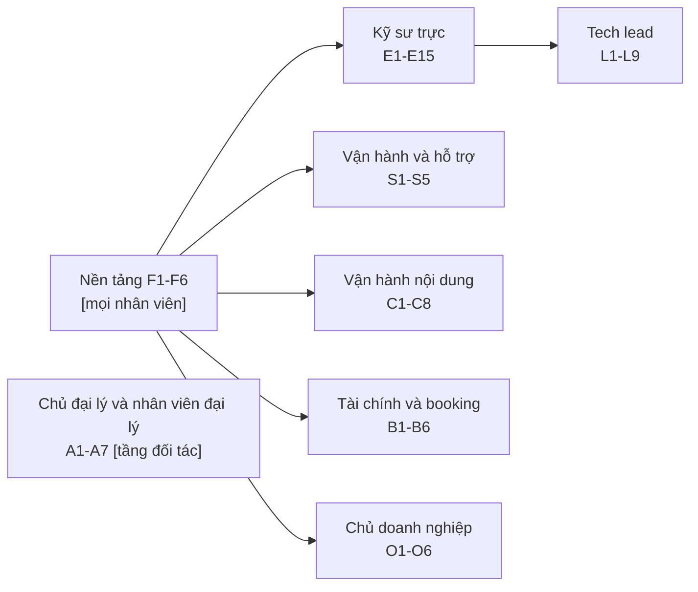
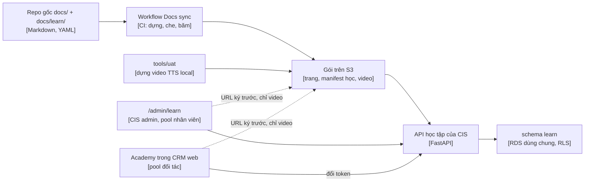

# AA Academy, trang học liệu của AA

Ghi chú nghiên cứu, phiên S279, 13/11/2026 (AA-1098). Người viết: Claude Code (lane nghiên cứu). Chỉ đọc: không sửa
code, không gọi AWS, không chạy lượt trả phí. Thông tin về repo lấy từ nhánh main của từng repo ngày 13/11/2026.
Thông tin bên ngoài ghi kèm URL nguồn ngay trong bài và lặp lại ở mục [Nguồn](#10-nguồn). Bản gốc tiếng Anh là
[README.md](README.md). Danh sách tri thức đầy đủ là [danh mục tri thức](inventory.vi.md). Nghiên cứu song song về
bộ playbook cho dự án mới (AA-1099) nằm ở [`../new-project-playbook/`](../new-project-playbook/README.md); playbook đó
là một khoá học lõi ở đây.

## Tóm tắt

- **Xây trang học liệu ngay trong hệ thống đang chạy.** Đặt tên là **AA Academy**. Nhân viên học ở `/admin/learn`
  trong CIS admin. Đại lý học trong app CRM web. Không có máy chủ LMS riêng, không thêm kho dữ liệu, không mua giấy
  phép.
- **Một nguồn sự thật.** Khoá học nằm dưới dạng Markdown và YAML trong repo gốc (`docs/learn/`). Bài học trỏ tới
  một trang catalog, một ADR hoặc một mục của `CONTEXT.md` bằng ID và không bao giờ chép lại. Workflow Docs sync đã
  dựng sẵn một gói tài liệu đã che thông tin nhạy cảm, có phân tầng truy cập và cặp EN/VI cho `/admin/docs`; ta mở
  rộng nó để xuất bản cả khoá học.
- **241 mục tri thức trong 24 lĩnh vực** được ánh xạ vào **62 module** thuộc **8 lộ trình học**: lộ trình Nền tảng
  cho mọi nhân viên, rồi mỗi vai trò một lộ trình: kỹ sư trực, tech lead, vận hành và hỗ trợ, người vận hành nội
  dung, nhân viên tài chính và booking, chủ đại lý và nhân viên đại lý, chủ doanh nghiệp.
- **Mỗi module kết thúc bằng một bài trắc nghiệm gợi nhớ.** Câu trả lời sai được hỏi lại theo lịch giãn cách. Bài
  thực hành chạy ở Dev trên tenant thực hành được cách ly, có trần ngân sách, và do hệ thống tự kiểm, không phải
  người học tự khai.
- **Chi phí.** Chi phí chạy khoảng 0 đến 3 USD mỗi tháng trên AWS (video bài học trên S3, phát qua URL ký trước).
  Agent soạn nháp bài học và trắc nghiệm tốn một lần khoảng 35 đến 45 USD theo giá niêm yết, cộng khoảng 0,5 đến 1 USD
  lời gọi LLM cho mỗi người học ở các bài thực hành trả phí. Không giấy phép. Moodle sẽ tốn khoảng 70 đến 120 USD mỗi
  tháng cho hai môi trường cộng công bảo trì; TalentLMS bắt đầu từ 119 USD mỗi tháng.
- **Công sức.** 31 đến 39 phiên cho mọi giai đoạn: 8 đến 11 phiên để xây nền tảng và môi trường thực hành, 22 đến 26
  phiên để viết nội dung cho 62 module (gồm cả thực hành và video, theo ước lượng từng module ở
  [§8.2](#82-ước-lượng-công-viết-theo-module)), 1 đến 2 phiên cho đo lường. Lộ trình Nền tảng mở được sau 6 đến 8
  phiên; lộ trình kỹ sư trực sau 17 đến 21 phiên. Các lane nội dung chạy song song, nên thời gian thực ngắn hơn số
  phiên.
- **Các quyết định cho tech lead** nằm ở [§9](#9-quyết-định-cho-tech-lead), mỗi quyết định có kèm câu trả lời đề
  xuất.

## 1. Lý do và mục tiêu

### 1.1 Vấn đề

Hệ sinh thái AA có tài liệu tốt nhưng không học được theo thứ tự. Tri thức nằm rải ở catalog tài liệu
([`docs/README.md`](../../README.md)), 32 ADR ở repo gốc ([`docs/adr/`](../../adr/README.md)) cộng ADR của các app,
data standards, runbook và playbook, skill của agent (`skill/`), sổ bài học (`skill/aa-lessons/lessons.md`) và
`CONTEXT.md` của từng repo. Ba sự thật cho thấy độ lớn của vấn đề:

- `CONTEXT.md` của CIS khoảng 530 KB, của Partner khoảng 380 KB, của Booking khoảng 250 KB. Chúng chính xác, nhưng
  không ai đọc hết từ đầu tới cuối được.
- Trình đọc tài liệu trong admin (`/admin/docs`) chỉ dành cho admin và chỉ hiện các trang `docs/` của repo gốc.
  Skill, file steering và `CONTEXT.md` của app không có trong đó
  ([quy tắc xuất bản v1](../../README.md#admin-docs-page-allowlist-aa-898)).
- Chỉ 22 trong 6.771 file được theo dõi dưới `docs/` có bản dịch `.vi.md` (`git ls-files` trên nhánh main, ngày
  13/11/2026).

Nhiều phương pháp đã được viết ra nhưng chưa bao giờ được dạy: luồng trunk-based, contract-first, ratchet,
maker-checker, DRY RUN trước, gate chạy shadow rồi mới enforce, Done phải có bằng chứng. Phần lớn quy tắc làm việc
mà agent đang theo đã có trong tài liệu repo; còn hai quy tắc chỉ nằm trong ghi chú riêng của agent (xem G5 ở
[§2.3](#23-khoảng-trống-chặn-khoá-học)).

### 1.2 Mục tiêu

1. **Mỗi vai trò có một lộ trình theo thứ tự** từ ngày đầu tới lúc "tự làm được", với mục tiêu rõ cho từng module.
2. **Một nguồn sự thật.** Sửa tài liệu là khoá học tự cập nhật. Không chép gì nên không có gì lệch âm thầm.
3. **Bằng chứng, không phải điểm danh.** Hoàn thành nghĩa là đã qua bài trắc nghiệm và, ở chỗ quan trọng, qua một
   bài thực hành do hệ thống kiểm.
4. **Song ngữ ở chỗ cần.** Tiếng Anh trước; tiếng Việt theo từng lộ trình khi lộ trình đã ổn định. Lộ trình cho đại
   lý có cả hai thứ tiếng ngay từ đầu, giống runbook app của họ hiện nay.
5. **An toàn từ thiết kế.** Đại lý chỉ thấy module dành cho đại lý. Trang nội bộ giữ trong nội bộ. Không account ID,
   không secret.
6. **Đo được.** Việc học được đo trên bốn cấp Kirkpatrick, dùng các tín hiệu nền tảng đã ghi sẵn.
7. **Dùng lại được.** Cùng định dạng khoá học dạy đội của một dự án mới thông qua playbook dự án mới (AA-1099).

### 1.3 Thế nào là thành công

| Thước đo | Mục tiêu sau khi mở hai lộ trình đầu |
|---|---|
| PR đầu tiên của kỹ sư mới được merge và verify live trên Dev | trong 5 ngày làm việc kể từ khi bắt đầu lộ trình Nền tảng |
| Mọi nhân viên hoàn thành lộ trình Nền tảng | 100% trong 30 ngày sau khi mở |
| Người giữ ca trực đã qua lộ trình kỹ sư trực | 100% trước tuần trực đầu tiên |
| Module có nguồn đã đổi nhưng bài học chưa được rà lại | 0 module quá 14 ngày |
| Điểm mức độ liên quan do người học chấm (khảo sát cấp 1, thang 1 tới 5) | trung bình ít nhất 4 mỗi module |

Mọi mục tiêu là setting trong settings registry, sửa được trên trang admin ([§7.4](#74-mọi-ngưỡng-là-một-setting)).

## 2. Danh mục tri thức

### 2.1 Tóm tắt theo lĩnh vực

Danh sách đầy đủ, có đường dẫn nguồn, đối tượng và module cho từng mục, là [danh mục tri thức](inventory.vi.md). Tên
các mục trong danh mục giữ nguyên tiếng Anh vì đó là tên kỹ thuật dùng thống nhất trong mọi tài liệu (xem bảng thuật
ngữ `docs/glossary.vi.md`).

| Lĩnh vực | Số mục | Nguồn chính | Dạy ở |
|---|---|---|---|
| Kiến trúc | 12 | `docs/ecosystem-architecture.md`, `docs/adr/` | F1, F2, E1, E3, E10, E11, L1, L8 |
| Pipeline nội dung CIS | 22 | `apps/AA-CIS-App/CONTEXT.md`, ADR 0020, `skill/aa-wave-rerun/` | C2 tới C8, A2, E11 |
| Nền tảng CIS | 6 | `apps/AA-CIS-App/CONTEXT.md` | C7, S2, S3, E3, E5, F6 |
| Job runner | 5 | ADR 0003/0003a, `docs/ops/job-kinds.md` | E4 |
| Nền tảng AI | 17 | ADR 0009, `docs/architecture/ai-gateway.md`, `docs/llm/` của CIS | E6, E9, E15, L1, A6 |
| TripPlanner | 7 | `apps/AA-TripPlanner-Web/CONTEXT.md` | E14, S2 |
| Booking | 12 | nhóm ADR 0004/0005, `apps/AA-Booking/CONTEXT.md`, các guide booking | B1 tới B6, E12 |
| CRM đối tác | 13 | ADR 0010/0010a, `apps/AA-Partner/CONTEXT.md`, các guide CRM | A2 tới A7, E5, E13, S5 |
| Định danh | 5 | nhóm ADR 0006 | E5, S2, S4 |
| Nền tảng dữ liệu | 19 | `docs/architecture/data-standards/`, schema reference | E3, E9, F4, L1 |
| Mở rộng và độ tin cậy | 6 | `03-scaling.md`, ADR 0012/0018 | E9, E10, L5, L7 |
| Hạ tầng | 11 | `infra/AA-CIS-Infra/CONTEXT.md`, `docs/generated/` | E1, E10, F5, S4 |
| Thực hành kỹ thuật | 19 | `docs/engineering-handbook.md`, `skill/aa-ship/`, workflow CI | F3, E2 |
| Frontend | 4 | ADR 0016, `skill/aa-ui-verify/` | E7 |
| Kiểm thử | 3 | workflow CI, `tools/uat/` | E8 |
| Quan sát và vận hành | 12 | `docs/ops/` | E9, S1, S2, S3 |
| Bảo mật | 8 | `docs/security/`, `docs/legal/`, STYLE SEC-06 | E5, F4, L9, O5, A5 |
| Chi phí và FinOps | 8 | `docs/ops/finops.md`, DM-10, `tools/llm/` | F5, C5, L5, O3 |
| Tài liệu | 8 | `docs/README.md`, `docs/STYLE.md` | F1, F6, L3, L4 |
| Vận hành agent | 11 | `docs/agents.md`, `skill/aa-session/`, `.claude/hooks/` | L3, L9 |
| Kế hoạch và issue | 9 | `docs/backlog/`, `skill/aa-linear-issue/` | L4, O6 |
| Quản trị và kiểm soát thay đổi | 13 | handbook §1 và §10, DM-11 | F3, L1, L2, L6, B2, C3 |
| Bên liên quan và nhà cung cấp | 7 | `skill/aa-jira-update/`, `docs/reports/` | L6, O1, O2 |
| Bài học | 4 | `skill/aa-lessons/`, `docs/guides/` | E1, E15, C1 |
| **Tổng** | **241** | | |

### 2.2 Danh mục cho ta biết gì

- **Khoảng hai phần ba số mục là thực hành chung có cách hiện thực riêng của AA**: giao hàng trunk-based, contract
  view, migration expand/contract, outbox/inbox, maker-checker, gate chạy shadow rồi mới enforce, sổ cái chi phí.
  Chúng là lõi của playbook dự án mới (AA-1099) và dạy tốt cho bất kỳ kỹ sư nào.
- **Khoảng một phần ba là tri thức nghiệp vụ riêng của AA**: pipeline A-series và T-series, chuỗi giá, control plane
  của tenant. Chúng cần ví dụ thực hành trên tenant thực hành ở Dev, không chỉ đọc.
- **Tri thức của agent và của người là một.** Skill và file steering dạy agent cách AA làm việc. Con người cần đúng
  các quy tắc đó. Một nguồn phải phục vụ cả hai (xem [§6.6](#66-một-nguồn-cho-người-và-agent)).
- **Thay đổi mới đã có trong nguồn**: ratchet code-health và settings registry đã lên trong S279 (AA-1097, AA-1096
  đang làm), nên được dạy như thực hành hiện hành ở E2 và C7.

### 2.3 Khoảng trống chặn khoá học

Khoá học chỉ trỏ được tới nguồn đã có. Mỗi khoảng trống dưới đây có giai đoạn, công sức và người phụ trách trong
kế hoạch triển khai ([§8](#8-kế-hoạch-triển-khai)). Khi khoảng trống chưa được lấp, module vẫn mở nhưng thiếu bài nêu
ở cột cuối, nên không module nào phải chờ một trang chưa viết. Vài khoảng trống trùng với AA-1099, issue đó dự định
viết chúng.

| # | Khoảng trống | Chặn | Đề xuất xử lý | Giai đoạn, công sức, người phụ trách | Khi chưa lấp |
|---|---|---|---|---|---|
| G1 | Chưa có trang hướng dẫn "thêm app mới / dự án mới" (catalog GUIDE-08 mới dự kiến); playbook 12 bước chỉ nằm trong ADR 0008 | L8 | AA-1099 viết thành `docs/playbook/` | P1 (tính trong AA-1099); tech lead | Chưa mở L8 |
| G2 | Chưa có trang chiến lược kiểm thử cho cả hệ sinh thái: tháp kiểm thử rải trên các workflow và skill | E8 | Một trang giải thích, trỏ tới từng workflow | P1 (nằm trong 1 tới 2 phiên của P1); tech lead | E8 chỉ dạy từ các file workflow |
| G3 | Chưa có trang quy chuẩn viết code ngoài cấu hình công cụ (phân lớp, xử lý lỗi, mẫu async) | E2, E11 tới E14 | Mỗi ngôn ngữ một trang, dựng từ cấu hình ratchet và `CONTEXT.md` | P5b, 0,5; tech lead | E2 và các module chuyên sâu bỏ bài "phong cách code của nhà" |
| G4 | UI kit chưa có hướng dẫn dùng bằng Markdown; chưa có tiêu chuẩn accessibility | E7 | Hướng dẫn kit sinh từ danh sách component của chính kit (P5b); một bộ quy tắc accessibility (P6) | P5b 0,5 + P6 0,5; tech lead | E7 mở mà chưa có bài accessibility tới P6 |
| G5 | Còn hai quy tắc làm việc chỉ nằm trong ghi chú riêng của agent: "tự quyết, không hỏi" và "không tự đặt cổng chặn". Các quy tắc khác đã có trong tài liệu repo: thang chạy trả phí là DM-10.6 trong [`02-data-management.md`](../../architecture/data-standards/02-data-management.md); báo giá và chờ đồng ý rõ ràng nằm trong [`docs/ops/finops.md`](../../ops/finops.md) (S241 D-19); AWS CLI một dòng và biến môi trường có gạch dưới nằm trong [`docs/STYLE.md`](../../STYLE.md) (mục Commands), có phép kiểm `aws-multiline` trong `tools/docs/check_docs_text.py` và handbook §2.3, §4.7, §5.3; "Done = đã verify live" là bước 8 ở handbook §3 và `skill/aa-ship/SKILL.md` | L3 | Thêm hai quy tắc đó vào mô hình vận hành của handbook (§2); bài F3 và F5 trỏ tới các trang đã có | P1 (nằm trong 1 tới 2 phiên của P1); tech lead | L3 bỏ qua hai quy tắc đó |
| G6 | Skill viết tiếng Việt và gắn với đường dẫn AA; khoá học thì tiếng Anh trước | L3, L4, L6 | Trang quy tắc gốc tiếng Anh trong `docs/`; skill giữ phần thủ tục | P1 (nằm trong 1 tới 2 phiên của P1); tech lead | Các bài đó chỉ trỏ tới handbook |
| G7 | Catalog gốc chưa có trang chạy local cho từng repo | E1 | Mỗi `CONTEXT.md` một mục "chạy local", trỏ từ GUIDE-10 | P1 (nằm trong 1 tới 2 phiên của P1); tech lead | Bài thực hành E1 làm cùng một buổi hướng dẫn |
| G8 | Chưa có trang giải thích threat model cho hệ đa tenant | E5, L9 | Một trang giải thích kiểu STRIDE. Trang nêu các nhóm mối đe doạ và biện pháp kiểm soát tương ứng, không bao giờ nêu lỗ hổng đang mở (SEC-06: repo gốc đang public) | P5b, 0,5; tech lead | E5 và L9 chỉ dạy từ ADR 0006 và security baseline |
| G9 | Chưa có tài liệu nhập môn nghiệp vụ du lịch (vận hành tour, phân phối B2B, allotment, mùa, tỷ giá) | B1 tới B6, A4 | Một trang giải thích, chủ doanh nghiệp duyệt | P6, 0,5; tech lead viết, chủ doanh nghiệp duyệt | Lộ trình B và A4 mở mà thiếu bài nhập môn |
| G10 | Chưa có trang phương pháp viết prompt (khối brand, thẻ fact, prompt sửa lỗi) | E6, C8 | Một trang cạnh prompt register | P5b, 0,5; tech lead | E6 và C8 chỉ dạy từ prompt register |
| G11 | Chưa có trang giải thích cách điều phối agent (lane, workflow, reviewer, worktree) | L3 | Một trang giải thích dựng từ `tools/workflows/lane.js` và các skill | P6, 0,5; tech lead | L3 chỉ dạy từ `docs/agents.md` |
| G12 | Các runbook mà bài thực hành cần chưa được kiểm: [diễn tập pilot](../../ops/runbooks/pilot-rehearsal.md) là bản nháp có nhãn UNTESTED, còn [rollback game day](../../ops/drills/rollback-game-day.md) là kế hoạch chưa chạy | E9, S1, S3 và mọi bài thực hành cần tenant | Chạy diễn tập pilot trọn vẹn một lần (P4b) và rollback game day một lần (P5b); bài thực hành chỉ dùng runbook đã được kiểm (quy tắc STYLE) | P4b 1 + P5b 0,5; kỹ sư trực | Bài thực hành cần tenant chờ P4b; E9 dùng bản chạy thử chỉ đọc |
| G13 | Vài nguồn mâu thuẫn nhau (ví dụ service portal CRM chạy ở đâu; DM-11.1 nói ADR 0009 "chưa viết"; trang FinOps có trước lần chuyển tài khoản LLM ở S278) | E6, E13, F5 | Sửa từng nguồn; kiểm lệch ở §6.4 ngăn mâu thuẫn mới | P1 (nằm trong 1 tới 2 phiên của P1); tech lead | Bài bị ảnh hưởng mang ghi chú "nguồn đang được rà lại" |
| G14 | Chưa có mẫu cho giai đoạn khám phá, sổ rủi ro, RACI hay chọn nhà cung cấp | L6, L8 | AA-1099 cung cấp | Theo kế hoạch của AA-1099 (0 ở đây); tech lead | L6 chỉ dạy quy tắc Jira và nhà cung cấp; L8 chờ AA-1099 |
| G15 | Chưa có đo lường việc học hay hồ sơ năng lực ở bất kỳ đâu | §7 | Thiết kế này cung cấp | P3 tới P8 | Không áp dụng |

## 3. Đối tượng và lộ trình học

### 3.1 Cách dựng lộ trình

Mẫu này mượn từ Microsoft Learn. Ở đó, một lộ trình học là một tập module được sắp theo vai trò hoặc theo công nghệ,
và mỗi module kết thúc bằng một bài kiểm tra kiến thức ngắn; một bài đánh giá rộng hơn mới chứng nhận một credential
([Microsoft Learn FAQ](https://learn.microsoft.com/en-us/training/support/faq)). Cấp nền tảng dùng chung và các bài
thực hành là phần AA tự thêm.



- **Lộ trình** = danh sách module theo thứ tự cho một vai trò. **Module** = một vùng mục tiêu, 30 tới 120 phút.
  **Bài học** = một mục tiêu, 5 tới 15 phút.
- **Bắt buộc và tự chọn.** Mỗi lộ trình liệt kê module bắt buộc. Các module chuyên sâu (E11 tới E14) là tự chọn, do
  tech lead chọn cho từng người.
- **Đại lý không bao giờ thấy module nội bộ.** Lộ trình đại lý không bắt đầu từ Nền tảng. A1 cho đại lý một phần định
  hướng ngắn riêng.
- **Agent AI** không học khoá học. Chúng đọc cùng nguồn qua skill. Agent và con người khớp nhau vì cùng đọc một nguồn.

### 3.2 Nền tảng (mọi nhân viên, khoảng 4 giờ)

| Module | Mục tiêu: học xong, người học có thể… | Điều kiện trước | Nguồn chính |
|---|---|---|---|
| F1 AA và cách AA bán hàng | giải thích mô hình chỉ B2B, bốn app và ai trả tiền cho gì | không | ADR 0019; các guide theo vai trò trong `docs/guides/` |
| F2 Bản đồ hệ sinh thái | gọi tên từng app, app sở hữu gì và các app nói chuyện với nhau ra sao, trên sơ đồ C4 cấp 1 và 2 | F1 | `docs/ecosystem-architecture.md`; ADR 0001 |
| F3 Công việc chảy thế nào | theo một ý tưởng qua vòng đời 12 bước tới "Done = đã verify live"; nói được nguồn nào thắng | F2 | handbook §1.3, §2, §3; mẫu DoR; `skill/ai-nghiep/SKILL.md` §2 |
| F4 Dữ liệu, quyền riêng tư và an toàn khi public | phân loại một trường là PII hay không; nói được thứ gì không bao giờ được vào repo public hay prompt | F2 | DM-6; STYLE SEC-06; ADR 0014 |
| F5 Cơ bản về chi phí | đọc một dòng chi phí, báo giá trước một bước trả phí, theo thang chạy trả phí | F3 | `docs/ops/finops.md`; DM-10; tiêu chuẩn gắn tag |
| F6 Tài liệu, ngôn ngữ và tìm câu trả lời | tìm mọi thông tin qua catalog, `/admin/docs` và bảng thuật ngữ; viết một trang qua được docs lint | F3 | `docs/README.md`; `docs/STYLE.md`; bảng thuật ngữ; quy ước ngôn ngữ |

### 3.3 Kỹ sư trực (khoảng 30 giờ cộng một module chuyên sâu)

Bắt buộc với bất kỳ ai merge code hoặc giữ ca trực. Chứng chỉ "sẵn sàng trực" cần E2, E3, E9 và bài thực hành của
chúng.

| Module | Mục tiêu | Điều kiện trước | Nguồn chính | Thực hành |
|---|---|---|---|---|
| E1 Workspace, quyền truy cập và ngữ cảnh repo | xin quyền, chạy từng repo ở máy, đọc `CONTEXT.md` trước khi thiết kế | F | `docs/onboarding.md`; GUIDE-10; `CONTEXT.md` từng repo | Chạy một app ở máy, nối vào Dev |
| E2 Đưa một thay đổi lên | đưa một thay đổi từ nhánh tới "Done đã verify live": luật PR, dòng Refs, pre-push, CI, ratchet, merge queue, verify sau deploy, flag | E1 | `skill/aa-ship/SKILL.md`; `tools/github/README.md`; handbook §5 | Đưa một PR chỉ sửa tài liệu qua đủ cổng trên repo thử dành cho việc học (dựng ở P4b, [§4.5](#45-môi-trường-thực-hành)) |
| E3 Nền tảng dữ liệu và migration | viết migration qua MIG-4 và expand/contract; thêm một contract view; đọc schema reference | E2 | data standards; ADR 0017; `docs/architecture/db-schema-reference.md` | Viết một migration expand trên schema nháp; qua preflight |
| E4 Job runner và cổng deploy | thêm một job kind, dừng một job kind, biết khi nào deploy phải chờ | E3 | ADR 0003/0003a; `docs/ops/job-kinds.md`; runbook cổng deploy | Đưa vào hàng và xả một job rỗng trên tenant thực hành |
| E5 Định danh và bảo mật trong code | chọn đúng pool và route class; kiểm token; giữ secret theo tên | E2 | nhóm ADR 0006; ADR 0010a; route class của Partner; sổ secret | Gọi endpoint thực hành bằng token sai loại và đọc lỗi 403 |
| E6 AI gateway và LLMOps | thêm route cho stage, ghi chi phí, chạy shadow và eval trước khi đưa lên | E3 | ADR 0009; `docs/architecture/ai-gateway.md`; runbook eval; prompt register | Chạy eval 3 mục trên stage chỉ dành cho thực hành, có trần ngân sách riêng của stage; không đụng route hay shadow của stage thật ([§4.5](#45-môi-trường-thực-hành)) |
| E7 Frontend và UI kit | dựng trang từ kit, không sửa bản sao vendored, kiểm UI trước khi Done | E2 | ADR 0016; `skill/aa-ui-verify/SKILL.md` | Thêm một trang thực hành và qua UI smoke |
| E8 Chiến lược kiểm thử | đặt mỗi kiểm thử đúng tầng: unit, integration, contract, smoke, visual, E2E, eval, isolation probe | E2 | workflow CI; `tools/uat/`; trang của khoảng trống G2 | Viết một mẫu contract bị CI từ chối, rồi sửa |
| E9 Trực: quan sát, xử lý, rollback | đi từ cảnh báo tới playbook, rollback một service ECS, chạy xoá ở chế độ DRY RUN | E4 | `docs/ops/README.md`; playbook; runbook rollback; destructive-ops | Mỗi người học chạy thử rollback ở chế độ chỉ đọc; ngồi một buổi theo nhóm của [rollback game day](../../ops/drills/rollback-game-day.md) khi buổi đó đã được chạy (quy tắc an toàn ở [§4.5](#45-môi-trường-thực-hành)) |
| E10 Hạ tầng dạng code | đọc Terraform plan, chỉ apply qua workflow, gắn tag mọi tài nguyên | E2 | `infra/AA-CIS-Infra/CONTEXT.md`; tiêu chuẩn tag; tài liệu sinh tự động | Đọc một plan mẫu và chỉ ra thay đổi bị chặn |
| E11 Chuyên sâu: pipeline CIS | lần theo một tour từ A0 tới A3 và một bài của tenant từ T0 tới T11 | E3, E6 | `CONTEXT.md` của CIS; ADR 0015, 0020 | Lần theo một tour đã xử lý từ A0 tới A3 qua lịch sử chạy và các dòng sổ cái (chỉ đọc: A1 chạy cho toàn nền tảng và ghi vào kho nội dung master dùng chung), rồi chạy một bài T-series cho tour đó trên tenant thực hành của người học, dưới ngân sách AI có hard stop của tenant đó (trả phí, có trần) |
| E12 Chuyên sâu: Booking | lần theo một báo giá tới booking đã xác nhận và hoá đơn nhà cung cấp | E3 | `CONTEXT.md` của Booking; nhóm ADR 0004/0005; `booking.b2b.v1` | Tạo báo giá và giữ chỗ trên đại lý thực hành |
| E13 Chuyên sâu: CRM đối tác | giải thích tenancy, chia phần công bằng, link ký số và bộ lọc PII | E5 | `CONTEXT.md` của Partner; ADR 0010 | Tạo link khách hàng trên đại lý thực hành và mở nó |
| E14 Chuyên sâu: TripPlanner | giải thích việc tách Lambda, chuyến đi lưu theo sự kiện và việc nhận chuyến của khách vãng lai | E3 | `CONTEXT.md` của TripPlanner | Tạo chuyến của khách vãng lai và nhận nó |
| E15 Bài học, guard và postmortem | viết bài học có guard, biến nó thành test, viết postmortem không đổ lỗi | E9 | `skill/aa-lessons/SKILL.md`; mẫu postmortem | Biến một bài học mẫu thành một guard test |

### 3.4 Tech lead (khoảng 15 giờ sau E1 tới E3)

| Module | Mục tiêu | Điều kiện trước | Nguồn chính |
|---|---|---|---|
| L1 Quản trị kiến trúc | quyết định khi nào cần ADR, đặt ở đâu và sửa đổi thế nào; dùng khung chọn công nghệ | E3 | ADR README; `skill/ai-nghiep/references/adr.md`; AI Use Register; DM-1 tới DM-5 |
| L2 Kiểm soát thay đổi và quyền merge | áp dụng quyền merge theo giai đoạn, ma trận phê duyệt, lớp rủi ro và review độc lập | L1 | DM-11; ADR 0011; lớp rủi ro trong DoR |
| L3 Điều hành một đội agent | chạy nghi thức phiên, giao lane, đọc hook, giữ skill gọn, giữ bằng chứng | L2 | `docs/agents.md`; `skill/aa-session/`; `tools/workflows/lane.js`; `.claude/hooks/` |
| L4 Kế hoạch, backlog và issue | sắp backlog, giới hạn việc đang làm, viết issue đạt Ready, giữ hạn mức Linear | F3 | `docs/backlog/`; `skill/aa-linear-issue/`; plan sync |
| L5 Rà soát chi phí và dung lượng | chạy rà soát chi phí và dung lượng hằng tháng, xử lý khi chạm ngưỡng | F5 | FinOps; mẫu rà soát dung lượng và chi phí; công cụ báo cáo chi phí tháng |
| L6 Bên liên quan và nhà cung cấp | viết cập nhật Jira, tách câu hỏi kinh doanh khỏi câu hỏi kỹ thuật, làm việc với đại lý bán lại | L4 | `skill/aa-jira-update/`; hướng dẫn giọng văn với bên liên quan |
| L7 Môi trường, mở rộng và sẵn sàng prod | áp dụng mô hình tài khoản gọn và chỉ mở rộng khi chạm ngưỡng đo được | L5 | ADR 0012, 0018; scaling C3, C9 |
| L8 Playbook dự án mới | khởi động một dự án mới bằng bộ kit và chạy trọn vòng đời | L1 tới L7 | Playbook AA-1099 (`docs/playbook/` khi đã dựng); ADR 0008 |
| L9 Bảo mật và rà soát định kỳ | chạy rà soát quyền, đọc security baseline, phân loại lỗ hổng, theo dõi độ sạch CI | L2 | `docs/security/`; mẫu rà soát quyền; ADR 0021 |

### 3.5 Vận hành và hỗ trợ (khoảng 8 giờ)

Dành cho nhân viên xử lý yêu cầu cấp quyền, sự cố đăng nhập và phản hồi đầu tiên, không sửa code.

| Module | Mục tiêu | Điều kiện trước | Nguồn chính |
|---|---|---|---|
| S1 Phản hồi sự cố ban đầu | phân mức độ nghiêm trọng, mở đúng playbook, chuyển cấp, ghi postmortem | F | `docs/ops/README.md`; quy trình ứng phó sự cố; mẫu postmortem |
| S2 Quyền vào app, tài khoản nhân viên và vai trò | cấp và thu quyền vào app trong danh bạ nhân viên; giải thích từng vai trò | S1 | trang mục lục GUIDE-12 và runbook từng app; vai trò nhân viên của CIS |
| S3 Vòng đời tenant và onboarding pilot | tạo, tạm ngưng và xoá một tenant; chạy diễn tập pilot | S2 | control plane của tenant; runbook pilot |
| S4 Sự cố đăng nhập và thư | chẩn đoán lỗi đăng nhập Cognito và thư bị trả về của SES | S2 | playbook đăng nhập Cognito; runbook SES bounce |
| S5 Quyền hỗ trợ vào dữ liệu đại lý | mở và đóng cửa sổ hỗ trợ do chủ đại lý cấp và biết cái gì được ghi audit | S3 | `CONTEXT.md` của Partner (AA support access) |

### 3.6 Người vận hành nội dung (khoảng 10 giờ)

| Module | Mục tiêu | Điều kiện trước | Nguồn chính |
|---|---|---|---|
| C1 Làm quen CIS admin | tìm được mọi trang nội dung và quy tắc vai trò của nó | F | `docs/guides/cis-admin-runbook.md` |
| C2 Pipeline A-series | giải thích A0 tới A4 và đọc trạng thái của một tour | C1 | `CONTEXT.md` của CIS (A-series) |
| C3 Cổng chất lượng và độ trung thành với nguồn | đọc kết quả gate: grounding, day oracle, F-code; áp dụng chính sách trung thành với nguồn | C2 | `CONTEXT.md` của CIS §A1, §T10; ADR 0020 |
| C4 Review Queue trong thực tế | duyệt, từ chối hoặc viết lại kèm nhãn ở mức câu | C3 | `CONTEXT.md` của CIS §A2 |
| C5 Wave và lượt chạy trả phí | chuẩn bị wave, đặt điều kiện dừng, đọc báo cáo wave và chi phí | C4, F5 | `skill/aa-wave-rerun/SKILL.md`; công cụ ước tính chi phí |
| C6 Địa điểm và ảnh | theo dõi việc trích địa điểm, geocode và ghép ảnh | C2 | ADR 0007; kiến trúc §4.5 |
| C7 Setting và hướng dẫn cho người vận hành | đổi một ngưỡng an toàn, kèm hướng dẫn EN/VI của nó | C3 | settings registry (`CONTEXT.md` của CIS) |
| C8 Bộ nhớ viết, fact và hiệu chuẩn | thêm một fact entry, ghim một mẫu viết, gán nhãn mẫu hiệu chuẩn | C4 | ADR 0010, 0007 của CIS; fact entry |

### 3.7 Nhân viên tài chính và booking (khoảng 8 giờ)

| Module | Mục tiêu | Điều kiện trước | Nguồn chính |
|---|---|---|---|
| B1 Cơ bản về Booking admin | đăng nhập, tìm từng màn hình, biết từng vai trò | F1, F3, F4 | `docs/guides/booking-admin-runbook.md` |
| B2 Giá, phiên bản giá và maker-checker | nhập giá nhà cung cấp và quy tắc giá, công bố một phiên bản giá với tư cách người thứ hai | B1 | ADR 0005, 0005b; `docs/guides/booking-price-setup.md` |
| B3 Hồ sơ chuyến đi, lịch khởi hành và vận hành | chạy một hồ sơ chuyến đi; quản lý lịch khởi hành, allotment, voucher và huỷ | B2 | `CONTEXT.md` của Booking |
| B4 Nhà cung cấp, hoá đơn và chi trả | đặt dịch vụ nhà cung cấp, đối chiếu hoá đơn, giải ngân chi trả | B3 | `CONTEXT.md` của Booking |
| B5 Tài chính và lợi nhuận | đọc chi phí đã quy đổi tỷ giá, đơn đặt hàng và lợi nhuận theo hồ sơ, lịch khởi hành và đại lý | B4, F5 | `CONTEXT.md` của Booking §Finance |
| B6 Bán cho đại lý | áp dụng quy tắc bán lại B2B và bậc giá đại lý | B2 | ADR 0005a; bậc giá |

### 3.8 Chủ đại lý và nhân viên đại lý (tầng đối tác, khoảng 5 giờ; EN và VI từ ngày đầu)

Phục vụ trong app CRM web cho người dùng của pool đại lý. Nội dung được viết riêng cho đại lý, không trỏ tới trang nội
bộ, vì trang nội bộ có thể chứa chi tiết nội bộ.

| Module | Mục tiêu | Điều kiện trước | Nguồn chính |
|---|---|---|---|
| A1 Chào mừng tới AA | giải thích AA cung cấp gì (nội dung, CRM, TripPlanner, booking) và đăng nhập có MFA | không | trang mới cho đại lý (dựa trên ADR 0019, viết cho đại lý) |
| A2 Content studio | đặt nhận diện thương hiệu, chọn tour, dùng Slate, viết bài, đọc tín hiệu chất lượng, xuất bản | A1 | `docs/guides/content-studio-runbook.md` |
| A3 Cơ bản về CRM | chạy pipeline từ yêu cầu tới hoá đơn; gửi thư và SMS qua tài khoản riêng của đại lý | A1 | `docs/guides/crm-runbook.md` |
| A4 Đặt dịch vụ với AA | yêu cầu báo giá và giữ chỗ, đọc bảng giá và lịch khởi hành ngay trong CRM | A3 | runbook CRM (phần booking); tài liệu nhập môn của G9 |
| A5 Trách nhiệm dữ liệu và quyền riêng tư | làm bên kiểm soát dữ liệu của khách du lịch; xuất và xoá dữ liệu; cấp cửa sổ hỗ trợ | A3 | phụ lục AI cho tenant; DPA; vòng đời dữ liệu của Partner |
| A6 Dấu AI và giới hạn của AI | giải thích dấu AI và vì sao công cụ từ chối tư vấn rủi ro cao | A2 | ADR 0020; ranh giới AI |
| A7 Chủ đại lý: người dùng và cài đặt | thêm người dùng, đặt vai trò và cài đặt của đại lý | A3 | `docs/guides/crm-runbook.md` |

Nhân viên đại lý học A1 tới A6. Chủ đại lý học thêm A7.

### 3.9 Chủ doanh nghiệp (khoảng 4 giờ)

| Module | Mục tiêu | Điều kiện trước | Nguồn chính |
|---|---|---|---|
| O1 Định hướng cho chủ doanh nghiệp | biết quyết định nào thuộc về chủ doanh nghiệp và tìm chúng ở đâu | F1 | `docs/guides/ceo.md` |
| O2 Báo cáo và tiến độ | đọc báo cáo nền tảng hằng tuần, epic theo app và release note | O1 | catalog báo cáo; mẫu release note |
| O3 Chi phí cho chủ doanh nghiệp | đọc báo cáo chi phí tháng, chi phí đơn vị và trang Spend | F5 | báo cáo chi phí; trang Cost Operations |
| O4 Chính sách chất lượng nội dung | giải thích chính sách trung thành với nguồn, chính sách duyệt và ý nghĩa của trạng thái "held" | O1 | ADR 0020; chính sách nội dung |
| O5 Bộ hồ sơ pháp lý và quyền riêng tư | biết DPA, danh sách bên xử lý phụ và phụ lục AI cam kết những gì | O1 | `docs/legal/readiness-packet.md` |
| O6 Bản đồ sản phẩm và lộ trình | đọc các mốc và nội dung từng giai đoạn mang lại | O2 | ADR 0019; các mốc của master plan |

### 3.10 Playbook dự án mới như một khoá học

Playbook của AA-1099 được dạy theo ba cách:

1. **L8** cho tech lead: chạy bộ kit từ đầu tới cuối.
2. **Một lộ trình "khởi động dự án"** cho đội của bất kỳ dự án mới nào: F3, F6, E2, E3, L1, L2, L4 và L8, theo đúng
   thứ tự đó. Lộ trình này dạy các thực hành chung, không có module nghiệp vụ của AA.
3. **Bài thực hành từ các mẫu của kit**: điền project charter, viết một ADR, dựng repo từ template và làm CI xanh.
   Bộ kiểm bài đọc kết quả, nên template và khoá học luôn khớp nhau.

## 4. Thiết kế khoá học và module

### 4.1 Các loại bài học

| Loại | Là gì | Nguồn | Khi nào dùng |
|---|---|---|---|
| Bài đọc | Mục tiêu, phần dẫn ngắn, rồi mục nguồn được hiển thị ngay tại chỗ, rồi 2 tới 3 câu "tự kiểm tra" | Trang catalog, ADR hoặc mục `CONTEXT.md` theo ID và anchor | Khái niệm, tiêu chuẩn, quyết định |
| Video hướng dẫn | 2 tới 6 phút quay màn hình có thuyết minh và phụ đề EN/VI | Kịch bản trong git; ảnh chụp trên tenant thực hành ở Dev; TTS miễn phí chạy local (`tools/uat/`) | Thao tác giao diện: lộ trình nội dung, booking, đại lý |
| Bài thực hành | Các bước trên tenant thực hành ở Dev; bộ kiểm đọc trạng thái mong đợi qua API | `lab.yaml` gồm các bước và phép kiểm | Mọi việc làm trong app |
| Trắc nghiệm | 5 tới 10 câu hỏi gợi nhớ, mỗi câu dẫn anchor nguồn của nó | `quiz.yaml` | Cuối mỗi module |
| Ví dụ thực tế | Một ca có thật (postmortem, audit, bài học) kể theo vấn đề, nguyên nhân, cách sửa | `docs/ops/postmortems/`, `docs/audits/`, bài học | Rèn phán đoán: vận hành, chất lượng, quản trị |

Cơ sở bằng chứng: tự kiểm tra giúp nhớ lâu hơn đọc lại sau hai ngày và một tuần (Roediger và Karpicke, 2006,
[PubMed](https://pubmed.ncbi.nlm.nih.gov/16507066/)). Ôn giãn cách tốt hơn ôn dồn, và khoảng cách tốt nhất giữa các
lần ôn tăng theo thời gian kiến thức cần được nhớ (Cepeda và cộng sự, 2006,
[PubMed](https://pubmed.ncbi.nlm.nih.gov/16719566/)). Học vi mô có ích theo một tổng quan 40 nghiên cứu
([Heliyon 2024/2025](https://pubmed.ncbi.nlm.nih.gov/39882484/); tập 11 số 2, năm 2025, đăng trực tuyến tháng
12/2024), nhưng một tổng quan về nơi làm việc gọi bằng chứng là
lẫn lộn ([ETR&D 2022](https://link.springer.com/article/10.1007/s11423-022-10084-1)). Vì vậy bài học ngắn luôn đi
cùng trắc nghiệm và thực hành, hai thứ có bằng chứng mạnh hơn.

### 4.2 Cấu tạo một module

Mỗi module là một thư mục trong repo gốc:

```text
docs/learn/
  paths/engineer-on-duty.yaml          # ordered module ids, required/elective, certificate rule
  modules/E3-data-platform/
    module.yaml                        # id, title, objectives, prerequisites, owner, version, audience tier
    lessons/01-schema-ownership.md     # objective + source refs + short framing (no copied text)
    lessons/02-mig4-flow.md
    quiz.yaml                          # items, each with a source anchor
    lab.yaml                           # steps on a lab tenant + the check to run
    video/02-mig4-flow.script.md       # optional narration script (public-safe)
```

Một file bài học thì ngắn. Phần thân dẫn dắt nguồn và trỏ tới nó:

```yaml
# front matter of lessons/02-mig4-flow.md
id: E3-02
objective: Order a schema change as migration PR, copy, apply, schema dump, code PR.
sources:
  - ref: ARCH-08-engineering#3-migrations      # catalog id + anchor
  - ref: adr:0017                              # ADR number
  - ref: context:AA-CIS-App#migrations          # CONTEXT.md section
minutes: 10
```

### 4.3 Tiêu chí hoàn thành

| Cấp | Hoàn thành khi |
|---|---|
| Bài học | Đã mở, và đã trả lời các câu "tự kiểm tra" (không chấm điểm) |
| Module | Mọi bài bắt buộc hoàn thành, điểm trắc nghiệm đạt hoặc vượt mức đạt (đề xuất 80%), và qua phép kiểm thực hành nếu module có bài thực hành |
| Lộ trình | Mọi module bắt buộc hoàn thành, cộng một bài trắc nghiệm tổng hợp rút từ mọi module (đề xuất mức đạt 80%) |
| Chứng chỉ | Cấp cho một lộ trình, ghim theo phiên bản các module đã đạt, có mã xác minh |
| Cấp lại chứng chỉ | Cần khi một module bắt buộc lên phiên bản lớn, hoặc sau 12 tháng với lộ trình kỹ sư trực và tech lead |

Có thể làm lại bài trắc nghiệm sau 24 giờ. Câu trả lời sai trở thành thẻ ôn tập giãn cách. Thời gian đọc được hiển
thị nhưng không bao giờ được tính là bằng chứng.

### 4.4 Thực hành trên tenant thực hành ở Dev

- **Ở đâu.** Chỉ Dev, nơi chỉ có dữ liệu thử (ADR 0012). Mỗi người học có các tenant thực hành được gắn cờ thực hành,
  để báo cáo và tổng hợp chi phí loại trừ được. Cách tạo chúng nằm ở [§4.5](#45-môi-trường-thực-hành).
- **Phép kiểm.** Mỗi `lab.yaml` nêu một phép kiểm: một lần đọc API chứng minh trạng thái mong đợi (có báo giá, job
  đã xả, trả về 403). API học tập chạy phép kiểm bằng chính token của người học. Không tự khai.
- **Bước trả phí.** Rất ít bài thực hành gọi LLM (E6, E11). Mỗi bài chạy dưới một trần mà gateway áp cho đúng loại lời
  gọi đó ([§4.5](#45-môi-trường-thực-hành)), và theo thang chạy trả phí. Các trần là setting.
- **Dọn dẹp.** Một job xoá tenant thực hành sau một số ngày nhất định (một setting), qua đúng đường xoá tenant thông
  thường của từng app, nên chính việc dọn dẹp cũng được kiểm.
- **Không bao giờ trên tenant thật.** Bộ kiểm thực hành từ chối mọi tenant không được gắn cờ thực hành.

### 4.5 Môi trường thực hành

**Cách ly và ngân sách.** Gateway có nhiều lớp ngân sách ([AI gateway §5](../../architecture/ai-gateway.md)). Không
phải lớp nào cũng phủ được bài thực hành:

| Loại bài thực hành | Vì sao guard hiển nhiên không khớp | Thiết kế |
|---|---|---|
| A-series (viết lại A1) | A1 là bước viết lại raw tour cho toàn nền tảng. Nó ghi vào kho nội dung master dùng chung và không phải job của tenant, nên ngân sách tenant (`shared.tenant_ai_budget`, hard stop với job T-stage) không chặn được nó | Không bài thực hành nào chạy stage A-series. E11 chỉ đọc lại một tour đã xử lý (lịch sử chạy, kết quả gate, dòng sổ cái) |
| T-series (bài của tenant) | Khớp: job T-stage chạy theo từng tenant | Tenant thực hành của người học có một dòng ngân sách AI với `hard_stop` bật; trần là một setting |
| Eval và shadow (E6) | Shadow gắn vào một stage thật, nên shadow của bài thực hành sẽ chạy trên lưu lượng thật và ghi vào nhật ký shadow dùng chung | Một stage gateway chỉ dành cho thực hành (tên đề xuất `learn_lab`, role `judge`) có dòng riêng ở lớp ngân sách theo job và stage (`shared.spend_budget`), và lớp dung lượng `dev`. Bài thực hành chạy eval 3 mục trên stage đó; không bao giờ thêm shadow vào stage thật |
| Agent soạn nháp bài học | Không phải bài thực hành, nhưng cũng trả phí | Stage riêng (`learn_draft`, role `writer`), ngân sách stage riêng, và thang chạy trả phí ([§6.3](#63-agent-soạn-nháp-có-kiểm-soát-chi-phí)) |

Khoá ngân sách cụ thể được đối chiếu với code gateway ở P4b; quy tắc là mọi lời gọi trả phí của bài thực hành đều có
một trần có tên, và trần đó đóng khi không đọc được.

**Tạo môi trường trên nhiều app.** Một bài thực hành đầy đủ cần một tenant CIS (Content studio), một đại lý CRM
(Partner) và một đại lý Booking (cho E12 và A4). [Diễn tập pilot](../../ops/runbooks/pilot-rehearsal.md) cho thấy mọi
mắt xích đều chạy trên Dev, nhưng nó là bản nháp có nhãn UNTESTED và còn bước làm tay. Vì vậy:

1. **Kiểm diễn tập trước (P4b, khoảng 1 phiên).** Chạy trọn vẹn một lần trên Dev và ghi lại bước nào còn làm tay.
   Việc này lấp G12 cho bài thực hành cần tenant.
2. **Dựng bộ tạo môi trường thực hành (P4b, khoảng 2 phiên).** Một job kind của CIS (tên đề xuất
   `learn.lab_provision`) tạo cho một người học tenant CIS, đại lý CRM và đại lý Booking qua API admin hoặc ops của
   chính từng app, gắn cờ thực hành cho từng cái, đặt ngân sách T-series và ghi các id vào schema `learn`. Một job
   `learn.lab_erase` tương ứng chạy đường xoá của từng app. Mỗi bước idempotent nên lượt chạy lỗi có thể chạy tiếp.
3. **Khi chưa có**, bài thực hành cần tenant đóng; module đọc và trắc nghiệm không bị chặn.

**Repo thử cho E2 (P4b, khoảng 0,5 phiên, 0 USD).** E2 cần một repo nơi người học mở được PR thật và đi qua đủ cổng
mà không đụng repo sản phẩm. Đề xuất: một repo public mới trong org (ví dụ `aa-learn-sandbox`) chỉ chứa tài liệu, có
các workflow `pr-title`, `docs-lint` và `secret-scan` của repo gốc, cùng ruleset nhánh như các repo app (check bắt
buộc, chỉ squash, không push thẳng), và một check sau deploy giả đọc một trang tĩnh. Repo public chạy runner chuẩn do
GitHub host miễn phí ([giá GitHub Actions](https://docs.github.com/en/billing/concepts/product-billing/github-actions)).
Tạo repo trong org là một quyết định ([§9](#9-quyết-định-cho-tech-lead), D15).

**An toàn cho rollback game day của E9.** Một lần rollback ECS thật trên Dev dùng chung ảnh hưởng mọi người đang dùng
Dev. Vì vậy:

- Mỗi người học làm trước bản chạy thử chỉ đọc của công cụ rollback, không thay đổi gì.
- Lần rollback thật là **một buổi theo nhóm có lịch**, không phải bước của từng người: tối đa mỗi tháng một lần, do
  kỹ sư trực điều khiển, người học theo dõi và lần lượt làm các bước, theo
  [kế hoạch rollback game day](../../ops/drills/rollback-game-day.md).
- Buổi đó chỉ chạy khi cổng deploy cho phép deploy: mọi bảng job rảnh và không có wave đang mở (DM-11.4). Không
  override cổng deploy cho một buổi đào tạo.
- Phiên điều phối giữ merge và deploy vào service mục tiêu trong suốt buổi, và buổi kết thúc bằng roll forward cùng
  một lần kiểm live, để Dev trở lại image mới nhất.

## 5. Các phương án nền tảng

### 5.1 So sánh

Giá là giá niêm yết ngày 13/11/2026. Số liệu Fargate dùng giá ARM ở us-east-1; vùng của ta (us-west-1) đắt hơn.

| Tiêu chí | (a) Xây trong CIS admin và CRM web | (b) Moodle | (c) Open edX | (d) Trang tài liệu (Docusaurus, Starlight) | (e) SaaS (TalentLMS, LearnWorlds) |
|---|---|---|---|---|---|
| Một nguồn, không chép | Có: bài học tham chiếu ID catalog; dùng lại gói Docs sync | Không: cần đồng bộ git sang Moodle qua web service | Không: vòng OLX; nhập lại thay thế cả khoá học | Có với phần chữ, nhưng là một giao diện tài liệu thứ hai cạnh `/admin/docs` | Không: nội dung nằm trong SaaS trừ khi dựng đồng bộ qua API |
| EN và VI | Có: cặp `.vi.md` đã có trong gói | Một phần: gói tiếng Việt cho 5.0 mới dịch 51% | Một phần: tiếng Việt do cộng đồng dịch, còn thiếu | Có: i18n sẵn | TalentLMS: dịch bằng AI; LearnWorlds: không nêu |
| Tiến độ, trắc nghiệm, chứng chỉ | Tự xây (giai đoạn 3 và 4) | Có sẵn; customcert cho PDF xác minh được | Có sẵn | Không có; vẫn phải viết code riêng | Có sẵn |
| Đăng nhập bằng pool Cognito nhân viên và đối tác | Đã có ở cả hai app | Có: OAuth 2 / OIDC mỗi issuer, mỗi pool một | Cần backend python-social-auth cho mỗi nhà cung cấp | Code riêng | TalentLMS: OIDC ở gói trả phí; LearnWorlds: SSO chỉ từ gói Learning Center |
| Tầng truy cập và che thông tin | Dùng lại của trình đọc tài liệu | Dựng lại bằng vai trò Moodle; không có che thông tin | Dựng lại | Dựng lại | Dựng lại |
| Chuẩn (SCORM, xAPI, cmi5) | Bản ghi tiến độ dạng xAPI, xuất được | SCORM 1.2 trong lõi; xAPI và cmi5 cần add-on trả phí | Sự kiện xAPI vào bộ phân tích của nó | Không | TalentLMS: SCORM 1.2, Tin Can (xAPI) và cmi5 ở mọi gói |
| Hạ tầng thêm | Không | Task PHP, task cron, kho file dùng chung (EFS), cơ sở dữ liệu, cache | MySQL, MongoDB, Redis, bộ phân tích; 4 tới 8 GB RAM mỗi môi trường | Hosting tĩnh | Không (nhà cung cấp lo) |
| Giấy phép | Không | GPL v3 | AGPL 3.0 | MIT | Thương mại |
| Chi phí tháng | 0 tới 3 USD (lưu và phát video trên S3, [§6.7](#67-dựng-lại-và-phát-video)) | Khoảng 35 tới 60 USD mỗi môi trường, 70 tới 120 USD cho hai, cộng công vá image | Khoảng 115 USD compute mỗi môi trường, chưa tính lưu trữ | Khoảng 0 tới 5 USD hosting, cộng code tiến độ tự viết | TalentLMS từ 119 USD (gói Core; trang giá ghi giới hạn người dùng của Core không rõ, vừa 1 tới 40 vừa "tới 100"); gói có SSO của LearnWorlds 249 tới 299 USD |
| Bảo trì | Code của ta, CI của ta, kit của ta | Một image PHP ta tự dựng và vá (image Bitnami đã chuyển sang legacy) | Nặng nhất | Hai giao diện tài liệu | Nhà cung cấp bảo trì; dữ liệu nằm ngoài tài khoản của ta |

Nguồn: Moodle OAuth 2 ([tài liệu](https://docs.moodle.org/503/en/OAuth_2_services)), giấy phép
([tài liệu](https://docs.moodle.org/dev/License)), kiến trúc tham chiếu của AWS
([AWS](https://docs.aws.amazon.com/architecture-diagrams/latest/moodle-for-high-availability-on-aws/moodle-for-high-availability-on-aws.html)),
dataroot dùng chung ([tài liệu](https://docs.moodle.org/500/en/Server_cluster)), gói tiếng Việt
([trang tải](https://download.moodle.org/langpack/5.0/)), SCORM ([tài liệu](https://docs.moodle.org/39/en/SCORM)),
xAPI và cmi5 trong Moodle ([Rustici](https://rusticisoftware.com/resources/play-xapi-and-cmi5-in-moodle/)),
chứng chỉ ([tài liệu](https://docs.moodle.org/en/Custom_certificate_module)); giá Fargate
([AWS](https://aws.amazon.com/fargate/pricing/)); yêu cầu của Open edX
([Tutor](https://docs.tutor.edly.io/gettingstarted/requirements.html)) và đăng nhập bên thứ ba
([Open edX](https://docs.openedx.org/en/latest/site_ops/install_configure_run_guide/configuration/tpa/tpa_integrate_open/tpa_oauth.html));
i18n của Docusaurus ([tài liệu](https://docusaurus.io/docs/i18n/tutorial)), i18n của Starlight
([tài liệu](https://starlight.astro.build/guides/i18n)), Material for MkDocs vào chế độ bảo trì
([blog](https://squidfunk.github.io/mkdocs-material/blog/2025/11/11/insiders-now-free-for-everyone/));
TalentLMS ([bảng giá](https://www.talentlms.com/prices)); LearnWorlds ([bảng giá](https://www.learnworlds.com/pricing/)).

### 5.2 Ghi chú từng phương án

- **(b) Moodle** là phương án dự phòng tốt nhất. Nó đăng nhập vào cả hai pool Cognito như hai issuer OIDC, nếu
  Cognito trả về `given_name`, `family_name` và `email`. Cái tốn không phải giấy phép mà là bảo trì: một image PHP,
  một kho file dùng chung đã biết là chậm, và một bộ đồng bộ git ta phải tự viết.
- **(c) Open edX** được xây cho quy mô MOOC. Với vài chục tới vài trăm người học, nó mang gánh vận hành nặng nhất và
  ba kho dữ liệu thêm, đi ngược mô hình một RDS.
- **(d) Trang tài liệu** chỉ giải quyết phần đọc, thứ `/admin/docs` đã giải quyết. Material for MkDocs đang ở chế
  độ bảo trì: đã ngừng phát triển tính năng, và bản cập nhật tháng 10/2026 chỉ kéo dài bảo trì quan trọng tới
  05/05/2027. Dự án mới không nên bắt đầu với nó.
- **(e) SaaS.** TalentLMS mạnh về chuẩn và SSO, nhưng tốn ít nhất khoảng 1.100 tới 1.400 USD mỗi năm và phá vỡ một
  nguồn sự thật. LearnWorlds được xây để bán khoá học và để SSO sau gói 249 tới 299 USD.
- **Chi phí Cognito.** Người dùng đăng nhập thẳng vào pool của ta nằm trong số người dùng hoạt động hằng tháng miễn
  phí của gói Essentials và Lite. Liên kết theo chiều ngược lại (một nhà cung cấp định danh của LMS đứng trước
  Cognito) sẽ bị tính phí sau 50 người dùng ([giá Cognito](https://aws.amazon.com/cognito/pricing/)). Phương án (a)
  giữ nguyên cách đăng nhập hiện tại.

### 5.3 Khuyến nghị

**Chọn (a).** Nó dùng lại những gì đã có: bộ dựng Docs sync (`tools/docs/build_docs_reader.py`), service trình đọc
tài liệu (`api/services/docs_reader.py` trong CIS) cùng tầng truy cập, che thông tin và liên kết EN/VI, UI kit, cả hai
pool Cognito và job runner. Nó chỉ thêm một schema nhỏ, một module API và hai vùng giao diện.

**Lối thoát.** Tiến độ được lưu dưới dạng câu lệnh kiểu xAPI (người học, động từ, đối tượng, kết quả, ngữ cảnh, thời
gian). xAPI 2.0 là chuẩn IEEE 9274.1.1-2023
([ADL](https://adlnet.gov/news/2023/11/22/xAPI-Officially-Becomes-a-Published-IEEE-Standard)). Chứng chỉ giữ các
trường của Open Badges 3.0, bản chính thức từ 29/05/2024
([1EdTech](https://www.1edtech.org/1edtech-article/new-open-badges-30-standard-provides-enhanced-security-and-mobility/411060)).
Nội dung vẫn là Markdown thuần. Nếu sau này cần nội dung SCORM hay cmi5 của bên thứ ba hoặc một kho bản ghi học tập
chính thức, các bản ghi xuất được sang một kho mã nguồn mở như SQL LRS (Apache 2.0, PostgreSQL;
[tài liệu](https://yetanalytics.github.io/lrsql/overview.html)) hoặc sang Moodle mà không phải làm lại.

### 5.4 Kiến trúc đích



- **Gói.** Bộ dựng thêm một manifest `learn/`: lộ trình, module, bài học, câu trắc nghiệm, đặc tả thực hành, khoá
  video và mã băm nội dung cho mọi mục nguồn được tham chiếu. Nếu D13 được chấp nhận, một allowlist cho phép đưa vào
  các mục có tên của skill, file steering và `CONTEXT.md` của app mà bài học tham chiếu, với cùng guard che thông
  tin. Mặc định từ chối: mục không có trong danh sách không bao giờ được xuất bản.
- **Tầng truy cập.** Hiện `/admin/docs` chỉ dành cho admin. Thiết kế thêm tầng `staff` (mọi vai trò nhân viên, không
  chỉ admin) bên cạnh `owner` (như hiện nay) và tầng mới `partner` cho module đại lý. Module tầng đối tác chỉ được
  tham chiếu trang đánh dấu cho đại lý; ngược lại bộ dựng báo lỗi. Mở rộng trình đọc là một thay đổi kiểm soát truy
  cập, nên nó là một quyết định ([§9](#9-quyết-định-cho-tech-lead), D13), được review như thay đổi rủi ro trước khi
  merge.
- **Schema `learn`** (chủ sở hữu AA-CIS-App, dùng dải số migration của CIS): ghi danh, câu lệnh (kiểu xAPI), lượt
  làm trắc nghiệm, thẻ ôn tập, lượt thực hành, chứng chỉ, mục rà soát nội dung. Người học được định danh bằng
  (issuer, subject) theo ADR 0006. Dòng của đại lý mang `tenant_id` theo template RLS với FORCE RLS.
- **API.** Đọc catalog và bài học từ gói; ghi tiến độ; chấm trắc nghiệm ở server (đáp án không tới trình duyệt trước
  khi nộp); chạy phép kiểm thực hành; cấp chứng chỉ; phục vụ trang xác minh theo mã. Video không bao giờ đi qua API:
  API trả về một URL S3 ký trước có hạn ngắn ([§6.7](#67-dựng-lại-và-phát-video)).
- **Giao diện nhân viên** ở `/admin/learn`: lộ trình của tôi, trình đọc bài (dùng bộ hiển thị của trình đọc tài
  liệu), trắc nghiệm, hàng ôn tập, trạng thái thực hành, chứng chỉ; một màn hình theo nhóm cho tech lead.
- **Giao diện đại lý** trong CRM web: cùng component từ kit, gọi API của CIS bằng cơ chế đổi token đối tác mà Content
  studio đang dùng (ADR 0010a). Chủ đại lý thấy tiến độ của nhân viên mình.
- **Ôn tập giãn cách** dùng thuật toán FSRS qua `ts-fsrs` (MIT,
  [GitHub](https://github.com/open-spaced-repetition/ts-fsrs)), chạy trong trình duyệt, thẻ lưu ở server.

## 6. Quy trình nội dung

### 6.1 Một nguồn sự thật

- Bài học tham chiếu nguồn bằng ID catalog và anchor, số ADR, hoặc mục `CONTEXT.md`. Trình đọc hiển thị mục nguồn
  đang sống từ gói. Không chép gì.
- Chữ trong bài học chỉ chứa thứ không nguồn nào có: mục tiêu, phần dẫn ngắn và các câu "tự kiểm tra".
- Câu trắc nghiệm dẫn anchor mà nó kiểm. Khi chữ ở anchor đổi, câu đó bị tạm ngưng tới khi được rà lại.

### 6.2 Luồng soạn bài

1. Chủ module (hoặc một lane agent) soạn `module.yaml`, bài học, trắc nghiệm và thực hành trong một PR ở repo gốc.
2. CI chạy docs lint cộng một `check_learn.py` mới: mọi tham chiếu đều tìm được, mọi câu trắc nghiệm có anchor,
   module tầng đối tác chỉ tham chiếu trang cho đại lý, điều kiện trước không tạo vòng, ID không trùng.
3. Một người thứ hai duyệt (maker-checker). Với câu trắc nghiệm do agent soạn, người duyệt là một chủ module là người.
4. Merge xong thì xuất bản qua Docs sync. Phiên bản module tăng: patch cho sửa chữ, minor cho bài mới, major khi mục
   tiêu hoặc câu trắc nghiệm đổi (kích hoạt cấp lại chứng chỉ với module bắt buộc).

### 6.3 Agent soạn nháp có kiểm soát chi phí

Agent được soạn nháp bài học và câu trắc nghiệm từ nguồn. Lời gọi đi qua AI gateway với một stage đã đăng ký
(`learn_draft`, role `writer`) có ngân sách stage riêng, được ghi vào sổ cái, và theo thang chạy trả phí: thử trước 3
module với `tools/llm/cost_estimate.py`. Stage được đưa vào AI Use Register kèm phạm vi dữ liệu (chỉ tài liệu repo,
không dữ liệu tenant).

**Ước tính chi phí** theo giá niêm yết của Claude Sonnet 5.5 là 2 USD mỗi triệu token đầu vào và 10 USD mỗi triệu
token đầu ra ([giá Claude](https://platform.claude.com/docs/en/about-claude/pricing)); thứ tự route của gateway quyết
định kết nối nào phục vụ, và sổ cái ghi chi phí thật:

| Hạng mục | Giả định mỗi module | Chi phí mỗi module | Số lượng | Tổng |
|---|---|---|---|---|
| Soạn nháp (phần dẫn bài học, câu trắc nghiệm, đặc tả thực hành) | khoảng 50.000 token đầu vào từ các mục nguồn được tham chiếu, 8.000 token đầu ra | khoảng 0,18 USD | 62 | khoảng 11 USD |
| Lượt kiểm (lời gọi thứ hai đối chiếu từng câu trắc nghiệm với anchor của nó) | khoảng 60.000 đầu vào, 2.000 đầu ra | khoảng 0,14 USD | 62 | khoảng 9 USD |
| Soạn lại sau khi người duyệt | một nửa số module cần thêm một hoặc hai vòng soạn và kiểm | khoảng 0,3 tới 0,6 USD | 31 | khoảng 10 tới 20 USD |
| Bản nháp tiếng Việt của một module | khoảng 10.000 đầu vào, 10.000 đầu ra | khoảng 0,12 USD | 38 (lộ trình đại lý và các lộ trình nhân viên đã ổn định) | khoảng 5 USD |
| **Tổng, một lần** | | | | **khoảng 35 tới 45 USD**; lượt thử 3 module tốn khoảng 1 tới 2 USD |

Câu trả lời trắc nghiệm và dữ liệu người học không bao giờ được gửi tới LLM ([§7.2](#72-dữ-liệu-người-học-và-quyền-riêng-tư)).
Lượt soạn lại sau khi nguồn đổi thì nhỏ và được tính trong sổ cái theo từng stage.

### 6.4 Kiểm lệch

| Phép kiểm | Khi nào | Kết quả |
|---|---|---|
| Tham chiếu tìm được | Mọi PR ở repo gốc (`check_learn.py`) | PR báo lỗi |
| Mã băm của mục nguồn đổi | Mỗi lần dựng Docs sync | Mở một mục rà soát nội dung cho chủ module; tạm ngưng các câu trắc nghiệm liên quan |
| Module quá hạn rà soát | Hằng tuần (cùng job với báo cáo độ mới của tài liệu) | Cảnh báo ở màn hình của tech lead |
| Trang giao diện trong video đã đổi | Diff visual regression của app (`visual.yml`) chạm vào trang mà video có chiếu | Đánh dấu video cũ; xếp hàng dựng lại |
| Câu trắc nghiệm quá dễ hoặc quá khó | Hằng tháng | Câu có tỷ lệ đạt rất cao hoặc rất thấp được đánh dấu để viết lại |

### 6.5 Chủ sở hữu và chu kỳ rà soát

| Lộ trình | Chủ sở hữu (vai trò) | Rà soát mỗi |
|---|---|---|
| Nền tảng | tech lead | 180 ngày, và mỗi khi nguồn đổi |
| Kỹ sư trực, tech lead | tech lead | 90 ngày |
| Vận hành và hỗ trợ | tech lead, cùng kỹ sư trực | 90 ngày |
| Người vận hành nội dung | tech lead, cùng một người vận hành nội dung lâu năm | 90 ngày |
| Tài chính và booking | tech lead, cùng một trưởng nhóm tài chính; chủ doanh nghiệp duyệt | 90 ngày |
| Đại lý | tech lead; chủ doanh nghiệp duyệt | 90 ngày, và mỗi bản phát hành Content studio hoặc CRM |
| Chủ doanh nghiệp | tech lead; chủ doanh nghiệp duyệt | 180 ngày |

### 6.6 Một nguồn cho người và agent

Các quy tắc agent đang theo qua skill cũng phải tới được con người. Kế hoạch: văn bản gốc của một quy tắc nằm ở một
trang `docs/` tiếng Anh; skill trỏ tới đó và chỉ giữ phần thủ tục; bài học tham chiếu cùng trang đó. Cách này lấp
khoảng trống G5 và G6 và sau này cho phép trợ lý trong app (AA-704) trả lời từ cùng một gói.

### 6.7 Dựng lại và phát video

- Kịch bản nằm trong git cạnh bài học và phải an toàn khi public (repo gốc đang public).
- Màn hình do Playwright chụp trên tenant thực hành; thuyết minh dùng giọng đọc local miễn phí của `tools/uat/`; phụ
  đề EN và VI. Không dùng text-to-speech trả phí.
- Chỉ dựng video cho bài nặng về giao diện (lộ trình nội dung, booking, đại lý). Cờ video cũ (§6.4) xếp hàng dựng lại.
- Kết quả (MP4 cộng phụ đề) đưa lên prefix S3 riêng tư của gói. Video không lưu trong git.
- **Phát video.** API của CIS đứng sau API Gateway REST, có giới hạn payload 10 MB và thời gian chờ tích hợp mặc định
  29 giây ([hạn mức API Gateway](https://docs.aws.amazon.com/apigateway/latest/developerguide/api-gateway-execution-service-limits-table.html)).
  Video không đi qua đó được. API học tập kiểm quyền của người học rồi trả về một URL GET S3 ký trước, hết hạn sau vài
  phút; trình duyệt phát file thẳng từ S3, có range request để tua. CloudFront với URL ký chỉ là bước tiếp theo nếu
  lượt xem tăng hoặc người học ở xa us-west-1 báo tải chậm; ở quy mô này chưa cần.
- **Chi phí.** Khoảng 21 module nặng về giao diện, mỗi module 2 tới 3 video, mỗi video khoảng 15 MB, tức khoảng 1 GB
  trên S3 (vài cent mỗi tháng). Lượt xem: 50 người học xem 30 video mỗi tháng là khoảng 22 GB dữ liệu truyền ra. AWS
  miễn phí 100 GB truyền ra internet đầu tiên mỗi tháng, gộp trên mọi dịch vụ và vùng của tài khoản
  ([giá S3](https://aws.amazon.com/s3/pricing/)); các workload khác trên tài khoản đã dùng một phần. Nếu đã dùng hết,
  22 GB tốn khoảng 2 USD theo mức 0,09 USD mỗi GB mà cùng trang đó nêu làm ví dụ. Vậy video tốn khoảng 0 tới 2 USD mỗi
  tháng.

## 7. Quản trị và đo lường

### 7.1 Ai duyệt cái gì

| Thay đổi | Người soạn | Người duyệt |
|---|---|---|
| Lộ trình mới hoặc quy tắc chứng chỉ | tech lead | báo cho chủ doanh nghiệp |
| Module mới hoặc đổi lớn (major) | chủ module hoặc agent | tech lead (người thứ hai) |
| Sửa chữ (patch) | bất kỳ ai | chủ module |
| Module cho đại lý | chủ module | tech lead; chủ doanh nghiệp duyệt trước khi mở |
| Mức đạt, chu kỳ cấp lại chứng chỉ, ngân sách thực hành | tech lead | trong settings registry, có audit |

### 7.2 Dữ liệu người học và quyền riêng tư

- Bản ghi tiến độ là dữ liệu cá nhân. Cột mang tag `pii:` và các bảng có dòng thời hạn lưu trữ DM-7.1 (đề xuất: giữ
  khi tài khoản còn hoạt động cộng 365 ngày, rồi xoá bằng job TTL).
- Bản ghi người học của đại lý là dữ liệu tenant dưới RLS. Chủ đại lý thấy nhân viên của mình. Nhân viên AA chỉ thấy
  số đếm theo đại lý, đúng quy tắc agent đang theo với dữ liệu tenant.
- Câu trả lời trắc nghiệm và kết quả thực hành không bao giờ được gửi tới LLM.

### 7.3 Đo lường theo các cấp Kirkpatrick

Mô hình định nghĩa bốn cấp: phản ứng, học được, hành vi và kết quả
([Kirkpatrick Partners](https://www.kirkpatrickpartners.com/the-kirkpatrick-model/)).

| Cấp | Thước đo của AA | Nguồn |
|---|---|---|
| 1 Phản ứng | Khảo sát hai câu mỗi module: mức liên quan và mức tự tin, thang 1 tới 5 | câu lệnh trong `learn` |
| 2 Học được | Tỷ lệ đạt và điểm trắc nghiệm mỗi module; mức nhớ qua ôn tập giãn cách | câu lệnh trong `learn` |
| 3 Hành vi | Làm đúng quy trình ship (PR qua mọi cổng ngay lần đầu); bài học viết có guard; theo đúng các bước runbook khi diễn tập; quyết định ở Review Queue bị lật lại | kết quả CI, sổ bài học, bằng chứng diễn tập, nhật ký duyệt |
| 4 Kết quả | Thời gian tới PR đầu tiên đã verify của kỹ sư mới; thời gian tới tour đầu tiên được xuất bản của người vận hành nội dung; thời gian onboarding đại lý; số sự cố và rollback mỗi tháng | ngày trên Linear và GitHub, dữ liệu CIS, dữ liệu CRM, mục lục postmortem |

Các thước đo này được đưa vào sổ báo cáo (`docs/reports/kpis.yaml`) để hiện trong báo cáo nền tảng hằng tuần.

### 7.4 Mọi ngưỡng là một setting

Mức đạt, thời gian chờ làm lại, chu kỳ cấp lại chứng chỉ, ngân sách thực hành, tuổi thọ tenant thực hành, chu kỳ rà
soát và các mục tiêu ở §1.3 đều là setting trong settings registry của CIS, mỗi setting có hướng dẫn EN/VI cho người
vận hành. Không có hằng số cứng trong code.

## 8. Kế hoạch triển khai

### 8.1 Các giai đoạn

Một phiên là một phiên làm việc của đội agent (3 tới 5 issue). Công sức tính bằng phiên làm việc; các lane nội dung
chạy song song, nên thời gian thực ngắn hơn.

| Giai đoạn | Mang lại | Công sức (phiên) | Người phụ trách | Chi phí thêm |
|---|---|---|---|---|
| P0 Quyết định | Nghiên cứu này, trang quyết định, lựa chọn của tech lead ghi vào AA-1098 | xong trong S279 | tech lead | 0 |
| P1 Lấp khoảng trống dùng chung | Các trang G2, G5, G6, G7, G13; G1 do AA-1099 viết | 1 tới 2 | tech lead | 0 |
| P2 Định dạng nội dung và gói | Định dạng `docs/learn/`, `check_learn.py`, manifest học trong Docs sync, mã băm nguồn, tầng `staff` và `partner` cùng allowlist (nếu D13 được chấp nhận, kèm review thay đổi rủi ro) | 1 | tech lead | 0 |
| P3 Schema, API, giao diện nhân viên | Schema `learn` (migration, RLS, dòng thời hạn lưu trữ), API học tập, trình đọc và tiến độ ở `/admin/learn`, URL video ký trước | 2 | tech lead | 0 |
| P4 Trắc nghiệm, ôn tập, chứng chỉ | Trắc nghiệm chấm ở server, ôn tập FSRS, bộ kiểm thực hành, chứng chỉ và trang xác minh, các setting | 1 tới 2 | tech lead | 0 |
| P4b Môi trường thực hành | Chạy diễn tập pilot trọn vẹn một lần (G12, khoảng 1); job tạo và xoá môi trường thực hành trên CIS, CRM và Booking, kèm ngân sách stage thực hành và ngân sách tenant (khoảng 2); repo thử cho E2 (khoảng 0,5) | 3 tới 4 | tech lead; kỹ sư trực chạy diễn tập | 0 (trần LLM riêng của diễn tập được áp dụng) |
| P5a Lộ trình Nền tảng | F1 tới F6 (bài đọc và trắc nghiệm, EN) | 1 | tech lead | khoảng 3 USD soạn nháp |
| P5b Lộ trình kỹ sư trực | E1 tới E15 có thực hành (EN); các trang G3, G4 (hướng dẫn kit), G8, G10; lần chạy rollback game day đầu tiên (G12) | 8 tới 9 | tech lead; kỹ sư trực cho E9 | khoảng 10 USD soạn nháp; khoảng 0,5 tới 1 USD lời gọi LLM thực hành mỗi người học |
| P6 Các lộ trình nhân viên còn lại | tech lead (có L8 khi AA-1099 đã dựng), vận hành và hỗ trợ, nội dung, tài chính và booking, chủ doanh nghiệp; video cho nội dung và booking; tiếng Việt cho lộ trình đã ổn định; các trang G4 (accessibility), G9, G11 | 9 tới 11 | tech lead; chủ doanh nghiệp duyệt B và O | khoảng 25 USD soạn nháp (gồm VI) |
| P7 Academy cho đại lý | Tầng đối tác trong CRM web, A1 tới A7 bằng EN và VI, video hướng dẫn | 4 tới 5 | tech lead; chủ doanh nghiệp duyệt | khoảng 5 USD soạn nháp |
| P8 Đo lường | Báo cáo cấp 1 tới 4, màn hình sức khoẻ nội dung, tự động kiểm lệch đầy đủ | 1 tới 2 | tech lead | 0 |
| **Tổng** | | **31 tới 39** | | **khoảng 0 tới 3 USD mỗi tháng tiền chạy; khoảng 35 tới 45 USD soạn nháp một lần** |

- **Xây dựng** (P1 tới P4b): 8 tới 11 phiên. **Nội dung** (P5a tới P7): 22 tới 26. **Đo lường** (P8): 1 tới 2.
- **Lộ trình Nền tảng mở** sau P1 tới P4 cộng P5a: 6 tới 8 phiên. Nó không cần P4b.
- **Lộ trình kỹ sư trực mở** sau P1 tới P5b: 17 tới 21 phiên.
- Các giai đoạn P2 tới P4b là các lát xây dựng, mỗi lát khoảng một PR cho mỗi repo. Các giai đoạn nội dung chạy được
  thành lane song song khi P2 đã merge, vì bài học là file trong git.

### 8.2 Ước lượng công viết theo module

Các mức dưới đây giả định agent soạn nháp qua stage `learn_draft` và một lần người duyệt cho mỗi module, với nguồn
đã có sẵn (các trang khoảng trống được tính riêng ở trên).

| Công việc | Mức (phiên) | Số lượng | Phiên |
|---|---|---|---|
| Module đọc: bài học, trắc nghiệm, duyệt | 0,10 tới 0,15 mỗi module | 62 | 6,2 tới 9,3 |
| Thực hành: `lab.yaml`, bộ kiểm, một lần chạy thử trên Dev | 0,25 mỗi bài | 15 (E1 tới E15) | 3,75 |
| Video cho một module nặng về giao diện (2 tới 3 video ngắn, kịch bản, quay, phụ đề) | 0,20 mỗi module | 21 (C1 tới C8, B1 tới B6, A1 tới A7) | 4,2 |
| Dịch một module sang tiếng Việt | 0,05 mỗi module | 38 (A1 tới A7 cộng 31 module của F, S, C, B và O) | 1,9 |
| **Cộng phần nội dung** | | | **16,1 tới 19,2** |
| Các trang khoảng trống trong giai đoạn nội dung (G3, G4 hai lần, G8, G9, G10, G11; mỗi trang 0,5) và rollback game day | | | 4,0 |
| Giao diện tầng đối tác trong CRM web và trang chào mừng đại lý (P7) | | | 1,5 |
| **Các giai đoạn nội dung P5a tới P7** | | | **21,6 tới 24,7, lập kế hoạch là 22 tới 26** |

Lộ trình kỹ sư trực (E1 tới E15) và lộ trình tech lead (L1 tới L9) tạm thời chỉ có tiếng Anh (D5); phần dịch của
chúng không nằm trong ước lượng này.

## 9. Quyết định cho tech lead

| # | Quyết định | Câu trả lời đề xuất | Lý do |
|---|---|---|---|
| D1 | Nền tảng | (a) xây trong CIS admin và CRM web | Một nguồn, không giấy phép, không thêm hạ tầng, dùng lại tầng truy cập và EN/VI |
| D2 | Tên gọi | AA Academy | Ngắn, rõ với cả nhân viên và đại lý |
| D3 | Chủ sở hữu schema | Schema mới `learn`, AA-CIS-App sở hữu, dùng dải số của CIS | CIS đã sở hữu nền tảng dùng chung (tenant, danh bạ nhân viên, trình đọc tài liệu) |
| D4 | Lộ trình đầu tiên | Nền tảng, rồi kỹ sư trực | Phủ rộng nhất cộng vai trò rủi ro cao nhất |
| D5 | Phạm vi tiếng Việt | Lộ trình nhân viên EN trước. Nền tảng, vận hành và hỗ trợ, nội dung, tài chính và booking, và chủ doanh nghiệp có VI khi lộ trình không đổi lớn trong 30 ngày; lộ trình kỹ sư trực và tech lead giữ EN. Lộ trình đại lý EN và VI ngay từ đầu | Hiện chỉ 22 trang tài liệu có VI, và runbook đại lý đã có VI; kỹ sư làm việc bằng tiếng Anh |
| D6 | Thời điểm mở Academy cho đại lý | Sau các lộ trình nhân viên (P7), trước khi onboarding tenant trả tiền đầu tiên | Tầng đối tác cần review riêng; đại lý được lợi nhiều nhất lúc onboarding |
| D7 | Mức đạt và cấp lại chứng chỉ | 80%, làm lại sau 24 giờ, cấp lại khi module lên phiên bản lớn hoặc sau 12 tháng (lộ trình kỹ sư trực và tech lead) | Thực hành phổ biến; mọi giá trị đều là setting |
| D8 | Video bài học | Chỉ cho bài nặng về giao diện, dựng local bằng `tools/uat/`, lưu ở S3 riêng tư và phát qua URL ký trước do API học tập cấp | Giữ quy tắc "không quay video UAT định kỳ" mà vẫn cho người học giao diện thứ họ cần; API Gateway không chở được video |
| D9 | Agent soạn nháp bài học và câu trắc nghiệm | Cho phép qua AI gateway trên stage `learn_draft` có ngân sách riêng, thử 3 module trước (khoảng 1 tới 2 USD), khoảng 35 tới 45 USD cho cả 62 module, có người duyệt | Tiết kiệm công soạn; chi phí luôn thấy được và có trần ([§6.3](#63-agent-soạn-nháp-có-kiểm-soát-chi-phí)) |
| D10 | Quy tắc còn nằm trong ghi chú riêng của agent | Thêm "tự quyết, không hỏi" và "không tự đặt cổng chặn" vào mô hình vận hành của handbook ở P1; các quy tắc khác dạy từ trang repo đã chứa chúng (G5) | Khoá học không dạy được thứ không có trong nguồn, và phần lớn quy tắc đã có |
| D11 | Thời hạn lưu dữ liệu người học | Tài khoản còn hoạt động cộng 365 ngày; chủ đại lý thấy nhân viên mình; AA chỉ thấy số đếm | Riêng tư mặc định, nhất quán với quy tắc dữ liệu tenant |
| D12 | Mục trong catalog | Đã làm trong PR này: GUIDE-13 "AA Academy" có trong `docs/README.md` với trạng thái planned và trỏ tới nghiên cứu này; đường dẫn đích của dòng đó đổi thành `docs/learn/` khi P2 lên | Giữ catalog là mục lục duy nhất, đúng như DoR của AA-1098 yêu cầu |
| D13 | Mở rộng trình đọc tài liệu | Có, ở P2: thêm tầng `staff` mà mọi vai trò nhân viên đọc được, cạnh `owner`. Chỉ xuất bản các mục của skill, file steering và `CONTEXT.md` qua một allowlist rõ ràng, mỗi mục một dòng, mặc định từ chối, cùng guard che thông tin và quy tắc SEC-06. Review thay đổi này như thay đổi rủi ro (xác thực và quyền truy cập) trước khi merge | Người học ngoài vai trò admin cần các trang mà bài học của họ dẫn. Nguồn vốn đã nằm trong repo public, nên rủi ro chủ yếu là cho sai vai trò thấy thủ tục nội bộ; allowlist và tầng truy cập giữ rủi ro đó nhỏ |
| D14 | Cách ly và ngân sách cho bài thực hành | Không bài thực hành nào chạy stage A-series (E11 chỉ đọc lại). Bài thực hành T-series chạy trên tenant thực hành của người học với ngân sách AI có hard stop của tenant. Bài eval chạy trên stage chỉ dành cho thực hành (`learn_lab`) có ngân sách stage riêng và lớp dung lượng `dev`; không bài nào thêm shadow vào stage thật | Ngân sách tenant không chặn được A1 hay shadow, và A1 ghi vào kho master dùng chung ([§4.5](#45-môi-trường-thực-hành)) |
| D15 | Tạo môi trường thực hành và repo thử | Kiểm diễn tập pilot trọn vẹn trước, rồi dựng job `learn.lab_provision` và `learn.lab_erase` trên CIS, CRM và Booking (khoảng 3 phiên ở P4b). Tạo một repo public chỉ chứa tài liệu cho E2, dùng ruleset nhánh của các repo app (khoảng 0,5 phiên, 0 USD) | Bài thực hành cho từng người cần tự động hoá chưa có; một cổng PR thật cần một repo làm hỏng cũng không sao |
| D16 | Rollback game day cho người học | Chỉ rollback thật trong một buổi theo nhóm có lịch, tối đa mỗi tháng một lần, do kỹ sư trực điều khiển, khi cổng deploy cho phép deploy, không bao giờ override; mọi người học làm bản chạy thử chỉ đọc | Rollback trên Dev dùng chung ảnh hưởng mọi người đang dùng nó |

## 10. Nguồn

### 10.1 Bên ngoài

| Chủ đề | Nguồn |
|---|---|
| Endpoint OIDC của Cognito | <https://docs.aws.amazon.com/cognito/latest/developerguide/federation-endpoints.html> |
| Giá Cognito và số người dùng miễn phí | <https://aws.amazon.com/cognito/pricing/> |
| Moodle OAuth 2 / OIDC | <https://docs.moodle.org/503/en/OAuth_2_services> |
| Giấy phép Moodle | <https://docs.moodle.org/dev/License> |
| Yêu cầu của Moodle 5.1 | <https://moodledev.io/general/releases/5.1> |
| Moodle Workplace | <https://moodle.com/workplace/> |
| Kiến trúc tham chiếu Moodle trên AWS | <https://docs.aws.amazon.com/architecture-diagrams/latest/moodle-for-high-availability-on-aws/moodle-for-high-availability-on-aws.html> |
| Quy tắc dataroot khi chạy cụm Moodle | <https://docs.moodle.org/500/en/Server_cluster> |
| Giá Fargate | <https://aws.amazon.com/fargate/pricing/> |
| Định dạng GIFT của Moodle | <https://docs.moodle.org/401/en/GIFT_format> |
| Gói tiếng Việt của Moodle | <https://download.moodle.org/langpack/5.0/> |
| SCORM trong Moodle | <https://docs.moodle.org/39/en/SCORM> |
| xAPI và cmi5 trong Moodle | <https://rusticisoftware.com/resources/play-xapi-and-cmi5-in-moodle/> |
| Chứng chỉ tuỳ biến của Moodle | <https://docs.moodle.org/en/Custom_certificate_module> |
| Moodle làm công cụ LTI | <https://docs.moodle.org/503/en/Publish_as_LTI_tool> |
| Yêu cầu Tutor của Open edX | <https://docs.tutor.edly.io/gettingstarted/requirements.html> |
| Cỡ máy Open edX theo cộng đồng | <https://discuss.openedx.org/t/hosted-service-query-on-hardware-requirements/12887> |
| Đăng nhập bên thứ ba của Open edX | <https://docs.openedx.org/en/latest/site_ops/install_configure_run_guide/configuration/tpa/tpa_integrate_open/tpa_oauth.html> |
| OLX của Open edX | <https://github.com/openedx/openedx-test-course/blob/master/README.rst> |
| Open edX Aspects và xAPI | <https://docs.openedx.org/projects/openedx-aspects/en/latest/technical_documentation/decisions/0002_xapi.html> |
| Tiếng Việt trong Open edX | <https://discuss.openedx.org/t/cannot-change-language-to-vietnamese-in-sumuc-version/16317> |
| i18n của Docusaurus | <https://docusaurus.io/docs/i18n/tutorial> |
| i18n của Starlight | <https://starlight.astro.build/guides/i18n> |
| Material for MkDocs vào chế độ bảo trì (bảo trì quan trọng tới 05/05/2027, bản cập nhật tháng 10/2026) | <https://squidfunk.github.io/mkdocs-material/blog/2025/11/11/insiders-now-free-for-everyone/> |
| Giấy phép Docusaurus và Starlight | <https://github.com/facebook/docusaurus>, <https://github.com/withastro/starlight> |
| xAPI 2.0 thành chuẩn IEEE | <https://adlnet.gov/news/2023/11/22/xAPI-Officially-Becomes-a-Published-IEEE-Standard> |
| Tổng quan cmi5 | <https://aicc.github.io/CMI-5_Spec_Current/flows/cmi5-overview.html> |
| SQL LRS | <https://yetanalytics.github.io/lrsql/overview.html> |
| Ralph LRS | <https://pypi.org/project/ralph-malph> |
| Tài liệu Learning Locker (đã lưu trữ) | <https://github.com/LearningLocker/docs> |
| Bảng giá TalentLMS (giới hạn người dùng gói Core ghi không rõ; SCORM 1.2, Tin Can và cmi5 ở mọi gói) | <https://www.talentlms.com/prices> |
| Bảng giá LearnWorlds | <https://www.learnworlds.com/pricing/> |
| Lộ trình, module và bài kiểm tra kiến thức của Microsoft Learn | <https://learn.microsoft.com/en-us/training/support/faq> |
| Luyện gợi nhớ (Roediger và Karpicke 2006, "Test-enhanced learning", PMID 16507066) | <https://pubmed.ncbi.nlm.nih.gov/16507066/>, <https://psychology.ecu.edu/wp-content/pv-uploads/sites/216/2019/03/Roediger-Karpicke-2006.pdf> |
| Ôn giãn cách (Cepeda và cộng sự 2006, "Distributed practice in verbal recall tasks", PMID 16719566) | <https://pubmed.ncbi.nlm.nih.gov/16719566/> |
| Bộ lập lịch FSRS (ts-fsrs) | <https://github.com/open-spaced-repetition/ts-fsrs> |
| Tổng quan học vi mô (Heliyon 2024/2025, tập 11 số 2, 40 nghiên cứu) | <https://pubmed.ncbi.nlm.nih.gov/39882484/> |
| Tổng quan học vi mô tại nơi làm việc (ETR&D 2022) | <https://link.springer.com/article/10.1007/s11423-022-10084-1> |
| Mô hình Kirkpatrick | <https://www.kirkpatrickpartners.com/the-kirkpatrick-model/> |
| Open Badges 3.0 (chính thức 29/05/2024) | <https://www.1edtech.org/1edtech-article/new-open-badges-30-standard-provides-enhanced-security-and-mobility/411060> |
| Hạn mức API Gateway REST (payload 10 MB, thời gian chờ tích hợp 29 giây) | <https://docs.aws.amazon.com/apigateway/latest/developerguide/api-gateway-execution-service-limits-table.html> |
| Giá S3 (miễn phí 100 GB truyền ra mỗi tháng, mức ví dụ 0,09 USD mỗi GB) | <https://aws.amazon.com/s3/pricing/> |
| Giá model Claude (Sonnet 5.5: 2 USD đầu vào, 10 USD đầu ra mỗi triệu token) | <https://platform.claude.com/docs/en/about-claude/pricing> |
| Giá GitHub Actions (runner chuẩn miễn phí với repo public) | <https://docs.github.com/en/billing/concepts/product-billing/github-actions> |

### 10.2 Nguồn của AA

| Chủ đề | Đường dẫn |
|---|---|
| Catalog tài liệu và quy tắc xuất bản của trình đọc tài liệu | [`docs/README.md`](../../README.md) |
| Bộ dựng trình đọc tài liệu | `tools/docs/build_docs_reader.py` |
| Service trình đọc tài liệu | `apps/AA-CIS-App/api/services/docs_reader.py`; trang `apps/AA-CIS-App/frontend/app/admin/docs/page.tsx` |
| Hướng dẫn văn phong và quy tắc ngôn ngữ | [`docs/STYLE.md`](../../STYLE.md); `.kiro/steering/language-convention.md` |
| Engineering handbook | [`docs/engineering-handbook.vi.md`](../../engineering-handbook.vi.md) |
| Hướng dẫn cho kỹ sư mới | [`docs/guides/new-engineer.md`](../../guides/new-engineer.md) |
| Runbook các app | [`docs/guides/app-access-and-operations.vi.md`](../../guides/app-access-and-operations.vi.md) |
| AI gateway | [`docs/architecture/ai-gateway.md`](../../architecture/ai-gateway.md) |
| Data standards | [`docs/architecture/data-standards/README.md`](../../architecture/data-standards/README.md) |
| Định danh và đổi token | [`docs/adr/0006-ecosystem-identity.md`](../../adr/0006-ecosystem-identity.md); [`docs/adr/0010a-content-studio-partner-sign-in.md`](../../adr/0010a-content-studio-partner-sign-in.md) |
| Mô hình môi trường | [`docs/adr/0012-environment-model.md`](../../adr/0012-environment-model.md) |
| Diễn tập pilot (bản nháp, UNTESTED; nền cho bộ tạo môi trường thực hành) | [`docs/ops/runbooks/pilot-rehearsal.md`](../../ops/runbooks/pilot-rehearsal.md) |
| Kế hoạch rollback game day | [`docs/ops/drills/rollback-game-day.md`](../../ops/drills/rollback-game-day.md) |
| Thang chạy trả phí (DM-10.6) | [`docs/architecture/data-standards/02-data-management.md`](../../architecture/data-standards/02-data-management.md) |
| Báo giá và chờ đồng ý rõ ràng cho khoản trả phí (S241 D-19) | [`docs/ops/finops.md`](../../ops/finops.md) |
| Phép kiểm chữ trong tài liệu (`aws-multiline`) | `tools/docs/check_docs_text.py` |
| Bộ công cụ UAT và video | `tools/uat/` |
| Quy tắc settings registry | `apps/AA-CIS-App/CONTEXT.md` (Settings registry) |
| Danh mục tri thức | [`inventory.vi.md`](inventory.vi.md) |
| Nghiên cứu playbook dự án mới | [`../new-project-playbook/README.md`](../new-project-playbook/README.md) |
